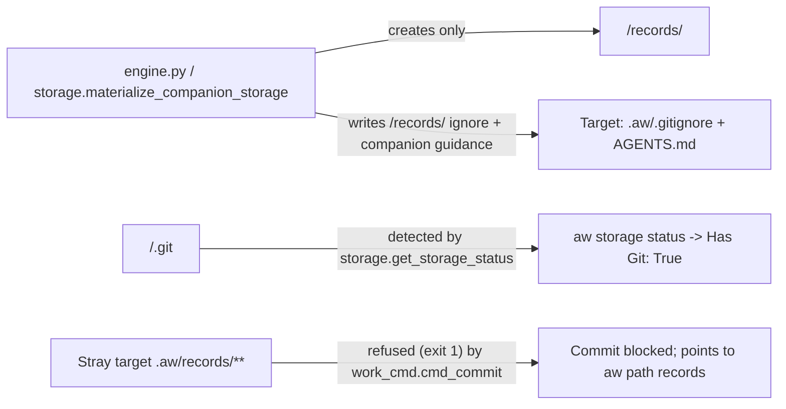

# IPD: Companion storage layout, Git detection, target containment, and installer guidance

- Date: 2026-11-21
- Kind: child
- Concern: companion-records-containment
- Scope: `agent_workflows/storage.py`, `agent_workflows/work_cmd.py`, `agent_workflows/engine.py`, `.aw/system/workflows/assess/assess.md`, `tests/test_companion_containment_and_storage.py`
- Scope-Paths: agent_workflows/storage.py, agent_workflows/work_cmd.py, agent_workflows/engine.py, .aw/system/workflows/assess/assess.md, tests/test_companion_containment_and_storage.py, .aw/records/plans/pending/20261121-companion-bugs-01-mnsbzt-companion-storage-layout-git-detection-target-containment-an.ipd.md
- Item-Dependencies: none
- Status: to-review
- Short-Description: Fix companion Git detection, remove empty companion .aw/records decoy dir, enforce target aw commit and .gitignore containment, and add companion AGENTS/assess guidance
- Work-Kind: bug
- Priority: high
- From-Backlog: rvxmzz
- Blocks-Release: next
- Set: companion-bugs
- Order: 1
- Highest E allocated: 05
- Author: Antigravity model=Gemini
- Id: mnsbzt

> Write and proofread this plan per the technical writing standard, `.aw/system/workflows/technical-writing/technical-writing.md` (`.agents/workflows/technical-writing/technical-writing.md` in a legacy-layout install), including requirement 12 (diagrams).

## Workflow history

- 2026-11-21 to-review (aw set): review-ready child plan Order 01 graduated from rvxmzz
- 2026-11-21 draft (Antigravity model=Gemini): created.

## Goal

Eliminate companion-mode storage layout ambiguity and public-target record leaks by fixing companion Git detection and directory creation in `agent_workflows/storage.py`, adding a fail-closed `.aw/records/` commit guard in `agent_workflows/work_cmd.py`, adding target `.aw/.gitignore` containment and companion instructions in `agent_workflows/engine.py` and `.aw/system/workflows/assess/assess.md`, and proving all behaviors with end-to-end tests.

## Detailed Implementation Checklist (TODO)

Execution-state rule: mark an `E-*` item complete only after performing the action. That mark is not validation. Right-sizing rule: write for a modest executor that cannot hold much in its head. Each E-item is one step (one concern, about one file, executable in one focused pass) and its V-item names each unit it covers with its own check; a plan stays at about 5 E-items and 8 work Scope-Paths, else split it into more child plans (guidance, `IPD-Z603`). Accepted execution states: blocked, failed, pending, performed; terminal gate demands 'performed'.

### Task group 1: Companion storage layout and Git detection

- [ ] E-01 Fix companion Git detection in `agent_workflows/storage.py` (`get_storage_status` and `init_records_storage`) and stop creating the empty decoy `<companion>/.aw/records/` directory in `materialize_companion_storage`
  - Depends on: none
  - Expected outcome: For `records_backend == "companion"`, `materialize_companion_storage` creates `<companion>/records/` (matching `resolve_project_context`) and never creates `<companion>/.aw/records/`; `get_storage_status` detects `<companion>/.git` (via the companion root or `git -C <records_path> rev-parse --show-toplevel` bounded to the companion directory) and reports `has_git=True` and `durability_state=local_git` (or remote states when configured), while `init_records_storage` initializes Git at `<companion>` rather than nesting a second `.git` inside `<companion>/records/`.
  - Execution state: pending

### Task group 2: Public-target containment in `aw commit` and installer

- [ ] E-02 Add a companion-mode containment gate to `cmd_commit` in `agent_workflows/work_cmd.py` that refuses to stage or commit `.aw/records/**` paths in a companion target repository
  - Depends on: E-01
  - Expected outcome: When `resolve_project_context(target_repo=repo_root)` reports `records_backend == "companion"` (or `git_policies.records == "companion-git"`), `aw commit` (both with a plan selector and with `--no-plan`) rejects any requested or staged path under `.aw/records/` with exit code `1`, writes nothing to the target Git index or history, and prints an actionable error naming `aw path records` and the companion commit boundary from `storage.get_git_commit_boundaries`.
  - Execution state: pending

- [ ] E-03 Update companion-mode target `.aw/.gitignore` generation and `AGENTS.md` managed-block instructions in `agent_workflows/engine.py`
  - Depends on: E-01
  - Expected outcome: Installing or syncing a repository with `records_backend == "companion"` adds target-local `/records/` ignore protection to target `.aw/.gitignore` so stray files written under target `.aw/records/` are not staged into public target Git; the installed `AGENTS.md` managed block states clearly for companion-mode repositories that records live at `aw path records` (not target-local `.aw/records/`) and directs agents to author via `aw ipd scaffold`, `aw backlog new`, `aw specs new`, and `aw research new`.
  - Execution state: pending

- [ ] E-04 Update `.aw/system/workflows/assess/assess.md` to direct agents to `aw ipd scaffold` and `aw path records` instead of literal `.aw/records/plans/pending/`
  - Depends on: E-03
  - Expected outcome: `.aw/system/workflows/assess/assess.md` instructs agents to create plans via `aw ipd scaffold` (or under `aw path records`) and warns that in `public-target-private-companion` repositories target-local `.aw/records/` must never receive plans.
  - Execution state: pending

### Task group 3: Behavioral regression suite

- [ ] E-05 Add end-to-end behavioral tests in `tests/test_companion_containment_and_storage.py` and run targeted tests plus `make typecheck`
  - Depends on: E-01, E-02, E-03, E-04
  - Expected outcome: `tests/test_companion_containment_and_storage.py` provisions real temporary target and companion Git repositories using the `public-target-private-companion` preset and verifies: (a) `<companion>/records/` exists and `<companion>/.aw/records/` does not; (b) `aw storage status` reports `Has Git: True` when `<companion>/.git` exists; (c) target `.aw/.gitignore` ignores target `.aw/records/`; (d) `aw commit` refuses `.aw/records/**` in the target repo with non-zero exit and zero commits created; (e) installed `AGENTS.md` in companion mode names `aw path records` and `aw ipd scaffold`. `python3 -m pytest tests/test_companion_containment_and_storage.py` and `make typecheck` pass.
  - Execution state: pending

## Project conventions discovered (Step 0)

- Cite code by SYMBOL (`module.function`) or quoted string, not bare line numbers (`IPD-C801`).
- `agent_workflows/storage.py`: `get_storage_status` currently checks only `Path(records_path) / ".git"`, and `init_records_storage` runs `git -C <records_path> init`; `materialize_companion_storage` currently executes `(comp_p / ".aw" / "records").mkdir(...)` while `project_context.resolve_project_context` maps `LogicalRoot.RECORDS` to `<companion>/records`.
- `agent_workflows/work_cmd.py`: `cmd_commit` routes commits through `_gch.offer_commit` and performs plan validation and `Scope-Paths` checks before staging; adding the companion containment refusal before `_gch.offer_commit` protects both plan-governed and `--no-plan` commits.
- `agent_workflows/engine.py`: owns target `.aw/.gitignore` emission and the managed `<!-- aw:block -->` section of `AGENTS.md`.
- `.aw/system/workflows/assess/assess.md`: currently names literal `.aw/records/plans/pending/` with zero mention of companion storage or `aw path records`.
- Do not modify `agent_workflows/artifact_meta.py` or legacy metadata parsers owned by the concurrent `metastore` plan set.

## Findings

1. `storage.materialize_companion_storage` created an empty decoy `<companion>/.aw/records/` directory beside the real `<companion>/records/` directory (`rvxmzz` item 9).
2. `storage.get_storage_status` checked only `Path(records_path) / ".git"`, missing `<companion>/.git` and reporting `Has Git: False` and `Durability State: unversioned` on initialized companion Git repositories (`rvxmzz` item 4).
3. `work_cmd.cmd_commit` had no guard for companion-mode target repositories, permitting `aw commit` to commit private `.aw/records/plans/pending/*.ipd.md` directly into a public target repository's `main` branch (`rvxmzz` item 2).
4. Target `.aw/.gitignore` did not ignore target-local `/records/` in companion mode, and `AGENTS.md` / `assess.md` gave agents zero companion guidance (`rvxmzz` items 1 and 5).

## Proposed changes (ordered, validatable)

1. **`agent_workflows/storage.py` (`E-01`)**:
   - Add a helper `_resolve_records_git_root(records_path: Path, backend: str) -> Optional[Path]` that returns `records_path` when `records_path / ".git"` exists, and for `RecordsBackend.COMPANION.value` also checks `records_path.parent` when `(records_path.parent / ".git").exists()`.
   - Update `get_storage_status` to use `_resolve_records_git_root` for `has_git`, `get_git_origin_url`, and `_remote_reachable`, and ensure `init_records_storage` initializes Git at `records_path.parent` (the companion root) when `backend == RecordsBackend.COMPANION.value` and `records_path.name == "records"`.
   - Update `materialize_companion_storage` to create `comp_p / "records"` (not `comp_p / ".aw" / "records"`) for `"records"` in `selected_root_classes`.
2. **`agent_workflows/work_cmd.py` (`E-02`)**:
   - In `cmd_commit`, resolve `ctx = resolve_project_context(target_repo=str(repo_root))` before staging/committing; if `ctx.records_backend == "companion"` (or `(ctx.git_policies or {}).get("records") == "companion-git"`), inspect both requested `paths` and `_staged_paths(repo_root)`. If any normalized path is `.aw/records` or starts with `.aw/records/`, print a clear refusal naming the offending paths, `aw path records`, and the companion repo path, and return `1`.
3. **`agent_workflows/engine.py` (`E-03`)**:
   - When writing or updating `.aw/.gitignore` for a repository whose `records_backend == "companion"`, include `/records/` (anchored to `.aw/.gitignore`, so it ignores `<target>/.aw/records/` without affecting other paths).
   - When rendering the managed `AGENTS.md` block for a companion-mode repository, include a short companion-records note stating that durable records live at `aw path records` (never target-local `.aw/records/`) and must be created with `aw ipd scaffold` / `aw backlog new` / `aw specs new` / `aw research new`.
4. **`.aw/system/workflows/assess/assess.md` (`E-04`)**:
   - Replace bare `.aw/records/plans/pending/` authoring instructions with `aw ipd scaffold` and `aw path records`, explicitly noting companion-mode target isolation.
5. **`tests/test_companion_containment_and_storage.py` (`E-05`)**:
   - Exercise real CLI / function calls against temporary target + companion Git repositories (testing observable exit codes, stdout/stderr, directory layout, and Git commit state; no code-pinning assertions).

## Deferred / out of scope (with reason)

- Unified companion records resolution in `project_context.py`, `doctor.py`, and `check_engine.py` (including linked worktree context inheritance and `check.ipd-uncarried-obligation` carrier resolution) is owned by sibling child plan `pbdtss` (Order 02).
  - Carrier: pbdtss
- Companion-safe runner prompts (R1 prompt purity), companion record routing during `aw agy run` / `aw oc run`, and the runner target-repo merge guard are owned by sibling child plan `v8tqje` (Order 03).
  - Carrier: v8tqje

## Scope check

- Over-scope: none. Every change directly addresses `rvxmzz` items 1, 2, 4, 5, and 9 without touching `artifact_meta.py` or metadata parsers owned by `metastore`.
- Under-scope: none. Remaining `rvxmzz` items (3, 6, 7, 8) are assigned to `pbdtss` and `v8tqje`.

## Required tests / validation

- Run `python3 -m pytest tests/test_companion_containment_and_storage.py` and existing storage/commit tests (`tests/test_storage*.py` if present, `tests/test_work_commit*.py` if present).
- Run `make typecheck` and `aw sanitize --agent`.

## Spec / documentation sync

- Updates the installed `AGENTS.md` managed block generator in `agent_workflows/engine.py` and `.aw/system/workflows/assess/assess.md` directly in `E-03` and `E-04`. No separate spec revision is needed because companion records isolation is already specified by `public-target-private-companion` (`project_schema.py` / `storage.py`).

## Open questions

None.

## Validation and cross-check (verify before reporting done)

Validation-state rule: inspect evidence in a separate pass. Do not mark a `V-*` item complete from memory or from the matching execution checkmark. Accepted validation results: blocked, failed, pass, pending; terminal gate demands 'pass'. Runtime-demonstration reachability rule: for each `V-*` item demanding the software be observed acting (such as a run, a dispatch, or a transition)—as distinct from items demanding a diff, a file's content, or a test result, which are reachable by construction—name the code path that produces the observation or the sibling `E-*` that creates it, else the demand is UNDER-SCOPE.

- [ ] V-01 validates E-01
  - Required evidence: Pasted `git diff agent_workflows/storage.py` showing `_resolve_records_git_root` in `get_storage_status`/`init_records_storage` and `comp_p / "records"` in `materialize_companion_storage`, plus pasted test output proving `aw storage status` reports `Has Git: True` when `<companion>/.git` exists and `<companion>/.aw/records/` is not created.
  - Observed evidence:
  - Result: pending

- [ ] V-02 validates E-02
  - Required evidence: Pasted `git diff agent_workflows/work_cmd.py` and pasted test output proving `aw commit` (both plan-governed and `--no-plan`) exits `1` when given a `.aw/records/**` path in a companion target repository, names `aw path records` in output, and leaves target Git HEAD unchanged.
  - Observed evidence:
  - Result: pending

- [ ] V-03 validates E-03
  - Required evidence: Pasted `git diff agent_workflows/engine.py` and pasted test output proving a companion-mode install writes `/records/` to target `.aw/.gitignore` and emits companion records guidance (`aw path records`, `aw ipd scaffold`) in target `AGENTS.md`.
  - Observed evidence:
  - Result: pending

- [ ] V-04 validates E-04
  - Required evidence: Pasted `git diff .aw/system/workflows/assess/assess.md` showing `aw ipd scaffold` / `aw path records` guidance and warning against writing plans to target-local `.aw/records/` in companion mode.
  - Observed evidence:
  - Result: pending

- [ ] V-05 validates E-05
  - Required evidence: Pasted actual runner output from `python3 -m pytest tests/test_companion_containment_and_storage.py`, `make typecheck`, and `aw sanitize --agent` showing 0 failures, 0 mypy issues, and 0 leak findings.
  - Observed evidence:
  - Result: pending

## Approval and execution gate

- Size assessment: standard
- Cohesion rationale: not required

This plan must be reviewed and approved (`- Status: approved`) before execution. Execution must happen inside an isolated worktree, commit strictly within `Scope-Paths` via `aw commit`, pass every `V-*` verification with pasted evidence, and transition to `.aw/records/plans/executed/` through `aw ipd finalize`.
