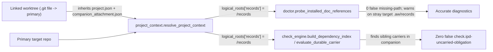

# IPD: Unified companion records resolution across doctor, check_engine, and linked worktrees

- Date: 2026-11-21
- Kind: child
- Concern: companion-records-resolution
- Scope: `agent_workflows/project_context.py`, `agent_workflows/doctor.py`, `agent_workflows/check_engine.py`, `tests/test_companion_doctor_and_carriers.py`
- Scope-Paths: agent_workflows/project_context.py, agent_workflows/doctor.py, agent_workflows/check_engine.py, tests/test_companion_doctor_and_carriers.py, .aw/records/plans/pending/20261121-companion-bugs-02-pbdtss-unified-companion-records-resolution-across-doctor-check-eng.ipd.md
- Item-Dependencies: executed:mnsbzt
- Status: to-review
- Short-Description: Inherit companion context in linked worktrees, resolve doctor doc references against companion records, and fix check.ipd-uncarried-obligation carrier resolution
- Work-Kind: bug
- Priority: high
- From-Backlog: rvxmzz
- Blocks-Release: next
- Set: companion-bugs
- Order: 2
- Highest E allocated: 04
- Author: Antigravity model=Gemini
- Id: pbdtss

> Write and proofread this plan per the technical writing standard, `.aw/system/workflows/technical-writing/technical-writing.md` (`.agents/workflows/technical-writing/technical-writing.md` in a legacy-layout install), including requirement 12 (diagrams).

## Workflow history

- 2026-11-21 to-review (aw set): review-ready child plan Order 02 graduated from rvxmzz
- 2026-11-21 draft (Antigravity model=Gemini): created.

## Goal

Unify companion records resolution across `project_context.resolve_project_context` (including linked Git worktrees), `doctor.probe_installed_doc_references`, and `check_engine.build_dependency_index` / `evaluate_durable_carrier` so diagnostics, carrier checks, and linked worktrees resolve the same `<companion>/records` root as `aw path records` and `aw att`, eliminating false missing-path findings and false-positive `check.ipd-uncarried-obligation` errors.

## Detailed Implementation Checklist (TODO)

Execution-state rule: mark an `E-*` item complete only after performing the action. That mark is not validation. Right-sizing rule: write for a modest executor that cannot hold much in its head. Each E-item is one step (one concern, about one file, executable in one focused pass) and its V-item names each unit it covers with its own check; a plan stays at about 5 E-items and 8 work Scope-Paths, else split it into more child plans (guidance, `IPD-Z603`). Accepted execution states: blocked, failed, pending, performed; terminal gate demands 'performed'.

### Task group 1: Linked-worktree companion context inheritance

- [ ] E-01 Update `resolve_project_context` in `agent_workflows/project_context.py` so a linked Git worktree inherits its primary checkout's companion configuration and attachment when absent from the worktree
  - Depends on: none
  - Expected outcome: When `target_repo` is a linked Git worktree (detected via a `.git` file pointing to `<primary>/.git/worktrees/<name>` or `git rev-parse --git-common-dir`), `resolve_project_context` resolves `.aw/config/project.json` and `.aw/state/durable/companion_attachment.json` from the primary checkout when absent in the worktree, returning `records_backend == "companion"` and `logical_roots["records"] == "<companion>/records"` consistently in both primary checkouts and isolated worktrees.
  - Execution state: pending

### Task group 2: Unified `doctor` and `check_engine` companion resolution

- [ ] E-02 Update `_extract_dangling_references` and `probe_installed_doc_references` in `agent_workflows/doctor.py` to resolve `.aw/records/...` against the companion records root and warn on stray target-local `.aw/records/`
  - Depends on: E-01
  - Expected outcome: In a companion-mode repository, backticked `.aw/records/<subpath>` references in `AGENTS.md` and record READMEs resolve against `ctx.logical_roots["records"] / <subpath>` (and README discovery scans `ctx.logical_roots["records"]`), producing zero false `doctor.dangling-doc-reference` findings on a freshly installed companion repository; if any stray directory, file, or symlink exists at `<target>/.aw/records`, `aw doctor` emits an explicit warning naming the stray path and `aw path records`.
  - Execution state: pending

- [ ] E-03 Ensure `build_dependency_index` and `evaluate_durable_carrier` (`_carrier_index`) in `agent_workflows/check_engine.py` resolve sibling carriers through the companion records root (including from linked worktrees)
  - Depends on: E-01
  - Expected outcome: Calling `evaluate_durable_carrier(repo_or_worktree, ...)` or `aw check` in a companion-mode repository (or in a linked worktree created from it) indexes sibling plans, specs, and backlog items from `<companion>/records/`, so valid sibling carriers (such as deferred rows naming sibling plan IDs) pass `check.ipd-uncarried-obligation` with zero false positives, while genuinely nonexistent carrier IDs still fail at `error` severity.
  - Execution state: pending

### Task group 3: Behavioral regression suite

- [ ] E-04 Add behavioral regression tests in `tests/test_companion_doctor_and_carriers.py` and run targeted pytest, `make typecheck`, and `aw sanitize --agent`
  - Depends on: E-01, E-02, E-03
  - Expected outcome: `tests/test_companion_doctor_and_carriers.py` constructs a real temporary companion-mode target repo, companion repo, and linked Git worktree (`git worktree add`), verifying: (a) `resolve_project_context` inside the linked worktree resolves `<companion>/records`; (b) `aw doctor` produces zero false `doctor.dangling-doc-reference` findings on a clean companion install and emits a warning when a stray file or symlink is placed at `<target>/.aw/records`; (c) `evaluate_durable_carrier` resolves valid sibling plan carriers in `<companion>/records/plans/pending/` from both the primary checkout and the linked worktree and rejects a nonexistent carrier ID. `python3 -m pytest tests/test_companion_doctor_and_carriers.py`, `make typecheck`, and `aw sanitize --agent` pass.
  - Execution state: pending

## Project conventions discovered (Step 0)

- Cite code by SYMBOL (`module.function`) or quoted content string, never bare line numbers (`IPD-C801`).
- `agent_workflows/doctor.py`: `_extract_dangling_references` currently checks `(repo_root / tok).exists() or (file_path.parent / tok).exists()`, without remapping `.aw/records/...` through `resolve_project_context(target_repo=str(repo_root)).logical_roots["records"]`.
- `agent_workflows/check_engine.py`: `evaluate_durable_carrier` calls `_carrier_index(repo_root)` -> `build_dependency_index(repo_root)` -> `status_set.inventory_all_artifacts(repo_root)`. When `repo_root` is a linked worktree (`<target>/.aw/worktrees/<lane>`) lacking untracked `.aw/config/project.json` or gitignored `.aw/state/durable/companion_attachment.json`, `resolve_project_context` fell back to `repository` backend and returned an empty carrier index.
- Do not duplicate or fork `artifact_meta.py` parsers owned by the concurrent `metastore` plan set; fix context resolution at `project_context.resolve_project_context` so `status_set.inventory_all_artifacts` and `check_engine.build_dependency_index` inherit the fix automatically.

## Findings

1. Linked worktrees created from a companion-mode target repository do not contain gitignored `.aw/state/durable/companion_attachment.json` (and may lack untracked `.aw/config/project.json`), causing `resolve_project_context(target_repo=worktree)` to misclassify the worktree as `records_backend="repository"` and miss all sibling records in `<companion>/records/` (`rvxmzz` item 6).
2. `doctor._extract_dangling_references` checks literal `repo_root / tok` for `.aw/records/...` strings inside `AGENTS.md`, emitting 14 false missing-path findings on every clean companion-mode install (`rvxmzz` item 3).
3. Symlinking `<target>/.aw/records` to `<companion>/records` is not a viable workaround because local `.aw/records` shadows the companion fallback while symlink traversal is refused; `aw doctor` must warn operators when a stray directory, file, or symlink exists at `<target>/.aw/records` (`rvxmzz` item 3).

## Proposed changes (ordered, validatable)

1. **`agent_workflows/project_context.py` (`E-01`)**:
   - Add a small helper `_primary_checkout_for_worktree(repo_root: Path) -> Optional[Path]` that reads `.git` when it is a regular file containing `gitdir: ...`, walks to the common `.git` directory (via `commondir` file or parent of `worktrees/<name>`), and returns the primary checkout root when distinct from `repo_root`.
   - When loading `.aw/config/project.json`, `.aw/config/policy.json`, or `.aw/state/durable/companion_attachment.json` inside `resolve_project_context`, fall back to the primary checkout path if absent in the linked worktree, and ensure registry lookup matches either the worktree path or the primary checkout path.
2. **`agent_workflows/doctor.py` (`E-02`)**:
   - In `_extract_dangling_references` and `probe_installed_doc_references`, resolve `ctx = project_context.resolve_project_context(target_repo=str(repo_root))` and map any `.aw/records/` or `.aw/records/<rest>` token to `Path(ctx.logical_roots["records"]) / <rest>` when checking existence and when scanning record READMEs.
   - When `ctx.records_backend == "companion"`, check whether `(repo_root / ".aw" / "records")` exists or is a symlink (`exists() or is_symlink()`), and emit a warning finding instructing the operator to move any files to `aw path records` and remove target-local `.aw/records`.
3. **`agent_workflows/check_engine.py` (`E-03`)**:
   - Audit `build_dependency_index`, `_carrier_index`, and `evaluate_durable_carrier` (including `scan_cache` keying and `check_durable_carrier`) to verify companion records from `ctx.logical_roots["records"]` are indexed cleanly from both primary checkouts and linked worktrees, and ensure `carrier_severity_for_plan` reads the companion/primary cutover date without falling back to empty target config.
4. **`tests/test_companion_doctor_and_carriers.py` (`E-04`)**:
   - Behavioral tests exercising real temporary target repo + companion repo + `git worktree add` linked worktree through `resolve_project_context`, `aw doctor`, and `check_engine.evaluate_durable_carrier`.

## Deferred / out of scope (with reason)

- Companion storage Git detection, decoy directory removal, target `aw commit` / `.aw/.gitignore` containment, and `AGENTS.md` / `assess.md` guidance are owned by prerequisite child plan `mnsbzt` (Order 01).
  - Carrier: mnsbzt
  - Carrier-Evidence: .aw/records/plans/executed/20261121-companion-bugs-01-mnsbzt-companion-storage-layout-git-detection-target-containment-an.ipd.md
- Runner prompt R1 purity, review/execute record routing to `<companion>/records/`, and the runner target-repo merge guard are owned by downstream child plan `v8tqje` (Order 03).
  - Carrier: v8tqje

## Scope check

- Over-scope: none. Scoped strictly to companion context inheritance in linked worktrees, `doctor.py` dangling-reference/stray-records checks, and `check_engine.py` carrier resolution.
- Under-scope: none. Foundation/containment is in `mnsbzt` and runner prompt/integration routing is in `v8tqje`.

## Required tests / validation

- Run `python3 -m pytest tests/test_companion_doctor_and_carriers.py` plus existing doctor and durable-carrier tests (`tests/test_durable_carrier_shared_predicate.py` and relevant `doctor` tests).
- Run `make typecheck` and `aw sanitize --agent`.

## Spec / documentation sync

- N/A: this plan restores existing `doctor`, `check_engine`, and `project_context` implementations to match the documented companion records model (`aw path records` / `public-target-private-companion`).

## Open questions

None.

## Validation and cross-check (verify before reporting done)

Validation-state rule: inspect evidence in a separate pass. Do not mark a `V-*` item complete from memory or from the matching execution checkmark. Accepted validation results: blocked, failed, pass, pending; terminal gate demands 'pass'. Runtime-demonstration reachability rule: for each `V-*` item demanding the software be observed acting (such as a run, a dispatch, or a transition)—as distinct from items demanding a diff, a file's content, or a test result, which are reachable by construction—name the code path that produces the observation or the sibling `E-*` that creates it, else the demand is UNDER-SCOPE.

- [ ] V-01 validates E-01
  - Required evidence: Pasted `git diff agent_workflows/project_context.py` and pasted test output proving `resolve_project_context(target_repo=linked_worktree)` returns `records_backend == "companion"` and `logical_roots["records"] == "<companion>/records"`.
  - Observed evidence:
  - Result: pending

- [ ] V-02 validates E-02
  - Required evidence: Pasted `git diff agent_workflows/doctor.py` and pasted test output proving `aw doctor` reports zero `doctor.dangling-doc-reference` findings for `.aw/records/...` on a clean companion install and emits an explicit warning when a stray file or symlink exists at `<target>/.aw/records`.
  - Observed evidence:
  - Result: pending

- [ ] V-03 validates E-03
  - Required evidence: Pasted `git diff agent_workflows/check_engine.py` (or verified carrier-resolution test trace if all changes reside in `project_context.py` + `check_engine.py`) and pasted test output proving `evaluate_durable_carrier` passes valid sibling plan carriers in `<companion>/records/plans/pending/` from both primary and linked worktree paths and fails on a missing carrier ID.
  - Observed evidence:
  - Result: pending

- [ ] V-04 validates E-04
  - Required evidence: Pasted actual runner output from `python3 -m pytest tests/test_companion_doctor_and_carriers.py tests/test_durable_carrier_shared_predicate.py`, `make typecheck`, and `aw sanitize --agent` showing 0 failures, 0 mypy issues, and 0 leak findings.
  - Observed evidence:
  - Result: pending

## Approval and execution gate

- Size assessment: standard
- Cohesion rationale: not required

This plan must be reviewed and approved (`- Status: approved`) before execution. Execution must happen inside an isolated worktree, commit strictly within `Scope-Paths` via `aw commit`, pass every `V-*` verification with pasted evidence, and transition to `.aw/records/plans/executed/` through `aw ipd finalize`.
