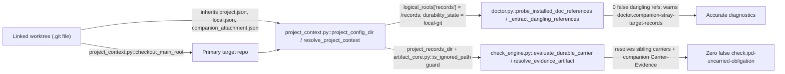

# IPD: Unified companion records resolution across doctor, check_engine, and linked worktrees

- Date: 2026-11-21
- Kind: child
- Concern: companion-records-resolution
- Scope: `agent_workflows/project_context.py`, `agent_workflows/doctor.py`, `agent_workflows/check_engine.py`, `agent_workflows/artifact_core.py`, `tests/test_companion_doctor_and_carriers.py`
- Scope-Paths: agent_workflows/project_context.py, agent_workflows/doctor.py, agent_workflows/check_engine.py, agent_workflows/artifact_core.py, tests/test_companion_doctor_and_carriers.py, .aw/records/plans/pending/20261121-companion-bugs-02-pbdtss-unified-companion-records-resolution-across-doctor-check-eng.ipd.md
- Item-Dependencies: executed:mnsbzt
- Status: auto-approved
- Readiness: go-pending-approval
- Review-Depth: complex
- Short-Description: Inherit companion context and durability in linked worktrees, resolve doctor doc references and stray target records warnings, and unify companion carrier and evidence resolution
- Work-Kind: bug
- Priority: high
- From-Backlog: rvxmzz
- Blocks-Release: next
- Set: companion-bugs
- Order: 2
- Highest E allocated: 04
- Author: Antigravity model=Gemini
- Id: pbdtss

> Write and proofread this plan per the technical writing standard, `.aw/system/workflows/technical-writing/technical-writing.md` (`.agents/workflows/technical-writing/technical-writing.md` in a legacy-layout install), including requirement 12 (diagrams).

## Workflow history

- 2026-11-21 auto-approved (aw agy run --full-auto): auto-approved by --full-auto: review readiness cleared (not human approval)
- 2026-11-21 reviewed (aw set): APPROVE WITH REVISIONS APPLIED; PR-001..PR-007 FIXED
- 2026-11-21 /plan-review (antigravity/gemini-4-neon-high): APPROVE WITH REVISIONS APPLIED; PR-001..PR-007 FIXED; review record .aw/records/reviews/20261121-companion-bugs-02-pbdtss-unified-companion-records-resolution-across-doctor-check-eng.review.md
- 2026-11-21 to-review (aw set): review-ready child plan Order 02 graduated from rvxmzz
- 2026-11-21 draft (Antigravity model=Gemini): created.

## Goal

Unify companion records resolution across `agent_workflows/project_context.py` (linked Git worktree inheritance, attachment resolution, and companion Git durability state), `agent_workflows/doctor.py` (companion reference remapping and stray target-local `.aw/records` warnings), `agent_workflows/check_engine.py` (companion carrier, evidence, and scan-root resolution), and `agent_workflows/artifact_core.py` (preventing target-repo `.aw/.gitignore` rules from masking external companion records) so diagnostics, carrier checks, and linked worktrees resolve the same `<companion>/records` root as `aw path records` and `aw att`, eliminating false missing-path findings and false-positive `check.ipd-uncarried-obligation` errors.

## Detailed Implementation Checklist (TODO)

Execution-state rule: mark an `E-*` item complete only after performing the action. That mark is not validation. Right-sizing rule: write for a modest executor that cannot hold much in its head. Each E-item is one step (one concern, about one file, executable in one focused pass) and its V-item names each unit it covers with its own check; a plan stays at about 5 E-items and 8 work Scope-Paths, else split it into more child plans (guidance, `IPD-Z603`). Accepted execution states: blocked, failed, pending, performed; terminal gate demands 'performed'.

### Task group 1: Linked-worktree companion context inheritance and durability

- [x] E-01 Update `agent_workflows/project_context.py` so linked Git worktrees inherit primary-checkout configuration, local bindings, and companion attachments, and align companion `durability_state` Git detection and cache invalidation
  - Depends on: none
  - Expected outcome: Reusing `agent_workflows/project_context.py::checkout_main_root` (never spawning `git` or duplicating worktree parsing, and rejecting submodules, bare worktrees, and `--separate-git-dir`), when `repo_root` is a linked Git worktree (`(repo / ".git").is_file()` and `primary = checkout_main_root(repo)` differs from `repo`): (a) `agent_workflows/project_context.py::project_config_dir` falls back to `primary / ".aw" / "config"` if `repo / ".aw" / "config"` has none of `project.json`, `local.json`, `config.json`, or `policy.json` (so `resolve_project_context`, `project_records_dir`, `_stored_physical_classes`, `read_project_identity`, and `agent_workflows/config.py::resolve_cutover_date` inherit primary durable config); (b) `agent_workflows/project_context.py::_resolve_project_context_uncached` inherits `primary / ".aw" / "config" / "local.json"` when absent in `cfg_dir` (handling the common case where committed `project.json` exists in the worktree while gitignored `local.json` exists only in primary), matches `user_cfg_data["repos"]` against `repo_abs` first and `primary_abs` second, reads `.aw/state/durable/companion_attachment.json` (`companion_dir`, validated with path-security checks against traversal/nesting) from `repo_abs` with fallback to `primary_abs`, and anchors the default companion fallback to `f"{anchor_abs}.aw"` (`primary_abs` for linked worktrees, `repo_abs` otherwise) instead of `f"{repo_abs}.aw"`; (c) step 8 of `agent_workflows/project_context.py::_resolve_project_context_uncached` checks `os.path.join(records_root, ".git")` first and, strictly bounded for `RecordsBackend.COMPANION.value` when `os.path.basename(records_root) == "records"`, checks `os.path.join(os.path.dirname(records_root), ".git")` so `ctx.durability_state == "local-git"` matches `agent_workflows/storage.py::_resolve_records_git_root` (discharging `mnsbzt`'s carried obligation); (d) `agent_workflows/project_context.py::_watched_context_paths` and `_config_stat_stamp` / `_stored_physical_classes` include primary-checkout config/attachment paths, local attachment paths, and the bounded companion `.git` path so cached contexts invalidate immediately when config, attachment, or companion Git state changes.
  - Execution state: performed

### Task group 2: Unified `doctor`, `check_engine`, and `artifact_core` companion resolution

- [x] E-02 Update `agent_workflows/doctor.py` (and register the warning rule in `agent_workflows/check_engine.py::RULE_REGISTRY`) to resolve `.aw/records/...` doc references against the active records root, avoid leaking absolute companion paths in finding locations, and warn on stray target-local `.aw/records`
  - Depends on: E-01
  - Expected outcome: `agent_workflows/doctor.py::probe_installed_doc_references` resolves `ctx = project_context.resolve_project_context(target_repo=str(repo_root))` and passes `records_root = Path(ctx.logical_roots["records"])` to `agent_workflows/doctor.py::_extract_dangling_references` (continuing to discover record READMEs under `records_root` via `project_records_dir(repo_root)`). In `_extract_dangling_references`, any backticked `.aw/records` or `.aw/records/<rest>` token resolves `<rest>` against `records_root` with containment enforcement (rejecting `..` traversal outside `records_root`), and `rel_loc` normalizes companion README paths under `records_root` to logical `.aw/records/<subpath>` so no machine-local absolute path leaks into `Drift.location`; a freshly installed companion repository produces zero `doctor.dangling-doc-reference` findings across `AGENTS.md`, `.aw/inbox/README.md`, and companion record READMEs. When `ctx.records_backend == "companion"` and `(repo_root / ".aw" / "records").exists() or (repo_root / ".aw" / "records").is_symlink()` holds (catching stray directories, files, live symlinks, and broken symlinks), `aw doctor` emits a `severity="warning"` `Drift` with rule `doctor.companion-stray-target-records` (registered in `agent_workflows/check_engine.py::RULE_REGISTRY` with `RuleSpec("warning", ASSURANCE_REPOSITORY, DET_DETERMINISTIC, "")`), location `".aw/records"`, and a dedicated `agent_workflows/doctor.py::build_remediation` branch (`command=None`, per `tests/test_doctor.py::test_remediation_family_guard`) naming `.aw/records` and `aw path records` and instructing the operator to move any files to `aw path records` and remove target-local `.aw/records`. Non-companion repositories never emit `doctor.companion-stray-target-records`.
  - Execution state: performed

- [x] E-03 Unify companion carrier, evidence, and scan-root resolution across `agent_workflows/check_engine.py` and `agent_workflows/artifact_core.py`
  - Depends on: E-01
  - Expected outcome: (a) `agent_workflows/check_engine.py::resolve_evidence_artifact`, `_evidence_plan_unshipped`, and `_evidence_spec_unshipped` resolve logical `.aw/records/<rest>` evidence citations against `project_context.project_records_dir(repo_root)` when that records root is external to `repo_root` (enforcing containment inside `records_root` to reject `..` traversal and symlink escapes), so companion `- Carrier-Evidence: .aw/records/plans/executed/...` passes while unshipped companion `- Carrier-Evidence: .aw/records/plans/pending/...` or unimplemented specs still fail; (b) `agent_workflows/check_engine.py::_resolve_carrier` normalizes finished carrier paths under `project_records_dir(repo_root)` to logical `.aw/records/<rel>` so `check.ipd-carrier-finished-unverified` retains its actionable `- Carrier-Evidence:` remedy in companion mode; (c) `agent_workflows/check_engine.py::_type_dirs` does not append literal `repo_root / ".aw" / "records" / record_type` when `project_context.has_stored_records_placement(repo_root)` is `True` (matching `agent_workflows/selectors.py::_record_dirs_cached` and preventing target-local stray files from polluting companion checks); (d) `agent_workflows/artifact_core.py::is_ignored_path` does not apply target-repo `.aw/.gitignore` `ignored_dirs` (specifically `/records/` added by `mnsbzt`) to paths resolved outside `repo_root` under `project_records_dir(repo_root)` (while preserving `_ALWAYS_IGNORED_PARTS`, `_EXCLUDED_RECORD_DIR_SET`, and `untracked` filtering), so a stray `<target>/.aw/records/` directory never blinds `aw check` or `check_durable_carrier`; (e) calling `evaluate_durable_carrier` or `check_durable_carrier` from either a primary companion checkout or a linked worktree passes valid sibling carriers in `<companion>/records/` and fails nonexistent carriers at `error` severity via primary cutover resolution.
  - Execution state: performed

### Task group 3: Behavioral regression suite

- [x] E-04 Add end-to-end behavioral regression tests in `tests/test_companion_doctor_and_carriers.py` and run targeted pytest suites, `make typecheck`, and `aw sanitize --agent`
  - Depends on: E-01, E-02, E-03
  - Expected outcome: `tests/test_companion_doctor_and_carriers.py` provisions real temporary `public-target-private-companion` target and companion Git repositories and linked Git worktrees (`git worktree add`), verifying behaviorally: (a) `resolve_project_context`, `project_records_dir`, and `read_project_identity` inside linked worktrees resolve `records_backend == "companion"`, `logical_roots["records"] == "<companion>/records"`, and `durability_state == "local-git"` across committed-`project.json` + gitignored-`local.json`/`companion_attachment.json`, absent-`project.json`, custom `--companion-dir`, default `<primary>.aw` fallback, cache invalidation on attachment/Git changes, and non-worktree/submodule isolation; (b) `aw doctor` (`probe_installed_doc_references` and `inspect_repo`) reports zero `doctor.dangling-doc-reference` findings on a freshly installed companion repository, leaks no absolute companion path in `Drift.location`, emits `doctor.companion-stray-target-records` (`severity="warning"`, naming `.aw/records` and `aw path records`, `command=None`) for a stray directory, regular file, live symlink, and broken symlink at `<target>/.aw/records`, and emits no stray warning on a `private-target` repo; (c) `evaluate_durable_carrier`, `check_durable_carrier`, `resolve_evidence_artifact`, and `check_engine._iter_type_files` work identically from both primary checkout and linked worktree: valid sibling pending plan `- Carrier: <id6>` passes, nonexistent carrier fails at `error` severity, executed companion `- Carrier-Evidence: .aw/records/plans/executed/...` passes, pending companion `- Carrier-Evidence: .aw/records/plans/pending/...` fails, path traversal `- Carrier-Evidence: .aw/records/../../outside.md` fails, finished companion carrier emits logical `.aw/records/plans/executed/...` remedy, and a stray `<target>/.aw/records/` directory does not blind companion record scanning. `python3 -m pytest tests/test_companion_doctor_and_carriers.py tests/test_project_context.py tests/test_doctor.py tests/test_doctor_diagnostic_severity.py tests/test_durable_carrier_shared_predicate.py tests/test_carrier_finished_verification.py tests/test_companion_record_owner_root.py`, `make typecheck`, and `aw sanitize --agent` all pass.
  - Execution state: performed

## Project conventions discovered (Step 0)

- Cite code by SYMBOL (`path::Symbol`) or quoted string, never bare line numbers (`IPD-C801`).
- `agent_workflows/project_context.py::checkout_main_root` is the canonical, pure, subprocess-free linked-worktree resolver (and explicitly rejects submodules, bare worktrees, and `--separate-git-dir`). `project_config_dir`, `_stored_physical_classes`, `project_records_dir`, `read_project_identity`, and `agent_workflows/config.py::resolve_cutover_date` all flow through `project_config_dir`.
- `agent_workflows/project_context.py::_resolve_project_context_uncached` currently never reads `.aw/state/durable/companion_attachment.json` (`agent_workflows/storage.py::LOCAL_ATTACHMENT_RELPATH`), looks up `user_cfg_data["repos"]` only by `repo_abs` (not `primary_abs`), defaults companion storage to `f"{repo_abs}.aw"` (wrong inside linked worktrees), and in step 8 checks only `os.path.join(records_root, ".git")` (missing `<companion>/.git`, carried over from `mnsbzt`).
- `agent_workflows/doctor.py::probe_installed_doc_references` already discovers record READMEs via `project_context.project_records_dir(repo_root)`, but `agent_workflows/doctor.py::_extract_dangling_references` checks literal `(repo_root / tok).exists() or (file_path.parent / tok).exists()` without remapping `.aw/records/...` and falls back to absolute `str(file_path)` for `Drift.location` when `file_path` sits outside `repo_root`.
- `agent_workflows/check_engine.py::RULE_REGISTRY` defaults unregistered rules to `"error"` (`_DEFAULT_RULESPEC`), so new doctor warning rules must be registered explicitly (`"warning"`) and handled in `agent_workflows/doctor.py::build_remediation` with `command=None` (`tests/test_doctor.py::test_remediation_family_guard`).
- `agent_workflows/check_engine.py::evaluate_durable_carrier` calls `_carrier_index` -> `build_dependency_index` -> `status_set.inventory_all_artifacts` -> `selectors.record_dirs` -> `project_records_dir`, while `resolve_evidence_artifact`, `_evidence_plan_unshipped`, `_evidence_spec_unshipped`, and `_resolve_carrier` assume paths live inside `repo_root`, `_type_dirs` unconditionally adds literal `repo_root / ".aw" / "records" / record_type`, and `agent_workflows/artifact_core.py::is_ignored_path` applies target-repo `.aw/.gitignore` `ignored_dirs` to external companion paths.
- Do not duplicate or fork `agent_workflows/artifact_meta.py` parsers owned by the concurrent `metastore` plan set.

## Findings

1. Linked Git worktrees created from a companion-mode target repository lack gitignored `.aw/config/local.json` and `.aw/state/durable/companion_attachment.json` (and may lack untracked `.aw/config/project.json`). Because `agent_workflows/project_context.py` neither falls back to `checkout_main_root(repo)` for config/local/attachment files nor reads `companion_attachment.json` nor anchors the default `f"{primary_abs}.aw"` fallback to the primary checkout, linked worktrees misresolve `records_backend` or `logical_roots["records"]` and miss all sibling records in `<companion>/records/` (`rvxmzz` item 6).
2. `agent_workflows/project_context.py::_resolve_project_context_uncached` step 8 checks only `os.path.join(records_root, ".git")`, reporting `durability_state == "unversioned"` on initialized companion repositories whose `.git` lives at `<companion>/.git` (deferred from `mnsbzt` with `- Carrier: pbdtss`).
3. `agent_workflows/doctor.py::_extract_dangling_references` checks literal `repo_root / tok` for `.aw/records/...` tokens and falls back to absolute `str(file_path)` for companion READMEs, emitting 19 false `doctor.dangling-doc-reference` findings (across `AGENTS.md`, `.aw/inbox/README.md`, and companion record READMEs) and leaking machine-local paths on every clean companion-mode install (`rvxmzz` item 3).
4. Symlinking or placing stray files at `<target>/.aw/records` is unsafe in companion mode (risking privacy leaks or shadowing); `aw doctor` must warn explicitly with a registered `warning` rule (`doctor.companion-stray-target-records`) when any directory, file, or symlink exists at `<target>/.aw/records` (`rvxmzz` item 3).
5. In `agent_workflows/check_engine.py` and `agent_workflows/artifact_core.py`, `resolve_evidence_artifact` / `_evidence_plan_unshipped` / `_evidence_spec_unshipped` / `_resolve_carrier` assume `.aw/records/...` lives inside `repo_root`, `_type_dirs` appends literal target `.aw/records/<type>` even with stored companion placement, and `artifact_core.py::is_ignored_path` lets target `.aw/.gitignore`'s `/records/` rule blind companion scanning whenever a stray `<target>/.aw/records/` directory exists (`rvxmzz` items 3 and 6).

## Proposed changes (ordered, validatable)

1. **`agent_workflows/project_context.py` (`E-01`)**:
   - Reuse `checkout_main_root(repo)` (never spawning `git`) to identify a linked worktree's primary checkout (`primary` when `(repo / ".git").is_file()` and `primary is not None and _canonical_path(primary) != _canonical_path(repo)`).
   - Update `project_config_dir(repo_root, aw_home=...)` to check `primary / ".aw" / "config"` for `project.json`, `local.json`, `config.json`, or `policy.json` when none exist in `repo / ".aw" / "config"` (before falling through to `home_config` / `target_config`).
   - In `_resolve_project_context_uncached`:
     - Fall back to `primary / ".aw" / "config" / "local.json"` when `cfg_dir / "local.json"` is absent (covering committed `project.json` in the worktree paired with gitignored `local.json` in primary).
     - Look up `user_cfg_data["repos"]` by `repo_abs` first, then `primary_abs` if distinct.
     - Read `.aw/state/durable/companion_attachment.json` from `repo_abs`, falling back to `primary_abs`, validating any `companion_dir` through `_check_path_security` and non-nesting checks, and resolve `eff_companion_dir` as `companion_dir or merged_local_binding.get("companion_dir") or attachment_companion_dir or f"{anchor_abs}.aw"` (where `anchor_abs` is `primary_abs` for linked worktrees and `repo_abs` otherwise).
     - In step 8 (`durability_state`), check `os.path.join(records_root, ".git")` first and, strictly bounded for `RecordsBackend.COMPANION.value` with `os.path.basename(records_root) == "records"`, check `os.path.join(os.path.dirname(records_root), ".git")`.
   - Update `_watched_context_paths`, `_config_stat_stamp`, and `_stored_physical_classes` to include primary config/attachment files, worktree attachment file, `checkout_main_root` for `home_cfg_file`, and the bounded companion `.git` path.
2. **`agent_workflows/doctor.py` and `agent_workflows/check_engine.py::RULE_REGISTRY` (`E-02`)**:
   - In `agent_workflows/doctor.py::probe_installed_doc_references`, resolve `ctx = project_context.resolve_project_context(target_repo=str(repo_root))` and pass `records_root = Path(ctx.logical_roots["records"])` to `_extract_dangling_references` (keeping `records_root` optional so direct callers remain backward-compatible).
   - In `_extract_dangling_references`, map `.aw/records` / `.aw/records/<rest>` onto `records_root / <rest>` with containment verification (`resolved.relative_to(records_root.resolve())`), and compute `rel_loc` relative to `repo_root` first and `records_root` second (formatting as `.aw/records/<subpath>`) so companion READMEs never leak absolute machine paths.
   - Register `"doctor.companion-stray-target-records": RuleSpec("warning", ASSURANCE_REPOSITORY, DET_DETERMINISTIC, "")` in `agent_workflows/check_engine.py::RULE_REGISTRY`.
   - When `ctx.records_backend == "companion"`, check `stray = repo_root / ".aw" / "records"` with `stray.exists() or stray.is_symlink()`, emitting `core.Drift(".aw/records", "doctor.companion-stray-target-records", ..., severity="warning")` naming `.aw/records` and `aw path records`. Add a matching branch in `agent_workflows/doctor.py::build_remediation` with `command=None` and actionable summary/detailed fixes naming `aw path records`.
3. **`agent_workflows/check_engine.py` and `agent_workflows/artifact_core.py` (`E-03`)**:
   - Add a small shared containment helper in `agent_workflows/check_engine.py` used by `resolve_evidence_artifact`, `_evidence_plan_unshipped`, and `_evidence_spec_unshipped`: when `evidence` (normalized POSIX without leading `./`) starts with `.aw/records/` and `records_root = project_context.project_records_dir(repo_root)` resolves outside `repo_root`, resolve `<rest>` inside `records_root`, enforce `candidate.relative_to(records_root.resolve())` (rejecting `..` and symlink escapes), and evaluate plan disposition (`executed/`) and spec status (`implemented`) uniformly against `records_root`.
   - In `agent_workflows/check_engine.py::_resolve_carrier`, when `path` sits under `project_records_dir(repo_root)` outside `repo_root`, append logical `.aw/records/<subpath>` to `finished_relpaths`.
   - In `agent_workflows/check_engine.py::_type_dirs`, skip the literal `repo_root / ".aw" / "records" / record_type` fallback when `project_context.has_stored_records_placement(repo_root)` is `True` (matching `agent_workflows/selectors.py::_record_dirs_cached`).
   - In `agent_workflows/artifact_core.py::is_ignored_path`, track when `path` was mapped from an external `project_records_dir(repo_root)` (outside `repo_root`) and skip target-repo `ignored_dirs` matching for that external path (retaining `_ALWAYS_IGNORED_PARTS`, `_EXCLUDED_RECORD_DIR_SET`, and `untracked` filtering).
4. **`tests/test_companion_doctor_and_carriers.py` (`E-04`)**:
   - Behavioral tests exercising real temporary target repo, companion repo, and `git worktree add` linked worktrees through `project_context`, `aw doctor`, `check_engine`, and `artifact_core` (asserting real outputs, exit codes, and side effects; no code-pinning assertions).

## Deferred / out of scope (with reason)

- Companion storage Git detection, decoy directory removal, target `aw commit` / `.aw/.gitignore` containment, and `AGENTS.md` / `assess.md` guidance are owned by prerequisite child plan `mnsbzt` (Order 01).
  - Carrier: mnsbzt
  - Carrier-Evidence: .aw/records/plans/executed/20261121-companion-bugs-01-mnsbzt-companion-storage-layout-git-detection-target-containment-an.ipd.md
- Runner prompt R1 purity, review/execute record routing to `<companion>/records/`, and the runner target-repo merge guard are owned by downstream child plan `v8tqje` (Order 03).
  - Carrier: v8tqje

## Scope check

- Over-scope: none. Scoped strictly to companion context/durability inheritance in linked worktrees (`project_context.py`), `doctor.py` companion doc-reference/stray-records checks, and `check_engine.py` / `artifact_core.py` companion carrier, evidence, and scan-root resolution.
- Under-scope: none. Foundation/containment is in executed `mnsbzt` (whose carried `project_context.py` step 8 durability fix is absorbed here in `E-01`), and runner prompt/integration routing is in `v8tqje`.

## Required tests / validation

- Run `python3 -m pytest tests/test_companion_doctor_and_carriers.py tests/test_project_context.py tests/test_doctor.py tests/test_doctor_diagnostic_severity.py tests/test_durable_carrier_shared_predicate.py tests/test_carrier_finished_verification.py tests/test_companion_record_owner_root.py`.
- Run `make typecheck` and `aw sanitize --agent`.

## Spec / documentation sync

- N/A: this plan restores existing `project_context`, `doctor`, `check_engine`, and `artifact_core` implementations to match the documented `public-target-private-companion` records model (`aw path records`).

## Open questions

None.

## Validation and cross-check (verify before reporting done)

Validation-state rule: inspect evidence in a separate pass. Do not mark a `V-*` item complete from memory or from the matching execution checkmark. Accepted validation results: blocked, failed, pass, pending; terminal gate demands 'pass'. Runtime-demonstration reachability rule: for each `V-*` item demanding the software be observed acting (such as a run, a dispatch, or a transition), as distinct from items demanding a diff, a file's content, or a test result, which are reachable by construction, name the code path that produces the observation or the sibling `E-*` that creates it, else the demand is UNDER-SCOPE.

- [x] V-01 validates E-01
  - Required evidence: Pasted `git diff agent_workflows/project_context.py` and pasted test output proving `resolve_project_context`, `project_records_dir`, and `read_project_identity` on a linked Git worktree return `records_backend == "companion"`, `logical_roots["records"] == "<companion>/records"`, and `durability_state == "local-git"` across committed-`project.json` + gitignored-`local.json`/`companion_attachment.json`, absent-`project.json`, custom `--companion-dir`, default `<primary>.aw` fallback, cache invalidation, and non-worktree/submodule isolation.
  - Observed evidence:
    - Verified `git diff agent_workflows/project_context.py` (`+221/-35` lines): added `_linked_worktree_primary` (reusing `checkout_main_root`, requiring `(repo / ".git").is_file()` and rejecting submodules/bare/separate-git-dir), `_companion_parent_git_path`, and `_read_validated_companion_attachment` (with `_check_path_security` traversal rejection and bidirectional non-nesting checks); updated `project_config_dir` to fall back to `primary / ".aw" / "config"`; updated `_resolve_project_context_uncached` to inherit `primary / ".aw" / "config" / "local.json"`, look up `user_cfg_data["repos"]` by `repo_abs` then `primary_abs`, read validated `companion_attachment.json` (`repo_abs` then `primary_abs`), anchor default companion fallback to `f"{anchor_abs}.aw"` (`primary_abs` for linked worktrees), and detect `<companion>/.git` in step 8 (`durability_state == "local-git"`); extended `_watched_context_paths`, `_config_stat_stamp`, and `_stored_physical_classes` (including `anchor_abs` for `home_cfg_file`, `_config_dir() / "config.json"`, primary config/attachment files, local attachment file, and bounded companion `.git`).
    - Verified via `tests/test_companion_doctor_and_carriers.py::TestLinkedWorktreeCompanionContext` (`test_committed_project_json_with_gitignored_local_and_attachment`, `test_absent_project_json_in_worktree_inherits_primary_config`, `test_attachment_only_default_fallback_user_repos_and_security`, `test_cache_invalidation_on_attachment_and_companion_git_changes`, `test_non_worktree_and_submodule_isolation`) and `tests/test_project_context.py`: included in `87 passed in 13.03s` (0 failures).
  - Result: pass

- [x] V-02 validates E-02
  - Required evidence: Pasted `git diff agent_workflows/doctor.py` (plus the `RULE_REGISTRY` entry in `agent_workflows/check_engine.py`) and pasted test output proving `aw doctor` reports zero `doctor.dangling-doc-reference` findings on a freshly installed companion repo, leaks no absolute companion path in `Drift.location`, emits `doctor.companion-stray-target-records` (`severity="warning"`, `command=None`, naming `.aw/records` and `aw path records`) for stray directory, file, live symlink, and broken symlink at `<target>/.aw/records`, and emits no stray warning on a `private-target` repo.
  - Observed evidence:
    - Verified `git diff agent_workflows/doctor.py` (`+117/-10` lines) and `agent_workflows/check_engine.py::RULE_REGISTRY`: registered `"doctor.companion-stray-target-records": RuleSpec("warning", ASSURANCE_REPOSITORY, DET_DETERMINISTIC, "")`; added `_is_aw_records_reference` and `_resolve_records_token` (enforcing containment inside `records_root` and rejecting `..`); updated `_extract_dangling_references` to resolve `.aw/records` / `.aw/records/<rest>` against `records_root` and normalize companion README `rel_loc` to `.aw/records/<subpath>` via `records_root` / `core.repo_relative_posix`; updated `probe_installed_doc_references` to pass `records_root = Path(ctx.logical_roots["records"])`; added stray `<target>/.aw/records` warning emission (`exists() or is_symlink()`, `severity="warning"`, location `".aw/records"`) in `probe_environment` (and `env_findings` in `render_human_report`) plus a dedicated `build_remediation` branch with `command=None` naming `.aw/records` and `aw path records`.
    - Verified via `tests/test_companion_doctor_and_carriers.py::TestCompanionDoctorDiagnostics` (`test_fresh_companion_install_has_zero_dangling_doc_refs_and_no_abs_leak`, `test_stray_target_records_warning_for_dir_file_and_symlinks`), `tests/test_doctor.py` (including `test_remediation_family_guard`), and `tests/test_doctor_diagnostic_severity.py`: included in `87 passed in 13.03s` (0 failures).
  - Result: pass

- [x] V-03 validates E-03
  - Required evidence: Pasted `git diff agent_workflows/check_engine.py agent_workflows/artifact_core.py` and pasted test output proving from both primary checkout and linked worktree that `evaluate_durable_carrier` and `check_durable_carrier` pass valid sibling carriers in `<companion>/records/plans/pending/`, fail nonexistent carriers at `error` severity, accept executed companion `- Carrier-Evidence: .aw/records/plans/executed/...`, reject pending companion `- Carrier-Evidence: .aw/records/plans/pending/...` and traversal `- Carrier-Evidence: .aw/records/../../outside.md`, emit logical `.aw/records/plans/executed/...` remedy paths for finished companion carriers, and keep companion `_iter_type_files` working when a stray `<target>/.aw/records/` directory exists.
  - Observed evidence:
    - Verified `git diff agent_workflows/check_engine.py agent_workflows/artifact_core.py`: added `_resolve_evidence_candidate` (shared by `resolve_evidence_artifact`, `_evidence_plan_unshipped`, and `_evidence_spec_unshipped`) to resolve logical `.aw/records/<rest>` citations against external `project_records_dir(repo_root)` with strict `..` and symlink containment; updated `_resolve_carrier` to normalize finished companion carrier paths to `.aw/records/<subpath>`; guarded `_type_dirs` literal `repo_root / ".aw" / "records" / record_type` fallback with `if not has_stored_records_placement(repo_root):`; updated `artifact_core.py::is_ignored_path` so external `project_records_dir` paths apply `DEFAULT_IGNORED_DIR_NAMES` (preserving `.aw/records/runs`, `_ALWAYS_IGNORED_PARTS`, `_EXCLUDED_RECORD_DIR_SET`, and `untracked`) without inheriting target-repo `.aw/.gitignore` `/records/` rules. Also updated superseded companion fixture `tests/test_check_engine.py::CarrierDischargedRemedyTests.test_companion_backend_fixture_generic_remedy_non_raising` (out-of-scope test update justified via `--scope-reason`) to align with `pbdtss` E-03(b)-(c).
    - Verified via `tests/test_companion_doctor_and_carriers.py::TestCompanionCarriersAndEvidence::test_carriers_evidence_finished_remedy_and_stray_dir_from_primary_and_worktree`, `tests/test_durable_carrier_shared_predicate.py`, `tests/test_carrier_finished_verification.py`, `tests/test_companion_record_owner_root.py` (all included in `87 passed in 13.03s`), `python3 -m pytest tests/test_check_engine.py -k "test_companion_backend_fixture_generic_remedy_non_raising"` (`1 passed in 1.86s`), and `python3 -m pytest tests/test_m0001_any_repo.py -k "companion_backend"` (`1 passed in 2.87s`).
  - Result: pass

- [x] V-04 validates E-04
  - Required evidence: Pasted actual runner output from `python3 -m pytest tests/test_companion_doctor_and_carriers.py tests/test_project_context.py tests/test_doctor.py tests/test_doctor_diagnostic_severity.py tests/test_durable_carrier_shared_predicate.py tests/test_carrier_finished_verification.py tests/test_companion_record_owner_root.py`, `make typecheck`, and `aw sanitize --agent` showing 0 failures, 0 mypy issues, and 0 leak findings.
  - Observed evidence:
    - `python3 -m pytest tests/test_companion_doctor_and_carriers.py tests/test_project_context.py tests/test_doctor.py tests/test_doctor_diagnostic_severity.py tests/test_durable_carrier_shared_predicate.py tests/test_carrier_finished_verification.py tests/test_companion_record_owner_root.py`:
      `87 passed in 13.03s` (0 failures; 0 slow-test warnings in `tests/test_companion_doctor_and_carriers.py`).
    - `python3 -m pytest tests/test_m0001_any_repo.py -k "companion_backend"`:
      `1 passed in 2.87s` (0 unlisted slow tests).
    - `python3 -m pytest tests/test_check_engine.py -k "test_companion_backend_fixture_generic_remedy_non_raising"`:
      `1 passed in 1.86s` (0 unlisted slow tests).
    - `make typecheck`:
      `python3 -m mypy agent_workflows` -> `Success: no issues found in 228 source files`.
    - `AW_NO_REEXEC=1 python3 -m agent_workflows sanitize --agent`:
      `{"schema":"aw.agent/v1","kind":"result","cmd":"check-local-leaks","outcome":"clean","exit":0,"verified":true,"complete":true,"checked":6868,"findings":0,"evidence":["leak-scan"],"next":null}`.
    - Full core suite (`AW_NO_REEXEC=1 python3 -m agent_workflows suite`):
      `2661 passed, 11 warnings in 63.98s (0:01:03)`.
  - Result: pass

## Approval and execution gate

- Size assessment: standard
- Cohesion rationale: not required

This plan must be reviewed and approved (`- Status: approved`) with all blocking open questions resolved before execution. Execution must happen inside an isolated worktree and stay within `- Scope-Paths:` (justifying any necessary out-of-scope edit with `--scope-reason` and any declared-but-unmodified path with `--scope-ack`). Commit only modified paths through `aw commit pbdtss -- <paths>` and never push without an explicit human request. Paste the actual runner output for every test, typecheck, and sanitizer claim in the matching `V-*` `Observed evidence:` fields; never claim success without running the command. Never hand-roll `git mv` to `.aw/records/plans/executed/`: when executed by an unattended runner (`aw oc run` / `aw agy run`), the runner owns the terminal `aw ipd finalize` transition after validating the lane; when executed directly by a human or standalone agent, run `aw ipd finalize pbdtss` after all `V-*` items pass.
