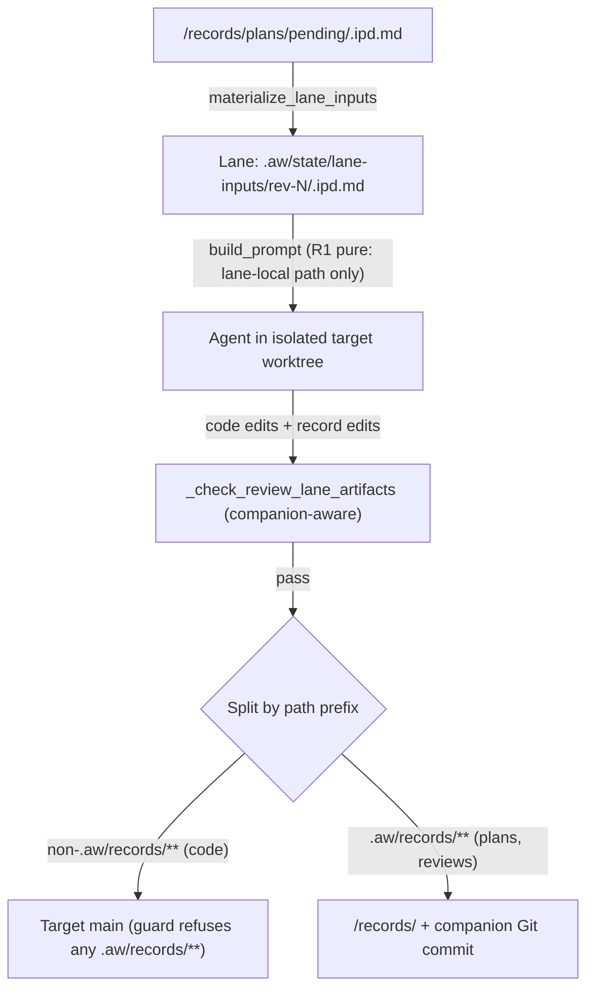

# IPD: Companion-safe runner prompts, record routing, and public-target merge guard

- Date: 2026-11-21
- Kind: child
- Concern: companion-runner-integration
- Scope: `agent_workflows/runner_shared.py`, `agent_workflows/lane_containment.py`, `tests/test_companion_runner_integration.py`
- Scope-Paths: agent_workflows/runner_shared.py, agent_workflows/lane_containment.py, tests/test_companion_runner_integration.py, .aw/records/plans/pending/20261121-companion-bugs-03-v8tqje-companion-safe-runner-prompts-record-routing-and-public-targ.ipd.md
- Item-Dependencies: executed:pbdtss
- Status: to-review
- Short-Description: Preserve R1 prompt purity in companion mode, evaluate review carriers against companion records, route lane record writes to companion repo, and refuse .aw/records merges into public target main
- Work-Kind: bug
- Priority: high
- From-Backlog: rvxmzz
- Blocks-Release: next
- Set: companion-bugs
- Order: 3
- Highest E allocated: 05
- Author: Antigravity model=Gemini
- Id: v8tqje

> Write and proofread this plan per the technical writing standard, `.aw/system/workflows/technical-writing/technical-writing.md` (`.agents/workflows/technical-writing/technical-writing.md` in a legacy-layout install), including requirement 12 (diagrams).

## Workflow history

- 2026-11-21 to-review (aw set): review-ready child plan Order 03 graduated from rvxmzz
- 2026-11-21 draft (Antigravity model=Gemini): created.

## Goal

Make unattended `aw agy run` and `aw oc run` lanes safe and functional in `public-target-private-companion` repositories by preserving R1 prompt purity for companion plans, checking lane artifact conformance against companion carriers, routing lane `.aw/records/**` mutations to the companion repository instead of merging them into public target `main`, and adding a fail-closed target-repo merge guard plus full-Set end-to-end verification.

## Detailed Implementation Checklist (TODO)

Execution-state rule: mark an `E-*` item complete only after performing the action. That mark is not validation. Right-sizing rule: write for a modest executor that cannot hold much in its head. Each E-item is one step (one concern, about one file, executable in one focused pass) and its V-item names each unit it covers with its own check; a plan stays at about 5 E-items and 8 work Scope-Paths, else split it into more child plans (guidance, `IPD-Z603`). Accepted execution states: blocked, failed, pending, performed; terminal gate demands 'performed'.

### Task group 1: R1 prompt purity and companion carrier evaluation in lanes

- [ ] E-01 Preserve R1 prompt purity in `agent_workflows/runner_shared.py` (`build_prompt` and lane input setup) and `agent_workflows/lane_containment.py` when `records_backend == "companion"`
  - Depends on: none
  - Expected outcome: When dispatching a review or execute turn in a companion-mode repository, `lane_containment.materialize_lane_inputs` materializes the companion plan inside the lane (`lane_root / ".aw/state/lane-inputs/..."`) and `build_prompt` passes only that lane-local relative path in the prompt (never an external `<companion>/records/...` path), so emitted prompts strictly satisfy R1 prompt purity (`no path outside the lane`).
  - Execution state: pending

- [ ] E-02 Ensure `_check_review_lane_artifacts` in `agent_workflows/runner_shared.py` evaluates `check.ipd-uncarried-obligation` and handoff readiness against the companion records context
  - Depends on: E-01
  - Expected outcome: In `_check_review_lane_artifacts`, carrier and handoff checks pass the companion-aware context (backed by `pbdtss` linked-worktree inheritance and/or primary `repo` fallback) so valid sibling carriers in `<companion>/records/` pass without false-positive `fail-merge`, while invalid carriers still refuse integration.
  - Execution state: pending

### Task group 2: Companion record routing and public-target merge guard

- [ ] E-03 Route lane `.aw/records/**` outputs (revised IPDs, `.review.md` files, executed-plan transitions) into `<companion>/records/` (and companion Git history when `<companion>/.git` exists) during review and execute integration in `agent_workflows/runner_shared.py`
  - Depends on: E-01, E-02
  - Expected outcome: When `records_backend == "companion"`, integrating a completed review lane or execute lane extracts any `.aw/records/**` changes produced in the lane, writes them atomically to their corresponding paths under `<companion>/records/` (committing them to `<companion>` when `<companion>/.git` exists), and strips `.aw/records/**` from the target-repo merge so code edits land on target `main` while private records land exclusively in `<companion>`.
  - Execution state: pending

- [ ] E-04 Add a fail-closed target-repo merge guard in `agent_workflows/runner_shared.py` (`integrate_review_lane_branch` and the execute integration path) that refuses to merge any `.aw/records/**` path into public target `main` in companion mode
  - Depends on: E-03
  - Expected outcome: Before executing the final target-repo fast-forward or merge into `main`, if `records_backend == "companion"` and the target-repo diff still contains any `.aw/records/**` path, the integration gate refuses with a non-zero / terminal refusal naming the offending `.aw/records/**` paths and leaves target `main` completely unchanged.
  - Execution state: pending

### Task group 3: Whole-Set end-to-end verification

- [ ] E-05 Add end-to-end behavioral tests in `tests/test_companion_runner_integration.py` and run the whole-Set verification suite across all `companion-bugs` tests, `make typecheck`, and `aw sanitize --agent`
  - Depends on: E-01, E-02, E-03, E-04
  - Expected outcome: `tests/test_companion_runner_integration.py` exercises a real temporary `public-target-private-companion` target + companion Git repository pair and verifies: (a) emitted review and execute prompts contain zero external `<companion>` absolute paths (R1 prompt purity); (b) `_check_review_lane_artifacts` passes a review whose deferred rows reference valid sibling plans in `<companion>/records/plans/pending/`; (c) review integration writes the revised IPD and `.review.md` into `<companion>/records/` and commits them in `<companion>` while target `main` contains zero `.aw/records/**` commits; (d) the fail-closed merge guard refuses if a branch attempts to merge `.aw/records/**` directly into target `main`. Whole-Set pytest across `tests/test_companion_containment_and_storage.py`, `tests/test_companion_doctor_and_carriers.py`, and `tests/test_companion_runner_integration.py`, plus `make typecheck` and `aw sanitize --agent`, all pass.
  - Execution state: pending

## Project conventions discovered (Step 0)

- Cite code by SYMBOL (`module.function`) or quoted string, never bare line numbers (`IPD-C801`).
- `agent_workflows/runner_shared.py`:
  - `build_prompt` constructs the prompt text passed to the host CLI (`agy` / `opencode`), and `lane_containment.materialize_lane_inputs` materializes lane inputs under `.aw/state/lane-inputs/rev-N/`.
  - `_check_review_lane_artifacts` validates modified `.aw/records/**` artifacts before integration via `ipd_lint.lint_text` and `check_engine.evaluate_durable_carrier`.
  - `integrate_review_lane_branch` (invoked inside `integrate_under_repository_lock`) merges review lane commits onto target `main`.
- `agent_workflows/lane_containment.py`: owns `materialize_lane_inputs` and the `host-permission-posture` event asserting `"R1 prompt purity: the emitted prompt names no path outside the lane"`.
- Do not refactor `artifact_meta.py` or frontmatter parsers owned by the concurrent `metastore` plan set; keep changes focused on prompt path materialization, companion record routing, and the target-repo merge guard.

## Findings

1. In `run-20261121T055224Z-1705064`, `build_prompt` emitted `/plan-review <companion-abs-path>/records/plans/pending/20261121-perf-opt-01-p1f1st-...ipd.md` while `events.jsonl` asserted `"R1 prompt purity: the emitted prompt names no path outside the lane"` (`rvxmzz` item 8).
2. `_check_review_lane_artifacts` evaluated `check_engine.evaluate_durable_carrier` against the isolated target worktree where companion sibling plans were invisible, producing a false-positive `fail-merge` (`rvxmzz` item 6).
3. The review lane committed revised `.aw/records/plans/pending/*.ipd.md` and `.aw/records/reviews/*.review.md` onto a target-repo branch (`aw/parked/...`), and `integrate_review_lane_branch` attempted to merge those private files into public target `main` instead of routing them into `<companion>/records/` (`rvxmzz` item 7).

## Proposed changes (ordered, validatable)

1. **`agent_workflows/lane_containment.py` and `agent_workflows/runner_shared.py` (`E-01`)**:
   - Ensure `materialize_lane_inputs` always materializes a companion-backed plan into the lane's `.aw/state/lane-inputs/rev-N/` directory and returns the lane-relative path.
   - Ensure `build_prompt` (and review-command prompt formatting) substitutes the lane-relative materialized path whenever `lane_plan_path` lies outside `lane_root`, so zero external companion paths appear in emitted prompts.
2. **`agent_workflows/runner_shared.py` (`E-02`)**:
   - In `_check_review_lane_artifacts`, ensure `evaluate_durable_carrier` and `evaluate_handoff_ready` receive a companion-aware root (relying on `pbdtss` worktree inheritance and passing `repo` when `wt_path` does not carry local companion config) so companion sibling carriers resolve cleanly.
3. **`agent_workflows/runner_shared.py` (`E-03`)**:
   - Add a companion record-routing helper (used by `integrate_review_lane_branch` and the execute integration path when `ctx.records_backend == "companion"`):
     - Extract any changed/added/deleted `.aw/records/**` paths from the lane branch/worktree.
     - Apply them atomically under `Path(ctx.logical_roots["records"])`, and when the companion root has `.git`, stage and commit only those record paths in the companion Git repo with the run/item trailers.
     - For review lanes with only record changes, complete integration cleanly without creating any commit on target `main`. For execute lanes with both code and record changes, integrate only the non-`.aw/records/**` code changes onto target `main`.
4. **`agent_workflows/runner_shared.py` (`E-04`)**:
   - Add a fail-closed assertion/guard right before merging any branch into target `main` when `ctx.records_backend == "companion"`: inspect `git diff --name-only <base>..<branch>` and refuse integration if any path equals `.aw/records` or starts with `.aw/records/`.
5. **`tests/test_companion_runner_integration.py` (`E-05`)**:
   - End-to-end behavioral tests against temporary target + companion Git repositories covering R1 prompt purity, companion carrier conformance, review record routing to companion Git, execute code-vs-record split, and target-repo `.aw/records/**` merge refusal.
   - Run the whole-Set verification across `tests/test_companion_containment_and_storage.py`, `tests/test_companion_doctor_and_carriers.py`, and `tests/test_companion_runner_integration.py` (acting as the Set's whole-Set validation owner for orchestrator `p47398`).

## Deferred / out of scope (with reason)

- Companion storage Git detection, decoy directory removal, target `aw commit` / `.aw/.gitignore` containment, and `AGENTS.md` / `assess.md` guidance are owned by prerequisite child plan `mnsbzt` (Order 01).
  - Carrier: mnsbzt
  - Carrier-Evidence: .aw/records/plans/executed/20261121-companion-bugs-01-mnsbzt-companion-storage-layout-git-detection-target-containment-an.ipd.md
- Linked-worktree `project_context` inheritance, `doctor.py` companion reference resolution, and `check_engine.py` carrier resolution are owned by prerequisite child plan `pbdtss` (Order 02).
  - Carrier: pbdtss
  - Carrier-Evidence: .aw/records/plans/executed/20261121-companion-bugs-02-pbdtss-unified-companion-records-resolution-across-doctor-check-eng.ipd.md

## Scope check

- Over-scope: none. Scoped strictly to companion-mode prompt purity, review/execute lane record routing, target-repo merge guard, and whole-Set verification.
- Under-scope: none. Together with `mnsbzt` and `pbdtss`, all nine defects and all seven acceptance criteria of backlog item `rvxmzz` are covered.

## Required tests / validation

- Whole-Set verification (owned by `v8tqje` for orchestrator `p47398`):
  - `python3 -m pytest tests/test_companion_containment_and_storage.py tests/test_companion_doctor_and_carriers.py tests/test_companion_runner_integration.py`
  - `make typecheck`
  - `aw sanitize --agent`

## Spec / documentation sync

- N/A: this plan restores runner R1 prompt purity (`lane_containment.py`) and companion-storage isolation (`public-target-private-companion`) to their already-specified contracts.

## Open questions

None.

## Validation and cross-check (verify before reporting done)

Validation-state rule: inspect evidence in a separate pass. Do not mark a `V-*` item complete from memory or from the matching execution checkmark. Accepted validation results: blocked, failed, pass, pending; terminal gate demands 'pass'. Runtime-demonstration reachability rule: for each `V-*` item demanding the software be observed acting (such as a run, a dispatch, or a transition)—as distinct from items demanding a diff, a file's content, or a test result, which are reachable by construction—name the code path that produces the observation or the sibling `E-*` that creates it, else the demand is UNDER-SCOPE.

- [ ] V-01 validates E-01
  - Required evidence: Pasted `git diff agent_workflows/runner_shared.py agent_workflows/lane_containment.py` and pasted test output proving `build_prompt` in companion mode emits only lane-local materialized paths and contains zero occurrences of the external companion directory path.
  - Observed evidence:
  - Result: pending

- [ ] V-02 validates E-02
  - Required evidence: Pasted `git diff agent_workflows/runner_shared.py` for `_check_review_lane_artifacts` and pasted test output proving a review modifying a companion plan with sibling carriers passes conformance while a broken carrier still fails.
  - Observed evidence:
  - Result: pending

- [ ] V-03 validates E-03
  - Required evidence: Pasted `git diff agent_workflows/runner_shared.py` for companion record routing and pasted test output proving integrated review `.ipd.md` and `.review.md` files land and commit in `<companion>/records/` while target `main` contains zero `.aw/records/**` commits.
  - Observed evidence:
  - Result: pending

- [ ] V-04 validates E-04
  - Required evidence: Pasted `git diff agent_workflows/runner_shared.py` for the fail-closed target merge guard and pasted test output proving an attempt to merge a branch containing `.aw/records/**` into a companion target `main` is refused with target `main` unchanged.
  - Observed evidence:
  - Result: pending

- [ ] V-05 validates E-05
  - Required evidence: Pasted actual runner output from `python3 -m pytest tests/test_companion_containment_and_storage.py tests/test_companion_doctor_and_carriers.py tests/test_companion_runner_integration.py`, `make typecheck`, and `aw sanitize --agent` showing 0 failures, 0 mypy issues, and 0 leak findings.
  - Observed evidence:
  - Result: pending

## Approval and execution gate

- Size assessment: standard
- Cohesion rationale: not required

This plan must be reviewed and approved (`- Status: approved`) before execution. Execution must happen inside an isolated worktree, commit strictly within `Scope-Paths` via `aw commit`, pass every `V-*` verification with pasted evidence, and transition to `.aw/records/plans/executed/` through `aw ipd finalize`.
