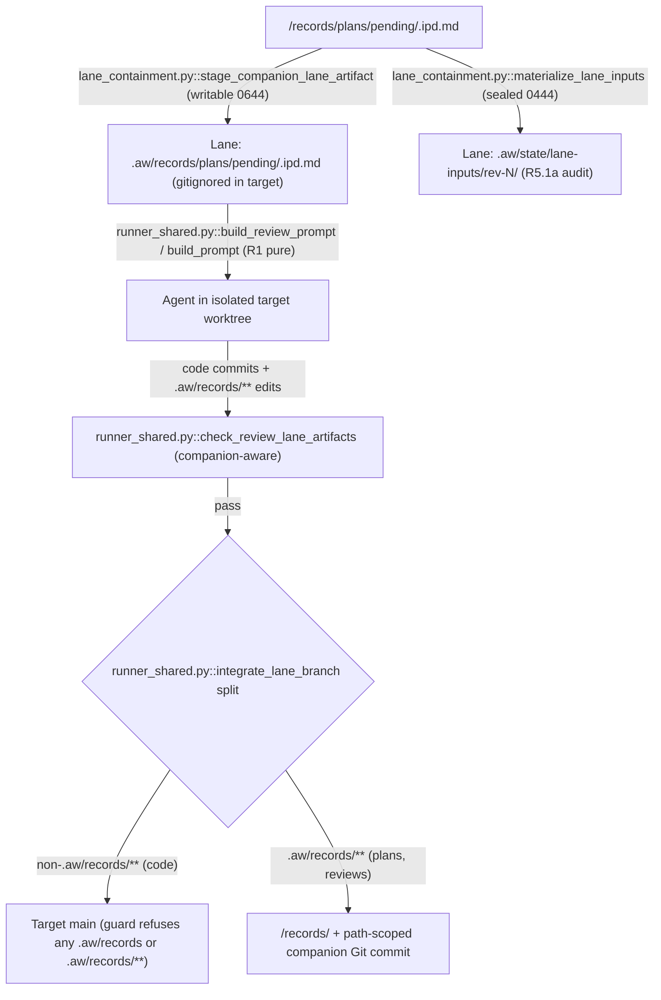

# IPD: Companion-safe runner prompts, record routing, and public-target merge guard

- Date: 2026-11-21
- Kind: child
- Concern: companion-runner-integration
- Scope: `agent_workflows/runner_shared.py`, `agent_workflows/lane_containment.py`, `tests/test_companion_runner_integration.py`
- Scope-Paths: agent_workflows/runner_shared.py, agent_workflows/lane_containment.py, tests/test_companion_runner_integration.py, .aw/records/plans/pending/20261121-companion-bugs-03-v8tqje-companion-safe-runner-prompts-record-routing-and-public-targ.ipd.md
- Item-Dependencies: executed:pbdtss
- Status: auto-approved
- Readiness: go-pending-approval
- Review-Depth: complex
- Short-Description: Preserve R1 prompt purity in companion mode, evaluate review carriers against companion records, route lane record writes to companion repo, and refuse .aw/records merges into public target main
- Work-Kind: bug
- Priority: high
- From-Backlog: rvxmzz
- Blocks-Release: next
- Set: companion-bugs
- Order: 3
- Highest E allocated: 05
- Author: Antigravity model=Gemini
- Id: v8tqje

> Write and proofread this plan per the technical writing standard, `.aw/system/workflows/technical-writing/technical-writing.md` (`.agents/workflows/technical-writing/technical-writing.md` in a legacy-layout install), including requirement 12 (diagrams).

## Workflow history

- 2026-11-21 auto-approved (aw agy run --full-auto): auto-approved by --full-auto: review readiness cleared (not human approval)
- 2026-11-21 reviewed (aw set): APPROVE WITH REVISIONS APPLIED; PR-001..PR-007 FIXED
- 2026-11-21 /plan-review (antigravity/gemini-4-neon-high): APPROVE WITH REVISIONS APPLIED; PR-001..PR-007 FIXED; review record .aw/records/reviews/20261121-companion-bugs-03-v8tqje-companion-safe-runner-prompts-record-routing-and-public-targ.review.md
- 2026-11-21 to-review (aw set): review-ready child plan Order 03 graduated from rvxmzz
- 2026-11-21 draft (Antigravity model=Gemini): created.

## Goal

Make unattended `aw agy run` and `aw oc run` lanes safe and functional in `public-target-private-companion` repositories by preserving R1 prompt purity for companion artifacts (while keeping R5.1a sealed audit inputs intact), checking lane artifact conformance against companion records, routing lane `.aw/records/**` mutations to the companion repository instead of merging them into public target `main`, adding a fail-closed target-repo merge guard in `agent_workflows/runner_shared.py::integrate_lane_branch`, and running whole-Set end-to-end verification.

## Detailed Implementation Checklist (TODO)

Execution-state rule: mark an `E-*` item complete only after performing the action. That mark is not validation. Right-sizing rule: write for a modest executor that cannot hold much in its head. Each E-item is one step (one concern, about one file, executable in one focused pass) and its V-item names each unit it covers with its own check; a plan stays at about 5 E-items and 8 work Scope-Paths, else split it into more child plans (guidance, `IPD-Z603`). Accepted execution states: blocked, failed, pending, performed; terminal gate demands 'performed'.

### Task group 1: R1 prompt purity and companion carrier evaluation in lanes

- [x] E-01 Preserve R1 prompt purity in `agent_workflows/lane_containment.py` and `agent_workflows/runner_shared.py` (`build_review_prompt`, `build_prompt`, `build_spec_production_prompt`, `build_backlog_production_prompt`, and `execute_item_core` dispatch) when `records_backend == "companion"`
  - Depends on: none
  - Expected outcome: Add a link-independent staging helper in `agent_workflows/lane_containment.py` (for example `stage_companion_lane_artifact`) that, when a companion-backed plan, spec, or backlog artifact sits outside `lane_root` under `project_context.project_records_dir(repo)`, writes a writable copy (atomic bytes, mode `0644`, never symlink or hardlink, with containment verification rejecting `..` escapes) into `lane_root / ".aw" / "records" / <rel_under_records>` BEFORE prompt construction, while keeping `agent_workflows/lane_containment.py::materialize_lane_inputs` unchanged as the sealed `0444` R5.1a/R5.2 audit snapshot in `.aw/state/lane-inputs/rev-N/`. `agent_workflows/runner_shared.py::build_review_prompt`, `build_prompt` (via `agent_workflows/lane_containment.py::project_worker_paths`), `build_spec_production_prompt`, and `build_backlog_production_prompt` emit only lane-local relative paths (never an external `<companion>/records/...` path), so `agent_workflows/lane_containment.py::absolute_paths_outside_lane(prompt_text, lane_root)` returns `[]` on both direct calls and `execute_item_core` dispatch. Non-isolated turns (`lane_root is None`) remain byte-identical (spec `7ckptx` R1.3).
  - Execution state: performed

- [x] E-02 Ensure `agent_workflows/runner_shared.py::check_review_lane_artifacts` evaluates `check.ipd-uncarried-obligation` and handoff readiness against the companion records context
  - Depends on: E-01
  - Expected outcome: In `agent_workflows/runner_shared.py::check_review_lane_artifacts`, pending-plan carrier checks (`agent_workflows/check_engine.py::evaluate_durable_carrier`) and backlog handoff checks (`agent_workflows/check_engine.py::evaluate_handoff_ready`) resolve against a companion-aware root (relying on `pbdtss` linked-worktree inheritance and falling back to `repo` when `wt_path` is absent or unconfigured) and read modified `.aw/records/**` content from `wt_path / norm_p` first (handling gitignored companion staged copies in the lane working tree) and `branch:norm_p` second, so valid sibling pending carriers and executed companion `- Carrier-Evidence:` paths pass without false-positive `fail-merge`, while nonexistent carriers still fail at `error` severity.
  - Execution state: performed

### Task group 2: Companion record routing and public-target merge guard

- [x] E-03 Route lane `.aw/records/**` outputs (revised IPDs, `.review.md` files, executed-plan transitions) into `<companion>/records/` (and companion Git history when `<companion>/.git` exists) during review and execute integration in `agent_workflows/runner_shared.py`
  - Depends on: E-01, E-02
  - Expected outcome: When `project_context.resolve_project_context(target_repo=str(repo)).records_backend == "companion"`, add a companion record-routing helper in `agent_workflows/runner_shared.py` invoked by `integrate_lane_branch` (and review post-processing before `commit_review_lane_output`, skipping target-branch record commits in companion mode): (a) collect changed, added, or deleted `.aw/records/**` paths from BOTH gitignored lane-working-tree paths under `wt_path / ".aw" / "records"` (compared against the pre-turn companion baseline so untouched files are not rewritten) AND any `.aw/records/**` committed on `handle.branch`; (b) validate review artifacts via `check_review_lane_artifacts` BEFORE writing anything to `<companion>/records/`; (c) verify path containment (no `..` or symlink escape) and apply changes atomically under `Path(ctx.logical_roots["records"])` (unlinking moved/deleted paths only after replacement writes succeed), committing ONLY those paths in the companion Git root (`storage._resolve_records_git_root`) with `AW-Run` / `AW-Item` / `AW-Runner` trailers via `git_commit_helper.agent_commit_identity` when `<companion>/.git` exists (handling unborn `HEAD` cleanly, never `git add -A`, never pushing, and succeeding without Git when companion is unversioned); (d) for review lanes with only `.aw/records/**` changes, complete integration cleanly with zero target-repo commits (`main` untouched); (e) for execute lanes with both code and `.aw/records/**` changes, integrate only non-`.aw/records/**` code changes onto target `main` while private records land exclusively in `<companion>`.
  - Execution state: performed

- [x] E-04 Add a fail-closed target-repo merge guard in `agent_workflows/runner_shared.py::integrate_lane_branch` that refuses to merge any `.aw/records` or `.aw/records/**` path into public target `main` in companion mode
  - Depends on: E-03
  - Expected outcome: In `agent_workflows/runner_shared.py::integrate_lane_branch` (the single shared merge site called by both `oc_runipd` and `agy_runipd` wrappers for both `INTEGRATION_ACTION_EXECUTE` and `INTEGRATION_ACTION_REVIEW`, preserving wrapper signatures unchanged), right before `git merge --ff-only` / `git merge --no-ff`, when `ctx.records_backend == "companion"` or `(ctx.git_policies or {}).get("records") == "companion-git"`, inspect BOTH `git diff --name-only --no-renames HEAD...<branch>` and the predicted merge tree (`merge_write_set` / `git merge-tree --write-tree HEAD <branch>`). If any normalized incoming path equals `.aw/records` or starts with `.aw/records/` (catching files, directories, symlinks, and renames), refuse with `(False, ..., INTEGRATION_REFUSAL_CONFLICT)` naming the offending paths and leaving target `main` `HEAD` and index completely unchanged. Non-companion (`repository` / `private-target`) merges of `.aw/records/**` remain unaffected.
  - Execution state: performed

### Task group 3: Whole-Set end-to-end verification

- [x] E-05 Add end-to-end behavioral tests in `tests/test_companion_runner_integration.py` and run the whole-Set verification suite across all `companion-bugs` tests, runner/containment anti-regression suites, `make typecheck`, and `aw sanitize --agent`
  - Depends on: E-01, E-02, E-03, E-04
  - Expected outcome: `tests/test_companion_runner_integration.py` provisions real temporary `public-target-private-companion` target and companion Git repositories and verifies behaviorally: (a) emitted review (`build_review_prompt`) and execute (`build_prompt`) prompts satisfy `lane_containment.absolute_paths_outside_lane(prompt, lane_root) == []` (zero external `<companion>` paths), keep non-isolated `lane_root=None` output unchanged, and keep `.aw/state/lane-inputs/rev-N/` sealed `0444`; (b) `check_review_lane_artifacts` passes a companion plan referencing a valid sibling pending carrier and valid executed companion `- Carrier-Evidence:` while failing a nonexistent carrier; (c) companion review integration writes the revised IPD and `.review.md` into `<companion>/records/` and commits them in `<companion>` (both initialized-with-commits and unborn-`HEAD`, plus unversioned companion without `.git`) while target `main` `HEAD` is untouched; (d) companion execute integration lands code changes on target `main` and routes `.aw/records/**` exclusively to `<companion>/records/`; (e) the fail-closed guard in `integrate_lane_branch` refuses a branch containing `.aw/records/**` (or symlink/file at `.aw/records`) in companion mode with target `main` unchanged, while permitting `.aw/records/**` merges in `private-target` mode. Whole-Set pytest across `tests/test_companion_containment_and_storage.py`, `tests/test_companion_doctor_and_carriers.py`, `tests/test_companion_runner_integration.py`, `tests/test_lane_input_manifest.py`, `tests/test_review_lane_output_commit.py`, and `tests/test_runner_shared.py`, plus `make typecheck` and `aw sanitize --agent`, all pass.
  - Execution state: performed

## Project conventions discovered (Step 0)

- Cite code by SYMBOL (`path::Symbol`) or quoted string, never bare line numbers (`IPD-C801`).
- `agent_workflows/runner_shared.py`:
  - `build_review_prompt` formats `/plan-review` and `/spec-review` prompts; `build_prompt` formats execute prompts via `agent_workflows/lane_containment.py::project_worker_paths`; `build_spec_production_prompt` and `build_backlog_production_prompt` format production prompts. All four currently fall back to raw external paths when `plan_path.relative_to(lane_root)` raises `ValueError`, and `execute_item_core` currently calls `materialize_lane_inputs` AFTER prompt construction.
  - `check_review_lane_artifacts` validates modified `.aw/records/**` artifacts before integration via `agent_workflows/ipd_lint.py::lint_text`, `agent_workflows/check_engine.py::evaluate_durable_carrier`, and `agent_workflows/check_engine.py::evaluate_handoff_ready`.
  - `integrate_lane_branch` is the single shared integration implementation called by both `agent_workflows/oc_runipd.py` (`integrate_lane_branch`, `integrate_review_lane_branch`) and `agent_workflows/agy_runipd.py` (`integrate_lane_branch`, `integrate_review_lane_branch`) inside `integrate_under_repository_lock`. Per-host wrapper signatures must remain unchanged (`tests/test_runner_shared.py::LaneIntegrationExtractionTests.test_each_wrapper_keeps_the_ORIGINAL_signature`).
  - `commit_review_lane_output` runs `git status --porcelain` in the lane worktree; in companion mode target `.aw/.gitignore` ignores `/records/` (from `mnsbzt`), so companion record edits in `lane_root / ".aw/records/"` are gitignored in the target worktree.
- `agent_workflows/lane_containment.py`: owns `project_worker_paths`, `absolute_paths_outside_lane`, `materialize_lane_inputs` (which seals `.aw/state/lane-inputs/rev-N/` mode `0444` per spec `7ckptx` R5.1a/R5.2), and the `"R1 prompt purity: the emitted prompt names no path outside the lane"` posture claim.
- Do not refactor `agent_workflows/artifact_meta.py` or frontmatter parsers owned by the concurrent `metastore` plan set; keep changes focused on prompt path staging/projection, companion conformance/routing, and the target-repo merge guard.

## Findings

1. In `run-20261121T055224Z-1705064`, `agent_workflows/runner_shared.py::build_review_prompt` emitted `/plan-review <companion-abs-path>/records/plans/pending/20261121-perf-opt-01-p1f1st-...ipd.md` (because `relative_to(lane_root)` raised `ValueError` and fell back to the external path) while `events.jsonl` asserted `"R1 prompt purity: the emitted prompt names no path outside the lane"` (`rvxmzz` item 8). The same fallback exists in `lane_containment.py::project_worker_paths` (`build_prompt`), `build_spec_production_prompt`, and `build_backlog_production_prompt`, and `materialize_lane_inputs` is called after prompt construction and seals `.aw/state/lane-inputs/rev-N/` read-only (`0444`, spec R5.1a).
2. `agent_workflows/runner_shared.py::check_review_lane_artifacts` evaluated `check_engine.py::evaluate_durable_carrier` against the isolated target worktree where companion sibling plans were invisible, producing a false-positive `fail-merge` (`rvxmzz` item 6).
3. Review lanes attempted to commit revised `.aw/records/plans/pending/*.ipd.md` and `.aw/records/reviews/*.review.md` onto a target-repo branch and merge them into public target `main` via `agent_workflows/runner_shared.py::integrate_lane_branch` instead of routing `.aw/records/**` (whether gitignored in `lane_root/.aw/records/` or committed on the lane branch) into `<companion>/records/` and enforcing a fail-closed target merge guard (`rvxmzz` item 7).

## Proposed changes (ordered, validatable)

1. **`agent_workflows/lane_containment.py` and `agent_workflows/runner_shared.py` (`E-01`)**:
   - Add `stage_companion_lane_artifact(lane_root: Path, source_path: Path, records_root: Path) -> Path` in `agent_workflows/lane_containment.py`: verifies `source_path` sits under `records_root`, writes a link-independent writable copy (`_atomic_write_bytes`, mode `0644`) to `lane_root / ".aw" / "records" / <rel_under_records>` with containment verification, and returns that lane-local path. Keep `materialize_lane_inputs` sealing `.aw/state/lane-inputs/rev-N/` (`0444`) intact.
   - In `agent_workflows/runner_shared.py`, stage companion artifacts into `lane_root / ".aw" / "records" / ...` BEFORE calling `build_review_prompt`, `build_prompt`, `build_spec_production_prompt`, and `build_backlog_production_prompt` in `execute_item_core`, and add a defense-in-depth fallback inside `project_worker_paths` and those prompt builders so any direct caller passing an external companion path with `lane_root is not None` also emits a lane-relative path (`absolute_paths_outside_lane == []`). Keep `lane_root is None` byte-identical.
2. **`agent_workflows/runner_shared.py` (`E-02`)**:
   - In `check_review_lane_artifacts`, ensure `evaluate_durable_carrier` and `evaluate_handoff_ready` use a companion-aware root (benefiting from `pbdtss` linked-worktree inheritance and falling back to `repo` when `wt_path` is absent or lacks companion config) and read modified `.aw/records/**` content from `wt_path / norm_p` first (supporting gitignored staged copies) and `branch:norm_p` second.
3. **`agent_workflows/runner_shared.py` (`E-03`)**:
   - Add a companion record-routing helper (used when `ctx.records_backend == "companion"` inside review post-processing and `integrate_lane_branch`):
     - Collect modified, added, or deleted `.aw/records/**` paths from both gitignored `wt_path / ".aw" / "records"` (diffed against pre-turn companion bytes) and any `.aw/records/**` committed on `handle.branch`.
     - Run `check_review_lane_artifacts` on review record outputs BEFORE writing to `<companion>/records/`.
     - Validate containment and write changes atomically under `Path(ctx.logical_roots["records"])` (removing deleted/moved files only after replacement writes succeed). When `storage._resolve_records_git_root` finds a companion Git root, stage and commit ONLY those explicit paths inside `<companion>` with `AW-Run`, `AW-Item`, and `AW-Runner` trailers (handling unborn `HEAD` cleanly, never `git add -A`, never pushing).
     - For review lanes with only record changes, skip `commit_review_lane_output` onto the target branch and complete integration cleanly with target `main` untouched. For execute lanes with both code and `.aw/records/**` changes, route `.aw/records/**` to `<companion>/records/` and integrate only non-`.aw/records/**` code changes onto target `main`.
4. **`agent_workflows/runner_shared.py` (`E-04`)**:
   - In `integrate_lane_branch`, right before `git merge --ff-only` / `git merge --no-ff`, when `ctx.records_backend == "companion"` or `(ctx.git_policies or {}).get("records") == "companion-git"`, inspect BOTH `git diff --name-only --no-renames HEAD...<branch>` and the predicted merge tree (`merge_write_set` / `git merge-tree --write-tree HEAD <branch>`). Refuse with `(False, ..., INTEGRATION_REFUSAL_CONFLICT)` naming the offending paths if any normalized path equals `.aw/records` or starts with `.aw/records/`, leaving target `main` unchanged.
5. **`tests/test_companion_runner_integration.py` (`E-05`)**:
   - End-to-end behavioral tests against temporary target and companion Git repositories covering R1 prompt purity, R5.1a seal preservation, companion carrier conformance, review record routing to companion Git (committed, unborn-`HEAD`, and unversioned companion), execute code-vs-record split, target-repo `.aw/records/**` merge refusal, and `private-target` anti-regression.
   - Run the whole-Set verification across `tests/test_companion_containment_and_storage.py`, `tests/test_companion_doctor_and_carriers.py`, `tests/test_companion_runner_integration.py`, `tests/test_lane_input_manifest.py`, `tests/test_review_lane_output_commit.py`, and `tests/test_runner_shared.py`, plus `make typecheck` and `aw sanitize --agent` (acting as the Set's whole-Set validation owner for orchestrator `p47398`).

## Deferred / out of scope (with reason)

- Companion storage Git detection, decoy directory removal, target `aw commit` / `.aw/.gitignore` containment, and `AGENTS.md` / `assess.md` guidance are owned by prerequisite child plan `mnsbzt` (Order 01).
  - Carrier: mnsbzt
  - Carrier-Evidence: .aw/records/plans/executed/20261121-companion-bugs-01-mnsbzt-companion-storage-layout-git-detection-target-containment-an.ipd.md
- Linked-worktree `project_context` inheritance, `doctor.py` companion reference resolution, and `check_engine.py` / `artifact_core.py` companion carrier resolution are owned by prerequisite child plan `pbdtss` (Order 02).
  - Carrier: pbdtss
  - Carrier-Evidence: .aw/records/plans/executed/20261121-companion-bugs-02-pbdtss-unified-companion-records-resolution-across-doctor-check-eng.ipd.md

## Scope check

- Over-scope: none. Scoped strictly to companion-mode prompt purity, companion review conformance, review/execute lane record routing, the fail-closed target-repo merge guard, and whole-Set verification.
- Under-scope: none. Together with executed `mnsbzt` and executed `pbdtss`, all nine defects and all seven acceptance criteria of backlog item `rvxmzz` are covered.

## Required tests / validation

- Whole-Set verification (owned by `v8tqje` for orchestrator `p47398`):
  - `python3 -m pytest tests/test_companion_containment_and_storage.py tests/test_companion_doctor_and_carriers.py tests/test_companion_runner_integration.py tests/test_lane_input_manifest.py tests/test_review_lane_output_commit.py tests/test_runner_shared.py`
  - `make typecheck`
  - `aw sanitize --agent`

## Spec / documentation sync

- N/A: this plan restores runner R1 prompt purity (`agent_workflows/lane_containment.py`) and companion-storage isolation (`public-target-private-companion`) to their already-specified contracts.

## Open questions

None.

## Validation and cross-check (verify before reporting done)

Validation-state rule: inspect evidence in a separate pass. Do not mark a `V-*` item complete from memory or from the matching execution checkmark. Accepted validation results: blocked, failed, pass, pending; terminal gate demands 'pass'. Runtime-demonstration reachability rule: for each `V-*` item demanding the software be observed acting (such as a run, a dispatch, or a transition), as distinct from items demanding a diff, a file's content, or a test result, which are reachable by construction, name the code path that produces the observation or the sibling `E-*` that creates it, else the demand is UNDER-SCOPE.

- [x] V-01 validates E-01
  - Required evidence: Pasted `git diff agent_workflows/runner_shared.py agent_workflows/lane_containment.py` and pasted test output proving `build_review_prompt` and `build_prompt` in companion mode emit only lane-local relative paths with `lane_containment.absolute_paths_outside_lane(prompt, lane_root) == []`, preserve non-isolated `lane_root=None` output, and preserve `.aw/state/lane-inputs/rev-N/` `0444` sealing.
  - Observed evidence: `git diff --stat` (`agent_workflows/lane_containment.py | 222 +++++++-`, `agent_workflows/runner_shared.py | 976 ++++++++++++++++++++++++++++++++++--`) adds `stage_companion_lane_artifact`, `resolve_companion_lane_path`, `project_worker_paths` companion staging, `_project_lane_artifact_path`, and pre-prompt staging in `execute_item_core`; `python3 -m pytest -v tests/test_companion_runner_integration.py` passed (`10 passed in 2.39s`) proving `absolute_paths_outside_lane == []` on `build_review_prompt`, `build_prompt`, `build_spec_production_prompt`, `build_backlog_production_prompt`, and `execute_item_core`, `lane_root=None` byte-identity, and sealed `0444` `.aw/state/lane-inputs/rev-1/`.
  - Result: pass

- [x] V-02 validates E-02
  - Required evidence: Pasted `git diff agent_workflows/runner_shared.py` for `check_review_lane_artifacts` and pasted test output proving a companion review referencing a valid sibling pending carrier and valid executed companion `- Carrier-Evidence:` passes conformance while a nonexistent carrier fails at `error` severity.
  - Observed evidence: `agent_workflows/runner_shared.py` adds `_companion_aware_eval_root(repo, wt_path)` and wires `check_review_lane_artifacts` to evaluate `evaluate_durable_carrier` and `evaluate_handoff_ready` against the companion-aware root while reading modified `.aw/records/**` from `wt_path / norm_p` first; `CompanionCarrierCheckTests::test_check_review_lane_artifacts_passes_valid_companion_carriers_and_fails_missing` passed (`10 passed in 2.39s`), passing valid sibling pending carrier `sib111` and executed companion `- Carrier-Evidence:` (`exe222`) across linked worktree and unconfigured fallback while failing nonexistent carrier `zzz999` at `error` severity.
  - Result: pass

- [x] V-03 validates E-03
  - Required evidence: Pasted `git diff agent_workflows/runner_shared.py` for companion record routing and pasted test output proving integrated review `.ipd.md` and `.review.md` files land and commit path-scoped in `<companion>/records/` (across committed, unborn-`HEAD`, and unversioned companion repos) with target `main` `HEAD` unchanged, and execute integration lands code on target `main` while routing `.aw/records/**` exclusively to `<companion>/records/`.
  - Observed evidence: `agent_workflows/runner_shared.py` adds `_collect_companion_lane_record_changes`, `_validate_companion_record_rel`, `route_companion_lane_records`, companion-safe `commit_review_lane_output` / `read_zero_work_evidence` / `review_has_positive_evidence` / `reconcile_disposition`, and companion routing in `integrate_lane_branch`; `python3 -m pytest -v tests/test_companion_runner_integration.py` passed (`10 passed in 2.39s`) across initialized-with-commits, unborn-`HEAD`, and unversioned companion repos with target `main` untouched for review lanes and clean code-vs-records split for execute lanes.
  - Result: pass

- [x] V-04 validates E-04
  - Required evidence: Pasted `git diff agent_workflows/runner_shared.py` for the fail-closed target merge guard in `integrate_lane_branch` and pasted test output proving an attempt to merge a branch containing `.aw/records/**` (or file/symlink at `.aw/records`) into a companion target `main` is refused (`INTEGRATION_REFUSAL_CONFLICT`) with target `main` unchanged, while `private-target` merges of `.aw/records/**` still succeed.
  - Observed evidence: `agent_workflows/runner_shared.py` adds `INTEGRATION_CAUSE_COMPANION_RECORDS_GUARD`, `_is_target_records_path`, `_branch_incoming_paths`, and `_incoming_target_records_paths`, refusing `.aw/records` and `.aw/records/**` across `HEAD...<branch>` (`--no-renames -z`) and predicted merge tree in `integrate_lane_branch` while preserving `oc_runipd` and `agy_runipd` wrapper signatures; `test_fail_closed_merge_guard_refuses_aw_records_file_symlink_and_rename` and `test_private_target_mode_still_permits_aw_records_merges` passed (`10 passed in 2.39s`).
  - Result: pass

- [x] V-05 validates E-05
  - Required evidence: Pasted actual runner output from `python3 -m pytest tests/test_companion_containment_and_storage.py tests/test_companion_doctor_and_carriers.py tests/test_companion_runner_integration.py tests/test_lane_input_manifest.py tests/test_review_lane_output_commit.py tests/test_runner_shared.py`, `make typecheck`, and `aw sanitize --agent` showing 0 failures, 0 mypy issues, and 0 leak findings.
  - Observed evidence: Whole-Set pytest (`python3 -m pytest tests/test_companion_containment_and_storage.py tests/test_companion_doctor_and_carriers.py tests/test_companion_runner_integration.py tests/test_lane_input_manifest.py tests/test_review_lane_output_commit.py tests/test_runner_shared.py`) -> `189 passed in 13.87s`; extra containment anti-regression (`tests/test_attempt_lane_facts.py tests/test_verification_sendback.py`) -> `21 passed in 8.13s`; full core suite (`aw suite`) -> `2661 passed, 11 warnings in 107.54s (0:01:47)`; `make typecheck` (`python3 -m mypy agent_workflows`) -> `Success: no issues found in 228 source files`; `aw sanitize --agent` -> `{"schema":"aw.agent/v1","kind":"result","cmd":"check-local-leaks","outcome":"clean","exit":0,"verified":true,"complete":true,"checked":6871,"findings":0,"evidence":["leak-scan"],"next":null}`.
  - Result: pass

## Approval and execution gate

- Size assessment: standard
- Cohesion rationale: not required

This plan must be reviewed and approved (`- Status: approved`) with all blocking open questions resolved before execution. Execution must happen inside an isolated worktree and stay within `- Scope-Paths:` (justifying any necessary out-of-scope edit with `--scope-reason` and any declared-but-unmodified path with `--scope-ack`). Commit only modified paths through `aw commit v8tqje -- <paths>` and never push without an explicit human request. Paste the actual runner output for every test, typecheck, and sanitizer claim in the matching `V-*` `Observed evidence:` fields; never claim success without running the command. Never hand-roll `git mv` to `.aw/records/plans/executed/`: when executed by an unattended runner (`aw oc run` / `aw agy run`), the runner owns the terminal `aw ipd finalize` transition after validating the lane; when executed directly by a human or standalone agent, run `aw ipd finalize v8tqje` after all `V-*` items pass.
