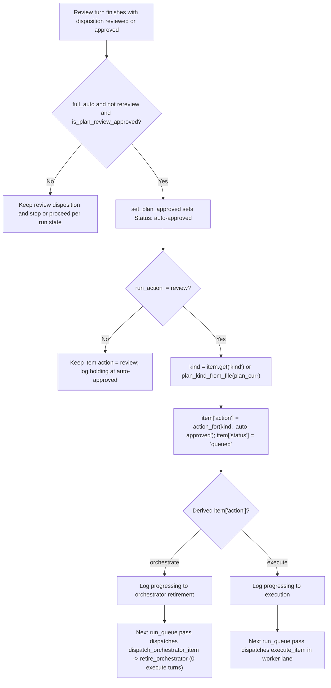

# IPD: Route auto-approved orchestrator IPDs to orchestrate instead of execute

- Date: 2026-11-21
- Kind: child
- Concern: Backlog `diobl2` (`Work-Kind: bug`, `Priority: high`, `Blocks-Release: next`) reports that when `aw oc run --full-auto` or `aw agy run --full-auto` completes a `/plan-review` turn on a `Kind: orchestrator` Implementation Plan Document (IPD) and transitions it from `reviewed` to `auto-approved` inside `agent_workflows/runner_shared.py::execute_item_core`, the runner hardcodes `item["action"] = "execute"` whenever `run_action != "review"`. That overwrite bypasses `agent_workflows/runner_shared.py::action_for` (which delegates to `agent_workflows/run_selection_policy.py::runner_action` and maps `("orchestrator", "auto-approved")` to `"orchestrate"`). As a result, the runner allocates an isolated worker worktree, writes a begin receipt, and spends an agent execution turn on the orchestrator instead of routing it to `agent_workflows/runner_shared.py::dispatch_orchestrator_item` and `agent_workflows/ipd_lifecycle.py::retire_orchestrator`, as observed in `run-20261121T141636Z-2560095` for orchestrator `p47398`.
- Scope: IN: (1) replace the hardcoded `item["action"] = "execute"` in the `--full-auto` post-review auto-approval block of `agent_workflows/runner_shared.py::execute_item_core` with `kind = item.get("kind") or plan_kind_from_file(plan_curr)` and `item["action"] = action_for(kind, "auto-approved")`; (2) update the adjacent `if auto_approved:` progress log line in `agent_workflows/runner_shared.py::execute_item_core` so `item["action"] == "orchestrate"` logs `"progressing to orchestrator retirement"`, `item["action"] == "review"` logs `"holding at auto-approved (--action review)"`, and `item["action"] == "execute"` preserves `"progressing to execution"`; and (3) add fast `@pytest.mark.core` behavioral regression tests in `tests/test_runner_fullauto_and_sweep_fixes.py` covering `execute_item_core` action derivation and progress log wording (`Kind: orchestrator` with `item["kind"]` present and absent, `Kind: child`, `Kind: standard`, and `--action review`) plus end-to-end `run_queue` execution across both `oc_runipd` and `agy_runipd` showing a `to-review` orchestrator retire via `retire_orchestrator` with zero `execute` agent turns. OUT: modifying `agent_workflows/runner_shared.py::initialize_run` (which already derives actions via `action_for`), modifying `agent_workflows/runner_shared.py::finish_integrated_review_item` (deferred review integration does not auto-approve any IPD kind), or modifying `agent_workflows/oc_runipd.py` or `agent_workflows/agy_runipd.py` (both already delegate item turns to `execute_item_core` and already short-circuit `action == "orchestrate"` to `dispatch_orchestrator_item`).
- Scope-Paths: agent_workflows/runner_shared.py, tests/test_runner_fullauto_and_sweep_fixes.py
- Item-Dependencies: none
- Status: approved
- Readiness: go-pending-approval
- Review-Depth: standard
- Short-Description: Derive next action via action_for(kind, 'auto-approved') instead of hardcoding execute in execute_item_core
- Work-Kind: bug
- Priority: high
- From-Backlog: diobl2
- Blocks-Release: next
- Set: diobl2
- Order: 1
- Highest E allocated: 04
- Author: antigravity/gemini-4-hydrogen-xhigh
- Id: behm9r
- Approval: 2026-11-27, recorded via aw ipd set: status set to approved

> Write and proofread this plan per the technical writing standard, `.aw/system/workflows/technical-writing/technical-writing.md` (`.agents/workflows/technical-writing/technical-writing.md` in a legacy-layout install), including requirement 12 (diagrams).

## Workflow history

- 2026-11-27 approved (aw set): status set to approved
- 2026-11-25 reviewed (aw set): plan-review (opencode/its_direct/pt3-claude-opus-5.5-1m-us): APPROVE WITH REVISIONS APPLIED; PR-001..PR-007 fixed (spawn-layer stubbing in E-03, ready orchestrator fixtures, host-binding drive in E-02, isolate_worktree off, one test per host, import pytest, reached_success comment); review record .aw/records/reviews/20261121-diobl2-01-behm9r-route-auto-approved-orchestrator-ipds-to-orchestrate-instead.review.md
- 2026-11-21 to-review (aw set): Authored review-ready child plan for backlog diobl2
- 2026-11-21 draft (antigravity/gemini-4-hydrogen-xhigh): created.

## Goal

Compute the post-review `--full-auto` queue action in `agent_workflows/runner_shared.py::execute_item_core` through `action_for(kind, "auto-approved")` instead of hardcoding `"execute"`, so reviewed `Kind: orchestrator` IPDs transition to `action == "orchestrate"`, print accurate progress wording, and retire through `dispatch_orchestrator_item` and `retire_orchestrator` without spawning an agent execution turn while `Kind: child` and standard IPDs keep transitioning to `action == "execute"`.

## Detailed Implementation Checklist (TODO)

Execution-state rule: mark an `E-*` item complete only after performing the action. That mark is not validation. Right-sizing rule: write for a modest executor that cannot hold much in its head. Each E-item is one step (one concern, about one file, executable in one focused pass) and its V-item names each unit it covers with its own check; a plan stays at about 5 E-items and 8 work Scope-Paths, else split it into more child plans (guidance, `IPD-Z603`). Accepted execution states: blocked, failed, pending, performed; terminal gate demands 'performed'.

### Task group 1: Derive post-review auto-approval action via action_for and update progress wording

- [ ] E-01 In `agent_workflows/runner_shared.py::execute_item_core`, inside the `--full-auto` post-review auto-approval block (`if is_review and queue_entry_type(item) == "ipd" ...`), compute `kind = item.get("kind") or plan_kind_from_file(plan_curr)` and set `item["action"] = action_for(kind, "auto-approved")` (with `item["status"] = "queued"`) when `run_action != "review"`, instead of hardcoding `item["action"] = "execute"`. In the `if auto_approved:` print block of `execute_item_core`, preserve `"progressing to execution"` when `item.get("action") == "execute"`, emit `"progressing to orchestrator retirement"` when `item.get("action") == "orchestrate"`, and emit `"holding at auto-approved (--action review)"` when `item.get("action") == "review"`. Also update the existing comment above `reached_success = item_reached_success(` (it reads "the `--full-auto` bridge above may have just rewritten it from `review` to `execute`") so it says the bridge may rewrite it to `execute` or `orchestrate`; no code change is needed there, because `item_reached_success({"action": "orchestrate", "status": "reviewed"})` is `False`, exactly like the `execute` case. Do not change the `except Exception` branch: a failed `set_plan_approved` must still leave `item["action"]` untouched.
  - Depends on: none
  - Expected outcome: A reviewed `Kind: orchestrator` IPD auto-approved under `--full-auto` (outside `--action review`) transitions on the queue entry to `action == "orchestrate"` and `status == "queued"` (even when `item.get("kind")` was missing on the queue entry) and prints `"progressing to orchestrator retirement"`. A `Kind: child` or standard IPD transitions to `action == "execute"` and `status == "queued"` and prints `"progressing to execution"`. An `--action review` run preserves `item["action"] == "review"` and prints `"holding at auto-approved (--action review)"`.
  - Execution state: pending

### Task group 2: Add behavioral regression tests and run repository validation

- [ ] E-02 In `tests/test_runner_fullauto_and_sweep_fixes.py`, add `import pytest` (the module imports only `unittest` today, so `@pytest.mark.core` would raise `NameError`), then add fast `@pytest.mark.core` behavioral tests that drive one review item through `oc_runipd.execute_item` (which calls `runner_shared.execute_item_core` with the host's real `spawn_executor`, `spawn_verifier`, `raw_launcher`, `host_labels`, `run_suite_check`, and `process_backlog_close` bindings) with `mock.patch.object(oc_runipd, "run_opencode", fake_run)`, following `tests/test_rereview_reviewed_plan.py::TestRereviewExecutionTurn::test_execute_item_core_rereview_demotes_and_turn_sees_to_review`. The state must set `options.full_auto: True` and `options.isolate_worktree: False` (`isolation_for_action` defaults to `True`, which would allocate a real worktree), and `fake_run` must write `- Status: reviewed` and `- Readiness: go-pending-approval` plus a review-provenance `## Workflow history` line (for example via `artifact_meta.append`, as the model test does) so `plan_readiness.is_plan_review_approved` returns `True`. Cover: (a) a `Kind: orchestrator` IPD with `item["kind"] = "orchestrator"`, (b) a `Kind: orchestrator` IPD with `"kind"` omitted from `item` to prove fallback to `plan_kind_from_file(plan_curr)`, (c) `Kind: child` and standard (no `- Kind:` field) IPDs, and (d) a `Kind: orchestrator` IPD with `options["action"] = "review"`. Every orchestrator fixture in (a), (b), and (d) must be READY in the sense of `orchestrator_readiness.review_readiness(..., ask=False)`: a `## Child IPDs` table with one row, that child on disk at `reviewed` or later (or `executed` under `executed/`), a conforming `CONFIRM <child> REACHED executed` E-row, and a current `- Coverage: pass` record written with `coverage_record.write(path, verdict=coverage_record.COVERAGE_PASS, commit=False)` after the body is final. Without that, the real `set_plan_approved` (which runs `aw set auto-approved`) is refused by the orchestrator readiness gate in `status_set.py`, the `except Exception` branch prints `Failed to auto-approve`, and the test proves nothing about the action. Assert `item["action"]`, `item["status"]`, `item["auto_approved"]`, on-disk `- Status: auto-approved`, the `ipd-auto-approved` event in `events.jsonl`, and the exact stdout progress wording for each case, without `inspect`, `ast`, or source-regex checks. If a host-level drive is impractical, calling `runner_shared.execute_item_core` directly is acceptable only when every injected keyword argument above is supplied from the `oc_runipd` module.
  - Depends on: E-01
  - Expected outcome: Cases (a) and (b) fail on unpatched `runner_shared.py` (they observe `action == "execute"` and `"progressing to execution"`), case (d) fails on the old wording only, case (c) passes before and after, and every test passes in under 2 seconds under pytest.
  - Execution state: pending

- [ ] E-03 In `tests/test_runner_fullauto_and_sweep_fixes.py`, add two fast `@pytest.mark.core` behavioral end-to-end tests, ONE PER HOST (one driving `oc_runipd.run_queue`, one driving `agy_runipd.run_queue`, sharing a fixture helper), each with `options.full_auto: True` and `options.isolate_worktree: False` over a temporary git repository containing an `executed` child IPD under `.aw/records/plans/executed/` and a `to-review` `Kind: orchestrator` IPD (carrying a conforming `## Child IPDs` table, a `CONFIRM <child> REACHED executed` row, and a current `- Coverage: pass` record written with `coverage_record.write(..., commit=False)` and then committed). Follow the `run_queue` fixture pattern in `tests/test_orchestrator_retirement.py::AnOrchestratorIsRetiredMidRun`. Stub the SPAWN layer, not the item executor: patch `oc_runipd.run_opencode` (respectively `agy_runipd.run_agy_turn`) with a fake that, for a `review` turn, writes `- Status: reviewed`, `- Readiness: go-pending-approval`, and a review-provenance history line, and that raises `AssertionError` (or records the call and fails the test) for any non-review turn. Do NOT patch `oc_runipd.execute_item` or `agy_runipd.execute_item`: the fix lives in `runner_shared.execute_item_core`, which those functions call, so stubbing them (as `tests/test_orchestrator_retirement.py::DispatchRunCase.drive` does) would bypass the code under test and pass on unpatched code. Let the real `dispatch_orchestrator_item` and `ipd_lifecycle.retire_orchestrator` run; neither spawns a model when the coverage record is current. Assert zero non-review spawn calls, `item["action"] == "orchestrate"`, `item["status"] == "executed"`, `item["auto_approved"] is True`, both `ipd-auto-approved` and `orchestrator-finalized` events in `events.jsonl`, and relocation of the orchestrator plan to `.aw/records/plans/executed/` with `- Status: executed`.
  - Depends on: E-01
  - Expected outcome: On unpatched code each host test fails (the fake spawn is called for an `execute` turn on the orchestrator). After E-01, both `oc_runipd.run_queue` and `agy_runipd.run_queue` drive the `to-review` orchestrator through review, `auto-approved`, `orchestrate`, and `retire_orchestrator` to `executed` with zero agent execution turns, and each test stays under the 2-second per-test slow threshold (`0 unlisted slow tests`). If a test measures over 2 seconds, remove the `core` marker and add it to `tests/slow_allowlist.txt` with a reason instead of leaving it unlisted.
  - Execution state: pending

- [ ] E-04 Run targeted pytest on `tests/test_runner_fullauto_and_sweep_fixes.py`, `tests/test_action_table_runner_parity.py`, `tests/test_orchestrator_retirement.py`, and `tests/test_runner_fallback_bindings.py`, plus bare `python3 -m pytest`, `make test-all`, `make typecheck`, `aw check all --agent`, and `aw sanitize --agent`.
  - Depends on: E-02, E-03
  - Expected outcome: All targeted suites, bare `python3 -m pytest` (including the new `@pytest.mark.core` tests), `make test-all`, `make typecheck`, `aw check all --agent`, and `aw sanitize --agent` pass with zero failures and zero unlisted slow tests.
  - Execution state: pending

Add further leaves as `- [ ] E-NEW <action>` and run `aw ipd sync` to assign ids.

## Project conventions discovered (Step 0)

- Both `agent_workflows/oc_runipd.py` (`execute_item`) and `agent_workflows/agy_runipd.py` (`execute_item`) delegate item execution and post-review auto-approval to `agent_workflows/runner_shared.py::execute_item_core`, and both `oc_runipd.run_queue` and `agy_runipd.run_queue` already short-circuit `runnable.get("action") == "orchestrate"` to `runner_shared.dispatch_orchestrator_item` before calling `execute_item`.
- `agent_workflows/runner_shared.py::action_for` delegates to `agent_workflows/run_selection_policy.py::runner_action` and maps `("orchestrator", "auto-approved")` to `"orchestrate"` and `("child", "auto-approved")` (or `None`) to `"execute"`.
- `agent_workflows/runner_shared.py::plan_kind_from_file` reads `- Kind:` from a plan file and returns `None` when absent or unreadable.
- `agent_workflows/runner_shared.py::initialize_run` already handles plans that start at `- Status: reviewed` under `--full-auto` by calling `set_plan_approved_fn` and then `action_for(kind, status or "approved")`.
- `agent_workflows/runner_shared.py::item_reached_success` calls `success_states_for_action(item.get("action"))`; for `"orchestrate"`, `success_states_for_action` returns `EXECUTE_OR_RETIRED_REPORTING_SUCCESS_STATES` (`"reviewed"` is `False` during the review-to-queued transition, and `"executed"` is `True` after `dispatch_orchestrator_item` completes).
- `agent_workflows/coverage_record.py::is_current` computes `probe_cache_digest` over `child_table_rows`, `e_items`, and `prose_sections` (`PROBE_PROSE_SECTIONS`), so `set_plan_approved` changing `- Status:` to `auto-approved` and adding a `## Workflow history` line preserves a current `- Coverage: pass` record with zero extra model probe calls during `dispatch_orchestrator_item`.
- `conftest.py::pytest_collection_modifyitems` runs only `@pytest.mark.core` tests on bare `python3 -m pytest`; `tests/test_runner_fullauto_and_sweep_fixes.py` currently has no module-level `core` marker, so new regression tests must carry `@pytest.mark.core` (and finish under 2 seconds each to stay out of `tests/slow_allowlist.txt`).
- `tests/test_rereview_reviewed_plan.py::TestRereviewExecutionTurn` is the model for driving a review turn through the real `execute_item_core` with `full_auto` on: it sets `options.isolate_worktree: False`, patches `oc_runipd.run_opencode` with a fake turn, and has that turn write the plan's status and Readiness through `artifact_meta.append`.
- `agent_workflows/runner_shared.py::set_plan_approved` shells out to `aw set auto-approved` through `run_checked`. For a `Kind: orchestrator` plan, `agent_workflows/status_set.py` then runs the orchestrator review-readiness gate (`orchestrator_readiness.review_readiness(..., ask=False)`, spec `25kzda` 2.5d), so an orchestrator test fixture must be ready (child row, ready child, current `- Coverage: pass`) or the auto-approval is refused and caught.
- Cite code by SYMBOL (`module.function`) or by a quoted content string, with a line number only appended to one of those and never alone: an offset expires before this plan executes (advisory `IPD-C801`).

## Findings

| Id | Evidence | Finding |
|---|---|---|
| F-01 | `agent_workflows/runner_shared.py::execute_item_core` (`if run_action != "review": item["action"] = "execute"`) | The post-review `--full-auto` auto-approval block unconditionally overwrites `item["action"] = "execute"`, bypassing `action_for` for `Kind: orchestrator` IPDs and causing the next queue iteration to dispatch an agent execute turn instead of `dispatch_orchestrator_item`. |
| F-02 | `agent_workflows/runner_shared.py::execute_item_core` (`if auto_approved:` print statement) | The post-auto-approval progress message hardcodes `"progressing to execution"`, which misstates the next step for both `action == "orchestrate"` and `--action review` runs. |
| F-03 | `rg -n` search for `item["action"] =` across `agent_workflows/` | `execute_item_core` is the sole site in `agent_workflows/` that overwrites `item["action"]` to `"execute"`; `initialize_run` already calls `action_for(kind, status)` after `set_plan_approved_fn`. |
| F-04 | `agent_workflows/runner_shared.py::finish_integrated_review_item` | Deferred review integration restores `reviewed` from the attempt record and does not run `--full-auto` auto-approval for any IPD kind. |
| F-05 | `agent_workflows/oc_runipd.py::run_queue` and `agent_workflows/agy_runipd.py::run_queue` (`if runnable.get("action") == "orchestrate":`) | Both host drivers already short-circuit `action == "orchestrate"` to `runner_shared.dispatch_orchestrator_item`, which calls `orchestrator_readiness.review_readiness` and `ipd_lifecycle.retire_orchestrator` without spawning an agent execute turn. |
| F-06 | `tests/test_orchestrator_retirement.py::DispatchRunCase.drive` (patches `execute_item`) versus `oc_runipd.execute_item` (calls `runner_shared.execute_item_core`) | A regression test that stubs `execute_item` never runs `execute_item_core`, where the bug lives, so it passes on unpatched code. The end-to-end tests must stub the spawn layer (`oc_runipd.run_opencode`, `agy_runipd.run_agy_turn`) instead (plan-review 2026-11-24). |
| F-07 | `runner_shared.set_plan_approved` (`aw set auto-approved` via `run_checked`) and `status_set.py` orchestrator readiness gate (`_ready_forward_targets` includes `"auto-approved"`) | Auto-approving an orchestrator runs the 2.5d readiness gate. An unready orchestrator fixture makes `set_plan_approved` raise, the code prints `Failed to auto-approve`, and `auto_approved` stays `False`, so the fixtures must be ready (plan-review 2026-11-24). |
| F-08 | `runner_shared.isolation_for_action` (falls back to `options.get("isolate_worktree", True)`) | Without `isolate_worktree: False` a test review turn allocates a real isolation worktree, which is slow and outside what these tests examine (plan-review 2026-11-24). |
| F-09 | `tests/test_runner_fullauto_and_sweep_fixes.py` imports (`unittest`, no `pytest`) | `@pytest.mark.core` needs `import pytest` added to that module (plan-review 2026-11-24). |

## Proposed changes (ordered, validatable)

The flowchart below shows the post-review `--full-auto` auto-approval branch inside `agent_workflows/runner_shared.py::execute_item_core` and the resulting next-iteration dispatch in `run_queue`:

1. **Derive next action via `action_for` and fix progress wording (`E-01`)**: In `agent_workflows/runner_shared.py::execute_item_core`, inside the `if run_action != "review":` branch after `set_plan_approved(repo, item["id6"])`, resolve `kind = item.get("kind") or plan_kind_from_file(plan_curr)` and set `item["action"] = action_for(kind, "auto-approved")` alongside `item["status"] = "queued"`. Update the `if auto_approved:` progress message so `item.get("action") == "orchestrate"` prints `"progressing to orchestrator retirement"`, `item.get("action") == "review"` prints `"holding at auto-approved (--action review)"`, and `item.get("action") == "execute"` preserves `"progressing to execution"`.
2. **Unit-level `execute_item_core` regression coverage (`E-02`)**: In `tests/test_runner_fullauto_and_sweep_fixes.py`, add `import pytest` and `@pytest.mark.core` behavioral tests driving the real `runner_shared.execute_item_core` (through `oc_runipd.execute_item` with a patched `oc_runipd.run_opencode`, `isolate_worktree: False`, and ready orchestrator fixtures) across `Kind: orchestrator` (with and without `item["kind"]`), `Kind: child`, standard IPDs, and `--action review`, asserting queue mutations, on-disk status, events, and stdout wording.
3. **Cross-host `run_queue` end-to-end regression coverage (`E-03`)**: In `tests/test_runner_fullauto_and_sweep_fixes.py`, add one `@pytest.mark.core` behavioral test per host, driving `oc_runipd.run_queue` and `agy_runipd.run_queue` respectively with the spawn layer (`run_opencode`, `run_agy_turn`) stubbed and `execute_item` left real, over a `to-review` orchestrator whose child is already `executed`, proving that the review turn auto-approves to `action == "orchestrate"` and the subsequent queue iteration retires the orchestrator via `retire_orchestrator` to `.aw/records/plans/executed/` without invoking an agent `execute` turn.
4. **Full validation (`E-04`)**: Execute targeted suites, bare `python3 -m pytest`, `make test-all`, `make typecheck`, `aw check all --agent`, and `aw sanitize --agent`, and record pasted outputs in `Validation and cross-check`.

## Deferred / out of scope (with reason)

- Adding `--full-auto` auto-approval inside `agent_workflows/runner_shared.py::finish_integrated_review_item`: deferred review integration does not auto-approve any IPD kind today (`child` or `orchestrator`), so adding that behavior is a separate enhancement outside this bug fix.
  - Carrier-Declined: Deliberate scope boundary preserving existing deferred-integration behavior; `diobl2` addresses only the hardcoded `item["action"] = "execute"` bug in `execute_item_core`.

## Scope check

- Over-scope: none.
- Under-scope: verified none (plan-review 2026-11-24 re-checked: a grep for `item["action"] = "execute"` in `agent_workflows/` finds only the `execute_item_core` site, and the `reached_success` comment update in E-01 stays inside `runner_shared.py`); `execute_item_core` is shared by both `oc_runipd` and `agy_runipd`, `initialize_run` already uses `action_for`, and both hosts' `run_queue` loops already route `action == "orchestrate"` through `dispatch_orchestrator_item`.

## Required tests / validation

1. Run `python3 -m pytest tests/test_runner_fullauto_and_sweep_fixes.py -v` and confirm all existing and new regression tests pass in under 2 seconds each (`0 unlisted slow tests`). Before applying E-01, run the new tests once on the unpatched code and record that the orchestrator cases fail; this proves the tests reach `execute_item_core`. Review-time baseline (2026-11-24, HEAD `ed34590cd`): `tests/test_runner_fullauto_and_sweep_fixes.py` plus `tests/test_rereview_reviewed_plan.py::TestRereviewExecutionTurn` plus `tests/test_orchestrator_retirement.py::AnOrchestratorIsRetiredMidRun` gave `9 passed in 5.07s` and `0 unlisted slow tests`.
2. Run `python3 -m pytest tests/test_action_table_runner_parity.py tests/test_orchestrator_retirement.py tests/test_runner_fallback_bindings.py -v` to confirm no regressions in `action_for` parity, orchestrator dispatch/retirement, and `execute_item_core` fallback bindings.
3. Run bare `python3 -m pytest` (core tier), `make test-all` (thorough tier), `make typecheck`, `aw check all --agent`, and `aw sanitize --agent`.

## Spec / documentation sync

N/A: this bug fix aligns `agent_workflows/runner_shared.py::execute_item_core` with the existing dispatch table contract in `.aw/records/specs/approved/20260826-25kzda-01-25kzda-aw-run-deterministic-run-and-verify.spec.md` and `.aw/records/specs/implemented/20260916-z7nbn1-01-z7nbn1-universal-artifact-dispatch.spec.md` (`action_for("orchestrator", "auto-approved") == "orchestrate"`), introducing no new CLI flags, statuses, or specification rules. Plan-review (2026-11-24) checked the `25kzda` dispatch table row for `reviewed` under `--full-auto` ("Tool-set `auto-approved` ... then execute"): read with the `z7nbn1` orchestrator refinement, that row already means `orchestrate` for an orchestrator, so no spec text changes. The coverage gate also needs no change: the run-start probe skips an orchestrator whose action is not yet `orchestrate`, and the retirement-time re-check in `dispatch_orchestrator_item` (`review_readiness(..., ask=True)`) covers the item once it becomes `orchestrate`, at zero model calls when the `- Coverage:` record is current.

## Open questions

No open questions.

## Validation and cross-check (verify before reporting done)

Validation-state rule: inspect evidence in a separate pass. Do not mark a `V-*` item complete from memory or from the matching execution checkmark. Accepted validation results: blocked, failed, pass, pending; terminal gate demands 'pass'. Runtime-demonstration reachability rule: for each `V-*` item demanding the software be observed acting (such as a run, a dispatch, or a transition)—as distinct from items demanding a diff, a file's content, or a test result, which are reachable by construction—name the code path that produces the observation or the sibling `E-*` that creates it, else the demand is UNDER-SCOPE.

- [ ] V-01 validates E-01
  - Required evidence: paste the `git diff -- agent_workflows/runner_shared.py` hunk inside `execute_item_core` showing `kind = item.get("kind") or plan_kind_from_file(plan_curr)`, `item["action"] = action_for(kind, "auto-approved")`, the action-aware `if auto_approved:` stdout message, and the updated `reached_success` comment naming `orchestrate`, plus passing test output from `E-02` and `E-03`.
  - Observed evidence:
  - Result: pending
- [ ] V-02 validates E-02
  - Required evidence: paste the `git diff -- tests/test_runner_fullauto_and_sweep_fixes.py` hunk for the `execute_item_core` tests (showing `import pytest`, `@pytest.mark.core`, the `run_opencode` patch, `isolate_worktree: False`, the ready orchestrator fixture with a `COVERAGE_PASS` record, and zero `inspect`/`ast`/source-reading checks); the pre-E-01 run output showing the orchestrator cases (a) and (b) FAILING on unpatched code; and the post-E-01 `python3 -m pytest tests/test_runner_fullauto_and_sweep_fixes.py -v` output confirming all `Kind: orchestrator` (with and without `item["kind"]`), `Kind: child`, standard IPD, and `--action review` cases passed in under 2 seconds each, with no `Failed to auto-approve` line in their captured output.
  - Observed evidence:
  - Result: pending
- [ ] V-03 validates E-03
  - Required evidence: paste the `git diff -- tests/test_runner_fullauto_and_sweep_fixes.py` hunk (showing the patched spawn functions `oc_runipd.run_opencode` and `agy_runipd.run_agy_turn`, and NO patch of `execute_item`); the pre-E-01 output showing each host test FAILING on unpatched code; and the post-E-01 `python3 -m pytest tests/test_runner_fullauto_and_sweep_fixes.py -v` output showing both per-host orchestrator `--full-auto` retirement tests (`oc_runipd.run_queue` and `agy_runipd.run_queue`) passed with `0 unlisted slow tests`, verifying zero `execute` agent turns, `ipd-auto-approved` and `orchestrator-finalized` events, and the plan moved to `executed/`.
  - Observed evidence:
  - Result: pending
- [ ] V-04 validates E-04
  - Required evidence: paste the passing summary lines from (1) `python3 -m pytest tests/test_action_table_runner_parity.py tests/test_orchestrator_retirement.py tests/test_runner_fallback_bindings.py`, (2) bare `python3 -m pytest`, (3) `make test-all`, (4) `make typecheck`, (5) `aw check all --agent`, and (6) `aw sanitize --agent`.
  - Observed evidence:
  - Result: pending

## Approval and execution gate

- Size assessment: standard
- Cohesion rationale: not required

Execute only after explicit human approval (`- Status: approved`, or an authorized automated gate). All open questions are resolved (`No open questions.`).

SCOPE FENCE. `- Scope-Paths:` declares `agent_workflows/runner_shared.py` and `tests/test_runner_fullauto_and_sweep_fixes.py`. Do not expand scope casually; if the work genuinely requires editing a file outside the fence, make the edit and justify it in two-way scope reconciliation at finalize (`--scope-reason`), and acknowledge any declared-but-unmodified path with `--scope-ack`. Stop and report only on a genuinely unsafe condition such as an unresolvable concurrent-edit conflict or missing prerequisite symbols in `agent_workflows/runner_shared.py` (`execute_item_core`, `action_for`, `plan_kind_from_file`).

HONESTY. Every `V-*` evidence block must paste the actual runner or command output observed during execution; never claim success you did not run.

COMMIT. Commit only this plan's changed files through `aw commit behm9r -- <paths>`; verify `git diff --cached --name-only` contains only your paths; never use `git add -A`, a bare `git add`, or `git commit -a`; never push without an explicit human request.

POST-GATE LIFECYCLE. Once every `E-*` item has `Execution state: performed`, every `V-*` item has `Result: pass`, and `aw ipd lint --phase pre-transition` reports `conforming`, move the plan to `.aw/records/plans/executed/` through `aw ipd finalize behm9r --actor <agent/model> --message "
" --apply` (under `aw oc run` or `aw agy run`, the runner performs finalize after verifying the outcome). Never `git mv` the plan by hand. This plan inherits `- Blocks-Release: next` from backlog `diobl2`, so closing `diobl2` as `done` after execution uses the executed-carrier handoff path.
