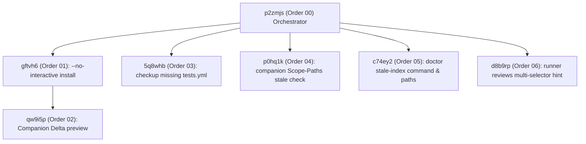

# IPD: Coordinate six dogfooding bug fixes across install, checkup, check, doctor, and runner selectors

- Date: 2026-11-21
- Kind: orchestrator
- Concern: Six user-facing CLI and companion-mode bugs discovered while dogfooding `polyopen` (`n5tqib`, `479wfb`, `bj3x5x`, `dv9ses`, `gqpgvm`, `bqqhdu`) need coordinated fixes across install, checkup, check engine, doctor, and runner selector diagnostics.
- Scope: Coordinate child plans `gftvh6` (Order 01), `qw9i5p` (Order 02), `5q8whb` (Order 03), `p0hq1k` (Order 04), `c74ey2` (Order 05), and `d8b9rp` (Order 06), retiring this orchestrator once all six children reach `executed`.
- Scope-Paths: .aw/records/plans/pending/20261121-dogfood-bugs-00-p2zmjs-coordinate-six-dogfooding-bug-fixes-across-install-checkup-c.ipd.md
- Item-Dependencies: executed:gftvh6, executed:qw9i5p, executed:5q8whb, executed:p0hq1k, executed:c74ey2, executed:d8b9rp
- Status: to-review
- Coverage: pass
- Coverage-Fingerprint: 421903d812a090e094c86773aadb85063f231e7638fc97e3893c0c111aacb184
- Coverage-Checked: 2026-11-21 by uri/its_direct/pt3-claude-opus-5.5-1m-us
- Short-Description: Coordinate fixes for six user-facing CLI and companion-mode bugs discovered while dogfooding polyopen
- Work-Kind: bug
- Priority: high
- Blocks-Release: next
- Set: dogfood-bugs
- Order: 0
- Highest E allocated: 06
- Author: antigravity
- Id: p2zmjs

> Write and proofread this plan per the technical writing standard, `.aw/system/workflows/technical-writing/technical-writing.md` (`.agents/workflows/technical-writing/technical-writing.md` in a legacy-layout install), including requirement 12 (diagrams).

## Workflow history

- 2026-11-21 to-review (aw set): Review-ready orchestrator for dogfood-bugs
- 2026-11-21 coverage pass (aw oc run): fingerprint 421903d812a0, model uri/its_direct/pt3-claude-opus-5.5-1m-us
- 2026-11-21 draft (antigravity): created.

## Goal

Coordinate six independent, bounded child plans fixing user-facing bugs found while dogfooding `agent-workflows` against a companion-mode target repository (`polyopen`), with each child graduating one release-blocking backlog item cleanly.

## Detailed Implementation Checklist (TODO)

Execution-state rule: mark an `E-*` item complete only after performing the action. That mark is not validation. Right-sizing rule: write for a modest executor that cannot hold much in its head. Each E-item is one step (one concern, about one file, executable in one focused pass) and its V-item names each unit it covers with its own check; a plan stays at about 5 E-items and 8 work Scope-Paths, else split it into more child plans (guidance, `IPD-Z603`). Accepted execution states: blocked, failed, pending, performed; terminal gate demands 'performed'.

### Task group 1: Child plan completion tracking

- [ ] E-01 CONFIRM gftvh6 REACHED executed
  - Depends on: none
  - Expected outcome: Child plan `gftvh6` (Order 01, backlog `n5tqib`) is in `.aw/records/plans/executed/` with `aw install --no-interactive` respecting non-interactive mode on TTY/PTY.
  - Execution state: pending

- [ ] E-02 CONFIRM qw9i5p REACHED executed
  - Depends on: E-01
  - Expected outcome: Child plan `qw9i5p` (Order 02, backlog `479wfb`) is in `.aw/records/plans/executed/` with `render_pre_write_plan` printing `{comp_path}/records/`.
  - Execution state: pending

- [ ] E-03 CONFIRM 5q8whb REACHED executed
  - Depends on: none
  - Expected outcome: Child plan `5q8whb` (Order 03, backlog `bj3x5x`) is in `.aw/records/plans/executed/` with local CI workflow pre-check in `checkup.py` and `/setup-repo` guidance.
  - Execution state: pending

- [ ] E-04 CONFIRM p0hq1k REACHED executed
  - Depends on: none
  - Expected outcome: Child plan `p0hq1k` (Order 04, backlog `dv9ses`) is in `.aw/records/plans/executed/` with companion-aware `stale_record_scope_paths` emitting portable `.aw/records/` paths only.
  - Execution state: pending

- [ ] E-05 CONFIRM c74ey2 REACHED executed
  - Depends on: none
  - Expected outcome: Child plan `c74ey2` (Order 05, backlog `gqpgvm`) is in `.aw/records/plans/executed/` with typed `aw index <type>` remediation and preserved companion index directories in `doctor.py`.
  - Execution state: pending

- [ ] E-06 CONFIRM d8b9rp REACHED executed
  - Depends on: none
  - Expected outcome: Child plan `d8b9rp` (Order 06, backlog `bqqhdu`) is in `.aw/records/plans/executed/` with actionable `--action review` hints in `runner_shared.describe_unresolved_plan_selector`.
  - Execution state: pending

## Child IPDs, sequence, and dependencies

| Order | Id | File | What it does | Depends on |
|---|---|---|---|---|
| 01 | `gftvh6` | `20261121-dogfood-bugs-01-gftvh6-honor-no-interactive-in-aw-install-policy-update-checkpoint.ipd.md` | Thread `ctx.interactive` into `install_wizard.collect_policy_interactive` so `aw install --no-interactive` never blocks on TTY/PTY (backlog `n5tqib`). | none |
| 02 | `qw9i5p` | `20261121-dogfood-bugs-02-qw9i5p-fix-aw-install-pre-write-plan-companion-delta-to-print-compa.ipd.md` | Replace obsolete `<companion>/.aw/records` decoy path with `<companion>/records/` in `install_wizard.render_pre_write_plan` (backlog `479wfb`). | Order 01 |
| 03 | `5q8whb` | `20261121-dogfood-bugs-03-5q8whb-handle-missing-local-ci-workflow-in-aw-checkup-instead-of-ra.ipd.md` | Detect absent local `.github/workflows/<wf>` in `checkup.read_ci_status` before invoking `gh` and add `/setup-repo` CI workflow guidance (backlog `bj3x5x`). | none |
| 04 | `p0hq1k` | `20261121-dogfood-bugs-04-p0hq1k-resolve-companion-records-paths-in-check-scope-path-target-s.ipd.md` | Resolve `.aw/records/` `Scope-Paths` entries against `project_records_dir` in `check_engine.stale_record_scope_paths` and never emit absolute paths (backlog `dv9ses`). | none |
| 05 | `c74ey2` | `20261121-dogfood-bugs-05-c74ey2-fix-aw-doctor-stale-index-remediation-command-and-companion.ipd.md` | Normalize companion records paths in `doctor._normalize_rel_path` and emit typed `aw index <type>` commands in `doctor.build_remediation` (backlog `gqpgvm`). | none |
| 06 | `d8b9rp` | `20261121-dogfood-bugs-06-d8b9rp-emit-actionable-action-review-hint-when-reviews-is-combined.ipd.md` | Emit actionable `--action review <selector>` hint in `runner_shared.describe_unresolved_plan_selector` when `reviews`/`review`/`to-review`/`all` is combined with another selector (backlog `bqqhdu`). | none |

## Completion criteria (the whole Set is done only when)

- `aw install --no-interactive --dry-run` never prompts on a TTY/PTY. Owner: `gftvh6`
- `aw install --dry-run` Companion Delta prints `<companion>/records/` without the obsolete `.aw/records` decoy. Owner: `qw9i5p`
- `aw checkup` reports an actionable missing-workflow reason instead of a raw GitHub API HTTP 404 when `.github/workflows/tests.yml` is absent, and `/setup-repo` checks for it. Owner: `5q8whb`
- `check.scope-path-target-stale` resolves `.aw/records/` paths against companion records storage and never recommends absolute filesystem paths. Owner: `p0hq1k`
- `aw doctor` preserves companion index parent directories and emits valid `aw index <type>` remediation commands. Owner: `c74ey2`
- `aw agy run reviews <setid>` and `aw oc run reviews <setid>` emit an actionable `--action review` hint. Owner: `d8b9rp`

## Cross-IPD validation

- Orders 01 (`gftvh6`) and 02 (`qw9i5p`) both edit `agent_workflows/install_wizard.py`; ordering `qw9i5p` after `gftvh6` guarantees `qw9i5p` validates the combined `install_wizard.py` test suite (`tests/test_install_wizard*.py`) after both changes land. Performed by `qw9i5p` (`V-02`).
- Orders 03 (`5q8whb`), 04 (`p0hq1k`), 05 (`c74ey2`), and 06 (`d8b9rp`) touch disjoint production modules (`checkup.py`, `check_engine.py`, `doctor.py`, `runner_shared.py`); each validates its own module suite, `make typecheck`, and `aw sanitize --agent`. Performed by `5q8whb` (`V-03`), `p0hq1k` (`V-03`), `c74ey2` (`V-03`), and `d8b9rp` (`V-02`).

## Deferred / out of scope (with reason)

- `.aw/config/project.json` untracked target status and preview parity in `public-target-private-companion` mode is already owned by backlog `o2or8a` and pending plan `ippuby`.
  - Carrier: ippuby

## Scope check

- Over-scope: none. Each child addresses one bounded bug with disjoint files (except `qw9i5p` serialized after `gftvh6`).
- Under-scope: none. All six backlog items (`n5tqib`, `479wfb`, `bj3x5x`, `dv9ses`, `gqpgvm`, `bqqhdu`) are mapped 1:1 to child plans `gftvh6`, `qw9i5p`, `5q8whb`, `p0hq1k`, `c74ey2`, and `d8b9rp`.

## Required tests / validation

This orchestrator runs no tests directly. Each child plan (`gftvh6`, `qw9i5p`, `5q8whb`, `p0hq1k`, `c74ey2`, `d8b9rp`) runs its targeted pytest suite, `make typecheck`, and `aw sanitize --agent` before finalizing; the runner merge gate runs the core pytest suite on every child integration.

## Open questions

None.

## Validation and cross-check (verify before reporting the Set complete)

Validation-state rule: inspect evidence in a separate pass. Do not mark a `V-*` item complete from memory or from the matching execution checkmark. Accepted validation results: blocked, failed, pass, pending; terminal gate demands 'pass'. Runtime-demonstration reachability rule: for each `V-*` item demanding the software be observed acting (such as a run, a dispatch, or a transition) (as distinct from items demanding a diff, a file's content, or a test result, which are reachable by construction) name the code path that produces the observation or the sibling `E-*` that creates it, else the demand is UNDER-SCOPE.

- [ ] V-01 validates E-01
  - Required evidence: `gftvh6` is present in `.aw/records/plans/executed/` with all `E-*`/`V-*` complete and passed.
  - Observed evidence:
  - Result: pending

- [ ] V-02 validates E-02
  - Required evidence: `qw9i5p` is present in `.aw/records/plans/executed/` with all `E-*`/`V-*` complete and passed.
  - Observed evidence:
  - Result: pending

- [ ] V-03 validates E-03
  - Required evidence: `5q8whb` is present in `.aw/records/plans/executed/` with all `E-*`/`V-*` complete and passed.
  - Observed evidence:
  - Result: pending

- [ ] V-04 validates E-04
  - Required evidence: `p0hq1k` is present in `.aw/records/plans/executed/` with all `E-*`/`V-*` complete and passed.
  - Observed evidence:
  - Result: pending

- [ ] V-05 validates E-05
  - Required evidence: `c74ey2` is present in `.aw/records/plans/executed/` with all `E-*`/`V-*` complete and passed.
  - Observed evidence:
  - Result: pending

- [ ] V-06 validates E-06
  - Required evidence: `d8b9rp` is present in `.aw/records/plans/executed/` with all `E-*`/`V-*` complete and passed.
  - Observed evidence:
  - Result: pending

## Approval and execution gate

- Size assessment: standard
- Cohesion rationale: not required

This orchestrator is not agent-executed directly; the runner retires `p2zmjs` to `executed` automatically once all six child plans (`gftvh6`, `qw9i5p`, `5q8whb`, `p0hq1k`, `c74ey2`, `d8b9rp`) reach `executed`.
