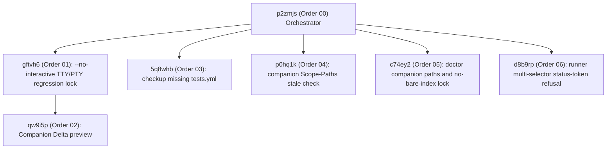

# IPD: Coordinate six dogfooding bug fixes across install, checkup, check, doctor, and runner selectors

- Date: 2026-11-21
- Kind: orchestrator
- Concern: Six user-facing CLI and companion-mode bugs discovered while dogfooding `polyopen` (`n5tqib`, `479wfb`, `bj3x5x`, `dv9ses`, `gqpgvm`, `bqqhdu`) need coordinated fixes and regression locks across install, checkup, check engine, doctor, and runner selector handling.
- Scope: Coordinate child plans `gftvh6` (Order 01), `qw9i5p` (Order 02), `5q8whb` (Order 03), `p0hq1k` (Order 04), `c74ey2` (Order 05), and `d8b9rp` (Order 06), retiring this orchestrator once all six children reach `executed`.
- Scope-Paths: .aw/records/plans/pending/20261121-dogfood-bugs-00-p2zmjs-coordinate-six-dogfooding-bug-fixes-across-install-checkup-c.ipd.md
- Item-Dependencies: executed:gftvh6, executed:qw9i5p, executed:5q8whb, executed:p0hq1k, executed:c74ey2, executed:d8b9rp
- Status: reviewed
- Readiness: go-pending-approval
- Review-Depth: orchestrator
- Coverage: pass
- Coverage-Fingerprint: 271adafc3ddd66cb57d7bdf7dd644f107d55a1c65f28e934dfc2edd37e8ffba5
- Coverage-Checked: 2026-11-25 by uri/its_direct/pt3-claude-opus-5.5-1m-us
- Short-Description: Coordinate fixes for six user-facing CLI and companion-mode bugs discovered while dogfooding polyopen
- Work-Kind: bug
- Priority: high
- Blocks-Release: next
- Set: dogfood-bugs
- Order: 0
- Highest E allocated: 06
- Author: antigravity
- Id: p2zmjs

> Write and proofread this plan per the technical writing standard, `.aw/system/workflows/technical-writing/technical-writing.md` (`.agents/workflows/technical-writing/technical-writing.md` in a legacy-layout install), including requirement 12 (diagrams).

## Workflow history

- 2026-11-25 reviewed (/plan-review model=gemini-4-neon-high): APPROVE WITH REVISIONS APPLIED; PR-001..PR-004 FIXED; review record .aw/records/reviews/20261121-dogfood-bugs-00-p2zmjs-coordinate-six-dogfooding-bug-fixes-across-install-checkup-c.review.md
- 2026-11-25 coverage pass (aw oc run): fingerprint 271adafc3ddd, model uri/its_direct/pt3-claude-opus-5.5-1m-us
- 2026-11-21 to-review (aw set): Review-ready orchestrator for dogfood-bugs
- 2026-11-21 coverage pass (aw oc run): fingerprint 421903d812a0, model uri/its_direct/pt3-claude-opus-5.5-1m-us
- 2026-11-21 draft (antigravity): created.

## Goal

Coordinate six bounded child plans addressing user-facing bugs found while dogfooding `agent-workflows` against a companion-mode target repository (`polyopen`), with each child graduating one release-blocking backlog item cleanly. Four children (`qw9i5p`, `5q8whb`, `p0hq1k`, `d8b9rp`) deliver code fixes and tests, and two children (`gftvh6`, `c74ey2`) lock in fixes that already landed on HEAD (`rznd0q`; `w819as`, `6qh68x`, `f1yjlx`) with regression tests and conditional production edits only if a test fails.

## Detailed Implementation Checklist (TODO)

Execution-state rule: mark an `E-*` item complete only after performing the action. That mark is not validation. Right-sizing rule: write for a modest executor that cannot hold much in its head. Each E-item is one step (one concern, about one file, executable in one focused pass) and its V-item names each unit it covers with its own check; a plan stays at about 5 E-items and 8 work Scope-Paths, else split it into more child plans (guidance, `IPD-Z603`). Accepted execution states: blocked, failed, pending, performed; terminal gate demands 'performed'.

### Task group 1: Child plan completion tracking

- [ ] E-01 CONFIRM gftvh6 REACHED executed
  - Depends on: none
  - Expected outcome: Child plan `gftvh6` (Order 01, backlog `n5tqib`) is in `.aw/records/plans/executed/` with `core`-marked TTY and real-PTY regression tests (`tests/test_install_no_interactive_tty.py`) locking in the `rznd0q` fix so `aw install --no-interactive` never prompts on a terminal, a conditional production edit only if a test fails, and one `CHANGELOG.md` bullet.
  - Execution state: pending

- [ ] E-02 CONFIRM qw9i5p REACHED executed
  - Depends on: E-01
  - Expected outcome: Child plan `qw9i5p` (Order 02, backlog `479wfb`) is in `.aw/records/plans/executed/` with `agent_workflows/install_wizard.py::render_pre_write_plan` printing the resolved companion `records/` directory (`resolved_roots.get("records")` with `{comp_path}/records/` fallback) without `/.aw/records` or `"and config"`, `core`-marked tests (`tests/test_install_wizard_companion_preview.py`), and one `CHANGELOG.md` bullet.
  - Execution state: pending

- [ ] E-03 CONFIRM 5q8whb REACHED executed
  - Depends on: none
  - Expected outcome: Child plan `5q8whb` (Order 03, backlog `bj3x5x`) is in `.aw/records/plans/executed/` with the bare-filename local CI workflow pre-check in `agent_workflows/checkup.py::read_ci_status`, updated `tests/test_checkup.py` fixtures, `/setup-repo` guidance in `.aw/system/workflows/setup-repo/setup-repo.md`, tests (`tests/test_checkup_missing_workflow.py`), and `README.md` / `CHANGELOG.md` updates.
  - Execution state: pending

- [ ] E-04 CONFIRM p0hq1k REACHED executed
  - Depends on: none
  - Expected outcome: Child plan `p0hq1k` (Order 04, backlog `dv9ses`) is in `.aw/records/plans/executed/` with companion-aware `agent_workflows/check_engine.py::stale_record_scope_paths` and `_logical_scope_rel` resolving `.aw/records/` entries and declared move pairs against `project_context.project_records_dir`, emitting portable `.aw/records/` paths only, plus tests (`tests/test_scope_path_stale_companion.py`) and one `CHANGELOG.md` bullet.
  - Execution state: pending

- [ ] E-05 CONFIRM c74ey2 REACHED executed
  - Depends on: none
  - Expected outcome: Child plan `c74ey2` (Order 05, backlog `gqpgvm`) is in `.aw/records/plans/executed/` with function-level and end-to-end regression tests (`tests/test_doctor_companion_paths.py`) locking in that `aw doctor` preserves logical `.aw/records/<type>/...` companion directories (never `- .` or absolute companion paths) and never emits bare `aw index`, with a conditional edit to `agent_workflows/doctor.py` only if a test fails.
  - Execution state: pending

- [ ] E-06 CONFIRM d8b9rp REACHED executed
  - Depends on: none
  - Expected outcome: Child plan `d8b9rp` (Order 06, backlog `bqqhdu`) is in `.aw/records/plans/executed/` with a multi-selector status-token guard at the top of `agent_workflows/runner_shared.py::expand_selectors` (exempting exact Set IDs) refusing combined status selectors with `DriverError` and host-specific `aw <host> review` / `--action review` (or `aw <host> run`) commands, `core`-marked function and CLI tests (`tests/test_runner_reviews_selector_hint.py`), and one `CHANGELOG.md` bullet.
  - Execution state: pending

## Child IPDs, sequence, and dependencies

| Order | Id | File | What it does | Depends on |
|---|---|---|---|---|
| 01 | `gftvh6` | `20261121-dogfood-bugs-01-gftvh6-honor-no-interactive-in-aw-install-policy-update-checkpoint.ipd.md` | Add `core`-marked simulated-TTY and real-PTY regression tests (`tests/test_install_no_interactive_tty.py`) locking in the `rznd0q` fix so `aw install --no-interactive` never prompts on a terminal, conditionally editing `agent_workflows/install_wizard.py` or `agent_workflows/cli.py` only if a test fails, plus one `CHANGELOG.md` bullet (backlog `n5tqib`). | none |
| 02 | `qw9i5p` | `20261121-dogfood-bugs-02-qw9i5p-fix-aw-install-pre-write-plan-companion-delta-to-print-compa.ipd.md` | Update `agent_workflows/install_wizard.py::render_pre_write_plan` to print the resolved companion `records/` directory (`resolved_roots.get("records")` with `<companion>/records/` fallback) and drop `"and config"`, plus `core`-marked tests and one `CHANGELOG.md` bullet (backlog `479wfb`). | Order 01 |
| 03 | `5q8whb` | `20261121-dogfood-bugs-03-5q8whb-handle-missing-local-ci-workflow-in-aw-checkup-instead-of-ra.ipd.md` | Detect absent local `.github/workflows/<wf>` bare filenames in `agent_workflows/checkup.py::read_ci_status` before invoking `gh`, update `tests/test_checkup.py` fixtures, add `/setup-repo` step 5 guidance, add behavioral tests, and update `README.md` and `CHANGELOG.md` (backlog `bj3x5x`). | none |
| 04 | `p0hq1k` | `20261121-dogfood-bugs-04-p0hq1k-resolve-companion-records-paths-in-check-scope-path-target-s.ipd.md` | Resolve `.aw/records/` `Scope-Paths` entries and declared move pairs against `project_context.project_records_dir` in `agent_workflows/check_engine.py::stale_record_scope_paths` via `_logical_scope_rel`, never emit absolute paths, add tests, and add one `CHANGELOG.md` bullet (backlog `dv9ses`). | none |
| 05 | `c74ey2` | `20261121-dogfood-bugs-05-c74ey2-fix-aw-doctor-stale-index-remediation-command-and-companion.ipd.md` | Add function-level and end-to-end regression tests (`tests/test_doctor_companion_paths.py`) proving `aw doctor` on a companion install preserves logical `.aw/records/<type>/...` directories and never emits bare `aw index`, conditionally editing `agent_workflows/doctor.py` only if a test fails (backlog `gqpgvm`). | none |
| 06 | `d8b9rp` | `20261121-dogfood-bugs-06-d8b9rp-emit-actionable-action-review-hint-when-reviews-is-combined.ipd.md` | Add a guard at the top of `agent_workflows/runner_shared.py::expand_selectors` refusing status selectors (`reviews`, `review`, `to-review`, `all`) combined with another selector (exempting exact Set IDs) and naming the host's `aw <host> review` / `--action review` (or `aw <host> run`) command, plus `core`-marked tests and one `CHANGELOG.md` bullet (backlog `bqqhdu`). | none |

## Completion criteria (the whole Set is done only when)

- `aw install --no-interactive` (with and without `--dry-run`) never prompts on a simulated TTY or real PTY, locked in by `core`-marked regression tests and a `CHANGELOG.md` entry. Owner: `gftvh6`
- `aw install --dry-run` Companion Delta prints the resolved companion `<companion>/records/` directory matching the `records` row, without the obsolete `/.aw/records` decoy or `"and config"`. Owner: `qw9i5p`
- `aw checkup` reports an actionable missing-workflow reason instead of a raw GitHub API HTTP 404 when a bare-filename `.github/workflows/<wf>` file is absent, `/setup-repo` checks for it, and `README.md` / `CHANGELOG.md` document it. Owner: `5q8whb`
- `check.scope-path-target-stale` resolves `.aw/records/` paths and declared move pairs against companion records storage and never recommends absolute filesystem paths. Owner: `p0hq1k`
- `aw doctor` on a companion install preserves logical `.aw/records/<type>/...` directories (never `- .` or absolute companion paths) and never emits a bare `aw index` command, locked in by regression tests. Owner: `c74ey2`
- `aw agy run` and `aw oc run` refuse a status selector (`reviews`, `review`, `to-review`, `all`) combined with another selector (unless it is an exact Set ID) with exit 2 and print the host's `aw <host> review <others>` / `--action review` (or `aw <host> run`) command. Owner: `d8b9rp`

## Cross-IPD validation

- Order 01 (`gftvh6`) conditionally scopes `agent_workflows/install_wizard.py` and creates `tests/test_install_no_interactive_tty.py`; Order 02 (`qw9i5p`) edits `agent_workflows/install_wizard.py` and depends on `executed:gftvh6`, validating the combined preview and install test modules (`tests/test_install_wizard_companion_preview.py`, `tests/test_install_consent_truth.py`, `tests/test_records_untracked_backend.py`, `tests/test_companion_containment_and_storage.py`, and `tests/test_install_no_interactive_tty.py`), bare `python3 -m pytest`, `make typecheck`, and `aw sanitize --agent`. Performed by `qw9i5p` (`V-02`).
- Orders 03 (`5q8whb`), 04 (`p0hq1k`), 05 (`c74ey2`), and 06 (`d8b9rp`) touch disjoint production and test modules (`agent_workflows/checkup.py`, `agent_workflows/check_engine.py`, `agent_workflows/doctor.py` conditionally, and `agent_workflows/runner_shared.py`). Each validates its targeted pytest suites and `aw sanitize --agent`, with `make typecheck` run unconditionally by `5q8whb` (`V-03`), `p0hq1k` (`V-03`), and `d8b9rp` (`V-04`), and conditionally by `c74ey2` (`V-03`) if `agent_workflows/doctor.py` changes. Performed by `5q8whb` (`V-03`), `p0hq1k` (`V-03`), `c74ey2` (`V-03`), and `d8b9rp` (`V-02`, `V-03`, `V-04`).

## Deferred / out of scope (with reason)

- `.aw/config/project.json` untracked target status and preview parity in `public-target-private-companion` mode is already owned by backlog `o2or8a` and pending plan `ippuby`.
  - Carrier: ippuby

## Scope check

- Over-scope: none. Each child addresses one bounded bug with disjoint production and test modules (except `agent_workflows/install_wizard.py`, shared by `gftvh6` conditionally and `qw9i5p`, with `qw9i5p` serialized after `gftvh6`). Five children (`gftvh6`, `qw9i5p`, `5q8whb`, `p0hq1k`, `d8b9rp`) each append one `- Fixed:` bullet to `CHANGELOG.md`, which per-lane worktree isolation and the runner merge gate serialize safely.
- Under-scope: none. All six backlog items (`n5tqib`, `479wfb`, `bj3x5x`, `dv9ses`, `gqpgvm`, `bqqhdu`) are mapped 1:1 to child plans `gftvh6`, `qw9i5p`, `5q8whb`, `p0hq1k`, `c74ey2`, and `d8b9rp`.

## Required tests / validation

This orchestrator runs no tests directly. Each child plan (`gftvh6`, `qw9i5p`, `5q8whb`, `p0hq1k`, `c74ey2`, `d8b9rp`) runs its targeted pytest suites and `aw sanitize --agent` before finalizing; `qw9i5p`, `5q8whb`, `p0hq1k`, and `d8b9rp` run `make typecheck` unconditionally, while `gftvh6` and `c74ey2` run `make typecheck` if a production file changes. The runner merge gate runs the core pytest suite on every child integration.

## Open questions

None.

## Validation and cross-check (verify before reporting the Set complete)

Validation-state rule: inspect evidence in a separate pass. Do not mark a `V-*` item complete from memory or from the matching execution checkmark. Accepted validation results: blocked, failed, pass, pending; terminal gate demands 'pass'. Runtime-demonstration reachability rule: for each `V-*` item demanding the software be observed acting (such as a run, a dispatch, or a transition) (as distinct from items demanding a diff, a file's content, or a test result, which are reachable by construction) name the code path that produces the observation or the sibling `E-*` that creates it, else the demand is UNDER-SCOPE.

- [ ] V-01 validates E-01
  - Required evidence: `gftvh6` is present in `.aw/records/plans/executed/` with all `E-*`/`V-*` complete and passed.
  - Observed evidence:
  - Result: pending

- [ ] V-02 validates E-02
  - Required evidence: `qw9i5p` is present in `.aw/records/plans/executed/` with all `E-*`/`V-*` complete and passed.
  - Observed evidence:
  - Result: pending

- [ ] V-03 validates E-03
  - Required evidence: `5q8whb` is present in `.aw/records/plans/executed/` with all `E-*`/`V-*` complete and passed.
  - Observed evidence:
  - Result: pending

- [ ] V-04 validates E-04
  - Required evidence: `p0hq1k` is present in `.aw/records/plans/executed/` with all `E-*`/`V-*` complete and passed.
  - Observed evidence:
  - Result: pending

- [ ] V-05 validates E-05
  - Required evidence: `c74ey2` is present in `.aw/records/plans/executed/` with all `E-*`/`V-*` complete and passed.
  - Observed evidence:
  - Result: pending

- [ ] V-06 validates E-06
  - Required evidence: `d8b9rp` is present in `.aw/records/plans/executed/` with all `E-*`/`V-*` complete and passed.
  - Observed evidence:
  - Result: pending

## Approval and execution gate

- Size assessment: standard
- Cohesion rationale: not required

Execution contract:
- Approval and open questions: this orchestrator must reach `- Status: approved` with all blocking open questions resolved before execution or retirement.
- Scope fence: `- Scope-Paths:` declares only this orchestrator plan file. Any out-of-scope edit must be justified with `--scope-reason` and any unmodified declared path acknowledged with `--scope-ack` at finalize; stop only for genuinely unsafe conditions (such as an unresolvable concurrent-edit conflict or missing prerequisite state), not for a scope-boundary question.
- Honesty and evidence: paste actual command or check output into every `V-*` Observed evidence block when retiring standalone; never claim a child reached `executed` without verifying it on disk.
- Commits and push: commit path-scoped through `aw commit p2zmjs -- <paths>` (or let the runner write the retirement commit); never push without an explicit human request.
- Lifecycle transition: this orchestrator is not agent-executed directly. When run by a runner (`aw oc run` / `aw agy run`), the runner retires `p2zmjs` to `.aw/records/plans/executed/` automatically once all six child plans (`gftvh6`, `qw9i5p`, `5q8whb`, `p0hq1k`, `c74ey2`, `d8b9rp`) reach `executed` on disk. If finalized standalone outside a runner, run `aw ipd finalize p2zmjs` after verifying all `V-01`..`V-06` evidence; never hand-roll `git mv` to `.aw/records/plans/executed/`.
