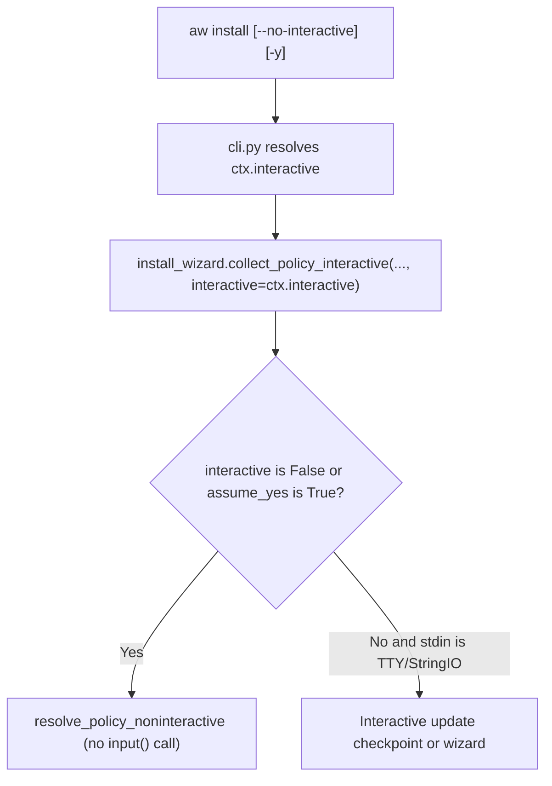

# IPD: Honor --no-interactive in aw install policy update checkpoint on TTY/PTY

- Date: 2026-11-21
- Kind: child
- Concern: `aw install --no-interactive` ignores `--no-interactive` and blocks on `Keep current policy and proceed? [Y/n/review]` whenever `sys.stdin` is attached to a TTY or PTY.
- Scope: Thread the resolved interactivity flag from `agent_workflows/cli.py` into `agent_workflows/install_wizard.py::collect_policy_interactive` and add regression tests proving non-interactive execution never prompts.
- Scope-Paths: agent_workflows/cli.py, agent_workflows/install_wizard.py, tests/test_install_wizard_noninteractive.py, .aw/records/plans/pending/20261121-dogfood-bugs-01-gftvh6-honor-no-interactive-in-aw-install-policy-update-checkpoint.ipd.md
- Item-Dependencies: none
- Status: to-review
- Short-Description: Thread ctx.interactive into install_wizard.collect_policy_interactive so --no-interactive never prompts
- Work-Kind: bug
- Priority: high
- From-Backlog: n5tqib
- Blocks-Release: next
- Set: dogfood-bugs
- Order: 1
- Highest E allocated: 03
- Author: antigravity
- Id: gftvh6

> Write and proofread this plan per the technical writing standard, `.aw/system/workflows/technical-writing/technical-writing.md` (`.agents/workflows/technical-writing/technical-writing.md` in a legacy-layout install), including requirement 12 (diagrams).

## Workflow history

- 2026-11-21 to-review (aw set): Review-ready child plans for dogfood-bugs
- 2026-11-21 draft (antigravity): created.

## Goal

Ensure `aw install --no-interactive` (including `--no-interactive --dry-run`) never blocks waiting for interactive input on a TTY or PTY, matching the documented `--no-interactive` CLI contract.

## Detailed Implementation Checklist (TODO)

Execution-state rule: mark an `E-*` item complete only after performing the action. That mark is not validation. Right-sizing rule: write for a modest executor that cannot hold much in its head. Each E-item is one step (one concern, about one file, executable in one focused pass) and its V-item names each unit it covers with its own check; a plan stays at about 5 E-items and 8 work Scope-Paths, else split it into more child plans (guidance, `IPD-Z603`). Accepted execution states: blocked, failed, pending, performed; terminal gate demands 'performed'.

### Task group 1: Respect explicit non-interactive mode in install wizard

- [ ] E-01 Add an optional keyword-only `interactive: Optional[bool] = None` parameter to `agent_workflows/install_wizard.py::collect_policy_interactive` and gate `is_interactive` so `interactive is False` always routes to `resolve_policy_noninteractive` without calling `input()`.
  - Depends on: none
  - Expected outcome: Calling `collect_policy_interactive(..., interactive=False)` with a TTY `sys.stdin` returns `resolve_policy_noninteractive(...)` immediately without reading stdin or printing `Keep current policy and proceed?`. When `interactive is None`, existing `assume_yes` and `isatty`/`StringIO` detection stays unchanged; when `interactive is True` and `assume_yes` is False, interactive mode is forced even on a non-TTY stream.
  - Execution state: pending

- [ ] E-02 Pass `interactive=ctx.interactive` (derived from `select_output(args)` / `--no-interactive` and `--interactive` flags) from `agent_workflows/cli.py`'s `install` command into `install_wizard.collect_policy_interactive`.
  - Depends on: E-01
  - Expected outcome: Running `aw install --no-interactive --dry-run` (or `aw install --no-interactive`) on a TTY/PTY completes immediately using the existing policy without hanging on `Keep current policy and proceed? [Y/n/review]`.
  - Execution state: pending

### Task group 2: Behavioral verification

- [ ] E-03 Add behavioral tests in `tests/test_install_wizard_noninteractive.py` covering `collect_policy_interactive(..., interactive=False)` with a mocked TTY `stdin` and CLI invocation of `aw install --no-interactive --dry-run` with a PTY or TTY-mocked stdin.
  - Depends on: E-01, E-02
  - Expected outcome: Tests assert that `input()` is never called when `--no-interactive` or `interactive=False` is passed, that existing policy is preserved, and that `aw install --no-interactive --dry-run` exits 0 without blocking.
  - Execution state: pending

## Project conventions discovered (Step 0)

- Test suite runs via bare `python3 -m pytest` (never `-n0`, never extra `-q`, never `-p no:randomly`); type checking runs via `make typecheck` (`python3 -m mypy agent_workflows`); leak check runs via `aw sanitize --agent`.
- Commits use `aw commit gftvh6 -- <paths>` inside an isolated worktree.
- Tests must exercise observable behavior and never read production source code (`inspect`, `ast`, regex).
- `agent_workflows/install_wizard.py::collect_policy_interactive` currently computes `is_interactive = not assume_yes and ((hasattr(sys.stdin, "isatty") and sys.stdin.isatty()) or isinstance(sys.stdin, io.StringIO))` and has no `interactive` parameter.
- `agent_workflows/cli.py` invokes `collect_policy_interactive` inside the `install` subcommand handler without passing the CLI's `--no-interactive` / `ctx.interactive` decision.

## Findings

| ID | Severity | Area | Finding |
|---|---|---|---|
| DF-02 | High | `agent_workflows/install_wizard.py::collect_policy_interactive`, `agent_workflows/cli.py` | Observed during dogfooding: `aw install --no-interactive --dry-run` on a PTY hung indefinitely at `Keep current policy and proceed? [Y/n/review]` until stdin was redirected from `/dev/null`, violating `--no-interactive`'s documented contract. |

## Proposed changes (ordered, validatable)

1. `agent_workflows/install_wizard.py::collect_policy_interactive` (`E-01`): Accept keyword-only `interactive: Optional[bool] = None`. Resolve `is_interactive`: if `assume_yes` is True or `interactive is False`, set `is_interactive = False`; else if `interactive is True`, set `is_interactive = True`; else keep the existing `isatty()` / `io.StringIO` probe.
2. `agent_workflows/cli.py` (`E-02`): Determine the explicit interactivity override from `args` / `ctx.interactive` in the `install` handler and pass `interactive=` to `collect_policy_interactive`.
3. `tests/test_install_wizard_noninteractive.py` (`E-03`): Add behavioral tests exercising both `collect_policy_interactive` directly and CLI `aw install --no-interactive --dry-run` under a TTY-reporting `stdin`.

## Deferred / out of scope (with reason)

- Fixing the obsolete `Companion Delta` preview path in `agent_workflows/install_wizard.py::render_pre_write_plan` is owned by sibling plan `qw9i5p` (Order 02).
  - Carrier: qw9i5p
- Aligning `.aw/config/project.json` preview parity and target staging in companion mode is already tracked by backlog `o2or8a` and pending plan `ippuby`.
  - Carrier: ippuby

## Scope check

- Over-scope: none. Every edit is confined to wiring interactivity into `install_wizard.collect_policy_interactive` and its CLI caller plus tests.
- Under-scope: none. Both the library function and the CLI entrypoint are covered.

## Required tests / validation

- Run `python3 -m pytest tests/test_install_wizard_noninteractive.py tests/test_install_wizard*.py`.
- Run `make typecheck` (`python3 -m mypy agent_workflows`) with zero errors.
- Run `aw sanitize --agent` with zero findings.

## Spec / documentation sync

N/A with reason: `--no-interactive` is already documented in `aw install --help` as `"Disable interactive prompting (declining confirmations and taking non-interactive defaults)."`; this change makes runtime behavior match the existing documented contract.

## Open questions

None.

## Validation and cross-check (verify before reporting done)

Validation-state rule: inspect evidence in a separate pass. Do not mark a `V-*` item complete from memory or from the matching execution checkmark. Accepted validation results: blocked, failed, pass, pending; terminal gate demands 'pass'. Runtime-demonstration reachability rule: for each `V-*` item demanding the software be observed acting (such as a run, a dispatch, or a transition) (as distinct from items demanding a diff, a file's content, or a test result, which are reachable by construction) name the code path that produces the observation or the sibling `E-*` that creates it, else the demand is UNDER-SCOPE.

- [ ] V-01 validates E-01
  - Required evidence: Paste `git diff -- agent_workflows/install_wizard.py` showing `interactive: Optional[bool] = None` in `collect_policy_interactive` and its gating of `is_interactive`, plus pasted `python3 -m pytest tests/test_install_wizard_noninteractive.py` output confirming `interactive=False` with a TTY `stdin` never calls `input()`.
  - Observed evidence:
  - Result: pending

- [ ] V-02 validates E-02
  - Required evidence: Paste `git diff -- agent_workflows/cli.py` showing `interactive=` passed to `collect_policy_interactive`, plus pasted test output proving `aw install --no-interactive --dry-run` on a TTY-reporting `stdin` exits 0 without printing `Keep current policy and proceed?`.
  - Observed evidence:
  - Result: pending

- [ ] V-03 validates E-03
  - Required evidence: Paste full output of `python3 -m pytest tests/test_install_wizard_noninteractive.py tests/test_install_wizard*.py`, `make typecheck`, and `aw sanitize --agent` showing all tests pass, 0 mypy errors, and 0 leak findings.
  - Observed evidence:
  - Result: pending

## Approval and execution gate

- Size assessment: standard
- Cohesion rationale: not required

This plan must reach `approved` before execution. Execute inside an isolated worktree, commit only `Scope-Paths` files via `aw commit gftvh6 -- <paths>`, paste actual command output into each `V-*` Observed evidence block, and finalize via `aw ipd finalize gftvh6`.
