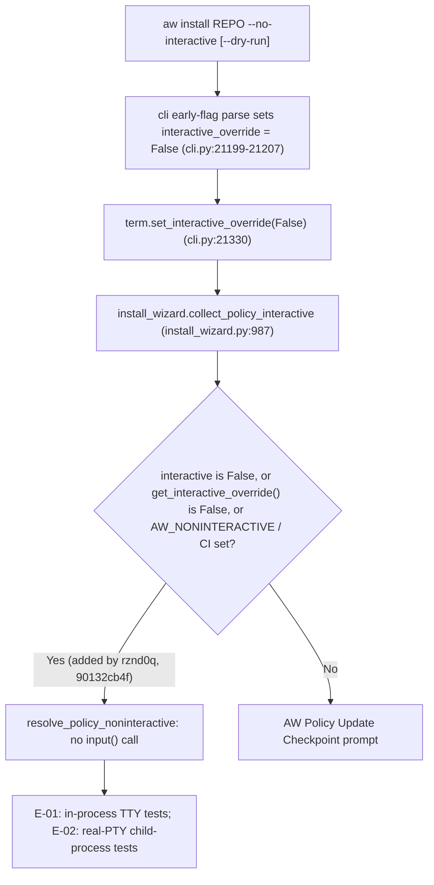

# IPD: Lock in aw install --no-interactive never prompting on a terminal with regression tests

- Date: 2026-11-21
- Kind: child
- Concern: Backlog `n5tqib` reported that `aw install --no-interactive --dry-run` on a terminal (TTY or pseudo-terminal, PTY) waited forever at `Keep current policy and proceed? [Y/n/review]` until stdin was redirected from `/dev/null`. Executed plan `rznd0q` (commit `90132cb4f`, 2026-11-21) fixed this after this plan was written, so what remains is a regression lock. The existing tests cover the `--dry-run` spellings and the library function. They do not cover `--no-interactive` without `--dry-run`, and none runs `aw install` on a real PTY, the setting the bug was reported in.
- Scope: Add behavioral regression tests in `tests/test_install_no_interactive_tty.py` that run `aw install --no-interactive` (with and without `--dry-run`) on a simulated TTY and on a real PTY, and assert that it never prompts, finishes, and exits 0. Change `agent_workflows/install_wizard.py` or `agent_workflows/cli.py` only if one of those tests fails on unmodified HEAD. Add one CHANGELOG bullet for the user-visible fix.
- Scope-Paths: tests/test_install_no_interactive_tty.py, agent_workflows/install_wizard.py, agent_workflows/cli.py, CHANGELOG.md, .aw/records/plans/pending/20261121-dogfood-bugs-01-gftvh6-honor-no-interactive-in-aw-install-policy-update-checkpoint.ipd.md
- Item-Dependencies: none
- Status: approved
- Readiness: go-pending-approval
- Review-Depth: standard
- Short-Description: Lock in that aw install --no-interactive never prompts on a TTY or PTY, with regression tests
- Work-Kind: bug
- Priority: high
- From-Backlog: n5tqib
- Blocks-Release: next
- Set: dogfood-bugs
- Order: 1
- Highest E allocated: 04
- Author: antigravity
- Id: gftvh6
- Approval: 2026-11-27, recorded via aw ipd set: status set to approved

> Write and proofread this plan per the technical writing standard, `.aw/system/workflows/technical-writing/technical-writing.md` (`.agents/workflows/technical-writing/technical-writing.md` in a legacy-layout install), including requirement 12 (diagrams).

## Workflow history

- 2026-11-27 approved (aw set): status set to approved
- 2026-11-24 reviewed (/plan-review model=claude-opus-5.5): APPROVE WITH REVISIONS APPLIED; F1..F5 FIXED, F6 and F7 DEFERRED; review record .aw/records/reviews/20261121-dogfood-bugs-01-gftvh6-honor-no-interactive-in-aw-install-policy-update-checkpoint.review.md
- 2026-11-21 to-review (aw set): Review-ready child plans for dogfood-bugs
- 2026-11-21 draft (antigravity): created.

## Goal

Prove, with tests that run `aw install` the way an operator does, that `--no-interactive` can never again wait for input on a terminal:

1. `aw install <repo> --no-interactive` and `aw install <repo> --no-interactive --dry-run`, run on an already-installed repository with stdin attached to a TTY, never call `input()`, never print `AW Policy Update Checkpoint`, exit 0, and leave the repository unchanged.
2. The same two commands, run as a child process whose stdin, stdout, and stderr are a real PTY, finish within a timeout and exit 0.

`--no-interactive` is documented in `aw install --help` as "Disable interactive prompting (declining confirmations and taking non-interactive defaults)." Declining confirmations means a non-dry-run install on an installed repository prints `aborted; nothing changed.` and exits 0 (observed at review), so "unchanged" is the expected result, not a defect.

The behavior is already correct on HEAD (see Step 0), so this plan adds no production change unless a test it adds fails.

## Detailed Implementation Checklist (TODO)

Execution-state rule: mark an `E-*` item complete only after performing the action. That mark is not validation. Right-sizing rule: write for a modest executor that cannot hold much in its head. Each E-item is one step (one concern, about one file, executable in one focused pass) and its V-item names each unit it covers with its own check; a plan stays at about 5 E-items and 8 work Scope-Paths, else split it into more child plans (guidance, `IPD-Z603`). Accepted execution states: blocked, failed, pending, performed; terminal gate demands 'performed'.

### Task group 1: Regression tests

- [ ] E-01 Create `tests/test_install_no_interactive_tty.py` with `pytestmark = pytest.mark.core` (as in `tests/test_runner_shared.py:58`), so the bare routine gate runs it. Import `_isolate_env`, `_make_modern_aw_repo`, `_FakeTTYStdin`, `_fail_input`, `_snapshot_tree`, and `_git_status_porcelain` from `tests/test_install_dry_run_noninteractive.py`; importing helpers from a sibling test module is an existing convention (for example `tests/test_agy_runipd_cli.py:23`). In each test, call `_isolate_env(monkeypatch, tmp_path, clear_ci=True)` so `CI` and `AW_NONINTERACTIVE` cannot make the test pass on their own, set `sys.stdin` to `_FakeTTYStdin()`, and call `cli.main([...])` under `redirect_stdout` and `redirect_stderr` into one buffer. Cases, parametrized where noted: (a) for `extra` in `["--no-interactive"]` and `["--no-interactive", "--dry-run"]`, with `builtins.input` patched to `_fail_input`, `cli.main(["install", str(repo), *extra])` returns 0, the output does not contain `AW Policy Update Checkpoint`, `_snapshot_tree(repo / ".aw")` equals its value before the call, and `_git_status_porcelain(repo)` is empty; (b) a control with no flag: patch `builtins.input` to record each prompt and answer `y` to the first and `n` to every later one, call `cli.main(["install", str(repo)])`, and assert that the first recorded prompt contains `Keep current policy and proceed?`. Case (b) proves that the simulated TTY reaches the checkpoint, so case (a) is not vacuous.
  - Depends on: none
  - Expected outcome: Three test cases exist and pass on unmodified HEAD. The review ran cases (a) without `--dry-run` and (b) by hand at `005bd41ed` and observed exactly these outcomes: (a) returned 0 with no checkpoint, an unchanged `.aw/` tree, and a clean `git status`; (b) recorded `Keep current policy and proceed? [Y/n/review] ` as its first prompt.
  - Execution state: pending

- [ ] E-02 In the same file, add a real-PTY test, parametrized over `extra` in `["--no-interactive"]` and `["--no-interactive", "--dry-run"]`. Skip it when `os.name == "nt"`. Build the repository with `_make_modern_aw_repo` and an isolated `HOME`, `AW_HOME`, `XDG_CONFIG_HOME`, and `XDG_DATA_HOME` under `tmp_path`, and copy `os.environ` into the child environment with `CI` and `AW_NONINTERACTIVE` removed and `AW_NO_REEXEC=1` set. Open a PTY with `pty.openpty()` and start `[sys.executable, "-m", "agent_workflows", "install", str(repo), *extra]` with `subprocess.Popen`, with stdin, stdout, and stderr all on the PTY's child end, `cwd` set to the repository root of the test checkout (`Path(__file__).resolve().parents[1]`), and `close_fds=True`. Close the child end in the parent, then drain the parent end with `select` until end of file or a 30-second deadline, as `tests/test_agent_turn_noninteractive_pty.py::AgentChildEnvNonInteractiveTests.test_offer_commit_under_real_pty_does_not_prompt_when_agent_child_env_set` does (lines 76-110); the drain matters because macOS PTYs can lose output once the child end closes. If the deadline passes, kill the process and fail with the drained output. Assert that the process exited before the deadline with code 0, and that the output contains neither `Keep current policy and proceed?` nor `AW Policy Update Checkpoint`.
  - Depends on: E-01
  - Expected outcome: Two test cases exist and pass on unmodified HEAD. The review ran both commands by hand on a real PTY at `005bd41ed`: each exited 0 in 0.3 seconds without the checkpoint text. The same harness with no flag reached the checkpoint and was still waiting at a 40-second timeout, which shows the harness reproduces the reported hang.
  - Execution state: pending

### Task group 2: Conditional production fix and release note

- [ ] E-03 Run `python3 -m pytest -o addopts="" -v tests/test_install_no_interactive_tty.py` on unmodified `agent_workflows/install_wizard.py` and `agent_workflows/cli.py`. If every case passes, change neither file, and acknowledge both at finalize with `--scope-ack agent_workflows/install_wizard.py --scope-ack agent_workflows/cli.py`. If a case fails, make the smallest change to `agent_workflows/install_wizard.py` or `agent_workflows/cli.py` that makes it pass without weakening the test, and re-run.
  - Depends on: E-01, E-02
  - Expected outcome: All five cases pass. `git diff --stat` for this plan lists a production file only if a case failed first, and that failing output is pasted in V-03.
  - Execution state: pending

- [ ] E-04 Add one bullet to `CHANGELOG.md` under `## 2.0.0 (pending)`, in the existing `- Fixed:` style and with no em or en dashes: `- Fixed: \\`aw install --no-interactive\\` (with or without \\`--dry-run\\`) no longer waits at the \\`Keep current policy and proceed?\\` prompt when run in a terminal.` First search `CHANGELOG.md` for `Keep current policy`; if an entry for this fix already exists, add nothing and record that in V-04.
  - Depends on: E-03
  - Expected outcome: Exactly one bullet describes the fix, and `git diff -- CHANGELOG.md` shows no other change.
  - Execution state: pending

## Project conventions discovered (Step 0)

- The plan as first written targeted a change that had already landed. Measured at `005bd41ed`:
  - `install_wizard.collect_policy_interactive` (`agent_workflows/install_wizard.py:987`) already has the keyword-only `interactive: Optional[bool] = None` and `dry_run: bool = False` parameters (lines 1001-1002). Lines 1008-1012 compute `forced_noninteractive` from `interactive is False`, `term.get_interactive_override() is False`, and `term.is_forced_noninteractive()`, and any of them sends the call to `resolve_policy_noninteractive` (line 1022). `git log -L` attributes this to `90132cb4f` ("rznd0q: preserve dry-run and non-interactive invariants in legacy aw install"), and the executed `rznd0q` plan's E-01 names this plan as the sibling it stays compatible with.
  - `agent_workflows/cli.py` never needs to pass `interactive=` (the call at lines 9709-9721 does not). The CLI's early-flag parser turns `--no-interactive` into `interactive_override = False` (lines 21199-21207) and sets it process-wide with `term.set_interactive_override` (line 21330), which `collect_policy_interactive` reads. `ctx.interactive`, which the original E-02 named, does not exist in `cli.py`.
- Probes at `005bd41ed`, run with `AW_NO_REEXEC=1`, `CI` and `AW_NONINTERACTIVE` unset, and an isolated `HOME`: on an installed repository with a simulated TTY stdin, `cli.main(["install", repo, "--no-interactive"])` returned 0 with no prompt, an unchanged `.aw/` tree, and a clean `git status`. Without the flag, the first prompt was `Keep current policy and proceed? [Y/n/review] `. On a real PTY, `--no-interactive` and `--no-interactive --dry-run` each exited 0 in 0.3 seconds. The PTY output of the first ended `aborted; nothing changed.`, and the second ended `[DRY RUN] No changes written to filesystem or Git state.`. With no flag, the PTY run was still waiting at the checkpoint after 40 seconds.
- Existing coverage in `tests/test_install_dry_run_noninteractive.py` (10 tests, all passing at review, none marked `core`): the CLI `--dry-run --no-interactive` cases on legacy repositories, an interactive-TTY `--dry-run` case, and the direct `collect_policy_interactive` matrix (lines 301-397, including `interactive=False` and `set_interactive_override(False)` on a TTY). It has no CLI case for `--no-interactive` without `--dry-run` and no real-PTY case. Because it is not `core`-marked, the bare routine gate skips it.
- The original Required tests glob `tests/test_install_wizard*.py` matches no file, and bare `python3 -m pytest <file>` hides per-test lines. Use `-o addopts=""` with explicit files.
- Tests must exercise observable behavior and never read production source code (`inspect`, `ast`, regex).

## Findings

| ID | Severity | Area | Finding |
|---|---|---|---|
| DF-02 | High | `aw install --no-interactive` on a TTY or PTY | Observed during dogfooding before 2026-11-21: `aw install --no-interactive --dry-run` on a PTY waited indefinitely at `Keep current policy and proceed? [Y/n/review]` until stdin was redirected from `/dev/null`. Fixed on HEAD by `rznd0q` (`90132cb4f`); this plan locks the fix in with tests. |

## Proposed changes (ordered, validatable)

1. `tests/test_install_no_interactive_tty.py` (`E-01`): in-process CLI tests on a simulated TTY, plus a control proving the TTY reaches the checkpoint.
2. `tests/test_install_no_interactive_tty.py` (`E-02`): real-PTY child-process tests with a timeout.
3. `agent_workflows/install_wizard.py`, `agent_workflows/cli.py` (`E-03`): no change unless a test from 1 or 2 fails on unmodified HEAD.
4. `CHANGELOG.md` (`E-04`): one `- Fixed:` bullet.

## Deferred / out of scope (with reason)

- Fixing the obsolete `Companion Delta` preview path in `agent_workflows/install_wizard.py::render_pre_write_plan` is owned by sibling plan `qw9i5p` (Order 02).
  - Carrier: qw9i5p
- Aligning `.aw/config/project.json` preview parity and target staging in companion mode is already tracked by backlog `o2or8a` and pending plan `ippuby`.
  - Carrier: ippuby
- Marking the existing `tests/test_install_dry_run_noninteractive.py` as `core`. Those tests belong to executed plan `rznd0q`, and changing the core tier's membership and time budget is a separate decision. E-01 and E-02 put the cases this bug needs into the core tier.
  - Carrier-Declined: the new core-marked module covers this bug's regression; tier changes for other plans' tests are outside it.
- Sibling `qw9i5p` cites this plan's rationale ("both plans edit `agent_workflows/install_wizard.py`") for its `executed:gftvh6` dependency, and its Required tests use the same glob `tests/test_install_wizard*.py`, which matches no file. That file is outside this plan's Scope-Paths (finding F6).
  - Carrier: qw9i5p
- Orchestrator `p2zmjs` describes this child as "Thread `ctx.interactive` into `install_wizard.collect_policy_interactive`" (child table row 01) and its E-01 expected outcome as a code change. That file is outside this plan's Scope-Paths (finding F7).
  - Carrier: p2zmjs

## Scope check

- Over-scope: none. One test module, one changelog line, and production edits only if a test fails.
- Under-scope: corrected at review. The original E-01 and E-02 added a parameter that already exists and passed a `ctx.interactive` value that does not exist. The original tests did not cover the non-dry-run spelling or a real PTY, and the user-visible fix had no release note (findings F1, F3, F5).

## Required tests / validation

- Run `python3 -m pytest -o addopts="" -v tests/test_install_no_interactive_tty.py` and paste the per-test lines.
- Run `python3 -m pytest -o addopts="" -q tests/test_install_dry_run_noninteractive.py tests/test_stdin_interactive.py` and paste the summary line.
- Run `aw sanitize --agent`. Run `make typecheck` only if a production file changed.

## Spec / documentation sync

No spec edit: `aw install --help` already documents `--no-interactive`, and the tests pin that documented behavior. User documentation: one CHANGELOG bullet (E-04), because the fix itself (`rznd0q`) added none.

## Open questions

None.

## Validation and cross-check (verify before reporting done)

Validation-state rule: inspect evidence in a separate pass. Do not mark a `V-*` item complete from memory or from the matching execution checkmark. Accepted validation results: blocked, failed, pass, pending; terminal gate demands 'pass'. Runtime-demonstration reachability rule: for each `V-*` item demanding the software be observed acting (such as a run, a dispatch, or a transition) (as distinct from items demanding a diff, a file's content, or a test result, which are reachable by construction) name the code path that produces the observation or the sibling `E-*` that creates it, else the demand is UNDER-SCOPE.

- [ ] V-01 validates E-01
  - Required evidence: Paste the `python3 -m pytest -o addopts="" -v tests/test_install_no_interactive_tty.py` lines for both case (a) parameters and case (b), each `PASSED`. Paste the test source lines that call `_isolate_env(..., clear_ci=True)`, set `sys.stdin` to `_FakeTTYStdin()`, patch `builtins.input` to `_fail_input` in case (a), and assert the checkpoint prompt in case (b). Fail if a case is missing or not `PASSED`, or if `pytestmark = pytest.mark.core` is absent.
  - Observed evidence:
  - Result: pending

- [ ] V-02 validates E-02
  - Required evidence: Paste the same run's lines for both real-PTY parameters, each `PASSED` and not `SKIPPED`. Paste the test source lines that open the PTY with `pty.openpty()`, enforce the 30-second deadline, assert exit code 0, and assert that both checkpoint strings are absent. Fail if either case is skipped on Linux.
  - Observed evidence:
  - Result: pending

- [ ] V-03 validates E-03
  - Required evidence: Paste `git diff --stat -- agent_workflows/install_wizard.py agent_workflows/cli.py`. If it is empty, paste the first passing run of `python3 -m pytest -o addopts="" -v tests/test_install_no_interactive_tty.py`. If it is not empty, paste the failing run before the change, the diff, the passing run after it, and `make typecheck` with 0 errors. Then paste the summary line of `python3 -m pytest -o addopts="" -q tests/test_install_dry_run_noninteractive.py tests/test_stdin_interactive.py` with 0 failed.
  - Observed evidence:
  - Result: pending

- [ ] V-04 validates E-04
  - Required evidence: Paste `git diff -- CHANGELOG.md` showing exactly one added `- Fixed:` line under `## 2.0.0 (pending)` with no em or en dash, or paste the existing entry found by the search. Paste the `aw sanitize --agent` result record with status not `fail`.
  - Observed evidence:
  - Result: pending

## Approval and execution gate

- Size assessment: standard
- Cohesion rationale: not required. Four E-items: two groups of tests in one new module, a conditional fix, and one changelog line.

This plan must reach `approved` before execution. Execute inside an isolated worktree, commit only `Scope-Paths` files via `aw commit gftvh6 -- <paths>`, paste actual command output into each `V-*` Observed evidence block, and finalize via `aw ipd finalize gftvh6`.
