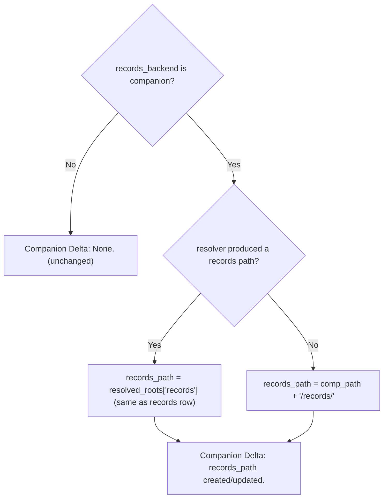

# IPD: Fix aw install pre-write plan Companion Delta to print companion records/ path

- Date: 2026-11-21
- Kind: child
- Concern: `agent_workflows/install_wizard.py::render_pre_write_plan` prints the obsolete decoy path `<companion>/.aw/records` in `Companion Delta:` even though `mnsbzt` eliminated that decoy and stores companion records directly under `<companion>/records/`.
- Scope: In `agent_workflows/install_wizard.py::render_pre_write_plan`, print the companion records directory in `Companion Delta:` from the same resolved `records` path the `Resolved Physical Classes` section prints, and drop the unsupported "and config" claim. Add a core-tier behavioral regression test module and one CHANGELOG bullet. EXCLUDES what `aw install` writes into the companion, and the `config_project` preview owned by `ippuby`.
- Scope-Paths: agent_workflows/install_wizard.py, tests/test_install_wizard_companion_preview.py, CHANGELOG.md, .aw/records/plans/pending/20261121-dogfood-bugs-02-qw9i5p-fix-aw-install-pre-write-plan-companion-delta-to-print-compa.ipd.md
- Item-Dependencies: executed:gftvh6
- Status: approved
- Readiness: go-pending-approval
- Review-Depth: standard
- Short-Description: Replace obsolete .aw/records decoy path with records/ in render_pre_write_plan Companion Delta
- Work-Kind: bug
- Priority: medium
- From-Backlog: 479wfb
- Blocks-Release: next
- Set: dogfood-bugs
- Order: 2
- Highest E allocated: 03
- Author: antigravity
- Id: qw9i5p
- Approval: 2026-11-27, recorded via aw ipd set: status set to approved

> Write and proofread this plan per the technical writing standard, `.aw/system/workflows/technical-writing/technical-writing.md` (`.agents/workflows/technical-writing/technical-writing.md` in a legacy-layout install), including requirement 12 (diagrams).

## Workflow history

- 2026-11-27 approved (aw set): status set to approved
- 2026-11-24 reviewed (/plan-review model=claude-opus-5.5): APPROVE WITH REVISIONS APPLIED; F1..F5 FIXED, F6 DEFERRED; review record .aw/records/reviews/20261121-dogfood-bugs-02-qw9i5p-fix-aw-install-pre-write-plan-companion-delta-to-print-compa.review.md
- 2026-11-21 to-review (aw set): Review-ready child plans for dogfood-bugs
- 2026-11-21 draft (antigravity): created.

## Goal

Ensure the `Companion Delta:` line rendered by `agent_workflows/install_wizard.py::render_pre_write_plan` displays the real companion records directory (`<companion>/records/`) instead of the obsolete `<companion>/.aw/records` decoy path, and that it always names the same directory as the `records` row printed above it.

## Detailed Implementation Checklist (TODO)

Execution-state rule: mark an `E-*` item complete only after performing the action. That mark is not validation. Right-sizing rule: write for a modest executor that cannot hold much in its head. Each E-item is one step (one concern, about one file, executable in one focused pass) and its V-item names each unit it covers with its own check; a plan stays at about 5 E-items and 8 work Scope-Paths, else split it into more child plans (guidance, `IPD-Z603`). Accepted execution states: blocked, failed, pending, performed; terminal gate demands 'performed'.

### Task group 1: Align the Companion Delta preview with the companion layout

- [ ] E-01 First record the base commit with `git rev-parse HEAD`; E-02 needs it. Then, in `agent_workflows/install_wizard.py::render_pre_write_plan`, change only the companion branch under `if policy.records_backend == RecordsBackend.COMPANION.value:`. Keep `comp_path = _format_path(policy.companion_dir or f"{repo_path}.aw")`. Set `records_path = resolved_roots.get("records") or f"{comp_path}/records/"`; `resolved_roots` already holds the formatted, slash-terminated path that the `records` row prints, and it is empty only when the resolver failed. Replace the appended line with `f"  Companion Delta:  {records_path} created/updated."`. Leave the `Companion Delta:  None.` branch and every other line unchanged.
  - Depends on: none
  - Expected outcome: For a companion-backend policy, the `Companion Delta:` line names `<companion>/records/`, matches the path in the `records` row, and contains no `/.aw/records`. Non-companion output is unchanged.
  - Execution state: pending

- [ ] E-02 Create `tests/test_install_wizard_companion_preview.py` with `pytestmark = pytest.mark.core`. Build each policy from `install_wizard.get_preset_defaults(preset)`, which returns `(placements, git_policies, delivery_mode, records_backend, durability_state)`, and pass those values to `ProjectPolicy(preset=..., placements=..., git_policies=..., delivery_mode=..., records_backend=..., durability_state=...)`. A bare `ProjectPolicy(preset=...)` keeps `records_backend="repository"` and never reaches the companion branch (measured). Use a `tempfile.TemporaryDirectory()` holding a `git init` target repository, and call `render_pre_write_plan(policy, str(repo), Term(color=False))`. Read the `records` row path as the fourth whitespace-separated token of the line whose stripped text starts with `- records`, as `tests/test_install_consent_truth.py` does. Cases:
  (a) **explicit companion directory**: preset `public-target-private-companion` with `companion_dir=str(<tmp>/priv)`. Assert the `Companion Delta:` line ends with `/records/ created/updated.`, contains the `records` row path, and does not contain `/.aw/records`.
  (b) **default companion directory**: the same preset with no `companion_dir`. Assert the line contains the `records` row path, that path ends with `f"{repo.name}.aw/records/"` (the default companion is the sibling directory `<repo>.aw`), and the line does not contain `.aw/.aw/records`.
  (c) **non-companion preset**: preset `private-target`. Assert the output contains `  Companion Delta:  None.`.
  Assert on rendered text only, never on source text.
  Then prove (a) and (b) fail without the fix, without touching the lane's working tree. Run `BASE_WT="$(mktemp -d)/qw9i5p-base"` and `git worktree add --detach "$BASE_WT" <base commit from E-01>`, then copy only the new test module into it. Run `AW_NO_REEXEC=1 python3 -m pytest -o addopts="" -v tests/test_install_wizard_companion_preview.py` with `$BASE_WT` as the working directory, then run `git worktree remove --force "$BASE_WT"`. Do not use `git stash`.
  - Depends on: E-01
  - Expected outcome: All three cases pass in the lane. At the base commit, (a) and (b) fail on their `/.aw/records` assertions and (c) passes.
  - Execution state: pending

- [ ] E-03 Add one bullet to `CHANGELOG.md` under `## 2.0.0 (pending)`, next to the existing `- Fixed:` bullets, with no em or en dashes: `- Fixed: \`aw install\` with companion records storage now names the companion \`records/\` directory in its pre-write plan, instead of a \`.aw/records\` directory inside the companion that is never created.`
  - Depends on: E-01
  - Expected outcome: `CHANGELOG.md` gains exactly that bullet and no other change.
  - Execution state: pending

## Project conventions discovered (Step 0)

- Executed plan `mnsbzt` (`companion-bugs` Order 01) established `<companion>/records/` as the companion records directory and removed creation of the empty `<companion>/.aw/records` decoy.
- `render_pre_write_plan` already renders the companion `records` row from `resolve_project_context(...).physical_classes`, formatted and slash-terminated in its local `resolved_roots` dictionary. Only the `Expected Deltas` line hardcodes `{comp_path}/.aw/records and config created/updated.`
- `render_pre_write_plan` has two callers: the `aw install --dry-run` preview in `agent_workflows/cli.py` and the interactive wizard in `install_wizard.py`. Both get the fix through the one function.
- What `aw install --preset public-target-private-companion --no-interactive -y` writes into the companion, measured at review in a throwaway repository: with `--companion-dir <dir>`, it writes `records/`, `.gitignore`, `.aw/companion_identity.json` and runs `git init` (`storage.attach_companion` and the attach block in `cli.py`). With no `--companion-dir`, `<repo>.aw/` receives only `records/`. Neither case writes a companion config file, so the old "and config" wording is dropped rather than kept.
- The plan's original test glob `tests/test_install_wizard*.py` matches no file. The existing callers of `render_pre_write_plan` in tests are `tests/test_install_consent_truth.py` and `tests/test_records_untracked_backend.py`. Sibling plan `gftvh6` adds `tests/test_install_no_interactive_tty.py`, which exists once that plan executes.
- Depends on `gftvh6` (Order 01) because both plans may edit `agent_workflows/install_wizard.py`.
- Rendering one preview takes about 0.1s, so the new module fits the core tier.

## Findings

| ID | Severity | Area | Finding |
|---|---|---|---|
| DF-04 | Medium | `agent_workflows/install_wizard.py::render_pre_write_plan` | Observed during `aw install --no-interactive --dry-run` on `polyopen`: `Resolved Physical Classes` printed `<companion>/records/`, while `Expected Deltas` printed `Companion Delta: <companion>/.aw/records and config created/updated.` Reproduced at review (`<TD>` is the temporary directory) with `--companion-dir`: the line read `<TD>/priv/.aw/records and config created/updated.` while the `records` row read `<TD>/priv/records/`. With the default companion it read `<TD>/t.aw/.aw/records ...`. |
| DF-04a | Low | Same line | The "and config" part names nothing the installer writes into the companion (see conventions). |

## Proposed changes (ordered, validatable)

1. `agent_workflows/install_wizard.py::render_pre_write_plan` (`E-01`): derive the delta path from the resolved `records` path and drop "and config".
2. `tests/test_install_wizard_companion_preview.py` (`E-02`): three behavioral cases, two of which fail at the base commit.
3. `CHANGELOG.md` (`E-03`): one `- Fixed:` bullet.

## Deferred / out of scope (with reason)

- Aligning `.aw/config/project.json` preview parity and target staging when `git_policies.config_project == "companion-git"` is owned by backlog `o2or8a` and pending plan `ippuby`.
  - Carrier: ippuby
- With no `--companion-dir`, the default companion `<repo>.aw/` receives `records/` but no `git init`, identity file, or `.gitignore`, while the preview labels `records` as `companion-git`. This was observed at review and is a different code path (the attach block in `cli.py`) from this preview text, and it is not yet triaged.
  - Carrier-Declined: observation recorded for human triage in the review record; this plan changes preview text only and must not change what the installer writes.

## Scope check

- Over-scope: none. One line in `render_pre_write_plan`, its tests, and a CHANGELOG bullet.
- Under-scope: corrected at review. The original plan had no CHANGELOG entry, named a test glob that matches no file, and did not prove the test fails without the fix.

## Required tests / validation

- `python3 -m pytest -o addopts="" -v tests/test_install_wizard_companion_preview.py`, plus the base-commit run in E-02.
- `python3 -m pytest -v tests/test_install_consent_truth.py tests/test_records_untracked_backend.py tests/test_companion_containment_and_storage.py`, and `tests/test_install_no_interactive_tty.py` when it exists.
- Bare core gate `python3 -m pytest`.
- `make typecheck` and `aw sanitize --agent`.

## Spec / documentation sync

No spec amendment: the preview text is not specified line by line, and the companion layout contract was settled by executed plan `mnsbzt`. User-facing documentation: one `- Fixed:` CHANGELOG bullet (E-03).

## Open questions

None.

## Validation and cross-check (verify before reporting done)

Validation-state rule: inspect evidence in a separate pass. Do not mark a `V-*` item complete from memory or from the matching execution checkmark. Accepted validation results: blocked, failed, pass, pending; terminal gate demands 'pass'. Runtime-demonstration reachability rule: for each `V-*` item demanding the software be observed acting (such as a run, a dispatch, or a transition) (as distinct from items demanding a diff, a file's content, or a test result, which are reachable by construction) name the code path that produces the observation or the sibling `E-*` that creates it, else the demand is UNDER-SCOPE.

- [ ] V-01 validates E-01
  - Required evidence: paste `git diff -- agent_workflows/install_wizard.py` showing that only the companion `Companion Delta:` line changed, now built from `resolved_roots.get("records")` with the `comp_path` fallback, with no `/.aw/records` and no "and config". Also paste the `Companion Delta:` line and the `records` row from `aw install . --preset public-target-private-companion --companion-dir <tmp>/priv --no-interactive --dry-run -y` run in a throwaway repository (path from the `render_pre_write_plan` call in `cli.py`'s dry-run branch), showing they name the same directory.
  - Observed evidence:
  - Result: pending

- [ ] V-02 validates E-02
  - Required evidence: paste the `python3 -m pytest -o addopts="" -v tests/test_install_wizard_companion_preview.py` output with three PASSED node ids for (a), (b), and (c), and the `pytestmark = pytest.mark.core` line. Paste the base commit sha and the base-worktree run showing (a) and (b) FAILED on assertions and (c) PASSED, plus the `git worktree remove` exit code. Paste the summary line and exit code of the neighbouring-suite run, the bare `python3 -m pytest` run (its `N passed` line), `make typecheck`, and `aw sanitize --agent`.
  - Observed evidence:
  - Result: pending

- [ ] V-03 validates E-03
  - Required evidence: paste `git diff CHANGELOG.md` showing exactly one added `- Fixed:` line under `## 2.0.0 (pending)` and no other change.
  - Observed evidence:
  - Result: pending

## Approval and execution gate

- Size assessment: standard
- Cohesion rationale: not required

This plan must reach `approved` before execution. Execute inside an isolated worktree, commit only `Scope-Paths` files via `aw commit qw9i5p -- <paths>`, paste actual command output into each `V-*` Observed evidence block, and finalize via `aw ipd finalize qw9i5p`.
