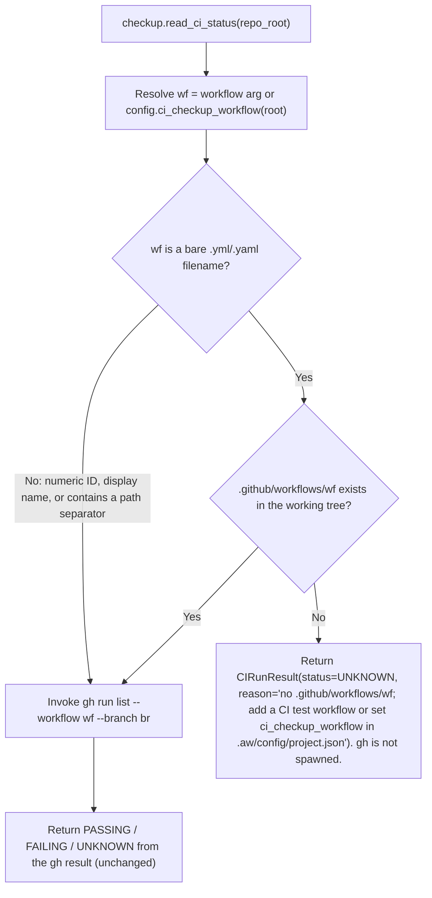

# IPD: Handle missing local CI workflow in aw checkup instead of raw HTTP 404 on tests.yml

- Date: 2026-11-21
- Kind: child
- Concern: `agent_workflows/checkup.py::read_ci_status` queries GitHub Actions for `tests.yml` without checking whether `.github/workflows/<workflow>` exists locally, producing a noisy raw HTTP 404 (`CI UNKNOWN`) on every newly installed repository that has not added `tests.yml`.
- Scope: Detect an absent local workflow file in `agent_workflows/checkup.py::read_ci_status` before invoking `gh`, return a clear actionable `reason` without asking GitHub for a guaranteed 404, add setup guidance in `.aw/system/workflows/setup-repo/setup-repo.md`, add behavioral tests, update the existing `tests/test_checkup.py` fixture so its `gh`-parsing tests keep reaching `gh`, and document the behavior in `README.md` and `CHANGELOG.md`.
- Scope-Paths: agent_workflows/checkup.py, .aw/system/workflows/setup-repo/setup-repo.md, tests/test_checkup_missing_workflow.py, tests/test_checkup.py, README.md, CHANGELOG.md, .aw/records/plans/pending/20261121-dogfood-bugs-03-5q8whb-handle-missing-local-ci-workflow-in-aw-checkup-instead-of-ra.ipd.md
- Item-Dependencies: none
- Status: reviewed
- Readiness: go-pending-approval
- Review-Depth: standard
- Short-Description: Detect absent local CI workflow in checkup and add setup-repo workflow configuration guidance
- Work-Kind: bug
- Priority: high
- From-Backlog: bj3x5x
- Blocks-Release: next
- Set: dogfood-bugs
- Order: 3
- Highest E allocated: 05
- Author: antigravity
- Id: 5q8whb

> Write and proofread this plan per the technical writing standard, `.aw/system/workflows/technical-writing/technical-writing.md` (`.agents/workflows/technical-writing/technical-writing.md` in a legacy-layout install), including requirement 12 (diagrams).

## Workflow history

- 2026-11-24 reviewed (/plan-review model=claude-opus-5.5): APPROVE WITH REVISIONS APPLIED; F1..F8 FIXED; review record .aw/records/reviews/20261121-dogfood-bugs-03-5q8whb-handle-missing-local-ci-workflow-in-aw-checkup-instead-of-ra.review.md
- 2026-11-21 to-review (aw set): Review-ready child plans for dogfood-bugs
- 2026-11-21 draft (antigravity): created.

## Goal

Stop `aw checkup` from recording a raw GitHub API HTTP 404 reason on every repository that lacks `.github/workflows/tests.yml`. `aw attention` and `aw doctor` display that saved reason, so they show the noise too. Guide operators during `/setup-repo` to either add a test workflow or configure `ci_checkup_workflow`.

The status stays `UNKNOWN`. Only the `reason` text changes, and `gh` is no longer called when the answer is already known to be a 404. `runner_shared.decide_red_ci_gate` treats `UNKNOWN` as warn-only, so the red-CI run-start gate behaves exactly as before.

## Detailed Implementation Checklist (TODO)

Execution-state rule: mark an `E-*` item complete only after performing the action. That mark is not validation. Right-sizing rule: write for a modest executor that cannot hold much in its head. Each E-item is one step (one concern, about one file, executable in one focused pass) and its V-item names each unit it covers with its own check; a plan stays at about 5 E-items and 8 work Scope-Paths, else split it into more child plans (guidance, `IPD-Z603`). Accepted execution states: blocked, failed, pending, performed; terminal gate demands 'performed'.

### Task group 1: Local workflow pre-check in checkup

- [ ] E-01 In `agent_workflows/checkup.py::read_ci_status`, after `wf` and `br` are resolved and before the `gh` command is built, add a local pre-check. The pre-check applies only when `wf` is a bare workflow filename: it ends in `.yml` or `.yaml` (case-insensitive) and contains no `/` or `\`. When it applies and `(root / ".github" / "workflows" / wf).is_file()` is False, return `CIRunResult(status=CiHealth.UNKNOWN, reason=f"no .github/workflows/{wf}; add a CI test workflow or set ci_checkup_workflow in .aw/config/project.json")` without spawning `gh`. In every other case run `gh` exactly as today: the file exists, or `wf` is a numeric workflow ID, a display name, or a value containing a path separator (`gh run list --workflow` accepts all three). The check reads the working tree, not git history, and adds no git subprocess. Do not gate on whether `.github/workflows/` exists or whether `root` is a git repository: a fresh repository with no `.github/` at all is the most common case and must also get the actionable reason.
  - Depends on: none
  - Expected outcome: In a repository whose `.github/workflows/` holds only `secret-scan.yml`, and in one with no `.github/` directory, `read_ci_status` spawns no `gh` process and returns `status == "UNKNOWN"` with the reason text above instead of `gh exited 1: HTTP 404 ...`. When `.github/workflows/<wf>` exists, or `wf` is not a bare `.yml`/`.yaml` filename, the `gh` call and the result are unchanged.
  - Execution state: pending

- [ ] E-04 Update the shared fixture `tests/test_checkup.py::_init_repo` so every repository it builds contains a committed `.github/workflows/tests.yml` (a one-line placeholder body is enough). Without this, E-01 short-circuits every `gh`-stub test in that file, because none of them creates `.github/workflows/`: `test_ci_shape_passing`, `test_ci_shape_failing_with_prior_pass`, `test_ci_shape_unknown_nonzero_exit`, `test_ci_shape_unknown_malformed_json`, `test_ci_shape_unknown_timeout`, `test_ci_shape_commit_not_in_local_history`, `test_ci_shape_widen_limit_when_no_pass_in_page_1`, `test_commits_since_first_parent`, and `test_record_written_to_primary_checkout_from_linked_worktree` would all stop reaching the stub. `test_ci_shape_unknown_no_gh` would also fail, because it asserts the `command not found` reason. In `test_custom_workflow_and_branch_reach_gh_argv`, also create and commit `.github/workflows/custom-ci.yml`. Do not weaken any existing assertion.
  - Depends on: E-01
  - Expected outcome: Every test in `tests/test_checkup.py` passes with its original assertions, and the `gh`-stub tests still reach the stub (their argv and parsing assertions still hold).
  - Execution state: pending

### Task group 2: Setup-repo CI workflow configuration guidance

- [ ] E-02 Extend section `### 5. CI baseline for the stack` in `.aw/system/workflows/setup-repo/setup-repo.md` with a short paragraph. It tells the setup pass to read `ci_checkup_workflow` from `.aw/config/project.json` (default `tests.yml`) and check whether `.github/workflows/<that file>` exists. If the file is absent, offer two choices and apply only the one the user approves. Choice one: scaffold a minimal, stack-appropriate `.github/workflows/tests.yml` under the existing step 5 rules. Choice two: when an existing workflow already runs the tests, set `ci_checkup_workflow` to that workflow's filename. Say that `aw checkup` reads this workflow, and that without it `aw checkup` reports CI as `UNKNOWN`. Classify the area as conformant when the file exists. Edit only the canonical body: the generated skill pointer `.agents/skills/setup-repo/SKILL.md` and the command shims reference this file by path and need no regeneration.
  - Depends on: E-01
  - Expected outcome: Step 5 of `.aw/system/workflows/setup-repo/setup-repo.md` contains the check, both choices, and the ask-before-change rule, in active voice, with no em or en dashes and no absolute paths.
  - Execution state: pending

- [ ] E-05 Document the new behavior for users. In the `Periodic CI checkup` section of `README.md`, extend the `ci_checkup_workflow` bullet with one sentence: when the named `.yml`/`.yaml` file is absent from `.github/workflows/`, `aw checkup` reports CI as `UNKNOWN` with a reason naming the missing file, and does not call `gh`. Add one `- Fixed:` bullet under the `## 2.0.0 (pending)` heading of `CHANGELOG.md` describing the same change. Use no em or en dashes; both files are user-facing.
  - Depends on: E-01
  - Expected outcome: `README.md` and `CHANGELOG.md` each describe the missing-workflow reason, with no em or en dashes.
  - Execution state: pending

### Task group 3: Behavioral tests

- [ ] E-03 Add behavioral tests in `tests/test_checkup_missing_workflow.py`. Each test builds a real git repository in `tmp_path` and puts a logging `gh` stub first on `PATH` (built with `tests.support.make_fake_executable`, the same pattern as `tests/test_checkup.py::_create_gh_stub`; copy the helper rather than importing from another test module). Each test asserts on the stub's call log. Cases: (a) `.github/workflows/` holds only `secret-scan.yml`: `read_ci_status` returns `CiHealth.UNKNOWN`, the reason contains `no .github/workflows/tests.yml` and `ci_checkup_workflow`, and the stub log shows zero calls; (b) no `.github/` directory at all: the same result and zero calls; (c) `.github/workflows/tests.yml` exists: the stub is called once or more with `--workflow tests.yml`; (d) `ci_checkup_workflow` in `.aw/config/project.json` names an existing `ci.yml`: the stub is called with `--workflow ci.yml`; (e) `ci_checkup_workflow` names an absent `ci.yml` while `tests.yml` exists: zero calls, and the reason names `ci.yml`; (f) a numeric workflow ID such as `12345` passed via the `workflow=` argument: the stub is called; (g) through `checkup.perform_checkup` in case (a): the saved record's `ci.reason` holds the new reason and `checkup.format_checkup_line` renders `CI UNKNOWN (no .github/workflows/tests.yml; ...)` with no `HTTP 404` text.
  - Depends on: E-01
  - Expected outcome: All seven cases pass, and `tests/test_checkup.py` and `tests/test_red_ci_stop.py` pass with zero regressions.
  - Execution state: pending

## Project conventions discovered (Step 0)

- `agent_workflows/config.py::ci_checkup_workflow` returns `"tests.yml"` when `ci_checkup_workflow` is unset in `.aw/config/project.json`.
- `agent_workflows/checkup.py::read_ci_status` calls `gh run list --workflow <wf> --branch   ...` unconditionally.
- `agent_workflows/checkup.py::CiHealth` defines three status values: `PASSING`, `FAILING`, `UNKNOWN`. Keeping `CiHealth.UNKNOWN` preserves all downstream consumers (`format_checkup_line`, `is_checkup_warning`, `red_ci_stop`, `run_checkup_cli`) without schema churn while eliminating the noisy raw HTTP 404 error.
- `runner_shared.decide_red_ci_gate` treats a missing record or `UNKNOWN` CI status as warn-only ("proceeding because CI status is UNKNOWN"), so the new reason changes no gate decision.
- `tests/test_checkup.py::_init_repo` (lines 40-49) builds a git repository with no `.github/` directory, and ten tests drive the `gh` stub (`_create_gh_stub`, `gh_env`) through it. `test_ci_shape_unknown_no_gh` asserts the `command not found` reason. E-01 short-circuits all of these unless the fixture creates `.github/workflows/tests.yml`, so E-04 updates the fixture. Gating the short-circuit on `.github/workflows/` existing instead was rejected: a fresh repository with no `.github/` is the common case, and it would still get the raw 404.
- `tests/test_red_ci_stop.py` and `tests/test_clean_target_control_state.py` mock `run_start_checkup` / `perform_checkup`, so E-01 does not reach them.
- `.agents/skills/setup-repo/SKILL.md` is a pointer whose digest (`host_adapters.compute_workflow_semantic_digest`) hashes manifest fields and the body PATH, not the body content, so editing `setup-repo.md` needs no shim regeneration.

## Findings

| ID | Severity | Area | Finding |
|---|---|---|---|
| DF-01 | High | `agent_workflows/checkup.py::read_ci_status`, `.aw/system/workflows/setup-repo/setup-repo.md` | `aw install` creates `.github/workflows/secret-scan.yml` (not `tests.yml`), yet `aw checkup` queries GitHub Actions for `tests.yml` and surfaces `CI UNKNOWN (gh exited 1: HTTP 404: Not Found (.../actions/workflows/tests.yml))` in `aw att` and `aw doctor`. |

## Proposed changes (ordered, validatable)

1. `agent_workflows/checkup.py::read_ci_status` (`E-01`): when `wf` is a bare `.yml`/`.yaml` filename (no `/` or `\`) and `.github/workflows/<wf>` is not a file in the working tree, return `CIRunResult(status=CiHealth.UNKNOWN, reason=f"no .github/workflows/{wf}; add a CI test workflow or set ci_checkup_workflow in .aw/config/project.json")` without calling `gh`. Every other case calls `gh` as today.
2. `tests/test_checkup.py` (`E-04`): `_init_repo` commits `.github/workflows/tests.yml`, and the custom-workflow test also commits `custom-ci.yml`, so existing `gh`-stub tests keep reaching the stub.
3. `.aw/system/workflows/setup-repo/setup-repo.md` (`E-02`): step 5 checks for `.github/workflows/<ci_checkup_workflow>` and offers to scaffold `tests.yml` or set `ci_checkup_workflow`.
4. `README.md`, `CHANGELOG.md` (`E-05`): document the missing-workflow reason.
5. `tests/test_checkup_missing_workflow.py` (`E-03`): seven behavioral cases, each asserting on the `gh` stub's call log.

## Deferred / out of scope (with reason)

- Introducing a fourth `CiHealth` enum value (`NOT_CONFIGURED`) across all JSON schemas and red-CI gates is out of scope for this bug fix; keeping `CiHealth.UNKNOWN` with a clear actionable `reason` avoids breaking existing consumers.
  - Carrier-Declined: Schema change unnecessary for resolving the raw HTTP 404 UX bug; `CiHealth.UNKNOWN` with an actionable reason preserves backward compatibility across all checkup consumers.

## Scope check

- Over-scope: none. The touched files are `checkup.py`, the `test_checkup.py` fixture, the new test module, `setup-repo.md`, and one README sentence plus one CHANGELOG bullet.
- Under-scope: corrected at review. The original plan omitted the `tests/test_checkup.py` fixture update (E-04), without which ten existing tests regress, and the user-facing documentation (E-05). No other gap remains: the runtime checkup path, the saved record, the rendered line, and the `/setup-repo` onboarding step are all covered.

## Required tests / validation

- Run `python3 -m pytest -o addopts="" -q tests/test_checkup_missing_workflow.py tests/test_checkup.py tests/test_red_ci_stop.py` and paste the summary line.
- Run `make typecheck` and `aw sanitize --agent`.

## Spec / documentation sync

No spec describes `read_ci_status` (searched `.aw/records/specs` for `read_ci_status` and `ci_checkup_workflow`; no live spec matches), so no spec amendment is needed. `.aw/system/workflows/setup-repo/setup-repo.md` is updated in `E-02`; `README.md` and `CHANGELOG.md` are updated in `E-05`.

## Open questions

None.

## Validation and cross-check (verify before reporting done)

Validation-state rule: inspect evidence in a separate pass. Do not mark a `V-*` item complete from memory or from the matching execution checkmark. Accepted validation results: blocked, failed, pass, pending; terminal gate demands 'pass'. Runtime-demonstration reachability rule: for each `V-*` item demanding the software be observed acting (such as a run, a dispatch, or a transition) (as distinct from items demanding a diff, a file's content, or a test result, which are reachable by construction) name the code path that produces the observation or the sibling `E-*` that creates it, else the demand is UNDER-SCOPE.

- [ ] V-01 validates E-01
  - Required evidence: Paste `git diff -- agent_workflows/checkup.py`. It must show the pre-check placed before the `gh` command is built, the bare-filename test (`.yml`/`.yaml` suffix, case-insensitive, no `/` or `\`), the `.is_file()` check, and the exact reason string from E-01. Paste the `python3 -m pytest -o addopts="" -v tests/test_checkup_missing_workflow.py` lines for cases (a), (b), and (e), each `PASSED`; those cases assert zero lines in the `gh` stub log. Fail if any case is not `PASSED` or the reason string differs.
  - Observed evidence:
  - Result: pending

- [ ] V-02 validates E-02
  - Required evidence: Paste `git diff -- .aw/system/workflows/setup-repo/setup-repo.md`. The added lines must sit inside `### 5. CI baseline for the stack` and name `ci_checkup_workflow`, `.github/workflows/`, both choices, and the ask-before-change rule. Paste `grep -nP '[\x{2013}\x{2014}]' .aw/system/workflows/setup-repo/setup-repo.md` output, or state that it printed nothing; any match on an added line fails.
  - Observed evidence:
  - Result: pending

- [ ] V-03 validates E-03
  - Required evidence: Paste the `python3 -m pytest -o addopts="" -v tests/test_checkup_missing_workflow.py` output showing seven test cases (a) through (g), each `PASSED`. Paste the summary line of `python3 -m pytest -o addopts="" -q tests/test_checkup_missing_workflow.py tests/test_checkup.py tests/test_red_ci_stop.py` with 0 failed and 0 errors. Paste `make typecheck` output with 0 errors and the `aw sanitize --agent` result record with status not `fail`.
  - Observed evidence:
  - Result: pending

- [ ] V-04 validates E-04
  - Required evidence: Paste `git diff -- tests/test_checkup.py`. It must add `.github/workflows/tests.yml` to `_init_repo` and `custom-ci.yml` to `test_custom_workflow_and_branch_reach_gh_argv`, and must remove or loosen no `assert` line. Paste the summary line of `python3 -m pytest -o addopts="" -q tests/test_checkup.py` with 0 failed; the count of passed tests must equal the count before the change (paste both counts).
  - Observed evidence:
  - Result: pending

- [ ] V-05 validates E-05
  - Required evidence: Paste `git diff -- README.md CHANGELOG.md`: one added sentence in the `ci_checkup_workflow` bullet of `README.md` and one added `- Fixed:` bullet under `## 2.0.0 (pending)` in `CHANGELOG.md`, both naming the missing-workflow reason. Paste `git diff -U0 -- README.md CHANGELOG.md | grep -nP '^\+.*[\x{2013}\x{2014}]'` output, or state that it printed nothing; any match fails.
  - Observed evidence:
  - Result: pending

## Approval and execution gate

- Size assessment: standard
- Cohesion rationale: not required. Five E-items and seven Scope-Paths, all serving one user-visible fix.

Execution order: E-01, then E-04 (so `tests/test_checkup.py` is green again before new work), then E-02, E-05, and E-03.

This plan must reach `approved` before execution. Execute inside an isolated worktree, commit only `Scope-Paths` files via `aw commit 5q8whb -- <paths>`, paste actual command output into each `V-*` Observed evidence block, and finalize via `aw ipd finalize 5q8whb`.
