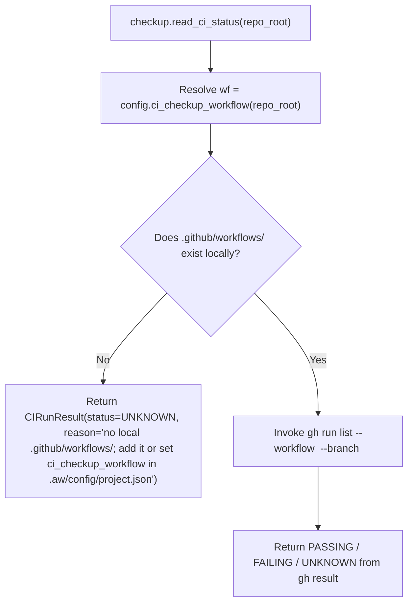

# IPD: Handle missing local CI workflow in aw checkup instead of raw HTTP 404 on tests.yml

- Date: 2026-11-21
- Kind: child
- Concern: `agent_workflows/checkup.py::read_ci_status` queries GitHub Actions for `tests.yml` without checking whether `.github/workflows/<workflow>` exists locally, producing a noisy raw HTTP 404 (`CI UNKNOWN`) on every newly installed repository that has not added `tests.yml`.
- Scope: Detect an absent local workflow file in `agent_workflows/checkup.py::read_ci_status` before invoking `gh`, return a clear actionable `reason` without hitting GitHub for a guaranteed 404, add setup guidance in `.aw/system/workflows/setup-repo/setup-repo.md`, and add behavioral tests.
- Scope-Paths: agent_workflows/checkup.py, .aw/system/workflows/setup-repo/setup-repo.md, tests/test_checkup_missing_workflow.py, .aw/records/plans/pending/20261121-dogfood-bugs-03-5q8whb-handle-missing-local-ci-workflow-in-aw-checkup-instead-of-ra.ipd.md
- Item-Dependencies: none
- Status: to-review
- Short-Description: Detect absent local CI workflow in checkup and add setup-repo workflow configuration guidance
- Work-Kind: bug
- Priority: high
- From-Backlog: bj3x5x
- Blocks-Release: next
- Set: dogfood-bugs
- Order: 3
- Highest E allocated: 03
- Author: antigravity
- Id: 5q8whb

> Write and proofread this plan per the technical writing standard, `.aw/system/workflows/technical-writing/technical-writing.md` (`.agents/workflows/technical-writing/technical-writing.md` in a legacy-layout install), including requirement 12 (diagrams).

## Workflow history

- 2026-11-21 to-review (aw set): Review-ready child plans for dogfood-bugs
- 2026-11-21 draft (antigravity): created.

## Goal

Prevent `aw checkup`, `aw attention`, and `aw doctor` from failing with a raw GitHub API HTTP 404 on every repository that lacks `.github/workflows/tests.yml`, and guide operators during `/setup-repo` to either add a test workflow or configure `ci_checkup_workflow`.

## Detailed Implementation Checklist (TODO)

Execution-state rule: mark an `E-*` item complete only after performing the action. That mark is not validation. Right-sizing rule: write for a modest executor that cannot hold much in its head. Each E-item is one step (one concern, about one file, executable in one focused pass) and its V-item names each unit it covers with its own check; a plan stays at about 5 E-items and 8 work Scope-Paths, else split it into more child plans (guidance, `IPD-Z603`). Accepted execution states: blocked, failed, pending, performed; terminal gate demands 'performed'.

### Task group 1: Local workflow pre-check in checkup

- [ ] E-01 Update `agent_workflows/checkup.py::read_ci_status` so that when `wf` is a workflow filename (ending in `.yml` or `.yaml` without path traversal) and `(root / ".github" / "workflows" / wf)` does not exist on disk while `root` is a git repository, `read_ci_status` returns `CIRunResult(status=CiHealth.UNKNOWN, reason=...)` with an actionable message naming `.github/workflows/<wf>` and `ci_checkup_workflow` without spawning `gh`. Preserve existing `gh` execution whenever `.github/workflows/<wf>` exists locally, when `wf` is not a `.yml`/`.yaml` filename (for example a workflow ID or display name), or when a test explicitly mocks `subprocess.run` on a synthetic temp dir that creates `.github/workflows/<wf>`.
  - Depends on: none
  - Expected outcome: On a target repo that only has `.github/workflows/secret-scan.yml` (and no `tests.yml`), `read_ci_status` does not invoke `gh` and returns `status == "UNKNOWN"` with a concise actionable reason (`no .github/workflows/tests.yml; add a CI test workflow or set ci_checkup_workflow in .aw/config/project.json`) instead of a raw `gh exited 1: HTTP 404` URL. Existing `tests/test_checkup*.py` remain green.
  - Execution state: pending

### Task group 2: Setup-repo CI workflow configuration guidance

- [ ] E-02 Add a concise check in `.aw/system/workflows/setup-repo/setup-repo.md` instructing the setup pass to verify whether `.github/workflows/<ci_checkup_workflow>` exists (default `tests.yml`) and, if absent, offer to scaffold a stack-appropriate `.github/workflows/tests.yml` or set `ci_checkup_workflow` in `.aw/config/project.json`.
  - Depends on: E-01
  - Expected outcome: `.aw/system/workflows/setup-repo/setup-repo.md` documents the CI checkup workflow check clearly in active voice with no em/en dashes or absolute paths.
  - Execution state: pending

### Task group 3: Behavioral tests

- [ ] E-03 Add behavioral tests in `tests/test_checkup_missing_workflow.py` verifying: (a) a git repo with only `.github/workflows/secret-scan.yml` returns `CiHealth.UNKNOWN` with the actionable local-missing reason and zero `gh` calls; (b) a git repo with `.github/workflows/tests.yml` proceeds to call `gh`; (c) setting `ci_checkup_workflow` in `.aw/config/project.json` to an existing workflow proceeds to call `gh`; (d) a numeric workflow ID (non-`.yml`/`.yaml`) proceeds to call `gh`.
  - Depends on: E-01
  - Expected outcome: All new tests and existing `tests/test_checkup*.py` pass with zero regressions.
  - Execution state: pending

## Project conventions discovered (Step 0)

- `agent_workflows/config.py::ci_checkup_workflow` returns `"tests.yml"` when `ci_checkup_workflow` is unset in `.aw/config/project.json`.
- `agent_workflows/checkup.py::read_ci_status` calls `gh run list --workflow <wf> --branch   ...` unconditionally.
- `agent_workflows/checkup.py::CiHealth` defines three status values: `PASSING`, `FAILING`, `UNKNOWN`. Keeping `CiHealth.UNKNOWN` preserves all downstream consumers (`format_checkup_line`, `is_checkup_warning`, `red_ci_stop`, `run_checkup_cli`) without schema churn while eliminating the noisy raw HTTP 404 error.
- Note on existing `tests/test_checkup*.py`: check whether existing unit tests construct a fake temp directory without `.github/workflows/tests.yml` and mock `subprocess.run` to test `gh` parsing; if so, gate the local-absence short-circuit on `(root / ".github" / "workflows").is_dir()` (present whenever `aw install` created `secret-scan.yml` or the repo has workflows) OR check existing test fixtures carefully during `E-01` so no existing test breaks.

## Findings

| ID | Severity | Area | Finding |
|---|---|---|---|
| DF-01 | High | `agent_workflows/checkup.py::read_ci_status`, `.aw/system/workflows/setup-repo/setup-repo.md` | `aw install` creates `.github/workflows/secret-scan.yml` (not `tests.yml`), yet `aw checkup` queries GitHub Actions for `tests.yml` and surfaces `CI UNKNOWN (gh exited 1: HTTP 404: Not Found (.../actions/workflows/tests.yml))` in `aw att` and `aw doctor`. |

## Proposed changes (ordered, validatable)

1. `agent_workflows/checkup.py::read_ci_status` (`E-01`): Before invoking `gh`, check if `wf` is a `.yml`/`.yaml` filename and the repo's `.github/workflows` directory exists (or `.git` exists with no `.github/workflows/<wf>`). If `.github/workflows/<wf>` is absent, return `CIRunResult(status=CiHealth.UNKNOWN, reason=f"no .github/workflows/{wf}; add a CI test workflow or set ci_checkup_workflow in .aw/config/project.json")` without calling `gh`. Verify compatibility with every test in `tests/test_checkup*.py`.
2. `.aw/system/workflows/setup-repo/setup-repo.md` (`E-02`): Add a check for `.github/workflows/<ci_checkup_workflow>` offering to create `tests.yml` or configure `ci_checkup_workflow`.
3. `tests/test_checkup_missing_workflow.py` (`E-03`): Add behavioral tests covering all four workflow-presence cases.

## Deferred / out of scope (with reason)

- Introducing a fourth `CiHealth` enum value (`NOT_CONFIGURED`) across all JSON schemas and red-CI gates is out of scope for this bug fix; keeping `CiHealth.UNKNOWN` with a clear actionable `reason` avoids breaking existing consumers.
  - Carrier-Declined: Schema change unnecessary for resolving the raw HTTP 404 UX bug; `CiHealth.UNKNOWN` with an actionable reason preserves backward compatibility across all checkup consumers.

## Scope check

- Over-scope: none. Only `checkup.py`, `setup-repo.md`, and new behavioral tests are touched.
- Under-scope: none. Both the runtime checkup path and the `/setup-repo` onboarding workflow are covered.

## Required tests / validation

- Run `python3 -m pytest tests/test_checkup_missing_workflow.py tests/test_checkup*.py tests/test_red_ci_stop.py`.
- Run `make typecheck` and `aw sanitize --agent`.

## Spec / documentation sync

`.aw/system/workflows/setup-repo/setup-repo.md` is updated directly in `E-02`.

## Open questions

None.

## Validation and cross-check (verify before reporting done)

Validation-state rule: inspect evidence in a separate pass. Do not mark a `V-*` item complete from memory or from the matching execution checkmark. Accepted validation results: blocked, failed, pass, pending; terminal gate demands 'pass'. Runtime-demonstration reachability rule: for each `V-*` item demanding the software be observed acting (such as a run, a dispatch, or a transition) (as distinct from items demanding a diff, a file's content, or a test result, which are reachable by construction) name the code path that produces the observation or the sibling `E-*` that creates it, else the demand is UNDER-SCOPE.

- [ ] V-01 validates E-01
  - Required evidence: Paste `git diff -- agent_workflows/checkup.py` showing the local workflow existence check and actionable reason in `read_ci_status`, plus pasted `python3 -m pytest tests/test_checkup_missing_workflow.py` output proving `gh` is not called when `.github/workflows/tests.yml` is absent.
  - Observed evidence:
  - Result: pending

- [ ] V-02 validates E-02
  - Required evidence: Paste `git diff -- .aw/system/workflows/setup-repo/setup-repo.md` showing the CI checkup workflow check and configuration guidance.
  - Observed evidence:
  - Result: pending

- [ ] V-03 validates E-03
  - Required evidence: Paste full output of `python3 -m pytest tests/test_checkup_missing_workflow.py tests/test_checkup*.py tests/test_red_ci_stop.py`, `make typecheck`, and `aw sanitize --agent` showing all tests pass, 0 mypy errors, and 0 leak findings.
  - Observed evidence:
  - Result: pending

## Approval and execution gate

- Size assessment: standard
- Cohesion rationale: not required

This plan must reach `approved` before execution. Execute inside an isolated worktree, commit only `Scope-Paths` files via `aw commit 5q8whb -- <paths>`, paste actual command output into each `V-*` Observed evidence block, and finalize via `aw ipd finalize 5q8whb`.
