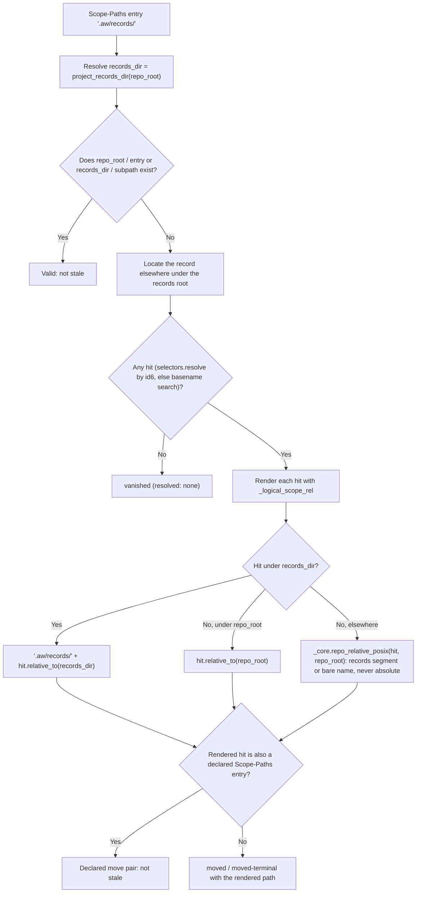

# IPD: Resolve companion records paths in check.scope-path-target-stale without absolute paths

- Date: 2026-11-21
- Kind: child
- Concern: In companion records mode (`public-target-private-companion`), `agent_workflows/check_engine.py::stale_record_scope_paths` tests `repo_root / entry` instead of the logical records root, falsely flags valid `.aw/records/...` `Scope-Paths` entries as moved, and recommends replacing them with an absolute machine-local path into the companion repository.
- Scope: Resolve `.aw/records/...` entries in `agent_workflows/check_engine.py::stale_record_scope_paths` against `project_context.project_records_dir(repo_root)`, render every resolved hit (including the hits the declared-move check compares) in logical `.aw/records/<rel>` form, never as an absolute filesystem path, add behavioral tests, and add one CHANGELOG bullet.
- Scope-Paths: agent_workflows/check_engine.py, tests/test_scope_path_stale_companion.py, CHANGELOG.md, .aw/records/plans/pending/20261121-dogfood-bugs-04-p0hq1k-resolve-companion-records-paths-in-check-scope-path-target-s.ipd.md
- Item-Dependencies: none
- Status: reviewed
- Readiness: go-pending-approval
- Review-Depth: standard
- Short-Description: Resolve .aw/records/ Scope-Paths against companion records root and never recommend machine-local absolute paths
- Work-Kind: bug
- Priority: high
- From-Backlog: dv9ses
- Blocks-Release: next
- Set: dogfood-bugs
- Order: 4
- Highest E allocated: 04
- Author: antigravity
- Id: p0hq1k

> Write and proofread this plan per the technical writing standard, `.aw/system/workflows/technical-writing/technical-writing.md` (`.agents/workflows/technical-writing/technical-writing.md` in a legacy-layout install), including requirement 12 (diagrams).

## Workflow history

- 2026-11-24 reviewed (/plan-review model=claude-opus-5.5): APPROVE WITH REVISIONS APPLIED; F1..F6 FIXED; review record .aw/records/reviews/20261121-dogfood-bugs-04-p0hq1k-resolve-companion-records-paths-in-check-scope-path-target-s.review.md
- 2026-11-21 to-review (aw set): Review-ready child plans for dogfood-bugs
- 2026-11-21 draft (antigravity): created.

## Goal

Make `check.scope-path-target-stale` companion-aware so valid `.aw/records/...` `Scope-Paths` entries in companion-mode repositories pass cleanly and genuinely moved companion records report portable `.aw/records/<rel>` paths rather than machine-local absolute paths.

## Detailed Implementation Checklist (TODO)

Execution-state rule: mark an `E-*` item complete only after performing the action. That mark is not validation. Right-sizing rule: write for a modest executor that cannot hold much in its head. Each E-item is one step (one concern, about one file, executable in one focused pass) and its V-item names each unit it covers with its own check; a plan stays at about 5 E-items and 8 work Scope-Paths, else split it into more child plans (guidance, `IPD-Z603`). Accepted execution states: blocked, failed, pending, performed; terminal gate demands 'performed'.

### Task group 1: Companion-aware existence and portable relative formatting

- [ ] E-01 Update `agent_workflows/check_engine.py::stale_record_scope_paths` so a `Scope-Paths` entry starting with `.aw/records/` also counts as existing when its target exists under the logical records root:
  1. Before the `for entry in paths:` loop, compute `records_dir = project_records_dir(repo_root)` once (import `project_records_dir` from `agent_workflows.project_context` at the top of the function, and remove the import and the second `project_records_dir(repo_root)` call inside the basename-fallback branch so that branch reuses this `records_dir`).
  2. After the existing `if target.exists(): continue`, add `if (records_dir / entry[len(".aw/records/"):]).exists(): continue`. The `startswith` guard above makes the slice safe.
  3. Leave the `_status_set.detect_artifact_type(target, repo_root)` call unchanged. It detects the type from the `.ipd.md` facet or from the `.aw/records/<type>/` segment of `target`, so it already returns `plans` for a companion-mode entry (measured at HEAD).
  - Depends on: none
  - Expected outcome: A pending plan in a companion-mode repo whose `Scope-Paths` lists `.aw/records/plans/pending/<file>.ipd.md` is not flagged by `stale_record_scope_paths` when `<companion>/records/plans/pending/<file>.ipd.md` exists. At HEAD the same input is classified `moved` with an absolute resolved path.
  - Execution state: pending

- [ ] E-02 Render every hit in `agent_workflows/check_engine.py::stale_record_scope_paths` through one new module-level helper, so that neither the declared-move check nor the reported path depends on the record living inside `repo_root`:
  1. Add `_logical_scope_rel(hit: Path, repo_root: Path, records_dir: Path) -> str` directly above `stale_record_scope_paths`. Resolve `hit`, `records_dir`, and `repo_root` once each (catching `OSError` and keeping the unresolved path). Return, in this order: `".aw/records/" + hit.relative_to(records_dir).as_posix()` when the hit is under `records_dir`; else `hit.relative_to(repo_root).as_posix()` when it is under `repo_root`; else `_core.repo_relative_posix(hit, repo_root)`, which returns the text from a `.aw/records/` or `.agents/` segment or the bare file name and never an absolute path (`agent_workflows/artifact_core.py::repo_relative_posix`, policy steps 3 and 4). `records_dir` is checked first so that a records root placed inside the checkout still renders in the `.aw/records/` form that `Scope-Paths` uses.
  2. Replace all three `relative_to(repo_root.resolve())` blocks in the function with this helper: the `hit_rels` set used by the `dparot` declared-move check, the single-hit `rel`, and the multi-hit `resolved_paths` loop. Remove the `hit.as_posix()` and `h.as_posix()` fallbacks, which are the source of the absolute path.
  3. Make no change to `check_scope_path_target_stale`. It formats `detail`, `recovery`, and (through `enrich_drift`) the agent record's `next` field from `stale.resolved`, so a relative `resolved` makes all three relative. The runner's dispatch refusal message (`agent_workflows/runner_shared.py`, the `stale_record_scope_paths(repo, plan_text)` call) reads the same field and is fixed by the same change.
  - Depends on: E-01
  - Expected outcome: In companion mode, a record that moved from `pending/` to `executed/` is reported `moved-terminal` with resolved path `.aw/records/plans/executed/<file>.ipd.md`, and no absolute path appears in `detail`, `recovery`, or `aw check --agent` output. A declared move pair (`.aw/records/plans/pending/<file>` and `.aw/records/plans/executed/<file>` both listed) is not reported; at HEAD it is reported twice as `moved-terminal`, because `hit_rels` silently drops every hit outside `repo_root`.
  - Execution state: pending

### Task group 2: Behavioral tests

- [ ] E-03 Add `tests/test_scope_path_stale_companion.py`, a `unittest.TestCase` module. Provision each case with `_provision_lightweight_companion_repo(Path(tmp))` from `tests/test_companion_doctor_and_carriers.py` (it returns `(target, companion, env)` and creates `companion/records/plans/pending` and `executed`), write plans with `RecordBuilder().plan(..., scope_paths=..., text_only=True)` into the companion, and call the predicates inside `_patched_env(env)` (which clears the project-context caches). Cases:
  (a) a pending companion plan whose `Scope-Paths` cites itself and a second existing companion plan as `.aw/records/plans/pending/<file>`: `stale_record_scope_paths(target, text)` returns `[]` and `check_scope_path_target_stale(target)` returns no finding;
  (b) the second plan moved with `Path.rename` from `pending/` to `executed/`: exactly one `StaleScopePath` with classification `moved-terminal` and `resolved == (".aw/records/plans/executed/<file>",)`; the matching finding's `detail` and `recovery` contain that string, and neither contains `str(companion)`, `str(target)`, or the temporary directory path;
  (c) a declared move pair (both the `pending/` and `executed/` spellings of the moved plan listed): `stale_record_scope_paths` returns `[]`;
  (d) end to end, after (b): `_run_aw_inproc(["check", "--dir", str(target), "--agent"], env=env)` returns rc 1, its output names `check.scope-path-target-stale`, and the output does not contain the temporary directory path (at HEAD the `next` field contains it);
  (e) `check_engine._logical_scope_rel(outside, target, records_dir)` for a path outside both roots returns a value that is not absolute (`not Path(v).is_absolute()`). Reach the helper by attribute access inside the test, not by a module-level `from ... import`, so that at the base commit only case (e) errors and cases (a) to (d) still run and fail on their assertions.
  Repository-backed behavior is covered by the existing `tests/test_scope_path_target_stale.py` (25 tests, including the `dparot` move-pair cases) and `tests/test_scope_paths_status_agnostic.py`, which must still pass unchanged.
  - Depends on: E-01, E-02
  - Expected outcome: Cases (a) to (d) fail at HEAD and pass after E-01 and E-02. The existing stale-scope tests pass unchanged. Measured at HEAD: provisioning takes about 0.03s and one in-process `aw check` about 0.2s, so the module stays well inside the core tier and needs no `tests/slow_allowlist.txt` entry.
  - Execution state: pending

### Task group 3: User-facing note

- [ ] E-04 Add one bullet to `CHANGELOG.md` under `## 2.0.0 (pending)`, in the existing `- Fixed:` style and with no em or en dashes: `- Fixed: in a repository whose records live in a companion repository, \`aw check\` no longer reports valid \`.aw/records/\` Scope-Paths entries as moved, and it never suggests an absolute path on this machine as the replacement.`
  - Depends on: E-02
  - Expected outcome: One new bullet exists, and `git diff -- CHANGELOG.md` shows no other change.
  - Execution state: pending

## Project conventions discovered (Step 0)

- `agent_workflows/check_engine.py::stale_record_scope_paths` currently checks `target = repo_root / entry; if target.exists(): continue`, then searches `project_records_dir(repo_root)`, then runs `hit.resolve().relative_to(repo_root.resolve())` and falls back to `hit.as_posix()` on `ValueError` (producing an absolute machine-local path whenever `records_dir` is outside `repo_root`, such as in companion or home backend mode).
- `check_scope_path_target_stale` interpolates `stale.resolved` directly into both `detail` and `recovery` (`target exists at {resolved_str}; ... or correct its Scope-Paths to {resolved_str}`).
- Leak-containment rule (`AGENTS.md` / `aw sanitize`; `docs/cli-output-contract.md`, "Path Sanitization and Leak Posture"): machine-local absolute paths must never be written into tracked plans, recommended as `Scope-Paths` values, or printed on any output surface. `agent_workflows/artifact_core.py::repo_relative_posix` is the shared leak-free renderer.
- `check.scope-path-target-stale` runs only in the full sweep (`aw check` or `aw check all`), not under `aw check plans` (measured: `aw check plans --agent` on the reproduction reports no such finding).
- `agent_workflows/runner_shared.py::_logical_record_file_rel` already renders a companion hit as `.aw/records/<rel>`; E-02 adds a small local helper instead of importing `runner_shared` into `check_engine`.

## Findings

| ID | Severity | Area | Finding |
|---|---|---|---|
| DF-03 | High | `agent_workflows/check_engine.py::stale_record_scope_paths`, `check_scope_path_target_stale` | Observed on `polyopen` (`p1f0or`): `aw check` flagged valid companion plan `.aw/records/plans/pending/20261121-perf-opt-00-p1f0or-...ipd.md` as `moved` and told the user to put the absolute path to `polyopen.aw/records/plans/pending/...` into `Scope-Paths:`. |
| DF-03a | High | same | Reproduced at review (HEAD `341d7137a`) with `_provision_lightweight_companion_repo`: an existing companion plan is classified `moved` with an absolute `resolved`; a moved one is `moved-terminal` with an absolute `resolved`; a declared move pair is reported twice as `moved-terminal`; and `aw check --dir <target> --agent` prints the temporary directory path in its `next` field. |

## Proposed changes (ordered, validatable)

1. `agent_workflows/check_engine.py::stale_record_scope_paths` (`E-01`): resolve `records_dir = project_records_dir(repo_root)` once and treat `.aw/records/<subpath>` as existing when `records_dir / subpath` exists.
2. `agent_workflows/check_engine.py::_logical_scope_rel` (`E-02`): render every hit as `.aw/records/<rel>`, else repo-relative, else through `_core.repo_relative_posix`, and use it for the declared-move check and both reported-path sites.
3. `tests/test_scope_path_stale_companion.py` (`E-03`): companion-mode predicate, check, declared-pair, end-to-end `aw check`, and helper tests.
4. `CHANGELOG.md` (`E-04`): one `- Fixed:` bullet.

## Deferred / out of scope (with reason)

None.

## Scope check

- Over-scope: none. Only `stale_record_scope_paths` and one new helper in `agent_workflows/check_engine.py`, one new test module, and one CHANGELOG bullet.
- Under-scope: corrected at review. The original plan fixed existence and formatting but left the `dparot` declared-move check comparing repo-relative paths only, so a declared move pair stayed reported in companion mode. The `home` records backend is covered by the same code, because `project_records_dir(repo_root)` returns its stored records root too; it has no dedicated test here.

## Required tests / validation

- Run `python3 -m pytest -o addopts="" -n 0 -v tests/test_scope_path_stale_companion.py tests/test_scope_path_target_stale.py tests/test_scope_paths_status_agnostic.py tests/test_companion_doctor_and_carriers.py`.
- Run `make typecheck` and `aw sanitize --agent`.

## Spec / documentation sync

No spec edit. Spec `25kzda` (section 5, "Only literal `.aw/records/` scope paths are checked") defines the three classifications and the declared-move rule in logical `.aw/records/` terms and does not say where the records root lives; this plan makes the predicate honor that wording in companion mode. `docs/cli-output-contract.md` already forbids absolute paths on output surfaces. User documentation: one CHANGELOG bullet (E-04).

## Open questions

None.

## Validation and cross-check (verify before reporting done)

Validation-state rule: inspect evidence in a separate pass. Do not mark a `V-*` item complete from memory or from the matching execution checkmark. Accepted validation results: blocked, failed, pass, pending; terminal gate demands 'pass'. Runtime-demonstration reachability rule: for each `V-*` item demanding the software be observed acting (such as a run, a dispatch, or a transition) (as distinct from items demanding a diff, a file's content, or a test result, which are reachable by construction) name the code path that produces the observation or the sibling `E-*` that creates it, else the demand is UNDER-SCOPE.

- [ ] V-01 validates E-01
  - Required evidence: Paste the `stale_record_scope_paths` hunk of `git diff -- agent_workflows/check_engine.py` showing the single `records_dir` computation and the `records_dir / entry[len(".aw/records/"):]` existence check, plus the `PASSED` line for case (a) from the V-03 run.
  - Observed evidence:
  - Result: pending

- [ ] V-02 validates E-02
  - Required evidence: Paste the `_logical_scope_rel` hunk and the three replaced call sites from `git diff -- agent_workflows/check_engine.py`, the output of `git diff -- agent_workflows/check_engine.py | grep -n "as_posix()"` showing no added `hit.as_posix()` or `h.as_posix()` fallback, and the `PASSED` lines for cases (b), (c), (d), and (e) from the V-03 run.
  - Observed evidence:
  - Result: pending

- [ ] V-03 validates E-03
  - Required evidence: Paste the full output of `python3 -m pytest -o addopts="" -n 0 -v tests/test_scope_path_stale_companion.py tests/test_scope_path_target_stale.py tests/test_scope_paths_status_agnostic.py tests/test_companion_doctor_and_carriers.py` showing every test `PASSED` and the `N passed` line; the output of `make typecheck` ending `Success: no issues found`; and the `aw sanitize --agent` result record with `"outcome":"clean"`. Also paste the result of running the new module's cases (a) to (d) against the unmodified `check_engine.py` (add a throwaway worktree at the plan's base commit with `git worktree add <tmp> <base-sha>`, copy only the new test module into it, run it there with the same pytest flags, then `git worktree remove <tmp>`) showing cases (a) to (d) FAILED on assertions, which proves they detect the defect.
  - Observed evidence:
  - Result: pending

- [ ] V-04 validates E-04
  - Required evidence: Paste `git diff -- CHANGELOG.md` showing exactly one added `- Fixed:` line under `## 2.0.0 (pending)`, with no em or en dash in it.
  - Observed evidence:
  - Result: pending

## Approval and execution gate

- Size assessment: standard
- Cohesion rationale: not required. Four E-items and four work Scope-Paths, all serving one user-visible fix.

This plan must reach `approved` before execution. Execute inside an isolated worktree, commit only `Scope-Paths` files via `aw commit p0hq1k -- <paths>`, paste actual command output into each `V-*` Observed evidence block, and finalize via `aw ipd finalize p0hq1k`.
