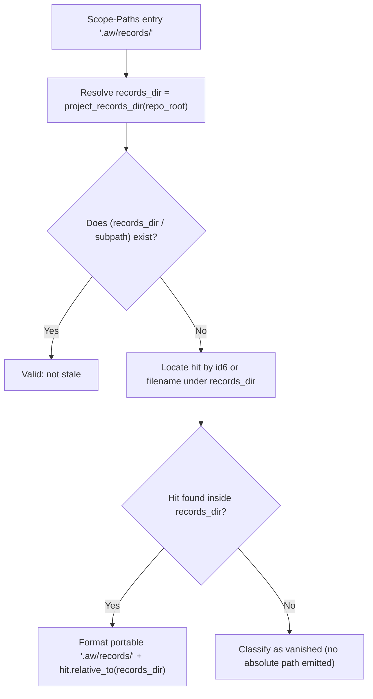

# IPD: Resolve companion records paths in check.scope-path-target-stale without absolute paths

- Date: 2026-11-21
- Kind: child
- Concern: In companion records mode (`public-target-private-companion`), `agent_workflows/check_engine.py::stale_record_scope_paths` tests `repo_root / entry` instead of the logical records root, falsely flags valid `.aw/records/...` `Scope-Paths` entries as moved, and recommends replacing them with an absolute machine-local path into the companion repository.
- Scope: Resolve `.aw/records/...` entries in `agent_workflows/check_engine.py::stale_record_scope_paths` against `project_context.project_records_dir(repo_root)`, format any genuinely moved companion record target back into logical `.aw/records/<rel>` form (never an absolute filesystem path), and add behavioral tests.
- Scope-Paths: agent_workflows/check_engine.py, tests/test_scope_path_stale_companion.py, .aw/records/plans/pending/20261121-dogfood-bugs-04-p0hq1k-resolve-companion-records-paths-in-check-scope-path-target-s.ipd.md
- Item-Dependencies: none
- Status: to-review
- Short-Description: Resolve .aw/records/ Scope-Paths against companion records root and never recommend machine-local absolute paths
- Work-Kind: bug
- Priority: high
- From-Backlog: dv9ses
- Blocks-Release: next
- Set: dogfood-bugs
- Order: 4
- Highest E allocated: 03
- Author: antigravity
- Id: p0hq1k

> Write and proofread this plan per the technical writing standard, `.aw/system/workflows/technical-writing/technical-writing.md` (`.agents/workflows/technical-writing/technical-writing.md` in a legacy-layout install), including requirement 12 (diagrams).

## Workflow history

- 2026-11-21 to-review (aw set): Review-ready child plans for dogfood-bugs
- 2026-11-21 draft (antigravity): created.

## Goal

Make `check.scope-path-target-stale` companion-aware so valid `.aw/records/...` `Scope-Paths` entries in companion-mode repositories pass cleanly and genuinely moved companion records report portable `.aw/records/<rel>` paths rather than machine-local absolute paths.

## Detailed Implementation Checklist (TODO)

Execution-state rule: mark an `E-*` item complete only after performing the action. That mark is not validation. Right-sizing rule: write for a modest executor that cannot hold much in its head. Each E-item is one step (one concern, about one file, executable in one focused pass) and its V-item names each unit it covers with its own check; a plan stays at about 5 E-items and 8 work Scope-Paths, else split it into more child plans (guidance, `IPD-Z603`). Accepted execution states: blocked, failed, pending, performed; terminal gate demands 'performed'.

### Task group 1: Companion-aware existence and portable relative formatting

- [ ] E-01 Update `agent_workflows/check_engine.py::stale_record_scope_paths` so any `Scope-Paths` entry starting with `.aw/records/` resolves its target against `project_context.project_records_dir(repo_root)` (checking `records_dir / entry.removeprefix(".aw/records/")` in addition to `repo_root / entry`) and passes `records_dir` context when detecting artifact type.
  - Depends on: none
  - Expected outcome: A pending plan in a companion-mode repo whose `Scope-Paths` lists `.aw/records/plans/pending/<file>.ipd.md` is not flagged by `stale_record_scope_paths` when `<companion>/records/plans/pending/<file>.ipd.md` exists.
  - Execution state: pending

- [ ] E-02 Update resolved-path formatting inside `agent_workflows/check_engine.py::stale_record_scope_paths` so that any hit located under `records_dir` is formatted as portable `.aw/records/<hit.relative_to(records_dir)>` (matching `declared_rel` for declared moves too) and never leaks a machine-local absolute path into `StaleScopePath.resolved`, `detail`, or `recovery`.
  - Depends on: E-01
  - Expected outcome: When a companion record genuinely moves from `pending/` to `executed/`, `check_scope_path_target_stale` reports `moved-terminal` with resolved path `.aw/records/plans/executed/<file>.ipd.md` and zero absolute filesystem paths in `detail` or `recovery`.
  - Execution state: pending

### Task group 2: Behavioral tests

- [ ] E-03 Add behavioral tests in `tests/test_scope_path_stale_companion.py` creating a companion-mode target + sibling companion repo and verifying: (a) an existing companion plan cited as `.aw/records/plans/pending/...` produces 0 `check.scope-path-target-stale` findings; (b) a genuinely moved companion plan (`pending/` -> `executed/`) emits `moved-terminal` with `.aw/records/plans/executed/...` and no absolute path in `detail` or `recovery`; (c) a declared move pair (`pending/` and `executed/` both listed in `Scope-Paths`) produces 0 findings; (d) standard repository-backed `.aw/records/` behavior is unchanged.
  - Depends on: E-01, E-02
  - Expected outcome: All new tests and existing `tests/test_check_engine.py` / `tests/test_companion_doctor_and_carriers.py` pass.
  - Execution state: pending

## Project conventions discovered (Step 0)

- `agent_workflows/check_engine.py::stale_record_scope_paths` currently checks `target = repo_root / entry; if target.exists(): continue`, then searches `project_records_dir(repo_root)`, then runs `hit.resolve().relative_to(repo_root.resolve())` and falls back to `hit.as_posix()` on `ValueError` (producing an absolute machine-local path whenever `records_dir` is outside `repo_root`, such as in companion or home backend mode).
- `check_scope_path_target_stale` interpolates `stale.resolved` directly into both `detail` and `recovery` (`target exists at {resolved_str}; ... or correct its Scope-Paths to {resolved_str}`).
- Leak-containment rule (`AGENTS.md` / `aw sanitize`): machine-local absolute paths must never be written into tracked plans or recommended as `Scope-Paths` values.

## Findings

| ID | Severity | Area | Finding |
|---|---|---|---|
| DF-03 | High | `agent_workflows/check_engine.py::stale_record_scope_paths`, `check_scope_path_target_stale` | Observed on `polyopen` (`p1f0or`): `aw check` flagged valid companion plan `.aw/records/plans/pending/20261121-perf-opt-00-p1f0or-...ipd.md` as `moved` and told the user to put the absolute path to `polyopen.aw/records/plans/pending/...` into `Scope-Paths:`. |

## Proposed changes (ordered, validatable)

1. `agent_workflows/check_engine.py::stale_record_scope_paths` (`E-01`, `E-02`): Resolve `records_dir = project_records_dir(repo_root)` once. Map `.aw/records/<subpath>` to `records_dir / subpath` for existence checks, and format any hit under `records_dir` as `f".aw/records/{hit.resolve().relative_to(records_dir.resolve()).as_posix()}"` before falling back to `repo_root`-relative formatting.
2. `tests/test_scope_path_stale_companion.py` (`E-03`): Add end-to-end companion-mode and repository-mode behavioral tests.

## Deferred / out of scope (with reason)

None.

## Scope check

- Over-scope: none. Only `stale_record_scope_paths` in `agent_workflows/check_engine.py` and its tests are modified.
- Under-scope: none. Also fixes `home` records backend automatically because `project_records_dir(repo_root)` handles both `companion` and `home` backends.

## Required tests / validation

- Run `python3 -m pytest tests/test_scope_path_stale_companion.py tests/test_check_engine.py tests/test_companion_doctor_and_carriers.py`.
- Run `make typecheck` and `aw sanitize --agent`.

## Spec / documentation sync

N/A with reason: aligns `check.scope-path-target-stale` with existing companion-mode record resolution and leak-containment contracts.

## Open questions

None.

## Validation and cross-check (verify before reporting done)

Validation-state rule: inspect evidence in a separate pass. Do not mark a `V-*` item complete from memory or from the matching execution checkmark. Accepted validation results: blocked, failed, pass, pending; terminal gate demands 'pass'. Runtime-demonstration reachability rule: for each `V-*` item demanding the software be observed acting (such as a run, a dispatch, or a transition) (as distinct from items demanding a diff, a file's content, or a test result, which are reachable by construction) name the code path that produces the observation or the sibling `E-*` that creates it, else the demand is UNDER-SCOPE.

- [ ] V-01 validates E-01
  - Required evidence: Paste `git diff -- agent_workflows/check_engine.py` showing `project_records_dir(repo_root)` lookup for `.aw/records/` entries in `stale_record_scope_paths`, plus pasted test output proving an existing companion record produces 0 stale findings.
  - Observed evidence:
  - Result: pending

- [ ] V-02 validates E-02
  - Required evidence: Paste `git diff -- agent_workflows/check_engine.py` showing portable `.aw/records/<rel>` formatting for hits under `records_dir`, plus pasted test output proving a moved companion record reports `.aw/records/plans/executed/...` with zero absolute paths in `detail` or `recovery`.
  - Observed evidence:
  - Result: pending

- [ ] V-03 validates E-03
  - Required evidence: Paste full output of `python3 -m pytest tests/test_scope_path_stale_companion.py tests/test_check_engine.py tests/test_companion_doctor_and_carriers.py`, `make typecheck`, and `aw sanitize --agent` showing all tests pass, 0 mypy errors, and 0 leak findings.
  - Observed evidence:
  - Result: pending

## Approval and execution gate

- Size assessment: standard
- Cohesion rationale: not required

This plan must reach `approved` before execution. Execute inside an isolated worktree, commit only `Scope-Paths` files via `aw commit p0hq1k -- <paths>`, paste actual command output into each `V-*` Observed evidence block, and finalize via `aw ipd finalize p0hq1k`.
