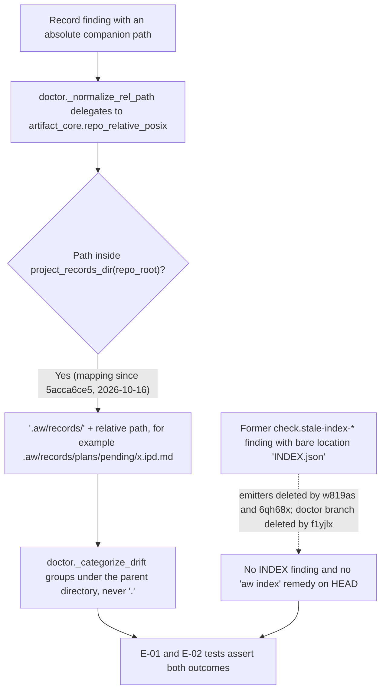

# IPD: Lock in the aw doctor companion index path and typed index remedy fixes with regression tests

- Date: 2026-11-21
- Kind: child
- Concern: Backlog `gqpgvm` reported two `aw doctor` defects on companion-mode repository `polyopen`: missing `INDEX.json` / `INDEX.md` files grouped under `- .` with their parent directories lost, and the remedy `Fix: run 'aw index'`, which fails because `aw index` requires a `type` argument. Both defects are already gone on HEAD, by work that landed after this plan was written, so what remains is a regression lock.
- Scope: Add behavioral regression tests in `tests/test_doctor_companion_paths.py` proving that `aw doctor` on a companion install keeps logical `.aw/records/<type>/...` directories for record findings and never emits a bare `aw index` command. Change `agent_workflows/doctor.py` only if one of those tests fails on unmodified HEAD.
- Scope-Paths: tests/test_doctor_companion_paths.py, agent_workflows/doctor.py, .aw/records/plans/pending/20261121-dogfood-bugs-05-c74ey2-fix-aw-doctor-stale-index-remediation-command-and-companion.ipd.md
- Item-Dependencies: none
- Status: reviewed
- Readiness: go-pending-approval
- Review-Depth: standard
- Short-Description: Lock in companion-path and no-bare-aw-index doctor behavior with regression tests
- Work-Kind: bug
- Priority: medium
- From-Backlog: gqpgvm
- Blocks-Release: next
- Set: dogfood-bugs
- Order: 5
- Highest E allocated: 03
- Author: antigravity
- Id: c74ey2

> Write and proofread this plan per the technical writing standard, `.aw/system/workflows/technical-writing/technical-writing.md` (`.agents/workflows/technical-writing/technical-writing.md` in a legacy-layout install), including requirement 12 (diagrams).

## Workflow history

- 2026-11-24 reviewed (/plan-review model=claude-opus-5.5): APPROVE WITH REVISIONS APPLIED; F1..F6 FIXED, F7 DEFERRED; review record .aw/records/reviews/20261121-dogfood-bugs-05-c74ey2-fix-aw-doctor-stale-index-remediation-command-and-companion.review.md
- 2026-11-21 to-review (aw set): Review-ready child plans for dogfood-bugs
- 2026-11-21 draft (antigravity): created.

## Goal

Prove, with tests that run `aw doctor` on a real companion install, that the two `polyopen` symptoms cannot return:

1. A finding about a record stored in the companion records root is listed under its logical directory (for example `.aw/records/plans/pending`), never under `- .`, and never under an absolute companion path.
2. No `aw doctor` output (human or `--agent`) contains the bare command `aw index`, which exits with `error: the following arguments are required: type`.

A companion install keeps the project's records in a separate git repository (the companion records root, returned by `project_context.project_records_dir(repo_root)`), outside the target repository. Paths there cannot be made relative to the target, which is why they need explicit mapping onto `.aw/records/...`.

Both symptoms are already fixed on HEAD (see Step 0), so this plan adds no production change unless a test it adds fails.

## Detailed Implementation Checklist (TODO)

Execution-state rule: mark an `E-*` item complete only after performing the action. That mark is not validation. Right-sizing rule: write for a modest executor that cannot hold much in its head. Each E-item is one step (one concern, about one file, executable in one focused pass) and its V-item names each unit it covers with its own check; a plan stays at about 5 E-items and 8 work Scope-Paths, else split it into more child plans (guidance, `IPD-Z603`). Accepted execution states: blocked, failed, pending, performed; terminal gate demands 'performed'.

### Task group 1: Regression tests

- [ ] E-01 Create `tests/test_doctor_companion_paths.py` with function-level regression tests. Build a real companion install with `_install_companion_repo` and `_patched_env` imported from `tests/test_companion_doctor_and_carriers.py`; importing helpers from a sibling test module is an existing convention, for example `tests/test_agy_runipd_cli.py`. Inside `_patched_env(env)`, set `rec = project_context.project_records_dir(target)` and assert that `rec` is inside the companion directory, so the test cannot pass on a non-companion layout. Cases: (a) `doctor._normalize_rel_path(str(rec / "plans" / "INDEX.json"), target)` returns `.aw/records/plans/INDEX.json`, and the `research` path returns `.aw/records/research/INDEX.json`; (b) `doctor._infer_artifact_type` on those two results returns `"plans"` and `"research"`; (c) `doctor._categorize_drift` on a `core.Drift` carrying each normalized location returns directories `.aw/records/plans` and `.aw/records/research`, not `.`; (d) `doctor.build_remediation` on `core.Drift(".aw/records/plans/INDEX.json", "check.stale-index-missing", "x")` returns a `Remediation` whose `command` is not `"aw index"` and whose `summary_fix` and `detailed_fix` do not contain the quoted bare command `'aw index'`.
  - Depends on: none
  - Expected outcome: Four test functions (or one parametrized group per case) exist and pass on unmodified `agent_workflows/doctor.py`.
  - Execution state: pending

- [ ] E-02 In the same file, add end-to-end tests that drive the CLI through `_run_aw_inproc(["doctor", "--dir", str(target), ...], env=env)` on a companion install. Cases: (e) a fresh companion install: neither the human output nor the `--agent` output contains a diagnostic rule starting `check.stale-index-`, a line whose stripped text is `- .`, or the quoted bare command (`'aw index'` or `"aw index"`); (f) write a plan with an unknown status, `20261121-zzprobe-01-q9q9q9-probe.ipd.md` with `- Status: bogus` and `- Id: q9q9q9`, under `rec / "plans" / "pending"`. The human output must list the group directory `.aw/records/plans/pending`, the `--agent` `diagnostics[]` must contain location `.aw/records/plans/pending/20261121-zzprobe-01-q9q9q9-probe.ipd.md`, and neither output may contain `str(companion)`; (g) write `rec / "research" / "badname.md"` with no front matter: the human output names `.aw/records/research/badname.md`, and no output contains `str(companion)`.
  - Depends on: E-01
  - Expected outcome: Three end-to-end tests exist and pass on unmodified `agent_workflows/doctor.py`. The review ran the same three scenarios by hand at `34792ea0b` and observed exactly these outcomes.
  - Execution state: pending

### Task group 2: Conditional production fix

- [ ] E-03 Run `python3 -m pytest -o addopts="" -v tests/test_doctor_companion_paths.py` on unmodified `agent_workflows/doctor.py`. If every case passes, make no change to `agent_workflows/doctor.py`, and acknowledge it at finalize with `--scope-ack agent_workflows/doctor.py`. If a case fails, make the smallest change to `agent_workflows/doctor.py` that makes it pass without weakening the test, and re-run.
  - Depends on: E-01, E-02
  - Expected outcome: All seven cases pass. `git diff --stat` for this plan lists `agent_workflows/doctor.py` only if a case failed first, and the failing output is pasted in V-03.
  - Execution state: pending

## Project conventions discovered (Step 0)

- The plan as first written targeted code that no longer exists or never caused the symptom. Measured at `34792ea0b`:
  - `doctor.build_remediation` has no `stale-index` branch. `f1yjlx` (executed, commit `972cff4cf`, 2026-11-23) deleted it, together with the `cmd = f"aw index {art_type}" if art_type else "aw index"` line and `summary_fix="aw index"`. `rg -n "stale-index|aw index" agent_workflows/doctor.py` prints only two allowlist comments (lines 763 and 766).
  - The `check.stale-index-*` emitters are gone: `w819as` (`a5707f414`) deleted them from `plans_index` and `prompts_index`, and `6qh68x` (`419e01d67`) deleted the `research_index` emitter and both registry entries.
  - `doctor._normalize_rel_path` delegates to `artifact_core.repo_relative_posix`, which already maps an absolute path inside `project_context.project_records_dir(repo_root)` to `.aw/records/<rel>` (`agent_workflows/artifact_core.py:657-673`, added by `5acca6ce5` on 2026-10-16). The Step 0 claim that it "cannot relativize a path outside `repo_root`" was false.
- Root cause of the `polyopen` `- .` grouping: the deleted emitters set the drift location to the bare constant `INDEX.json` / `INDEX.md` (`plans_index.py` and `research_index.py` before those commits). `doctor._categorize_drift` (`agent_workflows/doctor.py:1891-1916`) then falls back to `repo_root.rglob(fname)`, finds nothing in the target (the files live in the companion), and returns directory `.`. Removing those emitters removed the symptom; `_normalize_rel_path` was never involved.
- `aw index` with no argument still exits with `error: the following arguments are required: type` (run at review), so the bare command must stay out of every remedy. The E-02 test pins that.
- `tests/test_companion_doctor_and_carriers.py` already provides `_install_companion_repo`, `_patched_env`, and `_run_aw_inproc`, and its own test at line 570 asserts a companion README finding location of `.aw/records/plans/README.md`. E-01 and E-02 reuse those helpers.

## Findings

| ID | Severity | Area | Finding |
|---|---|---|---|
| DF-05 | Medium | `aw doctor` on companion installs | Observed on `polyopen` before 2026-11-23: `aw doctor` grouped companion missing index files under `- .` as `1. INDEX.json, 2. INDEX.md, 3. INDEX.json, 4. INDEX.md` and printed `Fix: run 'aw index'`, which fails with `error: the following arguments are required: type`. Fixed on HEAD by `w819as`, `6qh68x`, and `f1yjlx`; this plan locks the fix in with tests. |

## Proposed changes (ordered, validatable)

1. `tests/test_doctor_companion_paths.py` (`E-01`): function-level tests for path normalization, type inference, grouping, and remediation text on a companion install.
2. `tests/test_doctor_companion_paths.py` (`E-02`): end-to-end `aw doctor` tests (human and `--agent`) on a companion install.
3. `agent_workflows/doctor.py` (`E-03`): no change unless a test from 1 or 2 fails on unmodified HEAD.

## Deferred / out of scope (with reason)

- Deleting legacy `INDEX.json`/`INDEX.md` manifest generation and `check.stale-index-*` rules altogether is owned by the `metastore` Set: `snin8q` (the INDEX writers). `w819as` (executed) deleted the plans and prompts emitters, `6qh68x` (executed) deleted the `research_index` emitter and the two registry entries, and `f1yjlx` (executed) deleted the `doctor` stale-index sites.
  - Carrier: snin8q
  - Carrier-Evidence: .aw/records/plans/executed/20261108-metastore-42-snin8q-delete-the-index-writers-the-status-code-and-the-audit-index.ipd.md
- Making `doctor._categorize_drift` search the companion records root when a finding carries only a bare filename. No live emitter was found that passes a bare filename for a companion record (the E-02 probes show plan and research findings carry full logical paths), so the change would have no user today.
  - Carrier-Declined: no live caller produces the input; E-02 case (e) fails if a bare-filename index finding returns.
- Rewording the orchestrator `p2zmjs` (its E-05 expected outcome, child table row 05, and success criterion) so it describes this child as regression tests rather than `doctor.py` code changes. That file is outside this plan's Scope-Paths; the orchestrator's next review or execution owns it (finding F7).
  - Carrier: p2zmjs

## Scope check

- Over-scope: none. The plan adds one test module and changes `agent_workflows/doctor.py` only if a test fails.
- Under-scope: corrected at review. The original E-01 and E-02 edited code that `f1yjlx` had already deleted or that never caused the symptom; they are replaced with regression tests that fail if either symptom returns. The orchestrator `p2zmjs` still describes this child's outcome as code changes in `doctor.py` (its E-05 expected outcome, child table row 05, and success criterion line 98); that wording is outside this plan's scope (finding F7).

## Required tests / validation

- Run `python3 -m pytest -o addopts="" -v tests/test_doctor_companion_paths.py` and paste the per-test lines.
- Run `python3 -m pytest -o addopts="" -q tests/test_doctor.py tests/test_companion_doctor_and_carriers.py tests/test_record_residual_helpers.py` and paste the summary line.
- Run `aw sanitize --agent`. Run `make typecheck` only if `agent_workflows/doctor.py` changed.

## Spec / documentation sync

N/A with reason: the plan adds tests only and changes no user-visible behavior. No spec describes `doctor` remediation strings for index files (spec `4sd62s` 4.5 deleted the rules).

## Open questions

None.

## Validation and cross-check (verify before reporting done)

Validation-state rule: inspect evidence in a separate pass. Do not mark a `V-*` item complete from memory or from the matching execution checkmark. Accepted validation results: blocked, failed, pass, pending; terminal gate demands 'pass'. Runtime-demonstration reachability rule: for each `V-*` item demanding the software be observed acting (such as a run, a dispatch, or a transition) (as distinct from items demanding a diff, a file's content, or a test result, which are reachable by construction) name the code path that produces the observation or the sibling `E-*` that creates it, else the demand is UNDER-SCOPE.

- [ ] V-01 validates E-01
  - Required evidence: Paste the `python3 -m pytest -o addopts="" -v tests/test_doctor_companion_paths.py` lines for cases (a) through (d), each `PASSED`. Paste the test source lines that assert `rec` is inside the companion directory, and the expected strings `.aw/records/plans/INDEX.json`, `.aw/records/research/INDEX.json`, `.aw/records/plans`, and `.aw/records/research`. Fail if any case is missing or not `PASSED`.
  - Observed evidence:
  - Result: pending

- [ ] V-02 validates E-02
  - Required evidence: Paste the same run's lines for cases (e), (f), and (g), each `PASSED`. Paste the assertion lines that check for the absent `check.stale-index-` rule, the absent `- .` line, the absent quoted bare `aw index`, the location `.aw/records/plans/pending/20261121-zzprobe-01-q9q9q9-probe.ipd.md`, and the absence of `str(companion)`. Fail if any case is missing or not `PASSED`.
  - Observed evidence:
  - Result: pending

- [ ] V-03 validates E-03
  - Required evidence: Paste `git diff --stat` for this plan's commits. If it does not list `agent_workflows/doctor.py`, paste the first `-v` run on unmodified HEAD showing all seven cases `PASSED`. If it does list `agent_workflows/doctor.py`, paste the failing run first, then the diff, then the passing run. Paste the summary line of `python3 -m pytest -o addopts="" -q tests/test_doctor.py tests/test_companion_doctor_and_carriers.py tests/test_record_residual_helpers.py` with 0 failed, and the `aw sanitize --agent` result record with status not `fail` (plus `make typecheck` with 0 errors if `doctor.py` changed).
  - Observed evidence:
  - Result: pending

## Approval and execution gate

- Size assessment: standard
- Cohesion rationale: not required. Three E-items in one test module, with one conditional production file.

This plan must reach `approved` before execution. Execute inside an isolated worktree, commit only `Scope-Paths` files via `aw commit c74ey2 -- <paths>`, paste actual command output into each `V-*` Observed evidence block, and finalize via `aw ipd finalize c74ey2`.
