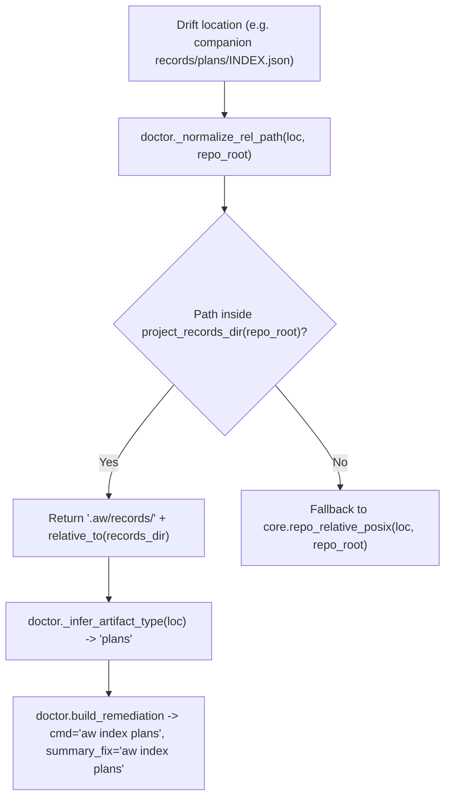

# IPD: Fix aw doctor stale-index remediation command and companion index parent paths

- Date: 2026-11-21
- Kind: child
- Concern: `agent_workflows/doctor.py::_normalize_rel_path`, `_infer_artifact_type`, and `build_remediation` strip companion records parent directories to `.` (producing duplicate `INDEX.json` / `INDEX.md` listings) and emit the invalid bare command `aw index` (which errors because `type` is required).
- Scope: Make `agent_workflows/doctor.py::_normalize_rel_path` normalize companion/external records paths into portable `.aw/records/<rel>` paths, update `_infer_artifact_type` and `build_remediation` so stale-index findings always emit a valid typed `aw index <type>` command (or `aw index plans|research|prompts` when type is genuinely unknown), and add behavioral tests.
- Scope-Paths: agent_workflows/doctor.py, tests/test_doctor_stale_index_companion.py, .aw/records/plans/pending/20261121-dogfood-bugs-05-c74ey2-fix-aw-doctor-stale-index-remediation-command-and-companion.ipd.md
- Item-Dependencies: none
- Status: to-review
- Short-Description: Emit typed aw index <type> commands in doctor remediation and preserve companion index parent directories
- Work-Kind: bug
- Priority: medium
- From-Backlog: gqpgvm
- Blocks-Release: next
- Set: dogfood-bugs
- Order: 5
- Highest E allocated: 03
- Author: antigravity
- Id: c74ey2

> Write and proofread this plan per the technical writing standard, `.aw/system/workflows/technical-writing/technical-writing.md` (`.agents/workflows/technical-writing/technical-writing.md` in a legacy-layout install), including requirement 12 (diagrams).

## Workflow history

- 2026-11-21 to-review (aw set): Review-ready child plans for dogfood-bugs
- 2026-11-21 draft (antigravity): created.

## Goal

Ensure `aw doctor` preserves the logical directory path (`.aw/records/plans/INDEX.json`, `.aw/records/research/INDEX.json`) for companion-mode index findings and emits a valid runnable `aw index <type>` command instead of the broken bare `aw index`.

## Detailed Implementation Checklist (TODO)

Execution-state rule: mark an `E-*` item complete only after performing the action. That mark is not validation. Right-sizing rule: write for a modest executor that cannot hold much in its head. Each E-item is one step (one concern, about one file, executable in one focused pass) and its V-item names each unit it covers with its own check; a plan stays at about 5 E-items and 8 work Scope-Paths, else split it into more child plans (guidance, `IPD-Z603`). Accepted execution states: blocked, failed, pending, performed; terminal gate demands 'performed'.

### Task group 1: Companion-aware path normalization and typed index remediation

- [ ] E-01 Update `agent_workflows/doctor.py::_normalize_rel_path` so that when `loc` resolves inside `project_context.project_records_dir(repo_root)` (companion or home records backend) and is outside `repo_root`, it returns `.aw/records/<rel>` instead of stripping the parent directory via `core.repo_relative_posix`. Also accept `records/<type>/` prefixes in `_infer_artifact_type` alongside `.aw/records/<type>/`.
  - Depends on: none
  - Expected outcome: For companion-mode drift locations `<companion>/records/plans/INDEX.json` and `<companion>/records/research/INDEX.json`, `_normalize_rel_path` returns `.aw/records/plans/INDEX.json` and `.aw/records/research/INDEX.json` (no flattening to `.` and no duplicate filenames under `- .`), and `_infer_artifact_type` returns `"plans"` and `"research"` respectively.
  - Execution state: pending

- [ ] E-02 Update the `stale-index` branch in `agent_workflows/doctor.py::build_remediation` so `cmd` and `summary_fix` use `f"aw index {art_type}"` when `art_type` is known and fall back to `"aw index <type>"` (never the invalid bare `"aw index"` command that fails argparse).
  - Depends on: E-01
  - Expected outcome: `build_remediation` for `check.stale-index-missing` / `check.stale-index-stale` produces `command="aw index plans"`, `summary_fix="aw index plans"`, and `detailed_fix="run 'aw index plans' to regenerate the manifest index."` for plans indexes (and `"aw index research"` for research indexes), never bare `"aw index"`.
  - Execution state: pending

### Task group 2: Behavioral tests

- [ ] E-03 Add behavioral tests in `tests/test_doctor_stale_index_companion.py` verifying `_normalize_rel_path`, `_infer_artifact_type`, and `build_remediation` on companion-mode `check.stale-index-missing` drifts for both `plans` and `research`, plus an unknown-type fallback check asserting bare `"aw index"` is never emitted as a runnable command.
  - Depends on: E-01, E-02
  - Expected outcome: All new tests and existing `tests/test_doctor*.py` / `tests/test_companion_doctor_and_carriers.py` pass.
  - Execution state: pending

## Project conventions discovered (Step 0)

- `agent_workflows/doctor.py::_normalize_rel_path` delegates solely to `core.repo_relative_posix(loc, repo_root)`, which cannot relativize a path outside `repo_root` (such as `<companion>/records/plans/INDEX.json`).
- `agent_workflows/doctor.py::build_remediation` sets `cmd = f"aw index {art_type}" if art_type else "aw index"` and hardcodes `summary_fix="aw index"`.
- `aw index` in `agent_workflows/cli.py` requires positional argument `type` (`error: the following arguments are required: type`).
- Note on concurrent `metastore` work: `metastore` plans (`w819as`, `q6epwc`) will eventually remove legacy index rules, but `doctor.py` remediation and companion path normalization still serve users until `metastore` completes and for any other companion drift locations routed through `_normalize_rel_path`.

## Findings

| ID | Severity | Area | Finding |
|---|---|---|---|
| DF-05 | Medium | `agent_workflows/doctor.py::_normalize_rel_path`, `build_remediation` | Observed on `polyopen`: `aw doctor` grouped companion missing index files under `- .` as `1. INDEX.json, 2. INDEX.md, 3. INDEX.json, 4. INDEX.md` and printed `Fix: run 'aw index'`, which fails immediately with `error: the following arguments are required: type`. |

## Proposed changes (ordered, validatable)

1. `agent_workflows/doctor.py::_normalize_rel_path` and `_infer_artifact_type` (`E-01`): Resolve companion/external records paths against `project_context.project_records_dir(repo_root)` into `.aw/records/<rel>` before falling back to `core.repo_relative_posix`.
2. `agent_workflows/doctor.py::build_remediation` (`E-02`): Use `cmd` (`aw index {art_type}`) for `summary_fix`, `detailed_fix`, and `command`; when `art_type` is `None`, emit `aw index <type>` (and `command=None`) instead of broken bare `aw index`.
3. `tests/test_doctor_stale_index_companion.py` (`E-03`): Add behavioral tests for companion index grouping and remediation commands.

## Deferred / out of scope (with reason)

- Deleting legacy `INDEX.json`/`INDEX.md` manifest generation and `check.stale-index-*` rules altogether is owned by the `metastore` Set: `snin8q` (the INDEX writers). `w819as` (executed) deleted the plans and prompts emitters, `6qh68x` (executed) deleted the `research_index` emitter and the two registry entries, and `f1yjlx` (executed) deleted the `doctor` stale-index sites.
  - Carrier: snin8q

## Scope check

- Over-scope: none. Only `agent_workflows/doctor.py` and its tests are touched.
- Under-scope: none.

## Required tests / validation

- Run `python3 -m pytest tests/test_doctor_stale_index_companion.py tests/test_doctor*.py tests/test_companion_doctor_and_carriers.py`.
- Run `make typecheck` and `aw sanitize --agent`.

## Spec / documentation sync

N/A with reason: fixes doctor remediation output to match existing `aw index <type>` CLI usage.

## Open questions

None.

## Validation and cross-check (verify before reporting done)

Validation-state rule: inspect evidence in a separate pass. Do not mark a `V-*` item complete from memory or from the matching execution checkmark. Accepted validation results: blocked, failed, pass, pending; terminal gate demands 'pass'. Runtime-demonstration reachability rule: for each `V-*` item demanding the software be observed acting (such as a run, a dispatch, or a transition) (as distinct from items demanding a diff, a file's content, or a test result, which are reachable by construction) name the code path that produces the observation or the sibling `E-*` that creates it, else the demand is UNDER-SCOPE.

- [ ] V-01 validates E-01
  - Required evidence: Paste `git diff -- agent_workflows/doctor.py` showing companion records normalization in `_normalize_rel_path` and `_infer_artifact_type`, plus test output verifying `.aw/records/plans/INDEX.json` and `.aw/records/research/INDEX.json` retain their distinct directories.
  - Observed evidence:
  - Result: pending

- [ ] V-02 validates E-02
  - Required evidence: Paste `git diff -- agent_workflows/doctor.py` showing typed `aw index {art_type}` in `build_remediation` (`summary_fix`, `detailed_fix`, `command`), plus test output verifying bare `aw index` is never emitted.
  - Observed evidence:
  - Result: pending

- [ ] V-03 validates E-03
  - Required evidence: Paste full output of `python3 -m pytest tests/test_doctor_stale_index_companion.py tests/test_doctor*.py tests/test_companion_doctor_and_carriers.py`, `make typecheck`, and `aw sanitize --agent` showing all tests pass, 0 mypy errors, and 0 leak findings.
  - Observed evidence:
  - Result: pending

## Approval and execution gate

- Size assessment: standard
- Cohesion rationale: not required

This plan must reach `approved` before execution. Execute inside an isolated worktree, commit only `Scope-Paths` files via `aw commit c74ey2 -- <paths>`, paste actual command output into each `V-*` Observed evidence block, and finalize via `aw ipd finalize c74ey2`.
