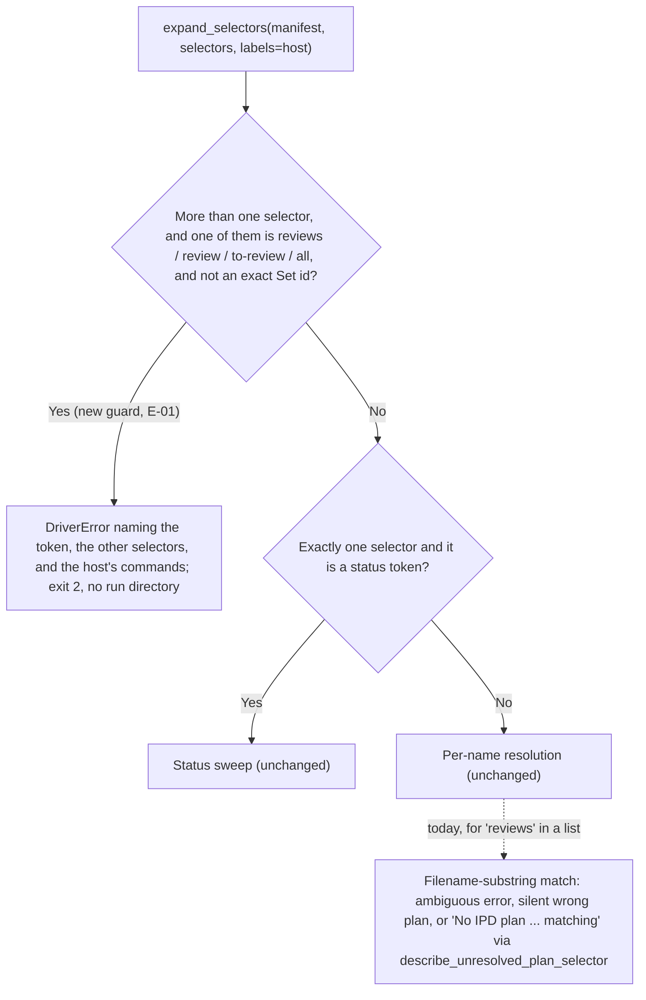

# IPD: Refuse a status selector combined with another selector and name the correct review command

- Date: 2026-11-21
- Kind: child
- Concern: `aw agy run reviews perf-opt` and `aw oc run reviews perf-opt` do not tell the operator that `reviews` is a status selector that must stand alone, or that `aw <host> review perf-opt` (the same as `--action review perf-opt`) reviews one Set. On `polyopen` the run failed with `No IPD plan, Set, or file matching 'reviews' found under .aw/records/plans/.`. In this repository it fails with `Ambiguous filename selector: reviews matches multiple plans: [...]`. When exactly one plan filename contains the token, it silently queues that plan instead of failing.
- Scope: Add one guard at the top of `agent_workflows/runner_shared.py::expand_selectors`. The guard refuses a selector list that holds a status selector token (`reviews`, `review`, `to-review`, `all`) together with any other selector, and names the host's correct commands. Add function-level and CLI-level tests for both hosts, and one CHANGELOG bullet.
- Scope-Paths: agent_workflows/runner_shared.py, tests/test_runner_reviews_selector_hint.py, CHANGELOG.md, .aw/records/plans/pending/20261121-dogfood-bugs-06-d8b9rp-emit-actionable-action-review-hint-when-reviews-is-combined.ipd.md
- Item-Dependencies: none
- Status: reviewed
- Readiness: go-pending-approval
- Review-Depth: standard
- Short-Description: Refuse a status selector combined with another selector and name the correct review or run command
- Work-Kind: bug
- Priority: medium
- From-Backlog: bqqhdu
- Blocks-Release: next
- Set: dogfood-bugs
- Order: 6
- Highest E allocated: 04
- Author: antigravity
- Id: d8b9rp

> Write and proofread this plan per the technical writing standard, `.aw/system/workflows/technical-writing/technical-writing.md` (`.agents/workflows/technical-writing/technical-writing.md` in a legacy-layout install), including requirement 12 (diagrams).

## Workflow history

- 2026-11-24 reviewed (/plan-review model=claude-opus-5.5): APPROVE WITH REVISIONS APPLIED; F1..F7 FIXED, F8 DEFERRED; review record .aw/records/reviews/20261121-dogfood-bugs-06-d8b9rp-emit-actionable-action-review-hint-when-reviews-is-combined.review.md
- 2026-11-21 to-review (aw set): Review-ready child plans for dogfood-bugs
- 2026-11-21 draft (antigravity): created.

## Goal

When an operator passes a status selector (`reviews`, `review`, `to-review`, or `all`) together with any other selector to `aw oc run` or `aw agy run`, the run is refused before any queue, session, or run directory exists. The refusal names the token, the other selectors, and the exact command that does what the operator most likely meant, spelled for the host in use.

A status selector picks items by their state rather than by name. Spec `25kzda` 2.1 already says "A new run accepts exactly one selector", and both hosts treat these tokens as status selectors only when they are the sole selector (`runner_shared.is_status_selector`, `len(tokens) == 1`). In any longer list, each token goes through the per-name resolver, where `reviews` is not a plan, Set, or id6, so it falls through to filename-substring matching.

## Detailed Implementation Checklist (TODO)

Execution-state rule: mark an `E-*` item complete only after performing the action. That mark is not validation. Right-sizing rule: write for a modest executor that cannot hold much in its head. Each E-item is one step (one concern, about one file, executable in one focused pass) and its V-item names each unit it covers with its own check; a plan stays at about 5 E-items and 8 work Scope-Paths, else split it into more child plans (guidance, `IPD-Z603`). Accepted execution states: blocked, failed, pending, performed; terminal gate demands 'performed'.

### Task group 1: The guard

- [ ] E-01 In `agent_workflows/runner_shared.py::expand_selectors`, immediately after `selectors_list` is built and before the single-token `reviews` branch, add the guard. Let `misused` be the tokens in `selectors_list` whose `.lower()` is in `STATUS_SELECTOR_TOKENS` and that are not an exact key of `sets`. If `len(selectors_list) > 1` and `misused` is not empty, raise `DriverError`. Do not raise `EmptyStatusSelection`, because that class exits 0. The message has this shape, with `{tok}` the first misused token as typed, `{others}` the remaining selectors joined by one space in their original order, and `{cmd}` and `{review}` taken from `labels.command` and `labels.review_command`:
  - For a review token: `'{tok}' is a status selector and must be the only selector; it was combined with: {others}. To review only those, run: {review} {others} (the same as {cmd} {others} --action review). To review everything awaiting review, run: {review}. No run was started.`
  - For `all`: `'all' is a status selector and must be the only selector; it was combined with: {others}. To run every actionable pending IPD, run: {cmd} all. To run only the others, run: {cmd} {others}. No run was started.`
  - If every selector is a status token (for example `reviews all`), `{others}` is empty. Use the message for the first token, ending after `must be the only selector.` and followed by `No run was started.`
  - Depends on: none
  - Expected outcome: `oc_runipd.expand_selectors(m, ["reviews", "perfopt"])` raises `DriverError` whose message contains `aw oc review perfopt` and `aw oc run perfopt --action review`; the `agy_runipd` call contains `aw agy review perfopt`. A single `["reviews"]` or `["all"]` call and every list without a status token behave exactly as before.
  - Execution state: pending

### Task group 2: Tests and changelog

- [ ] E-02 Create `tests/test_runner_reviews_selector_hint.py` with `pytestmark = pytest.mark.core`, as in `tests/test_runner_shared.py:58`. Build a small in-memory manifest of the shape `build_dynamic_manifest` returns. Use plan `aaa111` in Set `perfopt` (file `.aw/records/plans/pending/20261121-perfopt-01-aaa111-speed-up.ipd.md`, status `to-review`) and plan `bbb222` in Set `docs` (file `.aw/records/plans/pending/20261121-docs-01-bbb222-to-review-cleanup.ipd.md`, status `to-review`). Parametrize over both hosts (`oc_runipd`, `agy_runipd`) and assert on the raised message. Cases: (a) `["reviews", "perfopt"]`, `["review", "perfopt"]`, and `["REVIEWS", "perfopt"]` refuse with the host's review command and `--action review`; (b) `["to-review", "perfopt"]` refuses, where today it silently returns `['bbb222', 'aaa111']` because `bbb222`'s filename contains `to-review`; (c) `["all", "perfopt"]` refuses with `{cmd} all` and `{cmd} perfopt`; (d) `["perfopt", "reviews"]` (status token second) refuses; (e) `["reviews", "all"]` refuses; (f) `["reviews"]` returns `['aaa111', 'bbb222']` and `["all"]` returns `['aaa111', 'bbb222']`, unchanged; (g) `["perfopt", "docs"]` returns `['aaa111', 'bbb222']`, unchanged; (h) with a third Set literally named `reviews` holding plan `ccc333`, `["reviews", "perfopt"]` returns `['ccc333', 'aaa111']`, unchanged. Pass each call a fresh copy of the manifest, because `expand_selectors` mutates it.
  - Depends on: E-01
  - Expected outcome: All cases pass for both hosts. Before E-01, cases (a) through (e) fail and (f) through (h) pass; the review observed (b), (f), and (h) by hand at `34792ea0b`.
  - Execution state: pending

- [ ] E-03 In the same file, add one CLI test per host. Create a repository with `tests.repo_template.copy_template_repo` and one `to-review` plan in Set `perfopt`, then call `oc_runipd.main(["reviews", "perfopt", "--repo", str(repo), "--prepare-only"])`, and the `agy_runipd.main` equivalent, under `redirect_stdout` and `redirect_stderr`, as `tests/test_agy_runipd_cli.py:1964-1982` does. Assert that the return code is 2, that the output contains the host's review command followed by `perfopt`, that it does not contain `No IPD plan, Set, or file matching` or `Ambiguous filename selector`, and that `repo / ".aw" / "records" / "runs"` does not exist.
  - Depends on: E-01
  - Expected outcome: Both CLI tests pass.
  - Execution state: pending

- [ ] E-04 Add one bullet to `CHANGELOG.md` under `## 2.0.0 (pending)`, in the existing `- Fixed:` style and with no em or en dashes: `- Fixed: \`aw oc run\` and \`aw agy run\` now refuse a status selector (\`reviews\`, \`review\`, \`to-review\`, \`all\`) combined with another selector, and print the command to use instead, such as \`aw oc review <set>\`. Before, the run failed with a misleading "not found" or "ambiguous" message, or silently queued a plan whose filename contained the word.`
  - Depends on: E-01
  - Expected outcome: One new bullet exists, and `git diff -- CHANGELOG.md` shows no other change.
  - Execution state: pending

## Project conventions discovered (Step 0)

- `runner_shared.STATUS_SELECTOR_TOKENS` (`{"reviews", "review", "to-review", "all"}`, line 18756) and `REVIEW_SELECTOR_TOKENS` (line 18760) are the shared token sets. `is_status_selector` and `is_review_selector` require `len(tokens) == 1`.
- Both hosts' `expand_selectors` (`agent_workflows/oc_runipd.py:1742`, `agent_workflows/agy_runipd.py:2050`) are thin wrappers over `runner_shared.expand_selectors` (line 18194). They pass `labels=runner_shared.OC_HOST_LABELS` or `AGY_HOST_LABELS`, whose `command` is `aw oc run` / `aw agy run` and whose `review_command` is `aw oc review` / `aw agy review`. So one guard in the shared function fixes both hosts and can render each host's own commands.
- The plan's first fix site, `describe_unresolved_plan_selector` (line 18607), is reached only after the filename-substring step finds zero matches (line 18397). Measured at `34792ea0b`: in this repository `reviews` is a substring of 9 plan filenames, `review` of 89, `to-review` of 4, and `all` of 141. Both hosts' `expand_selectors(manifest, ["reviews", "dogfood-bugs"], repo)` raised `Ambiguous filename selector: reviews matches multiple plans: [...]`. That is also what `aw oc run --prepare-only reviews dogfood-bugs` and `aw agy run --prepare-only reviews dogfood-bugs` printed, with exit 2. A fix there would never run in a repository with review-related plan names. The `polyopen` message appeared only because no plan filename there contained `reviews`.
- `aw <host> review <selector>` is defined as `aw <host> run <selector> --action review` (spec `25kzda` 2.1; `agent_workflows/cli.py::expand_host_review_argv`, line 21023), and passes several selectors through unchanged. So `aw oc review perfopt` is the correct suggestion.
- Spec `25kzda` 2.3 puts an exact Set id before an exact status token, so a Set literally named `reviews` must keep resolving as that Set in a list. That is why the guard exempts exact Set ids.
- A `DriverError` from `expand_selectors` exits 2 before any run directory exists (observed: `aw oc run --prepare-only reviews dogfood-bugs` returned 2). No existing test passes a status token together with another selector to `expand_selectors` or a host `main` (searched `tests/` for both shapes).

## Findings

| ID | Severity | Area | Finding |
|---|---|---|---|
| DF-06 | Medium | `agent_workflows/runner_shared.py::expand_selectors` | Observed on `polyopen`: `aw agy run reviews perf-opt` printed `runagy: No IPD plan, Set, or file matching 'reviews' found under .aw/records/plans/.`, with no hint that `reviews` must stand alone or that `aw agy review perf-opt` was the right command. In repositories where plan filenames contain the token, the same input gives an `Ambiguous filename selector` error or silently queues the wrong plan. |

## Proposed changes (ordered, validatable)

1. `agent_workflows/runner_shared.py::expand_selectors` (`E-01`): the multi-selector status-token guard, with host-specific commands.
2. `tests/test_runner_reviews_selector_hint.py` (`E-02`, `E-03`): function-level cases (a) through (h) for both hosts, and one CLI test per host.
3. `CHANGELOG.md` (`E-04`): one `- Fixed:` bullet.

## Deferred / out of scope (with reason)

- Accepting `reviews <setid>` as a review filtered to one Set. `aw <host> review <setid>` already does exactly that (spec `25kzda` 2.1), so a second spelling would add grammar without adding capability.
  - Carrier-Declined: the alias `aw <host> review <selector>` already provides it; the refusal message points there.
- Enforcing spec `25kzda` 2.1's "exactly one selector" for ordinary names (for example `aw oc run abc123 def456`). The runner accepts several named selectors today, and refusing them would break existing invocations. That divergence between spec and code is a contract decision, not part of this bug.
  - Carrier-Declined: no reported harm; changing it would break working multi-name runs.
- Changing `describe_unresolved_plan_selector`. After E-01, a status token never reaches it inside a list, and a lone status token never reaches it at all.
  - Carrier-Declined: unreachable for this input once E-01 lands.
- Rewording orchestrator `p2zmjs`, which names `describe_unresolved_plan_selector` as this child's fix site (E-06 expected outcome, child table row 06) and cites this plan's `V-02` for typecheck (now `V-04`). That file is outside this plan's Scope-Paths (finding F8).
  - Carrier: p2zmjs

## Scope check

- Over-scope: none. One guard, one new test module, and one CHANGELOG bullet.
- Under-scope: corrected at review. The original E-01 changed a function the reported input does not reach in this repository, and it had no test for the silent wrong-plan case. The original Scope-Paths had no user-facing note for a user-visible change. All three are now covered (findings F1, F2, F6).

## Required tests / validation

- Run `python3 -m pytest -o addopts="" -v tests/test_runner_reviews_selector_hint.py` and paste the per-test lines.
- Run `python3 -m pytest -o addopts="" -q tests/test_runner_shared.py tests/test_agy_runipd_cli.py tests/test_unresolved_selector_near_match.py` and paste the summary line.
- Run `make typecheck` and `aw sanitize --agent`.

## Spec / documentation sync

No spec edit. Spec `25kzda` 2.1 already says a new run accepts exactly one selector; this plan enforces that rule for status tokens only, and the refusal text adds no new contract. `aw oc run --help` and `aw agy run --help` already describe `reviews` and `all` as standalone selectors. User documentation: one CHANGELOG bullet (E-04).

## Open questions

None.

## Validation and cross-check (verify before reporting done)

Validation-state rule: inspect evidence in a separate pass. Do not mark a `V-*` item complete from memory or from the matching execution checkmark. Accepted validation results: blocked, failed, pass, pending; terminal gate demands 'pass'. Runtime-demonstration reachability rule: for each `V-*` item demanding the software be observed acting (such as a run, a dispatch, or a transition) (as distinct from items demanding a diff, a file's content, or a test result, which are reachable by construction) name the code path that produces the observation or the sibling `E-*` that creates it, else the demand is UNDER-SCOPE.

- [ ] V-01 validates E-01
  - Required evidence: Paste `git diff -- agent_workflows/runner_shared.py`, showing one guard placed before the single-token `reviews` branch, using `STATUS_SELECTOR_TOKENS`, exempting exact `sets` keys, raising `DriverError` (not `EmptyStatusSelection`), and reading `labels.command` and `labels.review_command`. Fail if any other hunk changes behavior, or if a host command is a literal string instead of a `labels` field.
  - Observed evidence:
  - Result: pending

- [ ] V-02 validates E-02
  - Required evidence: Paste the `-v` lines of `python3 -m pytest -o addopts="" -v tests/test_runner_reviews_selector_hint.py` for cases (a) through (h) under both hosts, each `PASSED`. Paste the assertion lines that check for `aw oc review perfopt`, `aw agy review perfopt`, and `--action review`, and the unchanged return values for (f), (g), and (h). Fail if a case or a host is missing.
  - Observed evidence:
  - Result: pending

- [ ] V-03 validates E-03
  - Required evidence: Paste the same run's lines for both CLI tests, each `PASSED`, and the assertion lines for return code 2, the host review command, the two absent old messages, and the absent `runs` directory.
  - Observed evidence:
  - Result: pending

- [ ] V-04 validates E-04
  - Required evidence: Paste `git diff -- CHANGELOG.md` showing exactly one added `- Fixed:` line under `## 2.0.0 (pending)`, with no em or en dash in it. Paste the summary line of `python3 -m pytest -o addopts="" -q tests/test_runner_shared.py tests/test_agy_runipd_cli.py tests/test_unresolved_selector_near_match.py` with 0 failed, `make typecheck` with 0 errors, and the `aw sanitize --agent` result record with status not `fail`.
  - Observed evidence:
  - Result: pending

## Approval and execution gate

- Size assessment: standard
- Cohesion rationale: not required. Four E-items: one guard in one function, its tests in one new module, and one changelog line.

This plan must reach `approved` before execution. Execute inside an isolated worktree, commit only `Scope-Paths` files via `aw commit d8b9rp -- <paths>`, paste actual command output into each `V-*` Observed evidence block, and finalize via `aw ipd finalize d8b9rp`.
