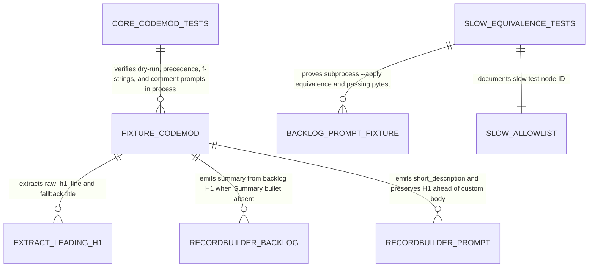
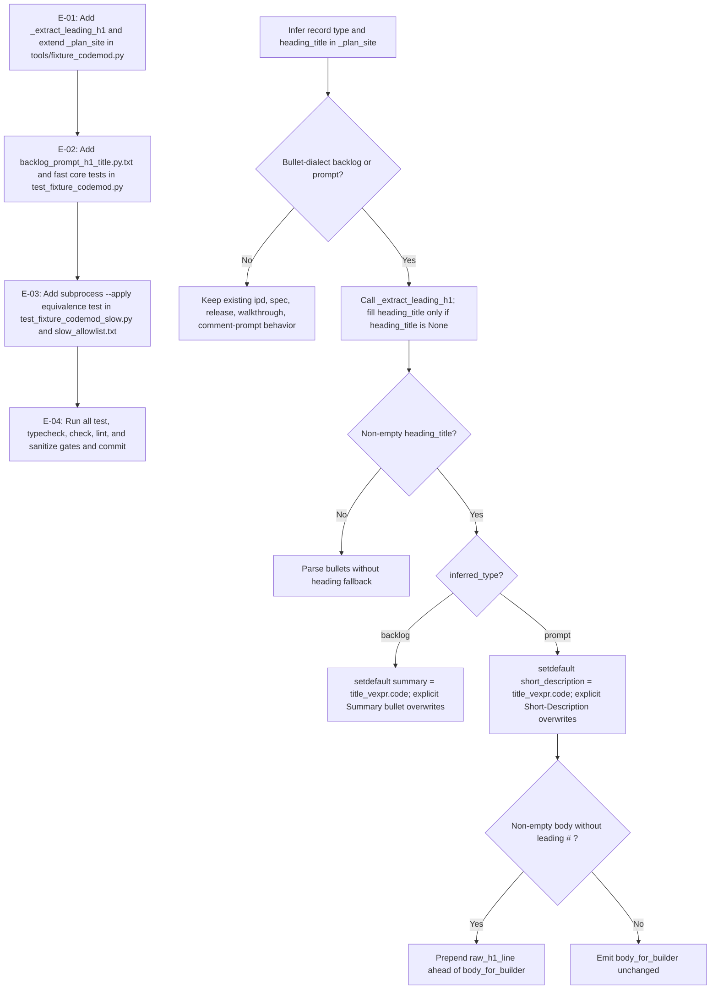

# IPD: Map H1 heading titles on backlog and prompt fixtures in fixture_codemod

- Date: 2026-11-21
- Kind: child
- Concern: Backlog `e0wwtc` (`Work-Kind: bug`, `Priority: low`, `Blocks-Release: next`) reports that `tools/fixture_codemod.py::_plan_site` drops Heading Level 1 (H1) titles on backlog and prompt fixtures instead of mapping them to `summary` or `short_description`. `tools/fixture_codemod.py::_parse_bullet_site` skips any leading `# ` heading line, and `tools/fixture_codemod.py::_plan_site` maps `heading_title` only for Implementation Plan Document (`ipd`), specification (`spec`), and release (`release`) records. On backlog and prompt fixtures without an explicit `- Summary:` or `- Short-Description:` bullet, the H1 title disappears and `tests/record_builder.py::RecordBuilder.backlog` or `RecordBuilder.prompt` substitutes default placeholder text (`"Demo backlog item"` or `"Demo staged prompt"`). When a prompt fixture also carries a `## ` body section, `RecordBuilder.prompt` uses `body` verbatim and drops the `# Prompt: <title>` heading line. During execution of plan `jjvnhb`, this defect caused three `not-equivalent` refusals in `tests/test_cli_search.py` (two backlog fixtures and one prompt fixture) whose `ALPHA_SECRET` H1 titles were dropped.
- Scope: IN: (1) add helper `tools/fixture_codemod.py::_extract_leading_h1` and update `tools/fixture_codemod.py::_plan_site` so non-empty H1 titles on bullet-dialect backlog fixtures map to `summary` when no explicit `- Summary:` bullet is present, non-empty H1 titles on bullet-dialect prompt fixtures map to `short_description` when no explicit `- Short-Description:` bullet is present, and bullet-dialect prompt fixtures with a non-empty `body` that lacks a leading `# ` heading prepend the original H1 line ahead of `body`; (2) preserve explicit `- Summary:` and `- Short-Description:` bullet precedence, titleless `# Backlog` / `# Backlog item` / `# Prompt` headings, and `<!-- aw-prompt: ... -->` comment-dialect prompt fixtures; (3) add fixture `tests/fixtures/fixture_codemod/backlog_prompt_h1_title.py.txt` and fast in-process core-tier behavioral tests in `tests/test_fixture_codemod.py` (keeping serial `-n 0` wall time under 10 seconds); and (4) add a subprocess `--apply` equivalence and rewritten-suite test in `tests/test_fixture_codemod_slow.py` with its node ID documented in `tests/slow_allowlist.txt`. OUT: modifying `tests/record_builder.py`, widening `tools/fixture_codemod.py::_HEADING_TO_RECORD_TYPE` to match uncolonized `# Prompt <words>` headings, changing `tools/fixture_codemod.py::F01_PATTERN`, modifying `tests/test_cli_search.py` (already converted in `jjvnhb`), converting other repository test modules (`59aiyh` and its chunk plans), or addressing sibling codemod plans `kbh055` and `svpml2`.
- Scope-Paths: tools/fixture_codemod.py, tests/test_fixture_codemod.py, tests/test_fixture_codemod_slow.py, tests/fixtures/fixture_codemod/backlog_prompt_h1_title.py.txt, tests/slow_allowlist.txt
- Item-Dependencies: none
- Status: to-review
- Short-Description: Map H1 heading titles on backlog and prompt fixtures to summary and short_description in fixture_codemod._plan_site instead of dropping them.
- Work-Kind: bug
- Priority: low
- From-Backlog: e0wwtc
- Blocks-Release: next
- Set: e0wwtc
- Order: 1
- Highest E allocated: 04
- Author: antigravity/gemini
- Id: osq7nu

> Written and proofread per `.aw/system/workflows/technical-writing/technical-writing.md`, including requirement 12 (diagrams).

## Workflow history

- 2026-11-22 to-review (aw set): Authored review-ready child plan graduated from backlog e0wwtc
- 2026-11-22 draft (antigravity/gemini): created.

## Goal

Update `tools/fixture_codemod.py::_plan_site` so Heading Level 1 (H1) titles on bullet-dialect backlog and prompt fixtures map to `summary` and `short_description` (and preserve the H1 line ahead of custom prompt bodies) instead of being dropped to `RecordBuilder` default placeholder strings.

## Detailed Implementation Checklist (TODO)

Execution-state rule: mark an `E-*` item complete only after performing the action. That mark is not validation. Right-sizing rule: write for a modest executor that cannot hold much in its head. Each E-item is one step (one concern, about one file, executable in one focused pass) and its V-item names each unit it covers with its own check; a plan stays at about 5 E-items and 8 work Scope-Paths, else split it into more child plans (guidance, `IPD-Z603`). Accepted execution states: blocked, failed, pending, performed; terminal gate demands 'performed'.

### Task group 1: Map backlog and prompt H1 titles in `tools/fixture_codemod.py`

- [ ] E-01 Update `tools/fixture_codemod.py` to add `_extract_leading_h1(template: str) -> tuple[str | None, str | None]` and extend `_plan_site`:
  1. Add `_extract_leading_h1(template)` next to `_infer_type_from_template`. Scan `template.splitlines()` for the first non-empty stripped line `s`. If `s` matches `re.match(r"^#\s+(.+)$", s)`, return `(s, m.group(1).strip())`; otherwise return `(None, None)`.
  2. In `_plan_site`, after step 5 resolves `inferred_type` from `_infer_type_from_template(template)` or `_infer_type_from_path_expr(written_path_expr, scope_index)`, initialize `raw_h1_line: str | None = None`. When `inferred_type in ("backlog", "prompt")` and `_PROMPT_COMMENT_SITE_RE.search(template)` is false, call `raw_h1_line, fallback_h1_title = _extract_leading_h1(template)`. If `heading_title is None` (arbitrary H1 heading whose record type came from `written_path_expr`), set `heading_title = fallback_h1_title`. Keep `heading_title == ""` unchanged when `_infer_type_from_template` matched a titleless heading (`# Backlog`, `# Backlog item`, `# Backlog:`, `# Prompt`, or `# Prompt:`).
  3. In `_plan_site` step 7 (inside `if heading_title:`), add `elif inferred_type == "backlog": kwargs_code.setdefault("summary", title_vexpr.code)` and `elif inferred_type == "prompt": kwargs_code.setdefault("short_description", title_vexpr.code)`. Keep the subsequent `parsed_fields` loop assigning `kwargs_code[reg_name] = effective_code` so an explicit `- Summary:` bullet on a backlog fixture or an explicit `- Short-Description:` bullet on a prompt fixture overwrites the heading fallback.
  4. In `_plan_site` body handling (`if body_tpl and body_tpl.strip() and "body" in method_params:`), add a branch alongside `release` and `walkthrough`: when `inferred_type == "prompt"`, `heading_title` is non-empty, `raw_h1_line` is non-empty, and `not body_for_builder.lstrip().startswith("# ")`, set `body_for_builder = f"{raw_h1_line}\n\n{body_for_builder}"` before calling `_template_to_value_expr(body_for_builder, fvs, strip_val=False)`.
  5. Keep `_HEADING_TO_RECORD_TYPE` and `F01_PATTERN` unchanged.
  - Depends on: none
  - Expected outcome: `tools/fixture_codemod.py::_plan_site` maps non-empty H1 titles on backlog fixtures to `summary`, maps non-empty H1 titles on bullet-dialect prompt fixtures to `short_description`, prepends `raw_h1_line` when a bullet-dialect prompt carries a non-empty `## ` body, preserves explicit `- Summary:` and `- Short-Description:` precedence, leaves titleless headings and `<!-- aw-prompt: ... -->` comment fixtures untouched, and supports both static strings and f-string expressions.
  - Execution state: pending

### Task group 2: Add behavioral fixture, fast core tests, and slow subprocess equivalence test

- [ ] E-02 Add fixture `tests/fixtures/fixture_codemod/backlog_prompt_h1_title.py.txt` (never named `test_*.py` under `tests/fixtures/`) and fast in-process core-tier behavioral tests in `tests/test_fixture_codemod.py` (with zero `inspect`, `ast`, or production source-regex reads):
  1. In `tests/fixtures/fixture_codemod/backlog_prompt_h1_title.py.txt`, define three fixture records modeling the `jjvnhb` / `tests/test_cli_search.py` failure and f-string coverage: (a) a static `# Backlog: Sample Backlog Title ALPHA_SECRET` fixture with `- Id: bkl001`, `- Status: open`, and `## Details\n\nBacklog body text containing BETA_BODY.` (no `- Summary:` bullet); (b) an f-string `# Backlog Item {bkl_tag}` fixture written under `.aw/records/backlog/open/` with `- Id: bkl002` and `- Status: open` (no `- Summary:` bullet); and (c) a bullet-style `# Prompt: Sample Prompt ALPHA_SECRET` fixture with `- Id: prm001`, `- Status: reviewed` (invalid prompt status routed to `raw_fields`), and `## Prompt\n\nPrompt body containing BETA_BODY.`. Include tests in the fixture module asserting that `agent_workflows/cli.py::main` (`search -p ALPHA_SECRET`, `search BETA_BODY`, and `search -F -p BETA_BODY`) and `agent_workflows/artifact_meta.py::read_text` observe the preserved H1 titles and body text.
  2. In `tests/test_fixture_codemod.py`, add fast in-process tests calling `tools/fixture_codemod.py::analyze_module`, `tools/fixture_codemod.py::apply_rewrites_to_source`, and `tests/record_builder.py::RecordBuilder` in temporary directories covering: (a) `# Backlog: <title>`, `# Backlog Item <title>`, and `# Backlog <title>` mapping to `summary` with `rewrite_class == "standard"` and rendered `- Summary: <title>`; (b) explicit `- Summary:` winning over a backlog H1 heading; (c) titleless `# Backlog` and `# Backlog item` leaving `summary` unset; (d) path-inferred arbitrary H1 headings on backlog (`# Fix login timeout`) and bullet prompt (`# Audit cache parity`) files mapping to `summary` and `short_description` (plus H1 body prepending for prompt); (e) `# Prompt: <title>` mapping to `short_description` both without `body` and with `## Prompt` `body` (including invalid `- Status: reviewed` producing `rewrite_class == "invalid-input"` with `raw_fields={'Status': 'reviewed'}` and `# Prompt: <title>` preserved in `body`); (f) explicit `- Short-Description:` winning over a prompt H1 heading; (g) titleless `# Prompt` leaving `short_description` unset and `body` unprefixed; (h) f-string H1 titles on backlog and prompt (with and without `## Body`), plus an unsupported conversion (`f"# Backlog: {tag!r}"`) refusing as `dynamic-construction`; and (i) `<!-- aw-prompt: ... -->` comment-dialect prompts keeping their post-comment H1 in `body` without duplicating it or synthesizing `short_description`.
  3. Confirm `python3 -m pytest -o addopts="" -n 0 -v --durations=0 tests/test_fixture_codemod.py` completes in under 10 seconds with zero unlisted slow tests.
  - Depends on: E-01
  - Expected outcome: `tests/test_fixture_codemod.py` passes all existing and new tests in under 10 seconds under `-n 0` with zero unlisted slow tests.
  - Execution state: pending

- [ ] E-03 In `tests/test_fixture_codemod_slow.py`, add a subprocess `--apply --format json` equivalence test driving `tools/fixture_codemod.py` via `_run_codemod` on a staged temporary-repo copy of `tests/fixtures/fixture_codemod/backlog_prompt_h1_title.py.txt` (via `_stage_fixture_in_temp_repo`). Assert `returncode == 0`, `stderr == ""`, `equivalent is True`, `before_hash == after_hash`, `totals["sites"] == 3`, `totals["rewrites"] == 3`, `totals["standard_rewrites"] == 2`, `totals["invalid_input_rewrites"] == 1`, `totals["by_reason"]["not-equivalent"] == 0`, generated `RecordBuilder().backlog(` calls carrying `summary='Sample Backlog Title ALPHA_SECRET'` and the f-string `summary=` argument, and generated `RecordBuilder().prompt(` carrying `short_description='Sample Prompt ALPHA_SECRET'`, `# Prompt: Sample Prompt ALPHA_SECRET` in `body`, and `raw_fields={'Status': 'reviewed'}`. Run the rewritten fixture module with `pytest -o addopts="" -m "" -p no:randomly -n 0 -v` and assert `returncode == 0` with all fixture tests `PASSED`. Record the new test node ID in `tests/slow_allowlist.txt`.
  - Depends on: E-02
  - Expected outcome: `python3 -m pytest -o addopts="" -n 0 -v --durations=0 tests/test_fixture_codemod_slow.py` passes with zero `not-equivalent` refusals and zero unlisted slow tests.
  - Execution state: pending

### Task group 3: Run repository validation gates and commit

- [ ] E-04 After the final edit, run `python3 -m pytest -o addopts="" -n 0 -v --durations=0 tests/test_fixture_codemod.py`, `python3 -m pytest -o addopts="" -n 0 -v --durations=0 tests/test_fixture_codemod_slow.py`, bare `python3 -m pytest`, `make test-all`, `make typecheck`, `aw check all --agent`, `aw ipd lint --phase pre-transition --agent .aw/records/plans/pending/20261121-e0wwtc-01-osq7nu-map-h1-heading-titles-on-backlog-and-prompt-fixtures-in-fixt.ipd.md`, and `aw sanitize --agent`. Confirm `rg -n "inspect\.|getsource" tests/test_fixture_codemod.py tests/test_fixture_codemod_slow.py` returns no matches. Commit only modified `- Scope-Paths:` files via `aw commit osq7nu -- <paths>`.
  - Depends on: E-03
  - Expected outcome: All targeted suites, core gate, thorough tier, typecheck, repository check, pre-transition lint, leak scan, and path-scoped commits succeed with zero failures and zero unlisted slow tests.
  - Execution state: pending

## Project conventions discovered (Step 0)

- `tests/record_builder.py::RecordBuilder.backlog` accepts `summary: str = "Demo backlog item"` (rendered as `- Summary: 
` and in the initial history entry, with `initial_text = ""` and no H1 line) and optional `short_description` via `**extra_fields` (validated against `agent_workflows/artifact_meta.py::registry_fields("backlog")`).
- `tests/record_builder.py::RecordBuilder.prompt` accepts `short_description: str = "Demo staged prompt"` (rendered inside the leading `<!-- aw-prompt: ... | Short-Description: ... -->` comment) and does not accept `summary`. When `body is None`, `RecordBuilder.prompt` sets `initial_text = f"# Prompt: {short_description}\n\nPrompt body.\n"`; when `body is not None`, `RecordBuilder.prompt` uses `body` verbatim.
- `tools/fixture_codemod.py::_plan_site` already prepends `# Release: <version>\n\n` and `# Walkthrough: <set>\n\n` when `body_tpl` is non-empty and lacks a leading `# ` heading, and already uses `kwargs_code.setdefault("version", title_vexpr.code)` before the `parsed_fields` loop so an explicit `- Version:` bullet overrides the heading fallback.
- `tools/fixture_codemod.py::_HEADING_TO_RECORD_TYPE` requires a colon after `# Prompt` (`^#\s+Prompt(?::\s*(.*)|\s*)$`) so headings such as `# Prompt purity lint` in IPDs or specs are not misclassified as prompt records; `# Backlog` accepts colon or whitespace (`^#\s+Backlog(?:\s+item)?(?::\s*(.*)|\s+(.*)|\s*)$`).
- `tests/test_fixture_codemod.py` runs under a 10-second serial `-n 0` wall-time bound (`j2xjtt` E-10, `n0li9v` E-13; baseline measured at `11 passed in 9.29s`), whereas subprocess `--apply` equivalence tests live in `tests/test_fixture_codemod_slow.py` with node IDs listed in `tests/slow_allowlist.txt`.
- Cite code by repository-relative `path::Symbol` identifiers or quoted strings rather than bare line numbers (`IPD-C801`).

## Findings

| Id | Source inspected | Finding |
|---|---|---|
| F-01 | `tools/fixture_codemod.py::_plan_site` and `tools/fixture_codemod.py::_parse_bullet_site` | `_parse_bullet_site` skips any leading `# ` heading line, and `_plan_site` maps `heading_title` only for `inferred_type in ("ipd", "spec")` (`title`) and `"release"` (`version`). Backlog and prompt H1 titles are discarded silently. |
| F-02 | Executed plan `jjvnhb` and commit `28be046cf` (`tests/test_cli_search.py`) | Three fixtures in `tests/test_cli_search.py` failed equivalence proof as `not-equivalent` because `fixture_codemod` dropped their H1 titles (`Sample Backlog Title ALPHA_SECRET`, `Done Backlog Title ALPHA_SECRET`, and `Sample Prompt ALPHA_SECRET`) and defaulted to `Demo backlog item` / `Demo staged prompt`. `jjvnhb` converted those three sites by hand and filed backlog `e0wwtc`. |
| F-03 | `tests/record_builder.py::RecordBuilder.backlog` and `RecordBuilder.prompt`, `agent_workflows/artifact_meta.py::REGISTRY` | `RecordBuilder.backlog` maps the backlog title/summary to `summary` (default `"Demo backlog item"`). `RecordBuilder.prompt` maps the prompt description to `short_description` (default `"Demo staged prompt"`), has no `summary` parameter, and emits `# Prompt: {short_description}` only when `body is None`. |
| F-04 | `tools/fixture_codemod.py::analyze_module` scan across `tests/test_*.py` | 23 backlog and prompt rewrite sites currently carry H1 headings: 6 backlog sites carry both an H1 heading and an explicit `- Summary:` bullet (for example `tests/test_status_set.py::create_backlog`, `tests/test_term.py`, and `tests/test_validator_nonsurveyable_dir.py`), where explicit `- Summary:` must win; 7 backlog and prompt sites carry non-empty H1 titles without `- Summary:` or `- Short-Description:` (`tests/test_readers_attention.py`, `tests/test_status_set.py::create_prompt`, `tests/test_status_set_descriptive_safety.py::create_prompt`, `tests/test_unresolved_selector_near_match.py`); 5 sites carry titleless `# Backlog` / `# Backlog item` / `# Prompt` headings (`heading_title == ""`); and 5 sites are `<!-- aw-prompt: ... -->` comment prompts that already keep their post-comment H1 inside `body`. |
| F-05 | `python3 -m pytest -o addopts="" -n 0 -v --durations=0 tests/test_fixture_codemod.py` | Baseline passes (`11 passed in 9.29s`, `0 unlisted slow tests`). Adding subprocess invocations to `tests/test_fixture_codemod.py` would risk exceeding the 10-second serial limit, so fast in-process tests belong in `tests/test_fixture_codemod.py` while subprocess `--apply` equivalence stays in `tests/test_fixture_codemod_slow.py`. |

## Proposed changes (ordered, validatable)

The entity-relationship diagram below maps the components and test surfaces connected by this fix:

The flowchart below shows the H1 mapping branches in `tools/fixture_codemod.py::_plan_site` and the execution order (`E-01` through `E-04`):

1. **Map backlog and prompt H1 titles in `tools/fixture_codemod.py` (`E-01`)**: Add `_extract_leading_h1`, populate `heading_title` for path-inferred arbitrary H1 headings on bullet-dialect backlog and prompt fixtures when `heading_title is None`, map non-empty `heading_title` to `summary` (backlog) and `short_description` (prompt) before explicit bullet overrides, and prepend `raw_h1_line` ahead of custom prompt bodies that lack a leading `# ` heading.
2. **Add fixture and fast core-tier behavioral tests (`E-02`)**: Add `tests/fixtures/fixture_codemod/backlog_prompt_h1_title.py.txt` and fast in-process tests in `tests/test_fixture_codemod.py` covering backlog and prompt H1 mapping, explicit bullet precedence, titleless headings, arbitrary path-inferred H1 headings, f-string titles, unsupported heading expressions, and comment-dialect prompts within the 10-second serial limit.
3. **Add subprocess `--apply` equivalence test (`E-03`)**: Add a slow equivalence test in `tests/test_fixture_codemod_slow.py` driving `tools/fixture_codemod.py --apply` on `backlog_prompt_h1_title.py.txt` and record its node ID in `tests/slow_allowlist.txt`.
4. **Verify repository gates and commit (`E-04`)**: Run targeted suites, bare `python3 -m pytest`, `make test-all`, `make typecheck`, `aw check all --agent`, pre-transition `aw ipd lint`, and `aw sanitize --agent`, then commit via `aw commit osq7nu -- <paths>`.

## Deferred / out of scope (with reason)

- Converting remaining repository test modules carrying backlog or prompt fixtures (`tests/test_readers_attention.py`, `tests/test_status_set.py`, `tests/test_status_set_descriptive_safety.py`, `tests/test_unresolved_selector_near_match.py`, `tests/test_term.py`, `tests/test_validator_nonsurveyable_dir.py`, `tests/test_generic_color_depth.py`) onto `tests/record_builder.py::RecordBuilder`:
  - Carrier: 59aiyh
- Preserving `Concern` and `Scope` bullets on IPD fixtures in `tools/fixture_codemod.py::_plan_site`:
  - Carrier: kbh055
- Fixing `tools/fixture_codemod.py::_is_body_or_oq_kwarg` misclassifying full record literals passed via `body=` to non-`RecordBuilder` helpers:
  - Carrier: svpml2
- Widening `tools/fixture_codemod.py::_HEADING_TO_RECORD_TYPE` to match uncolonized `# Prompt <words>` headings:
  - Carrier-Declined: Uncolonized `# Prompt <words>` headings appear on non-prompt records (such as specs or IPDs titled `# Prompt purity lint`); keeping the colon requirement in `_HEADING_TO_RECORD_TYPE` avoids misclassifying non-prompt records while `_extract_leading_h1` still preserves arbitrary H1 titles once `written_path_expr` identifies a prompt file.
- Extracting `short_description` from the body H1 of `<!-- aw-prompt: ... -->` comment-dialect prompt fixtures:
  - Carrier-Declined: `_parse_prompt_comment_site` already preserves the post-comment H1 verbatim in `body`, so comment-dialect prompts do not drop their H1 heading (`OQ-02`).

## Scope check

- Over-scope: none. `- Scope-Paths:` names only `tools/fixture_codemod.py`, `tests/test_fixture_codemod.py`, `tests/test_fixture_codemod_slow.py`, `tests/fixtures/fixture_codemod/backlog_prompt_h1_title.py.txt`, and `tests/slow_allowlist.txt`.
- Under-scope: none. Covers static, dynamic f-string, prefixed, arbitrary path-inferred, and titleless H1 headings on backlog and prompt fixtures; explicit `- Summary:` and `- Short-Description:` bullet precedence; prompt custom-body H1 preservation; comment-dialect prompt non-regression; core-tier timing budget; and subprocess `--apply` equivalence proof.

## Required tests / validation

- Targeted fast core codemod suite (must finish in under 10 seconds under `-n 0` with `0 unlisted slow tests`):
  `python3 -m pytest -o addopts="" -n 0 -v --durations=0 tests/test_fixture_codemod.py`
- Targeted slow subprocess equivalence suite:
  `python3 -m pytest -o addopts="" -n 0 -v --durations=0 tests/test_fixture_codemod_slow.py`
- Repository gates:
  - `python3 -m pytest`
  - `make test-all`
  - `make typecheck`
  - `aw check all --agent`
  - `aw ipd lint --phase pre-transition --agent .aw/records/plans/pending/20261121-e0wwtc-01-osq7nu-map-h1-heading-titles-on-backlog-and-prompt-fixtures-in-fixt.ipd.md`
  - `aw sanitize --agent`

## Spec / documentation sync

N/A with reason: internal defect fix in `tools/fixture_codemod.py::_plan_site`; `tools/README.md` (`fixture_codemod.py`) does not document dropping backlog or prompt H1 titles, and no command-line interface (CLI) flags, refusal reason codes, or specification contracts change.

## Open questions

### OQ-01: Which RecordBuilder parameter receives a backlog H1 title vs a prompt H1 title, and how should a prompt H1 interact with custom body sections?

- Blocking: no
- Status: resolved
- Owner: plan author
- Resolution or deferral rationale: RESOLVED from repository evidence in `tests/record_builder.py::RecordBuilder.backlog`, `tests/record_builder.py::RecordBuilder.prompt`, `agent_workflows/artifact_meta.py::REGISTRY`, `tools/fixture_codemod.py::_plan_site`, and executed plan `jjvnhb` (`tests/test_cli_search.py` in commit `28be046cf`). `RecordBuilder.backlog` takes `summary` as its primary title/summary parameter (defaulting to `"Demo backlog item"` when omitted) and renders no H1 heading. `RecordBuilder.prompt` has no `summary` parameter, takes `short_description` (defaulting to `"Demo staged prompt"` when omitted), renders `# Prompt: {short_description}` when `body is None`, and renders `body` verbatim when `body is not None`. Therefore, backlog H1 titles map to `summary` (overridden by an explicit `- Summary:` bullet), prompt H1 titles map to `short_description` (overridden by an explicit `- Short-Description:` bullet), and bullet-dialect prompts with a non-empty `## ` body prepend `raw_h1_line` ahead of `body` (matching the existing `release` and `walkthrough` heading-prepending pattern in `_plan_site` and the hand-converted fixture in `jjvnhb`).

### OQ-02: Should comment-dialect prompt fixtures (`<!-- aw-prompt: ... -->`) also map their post-comment H1 into `short_description`?

- Blocking: no
- Status: resolved
- Owner: plan author
- Resolution or deferral rationale: RESOLVED from repository evidence in `tools/fixture_codemod.py::_parse_prompt_comment_site`, `tests/test_readers_cache_parity.py`, `tests/test_readers_check_engine.py`, `tests/test_readers_selectors_find.py`, and `tests/test_readers_attention.py::test_prompts_tree_attention_pin`. For `<!-- aw-prompt: ... -->` fixtures, `_parse_prompt_comment_site` already preserves every line after the leading HTML comment (including any `# ...` H1 heading) verbatim in `body`, so the H1 heading is never dropped. Leaving comment-dialect prompt handling unchanged avoids altering metadata fields that the original HTML comment intentionally omitted.

## Validation and cross-check (verify before reporting done)

Validation-state rule: inspect evidence in a separate pass. Do not mark a `V-*` item complete from memory or from the matching execution checkmark. Accepted validation results: blocked, failed, pass, pending; terminal gate demands 'pass'. Runtime-demonstration reachability rule: for each `V-*` item demanding the software be observed acting (such as a run, a dispatch, or a transition), as distinct from items demanding a diff, a file's content, or a test result (which are reachable by construction), name the code path that produces the observation or the sibling `E-*` that creates it, else the demand is UNDER-SCOPE.

- [ ] V-01 validates E-01
  - Required evidence: paste the `git diff -- tools/fixture_codemod.py` hunks showing `_extract_leading_h1`, the backlog `summary` and prompt `short_description` heading-title mapping in `_plan_site`, and the `prompt` `raw_h1_line` body-prepending branch, confirming `_HEADING_TO_RECORD_TYPE` and `F01_PATTERN` are unchanged.
  - Observed evidence:
  - Result: pending

- [ ] V-02 validates E-02
  - Required evidence: paste `git diff --stat tests/fixtures/fixture_codemod/backlog_prompt_h1_title.py.txt tests/test_fixture_codemod.py`, actual output from `python3 -m pytest -o addopts="" -n 0 -v --durations=0 tests/test_fixture_codemod.py` showing all new and existing tests `PASSED` in under 10 seconds with `0 unlisted slow tests`, and `rg -n "inspect\.|getsource" tests/test_fixture_codemod.py` returning no matches.
  - Observed evidence:
  - Result: pending

- [ ] V-03 validates E-03
  - Required evidence: paste the `git diff -- tests/test_fixture_codemod_slow.py tests/slow_allowlist.txt` hunks and actual output from `python3 -m pytest -o addopts="" -n 0 -v --durations=0 tests/test_fixture_codemod_slow.py` showing the new equivalence test `PASSED` with `0 unlisted slow tests` and zero `not-equivalent` refusals, plus `rg -n "inspect\.|getsource" tests/test_fixture_codemod_slow.py` returning no matches.
  - Observed evidence:
  - Result: pending

- [ ] V-04 validates E-04
  - Required evidence: paste actual runner output and summary lines from bare `python3 -m pytest`, `make test-all`, `make typecheck`, `aw check all --agent`, `aw ipd lint --phase pre-transition --agent .aw/records/plans/pending/20261121-e0wwtc-01-osq7nu-map-h1-heading-titles-on-backlog-and-prompt-fixtures-in-fixt.ipd.md` (`"outcome":"clean"`), and `aw sanitize --agent` (`"outcome":"clean"`), plus `git show --stat` of the `aw commit osq7nu` commit(s) confirming only `- Scope-Paths:` files changed.
  - Observed evidence:
  - Result: pending

## Approval and execution gate

- Size assessment: standard
- Cohesion rationale: not required

Execute only after explicit human approval (`- Status: approved`, or an authorized automated approval) with `- Item-Dependencies: none` confirmed. All open questions are resolved (`OQ-01`, `OQ-02`).

SCOPE FENCE. `- Scope-Paths:` declares `tools/fixture_codemod.py`, `tests/test_fixture_codemod.py`, `tests/test_fixture_codemod_slow.py`, `tests/fixtures/fixture_codemod/backlog_prompt_h1_title.py.txt`, and `tests/slow_allowlist.txt`. Do not expand scope casually; if execution genuinely requires editing a file outside the fence, make the edit and justify it in two-way scope reconciliation at finalize (`--scope-reason`), and acknowledge any declared-but-unmodified path with `--scope-ack`. Stop and report only on a genuinely unsafe condition such as an unresolvable concurrent-edit conflict or missing prerequisite symbols in `tools/fixture_codemod.py` (`_infer_type_from_template`, `_parse_bullet_site`, `_plan_site`, `_template_to_value_expr`).

HONESTY. Every `V-*` evidence block must paste actual observed runner output from commands run after the final edit; never claim success you did not run.

COMMIT. Commit only files changed for this plan through `aw commit osq7nu -- <paths>`; verify `git diff --cached --name-only` contains only your paths; never use `git add -A`, a bare `git add`, or `git commit -a`; never push without an explicit human request.

POST-GATE LIFECYCLE. Once every `E-*` item has `Execution state: performed`, every `V-*` item has `Result: pass`, and `aw ipd lint --phase pre-transition` reports `conforming`, move the plan to `.aw/records/plans/executed/` through `aw ipd finalize osq7nu --actor <agent/model> --message "
" --apply` (when executed by `aw oc run` or `aw agy run`, the runner owns finalization; a standalone executor runs `aw ipd finalize osq7nu`). Never `git mv` the plan by hand. This plan inherits `- Blocks-Release: next` from backlog `e0wwtc`, so closing `e0wwtc` as `done` after execution follows the executed-carrier handoff path.
