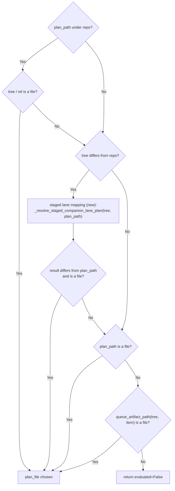

# IPD: Read the lane copy of an orchestrator plan in the review readiness gate under companion records

- Date: 2026-11-21
- Kind: child
- Concern: In companion records storage, `agent_workflows/runner_shared.py::handle_review_orchestrator_readiness` reads the unintegrated companion copy of an orchestrator plan instead of the copy the review agent edited in its lane worktree. The gate therefore refuses a correctly reviewed orchestrator with `IPD-REVIEW-ORCHESTRATOR-READY` and spends the whole correction budget.
- Scope: In `agent_workflows/runner_shared.py::handle_review_orchestrator_readiness`, map the companion `plan_path` to the lane copy through the existing read-only helper `ipd_lifecycle._resolve_staged_companion_lane_plan` before falling back to the companion copy, so readiness, the coverage write, the status read, and the existing demotion all act on the lane copy. Add behavioral regression tests in `tests/test_review_orch_readiness_companion.py` and one CHANGELOG bullet. EXCLUDES `agent_workflows/cli.py::_run_plans` (`aw ipd board`), Set membership lookup in `orchestrator_readiness.review_readiness`, the demotion command's selector, and companion commit routing.
- Scope-Paths: agent_workflows/runner_shared.py, tests/test_review_orch_readiness_companion.py, CHANGELOG.md, .aw/records/plans/pending/20261121-es4blt-01-wknwwz-read-the-lane-copy-of-an-orchestrator-plan-in-the-review-rea.ipd.md
- Item-Dependencies: none
- Status: approved
- Readiness: go-pending-approval
- Review-Depth: standard
- Short-Description: Make the orchestrator review readiness gate read the lane copy of a companion-stored plan, not the stale companion copy
- Work-Kind: bug
- Priority: high
- From-Backlog: es4blt
- Blocks-Release: next
- Set: es4blt
- Order: 1
- Highest E allocated: 07
- Author: opencode its_direct/pt3-claude-opus-5.5-1m-us
- Id: wknwwz
- Approval: 2026-11-27, recorded via aw ipd set: status set to approved

> Write and proofread this plan per the technical writing standard, `.aw/system/workflows/technical-writing/technical-writing.md` (`.agents/workflows/technical-writing/technical-writing.md` in a legacy-layout install), including requirement 12 (diagrams).

## Workflow history

- 2026-11-27 approved (aw set): status set to approved
- 2026-11-24 reviewed (/plan-review model=claude-opus-5.5): APPROVE WITH REVISIONS APPLIED; F1..F7 FIXED; review record .aw/records/reviews/20261121-es4blt-01-wknwwz-read-the-lane-copy-of-an-orchestrator-plan-in-the-review-rea.review.md
- 2026-11-22 to-review (aw set): ready for review: authored for backlog es4blt
- 2026-11-22 draft (opencode its_direct/pt3-claude-opus-5.5-1m-us): created.

## Goal

When a repository stores its records in a separate companion repository (preset `public-target-private-companion`, `records_backend: companion`), an isolated review of an Order-0 orchestrator plan must be judged on the copy of the plan that the review agent edited inside its lane worktree. After this plan, a correctly reviewed orchestrator passes `handle_review_orchestrator_readiness` on the first evaluation, with no correction turns. A refused orchestrator is demoted in that same lane copy, and the companion copy is not written during the gate.

Terms used in this plan:

- **Companion records root**: the directory outside the target repository that holds `.aw/records` content, for example `<companion>/records/`. The target repository ignores its own `.aw/records/`.
- **Lane worktree** (`tree`): the isolated git worktree in which the runner launches the review agent.
- **Lane copy**: the writable copy of a companion record that the runner stages at `<tree>/.aw/records/<rel>` before the review turn (`lane_containment.stage_companion_lane_artifact`, called through `lane_containment.resolve_companion_lane_path` in `runner_shared.execute_item_core`'s review dispatch). `<rel>` is the record's path relative to the companion records root.
- **Staged-baseline marker**: `<tree>/.aw/state/companion-staged-baseline.json`, written when a lane copy is staged (`lane_containment.write_companion_staged_baseline`). Record tools treat a lane as companion-staged only when this file exists.
- **Companion copy**: the original file under the companion records root. It stays at its pre-review content until the runner routes lane record changes back (`runner_shared.route_companion_lane_records`) after the turn.

## Detailed Implementation Checklist (TODO)

Execution-state rule: mark an `E-*` item complete only after performing the action. That mark is not validation. Right-sizing rule: write for a modest executor that cannot hold much in its head. Each E-item is one step (one concern, about one file, executable in one focused pass) and its V-item names each unit it covers with its own check; a plan stays at about 5 E-items and 8 work Scope-Paths, else split it into more child plans (guidance, `IPD-Z603`). Accepted execution states: blocked, failed, pending, performed; terminal gate demands 'performed'.

### Task group 1: Gate resolution

- [ ] E-03 First record the base commit with `git rev-parse HEAD`; E-06 needs it. Then, in `agent_workflows/runner_shared.py::handle_review_orchestrator_readiness`, insert one step in the `plan_file` resolution block, between the existing `tree / plan_path.relative_to(repo)` attempt and the `if plan_path.is_file(): plan_file = plan_path` fallback. The step runs only when `plan_file is None` and `tree.resolve() != repo.resolve()`. It calls `_ipd_lc._resolve_staged_companion_lane_plan(tree, plan_path)` after `from agent_workflows import ipd_lifecycle as _ipd_lc` inside the function, in the same way as the finalize call site that assigns `current_plan_for_finalize`. Wrap the call in `try`/`except Exception`, and set `plan_file` to the result only when the result differs from `plan_path` and `is_file()` is true. Leave the rest of the function unchanged. In particular, the demotion command keeps its `item["id6"]` selector. Do not call `lane_containment.resolve_companion_lane_path` here, because it stages a copy when the lane copy is absent.
  - Depends on: none
  - Expected outcome: In an isolated companion review lane whose lane copy exists, `plan_file` is the lane copy, so readiness, the coverage record write, the status read, and the demotion all act on it. When no lane copy was staged, or in the shared checkout (`tree` equal to `repo`), `plan_file` is the same path as before.
  - Execution state: pending

### Task group 2: Regression tests, changelog, and validation

- [ ] E-05 Create `tests/test_review_orch_readiness_companion.py` with `pytestmark = pytest.mark.core`. Import `_provision_companion_repos`, `_patched_env`, and `_add_lane_worktree` from `tests.test_companion_runner_integration`, and `_write_orchestrator_plan`, `_write_child_plan`, and `_fake_probe_pass` from `tests.test_production_correction_turn`.
  Shared setup for each test: run `target, companion, env = _provision_companion_repos(tmp)`, and do everything else inside `with _patched_env(env):`. Write the orchestrator with `_write_orchestrator_plan(scratch)`; its defaults are id6 `orc001`, Set `tstset`, and one `## Child IPDs` row for `chd001`. Except in (c), also write the child with `_write_child_plan(scratch, id6="chd001")`. Copy the files into `<companion>/records/plans/pending/`. For (a) to (c), create the lane with `lane, handle = _add_lane_worktree(target, "orc001", env)`. Take `companion_plan = runner_shared.resolve_plan_path(target, "", "orc001")` and save `companion_plan.read_bytes()` before the call.
  Calling the gate: call `runner_shared.handle_review_orchestrator_readiness` inside `mock.patch.object(runner_shared, "ask_orchestrator_probe", _fake_probe_pass)` with these arguments:
  - `item={"id6": "orc001", "configured_file": "", "artifact_type": "ipd", "position": 1}` (the correction path reads `item["position"]`);
  - `attempt={}`;
  - `state={"repo": str(target), "run_id": "r1", "options": {"retry_budget": 0}}` (budget 0 makes an unready plan refuse at once instead of launching a correction turn);
  - `run_dir=tmp / "run"` and `attempt_no=1`;
  - a `raw_launcher` that raises `AssertionError`;
  - `host_labels=runner_shared.OC_HOST_LABELS` and `tracker=None`;
  - `work_dir=str(lane)` and `wt_handle=handle`;
  - `plan_path=companion_plan`, `disposition="reviewed"`, and `exit_code=0`;
  - no-op `save_state` and `append_jsonl`.
  Staging the lane copy: run `lane_copy = lane_containment.resolve_companion_lane_path(lane, companion_plan, repo=target)`, which also writes the staged-baseline marker, then `coverage_record.write(lane_copy, coverage_record.COVERAGE_PASS, repo=lane, commit=False)`. Then replace `- Status: to-review` in the lane copy with `- Status: reviewed`, `- Readiness: go-pending-approval`, and `- Review-Depth: orchestrator`.
  Cases:
  (a) **lane copy reviewed, companion copy to-review**: stage the lane copy. Assert `result.disposition == "reviewed"`, `result.refused is False`, `runner_shared.review_orchestrator_retry_attempts(item) == 0`, `item.get("refusal") is None`, and that the companion copy's bytes equal the saved bytes.
  (b) **no lane copy**: do not stage. Assert `result.evaluated is True` and that `<lane>/.aw/records/plans/pending/<companion_plan.name>` does not exist after the call.
  (c) **demotion targets the lane copy**: write only the orchestrator, so row `01` resolves to no plan, and stage the lane copy. Assert `result.refused is True`, `item["refusal"]["code"] == "IPD-REVIEW-ORCHESTRATOR-READY"`, that the lane copy reads `- Status: to-review`, and that the companion copy's bytes equal the saved bytes. A `Demotion commit failed` warning on stderr is expected (Findings F-05).
  (d) **shared checkout unchanged**: create no lane. Write the coverage record into the companion copy with `repo=target` and set the same three fields there. Call the gate with `tree=target`, `work_dir=None`, and `wt_handle=None`. Assert `result.disposition == "reviewed"`, `result.refused is False`, and that `<target>/.aw/records` does not exist.
  Each test asserts on return values and file contents, never on source text.
  - Depends on: E-03
  - Expected outcome: All four tests pass with E-03 applied. At the base commit, (a) and (c) fail on their assertions: (a) gets `refused=True`, and in (c) the lane copy stays `reviewed`, as reproduced during review (Findings F-03 and F-09). (b) and (d) pass at the base commit; they guard against staging from inside the gate and against a change to the shared checkout.
  - Execution state: pending

- [ ] E-06 Run `python3 -m pytest -o addopts="" -v tests/test_review_orch_readiness_companion.py`, then `python3 -m pytest -v tests/test_companion_runner_integration.py tests/test_companion_ipd_lifecycle.py tests/test_production_correction_turn.py tests/test_gradcover_end_to_end.py`, then the bare core gate `python3 -m pytest`, then `python3 -m mypy agent_workflows`, `aw ipd lint .aw/records/plans/pending/20261121-es4blt-01-wknwwz-read-the-lane-copy-of-an-orchestrator-plan-in-the-review-rea.ipd.md`, and `aw sanitize --agent`. Then confirm, without touching the lane's working tree, that tests (a) and (c) fail without the fix. Run `BASE_WT="$(mktemp -d)/wknwwz-base"` and `git worktree add --detach "$BASE_WT" <base commit from E-03>`. Copy only `tests/test_review_orch_readiness_companion.py` into it. Run `AW_NO_REEXEC=1 python3 -m pytest -o addopts="" -v <node id of (a)> <node id of (c)>` with `$BASE_WT` as the working directory, record the output, and remove the scratch worktree with `git worktree remove --force "$BASE_WT"`. Do not use `git stash` or revert files in the lane.
  - Depends on: E-05
  - Expected outcome: Every command exits 0 in the lane. At the base commit, (a) fails on `refused` or `disposition` and (c) fails on the lane copy's status.
  - Execution state: pending

- [ ] E-07 Add one bullet to `CHANGELOG.md` under `## 2.0.0 (pending)`, next to the existing `- Fixed:` bullets, with no em or en dashes: `- Fixed: in a repository whose records live in a companion repository, \`aw oc run\` and \`aw agy run\` no longer refuse a correctly reviewed orchestrator plan with \`IPD-REVIEW-ORCHESTRATOR-READY\` or spend correction turns on it; the review check now reads the copy the review agent edited.`
  - Depends on: E-03
  - Expected outcome: `CHANGELOG.md` gains exactly that bullet and no other change.
  - Execution state: pending

Add further leaves as `- [ ] E-NEW <action>` and run `aw ipd sync` to assign ids.

## Project conventions discovered (Step 0)

- Companion record staging lives in `agent_workflows/lane_containment.py`: `stage_companion_lane_artifact` copies bytes to `<lane>/.aw/records/<rel>` with mode `0644` and writes the staged-baseline marker. `resolve_companion_lane_path` maps a companion path into the lane and stages it when `overwrite=True` or when the lane copy is absent.
- A read-only mapper already exists: `agent_workflows/ipd_lifecycle.py::_resolve_staged_companion_lane_plan(repo_root, plan_path)` (commit `b77c6ef43`, 2026-11-24). When the staged-baseline marker exists in `repo_root` and `plan_path` lies under the companion records root, it returns the lane copy (or its moved `executed/` copy). Otherwise it returns `plan_path` unchanged. It never stages or writes. `runner_shared.py` already calls it across modules at the finalize call site that assigns `current_plan_for_finalize`.
- Since commit `c8a130148` (2026-11-24), `status_set` honors the staged lane: `aw ipd set to-review <id6> --dir <lane>` writes the lane copy when one is staged, and writes the companion copy otherwise (measured during review). The existing demotion therefore already writes the lane copy once the gate reads it.
- `handle_review_orchestrator_readiness` has two call sites in `execute_item_core`: one with `tree=Path(wt_handle.path)` (isolated review lane) and one with `tree=repo`, `work_dir=None` (shared checkout). Both pass `plan_path=plan_path`, which is resolved against the target repository.
- Tests are behavioral. They call functions or drive the CLI and assert on outputs and files. Core-tier modules set `pytestmark = pytest.mark.core`, and the bare `python3 -m pytest` gate runs only core-marked tests. Other test modules already import fixtures from `tests.test_*` modules. The companion fixture takes about 0.06s to provision.
- Commits go through `aw commit wknwwz -- <paths>`. Never use `git add -A`, `git stash`, or a push.

## Findings

| Id | Finding | Evidence | Impact on this plan |
| --- | --- | --- | --- |
| F-01 | `plan_path.relative_to(repo)` raises `ValueError` for a companion plan, and the fallback then picks `plan_path` (the companion copy) because it exists, before trying `queue_artifact_path(tree, item)`. | `runner_shared.handle_review_orchestrator_readiness` resolution block; backlog `es4blt` Root cause. | E-03 inserts the lane mapping before that fallback. |
| F-02 | In companion mode, `queue_artifact_path(<lane>, item)` also returns the companion path, not the lane copy, both before and after the lane copy is staged. Reordering alone would therefore not fix the bug. The step that fixes it is the "companion-relative `.aw/records/...` mapping into `tree`" that the backlog item's Expected fix names in parentheses. | Authoring reproduction, 2026-11-21, re-measured at review on 2026-11-24 at `b85b57364`: `queue_artifact_path(wt, item)` returned `<TMP>/companion_repo/records/plans/pending/...` after staging. | E-03 maps `plan_path`. Mapping the `queue_artifact_path` result too would be redundant, because it is the same path. |
| F-03 | The bug reproduces through the real gate, and pointing the gate at the lane copy is enough for it to pass. With the default retry budget, the unfixed gate launches a correction turn. | Review reproduction at `b85b57364`: lane copy at `Status: reviewed` with a passing coverage record, companion copy at `Status: to-review`. With `plan_path=<companion>` and `retry_budget` 0, the result was `ReviewOrchestratorResult(disposition='fail-gate', evaluated=True, refused=True)` with refusal `Orchestrator orc001 is ready but status remains to-review (transition not executed)`. With the default budget, the stub launcher was called. With `plan_path=_resolve_staged_companion_lane_plan(wt, <companion>)`, the result was `disposition='reviewed', refused=False`, with 0 retry attempts. | E-03 alone meets acceptance criteria 1 and 2. Test (a) encodes this reproduction. |
| F-04 | The demotion `aw ipd set to-review <id6> --dir <lane>` writes the lane copy when one is staged. This is a change since authoring (commit `c8a130148`); the authoring reproduction had shown the companion copy being written. | Review reproduction at `b85b57364`: with lane and companion copies both at `reviewed`, the id6 selector and the path selector each left the lane copy at `to-review` and the companion copy at `reviewed`. With no lane copy staged, the id6 selector wrote the companion copy. | No selector change is needed: the demotion writes whichever file the gate now reads. Test (c) guards this. |
| F-05 | In companion mode the lane's `.aw/records/` is git-ignored, so the demotion's `git add <plan_file>` fails and the existing `except` prints `Demotion commit failed`. | Review reproduction: `git add <lane copy>` exited 1 with `The following paths are ignored by one of your .gitignore files: .aw/records`. | Not changed here. Companion record changes are committed by `route_companion_lane_records`, not by a lane commit. See Deferred. |
| F-06 | `aw ipd board` in text mode crashes on a companion plan (`ValueError ... is not in the subpath of ...`), as the backlog item's note predicts. | Re-measured at `b85b57364`: `cli.main(["ipd", "board", "--no-color", "--dir", <target>])` raised `ValueError`. | Separate command and defect. Filed as backlog `wdy3wg`. |
| F-07 | `runner_shared.read_set_membership(<lane>, <setid>)` returns only children stored in the companion records root. A child written only into the lane is not returned. | Re-measured at `b85b57364`: with child `chc001` in the companion root and `chl002` only in the lane, the result held only `chc001`. | Separate lookup (`review_readiness` membership). Filed as backlog `82cles`. |
| F-08 | The read-only mapping this plan needs already exists as `ipd_lifecycle._resolve_staged_companion_lane_plan`. | `agent_workflows/ipd_lifecycle.py` (commit `b77c6ef43`); existing cross-module call in `runner_shared.py` at the `current_plan_for_finalize` assignment; review probe returned the lane copy after staging and the companion path before staging. | E-03 reuses it instead of adding a second mapper to `lane_containment.py`. |
| F-09 | While the unfixed gate reads the companion copy, `review_readiness(..., ask=True)` writes its coverage record (`- Coverage: pass` and a history line) directly into the companion copy, bypassing `route_companion_lane_records`. | Review reproduction at `b85b57364`: a unified diff of the companion copy before and after the call showed `+- Coverage: pass`, `+- Coverage-Fingerprint: ...`, `+- Coverage-Checked: ...` and a `coverage pass (aw oc run)` history line. After the fix, the companion bytes were unchanged. | Tests (a) and (c) assert that the companion bytes are unchanged, not only its status. |

## Proposed changes (ordered, validatable)

The new plan-file resolution order in `handle_review_orchestrator_readiness` (E-03); only the "staged lane mapping" step is new:

1. **Resolution (E-03)**: map `plan_path` to the staged lane copy with the existing read-only helper before falling back to the companion copy.
2. **Tests (E-05)**: four behavioral cases, two of which fail at the base commit.
3. **Validation (E-06)** and **CHANGELOG (E-07)**.

## Deferred / out of scope (with reason)

- `agent_workflows/cli.py::_run_plans` (`aw ipd board`) crashes on a companion plan path (F-06). It is a different command and needs its own display-path decision.
  - Carrier: wdy3wg
- `orchestrator_readiness.review_readiness` reads Set membership from the companion records root, so a child authored only in the lane counts as unauthored (F-07). It is a different lookup from the plan-file read this plan fixes, and it has not been observed end to end.
  - Carrier: 82cles
- The demotion's `git add`/`git commit` in a companion lane fails on the ignored `.aw/records/` path and prints a warning (F-05). No state is lost: `route_companion_lane_records` routes and commits the lane record change after the turn.
  - Carrier-Declined: Companion record commits are owned by `runner_shared.route_companion_lane_records`; the lane commit attempt is already guarded by `except` and needs no change for this defect.
- Promoting `ipd_lifecycle._resolve_staged_companion_lane_plan` to a public name. `runner_shared.py` already calls it, and renaming it would touch `ipd_lifecycle.py` and its tests for no behavior change.
  - Carrier-Declined: naming cleanup with no user-visible effect; not a defect.

## Scope check

- Over-scope: none. The review removed the authored E-02 (a new `lane_containment.map_companion_lane_path`) because F-08 shows an equivalent read-only helper exists. It also removed E-04 (changing the demotion selector to a path) because F-04 shows the id6 selector already writes the lane copy.
- Under-scope: none for backlog `es4blt`. Its three acceptance criteria map to E-03 and test (a) in E-05. The backlog item's note about `_run_plans` is carried by `wdy3wg`. E-07 adds the user-facing CHANGELOG entry, as the sibling bug-fix plans do.

## Required tests / validation

- New regression tests: `python3 -m pytest -o addopts="" -v tests/test_review_orch_readiness_companion.py` (tests (a) to (d) in E-05).
- Fail-without-fix check for tests (a) and (c) at the base commit (E-06).
- Neighboring suites: `python3 -m pytest -v tests/test_companion_runner_integration.py tests/test_companion_ipd_lifecycle.py tests/test_production_correction_turn.py tests/test_gradcover_end_to_end.py`. `tests/test_companion_ipd_lifecycle.py` exercises the reused helper.
- Core gate: `python3 -m pytest`.
- Static types: `python3 -m mypy agent_workflows`.
- Plan lint and leak scan: `aw ipd lint <this plan>` and `aw sanitize --agent`.

## Spec / documentation sync

No spec amendment. The approved lifecycle automation policy spec `llbr2b` (`.aw/records/specs/approved/20260920-llbr2b-01-llbr2b-lifecycle-automation-policy.spec.md`, Section 3.10 row A-4) names this demotion as the transition `ipd:reviewed->to-review` made from `runner_shared.handle_review_orchestrator_readiness`, with the command `aw ipd set to-review <id6> ... --yes --no-commit` and refusal code `IPD-REVIEW-ORCHESTRATOR-READY`. This plan changes none of those; it changes only which copy of the plan the gate reads. User-facing documentation: one `- Fixed:` CHANGELOG bullet (E-07). No other documentation describes plan-file resolution in this gate.

## Open questions

### OQ-01: Should the gate stage a lane copy when none exists, as other post-turn readers do?

- Blocking: no
- Status: resolved
- Owner: none
- Resolution or deferral rationale: No. The gate is a reader. The review dispatch in `execute_item_core` stages the lane copy before the turn (`staged_review_plan`), so the copy exists whenever the agent could have edited it. If it is absent, the agent never had a lane copy to edit, and the companion copy is the correct input. Staging there would also rewrite the staged-baseline marker (`write_companion_staged_baseline`) from inside a gate. E-03 therefore uses a helper that writes nothing, and test (b) asserts that.

## Validation and cross-check (verify before reporting done)

Validation-state rule: inspect evidence in a separate pass. Do not mark a `V-*` item complete from memory or from the matching execution checkmark. Accepted validation results: blocked, failed, pass, pending; terminal gate demands 'pass'. Runtime-demonstration reachability rule: for each `V-*` item demanding the software be observed acting (such as a run, a dispatch, or a transition)—as distinct from items demanding a diff, a file's content, or a test result, which are reachable by construction—name the code path that produces the observation or the sibling `E-*` that creates it, else the demand is UNDER-SCOPE.

- [ ] V-03 validates E-03
  - Required evidence: paste the `git diff agent_workflows/runner_shared.py` hunk for the `plan_file` resolution block in `handle_review_orchestrator_readiness`. It must show the one inserted step: guarded by `plan_file is None` and `tree.resolve() != repo.resolve()`, calling `_resolve_staged_companion_lane_plan`, and placed before `if plan_path.is_file()`. The hunk must contain no other change, and the demotion command must still pass `item["id6"]`. Also paste the PASSED lines for test (a) (`disposition == "reviewed"`, `refused is False`, zero correction turns, companion bytes unchanged), test (b) (no lane copy created), and test (d) (shared checkout unchanged). This covers backlog `es4blt` acceptance criteria 1 and 2.
  - Observed evidence:
  - Result: pending

- [ ] V-05 validates E-05
  - Required evidence: paste the full `python3 -m pytest -o addopts="" -v tests/test_review_orch_readiness_companion.py` output showing four PASSED node ids for tests (a), (b), (c), and (d), and the `pytestmark = pytest.mark.core` line from the file. Test (c)'s PASSED line shows that the refused orchestrator's lane copy reads `Status: to-review` and the companion bytes are unchanged. This covers backlog `es4blt` acceptance criterion 3.
  - Observed evidence:
  - Result: pending

- [ ] V-06 validates E-06
  - Required evidence: paste the summary line and exit code of each command in E-06: the new test module, the four neighboring suites, bare `python3 -m pytest` (its `N passed` line), `python3 -m mypy agent_workflows`, `aw ipd lint` on this plan, and `aw sanitize --agent`. Also paste the base commit sha, the output of tests (a) and (c) at that commit in the scratch worktree showing both FAILED on assertions, and the `git worktree remove` exit code.
  - Observed evidence:
  - Result: pending

- [ ] V-07 validates E-07
  - Required evidence: paste `git diff CHANGELOG.md` showing exactly one added `- Fixed:` line under `## 2.0.0 (pending)` and no other change.
  - Observed evidence:
  - Result: pending

## Approval and execution gate

- Size assessment: standard
- Cohesion rationale: not required

Execution proceeds only after human approval (`aw ipd set approved wknwwz --by-human --message ...`) or runner dispatch of an approved plan. Commit only the paths in `- Scope-Paths:` with `aw commit wknwwz -- <paths>`. Never use `git add -A`, bare `git add`, `git commit -a`, or `git stash`, and never push. After every `V-*` item reads `pass` with pasted evidence and `aw ipd lint --phase pre-transition` conforms, finalize the plan to `executed/` with `aw ipd finalize wknwwz`.
