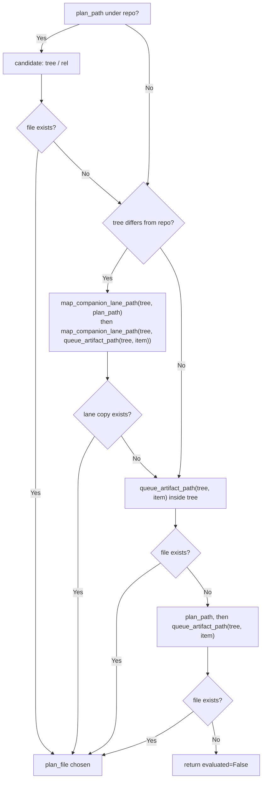

# IPD: Read the lane copy of an orchestrator plan in the review readiness gate under companion records

- Date: 2026-11-21
- Kind: child
- Concern: In companion records storage, `agent_workflows/runner_shared.py::handle_review_orchestrator_readiness` reads the unintegrated companion copy of an orchestrator plan instead of the copy the review agent edited in its lane worktree. The gate therefore refuses a correctly reviewed orchestrator with `IPD-REVIEW-ORCHESTRATOR-READY` and spends the whole correction budget.
- Scope: Add a read-only helper in `agent_workflows/lane_containment.py` that maps a companion record path to its lane-local path without staging a copy, and make `resolve_companion_lane_path` use it. Change the plan-file resolution in `runner_shared.handle_review_orchestrator_readiness` so that, in an isolated lane, the lane-local copy is chosen before the companion copy. Make the gate's automated demotion write the same file the gate reads. Add behavioral regression tests in `tests/test_review_orch_readiness_companion.py`. EXCLUDES `agent_workflows/cli.py::_run_plans` (`aw ipd board`), Set membership lookup in `orchestrator_readiness.review_readiness`, and companion commit routing.
- Scope-Paths: agent_workflows/lane_containment.py, agent_workflows/runner_shared.py, tests/test_review_orch_readiness_companion.py, .aw/records/plans/pending/20261121-es4blt-01-wknwwz-read-the-lane-copy-of-an-orchestrator-plan-in-the-review-rea.ipd.md
- Item-Dependencies: none
- Status: to-review
- Short-Description: Make the orchestrator review readiness gate read and demote the lane copy of a companion-stored plan, not the stale companion copy
- Work-Kind: bug
- Priority: high
- From-Backlog: es4blt
- Blocks-Release: next
- Set: es4blt
- Order: 1
- Highest E allocated: 06
- Author: opencode its_direct/pt3-claude-opus-5.5-1m-us
- Id: wknwwz

> Write and proofread this plan per the technical writing standard, `.aw/system/workflows/technical-writing/technical-writing.md` (`.agents/workflows/technical-writing/technical-writing.md` in a legacy-layout install), including requirement 12 (diagrams).

## Workflow history

- 2026-11-22 to-review (aw set): ready for review: authored for backlog es4blt
- 2026-11-22 draft (opencode its_direct/pt3-claude-opus-5.5-1m-us): created.

## Goal

When a repository stores its records in a separate companion repository (preset `public-target-private-companion`, `records_backend: companion`), an isolated review of an Order-0 orchestrator plan must be judged on the copy of the plan that the review agent edited inside its lane worktree. After this plan, a correctly reviewed orchestrator passes `handle_review_orchestrator_readiness` on the first evaluation, with no correction turns. A refused orchestrator is also demoted in that same lane copy.

Terms used in this plan:

- **Companion records root**: the directory outside the target repository that holds `.aw/records` content, for example `<companion>/records/`. The target repository ignores its own `.aw/records/`.
- **Lane worktree** (`tree`): the isolated git worktree in which the runner launches the review agent.
- **Lane copy**: the writable copy of a companion record that the runner stages at `<tree>/.aw/records/<rel>` before the review turn (`lane_containment.stage_companion_lane_artifact`, called through `lane_containment.resolve_companion_lane_path` in `runner_shared.execute_item_core`'s review dispatch). `<rel>` is the record's path relative to the companion records root.
- **Companion copy**: the original file under the companion records root. It stays at its pre-review content until the runner routes lane record changes back (`runner_shared.route_companion_lane_records`) after the turn.

## Detailed Implementation Checklist (TODO)

Execution-state rule: mark an `E-*` item complete only after performing the action. That mark is not validation. Right-sizing rule: write for a modest executor that cannot hold much in its head. Each E-item is one step (one concern, about one file, executable in one focused pass) and its V-item names each unit it covers with its own check; a plan stays at about 5 E-items and 8 work Scope-Paths, else split it into more child plans (guidance, `IPD-Z603`). Accepted execution states: blocked, failed, pending, performed; terminal gate demands 'performed'.

### Task group 1: Read-only lane mapping

- [ ] E-02 In `agent_workflows/lane_containment.py`, add a public function `map_companion_lane_path(lane_root: Path, source_path: Path, *, repo: Path | None = None) -> Path | None`. It returns `lane_root / ".aw" / "records" / <rel>` when `source_path` resolves under a companion records root, and `None` otherwise. Determine the companion records root with the same candidate lookup that `resolve_companion_lane_path` uses today: candidates `repo` then `lane_root`; `project_context.resolve_project_context(target_repo=...)` with `records_backend == "companion"`; `ctx.logical_roots["records"]`, else `project_context.project_records_dir(cand)`. Keep the same rejections: `..` in `source_path`, an absolute or empty `<rel>`, and symlink components in the lane destination (`_assert_no_symlink_components`). Return `lane_root / <in-lane rel>` unchanged when `source_path` already lies inside `lane_root`. The function MUST NOT create, copy, or modify any file. Then change `resolve_companion_lane_path` to obtain its destination from `map_companion_lane_path`, and keep its staging rule unchanged: stage when `overwrite` is true, or when the lane destination is absent and the source file exists.
  - Depends on: none
  - Expected outcome: `map_companion_lane_path` returns the lane-local path for a companion record and writes nothing. `resolve_companion_lane_path` returns the same paths and stages the same files as before.
  - Execution state: pending

### Task group 2: Gate resolution and demotion

- [ ] E-03 In `agent_workflows/runner_shared.py::handle_review_orchestrator_readiness`, replace the `plan_file` resolution block (the block from `plan_file: Path | None = None` down to the `if plan_file is None or not plan_file.is_file():` early return) with the following order. Stop at the first candidate that is an existing file. (1) `tree / plan_path.relative_to(repo)`, when `plan_path` lies under `repo`. This is the current first step, unchanged. (2) Only when `tree.resolve() != repo.resolve()`: `lane_containment.map_companion_lane_path(tree, plan_path, repo=repo)`, then the same mapping applied to `queue_artifact_path(tree, item)`. (3) `queue_artifact_path(tree, item)` when it lies inside `tree`. (4) `plan_path`. (5) `queue_artifact_path(tree, item)`. Wrap each `queue_artifact_path` call in `try`/`except Exception` as the current code does. Do not call `resolve_companion_lane_path` here, because it stages a copy when the lane copy is absent. Leave the rest of the function unchanged.
  - Depends on: E-02
  - Expected outcome: In an isolated companion review lane where the lane copy exists, `plan_file` is the lane copy. When no lane copy exists, `plan_file` is the companion copy, as today. For a repository-backed plan, the resolved path is unchanged.
  - Execution state: pending

- [ ] E-04 In the same function, change the demotion command built under the `# If plan reads reviewed, return it to to-review` comment so that its selector argument is `str(plan_file)` instead of `item["id6"]`. Keep every other argument (`--message`, `--yes`, `--no-commit`, `--dir str(tree)`) and the existing commit attempt and its `except` warning unchanged.
  - Depends on: E-03
  - Expected outcome: A refused orchestrator whose lane copy reads `Status: reviewed` is demoted in the lane copy. The companion copy is not written by the demotion.
  - Execution state: pending

### Task group 3: Regression tests and validation

- [ ] E-05 Create `tests/test_review_orch_readiness_companion.py` with `pytestmark = pytest.mark.core`. Build fixtures with `tests.test_companion_runner_integration._provision_companion_repos`, `_patched_env`, and `_add_lane_worktree`. Write the orchestrator and child plan text with `tests.test_production_correction_turn._write_orchestrator_plan` and `_write_child_plan` into a scratch directory, then copy both files into `<companion>/records/plans/pending/`. Patch `runner_shared.ask_orchestrator_probe` with `tests.test_production_correction_turn._fake_probe_pass`. Call `runner_shared.handle_review_orchestrator_readiness` directly with `tree=<lane>`, `plan_path=runner_shared.resolve_plan_path(<target>, <configured_file>, <id6>)` (the companion path), `state["repo"]=str(<target>)`, `host_labels=runner_shared.OC_HOST_LABELS`, `exit_code=0`, and a `raw_launcher` that raises `AssertionError` when called. Add these tests: (a) **lane copy reviewed, companion copy to-review**: stage the lane copy with `lane_containment.resolve_companion_lane_path`, write a passing coverage record into it with `coverage_record.write(<lane copy>, coverage_record.COVERAGE_PASS, repo=<lane>, commit=False)`, and set `Status: reviewed`, `Readiness: go-pending-approval`, and `Review-Depth: orchestrator` in it. Assert `disposition == "reviewed"`, `refused is False`, `runner_shared.review_orchestrator_retry_attempts(item) == 0`, no `IPD-REVIEW-ORCHESTRATOR-READY` refusal recorded on `item`, and that the companion copy still reads `Status: to-review`. (b) **no lane copy**: do not stage. Assert that the gate evaluates without creating `<lane>/.aw/records/plans/pending/<name>`. (c) **demotion targets the lane copy**: stage the lane copy at `Status: reviewed` with a `## Child IPDs` row whose child plan does not exist, and set `state["options"]["retry_budget"] = 0`. Assert `refused is True`, the lane copy reads `Status: to-review`, and the companion copy's bytes are unchanged. (d) **mapping is read-only**: assert `lane_containment.map_companion_lane_path(<lane>, <companion plan>, repo=<target>)` equals `<lane>/.aw/records/plans/pending/<name>` and that the file does not exist afterwards. Assert it returns `None` for a path outside every records root. Each test must assert on return values and on file contents, never on source text.
  - Depends on: E-04
  - Expected outcome: All four tests pass with E-02 through E-04 applied. Test (a) fails against the unchanged `handle_review_orchestrator_readiness` with `refused=True`, as reproduced during authoring (see Findings F-03).
  - Execution state: pending

- [ ] E-06 Run `python3 -m pytest -o addopts="" -v tests/test_review_orch_readiness_companion.py`, then `python3 -m pytest -v tests/test_companion_runner_integration.py tests/test_production_correction_turn.py tests/test_gradcover_end_to_end.py`, then the bare core gate `python3 -m pytest`, then `python3 -m mypy agent_workflows`, `aw ipd lint .aw/records/plans/pending/20261121-es4blt-01-wknwwz-read-the-lane-copy-of-an-orchestrator-plan-in-the-review-rea.ipd.md`, and `aw sanitize --agent`. Then confirm that test (a) fails without the fix, without touching the working tree. Create a scratch worktree at the plan's base commit with `git worktree add --detach /tmp/opencode/wknwwz-base <base-commit>`. Copy only `tests/test_review_orch_readiness_companion.py` into it, run `python3 -m pytest -o addopts="" -v <test (a) node id>` there with `AW_NO_REEXEC=1`, record the output, and remove the scratch worktree with `git worktree remove --force /tmp/opencode/wknwwz-base`. Do not use `git stash` or revert files in the lane.
  - Depends on: E-05
  - Expected outcome: Every command exits 0 in the lane. Test (a) fails at the base commit with `refused=True` (or an `AssertionError` on `disposition`).
  - Execution state: pending

Add further leaves as `- [ ] E-NEW <action>` and run `aw ipd sync` to assign ids.

## Project conventions discovered (Step 0)

- Companion record staging lives in `agent_workflows/lane_containment.py`: `stage_companion_lane_artifact` copies bytes to `<lane>/.aw/records/<rel>` with mode `0644` and records a baseline hash. `resolve_companion_lane_path` maps a companion path into the lane and stages it when `overwrite=True` or when the lane copy is absent.
- Other post-turn readers in `runner_shared.py` already prefer the lane copy through `resolve_companion_lane_path(..., overwrite=False)`. Examples: the spec status read in `execute_item_core` (variable `staged_spec`) and the plan status read (variable `staged_read`). Those readers run only after the lane copy was staged before the turn.
- `handle_review_orchestrator_readiness` has two call sites in `execute_item_core`: one with `tree=Path(wt_handle.path)` (isolated review lane) and one with `tree=repo`, `work_dir=None` (shared checkout). Both pass `plan_path=plan_path`, which is resolved against the target repository.
- Tests are behavioral. They call functions or drive the CLI and assert on outputs and files. Core-tier modules set `pytestmark = pytest.mark.core`. The bare `python3 -m pytest` gate runs only core-marked tests.
- Commits go through `aw commit wknwwz -- <paths>`. Never use `git add -A`, `git stash`, or a push.

## Findings

| Id | Finding | Evidence | Impact on this plan |
| --- | --- | --- | --- |
| F-01 | `plan_path.relative_to(repo)` raises `ValueError` for a companion plan, and the fallback then picks `plan_path` (the companion copy) because it exists, before trying `queue_artifact_path(tree, item)`. | `runner_shared.handle_review_orchestrator_readiness` resolution block; backlog `es4blt` Root cause. | E-03 reorders resolution. |
| F-02 | In companion mode, `queue_artifact_path(<lane>, item)` ALSO returns the companion path, not the lane copy, both before and after the lane copy is staged. Reordering alone would therefore not fix the bug. The load-bearing step is the "companion-relative `.aw/records/...` mapping into `tree`" that the backlog item's Expected fix names in parentheses. | Authoring reproduction, 2026-11-21: with the `_provision_companion_repos` fixture, `queue_artifact_path(wt, item)` printed `<TMP>/companion_repo/records/plans/pending/20261121-cmpset-00-orc001-sample.ipd.md` both before and after `resolve_companion_lane_path` staged `<TMP>/wt-orc001/.aw/records/plans/pending/...`. | E-02 adds the mapping; E-03 applies it to both `plan_path` and the `queue_artifact_path` result. |
| F-03 | The bug reproduces through the real gate, and pointing the gate at the lane copy is sufficient for it to pass. | Authoring reproduction, 2026-11-21: lane copy at `Status: reviewed` with a passing coverage record, companion copy at `Status: to-review`, `retry_budget` 0. With `plan_path=<companion>`: `ReviewOrchestratorResult(disposition='fail-gate', evaluated=True, refused=True)` and refusal `Orchestrator orc001 is ready but status remains to-review (transition not executed)`. With `plan_path=<lane copy>`: `ReviewOrchestratorResult(disposition='reviewed', evaluated=True, refused=False)`. | Confirms acceptance criteria 1 and 2 are reachable with E-02 and E-03 alone. Test (a) in E-05 encodes this reproduction. |
| F-04 | The demotion `aw ipd set to-review <id6> --dir <lane>` writes the COMPANION copy, not the lane copy. Passing the lane copy's path as the selector writes the lane copy. | Authoring reproduction, 2026-11-21: with the id6 selector, after the command the companion copy read `- Status: to-review` and the lane copy still read `- Status: reviewed`. With the path selector, the companion copy stayed `reviewed` and the lane copy read `to-review`. | Once E-03 makes the gate read the lane copy, a demotion by id6 would leave the lane copy at `reviewed`. `route_companion_lane_records` would then route that `reviewed` copy back over the demotion. E-04 makes the demotion write the file the gate reads. |
| F-05 | In companion mode the lane's `.aw/records/` is git-ignored, so the demotion's `git add <plan_file>` fails and the existing `except` prints `Demotion commit failed`. | Authoring reproduction: `git add <lane copy>` exited 1 with `The following paths are ignored by one of your .gitignore files: .aw/records`. | Not changed here. Companion record changes are committed by `route_companion_lane_records`, not by a lane commit. See Deferred. |
| F-06 | `aw ipd board` in text mode crashes on a companion plan (`ValueError ... is not in the subpath of ...`), as the backlog item's note predicts. | Authoring reproduction: `cli.main(["ipd", "board", "--no-color", "--dir", <target>])` raised `ValueError`; the `--agent` form exited 0. | Separate command and defect. Filed as backlog `wdy3wg`. |
| F-07 | `runner_shared.read_set_membership(<lane>, <setid>)` returns only children stored in the companion records root. A child written only into the lane is not returned. | Authoring reproduction: with child `chc001` in the companion root and `chl002` only in the lane, the result held only `chc001`. | Separate lookup (`review_readiness` membership). Filed as backlog `82cles`. |

## Proposed changes (ordered, validatable)

The new plan-file resolution order in `handle_review_orchestrator_readiness` (E-03):

1. **Read-only mapping (E-02)**: add `lane_containment.map_companion_lane_path` and route `resolve_companion_lane_path`'s path computation through it.
2. **Resolution order (E-03)**: prefer the lane copy in an isolated lane, as shown in the diagram.
3. **Demotion target (E-04)**: pass `str(plan_file)` to `aw ipd set to-review`.
4. **Tests (E-05)** and **validation (E-06)**.

## Deferred / out of scope (with reason)

- `agent_workflows/cli.py::_run_plans` (`aw ipd board`) crashes on a companion plan path (F-06). It is a different command and needs its own display-path decision.
  - Carrier: wdy3wg
- `orchestrator_readiness.review_readiness` reads Set membership from the companion records root, so a child authored only in the lane counts as unauthored (F-07). It is a different lookup from the plan-file read this plan fixes, and it has not been observed end to end.
  - Carrier: 82cles
- The demotion's `git add`/`git commit` in a companion lane fails on the ignored `.aw/records/` path and prints a warning (F-05). No state is lost: `route_companion_lane_records` routes and commits the lane record change after the turn.
  - Carrier-Declined: Companion record commits are owned by `runner_shared.route_companion_lane_records`; the lane commit attempt is already guarded by `except` and needs no change for this defect.

## Scope check

- Over-scope: none. E-04 changes one argument of the demotion command in the same function. Without it, E-03 would make the gate read one file and demote another (F-04).
- Under-scope: none for backlog `es4blt`. Its three acceptance criteria map to E-03 and test (a) in E-05. The backlog item's note about `_run_plans` is carried by `wdy3wg`.

## Required tests / validation

- New regression tests: `python3 -m pytest -o addopts="" -v tests/test_review_orch_readiness_companion.py` (tests (a) to (d) in E-05).
- Fail-without-fix check for test (a) (E-06).
- Neighboring suites: `python3 -m pytest -v tests/test_companion_runner_integration.py tests/test_production_correction_turn.py tests/test_gradcover_end_to_end.py`.
- Core gate: `python3 -m pytest`.
- Static types: `python3 -m mypy agent_workflows`.
- Plan lint and leak scan: `aw ipd lint <this plan>` and `aw sanitize --agent`.

## Spec / documentation sync

N/A, no spec amendment. The approved lifecycle automation policy spec `llbr2b` (`.aw/records/specs/approved/20260920-llbr2b-01-llbr2b-lifecycle-automation-policy.spec.md`, Section 3.10 row A-4) names this demotion as the transition `ipd:reviewed->to-review` read from `runner_shared.handle_review_orchestrator_readiness`, and describes the command as `aw ipd set to-review <id6> ... --yes --no-commit`. E-04 keeps the transition, the symbol, the flags, and the refusal code. It changes only the selector from the id6 to the path of the same plan. The row identifies where the transition is made, and that location does not change. No user-facing documentation describes plan-file resolution in this gate.

## Open questions

### OQ-01: Should the gate stage a lane copy when none exists, as other post-turn readers do?

- Blocking: no
- Status: resolved
- Owner: none
- Resolution or deferral rationale: No. The gate is a reader. The review dispatch in `execute_item_core` stages the lane copy before the turn (`staged_review_plan`), so it exists whenever the agent could have edited it. If it is absent, the agent never had a lane copy to edit, and the companion copy is the correct input. Staging there would also rewrite the companion baseline (`write_companion_staged_baseline`) from inside a gate. E-02 therefore adds a mapping that writes nothing, and test (b) asserts that.

## Validation and cross-check (verify before reporting done)

Validation-state rule: inspect evidence in a separate pass. Do not mark a `V-*` item complete from memory or from the matching execution checkmark. Accepted validation results: blocked, failed, pass, pending; terminal gate demands 'pass'. Runtime-demonstration reachability rule: for each `V-*` item demanding the software be observed acting (such as a run, a dispatch, or a transition)—as distinct from items demanding a diff, a file's content, or a test result, which are reachable by construction—name the code path that produces the observation or the sibling `E-*` that creates it, else the demand is UNDER-SCOPE.

- [ ] V-02 validates E-02
  - Required evidence: paste `git diff agent_workflows/lane_containment.py` showing the new `map_companion_lane_path` and `resolve_companion_lane_path` computing its destination through it, plus the PASSED line for test (d) in `tests/test_review_orch_readiness_companion.py` (mapping returns `<lane>/.aw/records/plans/pending/<name>`, the file does not exist afterwards, and a path outside every records root returns `None`), and the `tests/test_companion_runner_integration.py` pass summary showing existing staging behavior is unchanged.
  - Observed evidence:
  - Result: pending

- [ ] V-03 validates E-03
  - Required evidence: paste `git diff agent_workflows/runner_shared.py` for the `plan_file` resolution block in `handle_review_orchestrator_readiness` matching the order in E-03, plus the PASSED lines for test (a) (`disposition == "reviewed"`, `refused is False`, zero correction turns, companion copy still `Status: to-review`) and test (b) (no lane copy created). This covers backlog `es4blt` acceptance criteria 1 and 2.
  - Observed evidence:
  - Result: pending

- [ ] V-04 validates E-04
  - Required evidence: paste the `git diff agent_workflows/runner_shared.py` hunk showing the demotion selector changed from `item["id6"]` to `str(plan_file)` with the other arguments unchanged, plus the PASSED line for test (c) (lane copy reads `Status: to-review` after refusal; companion copy bytes unchanged).
  - Observed evidence:
  - Result: pending

- [ ] V-05 validates E-05
  - Required evidence: paste the full `python3 -m pytest -o addopts="" -v tests/test_review_orch_readiness_companion.py` output showing four PASSED node ids for tests (a), (b), (c), and (d), and the `pytestmark = pytest.mark.core` line from the file. This covers backlog `es4blt` acceptance criterion 3.
  - Observed evidence:
  - Result: pending

- [ ] V-06 validates E-06
  - Required evidence: paste the summary line and exit code of each command in E-06: the new test module, the three neighboring suites, bare `python3 -m pytest` (its `N passed` line), `python3 -m mypy agent_workflows`, `aw ipd lint` on this plan, and `aw sanitize --agent`. Also paste the failing output of test (a) run at the base commit in the scratch worktree, and the `git worktree remove` output.
  - Observed evidence:
  - Result: pending

## Approval and execution gate

- Size assessment: standard
- Cohesion rationale: not required

Execution proceeds only after human approval (`aw ipd set approved wknwwz --by-human --message ...`) or runner dispatch of an approved plan. Commit only the paths in `- Scope-Paths:` with `aw commit wknwwz -- <paths>`. Never use `git add -A`, bare `git add`, `git commit -a`, or `git stash`, and never push. After every `V-*` item reads `pass` with pasted evidence and `aw ipd lint --phase pre-transition` conforms, finalize the plan to `executed/` with `aw ipd finalize wknwwz`.
