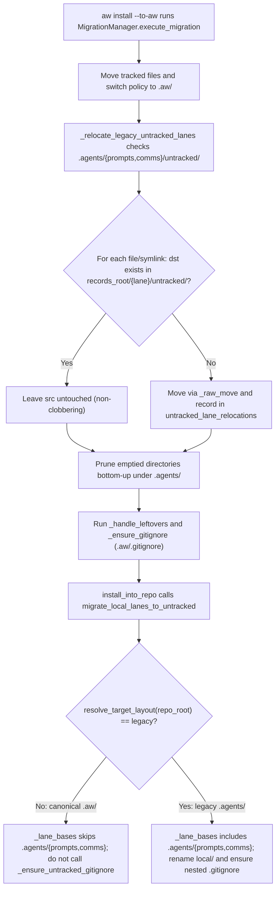

# IPD: Relocate legacy untracked lanes during --to-aw and guard migrate_local_lanes_to_untracked

- Date: 2026-11-21
- Kind: child
- Concern: Backlog `fbxkvo` (`Work-Kind: bug`, `Priority: medium`, `Blocks-Release: next`) reports two coupled defects observed during `aw install --to-aw` on `pubrun`. First, `agent_workflows/layout_inventory.py::_walk` prunes gitignored directories reported by `_ignored_dirs`, so `agent_workflows/layout_migration.py::MigrationManager.execute_migration` moves tracked files out of `.agents/prompts/` and `.agents/comms/` (including tracked `.agents/prompts/.gitignore` and `.agents/comms/.gitignore`) while leaving gitignored `.agents/prompts/untracked/` and `.agents/comms/untracked/` files stranded on disk. Second, immediately afterward, `agent_workflows/engine.py::migrate_local_lanes_to_untracked` iterates `_lane_bases` (which unconditionally includes `repo_root / ".agents" / "prompts"` and `repo_root / ".agents" / "comms"`), detects `.agents/prompts/untracked/` still present on disk, and calls `_ensure_untracked_gitignore`, recreating `.agents/prompts/.gitignore` (and `.agents/comms/.gitignore`) as untracked files (`?? .agents/prompts/.gitignore` in `git status -u --porcelain`) on every subsequent `aw install`.
- Scope: IN: (1) add `MigrationManager._relocate_legacy_untracked_lanes` in `agent_workflows/layout_migration.py` to move files and symlinks from `.agents/prompts/untracked/` and `.agents/comms/untracked/` into `<records_root>/prompts/untracked/` and `<records_root>/comms/untracked/` without clobbering existing destinations, prune emptied legacy directories bottom-up, wire the helper into `MigrationManager.execute_migration` and `MigrationManager.apply_embedded_stage_one` before `_handle_leftovers`, and reverse recorded moves in `MigrationManager.rollback_migration` and `MigrationManager.rollback_embedded_stage_one`; (2) update `agent_workflows/engine.py::_lane_bases` and `agent_workflows/engine.py::migrate_local_lanes_to_untracked` so canonical `.aw/` repositories (where `resolve_target_layout(repo_root) == "aw"`) omit legacy `.agents/{prompts,comms}` default lane bases and never invoke `_ensure_untracked_gitignore` for `.agents/prompts` or `.agents/comms`, while preserving legacy `.agents/` behavior when `resolve_target_layout(repo_root) == "legacy"`; and (3) add behavioral regression tests in `tests/test_layout_migration.py` and `tests/test_engine_restored_behavior.py`, registering any full-install `@pytest.mark.slow` test node ID in `tests/slow_allowlist.txt`. OUT: un-pruning ignored directories in `agent_workflows/layout_inventory.py::_walk`, relocating legacy `.agents/{prompts,comms}/local/` lanes inside `layout_migration.py` (which `tests/test_layout_migration.py::LeftoverDispositionTests.test_remove_preserves_untracked_ignored_local_lanes` requires to remain preserved), changing `workflow-artifacts/` or `.agents/docs/README.md` migration rules (tracked separately in backlog `ujxi56`), or modifying `aw install` commit-staging behavior for `.aw/.gitignore`.
- Scope-Paths: agent_workflows/layout_migration.py, agent_workflows/engine.py, tests/test_layout_migration.py, tests/test_engine_restored_behavior.py, tests/slow_allowlist.txt
- Item-Dependencies: none
- Status: to-review
- Short-Description: Relocate .agents/prompts/untracked/ and .agents/comms/untracked/ during --to-aw and stop migrate_local_lanes_to_untracked from recreating legacy .gitignore files on canonical .aw/ repos
- Work-Kind: bug
- Priority: medium
- From-Backlog: fbxkvo
- Blocks-Release: next
- Set: fbxkvo
- Order: 1
- Highest E allocated: 04
- Author: antigravity/gemini-4-neon-high
- Id: 2cv6rz

> Write and proofread this plan per the technical writing standard, `.aw/system/workflows/technical-writing/technical-writing.md` (`.agents/workflows/technical-writing/technical-writing.md` in a legacy-layout install), including requirement 12 (diagrams).

## Workflow history

- 2026-11-22 to-review (aw set): Authored review-ready child plan graduated from backlog fbxkvo
- 2026-11-22 draft (antigravity/gemini-4-neon-high): created.

## Goal

Relocate gitignored `.agents/prompts/untracked/` and `.agents/comms/untracked/` contents into `.aw/records/prompts/untracked/` and `.aw/records/comms/untracked/` without clobbering existing files during `aw install --to-aw` layout migration, and prune the emptied legacy directories. Prevent `agent_workflows/engine.py::migrate_local_lanes_to_untracked` from recreating `.agents/prompts/.gitignore` or `.agents/comms/.gitignore` on canonical `.aw/` repositories while preserving full lane-migration behavior on legacy `.agents/` repositories.

## Detailed Implementation Checklist (TODO)

Execution-state rule: mark an `E-*` item complete only after performing the action. That mark is not validation. Right-sizing rule: write for a modest executor that cannot hold much in its head. Each E-item is one step (one concern, about one file, executable in one focused pass) and its V-item names each unit it covers with its own check; a plan stays at about 5 E-items and 8 work Scope-Paths, else split it into more child plans (guidance, `IPD-Z603`). Accepted execution states: blocked, failed, pending, performed; terminal gate demands 'performed'.

### Task group 1: Relocate legacy untracked quarantine lanes in layout migration

- [ ] E-01 Update `agent_workflows/layout_migration.py::MigrationManager` to relocate legacy `.agents/prompts/untracked/` and `.agents/comms/untracked/` lanes without clobbering, prune emptied legacy directories, journal each moved path, and reverse recorded moves on rollback:
  1. Add `MigrationManager._relocate_legacy_untracked_lanes(self, target_backend: str) -> List[Dict[str, str]]`.
  2. Resolve the destination records root via `self._records_root_for_backend(target_backend)` and iterate the two legacy quarantine lanes in deterministic order: `("prompts", Path(self.target_repo) / ".agents" / "prompts" / "untracked")` and `("comms", Path(self.target_repo) / ".agents" / "comms" / "untracked")`. Do not relocate `.agents/prompts/local/` or `.agents/comms/local/`.
  3. Skip any legacy lane that is absent, is a symlink, or is not a directory. For each present legacy lane, walk its descendants in deterministic sorted order without following symlinks (`os.walk(..., followlinks=False)`): for each file or symlink `src_item`, compute `dst_item = records_root / lane_name / "untracked" / src_item.relative_to(src_lane)`.
  4. Enforce non-clobbering: if `dst_item.exists() or dst_item.is_symlink()`, leave `src_item` untouched and do not record it. Otherwise create `dst_item.parent` (`mkdir(parents=True, exist_ok=True)`), move `src_item` to `dst_item` via `self._raw_move(src_item, dst_item)` (never `git mv` or `git add`), and append `{"source": str(src_item), "destination": str(dst_item)}` to the returned relocation list.
  5. After moving files for each lane, prune emptied directories bottom-up inside `src_lane`, then `src_lane` itself, then `src_lane.parent` (`.agents/prompts` or `.agents/comms`), and finally `Path(self.target_repo) / ".agents"` if empty, using `rmdir()` only on empty directories (never `shutil.rmtree`).
  6. Call `self._relocate_legacy_untracked_lanes(target_backend)` in `MigrationManager.execute_migration` immediately before `self._handle_leftovers(tx_data, leftover_disposition=leftover_disposition)` (so `dry_run=True` and pre-switch faults never move untracked lanes), extending `tx_data.setdefault("untracked_lane_relocations", [])` and persisting via `self._save_transaction(tx_data)`. Call the same helper in `MigrationManager.apply_embedded_stage_one` immediately before `self._handle_leftovers(ls, leftover_disposition=leftover_disposition)` and extend `ls.setdefault("untracked_lane_relocations", [])`. Keep `MigrationManager.commit_paths` excluding `untracked_lane_relocations` so untracked lane files are never staged or committed.
  7. Update `MigrationManager.rollback_migration` and `MigrationManager.rollback_embedded_stage_one` to iterate `reversed(tx.get("untracked_lane_relocations") or [])` (or `ls.get("untracked_lane_relocations") or []`): when `dst_p.exists() or dst_p.is_symlink()` and not `(src_p.exists() or src_p.is_symlink())`, recreate `src_p.parent`, move `dst_p` back to `src_p` via `self._raw_move(dst_p, src_p)`, and prune now-empty destination subdirectories under `<records_root>/{prompts,comms}/untracked` (and empty parent directories inside `.aw/` or the external records root, without touching `.aw/state`).
  - Depends on: none
  - Expected outcome: `MigrationManager.execute_migration` and `apply_embedded_stage_one` move non-colliding files from `.agents/prompts/untracked/` and `.agents/comms/untracked/` into `<records_root>/{prompts,comms}/untracked/`, leave colliding files un-clobbered, prune emptied `.agents/` directories, keep `commit_paths()` free of untracked files, leave `.agents/{prompts,comms}/local/` untouched, and restore relocated files cleanly on `rollback_migration` and `rollback_embedded_stage_one`.
  - Execution state: pending

### Task group 2: Guard legacy nested `.gitignore` creation in `engine.py`

- [ ] E-02 Update `agent_workflows/engine.py::_lane_bases` and `agent_workflows/engine.py::migrate_local_lanes_to_untracked` so canonical `.aw/` repositories never recreate `.agents/prompts/.gitignore` or `.agents/comms/.gitignore`:
  1. In `agent_workflows/engine.py::_lane_bases`, check `is_legacy_layout = resolve_target_layout(repo_root) == "legacy"`. Always include `_records_member_destination(repo_root, ".aw/records/prompts")` and `_records_member_destination(repo_root, ".aw/records/comms")`. Include `repo_root / ".agents" / "prompts"` and `repo_root / ".agents" / "comms"` only when `is_legacy_layout` is `True`. Continue appending any explicit `dirs.get("prompts")` and `dirs.get("comms")` entries, deduplicated in order.
  2. In `agent_workflows/engine.py::migrate_local_lanes_to_untracked`, compute `is_canonical_aw = resolve_target_layout(repo_root) == "aw"`. Keep existing `.aw/records/` handling unchanged (`want_aw_gitignore = True` and unlink any stale per-lane `base / ".gitignore"`). Change the `else:` branch to `elif not is_canonical_aw:` before calling `_ensure_untracked_gitignore(base)`.
  3. Update the docstrings of `_lane_bases` and `migrate_local_lanes_to_untracked` to document that legacy `.agents/{prompts,comms}` lane scanning and nested `.gitignore` creation apply only when `resolve_target_layout(repo_root) == "legacy"`.
  - Depends on: none
  - Expected outcome: On a canonical `.aw/` repository (including one with leftover `.agents/prompts/untracked/` or `.agents/comms/untracked/` directories on disk), `migrate_local_lanes_to_untracked` never creates `.agents/prompts/.gitignore` or `.agents/comms/.gitignore`. On a legacy `.agents/` repository (`.agents/workflows/` present and no `.aw/system/`), `migrate_local_lanes_to_untracked` continues to rename `.agents/{prompts,comms}/local/` to `untracked/` and ensure `.agents/{prompts,comms}/.gitignore` ignores `untracked/`.
  - Execution state: pending

### Task group 3: Add behavioral regression tests

- [ ] E-03 Add behavioral tests (using zero `inspect`, `ast`, or source-regex checks against production code) in `tests/test_layout_migration.py` and `tests/test_engine_restored_behavior.py`, and register the full-install slow test in `tests/slow_allowlist.txt`:
  1. In `tests/test_layout_migration.py`, add fast behavioral tests exercising `MigrationManager.execute_migration` and `MigrationManager.rollback_migration` on temporary git repositories:
     - Relocation and pruning test: seed a legacy repo with tracked `.agents/workflows/{VERSION,index.md}`, tracked `.agents/prompts/.gitignore` (`untracked/\n`), gitignored `.agents/prompts/untracked/20260722-0002-01-session-handoff-resume.md`, tracked `.agents/comms/.gitignore` (`untracked/\n`), and gitignored `.agents/comms/untracked/inbox/msg.md`; run `execute_migration(target_backend="repository", leftover_disposition="remove")` and assert both files exist under `.aw/records/prompts/untracked/` and `.aw/records/comms/untracked/inbox/` with original bytes, `.agents/prompts/` and `.agents/comms/` are absent, and `mgr.commit_paths()` contains neither untracked file.
     - Non-clobbering collision test: pre-populate `.aw/records/prompts/untracked/same.md` (`"NEW"`) alongside `.agents/prompts/untracked/same.md` (`"OLD"`) and `.agents/prompts/untracked/unique.md` (`"UNIQUE"`); run `execute_migration(target_backend="repository", leftover_disposition="remove")` and assert `unique.md` moves to `.aw/records/prompts/untracked/unique.md`, `.aw/records/prompts/untracked/same.md` still reads `"NEW"`, `.agents/prompts/untracked/same.md` still reads `"OLD"`, and `.agents/prompts/untracked/` remains intact.
     - Rollback reversal test: after migrating the relocation fixture, run `mgr.rollback_migration()` and assert `.agents/prompts/untracked/20260722-0002-01-session-handoff-resume.md` and `.agents/comms/untracked/inbox/msg.md` are restored with original bytes and no longer exist under `.aw/records/*/untracked/`.
     - Dry-run read-only test: run `mgr.execute_migration(target_backend="repository", dry_run=True)` and assert `.agents/prompts/untracked/20260722-0002-01-session-handoff-resume.md` stays in place and `.aw/records/prompts/untracked/` is not created.
  2. In `tests/test_layout_migration.py`, add an end-to-end `@pytest.mark.slow` behavioral test driving `agent_workflows/cli.py::main(["install", str(repo), "--to-aw", "--yes"])` on two legacy fixtures (with stdout/stderr captured via `contextlib.redirect_stdout` / `redirect_stderr` and `AW_HOME` isolated to a temp directory):
     - Fixture A (tracked legacy `.agents/prompts/.gitignore` and `.agents/comms/.gitignore` plus gitignored `.agents/prompts/untracked/20260722-0002-01-session-handoff-resume.md` and `.agents/comms/untracked/inbox/msg.md`): assert exit `0`, relocated files present under `.aw/records/{prompts,comms}/untracked/` with original bytes, `.agents/prompts/` and `.agents/comms/` pruned, `.agents/prompts/.gitignore` and `.agents/comms/.gitignore` absent from disk, and `git status -u --porcelain` contains neither `?? .agents/prompts/.gitignore` nor `?? .agents/comms/.gitignore`. Then stage and commit the migrated repo, run a second `cli.main(["install", str(repo), "--yes"])`, and assert `git status -u --porcelain` contains zero lines referencing `.agents/prompts/.gitignore` or `.agents/comms/.gitignore`.
     - Fixture B (root `.gitignore` containing `**/*untracked*/`, no `.agents/prompts/.gitignore`, and gitignored `.agents/prompts/untracked/handoff.md`): run `cli.main(["install", str(repo), "--to-aw", "--yes"])` and assert exit `0`, `.aw/records/prompts/untracked/handoff.md` exists with original bytes, `.agents/prompts/` is pruned, and `git status -u --porcelain` has zero lines containing `.agents/prompts/.gitignore`.
     - Add the `@pytest.mark.slow` test node ID to `tests/slow_allowlist.txt` (tab-separated, reason `Full repo install/uninstall filesystem fixture tree lifecycle`) so the slow-test gate reports `0 unlisted slow tests`.
  3. In `tests/test_engine_restored_behavior.py`, add fast behavioral tests for `agent_workflows/engine.py::migrate_local_lanes_to_untracked`:
     - Canonical `.aw/` repo (`.aw/system/VERSION` present) carrying leftover `.agents/prompts/untracked/handoff.md` and `.agents/comms/untracked/inbox/msg.md`: calling `engine.migrate_local_lanes_to_untracked(tmp_path, {})` (and calling with explicit `{"prompts": ".agents/prompts", "comms": ".agents/comms"}`) does not create `.agents/prompts/.gitignore` or `.agents/comms/.gitignore`.
     - Legacy `.agents/` repo positive control (`.agents/workflows/VERSION` present, no `.aw/system/`) carrying `.agents/prompts/local/draft.md` and `.agents/comms/local/inbox/msg.md`: calling `engine.migrate_local_lanes_to_untracked(tmp_path, {})` renames both lanes to `untracked/`, preserves contents, and creates `.agents/prompts/.gitignore` and `.agents/comms/.gitignore` containing `untracked/`.
  - Depends on: E-01, E-02
  - Expected outcome: All new fast and slow behavioral tests pass, existing `tests/test_layout_migration.py::LeftoverDispositionTests` and `tests/test_engine_restored_behavior.py` tests remain green, and slow-test reporting emits `0 unlisted slow tests`.
  - Execution state: pending

### Task group 4: Validate repository gates and commit

- [ ] E-04 After the final edit, run targeted suites (including the `@pytest.mark.slow` end-to-end test via `python3 -m pytest -o addopts="" tests/test_layout_migration.py tests/test_engine_restored_behavior.py -k "untracked or migrate_local_lanes or LeftoverDisposition or InstallMigrationResidueSweep" -v`), `python3 -m pytest tests/test_layout_migration.py tests/test_engine_restored_behavior.py tests/test_layout_inventory.py tests/test_cli.py -v`, bare `python3 -m pytest`, `make test-all`, `aw check all --agent`, and `aw sanitize --agent`, then commit only modified `- Scope-Paths:` files through `aw commit 2cv6rz -- agent_workflows/layout_migration.py agent_workflows/engine.py tests/test_layout_migration.py tests/test_engine_restored_behavior.py tests/slow_allowlist.txt`.
  - Depends on: E-03
  - Expected outcome: Targeted suites (including the slow end-to-end `--to-aw` test), core gate (`python3 -m pytest`), thorough tier (`make test-all`), repository checks (`aw check all --agent`), leak scan (`aw sanitize --agent`), and the path-scoped `aw commit 2cv6rz` succeed with zero failures and zero unlisted slow tests.
  - Execution state: pending

Add further leaves as `- [ ] E-NEW <action>` and run `aw ipd sync` to assign ids.

## Project conventions discovered (Step 0)

- `agent_workflows/layout_inventory.py::_ignored_dirs` runs `git ls-files --others --ignored --exclude-standard --directory -z`, and `agent_workflows/layout_inventory.py::_walk` prunes those ignored directories so large ignored trees (such as `node_modules`) are never descended into or hashed. Consequently, gitignored `.agents/prompts/untracked/` and `.agents/comms/untracked/` never enter `inventory`, `migration_map`, or `move_journal`.
- `agent_workflows/layout_migration.py::MigrationManager._raw_move` moves regular files via `shutil.move` and preserves symlinks via `os.readlink` + `os.symlink` + `unlink` without touching the Git index. `MigrationManager._records_root_for_backend` maps `"repository"` to `self.records_dir` (`.aw/records`) and maps `"companion"` / `"home"` to the configured external records root.
- `agent_workflows/layout_migration.py::MigrationManager.commit_paths` offers only tracked paths (`was_tracked` entries, removed tracked leftovers, backfilled plans, `.aw/.gitignore`, and portable config files) so untracked user content is never staged or committed.
- `tests/test_layout_migration.py::LeftoverDispositionTests.test_remove_preserves_untracked_ignored_local_lanes` asserts that `MigrationManager.execute_migration(..., leftover_disposition="remove")` preserves gitignored `.agents/prompts/local/notes.md` and `.agents/comms/local/msg.json` in place under `.agents/` and records them under `leftover_disposition["preserved"]`.
- `agent_workflows/engine.py::resolve_target_layout` returns `"aw"` when `project_system_dir(repo_root).exists()` or when neither `project_system_dir(repo_root)` nor `.agents/workflows` exists, and returns `"legacy"` only when `(repo_root / WORKFLOWS_DIR).exists()` and `project_system_dir(repo_root)` does not exist.
- `agent_workflows/engine.py::create_setup_artifacts` invokes `migrate_local_lanes_to_untracked(repo_root, dirs)` on every `aw install`, and Command-Line Interface (CLI) command `aw normalize-lanes` (`agent_workflows/cli.py`) invokes `migrate_local_lanes_to_untracked(repo_root, {})`.
- Full-install tests invoking `cli.main(["install", ..., "--to-aw", "--yes"])` take about 3.5 seconds (exceeding the 2.0-second threshold in `tests/test_slow_report.py`), so sibling tests such as `tests/test_cli.py::Order15CliTests::test_install_legacy_repo_to_aw_flag` carry `@pytest.mark.slow` and an entry in `tests/slow_allowlist.txt`.
- Cite code by SYMBOL (`module.function`) or by a quoted content string, with a line number only appended to one of those and never alone: an offset expires before this plan executes (advisory `IPD-C801`).

## Findings

| Id | Source inspected | Finding |
|---|---|---|
| F-01 | `agent_workflows/layout_inventory.py::_ignored_dirs` and `agent_workflows/layout_inventory.py::_walk` | `_walk` prunes every directory returned by `git ls-files --others --ignored --exclude-standard --directory -z`, which excludes `.agents/prompts/untracked/` and `.agents/comms/untracked/` whenever `.agents/{prompts,comms}/.gitignore` or root `.gitignore` ignores `untracked/`. |
| F-02 | Direct reproduction running `agent_workflows/cli.py::main(["install", str(repo), "--to-aw", "--yes"])` on a temporary legacy 1.2.1 Git repository carrying tracked `.agents/{prompts,comms}/.gitignore` and gitignored `.agents/prompts/untracked/20260722-0002-01-session-handoff-resume.md` and `.agents/comms/untracked/inbox/msg.md` | After exit `0`, both untracked files remained stranded under `.agents/prompts/untracked/` and `.agents/comms/untracked/inbox/`, `.aw/records/prompts/untracked/` and `.aw/records/comms/untracked/inbox/` did not receive them, and `git status -u --porcelain` showed brand-new untracked `?? .agents/prompts/.gitignore` and `?? .agents/comms/.gitignore` alongside the staged `R` renames into `.aw/records/`. |
| F-03 | `agent_workflows/engine.py::_lane_bases` and `agent_workflows/engine.py::migrate_local_lanes_to_untracked` | `_lane_bases` unconditionally appends `repo_root / ".agents" / "prompts"` and `repo_root / ".agents" / "comms"` regardless of repository layout. When `.agents/prompts/untracked/` or `.agents/comms/untracked/` exists on a canonical `.aw/` repository, `migrate_local_lanes_to_untracked` enters its `else:` branch and calls `_ensure_untracked_gitignore(base)`, recreating `.agents/prompts/.gitignore` and `.agents/comms/.gitignore` on every `aw install`. |
| F-04 | `tests/test_layout_migration.py::LeftoverDispositionTests.test_remove_preserves_untracked_ignored_local_lanes` and baseline run (`python3 -m pytest tests/test_engine_restored_behavior.py tests/test_layout_migration.py -k "migrate_local_lanes or LeftoverDisposition or InstallMigrationResidueSweep" -v`) | Baseline passed (`12 passed in 6.78s`, `0 unlisted slow tests`). `LeftoverDispositionTests.test_remove_preserves_untracked_ignored_local_lanes` explicitly asserts that `.agents/prompts/local/notes.md` and `.agents/comms/local/msg.json` stay in place under `.agents/` during `MigrationManager.execute_migration`, so layout migration must relocate only `untracked/` lanes and leave `local/` lanes untouched. |

## Proposed changes (ordered, validatable)

The flowchart below shows the two coordinated paths added by `E-01` and `E-02`: untracked-lane relocation inside `MigrationManager` during `--to-aw` / layout migration, and layout-gated nested `.gitignore` handling inside `migrate_local_lanes_to_untracked`.

1. **Relocate legacy untracked quarantine lanes in `agent_workflows/layout_migration.py` (`E-01`)**: Add `MigrationManager._relocate_legacy_untracked_lanes(target_backend)` to move files and symlinks from `.agents/prompts/untracked/` and `.agents/comms/untracked/` into `<records_root>/{prompts,comms}/untracked/` without clobbering existing destinations, prune emptied legacy directories bottom-up, journal moves in `untracked_lane_relocations` before `_handle_leftovers` in both `execute_migration` and `apply_embedded_stage_one`, keep `commit_paths()` free of untracked files, and reverse recorded moves in `rollback_migration` and `rollback_embedded_stage_one`.
2. **Gate legacy lane bases and nested `.gitignore` creation in `agent_workflows/engine.py` (`E-02`)**: Restrict `_lane_bases` default `.agents/{prompts,comms}` candidates to `resolve_target_layout(repo_root) == "legacy"`, and guard `_ensure_untracked_gitignore` in `migrate_local_lanes_to_untracked` with `elif not is_canonical_aw:` so canonical `.aw/` repositories never recreate `.agents/prompts/.gitignore` or `.agents/comms/.gitignore`.
3. **Add behavioral regression tests (`E-03`)**: Add fast unit/migration tests and an end-to-end `@pytest.mark.slow` `aw install --to-aw --yes` test in `tests/test_layout_migration.py`, add canonical-versus-legacy `migrate_local_lanes_to_untracked` tests in `tests/test_engine_restored_behavior.py`, and register the slow test node ID in `tests/slow_allowlist.txt`.
4. **Validate and commit (`E-04`)**: Run targeted fast and slow suites, bare `python3 -m pytest`, `make test-all`, `aw check all --agent`, and `aw sanitize --agent`, then commit only modified `- Scope-Paths:` files via `aw commit 2cv6rz`.

## Deferred / out of scope (with reason)

- Un-pruning gitignored directories in `agent_workflows/layout_inventory.py::_walk`:
  - Carrier-Declined: `layout_inventory.build_migration_map` treats destination collisions with differing hashes as fatal `destination-collision` errors and applies optional `.type.md` grammar renames to `records/prompts/` files, whereas untracked quarantine lanes require non-clobbering filesystem relocation without renaming or failing on pre-existing scratch files.
- Relocating legacy `.agents/{prompts,comms}/local/` lanes inside `MigrationManager`:
  - Carrier-Declined: `tests/test_layout_migration.py::LeftoverDispositionTests.test_remove_preserves_untracked_ignored_local_lanes` explicitly specifies that `local/` lanes remain preserved under `.agents/` during `MigrationManager.execute_migration`, and backlog `fbxkvo` scopes relocation to `.agents/prompts/untracked/` and `.agents/comms/untracked/`.
- Fixing `workflow-artifacts/` and `.agents/docs/README.md` destination mapping during `--to-aw`:
  - Carrier-Declined: Tracked independently in sibling backlog item `ujxi56` (`pubrun-bugs`).

## Scope check

- Over-scope: none. `- Scope-Paths:` is limited to `agent_workflows/layout_migration.py`, `agent_workflows/engine.py`, `tests/test_layout_migration.py`, `tests/test_engine_restored_behavior.py`, and `tests/slow_allowlist.txt`.
- Under-scope: none. Covers all three acceptance criteria of backlog `fbxkvo` (relocation of `.agents/prompts/untracked/` and `.agents/comms/untracked/` with non-clobbering merge and empty-directory pruning, canonical `.aw/` guard in `migrate_local_lanes_to_untracked`, and end-to-end behavioral verification of `aw install --to-aw` and `git status -u --porcelain`), plus rollback safety, embedded stage-one parity, and legacy-layout non-regression.

## Required tests / validation

- Targeted suites (including the new `@pytest.mark.slow` end-to-end test):
  - `python3 -m pytest -o addopts="" tests/test_layout_migration.py tests/test_engine_restored_behavior.py -k "untracked or migrate_local_lanes or LeftoverDisposition or InstallMigrationResidueSweep" -v`
  - `python3 -m pytest tests/test_layout_migration.py tests/test_engine_restored_behavior.py tests/test_layout_inventory.py tests/test_cli.py -v`
- Repository gates:
  - `python3 -m pytest`
  - `make test-all`
  - `aw check all --agent`
  - `aw sanitize --agent`

## Spec / documentation sync

N/A with reason: canonical `.aw/.gitignore` ownership of `records/*/untracked/` and non-clobbering quarantine-lane behavior are already documented in `agent_workflows/engine.py` and existing specifications; this bug fix aligns layout migration and `migrate_local_lanes_to_untracked` with that existing contract without introducing new CLI flags or user-facing commands.

## Open questions

### OQ-01: Should untracked-lane relocation run inside `MigrationManager` rather than by un-pruning `layout_inventory._walk`?

- Blocking: no
- Status: resolved
- Owner: plan author
- Resolution or deferral rationale: RESOLVED from repository evidence in `agent_workflows/layout_inventory.py::_walk`, `agent_workflows/layout_inventory.py::build_migration_map`, and `agent_workflows/layout_migration.py::MigrationManager.execute_migration`. Un-pruning `.agents/{prompts,comms}/untracked/` inside `layout_inventory._walk` would route user scratch files through strict `destination-collision` errors (violating the non-clobbering requirement) and `--rename-to-grammar` `.prompt.md` renaming. Performing non-clobbering filesystem relocation inside `MigrationManager._relocate_legacy_untracked_lanes` immediately before `_handle_leftovers` preserves `layout_inventory` invariants, honors `dry_run=True` and pre-switch failure boundaries, supports clean rollback via `untracked_lane_relocations`, and leaves `.agents/{prompts,comms}/local/` untouched for `LeftoverDispositionTests.test_remove_preserves_untracked_ignored_local_lanes`.

### OQ-02: Which predicate should distinguish canonical `.aw/` repositories from legacy `.agents/` repositories in `engine.py::migrate_local_lanes_to_untracked`?

- Blocking: no
- Status: resolved
- Owner: plan author
- Resolution or deferral rationale: RESOLVED from repository evidence in `agent_workflows/engine.py::resolve_target_layout` and `agent_workflows/engine.py::create_setup_artifacts`. `resolve_target_layout(repo_root)` is the single authoritative layout predicate in `engine.py`: it returns `"aw"` whenever `project_system_dir(repo_root).exists()` (including migrated repositories with leftover `.agents/` directories) or on a fresh repository, and returns `"legacy"` only when `.agents/workflows` exists without `project_system_dir(repo_root)`. Using `resolve_target_layout(repo_root)` in both `_lane_bases` and `migrate_local_lanes_to_untracked` guarantees canonical `.aw/` repositories (including companion/home backends) never recreate `.agents/{prompts,comms}/.gitignore`, while legacy `.agents/` repositories retain full `local/`-to-`untracked/` migration and nested `.gitignore` maintenance.

## Validation and cross-check (verify before reporting done)

Validation-state rule: inspect evidence in a separate pass. Do not mark a `V-*` item complete from memory or from the matching execution checkmark. Accepted validation results: blocked, failed, pass, pending; terminal gate demands 'pass'. Runtime-demonstration reachability rule: for each `V-*` item demanding the software be observed acting (such as a run, a dispatch, or a transition; as distinct from items demanding a diff, a file's content, or a test result, which are reachable by construction), name the code path that produces the observation or the sibling `E-*` that creates it, else the demand is UNDER-SCOPE.

- [ ] V-01 validates E-01
  - Required evidence: paste `git diff -- agent_workflows/layout_migration.py` showing `_relocate_legacy_untracked_lanes`, its invocation before `_handle_leftovers` in `execute_migration` and `apply_embedded_stage_one`, and rollback reversal in `rollback_migration` and `rollback_embedded_stage_one`, plus pasted passing test output from `E-03` covering relocation, non-clobbering collisions, empty-dir pruning, dry-run safety, `commit_paths()` exclusion, rollback, and `LeftoverDispositionTests.test_remove_preserves_untracked_ignored_local_lanes`.
  - Observed evidence:
  - Result: pending
- [ ] V-02 validates E-02
  - Required evidence: paste `git diff -- agent_workflows/engine.py` showing `resolve_target_layout(repo_root)` gating in `_lane_bases` and `migrate_local_lanes_to_untracked`, plus pasted passing test output from `E-03` proving canonical `.aw/` repositories do not create `.agents/prompts/.gitignore` or `.agents/comms/.gitignore` while legacy `.agents/` repositories retain `local/`-to-`untracked/` migration and nested `.gitignore` creation.
  - Observed evidence:
  - Result: pending
- [ ] V-03 validates E-03
  - Required evidence: paste `git diff -- tests/test_layout_migration.py tests/test_engine_restored_behavior.py tests/slow_allowlist.txt`, pasted output of `python3 -m pytest -o addopts="" tests/test_layout_migration.py tests/test_engine_restored_behavior.py -k "untracked or migrate_local_lanes or LeftoverDisposition or InstallMigrationResidueSweep" -v` showing every fast and `@pytest.mark.slow` test passing with `0 unlisted slow tests`, and confirmation that `grep -rn "inspect\.\|getsource\|\bast\." tests/test_layout_migration.py tests/test_engine_restored_behavior.py` matches no newly added lines.
  - Observed evidence:
  - Result: pending
- [ ] V-04 validates E-04
  - Required evidence: paste actual runner output and summary lines from `python3 -m pytest tests/test_layout_migration.py tests/test_engine_restored_behavior.py tests/test_layout_inventory.py tests/test_cli.py -v`, bare `python3 -m pytest`, `make test-all`, `aw check all --agent`, and `aw sanitize --agent`, plus `git show --stat` of the `aw commit 2cv6rz` commit confirming only `- Scope-Paths:` files changed.
  - Observed evidence:
  - Result: pending

## Approval and execution gate

- Size assessment: standard
- Cohesion rationale: not required

Execute only after explicit human approval (`- Status: approved`, or an authorized automated gate) with `- Item-Dependencies: none` confirmed. All open questions are resolved (`OQ-01`, `OQ-02`).

SCOPE FENCE. `- Scope-Paths:` declares `agent_workflows/layout_migration.py`, `agent_workflows/engine.py`, `tests/test_layout_migration.py`, `tests/test_engine_restored_behavior.py`, and `tests/slow_allowlist.txt`. Do not expand scope casually; if execution genuinely requires editing a file outside the fence, make the edit and justify it in two-way scope reconciliation at finalize (`--scope-reason`), and acknowledge any declared-but-unmodified path with `--scope-ack`. Stop and report only on a genuinely unsafe condition such as an unresolvable concurrent-edit conflict.

HONESTY. Every `V-*` evidence block must paste the actual observed output from commands run after the final edit; never claim success you did not run.

COMMIT. Other agents or humans may work concurrently in a shared checkout; never alter, revert, stage, or commit unrelated changes you did not create. Commit only files changed for this plan through `aw commit 2cv6rz -- agent_workflows/layout_migration.py agent_workflows/engine.py tests/test_layout_migration.py tests/test_engine_restored_behavior.py tests/slow_allowlist.txt`; verify `git diff --cached --name-only` contains only your paths; never use `git add -A`, a bare `git add`, or `git commit -a`; never push without an explicit human request.

POST-GATE LIFECYCLE. Once every `E-*` item has `Execution state: performed`, every `V-*` item has `Result: pass`, and `aw ipd lint --phase pre-transition` reports `conforming`, move the plan to `.aw/records/plans/executed/` through `aw ipd finalize 2cv6rz --actor <agent/model> --message "
" --apply` (when executed by `aw oc run` or `aw agy run`, the runner owns finalization; a standalone executor runs `aw ipd finalize 2cv6rz`). Never `git mv` the plan by hand. This plan inherits `- Blocks-Release: next` from backlog `fbxkvo`, so closing `fbxkvo` as `done` after execution follows the executed-carrier HANDOFF path.
