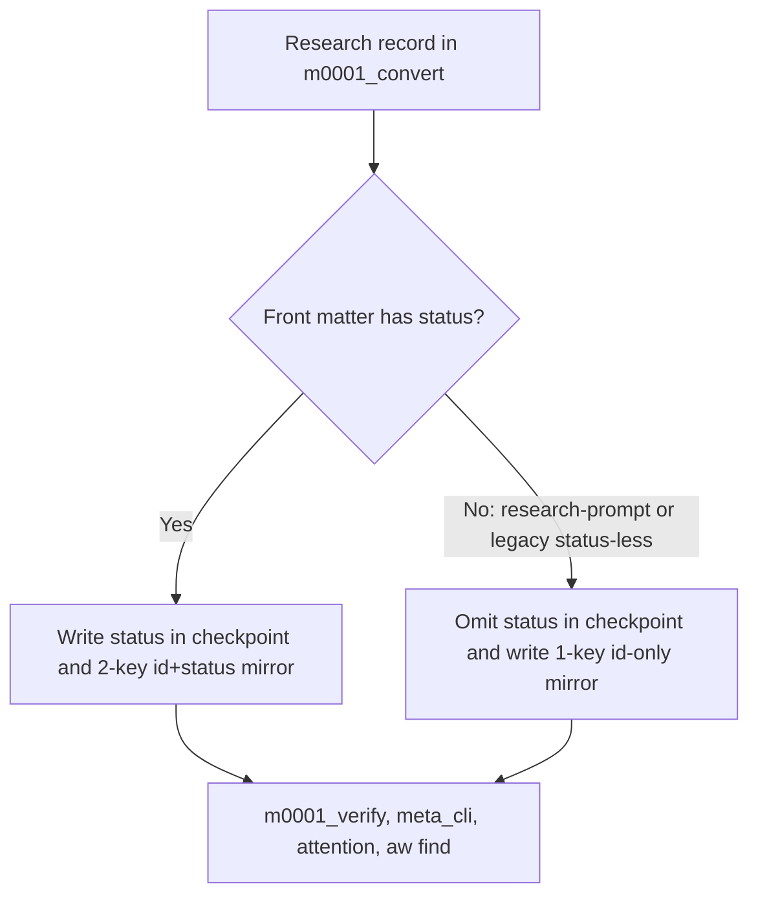

# IPD: Support status-less research records with id-only mirrors in metadata v2

- Date: 2026-11-21
- Kind: child
- Concern: `agent_workflows/migrations/m0001_convert.py::build_record_log` assigns `status = "draft"` whenever a `research` record has no `status` field in its front matter. Two real classes of research records intentionally carry no status: two-axis `research-prompt` records (8 tracked files in this repository) and legacy status-less research notes (such as `20260708-survey-notes.md` in `tests/migration_corpus.py::legacy_agents_layout`). Because `"draft"` is not in `agent_workflows/research_contract.py::STATUSES`, migrated `research-prompt` records fail `aw attention` with `attention.unknown-status` (`research status 'draft'`) and fail spec `4sd62s` AC-42(5) `aw find --agent` parity (`"-"` before migration versus `"draft"` after migration). On 2026-11-21, the maintainer selected Option A: treat status-less `research` records like walkthroughs in metadata v2 by omitting `status` from the log checkpoint and permitting an `id`-only front-matter mirror.
- Scope: Implement Option A across metadata-v2 conversion, mirror rendering/parsing, round-trip verification, drift checking/repair, tests, and spec `4sd62s`: (1) stop `m0001_convert.build_record_log` and `m0001_verify._legacy_field_pairs_for_record` from fabricating `status = "draft"` for status-less `research` records, leaving `status = None` and omitting `"status"` from checkpoint `fields`; (2) update `artifact_meta.render_in_file_mirror`, `artifact_meta.parse_artifact_mirror` (via an opt-in `allow_statusless: bool = False` parameter or dedicated research mirror parser so non-research types remain strict 2-key), `migrations/chain.py::_is_v2_mirror_text`, `m0001_verify`, and `meta_cli` (`aw check meta` and `aw meta repair`) to emit, parse, verify, and repair 1-key `id`-only front-matter mirrors for status-less `research` records while keeping 2-key `id`+`status` mirrors mandatory for status-bearing research and all non-walkthrough/non-roadmap types; (3) update `tests/test_m0001_review_conversion.py` (replacing the pinned `st2.status == "draft"` assertion on `rs5002` with `st2.status is None` and verifying `id`-only mirror, `aw check meta`, `aw attention`, and `aw find --agent` parity on both `research-prompt` and legacy status-less research fixtures); and (4) document the Option A rule in `.aw/records/specs/approved/20260925-metastore-01-4sd62s-artifact-metadata-store.spec.md` Sections 4.1 and 4.6. EXCLUDES: migrated spec validation (`0dsjzl` / `zgxig2`), `aw find` missing-kind-facet fallback (`7mmhlp` / `vvxbbl`), and editing `tests/test_m0001_any_repo.py` (`60mazt`).
- Scope-Paths: agent_workflows/migrations/m0001_convert.py, agent_workflows/artifact_meta.py, agent_workflows/migrations/m0001_verify.py, agent_workflows/migrations/chain.py, agent_workflows/meta_cli.py, tests/test_m0001_review_conversion.py, .aw/records/specs/approved/20260925-metastore-01-4sd62s-artifact-metadata-store.spec.md, .aw/records/plans/pending/20261121-fnabjy-01-s4utmv-support-status-less-research-records-with-id-only-mirrors-in.ipd.md
- Item-Dependencies: none
- Status: to-review
- Short-Description: Omit fabricated draft status for status-less research records across m0001_convert, artifact_meta mirrors, m0001_verify, meta_cli, attention, and spec 4sd62s.
- Work-Kind: bug
- Priority: high
- From-Backlog: fnabjy
- From-Spec: 4sd62s
- Blocks-Release: next
- Set: fnabjy
- Order: 1
- Highest E allocated: 05
- Author: antigravity/gemini
- Id: s4utmv

> Write and proofread this plan per the technical writing standard, `.aw/system/workflows/technical-writing/technical-writing.md` (`.agents/workflows/technical-writing/technical-writing.md` in a legacy-layout install), including requirement 12 (diagrams).

## Workflow history

- 2026-11-21 to-review (aw set): Authored review-ready child plan graduated from backlog fnabjy
- 2026-11-21 draft (antigravity/gemini): created.

## Goal

Eliminate the fabricated `"draft"` status on migrated status-less `research` records (`research-prompt` and status-less legacy research notes) by omitting `status` from their event log checkpoints and using `id`-only front-matter mirrors, restoring `aw attention` validity and `aw find --agent` parity before rehearsal and cutover.

## Detailed Implementation Checklist (TODO)

Execution-state rule: mark an `E-*` item complete only after performing the action. That mark is not validation. Right-sizing rule: write for a modest executor that cannot hold much in its head. Each E-item is one step (one concern, about one file, executable in one focused pass) and its V-item names each unit it covers with its own check; a plan stays at about 5 E-items and 8 work Scope-Paths, else split it into more child plans (guidance, `IPD-Z603`). Accepted execution states: blocked, failed, pending, performed; terminal gate demands 'performed'.

### Task group 1: Metadata-v2 status-less research mirror and log contract

- [ ] E-01 Update `agent_workflows/artifact_meta.py` to support `id`-only front-matter mirrors for status-less `research` records without relaxing strict 2-key validation for other artifact types:
  1. In `artifact_meta.render_in_file_mirror(id6, artifact_type, status)`, emit `---\nid: {id6}\n---\n{banner}` when `artifact_type in ("walkthrough", "roadmap")` OR `(artifact_type == "research" and not (status or "").strip())`.
  2. Add `allow_statusless: bool = False` to `artifact_meta.parse_artifact_mirror(text, *, allow_statusless: bool = False)` (keeping the default `False` strict 2-key `id` + `status` behavior unchanged): when `allow_statusless=True` and the front-matter block has exactly 1 line matching `^id:\s*(\S+)$`, validate `id6` and return `{"id": id_val, "status": None}`.
  3. Verify `artifact_meta.replay`, `_load_sources`, and `read_text` handle `research` checkpoints with `status` omitted (`state.status is None`, `state.legacy_raw_status is None`) cleanly without raising or inventing `"draft"`.
  - Depends on: none
  - Expected outcome: `artifact_meta` renders, parses, replays, and indexes status-less `research` records with `status=None` and `id`-only mirrors while non-research types remain strictly 2-key.
  - Execution state: pending

- [ ] E-02 Update `agent_workflows/migrations/m0001_convert.py::build_record_log` so that when `is_research` is True and no `status` key is present in front matter, `status` stays `None` (instead of assigning `"draft"`), omitting `"status"` from checkpoint `fields`. Verify `m0001_convert.rewrite_record_file` passes `status=None` through to `artifact_meta.render_in_file_mirror` so status-less `research` files receive the 1-key `id`-only mirror + banner.
  - Depends on: E-01
  - Expected outcome: `m0001_convert` produces checkpoints with no `status` key and `id`-only mirrors for `research-prompt` and status-less legacy research files, while status-bearing research files still record their status and 2-key mirror.
  - Execution state: pending

- [ ] E-03 Update `agent_workflows/migrations/m0001_verify.py`, `agent_workflows/migrations/chain.py`, and `agent_workflows/meta_cli.py` to recognize status-less `research` mirrors and checkpoints consistently:
  1. In `m0001_verify._legacy_field_pairs_for_record`, leave `status = None` when `art_type == "research"` and no `status` key is present (matching `m0001_convert.build_record_log`).
  2. In `m0001_verify._collect_converted_records` and `m0001_verify.verify_round_trip`, parse `art_type == "research"` mirrors with `allow_statusless=True`, enforce `mirror.get("status") == state.status` (so a status-bearing research record MUST still have a matching 2-key mirror while a status-less research record MUST have a 1-key mirror with `mirror.get("status") is None`), and enforce `state.status == leg_status`.
  3. In `migrations/chain.py::_is_v2_mirror_text`, allow `parse_artifact_mirror(text, allow_statusless=True)` for research files (or when the filename is a `.research-prompt.md` / research `.md` file lacking a non-research type facet) so `repo_has_legacy_records` recognizes migrated `id`-only research mirrors as v2.
  4. In `meta_cli._parse_log_backed_mirror`, pass `allow_statusless=True` when `art_type == "research"`. In `meta_cli.check_meta` and `meta_cli.meta_repair`, compare `file_status != st.status` cleanly when `st.type == "research"` and `st.status is None` (zero `meta.status-mirror-drift` when both are `None`, drift flagged when one has a status and the other does not, and `meta_repair` rewrites the `id`-only mirror cleanly).
  - Depends on: E-02
  - Expected outcome: `m0001_verify`, `migrations/chain.repo_has_legacy_records`, `aw check meta`, and `aw meta repair` accept and verify status-less `research` records with `id`-only mirrors and catch any mirror/log status mismatch.
  - Execution state: pending

- [ ] E-04 Update `.aw/records/specs/approved/20260925-metastore-01-4sd62s-artifact-metadata-store.spec.md` (Sections 4.1 and 4.6 in-file `status` mirror table row) to record the maintainer Option A ruling (2026-11-21): status-less `research` records (`research-prompt` and status-less legacy research notes) omit `status` from their checkpoint and carry an `id`-only front-matter mirror alongside walkthroughs and roadmaps; status-bearing research records keep the 2-key `id` + `status` mirror.
  - Depends on: E-03
  - Expected outcome: Spec `4sd62s` matches the implemented Option A contract with no contradiction between spec prose and runtime behavior.
  - Execution state: pending

- [ ] E-05 Update `tests/test_m0001_review_conversion.py` (`rs5002` in `test_fields_research_and_research_prompt`) from `assert st2.status == "draft"` to `assert st2.status is None`, asserting that `rs5002`'s rewritten file carries an `id`-only front-matter mirror (`---\nid: rs5002\n---`) with no `status:` line, passes `m0001_verify.verify_round_trip`, passes `aw check meta` with zero findings, passes `aw attention --all --format json` with zero `attention.unknown-status` violations, and preserves `aw find --agent` status `"-"` before and after migration. Add a companion test covering a status-less legacy research note and a status-bearing research record (confirming `meta.status-mirror-drift` still fires if a status-bearing research record drops its `status:` mirror line). Run `python3 -m pytest -o addopts="" -v tests/test_m0001_review_conversion.py tests/test_m0001_roundtrip.py tests/test_m0001_conversion.py tests/test_check_meta.py tests/test_meta_repair_cli.py`, `aw suite`, `make typecheck`, `aw ipd lint --phase pre-transition` on this plan, and `aw sanitize --agent`.
  - Depends on: E-04
  - Expected outcome: All targeted migration, mirror, meta-check, and core suite tests pass alongside `make typecheck`, `aw ipd lint --phase pre-transition`, and `aw sanitize --agent`.
  - Execution state: pending

## Project conventions discovered (Step 0)

- `agent_workflows/attention.py::_research_record` already implements two-axis `research-prompt` support: when `raw_status in (None, "")` and `state.fields.get("research_kind") == "research-prompt"`, it sets `status = ""` and `cls = A.READY` with zero violations; when `is_prompt` is False and `raw_status in (None, "")`, it emits `attention.missing-status` (matching pre-migration behavior instead of `attention.unknown-status`).
- `agent_workflows/cli.py::_find_type_records` (research branch) sets `status = raw_st or "-"`, so when `st.status` and `st.legacy_raw_status` are `None`, `aw find --agent` emits `"-"` automatically, preserving exact pre-migration parity for all 8 tracked `research-prompt` records.
- `agent_workflows/migrations/m0001_convert.py::build_record_log` and `agent_workflows/migrations/m0001_verify.py::_legacy_field_pairs_for_record` both currently hardcode `status = "draft" if is_research else ...`.
- `agent_workflows/artifact_meta.py::render_in_file_mirror` and `parse_artifact_mirror`, `agent_workflows/migrations/chain.py::_is_v2_mirror_text`, and `agent_workflows/meta_cli.py::_parse_log_backed_mirror` / `check_meta` / `meta_repair` currently treat only `("walkthrough", "roadmap")` as status-less.
- `tests/test_m0001_review_conversion.py` pins `assert st2.status == "draft"` on the `research-prompt` fixture `rs5002`.

## Findings

| Id | Finding | Evidence |
|---|---|---|
| F-01 | `m0001_convert.build_record_log` fabricates `status = "draft"` for status-less `research` records, which is outside `research_contract.STATUSES`. | `agent_workflows/migrations/m0001_convert.py::build_record_log`; measured during IPD `60mazt` (`8 attention.unknown-status` violations and `8 aw find` status mismatches `"-"` vs `"draft"` on the repo clone, plus 1 on `legacy_agents_layout`). |
| F-02 | `artifact_meta.render_in_file_mirror`, `parse_artifact_mirror`, `m0001_verify`, `migrations/chain._is_v2_mirror_text`, and `meta_cli` assume only `walkthrough` and `roadmap` can have an `id`-only mirror. | `agent_workflows/artifact_meta.py::render_in_file_mirror`, `parse_artifact_mirror`; `agent_workflows/migrations/m0001_verify.py`; `agent_workflows/migrations/chain.py::_is_v2_mirror_text`; `agent_workflows/meta_cli.py::_parse_log_backed_mirror`. |

## Proposed changes (ordered, validatable)

1. Extend `artifact_meta.render_in_file_mirror` and `parse_artifact_mirror(..., allow_statusless=False)` for status-less `research` records (`E-01`).
2. Stop fabricating `status = "draft"` in `m0001_convert.build_record_log` (`E-02`).
3. Align `m0001_verify`, `migrations/chain._is_v2_mirror_text`, and `meta_cli` (`check_meta` and `meta_repair`) to accept and verify `id`-only mirrors on status-less `research` records (`E-03`).
4. Sync spec `4sd62s` Sections 4.1 and 4.6 to document the maintainer Option A ruling (`E-04`).
5. Update `tests/test_m0001_review_conversion.py`, add behavioral tests, and run all validation gates (`E-05`).

## Deferred / out of scope (with reason)

- Migrated v2 specification validation in `attention._spec_record`: owned by sibling plan `zgxig2` (from backlog `0dsjzl`).
  - Carrier: zgxig2
- Returning migrated legacy research notes lacking a kind facet from `aw find`: owned by sibling plan `vvxbbl` (from backlog `7mmhlp`).
  - Carrier: vvxbbl
- Re-running AC-42 corpus and clone verification in `tests/test_m0001_any_repo.py`: owned by pending plan `60mazt`.
  - Carrier: 60mazt

## Scope check

- Over-scope: none. Only the five production modules touching mirrors/conversion/verification/meta-drift, `tests/test_m0001_review_conversion.py`, spec `4sd62s`, and this plan are modified.
- Under-scope: none. Covers conversion, mirror emission and parsing, round-trip verification, legacy-record detection, `aw check meta`, `aw meta repair`, `aw attention`, `aw find --agent`, and spec `4sd62s` sync.

## Required tests / validation

- `python3 -m pytest -o addopts="" -v tests/test_m0001_review_conversion.py tests/test_m0001_roundtrip.py tests/test_m0001_conversion.py tests/test_check_meta.py tests/test_meta_repair_cli.py`
- `aw suite` (core tier passes)
- `make typecheck` (0 mypy errors)
- `aw ipd lint --phase pre-transition` on this plan (`outcome: "clean"`)
- `aw sanitize --agent` (`outcome: "clean"`)

## Spec / documentation sync

Updates `.aw/records/specs/approved/20260925-metastore-01-4sd62s-artifact-metadata-store.spec.md` Sections 4.1 and 4.6 (`E-04`) to record the maintainer Option A decision (2026-11-21) for status-less `research` records.

## Open questions

None. Maintainer approved Option A on 2026-11-21 (omit `status` in the checkpoint and allow an `id`-only front-matter mirror for status-less `research` records).

## Validation and cross-check (verify before reporting done)

Validation-state rule: inspect evidence in a separate pass. Do not mark a `V-*` item complete from memory or from the matching execution checkmark. Accepted validation results: blocked, failed, pass, pending; terminal gate demands 'pass'. Runtime-demonstration reachability rule: for each `V-*` item demanding the software be observed acting (such as a run, a dispatch, or a transition), as distinct from items demanding a diff, a file's content, or a test result (which are reachable by construction), name the code path that produces the observation or the sibling `E-*` that creates it, else the demand is UNDER-SCOPE.

- [ ] V-01 validates E-01
  - Required evidence: paste the `git diff agent_workflows/artifact_meta.py` summary showing `render_in_file_mirror` emits an `id`-only mirror for status-less `research`, `parse_artifact_mirror(..., allow_statusless=False)` remains strict by default, and `replay`/`read_text` preserve `status=None`.
  - Observed evidence:
  - Result: pending

- [ ] V-02 validates E-02
  - Required evidence: paste the `git diff agent_workflows/migrations/m0001_convert.py` summary showing `build_record_log` omits `"status"` for status-less `research` records instead of assigning `"draft"`.
  - Observed evidence:
  - Result: pending

- [ ] V-03 validates E-03
  - Required evidence: paste the `git diff` summary across `agent_workflows/migrations/m0001_verify.py`, `agent_workflows/migrations/chain.py`, and `agent_workflows/meta_cli.py` confirming 1-key mirror verification, legacy-record detection, `aw check meta`, and `aw meta repair` support status-less `research` while still catching mirror/log status drift on status-bearing records.
  - Observed evidence:
  - Result: pending

- [ ] V-04 validates E-04
  - Required evidence: paste the `git diff` hunk for `.aw/records/specs/approved/20260925-metastore-01-4sd62s-artifact-metadata-store.spec.md` showing Sections 4.1 and 4.6 updated consistently with Option A.
  - Observed evidence:
  - Result: pending

- [ ] V-05 validates E-05
  - Required evidence: paste actual output from `python3 -m pytest -o addopts="" -v tests/test_m0001_review_conversion.py tests/test_m0001_roundtrip.py tests/test_m0001_conversion.py tests/test_check_meta.py tests/test_meta_repair_cli.py`, `aw suite`, `make typecheck`, `aw ipd lint --phase pre-transition` on this plan, and `aw sanitize --agent`.
  - Observed evidence:
  - Result: pending

## Approval and execution gate

- Size assessment: standard
- Cohesion rationale: not required

Execute after review and approval (`approved` or `auto-approved`). Note: `Scope-Paths` includes approved spec `.aw/records/specs/approved/20260925-metastore-01-4sd62s-artifact-metadata-store.spec.md` per maintainer Option A approval (2026-11-21). Commit only files changed for this plan through `aw commit s4utmv -- <paths>` (never `git add -A`, bare `git add`, `git commit -a`, or `--no-verify`; never push). Finalize to `.aw/records/plans/executed/` only via `aw ipd finalize` after `aw ipd lint --phase pre-transition` conforms and every `V-*` reads `pass` with pasted evidence.
