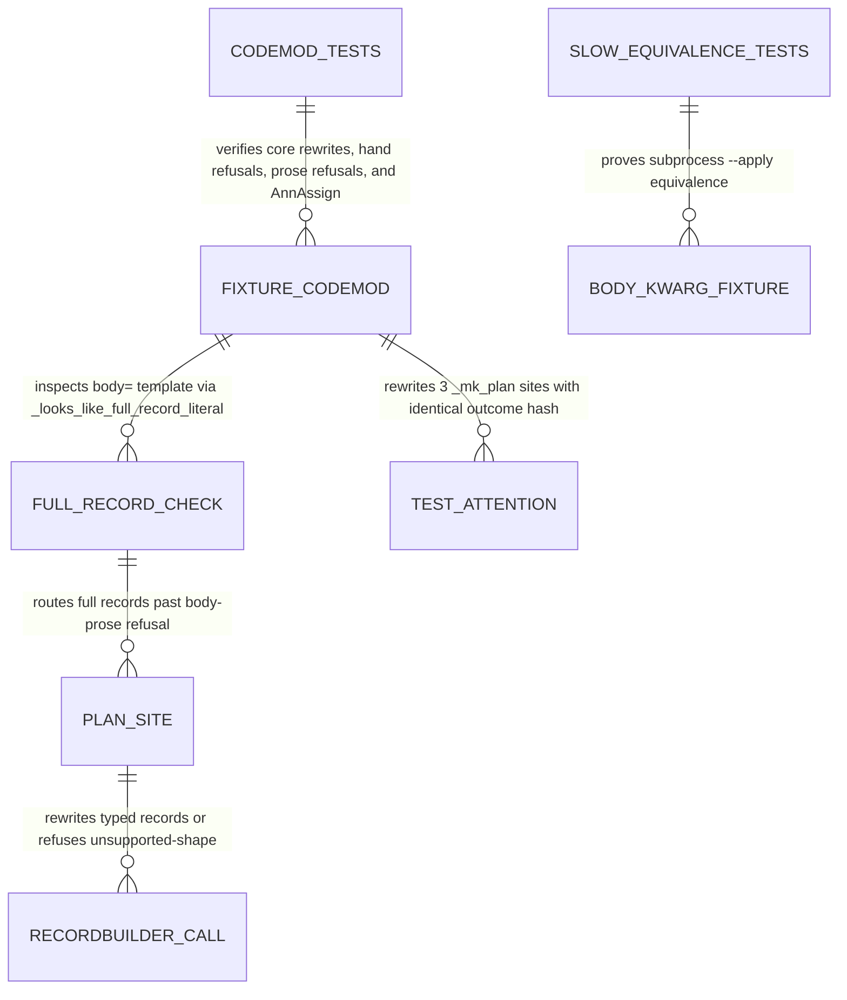
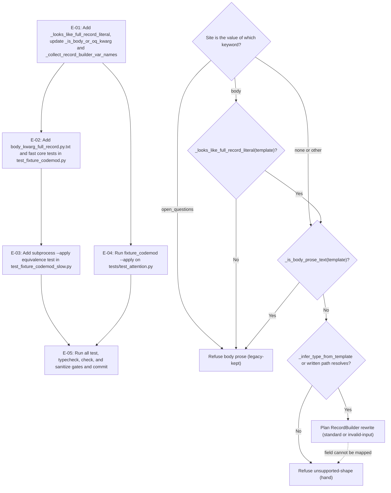

# IPD: Distinguish full record literals from body prose in fixture_codemod._is_body_or_oq_kwarg

- Date: 2026-11-21
- Kind: child
- Concern: Backlog `lufe6m` (`Work-Kind: bug`, `Priority: medium`, `Blocks-Release: next`) reports that `tools/fixture_codemod.py::_is_body_or_oq_kwarg` returns `True` solely because a string literal's AST parent is an `ast.keyword` named `"body"` or `"open_questions"`. When a test passes a full record literal via `body=` to a non-`RecordBuilder` helper (such as `_mk_plan` in `tests/test_attention.py`, observed in executed plan `lf0fe4`), `tools/fixture_codemod.py::_plan_site` refuses the literal as `"body prose"` (`legacy-kept`) before checking whether the text is a full record literal. As a result, full IPD literals that should rewrite to `tests/record_builder.py::RecordBuilder` and heading-less full record literals that should refuse as `"unsupported-shape"` (`hand`) remain misclassified as `"body prose"` (`legacy-kept`).
- Scope: IN: (1) update `tools/fixture_codemod.py::_is_body_or_oq_kwarg`, `tools/fixture_codemod.py::_plan_site`, and add `tools/fixture_codemod.py::_looks_like_full_record_literal` so `open_questions=` remains `body prose`, non-record-literal `body=` content (including H2 sections such as `## Notes` and `## Workflow history`, non-record H1 headings followed by prose, and prose after a record H1 before metadata bullets) remains `body prose`, and full record literals passed via `body=` proceed through `_plan_site` to rewrite or classify as `hand`; (2) extend `tools/fixture_codemod.py::_collect_record_builder_var_names` to track `ast.AnnAssign` bindings (`builder: RecordBuilder = RecordBuilder()`); (3) add fixture `tests/fixtures/fixture_codemod/body_kwarg_full_record.py.txt`, fast in-process core-tier behavioral tests in `tests/test_fixture_codemod.py` (keeping serial runtime under 10 seconds), and a subprocess `--apply` equivalence test in `tests/test_fixture_codemod_slow.py` listed in `tests/slow_allowlist.txt`; and (4) run `python3 tools/fixture_codemod.py --apply --format json tests/test_attention.py` to convert the three misclassified `_mk_plan(..., body=...)` sites in `tests/test_attention.py` onto `RecordBuilder().plan(..., text_only=True)`. OUT: changing `tests/record_builder.py::RecordBuilder`, altering `tools/fixture_codemod.py::F01_PATTERN` or `tools/fixture_codemod.py::_is_body_prose_text` outside `body=` handling, converting `tests/test_readers_check_engine.py` (its 5 `body=` sites are genuine `## Open questions` / `## Notes` body prose that stay `legacy-kept`; its other sites are unrelated to `body=` handling), or addressing sibling codemod backlog items `b1j6bl` and `e0wwtc`.
- Scope-Paths: tools/fixture_codemod.py, tests/test_fixture_codemod.py, tests/test_fixture_codemod_slow.py, tests/fixtures/fixture_codemod/body_kwarg_full_record.py.txt, tests/slow_allowlist.txt, tests/test_attention.py
- Item-Dependencies: none
- Status: reviewed
- Readiness: go-pending-approval
- Review-Depth: standard
- Short-Description: Fix fixture_codemod._is_body_or_oq_kwarg so full record literals passed via body= to non-RecordBuilder helpers rewrite or classify as hand instead of body prose (legacy-kept).
- Work-Kind: bug
- Priority: medium
- From-Backlog: lufe6m
- Blocks-Release: next
- Set: lufe6m
- Order: 1
- Highest E allocated: 05
- Author: antigravity/gemini-4-hydrogen-xhigh
- Id: svpml2

> Write and proofread this plan per the technical writing standard, `.aw/system/workflows/technical-writing/technical-writing.md` (`.agents/workflows/technical-writing/technical-writing.md` in a legacy-layout install), including requirement 12 (diagrams).

## Workflow history

- 2026-11-24 /plan-review (uri/its_direct/pt3-claude-opus-5.5-1m-us): APPROVE WITH REVISIONS APPLIED; PR-001..PR-010 FIXED; review record .aw/records/reviews/20261121-lufe6m-01-svpml2-distinguish-full-record-literals-from-body-prose-in-fixture.review.md
- 2026-11-24 reviewed (aw set): /plan-review: APPROVE WITH REVISIONS APPLIED; PR-001..PR-010 fixed
- 2026-11-21 to-review (aw set): Authored review-ready child plan graduated from backlog lufe6m
- 2026-11-21 draft (antigravity/gemini-4-hydrogen-xhigh): created.

## Goal

Update `tools/fixture_codemod.py::_is_body_or_oq_kwarg` so full record literals passed via `body=` to non-`RecordBuilder` helpers are no longer misclassified as `"body prose"` (`legacy-kept`), allowing them to rewrite to `tests/record_builder.py::RecordBuilder` or classify as `hand`, and convert the three affected `_mk_plan` fixtures in `tests/test_attention.py`.

## Detailed Implementation Checklist (TODO)

Execution-state rule: mark an `E-*` item complete only after performing the action. That mark is not validation. Right-sizing rule: write for a modest executor that cannot hold much in its head. Each E-item is one step (one concern, about one file, executable in one focused pass) and its V-item names each unit it covers with its own check; a plan stays at about 5 E-items and 8 work Scope-Paths, else split it into more child plans (guidance, `IPD-Z603`). Accepted execution states: blocked, failed, pending, performed; terminal gate demands 'performed'.

### Task group 1: Distinguish full record literals from body prose in `tools/fixture_codemod.py`

- [ ] E-01 In `tools/fixture_codemod.py`, add `_looks_like_full_record_literal(template: str) -> bool`, update `_is_body_or_oq_kwarg(site_node: ast.AST, parents: dict[int, ast.AST], template: str | None = None) -> bool` and its call in `_plan_site`, and add `ast.AnnAssign` handling to `_collect_record_builder_var_names`:
  1. In `_looks_like_full_record_literal(template)`:
     - Return `True` when `_YAML_RESEARCH_SITE_RE.search(template)` matches or when the first non-empty stripped line (`first_nonempty`) matches `re.match(r"\A<!--\s*aw-prompt:", first_nonempty)`.
     - When `first_nonempty` matches a pattern in `_HEADING_TO_RECORD_TYPE`, scan lines after `first_nonempty` before the first `## ` heading (skipping blank lines, `> ` blockquotes, and whole-line `_PLACEHOLDER_RE` markers): return `False` if any non-bullet line appears before the first `_BULLET_LINE_RE` line; return `True` if at least one `_BULLET_LINE_RE` line appears or if `## Workflow history` follows directly.
     - When `first_nonempty` matches `_BULLET_LINE_RE`, return `False` if `_is_body_prose_text(template)` is `True`; collect leading `_BULLET_LINE_RE` keys (normalized lowercase) before any `## ` heading and return `True` if `"id"` or `"subject-id"` is present or if at least two distinct metadata bullets appear outside open-question keys. The open-question key set is `agent_workflows/ipd_schema.py::OQ_FIELDS` lowercased, minus `"status"` (which is also a record field), plus `"resolution"`: that is `"blocking"`, `"owner"`, `"resolution"`, `"resolution or deferral rationale"`, `"finding"`, `"carrier"`, `"carrier-evidence"`, and `"carrier-declined"`. A heading-less `- Status: open` plus `- Finding: F-001` fragment therefore counts one metadata bullet, not two, and stays `False`.
     - Return `False` for all other inputs (including `## Notes`, `## Workflow history`, non-record H1 headings such as `# Quoting Report`, and single `- Status: open` fragments).
  2. In `_is_body_or_oq_kwarg(site_node, parents, template=None)`: keep `open_questions=` returning `True`; for `body=`, return `not _looks_like_full_record_literal(template)` when `template is not None` (and `True` when `template is None`). Pass `template` from `_plan_site` at the `_is_body_or_oq_kwarg(node, parents, template)` check.
  3. In `_collect_record_builder_var_names`: also inspect `ast.AnnAssign` nodes whose `value` is a `RecordBuilder(...)` call (`target` as `ast.Name` or `self.<attr>`), matching the `ast.Assign` logic.
  4. BEFORE editing, capture the whole-tree baseline with the unmodified tool: `mkdir -p .aw/state/svpml2` then `python3 tools/fixture_codemod.py --dry-run --format json tests/ > .aw/state/svpml2/dryrun-before.json`. Also capture `aw check all --agent > .aw/state/svpml2/check-before.jsonl` (it already exits 1 on this tree with pre-existing errors; E-05 compares against it). `.aw/state/` is gitignored, so neither file is committed. The dry-run takes about 16 seconds.
  - Depends on: none
  - Expected outcome: `.aw/state/svpml2/dryrun-before.json` and `.aw/state/svpml2/check-before.jsonl` exist and were produced by the unmodified tree. Full record literals passed via `body=` to non-`RecordBuilder` helpers pass step 4 of `_plan_site` to rewrite (or classify as `unsupported-shape` / `hand` when type or fields cannot be mapped), while genuine body prose on `body=` and `open_questions=` remains `body prose` (`legacy-kept`) and annotated `RecordBuilder` calls remain skipped.
  - Execution state: pending

### Task group 2: Add behavioral fixture, fast core tests, and slow subprocess equivalence test

- [ ] E-02 Add fixture `tests/fixtures/fixture_codemod/body_kwarg_full_record.py.txt` (never named `test_*.py` under `tests/fixtures/`) and fast in-process core-tier behavioral tests in `tests/test_fixture_codemod.py` (with zero `inspect`, `ast`, or source-regex checks against production code):
  1. In `tests/fixtures/fixture_codemod/body_kwarg_full_record.py.txt`, define a non-`RecordBuilder` helper `_mk_plan(dirpath, *, setid, order, id6, slug, body)` writing `body` to disk and test three cases: a valid `# IPD:` literal passed via `body=`, an invalid-status `# IPD:` literal (`- Status: frobnicated`) passed via `body=`, and a `body="## Notes\n\n- Id: ext123\n"` prose fixture passed to `_mk_plan` (reading metadata with `agent_workflows/artifact_meta.py::read_text`).
  2. In `tests/test_fixture_codemod.py`, add fast IN-PROCESS tests (no subprocess, and no `--apply`, because `--apply` runs nested pytest) using `tools/fixture_codemod.py::analyze_module`, `tools/fixture_codemod.py::apply_rewrites_to_source`, and `tools/fixture_codemod.py::main` with `--dry-run --format json` only (capture stdout with `contextlib.redirect_stdout`), on small modules written to a `tempfile.TemporaryDirectory()`. Name each temporary module and its test functions so they match neither `_LEGACY_SUBJECT_MODULE_GLOBS` (for example `*legacy*`) nor `_LEGACY_SUBJECT_FUNC_MARKERS` (for example `selector_two_dialect`); step 1 of `_plan_site` otherwise refuses every site as `legacy-format subject` before the `body=` logic runs. `tools/` is not a package, so load the tool ONCE per test module with `importlib.util.spec_from_file_location("fixture_codemod", CODEMOD_PATH)` and set `sys.modules["fixture_codemod"]` to the new module BEFORE `spec.loader.exec_module(module)`. Without that registration its `@dataclasses.dataclass` classes fail to build (`AttributeError: 'NoneType' object has no attribute '__dict__'`, observed during review). Cover: (a) full H1 record literals (`# IPD:` static, f-string, `textwrap.dedent`, invalid-status `raw_fields`, `# Spec:`), YAML research frontmatter, `<!-- aw-prompt: ... -->`, and heading-less review literals carrying `- Subject-Id:` plus `- Subject-Type:` or `- Verdict:` (the pair `_infer_type_from_template` requires) passed via `body=` plan rewrites; (b) heading-less `- Id:` / `- Status:` full record literals and `# IPD:` with an unknown field passed via `body=` refuse as `unsupported-shape` (`hand`), never `body prose`; (c) `open_questions=` literals (including bare `"- Status: open"`), `body="## Notes\n..."`, `body="## Workflow history\n..."`, `body="# Quoting Report\n\nReviewing...\n- Id: aaaaaa"`, `body="# Spec: Quoted\n\nProse before bullet:\n- Id: ffffff"`, a heading-less `body="- Status: open\n- Finding: F-001\n"` fragment, and fenced `<!-- aw-prompt: -->` examples inside prose refuse as `body prose` (`legacy-kept`); and (d) a call on an `AnnAssign`-bound builder (`rb: RecordBuilder = RecordBuilder()` then `rb.plan(body="# IPD: x\n\n- Id: aaaaaa\n- Status: draft\n")`) produces `sites=0`. Case (d) must put an F-01-matching literal inside the call so the test fails against the unfixed `_collect_record_builder_var_names`; a call with no such literal reports `sites=0` either way and proves nothing.
  3. Confirm `python3 -m pytest -o addopts="" -n 0 -v --durations=0 tests/test_fixture_codemod.py` stays under the 10-second serial wall-time limit (`j2xjtt` E-10). The 11 existing subprocess tests already take 8.05 to 9.31 seconds serially (measured at review), so all new tests together must add under 1 second in the `--durations=0` listing. Keeping them in-process is what keeps them inside that margin.
  - Depends on: E-01
  - Expected outcome: All existing and new tests in `tests/test_fixture_codemod.py` pass in under 10 seconds under `-n 0` with zero unlisted slow tests.
  - Execution state: pending

- [ ] E-03 In `tests/test_fixture_codemod_slow.py`, add a subprocess `--apply --format json` equivalence test driving `tools/fixture_codemod.py` via `_run_codemod` on a staged temporary-repo copy of `tests/fixtures/fixture_codemod/body_kwarg_full_record.py.txt` (via `_stage_fixture_in_temp_repo`), asserting `returncode == 0`, `stderr == ""`, `equivalent is True`, `before_hash == after_hash`, `totals["rewrites"] == 2` (`standard=1`, `invalid-input=1`), `totals["refusals"] == 1` (`body prose=1`, `legacy-kept=1`), and `returncode == 0` when executing the rewritten module with `pytest -o addopts="" -m "" -p no:randomly -n 0 -v` (mirror `FixtureCodemodEquivalenceTests::test_case_h_rewritten_fixture_module_tests_pass`, including `cwd=str(support.REPO_ROOT)` so the rewritten module can import `agent_workflows`). Read the proof from `report["modules"][0]["proof"]`. Record the new test node ID in `tests/slow_allowlist.txt` as one `<node id><TAB><reason>` line, matching the existing `tests/test_fixture_codemod_slow.py::...` entries.
  - Depends on: E-02
  - Expected outcome: `python3 -m pytest -o addopts="" -n 0 -v --durations=0 tests/test_fixture_codemod_slow.py` passes with `0 unlisted slow tests`.
  - Execution state: pending

### Task group 3: Apply codemod to `tests/test_attention.py`, run gates, and commit

- [ ] E-04 First, with the E-01 code in place and `tests/test_attention.py` still unmodified, run `python3 tools/fixture_codemod.py --dry-run --format json tests/ > .aw/state/svpml2/dryrun-after-e01.json` and compare it with `.aw/state/svpml2/dryrun-before.json` site by site (key: module, line, col; value: action and reason). The ONLY changed sites must be `tests/test_attention.py` lines 2678, 2688, and 2973 moving from `body prose` to `rewrite`; every other site in the tree keeps its classification. A review-time simulation of the change produced exactly that result (totals moved from `rewrites=30`, `body prose=154` to `rewrites=33`, `body prose=151`). If any other site changes, the heuristic over-triggers: fix E-01 before continuing. Then run `python3 tools/fixture_codemod.py --apply --format json tests/test_attention.py` to convert the three misclassified `_mk_plan(..., body=...)` sites (`DriftSurvivesEveryNarrowingTests._fixture` and `DispositionMismatchFiresUnderTheModernLayoutTests.test_disposition_mismatch_fires_under_modern_layout`) onto `RecordBuilder().plan(..., text_only=True)` with proved outcome-list equivalence (`before_hash == after_hash`, `equivalent=True`), then run `python3 tools/fixture_codemod.py --dry-run --format json tests/test_attention.py` to confirm `rewrites=0`, `hand=0`, `body prose=0`, and only the `setter-byte assertion` site remains.
  - Depends on: E-01
  - Expected outcome: `tests/test_attention.py` uses `RecordBuilder().plan(..., text_only=True)` at all three `_mk_plan` call sites with identical before and after pytest outcome hashes (`equivalent=True`).
  - Execution state: pending

- [ ] E-05 After the final edit, run `python3 -m pytest -o addopts="" -n 0 -v --durations=0 tests/test_fixture_codemod.py`, `python3 -m pytest -o addopts="" -n 0 -v --durations=0 tests/test_fixture_codemod_slow.py`, `python3 -m pytest tests/test_attention.py -v`, bare `python3 -m pytest`, `make test-all`, `make typecheck`, `python3 -m mypy tools/fixture_codemod.py` (`make typecheck` checks only `agent_workflows/`), `aw check all --agent`, and `aw sanitize --agent`. Compare the `aw check all --agent` diagnostics with `.aw/state/svpml2/check-before.jsonl`: the run must add no new `{location, rule}` diagnostic, and pre-existing ones are not this plan's to fix. Verify `rg -n "inspect\.|getsource" tests/test_fixture_codemod.py tests/test_fixture_codemod_slow.py` prints nothing; then commit only modified `- Scope-Paths:` files via `aw commit svpml2 -- <paths>`.
  - Depends on: E-03, E-04
  - Expected outcome: All targeted suites, the core gate, the thorough tier, both typechecks, and the leak scan succeed with zero failures and zero unlisted slow tests; `aw check all --agent` adds no diagnostic beyond the E-01 baseline; commits are path-scoped.
  - Execution state: pending

Add further leaves as `- [ ] E-NEW <action>` and run `aw ipd sync` to assign ids.

## Project conventions discovered (Step 0)

- `tools/fixture_codemod.py::_collect_candidate_sites` skips calls matched by `tools/fixture_codemod.py::_is_record_builder_call`, while `tools/fixture_codemod.py::_collect_record_builder_var_names` currently inspects `ast.Assign` only and misses `ast.AnnAssign`.
- `tools/fixture_codemod.py::_plan_site` extracts the template via `_extract_template(node)` and refuses in step 4 whenever `_is_body_or_oq_kwarg(node, parents)` or `_is_body_prose_text(template)` returns `True`, before `_infer_type_from_template` or `_parse_bullet_site` runs.
- `tools/fixture_codemod.py::_is_body_prose_text` already identifies `### OQ-`, `## Open questions`, `##` body headings (except `## Workflow history`), inline F-01 matches inside sentences, open-question bullet blocks (`Blocking`, `Owner`, `Resolution`, `Resolution or deferral rationale`), and prose-first text without `- Id:`.
- `tests/test_fixture_codemod.py` runs under a 10-second serial `-n 0` wall-time bound (`j2xjtt` E-10, `n0li9v` E-13; baseline measured at `11 passed in 9.31s`), whereas subprocess `--apply` equivalence tests live in `tests/test_fixture_codemod_slow.py` with node IDs listed in `tests/slow_allowlist.txt` (baseline measured at `2 passed in 5.36s`).
- `tests/test_fixture_codemod.py` carries module-level `pytestmark = pytest.mark.core` and `tests/test_fixture_codemod_slow.py` carries `pytestmark = pytest.mark.slow`, so new tests inherit the right tier without per-test markers.
- `tools/` is not a Python package (no `tools/__init__.py`); tests drive `tools/fixture_codemod.py` by path, either as a subprocess (`_run_codemod`) or through `importlib.util.spec_from_file_location` with `sys.modules` registration.
- `make typecheck` runs `python3 -m mypy agent_workflows` only; `python3 -m mypy tools/fixture_codemod.py` reports `Success: no issues found in 1 source file` at review.
- Cite code by repository-relative `path::Symbol` identifiers or quoted strings rather than bare line numbers (`IPD-C801`).

## Findings

| Id | Source inspected | Finding |
|---|---|---|
| F-01 | `tools/fixture_codemod.py::_is_body_or_oq_kwarg` and `tools/fixture_codemod.py::_plan_site` | `_is_body_or_oq_kwarg` inspects only `parents.get(id(site_node))` for `isinstance(parent, ast.keyword) and parent.arg in ("open_questions", "body")`, unconditionally refusing full record literals passed via `body=` as `"body prose"` (`legacy-kept`). |
| F-02 | AST scan over all `.py` files under `tests/` (`_collect_candidate_sites` sites with `ast.keyword` `body` or `open_questions`) | Exactly 10 non-`RecordBuilder` candidate sites are the direct value of a `body=` or `open_questions=` keyword across `tests/` (re-measured at review): 3 full IPD literals in `tests/test_attention.py` (`_mk_plan` in `DriftSurvivesEveryNarrowingTests._fixture` and `DispositionMismatchFiresUnderTheModernLayoutTests.test_disposition_mismatch_fires_under_modern_layout`), 5 section-body literals in `tests/test_readers_check_engine.py` (`_o30_write_full_plan` with 2 `## Open questions` bodies and 3 `## Notes` bodies, all of which `_is_body_prose_text` already classifies as body prose), 1 `open_questions=` literal in `tests/test_review_rereview.py` (`### OQ-02: ...`), and 1 prose-quoting `body=` literal in `tests/test_selector_two_dialect_readers.py` (`# Quoting Report`, classified `legacy-format subject` by its function-name marker before step 4 runs). |
| F-03 | `tools/fixture_codemod.py::apply_and_prove_module` simulation on a temporary copy of `tests/test_attention.py` with `_is_body_or_oq_kwarg` bypassed | All 3 `_mk_plan` sites in `tests/test_attention.py` rewrite (`2` `standard`, `1` `invalid-input` via `raw_fields={'Status': 'frobnicated'}`) with identical before and after pytest outcome hashes (`9babac6b2212de107c3c9106aa9fe5c9ff5a2f41eb34c9433b401b9afa4893a5`, `equivalent=True`, `pytest_runs=2`), leaving only 1 `setter-byte assertion` site (`legacy-kept`) and 0 `hand` or `body prose` sites. |
| F-04 | Executed plans `lf0fe4` (`tests/test_attention.py` batch) and `59aiyh` (shared record builder migration) | Both plans are in `.aw/records/plans/executed/`. `lf0fe4` filed backlog `lufe6m` for those 3 `_mk_plan` literals, and `59aiyh`'s census already dispositioned `tests/test_readers_check_engine.py` (11 sites, 7 `body prose`). No pending plan is scheduled to convert the 3 `_mk_plan` sites. |
| F-05 | `python3 -m pytest -o addopts="" -n 0 -v --durations=0` on `tests/test_fixture_codemod.py` and `tests/test_fixture_codemod_slow.py` | Baseline passes (`11 passed in 9.31s` in `tests/test_fixture_codemod.py` and `2 passed in 5.36s` in `tests/test_fixture_codemod_slow.py`). Fast in-process tests belong in `tests/test_fixture_codemod.py` to preserve its 10-second bound, while subprocess `--apply` equivalence tests belong in `tests/test_fixture_codemod_slow.py`. |

## Proposed changes (ordered, validatable)

The entity-relationship diagram below shows the modules, helpers, and test surfaces changed or verified by this plan:

The flowchart below shows the step-4 decision in `tools/fixture_codemod.py::_plan_site` after the change (the keyword check in `_is_body_or_oq_kwarg`, then the unchanged `_is_body_prose_text` check that `_plan_site` still applies to every template) and the execution sequence (`E-01` through `E-05`):

1. **Refine keyword-argument classification in `tools/fixture_codemod.py` (`E-01`)**: Add `_looks_like_full_record_literal(template)` to recognize YAML research frontmatter, leading `<!-- aw-prompt: ... -->` comments, `_HEADING_TO_RECORD_TYPE` H1 records without intervening prose before bullets, and heading-less bullet records (with `- Id:`, `- Subject-Id:`, or two non-open-question metadata bullets). Keep `open_questions=` and non-record `body=` strings refused as `"body prose"` (`legacy-kept`), pass `template` into `_is_body_or_oq_kwarg` from `_plan_site`, and extend `_collect_record_builder_var_names` to cover `ast.AnnAssign`.
2. **Add fixture and fast core-tier tests (`E-02`)**: Add `tests/fixtures/fixture_codemod/body_kwarg_full_record.py.txt` and fast in-process core tests in `tests/test_fixture_codemod.py` covering rewrites, `hand` refusals, kept `body prose` cases, and `AnnAssign`-bound `RecordBuilder` skips within the 10-second serial limit.
3. **Add subprocess `--apply` equivalence test (`E-03`)**: Add a slow equivalence test in `tests/test_fixture_codemod_slow.py` driving `tools/fixture_codemod.py --apply` on `body_kwarg_full_record.py.txt` and record its node ID in `tests/slow_allowlist.txt`.
4. **Convert the reported `_mk_plan` sites in `tests/test_attention.py` (`E-04`)**: Run `python3 tools/fixture_codemod.py --apply --format json tests/test_attention.py` and verify `before_hash == after_hash` and zero remaining `_mk_plan` literals.
5. **Run repository validation gates and commit (`E-05`)**: Run targeted suites, bare `python3 -m pytest`, `make test-all`, `make typecheck`, `aw check all --agent`, and `aw sanitize --agent`, then commit via `aw commit svpml2 -- <paths>`.

## Deferred / out of scope (with reason)

- Converting `tests/test_readers_check_engine.py` (`_o30_write_full_plan`) onto `tests/record_builder.py::RecordBuilder`. Its 5 `body=` sites are genuine body prose that stay `legacy-kept` after this fix, and executed plan `59aiyh` already dispositioned the file in its census:
  - Carrier-Evidence: .aw/records/plans/executed/20261102-metastore-10-59aiyh-move-test-data-to-one-shared-record-builder-over-artifact-me.ipd.md
- Preserving `Concern` and `Scope` bullets on IPD fixtures in `tools/fixture_codemod.py::_plan_site`:
  - Carrier: kbh055
- Preserving H1 heading titles on backlog and prompt records in `tools/fixture_codemod.py`:
  - Carrier: e0wwtc
- Changing `tools/fixture_codemod.py::_is_body_prose_text` outside `body=` keyword arguments or extending `tools/fixture_codemod.py::F01_PATTERN`:
  - Carrier-Declined: Deliberate scope boundary; `_is_body_prose_text` handles non-kwarg strings as specified in `y3uowx` (`OQ-01` explains why keeping `body=` prose classification for non-full-record literals avoids breaking `body="## Workflow history\n..."` and `body="# Quoting Report\n..."` helper patterns).

## Scope check

- Over-scope: none. `- Scope-Paths:` lists `tools/fixture_codemod.py`, `tests/test_fixture_codemod.py`, `tests/test_fixture_codemod_slow.py`, `tests/fixtures/fixture_codemod/body_kwarg_full_record.py.txt`, `tests/slow_allowlist.txt`, and `tests/test_attention.py`.
- Under-scope: none. Covers `body=` full record rewrites across record dialects, `hand` classification for heading-less or unknown-field full records, kept `body prose` for `open_questions=` and section-body helpers, `AnnAssign` `RecordBuilder` detection, fast core and slow subprocess equivalence tests, and conversion of the 3 `_mk_plan` sites in `tests/test_attention.py`.

## Required tests / validation

- Targeted fast core suite (must stay under 10 seconds under `-n 0`):
  `python3 -m pytest -o addopts="" -n 0 -v --durations=0 tests/test_fixture_codemod.py`
- Targeted slow subprocess equivalence suite:
  `python3 -m pytest -o addopts="" -n 0 -v --durations=0 tests/test_fixture_codemod_slow.py`
- Converted attention suite:
  `python3 -m pytest tests/test_attention.py -v`
- Repository gates:
  - `python3 -m pytest`
  - `make test-all`
  - `make typecheck`
  - `python3 -m mypy tools/fixture_codemod.py`
  - `aw check all --agent` (no new diagnostic versus `.aw/state/svpml2/check-before.jsonl`)
  - `aw sanitize --agent`

## Spec / documentation sync

N/A with reason: internal defect fix in `tools/fixture_codemod.py::_is_body_or_oq_kwarg` restoring the documented `y3uowx` / `tools/README.md` (`fixture_codemod.py`) distinction between `body prose` (`legacy-kept`) and record fixtures (`rewrite` or `hand`), introducing no new CLI flags, refusal reason codes, or specification rules.

## Open questions

### OQ-01: Should _is_body_or_oq_kwarg be removed completely or restricted to non-full-record literals?

- Blocking: no
- Status: resolved
- Owner: plan author
- Resolution or deferral rationale: RESOLVED from repository evidence in `tests/test_attention.py`, `tests/test_readers_check_engine.py`, `tests/test_selector_two_dialect_readers.py`, and `tools/fixture_codemod.py::_is_body_prose_text`. Deleting `_is_body_or_oq_kwarg` outright would misclassify `open_questions="- Status: open"`, `body="## Workflow history\n..."` overrides in `_o30_write_full_plan`, and non-record H1 prose such as `# Quoting Report\n\nReviewing...\n- Id: aaaaaa` in `make_research_record` as `unsupported-shape` (`hand`) because `_is_body_prose_text` returns `False` on those shapes. Restricting `_is_body_or_oq_kwarg` so `open_questions=` stays `body prose` while `body=` bypasses the refusal only when `_looks_like_full_record_literal(template)` is `True` fixes full record literals (`_mk_plan`, YAML research, prompt comments, H1 records, and heading-less records) while preserving every genuine `body prose` (`legacy-kept`) case.

## Validation and cross-check (verify before reporting done)

Validation-state rule: inspect evidence in a separate pass. Do not mark a `V-*` item complete from memory or from the matching execution checkmark. Accepted validation results: blocked, failed, pass, pending; terminal gate demands 'pass'. Runtime-demonstration reachability rule: for each `V-*` item demanding the software be observed acting (such as a run, a dispatch, or a transition), as distinct from items demanding a diff, a file's content, or a test result, which are reachable by construction, name the code path that produces the observation or the sibling `E-*` that creates it, else the demand is UNDER-SCOPE.

- [ ] V-01 validates E-01
  - Required evidence: paste `ls -l .aw/state/svpml2/dryrun-before.json .aw/state/svpml2/check-before.jsonl` and the baseline `totals` line from `dryrun-before.json`; paste the `git diff -- tools/fixture_codemod.py` hunks showing `_looks_like_full_record_literal`, `_is_body_or_oq_kwarg(site_node, parents, template=None)`, the updated call in `_plan_site`, and `ast.AnnAssign` handling in `_collect_record_builder_var_names`, plus passing test output from `E-02` and `E-03`.
  - Observed evidence:
  - Result: pending
- [ ] V-02 validates E-02
  - Required evidence: paste `git diff --stat tests/fixtures/fixture_codemod/body_kwarg_full_record.py.txt tests/test_fixture_codemod.py`, the `python3 -m pytest -o addopts="" -n 0 -v --durations=0 tests/test_fixture_codemod.py` output showing all new and existing tests `PASSED` in under 10 seconds with `0 unlisted slow tests`, and `rg -n "inspect\.|getsource" tests/test_fixture_codemod.py` returning no matches.
  - Observed evidence:
  - Result: pending
- [ ] V-03 validates E-03
  - Required evidence: paste the `git diff -- tests/test_fixture_codemod_slow.py tests/slow_allowlist.txt` hunks and the `python3 -m pytest -o addopts="" -n 0 -v --durations=0 tests/test_fixture_codemod_slow.py` output showing the new subprocess equivalence test `PASSED` with `0 unlisted slow tests`, plus `rg -n "inspect\.|getsource" tests/test_fixture_codemod_slow.py` returning no matches.
  - Observed evidence:
  - Result: pending
- [ ] V-04 validates E-04
  - Required evidence: paste the site-by-site comparison of `.aw/state/svpml2/dryrun-after-e01.json` against `.aw/state/svpml2/dryrun-before.json` listing every changed site (exactly the three `tests/test_attention.py` sites) and both `totals` lines; paste the `python3 tools/fixture_codemod.py --apply --format json tests/test_attention.py` summary showing all 3 `_mk_plan` sites rewritten (`equivalent=true`, `before_hash == after_hash`), the `git diff -- tests/test_attention.py` hunks showing `RecordBuilder().plan(..., text_only=True)`, and the post-edit `python3 tools/fixture_codemod.py --dry-run --format json tests/test_attention.py` totals showing `rewrites=0`, `hand=0`, `body prose=0`, and `setter-byte assertion=1`.
  - Observed evidence:
  - Result: pending
- [ ] V-05 validates E-05
  - Required evidence: paste actual runner output and summary lines from `python3 -m pytest tests/test_attention.py -v`, bare `python3 -m pytest`, `make test-all`, `make typecheck`, `python3 -m mypy tools/fixture_codemod.py`, `aw check all --agent` (with the list of `{location, rule}` diagnostics not present in `.aw/state/svpml2/check-before.jsonl`, which must be empty), and `aw sanitize --agent`, plus `git show --stat` of the `aw commit svpml2` commit(s) confirming only `- Scope-Paths:` files changed.
  - Observed evidence:
  - Result: pending

## Approval and execution gate

- Size assessment: standard
- Cohesion rationale: not required

Execute only after explicit human approval (`- Status: approved`, or an authorized automated gate) with `- Item-Dependencies: none` confirmed. All open questions are resolved (`OQ-01`).

SCOPE FENCE. `- Scope-Paths:` declares `tools/fixture_codemod.py`, `tests/test_fixture_codemod.py`, `tests/test_fixture_codemod_slow.py`, `tests/fixtures/fixture_codemod/body_kwarg_full_record.py.txt`, `tests/slow_allowlist.txt`, and `tests/test_attention.py`. Do not expand scope casually; if execution genuinely requires editing a file outside the fence, make the edit and justify it in two-way scope reconciliation at finalize (`--scope-reason`), and acknowledge any declared-but-unmodified path with `--scope-ack`. Stop and report only on a genuinely unsafe condition such as an unresolvable concurrent-edit conflict or missing prerequisite symbols in `tools/fixture_codemod.py` (`_is_body_or_oq_kwarg`, `_plan_site`, `_is_body_prose_text`).

HONESTY. Every `V-*` evidence block must paste the actual observed output from commands run after the final edit; never claim success you did not run.

COMMIT. Commit only files changed for this plan through `aw commit svpml2 -- <paths>`; verify `git diff --cached --name-only` contains only your paths; never use `git add -A`, a bare `git add`, or `git commit -a`; never push without an explicit human request.

POST-GATE LIFECYCLE. Once every `E-*` item has `Execution state: performed`, every `V-*` item has `Result: pass`, and `aw ipd lint --phase pre-transition` reports `conforming`, move the plan to `.aw/records/plans/executed/` through `aw ipd finalize svpml2 --actor <agent/model> --message "
" --apply` (when executed by `aw oc run` or `aw agy run`, the runner owns finalization; a standalone executor runs `aw ipd finalize svpml2`). Never `git mv` the plan by hand. This plan inherits `- Blocks-Release: next` from backlog `lufe6m`, so closing `lufe6m` as `done` after execution follows the executed-carrier HANDOFF path.
