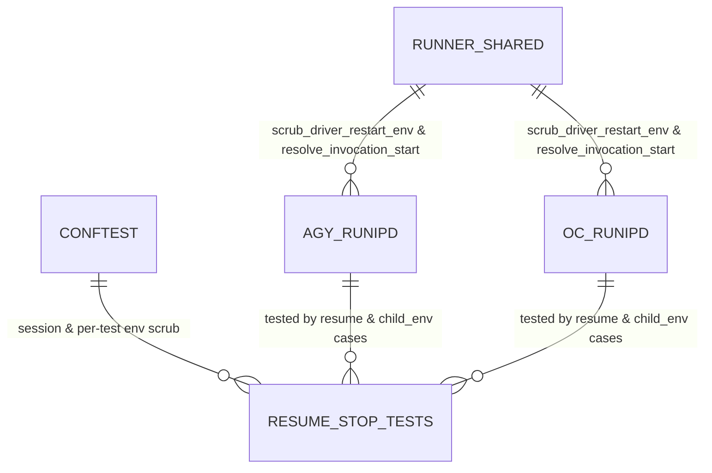
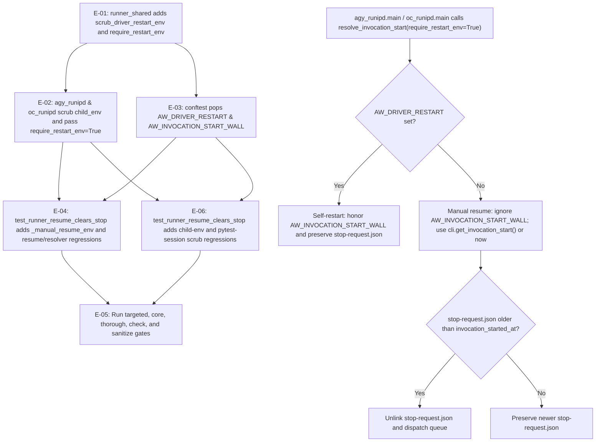

# IPD: Scrub driver restart env vars and ignore stale AW_INVOCATION_START_WALL on manual resume

- Date: 2026-11-21
- Kind: child
- Concern: Backlog `rryabb` (`Work-Kind: bug`, `Blocks-Release: next`) reports three failures in `tests/test_runner_resume_clears_stop.py` during `aw suite --thorough` on `main` (`b61073951`): `ResumeReconciliationAndStopLevelsTests.test_reconcile_one_item_does_not_bypass_second_indeterminate_item`, `ResumeReconciliationAndStopLevelsTests.test_resume_clears_stale_stop_for_all_four_levels_and_dispatches`, and `ResumeCLIClearsStaleStopTests.test_manual_resume_clears_stale_stop_while_self_restart_preserves`. Commit `a166b272c` switched `agy_runipd.main` and `oc_runipd.main` from `time.time()` to `runner_shared.resolve_invocation_start()`. When a driver self-restarts via `runner_shared.restart_on_new_code_if_needed`, it exports both `AW_DRIVER_RESTART` and `AW_INVOCATION_START_WALL`. Agent turns and pytest sessions inherit `AW_INVOCATION_START_WALL` because neither boundary scrubs driver-restart environment variables, and `agy_runipd.main` and `oc_runipd.main` honor `AW_INVOCATION_START_WALL` even when `AW_DRIVER_RESTART` is absent. When `AW_INVOCATION_START_WALL` predates the backdated `stop-request.json` file (`time.time() - 60.0`), `runner_stop.clear_stop_request_on_manual_resume` treats the stale stop file as newer than `invocation_started_at` and keeps it on disk.
- Scope: IN: (1) add `runner_shared.DRIVER_RESTART_ENV_VARS` and `runner_shared.scrub_driver_restart_env` in `agent_workflows/runner_shared.py`, apply it in `runner_shared.run_attended_turn`, and gate `AW_INVOCATION_START_WALL` in `runner_shared.resolve_invocation_start` behind `require_restart_env: bool = False` (passed as `True` by `runner_shared.track_startup_timings` and both drivers); (2) scrub driver-restart env vars via `runner_shared.scrub_driver_restart_env` in `agent_workflows/agy_runipd.py` (`run_agy_turn`) and `agent_workflows/oc_runipd.py` (`run_opencode`), and call `runner_shared.resolve_invocation_start(require_restart_env=True)` in both `main` entry points; (3) scrub `AW_DRIVER_RESTART` and `AW_INVOCATION_START_WALL` in `conftest.py` at session import and around each test in `_restore_home_sandbox`; and (4) harden `tests/test_runner_resume_clears_stop.py` with a shared `_manual_resume_env` helper and regression tests covering stale `AW_INVOCATION_START_WALL` on manual resume and the gated `resolve_invocation_start` (E-04), plus agent child-env scrubbing and pytest session scrubbing (E-06). OUT: changing `runner_shared.resolve_invocation_start_mono` default behavior when passed an explicit dict without `AW_DRIVER_RESTART` (preserves `tests/test_statusline_behavior.py` `TestCwdBadgeAndOptionARunId.test_resolve_invocation_start_mono_preserves_script_start`), changing `agent_workflows/suite_cache.py` cache-key env vars, or changing `runner_stop.clear_stop_request_on_manual_resume` mtime comparison semantics.
- Scope-Paths: agent_workflows/runner_shared.py, agent_workflows/agy_runipd.py, agent_workflows/oc_runipd.py, conftest.py, tests/test_runner_resume_clears_stop.py
- Item-Dependencies: none
- Status: approved
- Readiness: go-pending-approval
- Review-Depth: standard
- Short-Description: Scrub AW_DRIVER_RESTART and AW_INVOCATION_START_WALL at agent/test boundaries and ignore stale AW_INVOCATION_START_WALL on non-restart runner invocations
- Work-Kind: bug
- Priority: medium
- From-Backlog: rryabb
- Blocks-Release: next
- Set: rryabb
- Order: 1
- Highest E allocated: 06
- Author: antigravity/gemini-4-hydrogen-xhigh
- Id: z6wodh
- Approval: 2026-11-27, recorded via aw ipd set: status set to approved

> Write and proofread this plan per the technical writing standard, `.aw/system/workflows/technical-writing/technical-writing.md` (`.agents/workflows/technical-writing/technical-writing.md` in a legacy-layout install), including requirement 12 (diagrams).

## Workflow history

- 2026-11-27 approved (aw set): status set to approved
- 2026-11-24 reviewed (uri/its_direct/pt3-claude-opus-5.5-1m-us): plan-review (standard): APPROVE WITH REVISIONS APPLIED; PR-001..PR-006 fixed; review record .aw/records/reviews/20261121-rryabb-01-z6wodh-scrub-driver-restart-env-vars-and-ignore-stale-aw-invocation.review.md
- 2026-11-21 to-review (aw set): Authored review-ready plan for backlog rryabb
- 2026-11-21 draft (antigravity/gemini-4-hydrogen-xhigh): created.

## Goal

Eliminate driver-restart environment variable leakage across agent-turn and test-session boundaries, and prevent non-restart runner invocations from reading a stale `AW_INVOCATION_START_WALL`, so manual `resume` clears pre-existing `stop-request.json` files reliably and all three failing tests in `tests/test_runner_resume_clears_stop.py` pass under `aw suite --thorough`.

## Detailed Implementation Checklist (TODO)

Execution-state rule: mark an `E-*` item complete only after performing the action. That mark is not validation. Right-sizing rule: write for a modest executor that cannot hold much in its head. Each E-item is one step (one concern, about one file, executable in one focused pass) and its V-item names each unit it covers with its own check; a plan stays at about 5 E-items and 8 work Scope-Paths, else split it into more child plans (guidance, `IPD-Z603`). Accepted execution states: blocked, failed, pending, performed; terminal gate demands 'performed'.

### Task group 1: Shared helper, host driver wiring, and pytest boundary scrub

- [ ] E-01 In `agent_workflows/runner_shared.py`, define `DRIVER_RESTART_ENV_VARS` (`("AW_DRIVER_RESTART", "AW_INVOCATION_START_WALL")`) and `scrub_driver_restart_env(env)`, call `scrub_driver_restart_env` inside `run_attended_turn` on the child environment from `attended_session.child_env`, add a keyword-only `require_restart_env: bool = False` parameter to `resolve_invocation_start` so that, when it is `True`, `AW_INVOCATION_START_WALL` is read only if `AW_DRIVER_RESTART` is also set to a non-empty value, and pass `require_restart_env=True` inside `track_startup_timings`.
  - Depends on: none
  - Expected outcome: `runner_shared.scrub_driver_restart_env` removes both driver-restart variables in place; `runner_shared.run_attended_turn` scrubs the child env before `run_interactive_session`; `runner_shared.resolve_invocation_start(require_restart_env=True)` ignores `AW_INVOCATION_START_WALL` unless `AW_DRIVER_RESTART` is set, while `resolve_invocation_start_mono({"AW_INVOCATION_START_WALL": ...})` keeps its existing behavior.
  - Execution state: pending

- [ ] E-02 In `agent_workflows/agy_runipd.py` and `agent_workflows/oc_runipd.py`, call `runner_shared.scrub_driver_restart_env(child_env)` right after `pinned_child_env()` in `agy_runipd.run_agy_turn` and `oc_runipd.run_opencode`, and pass `require_restart_env=True` to `runner_shared.resolve_invocation_start` in `agy_runipd.main` and `oc_runipd.main`.
  - Depends on: E-01
  - Expected outcome: Neither Antigravity (`agy`) nor OpenCode (`oc`) headless agent turns inherit `AW_DRIVER_RESTART` or `AW_INVOCATION_START_WALL` from a restarted driver, and non-restart `main` invocations ignore any inherited `AW_INVOCATION_START_WALL` for both `clear_stale_stop_request_on_manual_resume` and `track_startup_timings`.
  - Execution state: pending

- [ ] E-03 In `conftest.py`, pop `AW_DRIVER_RESTART` and `AW_INVOCATION_START_WALL` from `os.environ` at session import time beside the existing `AW_EXECUTION_ROLE`, `AW_RUN_ID`, and `AW_CONFIG_DIR` scrubs, and also pop both variables before and after each test inside `_restore_home_sandbox`.
  - Depends on: none
  - Expected outcome: Pytest sessions started from a restarted driver or dirty shell never expose `AW_DRIVER_RESTART` or `AW_INVOCATION_START_WALL` to collected tests, and no test that mutates either variable can leak it to subsequent tests in the same worker.
  - Execution state: pending

### Task group 2: Test fixture hardening, regression coverage, and thorough-suite verification

- [ ] E-04 In `tests/test_runner_resume_clears_stop.py`, extract `_manual_resume_env()` stripping both `AW_DRIVER_RESTART` and `AW_INVOCATION_START_WALL` and use it to replace every existing dict comprehension that strips only `AW_DRIVER_RESTART` from `os.environ` (named `env` in `ClearStopRequestHelperTests` and `env_manual` in the two resume test classes), add `runner_stop.reset_deferred_request()` to `ResumeCLIClearsStaleStopTests.setUp` and `tearDown`, and add two behavioral regression tests: (a) for both `agy_runipd.main` and `oc_runipd.main`, manual `resume` clears a backdated `stop-request.json` when `os.environ` carries a stale `AW_INVOCATION_START_WALL` (300 seconds in the past) without `AW_DRIVER_RESTART`, while `AW_DRIVER_RESTART=1` plus the same `AW_INVOCATION_START_WALL` preserves it; and (b) direct calls showing `runner_shared.scrub_driver_restart_env` removes both keys from a dict, `runner_shared.resolve_invocation_start(env={"AW_INVOCATION_START_WALL": <300s ago>}, require_restart_env=True)` returns a wall start within a few seconds of now, and the same call with `AW_DRIVER_RESTART="1"` added returns the backdated wall start.
  - Depends on: E-01, E-02, E-03
  - Expected outcome: All existing tests in `tests/test_runner_resume_clears_stop.py` pass under both pytest and `python3 -m unittest` even when `AW_INVOCATION_START_WALL` and `AW_DRIVER_RESTART` are set in the launching shell, and regressions (a) and (b) fail on the unpatched base code and pass after E-01 through E-03.
  - Execution state: pending

- [ ] E-06 In `tests/test_runner_resume_clears_stop.py`, add the boundary-scrub regression tests: (c) with `AW_DRIVER_RESTART` and `AW_INVOCATION_START_WALL` patched into `os.environ`, call `agy_runipd.run_agy_turn` and `oc_runipd.run_opencode` with the process launcher mocked (reuse the mocking pattern already used for these two functions in `tests/test_commit_run_trailers_env.py`) and call `runner_shared.run_attended_turn` with the interactive-session launcher mocked, then assert neither key is in the environment each mock received; and (d) a pytest-session probe: a probe test that skips unless a marker variable (for example `AW_TEST_DRIVER_RESTART_SCRUB_PROBE=1`) is set and otherwise asserts both keys are absent from `os.environ`, plus a launcher test that runs `[sys.executable, "-m", "pytest", "<this file>::<probe node id>", "-o", "addopts=", "-p", "no:cacheprovider", "-q"]` with `cwd` at the repository root and an `env` carrying the marker, `AW_DRIVER_RESTART=1`, and a backdated `AW_INVOCATION_START_WALL`, and asserts exit code 0 and `1 passed`. The launcher MUST target only the probe node id, never the whole file, because a subprocess that collects the launcher test again recurses without bound.
  - Depends on: E-01, E-02, E-03
  - Expected outcome: Regression (c) proves all three agent-launch paths hand the child an environment without either driver-restart variable, and regression (d) proves the repository `conftest.py` removes both variables before any collected test runs; both fail on the unpatched base code and pass after E-01 through E-03, and the launcher test finishes under the 2-second slow-test threshold (measured at review: one test node of this file runs in about 1 second); if it exceeds the threshold, list it in `tests/slow_allowlist.txt` and justify that out-of-fence path with `--scope-reason` at finalize.
  - Execution state: pending

- [ ] E-05 Run targeted tests under clean and simulated-leak environments, bare `python3 -m pytest`, `make test-all`, `aw check all --agent`, and `aw sanitize --agent`.
  - Depends on: E-04, E-06
  - Expected outcome: All targeted suites (including `tests/test_runner_resume_clears_stop.py`, `tests/test_driver_restart.py`, `tests/test_runner_startup_timings.py`, `tests/test_statusline_behavior.py`, `tests/test_commit_run_trailers_env.py`, and `tests/test_agent_user_config_containment.py`), the bare core gate, and the thorough tier (`make test-all`) pass with zero failures, and `aw check all --agent` and `aw sanitize --agent` report no failure or finding introduced by this change; any pre-existing failure or finding is shown to reproduce on the base commit.
  - Execution state: pending

Add further leaves as `- [ ] E-NEW <action>` and run `aw ipd sync` to assign ids.

## Project conventions discovered (Step 0)

- Both `agy_runipd.run_agy_turn` and `oc_runipd.run_opencode` build `child_env` via `runner_shared.pinned_child_env()` (which copies `os.environ`) and already follow an overwrite-or-pop rule for `AW_EXECUTION_ROLE`, `AW_RUN_ID`, `AW_ITEM_ID6`, `AW_CONFIG_DIR`, and `AW_HOME` so inner turns never inherit an outer driver's state (`tests/test_commit_run_trailers_env.py`, `tests/test_agent_user_config_containment.py`).
- `conftest.py` pops runner-exported session variables (`AW_EXECUTION_ROLE`, `AW_RUN_ID`, `AW_ITEM_ID6`, `AW_RUNNER`, `AW_AGENT_MODEL`, `GIT_COMMITTER_NAME`, `GIT_COMMITTER_EMAIL`, `AW_CONFIG_DIR`, `CI`, `AW_NONINTERACTIVE`) at import time and restores sandbox environment state around each test in `_restore_home_sandbox`.
- `make test-serial` (`python3 -m unittest discover -s tests -t .`) does not load `conftest.py`, so `unittest` modules (`tests/test_runner_resume_clears_stop.py`, `tests/test_driver_restart.py`) construct clean manual-resume environments locally.
- Existing test `TestCwdBadgeAndOptionARunId.test_resolve_invocation_start_mono_preserves_script_start` in `tests/test_statusline_behavior.py` calls `runner_shared.resolve_invocation_start_mono({"AW_INVOCATION_START_WALL": repr(t0)})` without `AW_DRIVER_RESTART`, so `resolve_invocation_start(env=...)` must keep honoring explicit `env` calls when `require_restart_env` defaults to `False`.
- Cite code by SYMBOL (`module.function`) or by a quoted content string, with a line number only appended to one of those and never alone: an offset expires before this plan executes (advisory `IPD-C801`).

## Findings

| Id | Evidence | Finding |
|---|---|---|
| F-01 | `git show a166b272c` on `agent_workflows/agy_runipd.py` (`main`) and `agent_workflows/oc_runipd.py` (`main`) | Commit `a166b272c` replaced `invocation_start_wall = time.time()` with `runner_shared.resolve_invocation_start()`, which reads `AW_INVOCATION_START_WALL` before `cli.get_invocation_start()` and `time.time()`. |
| F-02 | `agent_workflows/runner_shared.py` (`restart_on_new_code_if_needed`) | Self-restart exports both `AW_DRIVER_RESTART` and `AW_INVOCATION_START_WALL` into `env`. |
| F-03 | `agent_workflows/agy_runipd.py` (`run_agy_turn`), `agent_workflows/oc_runipd.py` (`run_opencode`), `agent_workflows/runner_shared.py` (`run_attended_turn`), and `conftest.py` | Neither the agent child-env builders nor `conftest.py` pop `AW_DRIVER_RESTART` or `AW_INVOCATION_START_WALL`, and `tests/test_runner_resume_clears_stop.py` strips only `AW_DRIVER_RESTART` in `env_manual`. |
| F-04 | Direct reproduction: `AW_INVOCATION_START_WALL=$(python3 -c 'import time; print(time.time() - 300)') python3 -m pytest tests/test_runner_resume_clears_stop.py -v` vs bare `python3 -m pytest tests/test_runner_resume_clears_stop.py -v` | Without `AW_INVOCATION_START_WALL`, all 13 tests pass (`13 passed`). With `AW_INVOCATION_START_WALL` set 300s in the past, the exact 3 reported tests fail (`3 failed, 10 passed`): `test_resume_clears_stale_stop_for_all_four_levels_and_dispatches` (`AssertionError: True is not false` on `stop_path.exists()`), `test_manual_resume_clears_stale_stop_while_self_restart_preserves` (`AssertionError: 1 is not None` on `seen_levels[-1]`), and `test_reconcile_one_item_does_not_bypass_second_indeterminate_item` (`AssertionError: True is not false` on `stop_path.exists()`). |
| F-05 | Running `tests/test_runner_startup_timings.py`, `tests/test_driver_restart.py`, `tests/test_statusline_behavior.py`, and `tests/test_run_summary_table.py` together under `-n 1` and with `AW_INVOCATION_START_WALL` set 300s in the past | All 132 non-slow tests pass in both runs; `agent_workflows/cli.py` (`_INVOCATION_START`) resets its `ContextVar` in `finally`, confirming no `cli.main` timestamp leak. |

## Proposed changes (ordered, validatable)

The relationship diagram below maps the five files changed by `E-01` through `E-04` and `E-06`:

The flowchart below shows the ordered changes (`E-01` to `E-06`) and the runtime decision branch when `agy_runipd.main` or `oc_runipd.main` resolves `invocation_started_at` and runs `runner_stop.clear_stop_request_on_manual_resume`:

1. **Shared restart-env scrub and gated wall-start resolution (`E-01`)**: In `agent_workflows/runner_shared.py`, define `DRIVER_RESTART_ENV_VARS = ("AW_DRIVER_RESTART", "AW_INVOCATION_START_WALL")` and `scrub_driver_restart_env(env)` to pop both keys. Call `scrub_driver_restart_env` inside `run_attended_turn` on the environment returned by `attended_session.child_env`. Add `require_restart_env: bool = False` to `resolve_invocation_start`; when `True`, consult `AW_INVOCATION_START_WALL` only if `source.get("AW_DRIVER_RESTART")` is truthy, otherwise fall back to `cli.get_invocation_start()` or `(time.monotonic(), time.time())`. Pass `require_restart_env=True` inside `track_startup_timings` when resolving defaults.
2. **Host-driver parity (`E-02`)**: In both `agent_workflows/agy_runipd.py` (`run_agy_turn`) and `agent_workflows/oc_runipd.py` (`run_opencode`), call `runner_shared.scrub_driver_restart_env(child_env)` immediately after `child_env = pinned_child_env()` so no spawned agent turn inherits outer driver self-restart state. In both `agy_runipd.main` and `oc_runipd.main`, call `runner_shared.resolve_invocation_start(require_restart_env=True)`.
3. **Pytest session boundary scrub (`E-03`)**: In `conftest.py`, pop `AW_DRIVER_RESTART` and `AW_INVOCATION_START_WALL` at session import time alongside `AW_EXECUTION_ROLE`, `AW_RUN_ID`, and `AW_CONFIG_DIR`, and also pop both variables before `yield` and after `yield` inside `_restore_home_sandbox`.
4. **Test fixture hardening and behavioral regressions (`E-04`)**: In `tests/test_runner_resume_clears_stop.py`, add `_manual_resume_env()` excluding both `AW_DRIVER_RESTART` and `AW_INVOCATION_START_WALL`, call `runner_stop.reset_deferred_request()` in `ResumeCLIClearsStaleStopTests.setUp` and `tearDown`, and add tests proving (a) manual `resume` clears stale `stop-request.json` even when `AW_INVOCATION_START_WALL` is set without `AW_DRIVER_RESTART` while both together preserve `stop-request.json`, and (b) `scrub_driver_restart_env` and `resolve_invocation_start(require_restart_env=True)` behave as E-01 specifies.
5. **Boundary-scrub regressions (`E-06`)**: In the same test file, add tests proving (c) `run_agy_turn`, `run_opencode`, and `run_attended_turn` hand their mocked launchers an environment without either variable, and (d) a real pytest subprocess launched with both variables set runs a single probe test node that observes neither variable in `os.environ`. The subprocess targets only the probe node so it cannot re-collect the launcher test and recurse.
6. **End-to-end verification (`E-05`)**: Execute targeted, core, thorough (`make test-all`), `aw check all --agent`, and `aw sanitize --agent` checks and paste observed outputs.

## Deferred / out of scope (with reason)

- Changing `runner_shared.resolve_invocation_start` default (`require_restart_env=False`) when given an explicit `env` mapping without `AW_DRIVER_RESTART`: out of scope because `TestCwdBadgeAndOptionARunId.test_resolve_invocation_start_mono_preserves_script_start` in `tests/test_statusline_behavior.py` exercises `resolve_invocation_start_mono({"AW_INVOCATION_START_WALL": repr(t0)})` directly.
  - Carrier-Declined: Intentional compatibility constraint preserving the existing statusline unit-test contract; only invocations passing `require_restart_env=True` (`agy_runipd.main`, `oc_runipd.main`, `runner_shared.track_startup_timings`) gate `AW_INVOCATION_START_WALL` on `AW_DRIVER_RESTART`.
- Adding `AW_DRIVER_RESTART` or `AW_INVOCATION_START_WALL` to `SUITE_KEY_ENV_VARS` in `agent_workflows/suite_cache.py`: out of scope because driver-restart metadata must not bust the repository test-suite cache key (`conftest.py` owns pytest environment scrubbing).
  - Carrier-Declined: Deliberate architectural boundary; `conftest.py` already scrubs runner environment variables (`AW_EXECUTION_ROLE`, `AW_RUN_ID`, `AW_CONFIG_DIR`) so `aw suite` cache keys stay invariant across driver restarts.

## Scope check

- Over-scope: none.
- Under-scope: verified none; all three agent-launch paths (`agy_runipd.run_agy_turn`, `oc_runipd.run_opencode`, `runner_shared.run_attended_turn`), both driver CLI entry points (`agy_runipd.main`, `oc_runipd.main`), the pytest session boundary (`conftest.py`), and `tests/test_runner_resume_clears_stop.py` are included. Deliberately not scrubbed: `work_cmd` (its `att.run_interactive_session(argv, cwd=worktree, env=att.child_env())` call runs from a human shell, not from a restarted driver) and the driver's short-lived `aw` helper subprocesses built with `runner_shared.pinned_child_env()` (for example the scaffold call in `runner_shared`), which never call `resolve_invocation_start`; the suite-baseline pytest child built from `dict(os.environ)` in `runner_shared` is covered by the `conftest.py` scrub in E-03.

## Required tests / validation

1. Run `python3 -m pytest tests/test_runner_resume_clears_stop.py -v` both clean and with `AW_INVOCATION_START_WALL` set 300s in the past (and `AW_DRIVER_RESTART=1`), plus `python3 -m unittest tests/test_runner_resume_clears_stop.py -v` to exercise the `unittest` path without `conftest.py`.
2. Run `python3 -m pytest tests/test_driver_restart.py tests/test_runner_startup_timings.py tests/test_statusline_behavior.py tests/test_commit_run_trailers_env.py tests/test_agent_user_config_containment.py -o addopts="" -m "" -v` to verify no regressions across restart, startup timing, statusline, and child-env scrub suites.
3. Run bare `python3 -m pytest` (core tier), `make test-all` (thorough tier), `aw check all --agent`, and `aw sanitize --agent`.

## Spec / documentation sync

N/A: this bug fix restores the intended behavior of `AW_DRIVER_RESTART` and `AW_INVOCATION_START_WALL` across process boundaries and introduces no new user-facing CLI flags, commands, or specification rules. The only spec text on this behavior, spec `25kzda` (`aw run` deterministic run and verify) in its driver-restart rule "An operator `resume` (when `AW_DRIVER_RESTART` is not set) clears any recorded `driver_restart_refusal`", already states that a run without `AW_DRIVER_RESTART` is an operator resume; this plan makes the code match that rule, so the spec needs no edit.

## Open questions

No open questions.

## Validation and cross-check (verify before reporting done)

Validation-state rule: inspect evidence in a separate pass. Do not mark a `V-*` item complete from memory or from the matching execution checkmark. Accepted validation results: blocked, failed, pass, pending; terminal gate demands 'pass'. Runtime-demonstration reachability rule: for each `V-*` item demanding the software be observed acting (such as a run, a dispatch, or a transition)—as distinct from items demanding a diff, a file's content, or a test result, which are reachable by construction—name the code path that produces the observation or the sibling `E-*` that creates it, else the demand is UNDER-SCOPE.

- [ ] V-01 validates E-01
  - Required evidence: paste the `git diff -- agent_workflows/runner_shared.py` hunks showing `DRIVER_RESTART_ENV_VARS`, `scrub_driver_restart_env`, `run_attended_turn` scrubbing `child_env`, `resolve_invocation_start(..., require_restart_env=...)`, and `track_startup_timings`, plus output of running `tests/test_statusline_behavior.py` (`TestCwdBadgeAndOptionARunId.test_resolve_invocation_start_mono_preserves_script_start`) and the new `runner_shared` regression (b) from `E-04` passing.
  - Observed evidence:
  - Result: pending
- [ ] V-02 validates E-02
  - Required evidence: paste the `git diff -- agent_workflows/agy_runipd.py agent_workflows/oc_runipd.py` hunks showing identical `runner_shared.scrub_driver_restart_env(child_env)` calls in `run_agy_turn` and `run_opencode` and `require_restart_env=True` in both `main` functions, plus pytest output for regression (a) from `E-04` showing manual `resume` through both `agy_runipd.main` and `oc_runipd.main` clearing `stop-request.json` with a stale `AW_INVOCATION_START_WALL`, and regression (c) from `E-06` showing `run_agy_turn` and `run_opencode` stripping `AW_DRIVER_RESTART` and `AW_INVOCATION_START_WALL` from `child_env`.
  - Observed evidence:
  - Result: pending
- [ ] V-03 validates E-03
  - Required evidence: paste the `git diff -- conftest.py` hunk showing both `AW_DRIVER_RESTART` and `AW_INVOCATION_START_WALL` popped at import time and inside `_restore_home_sandbox`, plus the passing output of regression (d) from `E-06` (the launcher test, whose subprocess runs with `AW_DRIVER_RESTART=1` and `AW_INVOCATION_START_WALL` backdated 300 seconds in its environment), and the output of `python3 -m pytest tests/test_runner_resume_clears_stop.py -v` launched from a shell that exports both variables, showing every test passing.
  - Observed evidence:
  - Result: pending
- [ ] V-04 validates E-04
  - Required evidence: paste the `git diff -- tests/test_runner_resume_clears_stop.py` summary; the `python3 -m pytest tests/test_runner_resume_clears_stop.py -v` output; the `python3 -m unittest tests/test_runner_resume_clears_stop.py -v` output run from a shell exporting `AW_DRIVER_RESTART=1` and `AW_INVOCATION_START_WALL` set 300 seconds in the past, showing every test passing without `conftest.py`; and the RED evidence: the failing output of regressions (a) and (b) against unpatched production code, obtained EITHER by running them after writing them but before applying the E-01 through E-03 production edits, OR in a temporary `git worktree` of the plan's base commit with only the new test file copied in (remove that worktree afterwards). Never `git stash`, `git checkout --`, or revert files in the working checkout to obtain it. (b) failing with `AttributeError` or `TypeError` because `scrub_driver_restart_env` or `require_restart_env` does not exist yet counts as RED.
  - Observed evidence:
  - Result: pending
- [ ] V-05 validates E-05
  - Required evidence: paste the passing `N passed` summary lines from: (1) `python3 -m pytest tests/test_driver_restart.py tests/test_runner_startup_timings.py tests/test_statusline_behavior.py tests/test_commit_run_trailers_env.py tests/test_agent_user_config_containment.py -o addopts="" -m ""`, (2) bare `python3 -m pytest`, and (3) `make test-all`, with the `make test-all` output showing no `tests/test_runner_resume_clears_stop.py` failure; plus the `aw.agent/v1` result records of (4) `aw check all --agent` and (5) `aw sanitize --agent`. For any failure or finding in (2) through (5), paste evidence that the same failure or finding reproduces on the plan's base commit without this change (re-derived at execution time, not assumed from this review).
  - Observed evidence:
  - Result: pending
- [ ] V-06 validates E-06
  - Required evidence: paste the `git diff -- tests/test_runner_resume_clears_stop.py` hunks adding regressions (c) and (d); the passing pytest output naming the (c) tests for `run_agy_turn`, `run_opencode`, and `run_attended_turn` and the (d) launcher test; the launcher subprocess's captured `1 passed` line; the duration of the launcher test from `python3 -m pytest <launcher node id> -o addopts="" --durations=0`; and the RED evidence: the failing output of (c) and (d) against unpatched production code, obtained by either method V-04 allows.
  - Observed evidence:
  - Result: pending

## Approval and execution gate

- Size assessment: standard
- Cohesion rationale: six E-items exceed the five-item guidance (advisory `IPD-Z603`) because review split the original test item into E-04 (resume and resolver regressions) and E-06 (child-env and pytest-session regressions) so each verifies one test surface. All six items serve one root cause (driver-restart variables crossing process boundaries) inside five files, and moving E-06 to a separate plan would leave E-01 through E-03 without the regressions that prove them.

Execute only after explicit human approval (`- Status: approved`, or an authorized automated gate). All open questions are resolved (`No open questions.`).

SCOPE FENCE. `- Scope-Paths:` declares `agent_workflows/runner_shared.py`, `agent_workflows/agy_runipd.py`, `agent_workflows/oc_runipd.py`, `conftest.py`, and `tests/test_runner_resume_clears_stop.py`. Do not expand scope casually; if the work genuinely requires editing a file outside the fence, make the edit and justify it in the two-way scope reconciliation at finalize (`--scope-reason`), and acknowledge any declared-but-unmodified path with `--scope-ack`.

HONESTY. Every `V-*` evidence block must paste the actual runner or command output observed during execution; never claim success you did not run.

COMMIT. Commit only this plan's changed files through `aw commit z6wodh -- <paths>`; verify `git diff --cached --name-only` contains only your paths; never use `git add -A`, a bare `git add`, or `git commit -a`; never push without an explicit human request.

POST-GATE LIFECYCLE. Once every `E-*` item has `Execution state: performed`, every `V-*` item has `Result: pass`, and `aw ipd lint --phase pre-transition` reports `conforming`, move the plan to `.aw/records/plans/executed/` through `aw ipd finalize z6wodh --actor <agent/model> --message "
" --apply` (under `aw oc run` or `aw agy run`, the runner performs finalize after verifying the outcome). Never `git mv` the plan by hand. This plan inherits `- Blocks-Release: next` from backlog `rryabb`, so closing `rryabb` as `done` after execution uses the executed-carrier HANDOFF path.
