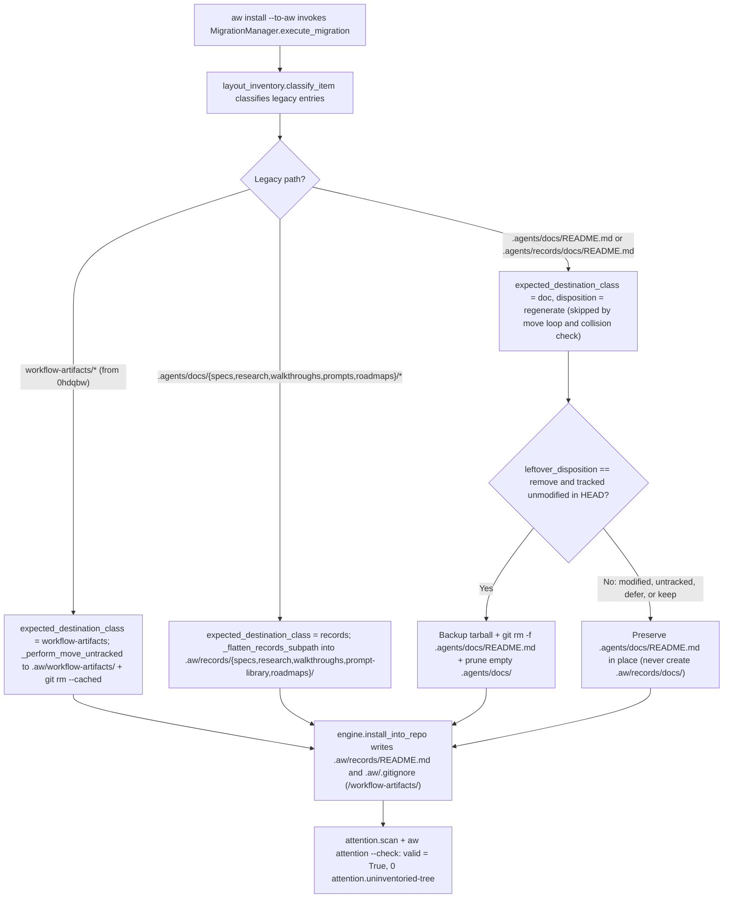

# IPD: Skip legacy .agents/docs/README.md in layout migration and verify aw install --to-aw attention validity

- Date: 2026-11-21
- Kind: child
- Concern: Backlog `ujxi56` (`Work-Kind: bug`, `Priority: high`, `Blocks-Release: next`) reports that running `aw install --to-aw` on a legacy `.agents/` repository containing `workflow-artifacts/` and `.agents/docs/README.md` (`pubrun`, commit `3f01e99f`) breaks `aw attention` with `attention.uninventoried-tree` contract violations (`VIEW INVALID`). Two causes combine: (1) `agent_workflows/layout_inventory.py::classify_item` classified `label == "workflow-artifacts"` as `records` instead of `.aw/workflow-artifacts/` (resolved by approved dependency `0hdqbw`, graduated from backlog `2biutm`); and (2) `agent_workflows/layout_inventory.py::classify_item` classifies `.agents/docs/README.md` (and intermediate `.agents/records/docs/README.md`) as `records` with `disposition: "migrate"`, and `_flatten_records_subpath` rewrites only the five doc-family subdirectories (`docs/prompts/`, `docs/research/`, `docs/specs/`, `docs/walkthroughs/`, `docs/roadmaps/`), so `build_migration_map` routes `docs/README.md` into an uninventoried `.aw/records/docs/README.md` directory that fails `agent_workflows/attention.py::scan`.
- Scope: IN: (1) update `agent_workflows/layout_inventory.py::classify_item` to classify `agents:docs/README.md` and `agents:records/docs/README.md` with `ownership: "doc"`, `lifecycle_class: "doc"`, `expected_destination_class: "doc"`, `disposition: "regenerate"`, and `destination_relpath_override: "records/README.md"` (matching `.agents/README.md`'s existing `regenerate` pattern), and update `agent_workflows/layout_inventory.py::build_migration_map` so `disposition == "regenerate"` entries do not trigger cross-item `destination-collision` errors; (2) add fast behavioral tests in `tests/test_layout_inventory.py` covering `classify_item`, `build_migration_map` coexistence with `.agents/README.md` and doc-family subtrees, `MigrationManager.execute_migration` across `remove` (tracked unmodified vs. locally modified/untracked), `defer`, and `keep` leftover dispositions, and `MigrationManager.project_stage_one_to_scratch`; and (3) add an end-to-end `@pytest.mark.slow` behavioral test in `tests/test_layout_migration.py` (registered in `tests/slow_allowlist.txt`) driving `aw install --to-aw --yes` on a legacy repository containing both `workflow-artifacts/assess-bugs/...` and `.agents/docs/README.md` and asserting that `aw attention --check` exits `0` with zero `attention.uninventoried-tree` findings. OUT: duplicating the `workflow-artifacts/` classification and untracked-relocation implementation owned by dependency `0hdqbw`, editing `agent_workflows/layout_migration.py`, altering `agent_workflows/attention.py` or `agent_workflows/attention_contract.py`, or dropping arbitrary user-authored files other than `README.md` placed directly under `.agents/docs/`.
- Scope-Paths: agent_workflows/layout_inventory.py, tests/test_layout_inventory.py, tests/test_layout_migration.py, tests/slow_allowlist.txt
- Item-Dependencies: executed:0hdqbw
- Status: to-review
- Short-Description: Classify legacy .agents/docs/README.md for regeneration instead of migrating to .aw/records/docs/ and verify aw install --to-aw leaves aw attention --check valid
- Work-Kind: bug
- Priority: high
- From-Backlog: ujxi56
- Blocks-Release: next
- Set: ujxi56
- Order: 1
- Highest E allocated: 04
- Author: antigravity/gemini-4-neon-high
- Id: qpvem9

> Write and proofread this plan per the technical writing standard, `.aw/system/workflows/technical-writing/technical-writing.md` (`.agents/workflows/technical-writing/technical-writing.md` in a legacy-layout install), including requirement 12 (diagrams).

## Workflow history

- 2026-11-22 to-review (aw set): Authored review-ready child plan graduated from backlog ujxi56
- 2026-11-22 draft (antigravity/gemini-4-neon-high): created.

## Goal

Prevent layout migration (`aw install --to-aw`, `aw migrate-layout`, and embedded stage one of `aw migrate metadata`) from creating an uninventoried `.aw/records/docs/` directory from legacy `.agents/docs/README.md`, and verify end-to-end after dependency `0hdqbw` that `aw install --to-aw` on a legacy repository containing both `workflow-artifacts/assess-bugs/...` and `.agents/docs/README.md` leaves `aw attention --check` valid with zero `attention.uninventoried-tree` findings.

## Detailed Implementation Checklist (TODO)

Execution-state rule: mark an `E-*` item complete only after performing the action. That mark is not validation. Right-sizing rule: write for a modest executor that cannot hold much in its head. Each E-item is one step (one concern, about one file, executable in one focused pass) and its V-item names each unit it covers with its own check; a plan stays at about 5 E-items and 8 work Scope-Paths, else split it into more child plans (guidance, `IPD-Z603`). Accepted execution states: blocked, failed, pending, performed; terminal gate demands 'performed'.

### Task group 1: Classify legacy `.agents/docs/README.md` for regeneration in `layout_inventory.py`

- [ ] E-01 Update `agent_workflows/layout_inventory.py::classify_item` and `agent_workflows/layout_inventory.py::build_migration_map` so legacy `.agents/docs/README.md` (and intermediate `.agents/records/docs/README.md`) is never migrated into `.aw/records/docs/`:
  1. In `classify_item` inside the `if label == "agents":` block, placed BEFORE `if first in _AGENTS_RECORD_SUBDIRS:` and `if first == "records":`, add an explicit branch matching `posix in {"docs/README.md", "records/docs/README.md"}` that returns `{"ownership": "doc", "lifecycle_class": "doc", "expected_destination_class": "doc", "disposition": "regenerate", "destination_relpath_override": "records/README.md"}`. Add a brief comment explaining that doc-family subtrees flatten directly under `.aw/records/` (`spec 20260817-2124-01` Order 07), `.aw/records/README.md` replaces this overview (`engine.collect_scaffold_members` emits no `docs/README.md` in canonical `.aw/` layout), and `MigrationManager._handle_leftovers` removes an unmodified tracked copy under `remove` while preserving locally modified or untracked copies in place.
  2. In `build_migration_map`, change the collision-tracking guard from `if not preserve_in_place:` to `if not preserve_in_place and item.get("disposition") != "regenerate":` so multiple `regenerate` entries (which `MigrationManager` never moves or copies) cannot trigger a false `destination-collision` error when both `.agents/docs/README.md` and `.agents/records/docs/README.md` exist with differing bytes. Keep `destination-collision` detection unchanged for all `migrate` and relocated `preserve` entries.
  3. Leave `_AGENTS_RECORD_SUBDIRS`, `_RECORDS_SUBPATH_REWRITES`, `_flatten_records_subpath`, `.agents/docs/{specs,research,walkthroughs,prompts,roadmaps}/...` routing, and the `workflow-artifacts` classification added by dependency `0hdqbw` unchanged.
  - Depends on: none
  - Expected outcome: `classify_item("agents", "docs/README.md")` and `classify_item("agents", "records/docs/README.md")` return `disposition == "regenerate"` and `expected_destination_class == "doc"`; `build_migration_map` emits no `records/docs/README.md` mapping and no false `destination-collision` when `.agents/README.md`, `.agents/docs/README.md`, and `.agents/records/docs/README.md` coexist; flattened doc-family subtrees still map directly under `records/{specs,research,walkthroughs,prompt-library,roadmaps}/`.
  - Execution state: pending

### Task group 2: Add behavioral regression tests

- [ ] E-02 In `tests/test_layout_inventory.py`, add fast (< 2s per test) behavioral tests (using zero `inspect`, `ast`, or source-regex checks against production code) covering `.agents/docs/README.md` classification, migration, leftover handling, and scratch projection:
  1. Direct classification and mapping test: assert `layout_inventory.classify_item("agents", "docs/README.md")` and `layout_inventory.classify_item("agents", "records/docs/README.md")` return `{"ownership": "doc", "lifecycle_class": "doc", "expected_destination_class": "doc", "disposition": "regenerate", "destination_relpath_override": "records/README.md"}`. Build a legacy repository containing `.agents/README.md`, `.agents/docs/README.md`, `.agents/records/docs/README.md` (with distinct bytes), and `.agents/docs/{specs,research,walkthroughs,prompts,roadmaps}/README.md`; run `inventory` and `build_migration_map` and assert `valid is True`, zero `destination-collision` errors, all five doc-family subtrees map to `records/{specs,research,walkthroughs,prompt-library,roadmaps}/README.md`, and zero file items map to `records/docs/...`.
  2. Standalone `MigrationManager.execute_migration` and `project_stage_one_to_scratch` test covering four cases:
     - `leftover_disposition="remove"` with clean tracked `.agents/docs/README.md` and `.agents/docs/specs/README.md`: `.aw/records/docs/` does not exist, `.aw/records/specs/README.md` exists byte-identically, `.agents/docs/README.md` is absent from disk, recorded in `leftover_disposition["removed"]` and `mgr.commit_paths()`, backed up in `leftover_disposition["backup"]`, `.agents/docs/` is pruned, and `attention.scan(repo)` produces `valid: True` with zero `attention.uninventoried-tree` findings.
     - `leftover_disposition="remove"` with locally modified (or untracked) `.agents/docs/README.md`: `.aw/records/docs/` does not exist, `.agents/docs/README.md` stays in place with its exact modified bytes and appears in `leftover_disposition["preserved"]`, and `attention.scan(repo)` still produces `valid: True` with zero `attention.uninventoried-tree` findings.
     - `leftover_disposition="defer"` and `leftover_disposition="keep"`: `.aw/records/docs/` does not exist and `.agents/docs/README.md` remains intact in place.
     - `plan_embedded_stage_one` plus `project_stage_one_to_scratch`: `scratch/.aw/records/docs/` does not exist while `scratch/.aw/records/specs/README.md` is projected byte-identically.
  - Depends on: E-01
  - Expected outcome: All existing and new fast tests in `tests/test_layout_inventory.py` pass with `0 unlisted slow tests`.
  - Execution state: pending

- [ ] E-03 In `tests/test_layout_migration.py`, add an end-to-end `@pytest.mark.slow` behavioral test `test_install_to_aw_workflow_artifacts_and_docs_readme_attention_valid` (using zero `inspect`, `ast`, or source-regex checks against production code) and register its node ID in `tests/slow_allowlist.txt`:
  1. Seed a temporary legacy 1.2.1 Git repository (with `AW_HOME` isolated to a temporary directory) containing tracked `.agents/workflows/{VERSION,index.md}`, `.agents/README.md`, `.agents/docs/README.md`, `.agents/docs/{specs,research,walkthroughs,prompts}/README.md`, `.agents/plans/README.md`, `workflow-artifacts/README.md`, `workflow-artifacts/assess-bugs/20260726-115243/report.md`, and `workflow-artifacts/advise-architect/20260727-100000/notes.md` committed cleanly on `main`.
  2. Run the Command-Line Interface (CLI) entry point `agent_workflows/cli.py::main(["install", str(repo), "--to-aw", "--yes"])` with stdout and stderr captured via `contextlib.redirect_stdout` and `contextlib.redirect_stderr`.
  3. Assert exit code `0`, `.aw/workflow-artifacts/assess-bugs/20260726-115243/report.md` and `.aw/workflow-artifacts/advise-architect/20260727-100000/notes.md` exist with original bytes, repo-root `workflow-artifacts/` does not exist, `git ls-files -- .aw/workflow-artifacts workflow-artifacts` is empty, `git check-ignore -v .aw/workflow-artifacts/assess-bugs/20260726-115243/report.md` exits `0` attributed to `.aw/.gitignore`, none of `.aw/records/docs`, `.aw/records/assess-bugs`, or `.aw/records/advise-architect` exists, `.agents/docs` does not exist, `.aw/records/README.md` and `.aw/records/{specs,research,walkthroughs,prompt-library}/README.md` exist, `json.loads(attention.render_json(*attention.scan(repo), repo_root=repo))` reports `valid: True` with zero `attention.uninventoried-tree` findings, and `cli.main(["attention", "--check", "--dir", str(repo)])` exits `0`.
  4. Register the new `@pytest.mark.slow` test node ID in `tests/slow_allowlist.txt` (tab-separated, reason `Full repo install/uninstall filesystem fixture tree lifecycle`) so the slow-test gate reports `0 unlisted slow tests`.
  - Depends on: E-01
  - Expected outcome: The end-to-end `aw install --to-aw --yes` test passes, proves all three acceptance criteria of backlog `ujxi56` against the combined `0hdqbw` + `qpvem9` implementation, and reports `0 unlisted slow tests`.
  - Execution state: pending

### Task group 3: Validate repository gates and commit

- [ ] E-04 After the final edit, run the targeted suites (including the new `@pytest.mark.slow` end-to-end test via `python3 -m pytest -o addopts="" tests/test_layout_migration.py -k "to_aw_workflow_artifacts_and_docs_readme" -v` and fast suites `python3 -m pytest tests/test_layout_inventory.py tests/test_awphysical_tools.py tests/test_layout_migration.py tests/test_m0001_layout_stage.py tests/test_cli.py -v`), bare `python3 -m pytest`, `make test-all`, `aw check all --agent`, and `aw sanitize --agent`, then commit only the modified `- Scope-Paths:` files through `aw commit qpvem9 -- agent_workflows/layout_inventory.py tests/test_layout_inventory.py tests/test_layout_migration.py tests/slow_allowlist.txt`.
  - Depends on: E-02, E-03
  - Expected outcome: Targeted fast and slow suites, core gate (`python3 -m pytest`), thorough tier (`make test-all`), repository checks (`aw check all --agent`), leak scan (`aw sanitize --agent`), and the path-scoped `aw commit qpvem9` succeed with zero failures and zero unlisted slow tests.
  - Execution state: pending

Add further leaves as `- [ ] E-NEW <action>` and run `aw ipd sync` to assign ids.

## Project conventions discovered (Step 0)

- `agent_workflows/layout_inventory.py::classify_item` already classifies `.agents/README.md` (`posix == "README.md"`) as `{"ownership": "doc", "lifecycle_class": "doc", "expected_destination_class": "doc", "disposition": "regenerate", "destination_relpath_override": "README.md"}`.
- `agent_workflows/layout_migration.py::MigrationManager` already handles `disposition == "regenerate"` cleanly across every path with zero changes needed: `execute_migration`, `apply_embedded_stage_one`, `project_stage_one_to_scratch`, and `_summarize_planned_groups` all skip entries whose `disposition` is not in `("migrate", "preserve")`; `_handle_leftovers` backs up and removes unmodified tracked legacy leftovers under `remove` (via `_is_removable_leftover`), preserves locally modified or untracked copies in place, preserves all leftovers under `keep` and `defer`, and prunes emptied `.agents/` directories bottom-up; and `commit_paths` automatically includes paths removed by `_handle_leftovers`.
- `agent_workflows/engine.py::collect_scaffold_members` writes `.agents/docs/README.md` (from `agents-docs-README.md`) only when `layout == "legacy"`, emits `targets = []` for `docs/README.md` when `layout == "aw"`, and writes `.aw/records/README.md` (from `agents-README.md`) in `ensure_plans_readmes` as the canonical records-root overview.
- `agent_workflows/layout_inventory.py::_RECORDS_SUBPATH_REWRITES` and `_flatten_records_subpath` flatten the five doc-family subtrees (`docs/prompts/` -> `prompt-library/`, `docs/research/` -> `research/`, `docs/specs/` -> `specs/`, `docs/walkthroughs/` -> `walkthroughs/`, `docs/roadmaps/` -> `roadmaps/`). Any unrewritten file under `docs/` falls through to `records/docs/<file>`.
- Approved Implementation Plan Document (IPD) `0hdqbw` (`- Status: approved`, `- Blocks-Release: next`, `- From-Backlog: 2biutm`) already owns reclassifying `label == "workflow-artifacts"` in `agent_workflows/layout_inventory.py` and moving it untracked into `.aw/workflow-artifacts/` in `agent_workflows/layout_migration.py`. Declaring `- Item-Dependencies: executed:0hdqbw` orders `0hdqbw` before `qpvem9` and avoids duplicate edits or merge conflicts on `workflow-artifacts/`.
- Full-install tests invoking `cli.main(["install", str(repo), "--to-aw", "--yes"])` exceed the 2.0-second threshold enforced by `tests/test_slow_report.py`, so sibling tests (`tests/test_cli.py::Order15CliTests::test_install_legacy_repo_to_aw_flag`) carry `@pytest.mark.slow` and an allowlist row in `tests/slow_allowlist.txt`.
- Cite code by SYMBOL (`module.function`) or by a quoted content string, with a line number only appended to one of those and never alone: an offset expires before this plan executes (advisory `IPD-C801`).

## Findings

| Id | Source inspected | Finding |
|---|---|---|
| F-01 | Direct reproduction running `agent_workflows/cli.py::main(["install", str(repo), "--to-aw", "--yes"])` on a temporary legacy 1.2.1 Git repository carrying `.agents/README.md`, `.agents/docs/README.md`, `.agents/docs/{specs,research,walkthroughs,prompts}/README.md`, and `workflow-artifacts/{README.md,assess-bugs/20260726-115243/report.md,advise-architect/20260727-100000/notes.md}` | After exit `0`, `attention.scan(repo)` reported `valid: False` with three `attention.uninventoried-tree` violations: `.aw/records/advise-architect`, `.aw/records/assess-bugs`, and `.aw/records/docs` (containing `.aw/records/docs/README.md`). |
| F-02 | `agent_workflows/layout_inventory.py::classify_item`, `_AGENTS_RECORD_SUBDIRS`, `_RECORDS_SUBPATH_REWRITES`, `_flatten_records_subpath`, and `build_migration_map` | `"docs"` is in `_AGENTS_RECORD_SUBDIRS`, so `classify_item("agents", "docs/README.md")` returns `expected_destination_class: "records"`, `disposition: "migrate"`. Because `_flatten_records_subpath("docs/README.md")` matches none of the five subtree prefixes, `build_migration_map` emits `records/docs/README.md`. The same fall-through affects intermediate `agents:records/docs/README.md`. In addition, `build_migration_map` currently checks `dest_seen` for `disposition == "regenerate"` entries, so two `regenerate` entries sharing one `destination_relpath_override` with differing hashes would falsely raise `destination-collision`. |
| F-03 | `.aw/records/plans/pending/20261121-2biutm-01-0hdqbw-route-legacy-workflow-artifacts-to-aw-workflow-artifacts-in.ipd.md` | Approved plan `0hdqbw` (`- Status: approved`, `- Blocks-Release: next`, `- Item-Dependencies: none`) already fixes the `workflow-artifacts/` defect across `agent_workflows/layout_inventory.py` and `agent_workflows/layout_migration.py` (including untracked relocation into `.aw/workflow-artifacts/`, `git rm --cached` on tracked legacy sources, `commit_paths()` exclusion, and rollback). `0hdqbw` does not handle `.agents/docs/README.md` and tests `aw migrate-layout` / `aw migrate metadata` rather than `aw install --to-aw`. |
| F-04 | `agent_workflows/layout_migration.py::MigrationManager.execute_migration`, `apply_embedded_stage_one`, `project_stage_one_to_scratch`, `_handle_leftovers`, `_is_removable_leftover`, and `commit_paths`; baseline run `python3 -m pytest tests/test_layout_inventory.py tests/test_layout_migration.py tests/test_awphysical_tools.py -k "InstallMigrationResidueSweep or test_e03_infrastructure or test_every_legacy_agents" -v` | Baseline passed (`8 passed in 2.82s`, `0 unlisted slow tests`). `MigrationManager` already skips `disposition == "regenerate"` during moves and scratch projection, removes clean tracked leftovers under `remove` with backup and empty-dir pruning (matching `InstallMigrationResidueSweepTests.test_agents_readme_disposition_per_leftover_mode`), and preserves locally modified, untracked, deferred, or kept leftovers without touching `layout_migration.py`. |

## Proposed changes (ordered, validatable)

The flowchart below shows how `agent_workflows/layout_inventory.py`, `agent_workflows/layout_migration.py`, `agent_workflows/engine.py`, and `agent_workflows/attention.py` coordinate during `aw install --to-aw` once dependency `0hdqbw` and this plan (`qpvem9`) are both applied:

1. **Classify legacy `.agents/docs/README.md` for regeneration in `agent_workflows/layout_inventory.py` (`E-01`)**: Add an explicit `posix in {"docs/README.md", "records/docs/README.md"}` branch in `classify_item` returning `doc` + `disposition: "regenerate"` + `destination_relpath_override: "records/README.md"`, and skip `disposition == "regenerate"` entries in `build_migration_map` collision detection so non-moved regenerated overviews cannot trigger false `destination-collision` errors.
2. **Add fast unit, leftover-mode, and scratch-projection tests (`E-02`)**: Extend `tests/test_layout_inventory.py` to prove classification, collision-free mapping alongside `.agents/README.md` and flattened doc-family trees, safe leftover handling under `remove` (tracked unmodified vs. modified/untracked), `defer`, and `keep`, `project_stage_one_to_scratch` parity, and immediate `attention.scan` validity.
3. **Add end-to-end `aw install --to-aw --yes` regression coverage (`E-03`)**: Add `@pytest.mark.slow` test `test_install_to_aw_workflow_artifacts_and_docs_readme_attention_valid` in `tests/test_layout_migration.py` (registered in `tests/slow_allowlist.txt`) proving that a legacy repository carrying both `workflow-artifacts/assess-bugs/...` and `.agents/docs/README.md` migrates cleanly with zero `.aw/records/docs/`, zero `.aw/records/<workflow>/`, untracked gitignored `.aw/workflow-artifacts/`, and `aw attention --check` exiting `0` with zero `attention.uninventoried-tree` findings.
4. **Validate repository gates and commit (`E-04`)**: Run targeted fast and slow suites, bare `python3 -m pytest`, `make test-all`, `aw check all --agent`, and `aw sanitize --agent`, then commit only modified `- Scope-Paths:` files through `aw commit qpvem9`.

## Deferred / out of scope (with reason)

- Re-implementing `workflow-artifacts/` reclassification and untracked relocation in `agent_workflows/layout_inventory.py` and `agent_workflows/layout_migration.py`:
  - Carrier-Declined: Approved plan `0hdqbw` (backlog `2biutm`, `- Blocks-Release: next`) already implements and tests that exact change; declaring `- Item-Dependencies: executed:0hdqbw` enforces ordering without duplicating edits or creating merge conflicts, while `E-03` verifies the combined `aw install --to-aw` outcome end-to-end.
- Dropping or relocating arbitrary non-`README.md` user files placed directly under `.agents/docs/` (for example `.agents/docs/notes.md`):
  - Carrier-Declined: Backlog `ujxi56` scopes this defect specifically to framework-scaffolded `.agents/docs/README.md`; silently skipping or deleting arbitrary user files under `.agents/docs/` would risk losing user-authored documentation without a human decision.
- Modifying `agent_workflows/attention.py` or `agent_workflows/attention_contract.py` to ignore `.aw/records/docs`:
  - Carrier-Declined: `.aw/records/docs/` is not a valid canonical records tree; preventing migration from creating it fixes the root cause rather than weakening `attention.uninventoried-tree` detection.

## Scope check

- Over-scope: none. `- Scope-Paths:` is limited to `agent_workflows/layout_inventory.py`, `tests/test_layout_inventory.py`, `tests/test_layout_migration.py`, and `tests/slow_allowlist.txt`.
- Under-scope: none. Together with declared dependency `0hdqbw` (`workflow-artifacts/` relocation to `.aw/workflow-artifacts/`), this plan satisfies all three acceptance criteria of backlog `ujxi56`: (1) `workflow-artifacts/` relocates under `.aw/workflow-artifacts/` outside `.aw/records/`, (2) `.agents/docs/README.md` never creates `.aw/records/docs/`, and (3) behavioral tests verify `aw install --to-aw` on a legacy repository containing both `workflow-artifacts/assess-bugs/...` and `.agents/docs/README.md` leaves `aw attention --check` valid with zero `attention.uninventoried-tree` findings.

## Required tests / validation

- Targeted suites (including the new `@pytest.mark.slow` end-to-end test):
  - `python3 -m pytest -o addopts="" tests/test_layout_migration.py -k "to_aw_workflow_artifacts_and_docs_readme" -v`
  - `python3 -m pytest tests/test_layout_inventory.py tests/test_awphysical_tools.py tests/test_layout_migration.py tests/test_m0001_layout_stage.py tests/test_cli.py -v`
- Repository gates:
  - `python3 -m pytest`
  - `make test-all`
  - `aw check all --agent`
  - `aw sanitize --agent`

## Spec / documentation sync

N/A with reason: canonical `.aw/records/` flattening (removing `.agents/docs/` and replacing `.agents/docs/README.md` with `.aw/records/README.md`) and `.aw/workflow-artifacts/` separation are already specified in `spec 20260817-2124-01` (Order 07) and implemented in `agent_workflows/engine.py::collect_scaffold_members` and `agent_workflows/engine.py::ARTIFACTS_DIR`; this bug fix aligns `agent_workflows/layout_inventory.py` with that existing contract without changing user-facing commands or flags.

## Open questions

### OQ-01: Should this plan depend on approved plan `0hdqbw` for `workflow-artifacts/` rather than duplicating those edits?

- Blocking: no
- Status: resolved
- Owner: plan author
- Resolution or deferral rationale: RESOLVED from repository evidence in `.aw/records/plans/pending/20261121-2biutm-01-0hdqbw-route-legacy-workflow-artifacts-to-aw-workflow-artifacts-in.ipd.md` (`F-03`). Plan `0hdqbw` is already `- Status: approved`, carries the same `- Blocks-Release: next` gate, and implements the full `workflow-artifacts/` reclassification in `agent_workflows/layout_inventory.py` and untracked move/rollback handling in `agent_workflows/layout_migration.py`. Declaring `- Item-Dependencies: executed:0hdqbw` lets the runner execute `0hdqbw` first without duplicate edits or merge conflicts, while `E-03` in this plan verifies the combined `aw install --to-aw` flow for both `workflow-artifacts/assess-bugs/...` and `.agents/docs/README.md` against `aw attention --check`.

### OQ-02: Should `.agents/docs/README.md` use `disposition: "regenerate"` (matching `.agents/README.md`) rather than `disposition: "skip"` or moving it to `.aw/records/README.md`?

- Blocking: no
- Status: resolved
- Owner: plan author
- Resolution or deferral rationale: RESOLVED from repository evidence in `agent_workflows/layout_inventory.py::classify_item`, `agent_workflows/layout_migration.py::MigrationManager`, and `agent_workflows/engine.py::collect_scaffold_members` (`F-02`, `F-04`). Moving `.agents/docs/README.md` onto `.aw/records/README.md` would overwrite or block the canonical `.aw/records/README.md` template (`agents-README.md`) with obsolete `.agents/docs/` prose (`agents-docs-README.md`). Using `disposition: "regenerate"` with `expected_destination_class: "doc"` and `destination_relpath_override: "records/README.md"` matches `.agents/README.md` exactly: `MigrationManager` never moves it into `.aw/records/docs/`, `_handle_leftovers` backs up and removes an unmodified tracked copy under `remove` and prunes empty `.agents/docs/`, locally modified or untracked copies are preserved in place without data loss, and `engine.ensure_plans_readmes` writes the canonical `.aw/records/README.md`.

## Validation and cross-check (verify before reporting done)

Validation-state rule: inspect evidence in a separate pass. Do not mark a `V-*` item complete from memory or from the matching execution checkmark. Accepted validation results: blocked, failed, pass, pending; terminal gate demands 'pass'. Runtime-demonstration reachability rule: for each `V-*` item demanding the software be observed acting (such as a run, a dispatch, or a transition; as distinct from items demanding a diff, a file's content, or a test result, which are reachable by construction), name the code path that produces the observation or the sibling `E-*` that creates it, else the demand is UNDER-SCOPE.

- [ ] V-01 validates E-01
  - Required evidence: paste `git diff -- agent_workflows/layout_inventory.py` showing the `posix in {"docs/README.md", "records/docs/README.md"}` branch in `classify_item` and the `item.get("disposition") != "regenerate"` collision-check guard in `build_migration_map`, plus passing `tests/test_layout_inventory.py` and `tests/test_awphysical_tools.py` output from `E-02`.
  - Observed evidence:
  - Result: pending
- [ ] V-02 validates E-02
  - Required evidence: paste `git diff -- tests/test_layout_inventory.py`, pasted output of `python3 -m pytest tests/test_layout_inventory.py -v` showing every existing and new test passing with `0 unlisted slow tests`, and confirmation that `rg -n "inspect\.|getsource|\bast\." tests/test_layout_inventory.py` matches no newly added lines.
  - Observed evidence:
  - Result: pending
- [ ] V-03 validates E-03
  - Required evidence: paste `git diff -- tests/test_layout_migration.py tests/slow_allowlist.txt`, pasted output of `python3 -m pytest -o addopts="" tests/test_layout_migration.py -k "to_aw_workflow_artifacts_and_docs_readme" -v` showing the end-to-end `aw install --to-aw --yes` test passing with `0 unlisted slow tests`, and confirmation that `rg -n "inspect\.|getsource|\bast\." tests/test_layout_migration.py` matches no newly added lines.
  - Observed evidence:
  - Result: pending
- [ ] V-04 validates E-04
  - Required evidence: paste actual runner output and summary lines from `python3 -m pytest tests/test_layout_inventory.py tests/test_awphysical_tools.py tests/test_layout_migration.py tests/test_m0001_layout_stage.py tests/test_cli.py -v`, bare `python3 -m pytest`, `make test-all`, `aw check all --agent`, and `aw sanitize --agent`, plus `git show --stat` of the `aw commit qpvem9` commit confirming only `- Scope-Paths:` files changed.
  - Observed evidence:
  - Result: pending

## Approval and execution gate

- Size assessment: standard
- Cohesion rationale: not required

Execute only after explicit human approval (`- Status: approved`, or an authorized automated gate) and after declared dependency `0hdqbw` reaches `executed`. All open questions are resolved (`OQ-01`, `OQ-02`).

SCOPE FENCE. `- Scope-Paths:` declares `agent_workflows/layout_inventory.py`, `tests/test_layout_inventory.py`, `tests/test_layout_migration.py`, and `tests/slow_allowlist.txt`. Do not expand scope casually; if execution genuinely requires editing a file outside the fence, make the edit and justify it in two-way scope reconciliation at finalize (`--scope-reason`), and acknowledge any declared-but-unmodified path with `--scope-ack`. Stop and report only on a genuinely unsafe condition such as an unresolvable concurrent-edit conflict or missing target symbols in `agent_workflows/layout_inventory.py`.

HONESTY. Every `V-*` evidence block must paste the actual observed output from commands run after the final edit; never claim success you did not run.

COMMIT. Other agents or humans may work concurrently in a shared checkout; never alter, revert, stage, or commit unrelated changes you did not create. Commit only files changed for this plan through `aw commit qpvem9 -- agent_workflows/layout_inventory.py tests/test_layout_inventory.py tests/test_layout_migration.py tests/slow_allowlist.txt`; verify `git diff --cached --name-only` contains only your paths; never use `git add -A`, a bare `git add`, or `git commit -a`; never push without an explicit human request.

POST-GATE LIFECYCLE. Once every `E-*` item has `Execution state: performed`, every `V-*` item has `Result: pass`, and `aw ipd lint --phase pre-transition` reports `conforming`, move the plan to `.aw/records/plans/executed/` through `aw ipd finalize qpvem9 --actor <agent/model> --message "
" --apply` (when executed by `aw oc run` or `aw agy run`, the runner owns finalization; a standalone executor runs `aw ipd finalize qpvem9`). Never `git mv` the plan by hand. This plan inherits `- Blocks-Release: next` from backlog `ujxi56`, so closing `ujxi56` as `done` after execution follows the executed-carrier HANDOFF path.
