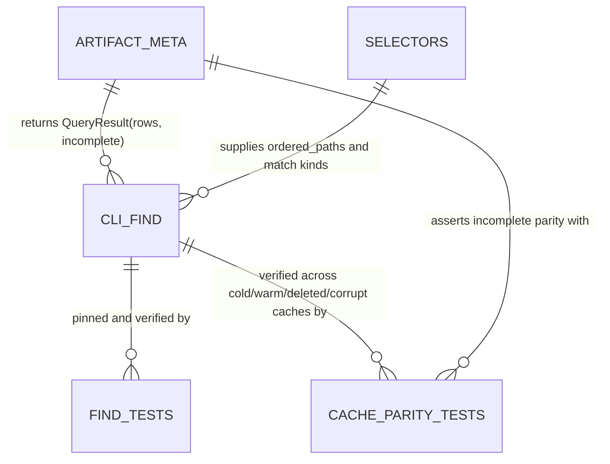
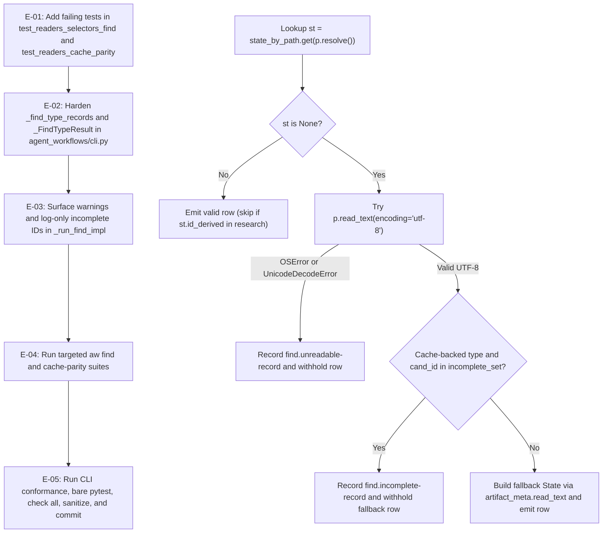

# IPD: Handle non-UTF-8 decode errors and surface incomplete cache records in aw find

- Date: 2026-11-21
- Kind: child
- Concern: Backlog `wdarhj` (`Work-Kind: bug`, `Blocks-Release: next`, discovered during Implementation Plan Document (IPD) `ffceq0` cache-parity testing) identifies two defects in `agent_workflows/cli.py::_find_type_records` when `artifact_meta.query` omits a record and records its `id6` in `QueryResult.incomplete`. First, in the `"plans"` and `"all other types"` branches, the fallback read calls `p.read_text(encoding="utf-8")` inside `except OSError: continue`; because `UnicodeDecodeError` inherits from `ValueError` rather than `OSError`, non-UTF-8 bytes in a record file crash `aw find` with an unhandled traceback. Second, `_query_by_path` discards `QueryResult.incomplete`, so when a record has valid UTF-8 markdown alongside a corrupt `meta/<id6>.jsonl` event log, `_find_type_records` silently falls back to `_meta.read_text(p.read_text(encoding="utf-8"), ...)` and prints the unverified markdown fields without reporting that the metadata log failed to parse.
- Scope: IN: (1) add behavioral regression tests in `tests/test_readers_selectors_find.py` and extend `tests/test_readers_cache_parity.py::test_invalid_replacement_reported_not_omitted_or_stale` to pin both defects before editing production code; (2) replace `agent_workflows/cli.py::_find_type_records`'s `_query_by_path` with `_query_cache` (returning `(state_by_path, incomplete_ids)`), extract a shared fallback/validation helper catching `(OSError, UnicodeDecodeError)` across all three `_find_type_records` branches (`plans`, `research`, and `all other types`), suppress markdown fallback rows when a cache-backed record's `id6` is in `QueryResult.incomplete`, and carry structured `_FindInvalidRecord` diagnostics on `_FindTypeResult` (keeping 3-tuple unpacking intact); (3) surface `"find.unreadable-record"` and `"find.incomplete-record"` warnings (plus unmatched log-only `incomplete` IDs for `norm == "all"` or explicit matching selectors) in `agent_workflows/cli.py::_run_find_impl` across `--agent`, `--json`, `--paths`, and human output modes while keeping `find`'s declared `exit_contract=(0, 2)`, and report a withheld-record answer as `complete: false` / `outcome: "partial"` rather than `clean`. OUT: altering `agent_workflows/artifact_meta.py` (`query`, `_load_sources`), altering `agent_workflows/selectors.py::_cached_states_by_path`, altering `agent_workflows/renderers.py`, changing `find`'s `exit_contract` from `(0, 2)` to `(0, 1, 2)`, or modifying sibling `except OSError:` file reads in `agent_workflows/cli.py::_run_search` (`aw search`) and `agent_workflows/plans.py::scan` (`aw ipd board`), which backlog `t5t02b` carries.
- Scope-Paths: agent_workflows/cli.py, tests/test_readers_selectors_find.py, tests/test_readers_cache_parity.py
- Item-Dependencies: none
- Status: approved
- Readiness: go-pending-approval
- Review-Depth: standard
- Short-Description: Handle non-UTF-8 decode errors and surface incomplete cache records in aw find instead of crashing or serving markdown fallback
- Work-Kind: bug
- Priority: medium
- From-Backlog: wdarhj
- Blocks-Release: next
- Set: wdarhj
- Order: 1
- Highest E allocated: 05
- Author: antigravity/gemini-4-hydrogen-xhigh
- Id: zeopzs
- Approval: 2026-11-27, recorded via aw ipd set: status set to approved

> Write and proofread this plan per the technical writing standard, `.aw/system/workflows/technical-writing/technical-writing.md` (`.agents/workflows/technical-writing/technical-writing.md` in a legacy-layout install), including requirement 12 (diagrams).

## Workflow history

- 2026-11-27 approved (aw set): status set to approved
- 2026-11-24 /plan-review (uri/its_direct/pt3-claude-opus-5.5-1m-us): APPROVE WITH REVISIONS APPLIED; PR-001 (HIGH) and PR-002..PR-011 FIXED; filed carrier backlog t5t02b for the aw search / aw ipd board decode crashes; review record .aw/records/reviews/20261121-wdarhj-01-zeopzs-handle-non-utf-8-decode-errors-and-surface-incomplete-cache.review.md
- 2026-11-24 reviewed (aw set): /plan-review: APPROVE WITH REVISIONS APPLIED; PR-001..PR-011 fixed
- 2026-11-21 to-review (aw set): Authored review-ready plan for backlog wdarhj
- 2026-11-21 draft (antigravity/gemini-4-hydrogen-xhigh): created.

## Goal

Prevent `aw find` from crashing with an unhandled `UnicodeDecodeError` on non-UTF-8 record files, and ensure `aw find` surfaces `QueryResult.incomplete` and unreadable records across all four command-line interface (CLI) output modes (`--agent`, `--json`, `--paths`, and human) instead of silently omitting them or serving unverified markdown mirror fields.

## Detailed Implementation Checklist (TODO)

Execution-state rule: mark an `E-*` item complete only after performing the action. That mark is not validation. Right-sizing rule: write for a modest executor that cannot hold much in its head. Each E-item is one step (one concern, about one file, executable in one focused pass) and its V-item names each unit it covers with its own check; a plan stays at about 5 E-items and 8 work Scope-Paths, else split it into more child plans (guidance, `IPD-Z603`). Accepted execution states: blocked, failed, pending, performed; terminal gate demands 'performed'.

### Task group 1: Pin defects, implement find error/incomplete handling, and verify gates

- [ ] E-01 Before modifying `agent_workflows/cli.py`, add behavioral regression tests in `tests/test_readers_selectors_find.py` and `tests/test_readers_cache_parity.py::test_invalid_replacement_reported_not_omitted_or_stale` covering non-UTF-8 files across `plans` and non-plan types, corrupt `meta/<id6>.jsonl` records with valid markdown mirrors, and log-only corrupt records across all four `aw find` output modes (asserting the `--agent` summary carries `complete: false`, `outcome: "partial"`, and `exit: 0` whenever a record is withheld), then run baseline tests on unmodified `HEAD` to observe the existing failures. Also capture the pre-change `aw check all --agent` baseline: save the full output to `/tmp/opencode/zeopzs-check-all-before.jsonl` (outside the repository) and record its `findings_by_severity`. At review on 2026-11-24 it already exited `1` with `{"error":12,"warning":4,"info":68}` from pre-existing records unrelated to this plan.
  - Depends on: none
  - Expected outcome: `git diff --stat agent_workflows/` is empty, existing clean tests in `tests/test_find_single_read.py`, `tests/test_readers_selectors_find.py`, and `tests/test_readers_cache_parity.py` pass, and the new regression tests fail on unmodified `HEAD` with `UnicodeDecodeError` and unwarned fallback emission (Case 2 currently emits the `pln001` row with `"status":"pending"`, its disposition, and a `clean`/`complete: true` summary). Both target test modules carry `pytestmark = pytest.mark.core`, so the core tier's 30-second wall budget (`conftest.py::pytest_sessionfinish`, `AW_CORE_BUDGET_SECONDS`) applies: build each fixture with a handful of records (reuse `tests/test_readers_cache_parity.py::_build_corpus_repo` where it fits), call the CLI in-process through `_run_cli` rather than a subprocess, and keep every new test under the 2-second slow-report threshold.
  - Execution state: pending

- [ ] E-02 In `agent_workflows/cli.py`, define `_FIND_INCOMPLETE_RECORD_RULE`, `_FIND_UNREADABLE_RECORD_RULE`, and `_FindInvalidRecord` on `_FindTypeResult` (preserving 3-tuple unpacking), replace `_query_by_path` with `_query_cache` returning `(state_by_path, incomplete_ids)`, and extract one shared helper in `_find_type_records` for all three branches (`plans`, `research`, `all other types`) to catch `(OSError, UnicodeDecodeError)` and suppress fallback rows when an `artifact_meta`-backed record's `id6` is in `QueryResult.incomplete`. In the `research` branch, keep the existing `if st is None or st.id_derived: continue` skip for a record the cache DID return (`st is not None` and `st.id_derived`), and call the helper only when `st is None`; the helper must read the file at most once, so `tests/test_find_single_read.py::test_b_find_research_single_read_non_matched` (each non-matched research doc opened exactly once) and `test_e_unparseable_research_doc_produces_no_rows` still pass unchanged. Record each withheld record exactly once: a non-UTF-8 markdown file whose filename `id6` is also in `incomplete` (measured at review: its `valid = 0` row carries `type = 'ipd'` and the markdown path) gets one `find.unreadable-record` diagnostic, and its `id6` is added to `handled_incomplete_ids` so E-03 does not report it a second time as log-only.
  - Depends on: E-01
  - Expected outcome: `_find_type_records` never raises `UnicodeDecodeError`, emits `find.unreadable-record` or `find.incomplete-record` diagnostics instead of unverified markdown rows (excluding `reviews` filenames from `incomplete_set` matching), and respects `--id` and `--disposition` scoping. `PermissionError` behavior is unchanged: a `chmod 0` record still raises from `artifact_meta.query` -> `_load_sources` -> `read_bytes()` before the fallback loop runs (measured at review for both `aw find plans --agent` and `aw find specs --agent`), and `test_f_unreadable_matched_plan_raises_permission_error` still passes.
  - Execution state: pending

- [ ] E-03 In `agent_workflows/cli.py::_run_find_impl`, aggregate `invalid_records`, `incomplete_ids`, and `handled_incomplete_ids` across queried types, surface remaining log-only `incomplete` IDs when `norm == "all"` without narrowing filters or when explicitly named by an unowned selector (exempting them from `facts.refusable`), and render all warning diagnostics at exit `0` across `--agent`, `--json`, `--paths`, and human output (including after `term.empty_result` when `all_lines` is empty). When at least one record was withheld, report the answer as incomplete, because `docs/cli-output-contract.md` "Anti-Greenwashing Invariant" forbids a positive outcome for partial work: the `--agent` summary carries `complete: false`, `outcome: "partial"`, `exit: 0`, and `next: "aw check meta --agent"` (unless `--limit` truncation already supplies the continuation `next`); `--json` uses `CommandResult(status="partial", complete=False, ...)`. `renderers.AgentRenderer.render_stream` derives `complete` only from `--limit` truncation and is out of scope, so on the withheld path render each item with `render_item` and the summary with `render_summary(..., complete=False, outcome="partial")` directly, as `agent_workflows/run_analytics_cli.py::_emit_query_agent` does. With no withheld record, output stays byte-identical to `HEAD`, including `find.id6-collision`, which withholds no row and stays `clean`.
  - Depends on: E-02
  - Expected outcome: All four `aw find` modes surface `find.unreadable-record` and `find.incomplete-record` diagnostics at exit `0` with empty `stderr` in `--agent`/`--json`, pure valid paths on `stdout` in `--paths`, the `--agent` summary passes `agent_schema.validate_agent_record` with `complete: false` and `outcome: "partial"` on the withheld path, and all new regression tests in `tests/test_readers_selectors_find.py` and `tests/test_readers_cache_parity.py` pass.
  - Execution state: pending

- [ ] E-04 Run the targeted `aw find` and cache-parity regression modules (`tests/test_readers_selectors_find.py`, `tests/test_readers_cache_parity.py`, `tests/test_find_single_read.py`, `tests/test_find_agent_stream.py`, `tests/test_find_human_limit.py`, `tests/test_find_filters.py`, and `tests/test_find_prompts_lane_status.py`).
  - Depends on: E-03
  - Expected outcome: All seven targeted test modules pass with zero failures and zero skipped assertions.
  - Execution state: pending

- [ ] E-05 Run `tests/test_cli_find.py`, `tests/test_readers_offline.py`, and `tests/test_exit_contract_conformance.py`, run bare `python3 -m pytest`, `aw check all --agent`, and `aw sanitize --agent`, and commit only changed files via `aw commit zeopzs -- <paths>`.
  - Depends on: E-04
  - Expected outcome: All three conformance/CLI modules and bare `python3 -m pytest` pass with zero failures; `aw sanitize --agent` reports `"outcome":"clean"` with zero findings; `aw check all --agent` adds no diagnostic beyond the E-01 baseline (compare the sorted `(rule, location)` pairs of the two outputs; a nonzero exit caused only by baseline diagnostics is acceptable, any new pair is a failure to fix); and commits stay strictly within `- Scope-Paths:`.
  - Execution state: pending

Add further leaves as `- [ ] E-NEW <action>` and run `aw ipd sync` to assign ids.

## Project conventions discovered (Step 0)

- `agent_workflows/command_surface.py` declares `exit_contract=(0, 2)` for `"find"`, and `tests/test_exit_contract_conformance.py` asserts that every live exit code of `"find"` is in `(0, 2)`. Following IPD `paw8so` (`_FIND_ID6_COLLISION_RULE = "find.id6-collision"` in `agent_workflows/cli.py`), `aw find` keeps exit code `0` when reporting read-time diagnostic warnings (`"find.id6-collision"`, `"find.unreadable-record"`, `"find.incomplete-record"`), reserving exit `2` for non-project roots, invalid flags, and unresolved non-vocabulary selectors.
- Under `agent_workflows/cli.py::_run_find_impl`, `--agent` carries warning diagnostics (`severity="warning"`) on the terminal `summary` record (`summary_diags`) via `renderers.AgentRenderer.render_stream` while keeping `stderr` empty; `--json` carries `Diagnostic` objects on `CommandResult.diagnostics` with empty `stderr`; `--paths` keeps `stdout` strictly pure repo-relative paths and writes notices/diagnostics to `stderr`; and human mode prints rows first followed by `!  ...` warning lines.
- All path-valued and free-text fields in `--agent` and `--json` diagnostics (`location`, `detail`, `fix`) must pass through `agent_schema.normalize_repo_path` (or `artifact_core.repo_relative_posix`) and `agent_schema.redact_home_paths` so `aw sanitize --agent` reports zero findings and companion-repository paths never leak home directories.
- `agent_workflows/cli.py::_FindTypeResult` subclasses `tuple` so callers unpacking 3 items (`lines, paths, matches = cli._find_type_records(...)` in `tests/test_find_single_read.py` and `tests/test_find_prompts_lane_status.py`) continue working while exposing additive metadata attributes (`items`, `invalid_records`, `incomplete_ids`, `handled_incomplete_ids`).
- `agent_workflows/selectors.py::_META_TYPE_FOR_RECORD` maps seven record trees (`plans`, `specs`, `prompts`, `research`, `backlog`, `walkthroughs`, `releases`). `artifact_meta.SUPPORTED_TYPES` has eight entries; the eighth, `roadmap`, has no `_META_TYPE_FOR_RECORD` entry, so `_find_type_records` queries `roadmaps` (like `comms` and `other`) through `_query_by_path(None)`, an all-types query. `reviews` records carry their subject's `id6` in the filename identity slot rather than owning an `id6` (DECISIONS D140), so `incomplete_set` matching applies to every type except `reviews` (whose `state_by_path` is always `{}`) and never matches `reviews` filenames against `incomplete_set`.
- `tests/test_find_single_read.py::test_f_unreadable_matched_plan_raises_permission_error` asserts that `chmod(0o000)` on a plan raises `PermissionError` (which occurs inside `artifact_meta.query` -> `_load_sources` -> `read_bytes()` before `_find_type_records` reaches its fallback loop). `test_a_find_plans_single_read_non_matched` and `test_b_find_research_single_read_non_matched` assert via `sys.addaudithook` that non-matched healthy records are opened at most once.
- Cite code by `path::Symbol` identifiers or quoted content strings rather than bare line numbers (`IPD-C801`, `.aw/system/workflows/technical-writing/technical-writing.md` Requirement 7).

## Findings

| Id | Source inspected | Finding |
|---|---|---|
| F-01 | `agent_workflows/cli.py::_find_type_records` (`_query_by_path` and `"plans"` branch) | `_query_by_path` iterates `qr.rows` from `artifact_meta.query` and discards `qr.incomplete`. When a plan is absent from `state_by_path`, the fallback calls `p.read_text(encoding="utf-8")` inside `except OSError: continue`, so `UnicodeDecodeError` (`ValueError` subclass) crashes `aw find plans`, and a valid `.ipd.md` with a corrupt `meta/<id6>.jsonl` silently renders fallback markdown fields with no warning. |
| F-02 | `agent_workflows/cli.py::_find_type_records` (`"research"` and `"all other types"` branches) | The `"all other types"` branch (`specs`, `prompts`, `backlog`, `walkthroughs`, `roadmaps`, `comms`, `releases`, `reviews`, `other`) repeats the exact same `p.read_text(encoding="utf-8")` inside `except OSError: continue` pattern and silently serves markdown fallback on corrupt logs. The `"research"` branch executes `if st is None or st.id_derived: continue`, silently dropping unreadable or corrupt-log research records without warning while relying on `st.id_derived` to skip non-id6 templates (`tests/test_find_single_read.py::test_e_unparseable_research_doc_produces_no_rows`). |
| F-03 | `agent_workflows/artifact_meta.py::query` and `_load_sources` | `artifact_meta.query` computes `incomplete` via `"SELECT id6 FROM artifacts WHERE valid = 0"` without filtering by `type`, so a type-scoped query still returns every invalid `id6` (measured at review: `query(type="spec")` returned `['pln001']` for a corrupt plan log). The `valid = 0` row's `type` depends on the failing source: a corrupt log whose first line does not parse stores `type = NULL` with path `meta/<id6>.jsonl` (measured: `('pln001', None, 'meta/pln001.jsonl', 0)`), while a non-UTF-8 markdown file with a filename `id6` stores its tree's type and markdown path (measured: `('pln001', 'ipd', 'plans/pending/...pln001...ipd.md', 0)`). `_load_sources` inserts no row at all when a legacy-named `.md` file has no filename `id6` and fails UTF-8 decode, so `incomplete` cannot report it. Therefore `_find_type_records` must catch `(OSError, UnicodeDecodeError)` directly on fallback reads, must not rely on `incomplete` being type-scoped, and must never match `reviews` filenames (whose slot holds the subject `id6`) against `incomplete_set`. |
| F-04 | `agent_workflows/cli.py::_run_find_impl` (`"if not all_lines:"`, `facts.refusable`, and `summary_diags` / `CommandResult.diagnostics`) | When every matched or scanned record is unreadable or incomplete (`all_lines == []`), `_run_find_impl` returns `0` immediately after `term.empty_result(...)` in human mode before printing post-row warnings, and `facts.refusable` exits `2` on a selector naming a log-only corrupt `meta/<id6>.jsonl` because `selectors.resolve` enumerates only `*.md` files. |
| F-05 | `tests/test_readers_cache_parity.py::test_invalid_replacement_reported_not_omitted_or_stale` | Case 1 (non-UTF-8 `plan_p`) and Case 2 (valid `plan_p` with corrupt `meta/pln001.jsonl`) verify `artifact_meta.query`, `aw attention`, and `aw check meta`, but omit `aw find` because `aw find plans` currently crashes in Case 1 and, in Case 2, emits the `pln001` row with `"status":"pending"` (the disposition, since `status = disp or canon_st`) under a `clean`, `complete: true` summary at exit `0` (measured at review). |
| F-06 | `agent_workflows/cli.py::_run_search` and `agent_workflows/plans.py::scan` | Both sibling readers call `read_text(encoding="utf-8")` inside `except OSError:`. Measured at review on the Case 1 corpus: `aw search clean --agent` raises `UnicodeDecodeError` in `_run_search`, and `aw ipd board` raises it in `plans.scan`. They live outside `aw find` (`wdarhj`), are excluded here to keep scope tight, and are carried by backlog `t5t02b` (`Work-Kind: bug`, `Blocks-Release: next`), filed at review. |
| F-07 | `docs/cli-output-contract.md` "Anti-Greenwashing Invariant" and `agent_workflows/renderers.py::AgentRenderer.render_stream` | The contract states "If `complete=False` (and not a non-destructive preview), the outcome is `partial` or `skipped`" and forbids a positive outcome for `partial` work; the Section 5 `runs query` example shows `outcome: "partial"` at `exit: 0`. `_run_find_impl` hardcodes `outcome="clean"`, and `render_stream` sets `complete = True` unless `--limit` truncates. A `find` answer that withholds a matched record is partial, so it must not report `clean`/`complete: true`; `agent_schema.validate_agent_record` accepts `partial` at exit `0`. `find.id6-collision` (`paw8so`) withholds no row, so it remains `clean`. |

## Proposed changes (ordered, validatable)

The entity-relationship diagram below shows the modules and test suites connected by this change:

The flowchart below shows the execution sequence (`E-01` to `E-05`) and the runtime decision branch added inside `_find_type_records` and `_run_find_impl`:

1. **Pin defects and add cache-parity coverage (`E-01`)**: Add regression tests in `tests/test_readers_selectors_find.py` covering non-UTF-8 files (`plans`, `specs`/`backlog`/`reviews`), corrupt `meta/<id6>.jsonl` with valid `.md` mirrors, log-only corrupt `meta/<id6>.jsonl`, filter interactions (`--id`, `--disposition`, `--status`), and all four output modes (`--agent`, `--json`, `--paths`, human). Extend `tests/test_readers_cache_parity.py::test_invalid_replacement_reported_not_omitted_or_stale` to verify `aw find plans --agent` across Case 1 and Case 2. Run baseline suites on unmodified `HEAD` to observe the existing failures (`UnicodeDecodeError` and the unwarned `"status":"pending"` fallback row under a `clean` summary), and save the `aw check all --agent` baseline.
2. **Harden `_find_type_records` and `_FindTypeResult` (`E-02`)**: Define `_FIND_INCOMPLETE_RECORD_RULE = "find.incomplete-record"`, `_FIND_UNREADABLE_RECORD_RULE = "find.unreadable-record"`, and `_FindInvalidRecord`, and extend `_FindTypeResult` with `invalid_records`, `incomplete_ids`, and `handled_incomplete_ids`. Replace `_query_by_path` with `_query_cache` returning `(by_p, list(qr.incomplete))`. Extract one shared helper in `_find_type_records` for the `st is None` fallback across `plans`, `research`, and `all other types` to catch `(OSError, UnicodeDecodeError)` and emit `find.unreadable-record` without crashing (preserving `PermissionError` raised earlier in `artifact_meta.query`), keep the research `st.id_derived` skip and the single-open property, and check extracted `id6` (for every type except `reviews`) against `incomplete_set` (respecting explicit `--id` and `--disposition` scoping) to emit `find.incomplete-record` and suppress unverified markdown fallback rows.
3. **Surface warnings across all modes in `_run_find_impl` (`E-03`)**: Aggregate `invalid_records`, `incomplete_ids`, and `handled_incomplete_ids` across `types`. Surface remaining log-only `incomplete_ids` when `norm == "all"` without narrowing filters or when a selector explicitly names an unowned log-only `inc_id` (exempting that selector from `facts.refusable`), and emit warnings at exit `0` across `--agent` (`summary["diagnostics"]`, empty `stderr`), `--json` (`CommandResult.diagnostics`, empty `stderr`), `--paths` (pure paths on `stdout`, warning lines on `stderr`), and human mode (after rows, and after `term.empty_result` when `all_lines` is empty). When a record was withheld, report `complete: false` and `outcome: "partial"` (`--agent`) or `status="partial"`, `complete=False` (`--json`), per F-07.
4. **Run targeted `aw find` and cache-parity suites (`E-04`)**: Verify `tests/test_readers_selectors_find.py`, `tests/test_readers_cache_parity.py`, `tests/test_find_single_read.py`, `tests/test_find_agent_stream.py`, `tests/test_find_human_limit.py`, `tests/test_find_filters.py`, and `tests/test_find_prompts_lane_status.py`.
5. **Run conformance and full repository gates, then commit (`E-05`)**: Verify `tests/test_cli_find.py`, `tests/test_readers_offline.py`, `tests/test_exit_contract_conformance.py`, bare `python3 -m pytest`, `aw check all --agent` (no new diagnostic against the E-01 baseline), and `aw sanitize --agent`, and commit via `aw commit zeopzs -- <paths>`.

## Deferred / out of scope (with reason)

- Separate `except OSError:` fallback `read_text(encoding="utf-8")` calls in `agent_workflows/cli.py::_run_search` (`aw search`) and `agent_workflows/plans.py::scan` (`aw ipd board`), both measured crashing at review (F-06):
  - Carrier: t5t02b
- `artifact_meta._load_sources` storing `artifacts.type` as `NULL` when the first line of a corrupt log fails to parse, and inserting no row for a legacy-named non-UTF-8 `.md` file with no filename `id6`:
  - Carrier-Declined: Outside backlog `wdarhj`'s `aw find` / `_find_type_records` defect scope. This plan handles both cases at the `aw find` read site (the fallback read catches the decode error itself, and `incomplete` is never assumed to be type-scoped), so the `artifact_meta` behavior causes no wrong `aw find` output once this plan lands.
- `chmod 0` (`PermissionError`) records crashing `aw find`: `artifact_meta._load_sources` raises from `read_bytes()` before `_find_type_records` runs, and `tests/test_find_single_read.py::test_f_unreadable_matched_plan_raises_permission_error` pins that behavior as shipped by IPD `qfpnrm`:
  - Carrier-Declined: Not a decode error and not in backlog `wdarhj`; changing it requires editing `agent_workflows/artifact_meta.py` and reversing a test that `qfpnrm` added deliberately, which needs its own decision.
- Returning exit code `1` from `aw find` when invalid or incomplete records are present:
  - Carrier-Declined: `agent_workflows/command_surface.py` locks `find`'s `exit_contract` to `(0, 2)` and `tests/test_exit_contract_conformance.py` enforces it; `paw8so` (`find.id6-collision`) established exit `0` with structured diagnostics so `aw find` remains usable while diagnosing repository damage.

## Scope check

- Over-scope: none. `- Scope-Paths:` names only `agent_workflows/cli.py`, `tests/test_readers_selectors_find.py`, and `tests/test_readers_cache_parity.py`.
- Under-scope: none. Every `_find_type_records` branch (`plans`, `research`, `all other types`), all four `aw find` output surfaces (`--agent`, `--json`, `--paths`, human), zero-healthy-row rendering, log-only corrupt records, and the partial-outcome report are addressed and tested. The sibling `aw search` and `aw ipd board` crashes are carried by backlog `t5t02b`.

## Required tests / validation

- Targeted `aw find` and cache-parity modules:
  `python3 -m pytest tests/test_readers_selectors_find.py tests/test_readers_cache_parity.py tests/test_find_single_read.py tests/test_find_agent_stream.py tests/test_find_human_limit.py tests/test_find_filters.py tests/test_find_prompts_lane_status.py tests/test_cli_find.py tests/test_readers_offline.py`
- Exit-contract conformance for `find`:
  `python3 -m pytest tests/test_exit_contract_conformance.py`
- Core regression, check, and leak gates:
  `python3 -m pytest`
  `aw check all --agent` (compared against the E-01 baseline; pre-existing diagnostics are not failures)
  `aw sanitize --agent`

## Spec / documentation sync

N/A with reason: no CLI flag, schema version, record kind, outcome value, or exit code is added or changed. `docs/cli-output-contract.md` Section 12 ("Path Discovery and Resolution vs. Verification Receipts") defines the `aw find` `--agent` stream and exit classification, which this plan keeps; the "Anti-Greenwashing Invariant" and the Section 5 `partial` summary example already require the `complete: false` / `outcome: "partial"` report this plan adopts; and `agent_workflows/command_surface.py` keeps `exit_contract=(0, 2)`. No document lists individual `find.*` diagnostic rules (`find.id6-collision` from IPD `paw8so` appears in no doc), so the two new rule names follow that precedent and live in code and tests.

## Open questions

### OQ-01: What exit code and diagnostic format should aw find use for incomplete and unreadable records?

- Blocking: no
- Status: resolved
- Owner: plan author
- Resolution or deferral rationale: RESOLVED from repository evidence (`agent_workflows/command_surface.py` `exit_contract=(0, 2)`, `agent_workflows/cli.py::_run_find_impl` `find.id6-collision`, and `tests/test_find_agent_stream.py::test_14_agent_collision_diagnostics_in_summary`): exit code remains `0`, `--agent` emits `Diagnostic` entries (`severity="warning"`, repo-relative `location`, home-path-redacted `detail`/`fix`) in `summary["diagnostics"]` with empty `stderr`, `--json` emits `Diagnostic` entries in `CommandResult.diagnostics` with empty `stderr`, `--paths` writes warning lines to `stderr` while keeping `stdout` strictly valid paths, and human output prints warnings after matching rows (or after `term.empty_result` when `all_lines` is empty). Amended at review (2026-11-24, F-07): when a record is withheld, the `--agent` summary also carries `complete: false` and `outcome: "partial"` (still exit `0`), and `--json` carries `status="partial"`, `complete=False`, because the contract's "Anti-Greenwashing Invariant" forbids a `clean` outcome for partial work.

### OQ-02: Should incomplete records also be suppressed in selectors._cached_states_by_path?

- Blocking: no
- Status: resolved
- Owner: plan author
- Resolution or deferral rationale: RESOLVED from repository evidence (`agent_workflows/selectors.py::_cached_states_by_path` and `agent_workflows/cli.py::_run_find_impl` `facts.refusable`): leave `selectors._cached_states_by_path` unchanged. `artifact_meta.query` already omits `valid=0` records from `res.rows`, so `selectors.resolve` falls back to `_read_header` / filename matching and passes the matched `Path` into `_find_type_records`; if `selectors.resolve` dropped an `id6`-named corrupt record on a legacy filename, `aw find plans <id6>` would falsely exit `2` as an unresolved selector instead of surfacing `find.incomplete-record`.

## Validation and cross-check (verify before reporting done)

Validation-state rule: inspect evidence in a separate pass. Do not mark a `V-*` item complete from memory or from the matching execution checkmark. Accepted validation results: blocked, failed, pass, pending; terminal gate demands 'pass'. Runtime-demonstration reachability rule: for each `V-*` item demanding the software be observed acting (such as a run, a dispatch, or a transition), as distinct from items demanding a diff, a file's content, or a test result, which are reachable by construction, name the code path that produces the observation or the sibling `E-*` that creates it, else the demand is UNDER-SCOPE.

- [ ] V-01 validates E-01
  - Required evidence: paste `git diff --stat agent_workflows/` empty before `E-02` begins, the `git diff -- tests/test_readers_selectors_find.py tests/test_readers_cache_parity.py` summary, and the `python3 -m pytest tests/test_readers_selectors_find.py tests/test_readers_cache_parity.py tests/test_find_single_read.py -v` output on unmodified `HEAD` showing existing tests passing and the new `E-01` tests failing with `UnicodeDecodeError` and silent fallback emission, plus the last line of the saved `/tmp/opencode/zeopzs-check-all-before.jsonl` baseline showing its `exit` and `findings_by_severity`.
  - Observed evidence:
  - Result: pending

- [ ] V-02 validates E-02
  - Required evidence: paste the `git diff -- agent_workflows/cli.py` hunks for `_FIND_INCOMPLETE_RECORD_RULE`, `_FIND_UNREADABLE_RECORD_RULE`, `_FindInvalidRecord`, `_FindTypeResult`, `_query_cache`, and the shared `_find_type_records` fallback helper (including the `research` branch hunk showing the `st.id_derived` skip retained), plus `python3 -m pytest tests/test_find_single_read.py -v` showing `test_b_find_research_single_read_non_matched`, `test_e_unparseable_research_doc_produces_no_rows`, `test_f_unreadable_matched_plan_raises_permission_error`, and all other single-read tests `PASSED`.
  - Observed evidence:
  - Result: pending

- [ ] V-03 validates E-03
  - Required evidence: paste the `git diff -- agent_workflows/cli.py` hunks for `_run_find_impl` diagnostic aggregation, log-only `incomplete_ids` surfacing, and four-mode output emission, plus `python3 -m pytest tests/test_readers_selectors_find.py tests/test_readers_cache_parity.py -v` output showing every existing and new `E-01` test `PASSED`, and the observed `aw find plans --agent` summary line from the Case 2 corpus (valid plan, corrupt `meta/pln001.jsonl`) showing `"outcome":"partial"`, `"exit":0`, `"complete":false`, and a `find.incomplete-record` diagnostic; this runtime observation is produced by `agent_workflows/cli.py::_run_find_impl`, which E-03 changes.
  - Observed evidence:
  - Result: pending

- [ ] V-04 validates E-04
  - Required evidence: paste the passing `N passed` summary lines from running `python3 -m pytest tests/test_readers_selectors_find.py tests/test_readers_cache_parity.py tests/test_find_single_read.py tests/test_find_agent_stream.py tests/test_find_human_limit.py tests/test_find_filters.py tests/test_find_prompts_lane_status.py`.
  - Observed evidence:
  - Result: pending

- [ ] V-05 validates E-05
  - Required evidence: paste the passing `N passed` summary lines from (1) `python3 -m pytest tests/test_cli_find.py tests/test_readers_offline.py tests/test_exit_contract_conformance.py`, (2) bare `python3 -m pytest`, (3) `aw check all --agent` with its `findings_by_severity` and the result of comparing its sorted `(rule, location)` pairs against the E-01 baseline (expected: no new pair), (4) `aw sanitize --agent` showing `"outcome":"clean"`, and (5) `git show --stat` of the `aw commit zeopzs` commit(s) confirming only `- Scope-Paths:` files changed.
  - Observed evidence:
  - Result: pending

## Approval and execution gate

- Size assessment: standard
- Cohesion rationale: not required

Execute only after human approval (`- Status: approved`, or an authorized automated gate). All open questions are resolved (`OQ-01`, `OQ-02`).

SCOPE FENCE. `- Scope-Paths:` declares `agent_workflows/cli.py`, `tests/test_readers_selectors_find.py`, and `tests/test_readers_cache_parity.py`. Do not expand scope casually; if the work genuinely requires editing a file outside the fence, make the edit and justify it in the two-way scope reconciliation at finalize (`--scope-reason`), and acknowledge any declared-but-unmodified path with `--scope-ack`. Stop and report only on a genuinely unsafe condition such as an unresolvable concurrent-edit conflict or missing prerequisite symbols in `agent_workflows/artifact_meta.py` (`query`, `read_text`, `QueryResult`).

HONESTY. Every `V-*` evidence block must paste actual observed command output from runs executed after the final edit; never claim success you did not run.

COMMIT. Commit only files modified for this plan through `aw commit zeopzs -- <paths>`; verify `git diff --cached --name-only` contains only your paths; never use `git add -A`, bare `git add`, or `git commit -a`; never push without an explicit human request.

POST-GATE LIFECYCLE. Once every `E-*` item has `Execution state: performed`, every `V-*` item has `Result: pass`, and `aw ipd lint --phase pre-transition` reports `conforming`, move the plan to `.aw/records/plans/executed/` through `aw ipd finalize zeopzs --actor <agent/model> --message "
" --apply` (under `aw oc run` or `aw agy run`, the runner performs finalize after verifying completion). Never `git mv` the plan by hand. This plan inherits `- Blocks-Release: next` from backlog `wdarhj`, so closing `wdarhj` as `done` after execution follows the executed-carrier handoff path.
