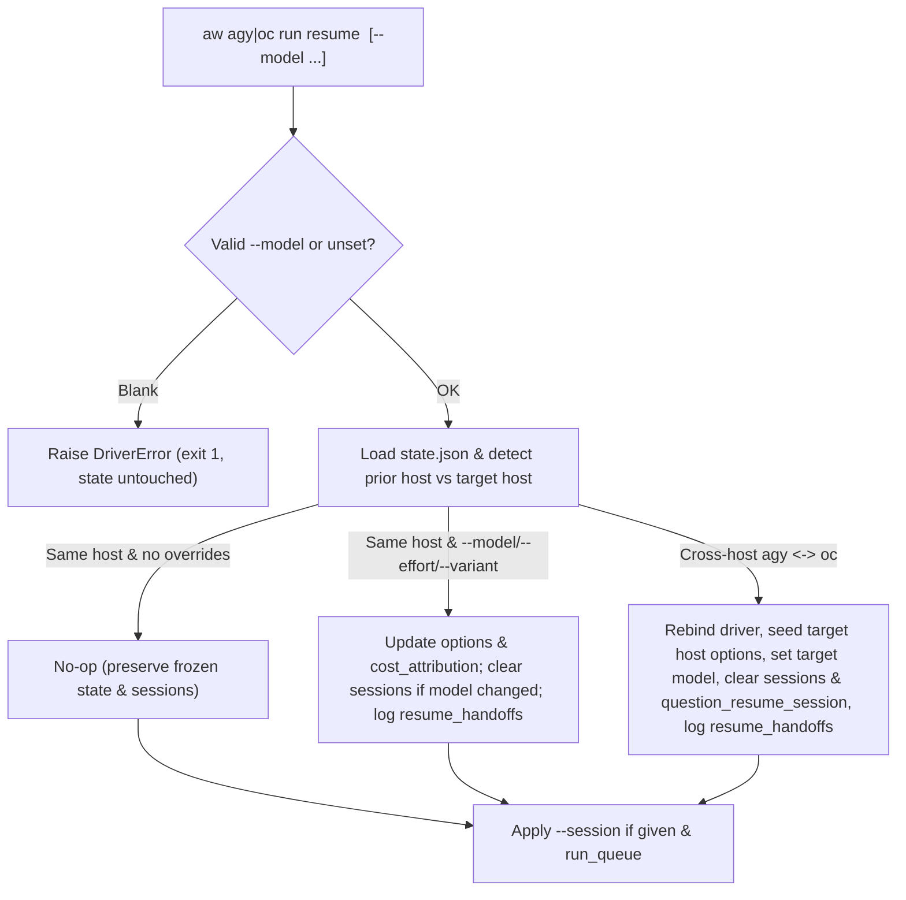

# IPD: Allow resuming a run with a different model or runner

- Date: 2026-11-22
- Kind: child
- Concern: When credits or quota run out mid-run, operators cannot resume an existing `run_id` with a different model on the same runner (`aw agy run resume` / `aw oc run resume` reject `--model`) or hand off the run across runners (`aw agy run resume <oc-run-id>` / `aw oc run resume <agy-run-id>`) because `state.json` keeps the original `driver`, host-specific `options`, and incompatible `session_id`/`set_sessions`. Adding explicit model/host overrides on `resume` plus a shared cross-runner handoff helper lets operators continue a run seamlessly on another model or runner while preserving the queue, completed items, preserved lanes, retry counters, and answered questions.
- Scope: Add a shared `apply_resume_host_and_model_switch` helper in `agent_workflows/runner_shared.py`; add `--model` and `--effort` on `agent_workflows/agy_runipd.py` `resume` and `--model` and `--opencode` on `agent_workflows/oc_runipd.py` `resume` (alongside existing `--variant`); wire both drivers' `resume` handlers through `apply_resume_host_and_model_switch` so same-host model/effort/variant switches and cross-host handoffs (`agy` <-> `oc`) update `state["driver"]`, `options`, and `cost_attribution`, clear incompatible session IDs (`state["session_id"]`, `state["set_sessions"]`, `options["session"]`, `state["session_item_count"]`, and non-terminal `question_resume_session`), record an audit entry in `state["resume_handoffs"]`, preserve `options["launch_profile"]` untouched, and refuse blank `--model` values; add behavioral tests in `tests/test_resume_switch.py`; and add one bullet to `CHANGELOG.md`. EXCLUDES: changing the `3cm15q`/`kgpptv` refusal of `as <profile>` and `--verify-with` on `resume`, modifying `aw runs resume` (the ledger verb), and adding automatic quota-exhaustion auto-failover.
- Scope-Paths: agent_workflows/runner_shared.py, agent_workflows/agy_runipd.py, agent_workflows/oc_runipd.py, tests/test_resume_switch.py, CHANGELOG.md, .aw/records/plans/pending/20261122-2s0u3d-01-c9v6ie-allow-resuming-a-run-with-a-different-model-or-runner.ipd.md
- Item-Dependencies: none
- Status: approved
- Readiness: go-pending-approval
- Short-Description: Add --model/--effort/--opencode overrides on resume and cross-runner (agy <-> oc) resume handoff
- Review-Depth: standard
- Work-Kind: feature
- Priority: medium
- From-Backlog: 2s0u3d
- Set: 2s0u3d
- Order: 1
- Highest E allocated: 04
- Author: antigravity/gemini
- Id: c9v6ie
- Approval: 2026-11-22, human ("approved"): Maintainer approved: backlog, graduate, review, and implement resume model/runner switch

> Write and proofread this plan per the technical writing standard, `.aw/system/workflows/technical-writing/technical-writing.md` (`.agents/workflows/technical-writing/technical-writing.md` in a legacy-layout install), including requirement 12 (diagrams).

## Workflow history

- 2026-11-22 approved (aw set, --by-human): Maintainer approved: backlog, graduate, review, and implement resume model/runner switch
- 2026-11-22 reviewed (aw set): APPROVE WITH REVISIONS APPLIED; PR-001..PR-002 FIXED
- 2026-11-22 /plan-review (antigravity/gemini): APPROVE WITH REVISIONS APPLIED; PR-001..PR-002 FIXED; review record .aw/records/reviews/20261122-2s0u3d-01-c9v6ie-allow-resuming-a-run-with-a-different-model-or-runner.review.md
- 2026-11-22 to-review (antigravity/gemini): authored review-ready child plan graduated from backlog 2s0u3d.
- 2026-11-22 draft (antigravity/gemini): created.

## Goal

Allow operators whose credits or quota are exhausted mid-run to resume an existing `run_id` using a different model on the same runner (`--model`, `--effort`, `--variant`, `--opencode`) or hand off the run to the other runner (`aw agy run resume <oc-run-id>` / `aw oc run resume <agy-run-id>`), safely clearing incompatible sessions while preserving the queue, preserved lanes, retry state, and answered questions.

## Detailed Implementation Checklist (TODO)

Execution-state rule: mark an `E-*` item complete only after performing the action. That mark is not validation. Right-sizing rule: write for a modest executor that cannot hold much in its head. Each E-item is one step (one concern, about one file, executable in one focused pass) and its V-item names each unit it covers with its own check; a plan stays at about 5 E-items and 8 work Scope-Paths, else split it into more child plans (guidance, `IPD-Z603`). Accepted execution states: blocked, failed, pending, performed; terminal gate demands 'performed'.

### Task group 1: Shared resume host/model switch helper and driver wiring

- [ ] E-01 Add `apply_resume_host_and_model_switch` (and helpers `_detect_state_host`, `validate_resume_model_override`) in `agent_workflows/runner_shared.py` that: validates any supplied `--model` is non-blank before mutating `state` (raising `DriverError` on empty/whitespace); detects same-host vs cross-host (`agy` <-> `oc`) transitions from `state["driver"]["id"]` (with option fallback for older states); on cross-host handoff rebinds `state["driver"]`, seeds missing target `default_host_options`, replaces the old host's `options["model"]` with either explicit `--model` or `default_model_resolver()`, resets cross-host-only knobs (`effort`/`variant`/`agent`/`explicit_model`), refreshes `options[COST_ATTRIBUTION_KEY]`, and preserves `options["launch_profile"]`; on same-host model switch updates `options["model"]` (plus `explicit_model` on `agy`) and `options[COST_ATTRIBUTION_KEY]`; applies explicit `--effort`/`--variant`/`--opencode` overrides (subsuming `oc_runipd`'s standalone `--variant` block); clears incompatible saved sessions (`state["session_id"]`, `state["set_sessions"]`, `options["session"]`, `state["session_item_count"]`, non-terminal queue items' `question_resume_session`, and incomplete `review_steps` `session_id` entries) whenever host or model changes (unless `--session` is explicitly passed on the same resume); appends a structured handoff record to `state["resume_handoffs"]`; and returns `False` as a complete no-op when neither host nor explicit model/effort/variant/opencode changes.
  - Depends on: none
  - Expected outcome: `runner_shared.apply_resume_host_and_model_switch` cleanly handles same-host no-op, same-host model/effort/variant override, cross-host `agy -> oc` and `oc -> agy` handoff (with and without explicit `--model`), blank `--model` refusal, session clearing, `launch_profile` preservation, and `resume_handoffs` audit logging.
  - Execution state: pending

- [ ] E-02 Register `--model` and `--effort` (`default=None`) on `agent_workflows/agy_runipd.py::build_parser` `resume` subparser and `--model` and `--opencode` (`default=None`) on `agent_workflows/oc_runipd.py::build_parser` `resume` subparser; wire both `args.command == "resume"` blocks to call `runner_shared.apply_resume_host_and_model_switch` before `--session` attachment and `run_queue`, saving `state.json` and logging a concise one-line notice to `stderr` whenever a host or model switch occurred. Preserve `oc_runipd`'s existing `as <profile>` and `--verify-with` resume refusals untouched.
  - Depends on: E-01
  - Expected outcome: Both `aw agy run resume` and `aw oc run resume` accept explicit model/runner-option overrides, seamlessly resume runs created by the other host, keep omitted resume invocations byte-identical to prior behavior, and keep `3cm15q`/`kgpptv` profile-refusal invariants intact.
  - Execution state: pending

### Task group 2: Behavioral tests, changelog, and validation gates

- [ ] E-03 Create `tests/test_resume_switch.py` (`pytestmark = pytest.mark.core`, zero source-code inspection) covering: parser acceptance of `--model`/`--effort` on `agy_runipd` `resume` and `--model`/`--variant`/`--opencode` on `oc_runipd` `resume`; blank `--model` refusal; same-host model switch on both hosts (updates `options.model` + `cost_attribution`, clears `session_id`/`set_sessions`/`question_resume_session`, appends `resume_handoffs`, preserves `launch_profile`, honors explicit `--session`); cross-host `agy -> oc` and `oc -> agy` resume handoffs both with explicit `--model` and falling back to target host default (rebinds `state["driver"]`, seeds target host options, clears cross-host sessions and model, preserves queue, preserved lanes, and answered questions); no-op resume leaves `state` unchanged; and `oc_runipd` `resume` still refuses `as <profile>` and `--verify-with`.
  - Depends on: E-02
  - Expected outcome: `python3 -m pytest tests/test_resume_switch.py` passes all tests with `0 unlisted slow tests`.
  - Execution state: pending

- [ ] E-04 Add one user-facing bullet under `## 2.0.0 (pending)` in `CHANGELOG.md` (with zero em or en dashes) documenting model overrides on `resume` and cross-runner (`agy` <-> `oc`) resume handoff. Run targeted tests, bare `python3 -m pytest` (core suite), `make typecheck`, `aw sanitize --agent`, and `aw ipd lint --phase pre-transition` on this plan; commit only `Scope-Paths` files via `aw commit c9v6ie -- <paths>`. Never push.
  - Depends on: E-03
  - Expected outcome: Targeted tests, bare core pytest suite, `make typecheck`, `aw sanitize --agent`, and `aw ipd lint --phase pre-transition` all pass with zero regressions and path-scoped commits on `- Scope-Paths:`.
  - Execution state: pending

## Project conventions discovered (Step 0)

- `agent_workflows/oc_runipd.py` already permits explicit `--variant` override on `resume` (`3cm15q` E-04, `429f30`), leaving `options["launch_profile"]` untouched as creation provenance while refusing profile names (`as <profile>` and `--verify-with`) on `resume` (`3cm15q` E-04, `kgpptv` E-02).
- `agent_workflows/runner_shared.py::initialize_run_core` records `state["driver"] = {"id": labels.id, "path": ..., "sha256": ...}` using `AGY_HOST_LABELS` (`id="agy_runipd"`) and `OC_HOST_LABELS` (`id="oc_runipd"`), and `host_labels_for_driver_id` maps recorded IDs back to host labels.
- `agent_workflows/agy_runipd.py::initialize_run` sets `host_options` keys `agy_executable`, `model`, `explicit_model`, `effort`, `timeout`, `new_session`, `dangerously_skip_permissions`, `no_verify`, and `cost_attribution`.
- `agent_workflows/oc_runipd.py::initialize_run` sets `host_options` keys `opencode`, `model`, `variant`, `agent`, `launch_profile`, `cost_attribution`, `auto`, `validate`, `no_audit`, and optional `verify_*`.
- `agent_workflows/runner_shared.py` must never import `agy_runipd` or `oc_runipd`; host-specific defaults and default-model resolvers are passed in as parameters by the calling driver.

## Findings

| Id | Finding | Evidence |
|---|---|---|
| F-01 | Neither driver accepts `--model` on `resume`, and `agy_runipd` does not accept `--effort` on `resume`. | `agent_workflows/agy_runipd.py::build_parser` and `agent_workflows/oc_runipd.py::build_parser` register `--model` only on `start`. |
| F-02 | Cross-host resume currently leaves `state["driver"]`, host-specific `options`, and host-specific `session_id`/`set_sessions` bound to the original host. | `agent_workflows/agy_runipd.py` and `agent_workflows/oc_runipd.py` `args.command == "resume"` blocks load `state.json` and pass directly to `run_queue` without checking whether `state["driver"]["id"]` matches the resuming host. |
| F-03 | `oc_runipd` already has an explicit-override precedent on `resume` (`--variant`) that preserves `options["launch_profile"]` untouched while forbidding profile re-resolution (`3cm15q` E-04). | `agent_workflows/oc_runipd.py` `args.command == "resume"` applies `args.variant` to `options["variant"]` while refusing `as <profile>` and `--verify-with`. |

## Proposed changes (ordered, validatable)

1. Add `_detect_state_host` and `apply_resume_host_and_model_switch` in `agent_workflows/runner_shared.py` (`E-01`).
2. Add resume CLI flags and wire `apply_resume_host_and_model_switch` in `agent_workflows/agy_runipd.py` and `agent_workflows/oc_runipd.py` (`E-02`).
3. Add core behavioral tests in `tests/test_resume_switch.py` (`E-03`).
4. Add a `CHANGELOG.md` bullet and run all validation gates (`E-04`).

## Deferred / out of scope (with reason)

- Re-resolving named profiles (`as <profile>` or `--verify-with`) on `resume`: out of scope because `3cm15q` E-04 and `kgpptv` E-02 explicitly freeze profile resolution at run creation.
  - Carrier-Declined: deliberate non-goal; explicit `--model`, `--effort`, and `--variant` flags satisfy credit-exhaustion handoffs without violating frozen-profile invariants.
- Automatic detection of provider quota exhaustion with unprompted host/model failover: out of scope; operator-initiated `resume` keeps model/spend switching explicit.
  - Carrier-Declined: deliberate non-goal; switching providers or models changes spend and behavior and requires explicit operator invocation.

## Scope check

- Over-scope: none. Only `agent_workflows/runner_shared.py`, `agent_workflows/agy_runipd.py`, `agent_workflows/oc_runipd.py`, `tests/test_resume_switch.py`, `CHANGELOG.md`, and this plan are modified.
- Under-scope: none. Covers both same-runner model switching and cross-runner (`agy` <-> `oc`) handoff on both hosts.

## Required tests / validation

- `python3 -m pytest tests/test_resume_switch.py` (all tests pass, `0 unlisted slow tests`)
- `python3 -m pytest tests/test_oc_runipd.py -k "profile or resume or verify_with"` and `tests/test_agy_runipd.py` (existing resume and profile invariants remain green)
- `python3 -m pytest` (bare core suite, 0 failures)
- `make typecheck` (0 mypy errors)
- `aw sanitize --agent` (`outcome: "clean"`, `findings: 0`)
- `aw ipd lint --phase pre-transition` on this plan (`outcome: "clean"`, 0 findings)

## Spec / documentation sync

Adds one user-facing `CHANGELOG.md` bullet under `## 2.0.0 (pending)`. Preserves `3cm15q` and `kgpptv` profile-freeze contracts on `resume`.

## Open questions

None.

## Validation and cross-check (verify before reporting done)

Validation-state rule: inspect evidence in a separate pass. Do not mark a `V-*` item complete from memory or from the matching execution checkmark. Accepted validation results: blocked, failed, pass, pending; terminal gate demands 'pass'. Runtime-demonstration reachability rule: for each `V-*` item demanding the software be observed acting (such as a run, a dispatch, or a transition), as distinct from items demanding a diff, a file's content, or a test result, which are reachable by construction, name the code path that produces the observation or the sibling `E-*` that creates it, else the demand is UNDER-SCOPE.

- [ ] V-01 validates E-01
  - Required evidence: paste pytest output from `tests/test_resume_switch.py` confirming `apply_resume_host_and_model_switch` handles no-op, blank `--model` refusal, same-host model/effort/variant override with session clearing and `launch_profile` preservation, and cross-host `agy -> oc` / `oc -> agy` handoff with `driver` rebinding, target option seeding, `cost_attribution` refresh, and `resume_handoffs` audit entry.
  - Observed evidence:
  - Result: pending

- [ ] V-02 validates E-02
  - Required evidence: paste pytest output from `tests/test_resume_switch.py` and existing `resume`/profile tests confirming `agy_runipd.build_parser()` accepts `--model`/`--effort` on `resume`, `oc_runipd.build_parser()` accepts `--model`/`--variant`/`--opencode` on `resume`, both drivers execute `resume` through `apply_resume_host_and_model_switch` and preserve existing `as <profile>` and `--verify-with` refusals.
  - Observed evidence:
  - Result: pending

- [ ] V-03 validates E-03
  - Required evidence: paste `python3 -m pytest tests/test_resume_switch.py` output showing 100% pass and `0 unlisted slow tests`.
  - Observed evidence:
  - Result: pending

- [ ] V-04 validates E-04
  - Required evidence: paste the `CHANGELOG.md` diff hunk (verifying zero em or en dashes), bare `python3 -m pytest` summary line, `make typecheck` summary, `aw sanitize --agent` output, `aw ipd lint --phase pre-transition` output, and `aw commit c9v6ie` output listing only `- Scope-Paths:` files.
  - Observed evidence:
  - Result: pending

## Approval and execution gate

- Size assessment: standard
- Cohesion rationale: not required

Execute only after plan review and maintainer approval (`- Status: approved`).

Scope fence: edit only `- Scope-Paths:`; any deviation must be justified at finalize (`--scope-reason`) or acknowledged (`--scope-ack`).

Honesty rule: run all validation commands and paste actual observed output.

Commits: commit only changed `- Scope-Paths:` files through `aw commit c9v6ie -- <paths>`; never `git add -A` or push without explicit instruction.

Lifecycle transition: finalize only via `aw ipd finalize c9v6ie --apply` after `aw ipd lint --phase pre-transition` conforms and all `V-*` items read `pass`.
