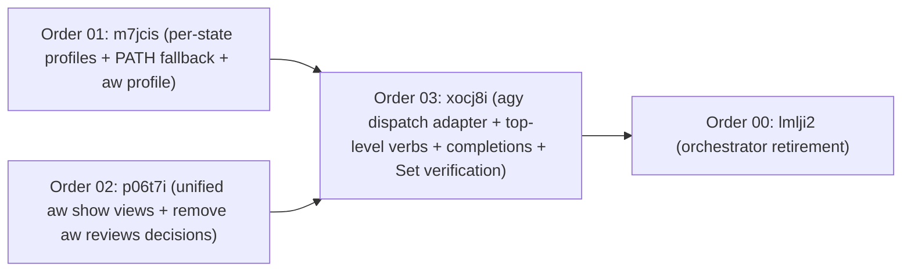

# IPD: Orchestrate verb-first top-level CLI commands and unified aw show views

- Date: 2026-11-22
- Kind: orchestrator
- Concern: Deliver verb-first top-level CLI commands (`aw rev`/`review`, `aw exec`, `aw plan`/`grad`/`graduate`, `aw approve`), Antigravity (`agy`) + OpenCode (`oc`) dispatch parity, per-state runner profile routing with single-host `PATH` fallback, unified read-only `aw show` views, and removal of `aw reviews decisions` (keeping `aw reviews record` intact through `metastore` cutover `cxxmyv` until `pqqqzf`) per spec `ogd2nv` Sections 2-4 (`i8dc07`; `ogd2nv` R-15 `aw validate` deferred to backlog `2hssxe`).
- Scope: Coordinate Orders 01 through 03 of Set `cliverbs`: Order 01 (`m7jcis`) adds per-state default profile routing, single-host `PATH` fallback, and host-neutral `aw profile`; Order 02 (`p06t7i`) unifies read-only views under `aw show` (`stale-reviews`, `review-decisions`, `graduation`, `board`, `history` matching durable `aw show <id6> --history`, `runs`, `artifact`) and removes `aw reviews decisions` while keeping `aw reviews record` intact through `metastore` cutover `cxxmyv` (full `aw reviews` retirement deferred to `pqqqzf`); Order 03 (`xocj8i`) adds the Antigravity (`agy`) dispatch adapter and `agy_runipd.py` `as <profile>` support (`E-06`), enables `--action execute`, adds the four verb-first top-level CLI commands (`rev`/`review`, `exec`, `plan`/`grad`/`graduate`, `approve`), updates completions/declarations/conformance/docs/`CHANGELOG.md`, and performs whole-Set verification (`E-05`/`V-05`; standalone `--action validate` and `aw validate` deferred to backlog `2hssxe`). This orchestrator performs no code edits itself.
- Scope-Paths: .aw/records/plans/pending/20261122-cliverbs-00-lmlji2-orchestrate-verb-first-top-level-cli-commands-and-unified-aw.ipd.md
- Item-Dependencies: executed:m7jcis, executed:p06t7i, executed:xocj8i
- Status: approved
- Readiness: go-pending-approval
- Review-Depth: orchestrator
- Coverage: pass
- Coverage-Fingerprint: 9f52ff9575058271afeba2fd61b63ce4ff71539e1448ab98b5582e6546dd36e4
- Coverage-Checked: 2026-11-27 by uri/its_direct/pt3-claude-opus-5.5-1m-us
- Short-Description: Coordinate Orders 01-03 adding per-state runner routing, unified aw show views, agy dispatch parity, and top-level verbs
- Work-Kind: feature
- Priority: medium
- From-Backlog: i8dc07
- From-Spec: ogd2nv
- Set: cliverbs
- Order: 0
- Highest E allocated: 03
- Author: antigravity
- Id: lmlji2
- Approval: 2026-11-27, recorded via aw ipd set: status set to approved

> Write and proofread this plan per the technical writing standard, `.aw/system/workflows/technical-writing/technical-writing.md` (`.agents/workflows/technical-writing/technical-writing.md` in a legacy-layout install), including requirement 12 (diagrams).

## Workflow history

- 2026-11-27 approved (aw set): status set to approved
- 2026-11-27 reviewed (aw set): plan-review: APPROVE WITH REVISIONS APPLIED; PR-001, PR-002 (FIXED)
- 2026-11-27 /plan-review (antigravity/gemini): APPROVE WITH REVISIONS APPLIED; PR-001, PR-002 (FIXED); review record .aw/records/reviews/20261122-cliverbs-00-lmlji2-orchestrate-verb-first-top-level-cli-commands-and-unified-aw.review.md
- 2026-11-27 coverage pass (aw oc run): fingerprint 9f52ff957505, model uri/its_direct/pt3-claude-opus-5.5-1m-us
- 2026-11-27 coverage pass (aw agy run): fingerprint 684388d57f13, model by host-default
- 2026-11-27 note (antigravity/gemini): Aligned scope, E-02, child table, and deferred scope with amended spec ogd2nv (R-09, R-11, AC-05) and follow-up backlog pqqqzf (aw show review-decisions, durable aw show history, keeping aw reviews record until post-cutover pqqqzf).
- 2026-11-23 to-review (aw set): status set to to-review
- 2026-11-23 coverage pass (aw oc run): fingerprint adac3176384a, model uri/its_direct/pt3-claude-opus-5.5-1m-us
- 2026-11-23 draft (antigravity): created and authored as Order 00 orchestrator for Set `cliverbs` graduating `i8dc07` under spec `ogd2nv`.

## Goal

Deliver the verb-first CLI (`review`/`rev`, `exec`, `plan`/`grad`/`graduate`, `approve`), Antigravity (`agy`) + OpenCode (`oc`) dispatch parity, and unified `aw show` surface specified in `ogd2nv` Sections 2-4 (excluding deferred R-15 `aw validate`, tracked in backlog `2hssxe`) by sequencing Orders 01 (`m7jcis`), 02 (`p06t7i`), and 03 (`xocj8i`) and retiring this orchestrator once all three children reach `executed`.

## Detailed Implementation Checklist (TODO)

Execution-state rule: mark an `E-*` item complete only after performing the action. That mark is not validation. Right-sizing rule: write for a modest executor that cannot hold much in its head. Each E-item is one step (one concern, about one file, executable in one focused pass) and its V-item names each unit it covers with its own check; a plan stays at about 5 E-items and 8 work Scope-Paths, else split it into more child plans (guidance, `IPD-Z603`). Accepted execution states: blocked, failed, pending, performed; terminal gate demands 'performed'.

### Task group 1: Child completion tracking

- [ ] E-01 CONFIRM m7jcis REACHED executed
  - Depends on: none
  - Expected outcome: Child plan `m7jcis` (Order 01) has landed in `.aw/records/plans/executed/` with `- Status: executed`, providing per-state runner profile routing, single-host `PATH` fallback, and host-neutral `aw profile` (`ogd2nv` R-07, R-08).
  - Execution state: pending

- [ ] E-02 CONFIRM p06t7i REACHED executed
  - Depends on: none
  - Expected outcome: Child plan `p06t7i` (Order 02) has landed in `.aw/records/plans/executed/` with `- Status: executed`, consolidating read-only views under `aw show` (`stale-reviews`, `review-decisions`, `graduation`, `board`, `history` matching durable `aw show <id6> --history`, `runs`, `artifact`) and removing `aw reviews decisions` while keeping `aw reviews record` intact through `metastore` cutover `cxxmyv` (deferred retirement in `pqqqzf`, `ogd2nv` R-09..R-11).
  - Execution state: pending

- [ ] E-03 CONFIRM xocj8i REACHED executed
  - Depends on: E-01, E-02
  - Expected outcome: Child plan `xocj8i` (Order 03) has landed in `.aw/records/plans/executed/` with `- Status: executed`, adding the Antigravity (`agy`) dispatch adapter and `agy_runipd.py` `as <profile>` support (`E-06`), enabling `--action execute`, exposing `aw rev`/`review`, `aw exec`, `aw plan`/`grad`/`graduate`, and `aw approve`, updating shell completions/declarations/conformance/docs/`CHANGELOG.md`, and passing whole-Set verification (`E-05`/`V-05`, `ogd2nv` R-07, R-12..R-14, R-16; `aw validate` / R-15 deferred to `2hssxe`).
  - Execution state: pending

## Child IPDs, sequence, and dependencies

| Order | Id | File | What it does | Depends on |
|---|---|---|---|---|
| 01 | `m7jcis` | `20261122-cliverbs-01-m7jcis-add-per-state-runner-profile-routing-path-host-fallback-and.ipd.md` | Extends `runner_profiles.py` and `run_dispatch.py` with per-state default profile config/CLI control (`graduate`/`plan`, `review`, `execute`, `validate`), single-host `PATH` fallback, and host-neutral `aw profile`. | none |
| 02 | `p06t7i` | `20261122-cliverbs-02-p06t7i-unify-read-only-views-under-aw-show-and-remove-aw-reviews-fo.ipd.md` | Adds reserved `aw show` views (`stale-reviews`, `review-decisions`, `graduation`, `board`, `history` matching durable `aw show <id6> --history`, `runs`) plus `aw show artifact <selector>` escape hatch, and removes `aw reviews decisions` while keeping `aw reviews record` intact until post-cutover backlog `pqqqzf`. | `executed:e36q6r`, `executed:9ifwdx` |
| 03 | `xocj8i` | `20261122-cliverbs-03-xocj8i-add-verb-first-top-level-cli-commands-review-exec-grad-appro.ipd.md` | Adds the Antigravity (`agy`) dispatch adapter and `agy_runipd.py` `as <profile>` support (`E-06`), enables `--action execute`, adds `aw rev`/`review`, `aw exec`, `aw plan`/`grad`/`graduate`, and `aw approve` (TTY auto-attest vs non-TTY `--by-human --message`), updates completions/declarations/conformance/docs/`CHANGELOG.md`, and performs whole-Set verification (`E-05`/`V-05`; `aw validate` deferred to `2hssxe`). | `executed:m7jcis`, `executed:p06t7i`, `executed:e36q6r` |

## Completion criteria (the whole Set is done only when)

- Per-state default profile routing, single-host `PATH` fallback, and host-neutral `aw profile` satisfy spec `ogd2nv` R-07, R-08, and AC-04. Owner: `m7jcis`.
- Unified read-only `aw show` views (`review-decisions`, durable `history`) and removal of `aw reviews decisions` (keeping `aw reviews record` intact until `pqqqzf`) satisfy spec `ogd2nv` R-09 through R-11 and AC-05. Owner: `p06t7i`.
- Antigravity (`agy`) + OpenCode (`oc`) dispatch parity, verb-first top-level commands (`review`/`rev`, `exec`, `plan`/`grad`/`graduate`, `approve`), completions, declarations, conformance, docs, `CHANGELOG.md`, and whole-Set verification satisfy spec `ogd2nv` R-07, R-12 through R-14, R-16, and AC-06 (excluding deferred R-15 `aw validate`, tracked in backlog `2hssxe`). Owner: `xocj8i`.

## Cross-IPD validation

- End-to-end verification combining normalized selectors (`e36q6r`), per-state profile routing (`m7jcis`), unified `aw show` views (`p06t7i`), Antigravity (`agy`) + OpenCode (`oc`) dispatch parity (`xocj8i` `E-06` / `V-06`), and all four shipped verb-first top-level commands (`review`/`rev`, `exec`, `plan`/`grad`/`graduate`, `approve`) while confirming `aw run`, `aw oc`, `aw agy`, and `aw set` remain unbroken is performed by `xocj8i` (`E-05` / `V-05`).

## Deferred / out of scope (with reason)

- Standalone `--action validate` (`/verify-execution` on already-executed plans) across `runner_shared.py`, `run_selection_policy.py`, `oc_runipd.py`, and `agy_runipd.py` and top-level `aw validate` (spec `ogd2nv` R-15 and the `aw validate` portion of AC-06): omitted from `xocj8i` per the 2026-11-27 maintainer ruling on `xocj8i` `OQ-01`.
  - Carrier: 2hssxe
- Normalized artifact selector flags across all commands: implemented by prerequisite Set `selectors` (`3xwbvs`, children `bzsoai`, `mnlaoa`, `e36q6r`).
  - Carrier: 3xwbvs
- Review-staleness clearing on human approval and `aw show stale-reviews --diff` core renderer: implemented by prerequisite IPD `9ifwdx`.
  - Carrier: 9ifwdx
- Relocating/renaming `aw reviews record` and removing top-level `aw reviews` completely before 2.0.0: deferred until after the `metastore` cutover (`cxxmyv`) lands.
  - Carrier: pqqqzf

## Scope check

- Over-scope: none; this orchestrator owns only child completion tracking and delegates all code, tests, completions, and docs to `m7jcis`, `p06t7i`, and `xocj8i`.
- Under-scope: none; every in-scope requirement in spec `ogd2nv` Sections 2-4 (`R-07`..`R-14`, `R-16`) is assigned to a child plan (`m7jcis`, `p06t7i`, `xocj8i`), and `R-15` (`aw validate`) is explicitly deferred to durable backlog carrier `2hssxe` per the 2026-11-27 maintainer ruling on `xocj8i` `OQ-01`.

## Required tests / validation

This orchestrator runs no tests directly. Whole-Set validation (targeted suites, bare core-tier `python3 -m pytest`, `mypy`, `aw attention --check`, and `aw sanitize --agent`) is performed by `xocj8i` (`E-05` / `V-05`) after Orders 01 and 02 have executed.

## Open questions

None; all five open questions in backlog item `i8dc07` were resolved by the maintainer on 2026-11-22 and codified in spec `ogd2nv`, and all four child-review open questions (`p06t7i` `OQ-01`/`OQ-02` and `xocj8i` `OQ-01`/`OQ-02`) were resolved by the maintainer on 2026-11-27 and applied across the Set (with follow-up carriers `pqqqzf` and `2hssxe`).

## Validation and cross-check (verify before reporting the Set complete)

Validation-state rule: inspect evidence in a separate pass. Do not mark a `V-*` item complete from memory or from the matching execution checkmark. Accepted validation results: blocked, failed, pass, pending; terminal gate demands 'pass'. Runtime-demonstration reachability rule: for each `V-*` item demanding the software be observed acting (such as a run, a dispatch, or a transition), as distinct from items demanding a diff, a file's content, or a test result, name the code path that produces the observation or the sibling `E-*` that creates it, else the demand is UNDER-SCOPE.

- [ ] V-01 validates E-01
  - Required evidence: Confirmed path `.aw/records/plans/executed/20261122-cliverbs-01-m7jcis-add-per-state-runner-profile-routing-path-host-fallback-and.ipd.md` with `- Status: executed` and all V-items `pass` (`ogd2nv` AC-04).
  - Observed evidence:
  - Result: pending

- [ ] V-02 validates E-02
  - Required evidence: Confirmed path `.aw/records/plans/executed/20261122-cliverbs-02-p06t7i-unify-read-only-views-under-aw-show-and-remove-aw-reviews-fo.ipd.md` with `- Status: executed` and all V-items `pass` (`ogd2nv` AC-05).
  - Observed evidence:
  - Result: pending

- [ ] V-03 validates E-03
  - Required evidence: Confirmed path `.aw/records/plans/executed/20261122-cliverbs-03-xocj8i-add-verb-first-top-level-cli-commands-review-exec-grad-appro.ipd.md` with `- Status: executed` and all V-items (`V-01..V-06`) `pass`, including whole-Set verification output in `V-05` (`ogd2nv` AC-06, excluding deferred R-15 `aw validate` in `2hssxe`).
  - Observed evidence:
  - Result: pending

## Approval and execution gate

- Size assessment: standard
- Cohesion rationale: not required

Execute (retire) only after human approval (`- Status: approved`, recorded with `aw set approved lmlji2 --by-human`) is recorded and all three children (`m7jcis`, `p06t7i`, `xocj8i`) have reached `- Status: executed` in `.aw/records/plans/executed/`.

Resolved questions: all five `i8dc07` questions and all four child-review questions (`p06t7i` `OQ-01`/`OQ-02`, `xocj8i` `OQ-01`/`OQ-02`) are resolved by the maintainer; none open.

Scope fence: this orchestrator declares only itself in `- Scope-Paths:` and performs no code edits. If an out-of-scope edit proves necessary, make it and justify it at finalize with `--scope-reason <path>`; acknowledge any declared path left unmodified with `--scope-ack <path>`.

Honesty rule: confirm each child's actual executed file path, `- Status: executed`, and passing `V-*` evidence on disk before recording `V-01..V-03` as `pass`; never claim completion of an unexecuted child.

Commits and lifecycle: commit only paths changed for this plan using `aw commit lmlji2 -- <paths>`; never `git add -A`, bare `git add`, or `git commit -a`, and never push. Never hand-roll a `git mv` of this plan into `.aw/records/plans/executed/`. Lifecycle transition is mandatory on completion with conditional ownership: when running inside a managed runner (`aw oc run` or `aw agy run`), the runner retires this orchestrator to `.aw/records/plans/executed/` automatically once every child in `## Child IPDs` is `executed` on disk (spending no agent turn); when retiring standalone outside a managed runner, run `aw ipd finalize lmlji2 --actor <agent/model> --message "
" --apply`.
