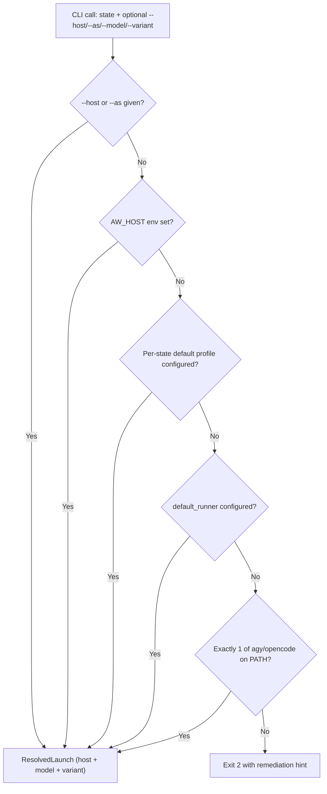

# IPD: Add per-state runner profile routing, PATH host fallback, and aw profile alias

- Date: 2026-11-22
- Kind: child
- Concern: Implement per-verb / per-state default runner profile configuration, host/profile precedence with single-host `PATH` fallback, and host-neutral `aw profile` management (spec `ogd2nv` R-07, R-08).
- Scope: Extend `agent_workflows/runner_profiles.py` to store and resolve per-state default profiles (`graduate`/`plan`, `review`, `execute`, `validate`) and perform single-host `PATH` fallback (`agy` vs `opencode`) when `default_runner` is unset; update `agent_workflows/run_dispatch.py` and `agent_workflows/cli.py` to support `--host`, `--as`, `AW_HOST`, per-state profile overrides, and host-neutral `aw profile` (`list`, `add`, `default`, `set-state`, `clear-state`, `remove`); add behavioral tests in `tests/test_runner_profiles_verbs.py`. EXCLUDES `aw show` consolidation (`p06t7i`) and verb-first CLI commands (`xocj8i`).
- Scope-Paths: agent_workflows/runner_profiles.py, agent_workflows/run_dispatch.py, agent_workflows/cli.py, tests/test_runner_profiles_verbs.py, .aw/records/plans/pending/20261122-cliverbs-01-m7jcis-add-per-state-runner-profile-routing-path-host-fallback-and.ipd.md
- Item-Dependencies: none
- Status: to-review
- Short-Description: Extend runner_profiles and run_dispatch with per-verb/per-state default profiles, single-host PATH fallback, and aw profile
- Work-Kind: feature
- Priority: medium
- From-Backlog: i8dc07
- From-Spec: ogd2nv
- Set: cliverbs
- Order: 1
- Highest E allocated: 04
- Author: antigravity
- Id: m7jcis

> Write and proofread this plan per the technical writing standard, `.aw/system/workflows/technical-writing/technical-writing.md` (`.agents/workflows/technical-writing/technical-writing.md` in a legacy-layout install), including requirement 12 (diagrams).

## Workflow history

- 2026-11-23 to-review (aw set): status set to to-review
- 2026-11-23 draft (antigravity): created and authored as Order 01 of Set `cliverbs` graduating `i8dc07` under spec `ogd2nv`.

## Goal

Enable per-workflow-state default model/host profiles (for example separate defaults for backlog graduation, IPD review, IPD execution, and validation), automatic single-host `PATH` fallback when `default_runner` is unset, and host-neutral `aw profile` management.

## Detailed Implementation Checklist (TODO)

Execution-state rule: mark an `E-*` item complete only after performing the action. That mark is not validation. Right-sizing rule: write for a modest executor that cannot hold much in its head. Each E-item is one step (one concern, about one file, executable in one focused pass) and its V-item names each unit it covers with its own check; a plan stays at about 5 E-items and 8 work Scope-Paths, else split it into more child plans (guidance, `IPD-Z603`). Accepted execution states: blocked, failed, pending, performed; terminal gate demands 'performed'.

### Task group 1: Per-state profile schema and resolution precedence

- [ ] E-01 Extend `agent_workflows/runner_profiles.py` to support per-state default profile bindings (`graduate`, `review`, `execute`, `validate`, with `plan` normalized to `graduate`) persisted cleanly in the profiles config schema alongside existing `default_runner`, `defaults`, `profiles`, and `roles`, plus mutators `set_state_profile(cfg, state, profile_name)` and `clear_state_profile(cfg, state)` validated against referential integrity.
  - Depends on: none
  - Expected outcome: Per-state profile defaults round-trip through `runner_profiles.load` / `save`, reject unknown state names or nonexistent profile names, and preserve backward compatibility with existing profile config files.
  - Execution state: pending

- [ ] E-02 Add `resolve_for_state(cfg, state, *, host=None, profile=None, model=None, variant=None, env=None, which=shutil.which)` in `agent_workflows/runner_profiles.py` implementing spec `ogd2nv` R-07 precedence: explicit `--host`/`--as`/`--model`/`--variant` > `AW_HOST` > per-state default profile > `default_runner` (and its per-runner default profile) > single-host `PATH` auto-detection (`agy` vs `opencode`). When both or neither binaries are on `PATH` and no default is set, raise `ProfileResolutionError` with an actionable hint naming `aw profile default` and `--host`.
  - Depends on: E-01
  - Expected outcome: Every precedence tier resolves deterministically and is testable without touching real host binaries via injected `env` and `which`.
  - Execution state: pending

### Task group 2: Host-neutral `aw profile` CLI and `run_dispatch.py` wiring

- [ ] E-03 Expose a host-neutral top-level `aw profile` command in `agent_workflows/cli.py` (sharing the handler of `aw oc profile` while adding `set-state <state> <profile>`, `clear-state <state>`, and showing per-state bindings in `aw profile list`), and add a shared `dispatch_for_state` helper in `agent_workflows/run_dispatch.py` that resolves host/model/variant via `runner_profiles.resolve_for_state` for verb-first commands (`xocj8i`).
  - Depends on: E-01, E-02
  - Expected outcome: Users can manage profiles, `default_runner`, and per-state defaults via `aw profile` without typing `aw oc profile`, and `run_dispatch.dispatch_for_state` is ready for `aw review`/`exec`/`grad`/`validate`.
  - Execution state: pending

### Task group 3: Behavioral tests

- [ ] E-04 Create `tests/test_runner_profiles_verbs.py` exercising: (a) storing, listing, and clearing per-state defaults (`graduate`/`plan`, `review`, `execute`, `validate`) via `aw profile` CLI and `runner_profiles` API, (b) every precedence tier (`--host`, `--as`, `AW_HOST`, per-state profile, `default_runner`, single-host `PATH` fallback for `agy`-only and `opencode`-only), (c) clear refusal when both or neither host binaries are on `PATH` with no default configured, and (d) backward compatibility with existing profile JSON documents.
  - Depends on: E-01, E-02, E-03
  - Expected outcome: All new tests and existing `tests/test_runner_profiles*.py` / `tests/test_run_dispatch*.py` pass under `python3 -m pytest` and `mypy`.
  - Execution state: pending

## Project conventions discovered (Step 0)

- `agent_workflows/runner_profiles.py` already defines `ProfileConfig`, `LaunchProfile`, `ResolvedLaunch`, `default_runner`, `defaults`, `profiles`, `roles`, `load`, `save`, `resolve`, `set_default_runner`, `set_default_profile`, and referential-integrity validation.
- `agent_workflows/run_dispatch.py` handles host-neutral `aw run ipd` and `aw run as <profile>` dispatch.
- Run `python3 -m pytest` bare; write behavioral tests only (no source inspection).

## Findings

- Existing `runner_profiles.py` supports a single `default_runner` and named profiles, but lacks per-state default bindings (`graduate`/`review`/`execute`/`validate`), single-host `PATH` fallback, and a host-neutral `aw profile` entry point.

## Proposed changes (ordered, validatable)

1. Extend `runner_profiles.py` schema and mutators for per-state profile bindings (`E-01`).
2. Add `resolve_for_state` with full precedence and single-host `PATH` fallback (`E-02`).
3. Add top-level `aw profile` CLI and `run_dispatch.dispatch_for_state` (`E-03`).
4. Add behavioral test suite `tests/test_runner_profiles_verbs.py` (`E-04`).

## Deferred / out of scope (with reason)

- Top-level verbs (`aw rev`, `aw exec`, `aw grad`, `aw validate`, `aw approve`) calling `dispatch_for_state`: owned by Order 03 (`xocj8i`).
  - Carrier: xocj8i
- Unified `aw show` views and removing `aw reviews`: owned by Order 02 (`p06t7i`).
  - Carrier: p06t7i

## Scope check

- Over-scope: none; touches only runner profile config, dispatch helper, `aw profile` CLI registration, and tests.
- Under-scope: none; satisfies spec `ogd2nv` R-07 and R-08 completely.

## Required tests / validation

- `python3 -m pytest tests/test_runner_profiles_verbs.py tests/test_runner_profiles*.py tests/test_run_dispatch*.py`
- `python3 -m mypy agent_workflows/runner_profiles.py agent_workflows/run_dispatch.py agent_workflows/cli.py`
- `aw sanitize`

## Spec / documentation sync

- Implements spec `ogd2nv` R-07 and R-08 (`AC-04`). User-facing verb docs update in Order 03 (`xocj8i`).

## Open questions

None; all design questions were resolved in `i8dc07` OQ-01 and codified in spec `ogd2nv`.

## Validation and cross-check (verify before reporting done)

Validation-state rule: inspect evidence in a separate pass. Do not mark a `V-*` item complete from memory or from the matching execution checkmark. Accepted validation results: blocked, failed, pass, pending; terminal gate demands 'pass'. Runtime-demonstration reachability rule: for each `V-*` item demanding the software be observed acting (such as a run, a dispatch, or a transition), as distinct from items demanding a diff, a file's content, or a test result, name the code path that produces the observation or the sibling `E-*` that creates it, else the demand is UNDER-SCOPE.

- [ ] V-01 validates E-01
  - Required evidence: Pasted pytest output from `tests/test_runner_profiles_verbs.py` proving per-state default bindings (`graduate`/`plan`, `review`, `execute`, `validate`) persist cleanly, enforce referential integrity, and load legacy profile configs without error.
  - Observed evidence:
  - Result: pending

- [ ] V-02 validates E-02
  - Required evidence: Pasted pytest output from `tests/test_runner_profiles_verbs.py` proving all six precedence levels (`--host`/`--as` > `AW_HOST` > per-state > `default_runner` > single-host `PATH` fallback > clean refusal when both or neither binaries are on `PATH`).
  - Observed evidence:
  - Result: pending

- [ ] V-03 validates E-03
  - Required evidence: Pasted pytest output demonstrating `aw profile list`, `aw profile set-state`, `aw profile clear-state`, `aw profile default`, and `run_dispatch.dispatch_for_state` returning the expected runner invocation.
  - Observed evidence:
  - Result: pending

- [ ] V-04 validates E-04
  - Required evidence: Pasted runner output from `python3 -m pytest tests/test_runner_profiles_verbs.py tests/test_runner_profiles*.py tests/test_run_dispatch*.py`, `mypy`, and `aw sanitize` all passing with exit 0.
  - Observed evidence:
  - Result: pending

## Approval and execution gate

- Size assessment: standard
- Cohesion rationale: not required

Ready for `/plan-review` and human approval (`aw set approved m7jcis --by-human`). Execution must follow the repository agent execution contract (isolated worktree, path-scoped `aw commit m7jcis -- <paths>`, pasted validation output, and post-gate lifecycle transition).
