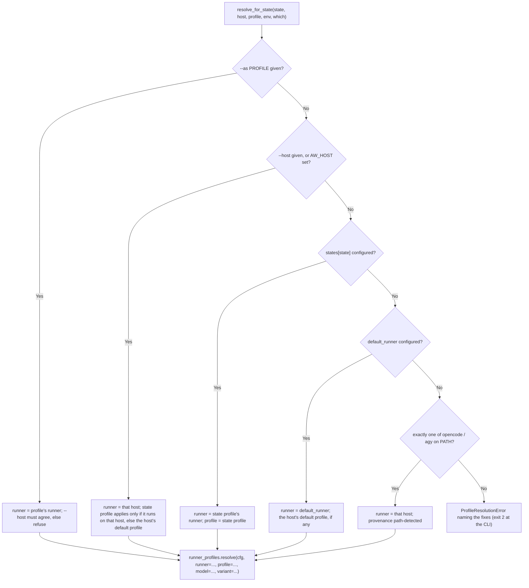

# IPD: Add per-state runner profile routing, PATH host fallback, and aw profile alias

- Date: 2026-11-22
- Kind: child
- Concern: Implement per-verb / per-state default runner profile configuration, host/profile precedence with single-host `PATH` fallback, and host-neutral `aw profile` management (spec `ogd2nv` R-07, R-08).
- Scope: Extend `agent_workflows/runner_profiles.py` with a top-level `states` map (per-state default profiles for `graduate`/`plan`, `review`, `execute`, `validate`), a schema bump to version 3, and `resolve_for_state` implementing spec `ogd2nv` R-07 precedence including the `AW_HOST` override and single-host `PATH` fallback (`opencode` vs `agy`); add `run_dispatch.dispatch_for_state`, which resolves only the runner and profile name and forwards to the existing adapter; register a host-neutral top-level `aw profile` (`list`, `show`, `add`, `remove`, `default`, `default-runner`, `set-state`, `clear-state`) in `agent_workflows/cli.py` and declare its leaves in `agent_workflows/command_surface.py` and `tests/conformance_matrix.py`; update `docs/runner-profiles.md`; add behavioral tests in `tests/test_runner_profiles_verbs.py` and update the schema-constant tests in `tests/test_runner_profiles.py`. EXCLUDES `aw show` consolidation (`p06t7i`), verb-first CLI commands (`xocj8i`), and an Antigravity (`agy`) dispatch adapter (see OQ-01).
- Scope-Paths: agent_workflows/runner_profiles.py, agent_workflows/run_dispatch.py, agent_workflows/cli.py, agent_workflows/command_surface.py, docs/runner-profiles.md, tests/test_runner_profiles_verbs.py, tests/test_runner_profiles.py, tests/conformance_matrix.py, .aw/records/plans/pending/20261122-cliverbs-01-m7jcis-add-per-state-runner-profile-routing-path-host-fallback-and.ipd.md
- Item-Dependencies: none
- Status: approved
- Readiness: go-pending-approval
- Review-Depth: standard
- Short-Description: Extend runner_profiles and run_dispatch with per-verb/per-state default profiles, single-host PATH fallback, and aw profile
- Work-Kind: feature
- Priority: medium
- From-Backlog: i8dc07
- From-Spec: ogd2nv
- Set: cliverbs
- Order: 1
- Highest E allocated: 06
- Author: antigravity
- Id: m7jcis
- Approval: 2026-11-27, recorded via aw ipd set: status set to approved

> Write and proofread this plan per the technical writing standard, `.aw/system/workflows/technical-writing/technical-writing.md` (`.agents/workflows/technical-writing/technical-writing.md` in a legacy-layout install), including requirement 12 (diagrams).

## Workflow history

- 2026-11-27 approved (aw set): status set to approved
- 2026-11-24 reviewed (aw set): APPROVE WITH REVISIONS APPLIED; PR-001..PR-016 FIXED
- 2026-11-24 /plan-review (uri/its_direct/pt3-claude-opus-5.5-1m-us): APPROVE WITH REVISIONS APPLIED; PR-001..PR-016 FIXED; review record .aw/records/reviews/20261122-cliverbs-01-m7jcis-add-per-state-runner-profile-routing-path-host-fallback-and.review.md
- 2026-11-23 to-review (aw set): status set to to-review
- 2026-11-23 draft (antigravity): created and authored as Order 01 of Set `cliverbs` graduating `i8dc07` under spec `ogd2nv`.

## Goal

Enable per-workflow-state default launch profiles (for example separate defaults for backlog graduation, IPD review, IPD execution, and validation), automatic single-host `PATH` fallback when no host is configured, and host-neutral `aw profile` management. A launch profile is a named entry in the user-local runner profile store (`runner-profiles.json`) that fixes a host runner, a model, and optional launch fields.

The diagram shows how `resolve_for_state` picks the RUNNER and the PROFILE NAME. Per-field values (`model`, `variant`, `agent`, `validate`) are then resolved by the existing `runner_profiles.resolve`, unchanged.

## Detailed Implementation Checklist (TODO)

Execution-state rule: mark an `E-*` item complete only after performing the action. That mark is not validation. Right-sizing rule: write for a modest executor that cannot hold much in its head. Each E-item is one step (one concern, about one file, executable in one focused pass) and its V-item names each unit it covers with its own check; a plan stays at about 5 E-items and 8 work Scope-Paths, else split it into more child plans (guidance, `IPD-Z603`). Accepted execution states: blocked, failed, pending, performed; terminal gate demands 'performed'.

### Task group 1: Per-state profile schema and resolution precedence

- [ ] E-01 In `agent_workflows/runner_profiles.py`, add the per-state profile map to the schema and its mutators.
  - Vocabulary: add `STATE_NAMES = ("graduate", "review", "execute", "validate")` (closed, like `ROLE_NAMES` around line 300) and `validate_state_name(name)`, which accepts `plan` as an input alias for `graduate` and refuses any other name with a `ProfileSchemaError` that lists the vocabulary. The stored document uses canonical names only: `parse_states` refuses a stored `plan` key with a message saying to write `graduate`, so one state can never carry two bindings.
  - Storage: a new TOP-LEVEL `states` key (state name -> profile NAME), mirroring `roles` rather than nesting under `defaults`. Add `"states"` to `ALLOWED_DOCUMENT_KEYS` (around line 278); add a `states: Mapping[str, str]` field to `ProfileConfig` (frozen through `MappingProxyType`, like `roles`); add `parse_states` (shape checks as in `parse_roles`, around line 988); read `states` at every supported version (the `roles` precedent, DECISION 01-btot17-D2); OMIT the key from `to_document` when empty so every existing store keeps its bytes and its `config_digest`; carry `states` through `_replace` (around line 1349) and `from_document` (around line 1186).
  - Referential integrity: extend `_validate_referential_integrity` (around line 1078) so every `states` entry must name an existing profile, refusing with the same style of message `_validate_role_reference` uses. A state profile may run on ANY runner; that is the point, since the state decides the host.
  - Schema version: set `SCHEMA_VERSION = 3` and `SUPPORTED_SCHEMA_VERSIONS = frozenset((1, 2, 3))` (around lines 232 and 254), update the module docstring's "Schema version 2 document" example (around line 22) to version 3 with a `states` entry, and rewrite the comment above the constants to record that `states` is the first consumed new key, so this plan is the "REQUIRED COMPANION" bump the existing comment describes. Mutators preserve `cfg.schema_version` today (measured at review: `set_default_profile` on a version 1 config returns version 1), so `set_state_profile` must return a config whose `schema_version` is `SCHEMA_VERSION`; otherwise a version 2 store would be saved carrying `states`, and an older aw would say "unknown field(s) ['states']" instead of "Upgrade aw". A store with no `states` is never bumped.
  - Mutators: `set_state_profile(cfg, state, profile_name)` and `clear_state_profile(cfg, state)` (idempotent), both validating the state name first. Extend `remove_profile` (around line 1393) so a profile referenced by any `states` entry follows the same explicit-decision rule as a per-runner default: `clear_default=True` also drops those state bindings, `replacement=<other>` repoints them (any runner is acceptable for a state binding; the existing same-runner check still applies to per-runner defaults), and with neither the call raises `ProfileResolutionError` naming the referencing states.
  - Update the two existing tests in `tests/test_runner_profiles.py` that pin the old constants: `test_the_module_writes_2_and_reads_1_and_2` (around line 3576) and the `ALLOWED_DOCUMENT_KEYS` assertion (around line 3976). Change only the expected values, and rename the first test to match.
  - Depends on: none
  - Expected outcome: Per-state bindings round-trip through `runner_profiles.load` / `save`; an unknown state, a stored `plan` key, or a dangling profile reference is refused; every existing version 1 and version 2 store loads unchanged and keeps its digest; setting a state binding writes `schema_version` 3.
  - Execution state: pending

- [ ] E-02 Add `resolve_for_state(cfg, state, *, host=None, profile=None, model=None, variant=None, env=None, which=None) -> ResolvedLaunch` in `agent_workflows/runner_profiles.py` implementing spec `ogd2nv` R-07.
  - Runner and profile selection, highest first: (1) explicit `profile` (`--as`): the profile's runner, and an explicit `host` that disagrees is refused by the existing `resolve` check; `AW_HOST` is ignored because the named profile decides its host. (2) explicit `host` (`--host`), then `AW_HOST` from `env` (default `os.environ`; an empty value counts as unset): canonicalize with `canonical_runner`, so `oc`, `opencode`, `agy`, and `antigravity` are accepted, and an unknown value raises `ProfileResolutionError` naming `AW_HOST` rather than being ignored. The state's profile applies only when it runs on that host; otherwise no profile is named and `resolve` applies that host's per-runner default profile. (3) `cfg.states[state]`: its runner and that profile. (4) `cfg.default_runner`, with `resolve` applying its per-runner default profile. (5) single-host `PATH` detection through `which` (default `shutil.which`) over a new constant `HOST_BINARIES = {"oc": "opencode", "agy": "agy"}`: exactly one found selects that runner.
  - Refusal: when no tier selects a runner (both binaries or neither on `PATH`), raise `ProfileResolutionError` whose message says which case occurred and names the fixes: `--host`, `AW_HOST`, `aw profile default-runner <host>`, and `aw profile set-state <state> <profile>`.
  - Field values: after choosing the runner and profile name, call the existing `resolve(cfg, runner=..., profile=..., model=model, variant=variant)` once, so per-field precedence stays in one function. Then set `provenance["runner"]` to one of three NEW values, added to `PROVENANCE_VALUES` (around line 717) beside the existing ones: `env-host` (from `AW_HOST`), `state-profile` (from `states`), and `path-detected` (from `PATH`); relabel field provenance that `resolve` reported as `profile` to `state-profile` when the profile came from `states`. Keep `explicit` and `default-runner` for tiers (1), (2) explicit, and (4).
  - Unchanged on purpose: `resolve(generic=True)` and `aw run ipd` keep refusing without `default_runner`; spec R-07 scopes `PATH` fallback to verb-first commands, so the fallback lives only in `resolve_for_state`. Update the `generic` paragraph of the `resolve` docstring (around line 1563) and the refusal text "aw does not guess which host to run" to say that `resolve_for_state` is the one route that may detect a host, and only when exactly one host binary exists.
  - Depends on: E-01
  - Expected outcome: Every tier resolves deterministically and is testable without real host binaries or the real environment, through injected `env` and `which`; every provenance value is a member of `PROVENANCE_VALUES`.
  - Execution state: pending

### Task group 2: Host-neutral `aw profile` CLI and `run_dispatch.py` wiring

- [ ] E-03 Register a host-neutral top-level `aw profile` command in `agent_workflows/cli.py` (no top-level `profile` parser exists today; confirmed at review) that reuses the `aw oc profile` handlers through `_run_oc_profile` (around line 20321).
  - Leaves and how each chooses a runner without a host prefix: `list` (alias `ls`) shows profiles for ALL runners with a runner column, each runner's default profile, `default_runner`, and the `states` bindings (also in the `--agent`/`--json` data); `show NAME` shows any profile; `add NAME --host HOST ...` requires `--host` and then behaves as `aw <host> profile add`; `remove NAME` uses the profile's own runner and accepts the existing `--clear-default`/`--replacement` flags, which also govern state bindings (E-01); `default NAME` sets the per-runner default for the profile's own runner, and `default --clear --host HOST` clears one; `default-runner HOST|--clear` sets or clears `default_runner` through `set_default_runner` (today only the OpenCode wizard can set it, at `runner_profile_wizard.py` line 627); `set-state STATE PROFILE` and `clear-state STATE` call the E-01 mutators.
  - `set-state` and `clear-state` exist only under `aw profile`, because a state binding is not owned by one host; `aw oc profile` and `aw agy profile` keep their current leaves, so `tests/test_completion.py` and `tests/test_oc_profile_cli_regression.py` stay valid unchanged.
  - Result records: the host-neutral leaves report `command` as `profile <verb>` (today `_oc_profile_result` hard-codes `<runner> profile <verb>`), and every typed `RunnerProfileError` keeps exiting 2 through `_run_oc_profile`.
  - Declare every new leaf in `agent_workflows/command_surface.py` (matching the `oc profile` declarations around line 2271), and add `tests/conformance_matrix.py` entries the way `oc profile` has them: `RUNNABLE_ARGV` for `profile show` and `arg_fixture_needed` exemptions for leaves that require a positional (`profile remove`, `profile set-state`, `profile clear-state`).
  - Depends on: E-01, E-02
  - Expected outcome: Users can list, show, add, remove, and set defaults for profiles, set `default_runner`, and set or clear per-state bindings with `aw profile`, without typing `aw oc profile`, and `tests/test_command_surface_declarations.py` reports zero undeclared leaves.
  - Execution state: pending

- [ ] E-05 Add `dispatch_for_state(state, tail, *, host=None, profile=None, env=None, which=None) -> int` to `agent_workflows/run_dispatch.py` for the verb-first commands that `xocj8i` adds.
  - It calls `runner_profiles.resolve_for_state` to choose the runner and profile NAME only, then calls `adapter_for(runner)` and forwards `[AS_TOKEN, profile, *tail]` when a profile was named by `--as` or by `states`, else `tail` unchanged. It never injects `--model`/`--variant`; those stay in `tail` and the host driver applies them once, which keeps the module docstring rule "RESOLUTION IS NOT DUPLICATED HERE".
  - Every `RunnerProfileError` and `RunDispatchError` is printed to stderr and returns `EXIT_CANNOT_RUN` (2), the same rendering `dispatch()` uses; this is where spec R-07's exit 2 comes from.
  - `RUNNER_ADAPTERS` stays OpenCode-only (OQ-01). A runner resolved as `agy` (including an `agy`-only `PATH`) therefore reaches the existing `adapter_for` refusal, "a known runner but has no dispatch adapter", and exits 2 before any host starts.
  - Update the module docstring's "FAIL CLOSED, NEVER FALL BACK" paragraph to name the single-host `PATH` detection in `dispatch_for_state` as the one exception and to say why it is not a guess: only one host could run.
  - Depends on: E-02
  - Expected outcome: `dispatch_for_state` routes each state to the expected adapter argv, refuses with exit 2 and a remediation message when no host is selectable or the host has no adapter, and leaves `dispatch_named`, `dispatch_default`, and `aw run ipd` behavior unchanged.
  - Execution state: pending

### Task group 3: Behavioral tests

- [ ] E-04 Create `tests/test_runner_profiles_verbs.py` with `pytestmark = pytest.mark.core` (so the bare core tier runs it), isolating the store with a temporary `XDG_CONFIG_HOME` as `tests/test_agy_profile_cli.py` does, and asserting on returned values, exit codes, stored documents, and output, never on source text. Cover:
  - (a) Storing, listing, and clearing per-state bindings through both the API and `cli.main(["profile", ...])`, including `plan` as an alias for `graduate`, refusal of an unknown state and a dangling profile, `schema_version` 3 written only once a binding exists, an existing version 1 and version 2 document loading unchanged with an unchanged digest, and `aw profile remove` of a state-referenced profile refusing without `--clear-default`/`--replacement` and succeeding with each.
  - (b) Every `resolve_for_state` tier with injected `env` and `which`: `--as`, `--as` with a disagreeing `--host` (refused), `--host` with a matching and a non-matching state profile, `AW_HOST` (including `opencode` and `antigravity` aliases, an empty value, and an invalid value), the state profile, `default_runner`, and `PATH` fallback for `opencode`-only and `agy`-only, each with its expected provenance value.
  - (c) Refusal when both binaries or neither are on `PATH` with no other tier set, asserting the message names `aw profile default-runner` and `--host`.
  - (d) `run_dispatch.dispatch_for_state` with `RUNNER_ADAPTERS` patched to a recording adapter: the forwarded argv for a state profile, a per-runner default profile, and `--as`; exit 2 with the "no dispatch adapter" message for a resolved `agy`; exit 2 for the both/neither refusal.
  - (e) `aw profile default-runner`, `default`, `show`, and `add --host` producing the expected store changes and `--agent` result records with `command` set to `profile <verb>`.
  - Depends on: E-01, E-02, E-03, E-05
  - Expected outcome: The new tests, the existing runner-profile and profile-CLI tests, the command-surface and agent-surface conformance tests, the `aw run` dispatch tests in `tests/test_cli.py`, and the bare core tier all pass, and `mypy` is clean on the changed modules.
  - Execution state: pending

### Task group 4: User documentation

- [ ] E-06 Update `docs/runner-profiles.md` for the new behavior.
  - Add a section on per-state defaults (`aw profile set-state`/`clear-state`, the `states` key, `plan` meaning `graduate`), the verb-first host precedence from E-02 (including `AW_HOST` and single-host `PATH` detection, and that `aw run ipd` still requires `default_runner`), and the host-neutral `aw profile` leaves, including `default-runner`.
  - Update every `schema_version: 2` example and the version paragraph (around line 265) to say a store that carries `states` is written as version 3 and is refused, with the upgrade advice, by an older aw.
  - Add one sentence saying `aw profile` (launch profiles) is unrelated to the separate `aw-profile` console script (`agent_workflows/aw_profile.py`, a run-trace profiling tool), so the similar names do not mislead.
  - Follow the user-facing prose rules: no em or en dashes.
  - Depends on: E-01, E-02, E-03, E-05
  - Expected outcome: `docs/runner-profiles.md` describes per-state defaults, the full verb-first precedence, `aw profile`, and schema version 3, with no stale version 2-only statement.
  - Execution state: pending

## Project conventions discovered (Step 0)

- `agent_workflows/runner_profiles.py` already defines `ProfileConfig`, `LaunchProfile`, `ResolvedLaunch`, `default_runner`, `defaults`, `profiles`, `roles`, `load`, `save`, `resolve`, `set_default_runner`, `set_default_profile`, `set_role`, `remove_profile`, and referential-integrity validation. Its schema FAILS CLOSED on an unknown key (`ALLOWED_DOCUMENT_KEYS` around line 278), and the comment above `SUPPORTED_SCHEMA_VERSIONS` says the version bump is the "REQUIRED COMPANION of the first plan that makes the key consumable".
- `PROVENANCE_VALUES` (around line 717) is a closed set, and `tests/test_runner_profiles.py` (around lines 2184 and 2300) fails any provenance value outside it.
- `agent_workflows/run_dispatch.py` handles host-neutral `aw run ipd` and `aw run as <profile>`. Its docstring rules are "RESOLUTION IS NOT DUPLICATED HERE" (resolve only the runner and forward the `as <profile>` clause) and "FAIL CLOSED, NEVER FALL BACK". `RUNNER_ADAPTERS` registers `oc` only, and `agy_runipd.main` has no `as <profile>` clause (its `resolve_verification_decision` docstring calls that "the deferred dispatch-adapter work").
- `aw oc profile` and `aw agy profile` share handlers through `_run_oc_profile` and a `profile_runner` parser default; every parser leaf must be declared in `agent_workflows/command_surface.py` (`tests/test_command_surface_declarations.py`), and leaves needing a positional carry `tests/conformance_matrix.py` exemptions.
- `AW_HOST` does not exist anywhere in `agent_workflows/` today; this plan introduces it.
- Run `python3 -m pytest` bare for the core tier; `tests/test_cli.py` is marked `slow`, so its `aw run` dispatch tests run only with `-o addopts=""`. Write behavioral tests only (no source inspection).

## Findings

- `runner_profiles.py` supports one `default_runner`, per-runner default profiles, and a `roles` map with no consumer, but has no per-state bindings, no `PATH` fallback, and no `AW_HOST`; no host-neutral `aw profile` exists, and no CLI command sets `default_runner`.
- The unknown-key refusal means per-state bindings need a new allowed key and, per the module's own recorded rule, a schema version bump; because mutators preserve the loaded version, the bump must be applied by the mutator that adds a binding.
- `run_dispatch` cannot launch Antigravity, so an `agy` host chosen by `AW_HOST`, a state profile, or `PATH` can be resolved but not dispatched (OQ-01).
- The spec's `PATH` fallback contradicts two shipped docstrings ("aw does not guess which host to run", "FAIL CLOSED, NEVER FALL BACK"); the plan narrows the fallback to the new verb-first route and updates both texts.

## Proposed changes (ordered, validatable)

1. Add the `states` map, `STATE_NAMES`, mutators, `remove_profile` handling, and schema version 3 to `runner_profiles.py` (`E-01`).
2. Add `resolve_for_state` with the R-07 tiers, `AW_HOST`, `PATH` detection, and three provenance values (`E-02`).
3. Add the host-neutral `aw profile` leaves and their declarations (`E-03`).
4. Add `run_dispatch.dispatch_for_state`, which resolves the runner and profile name and forwards (`E-05`).
5. Add behavioral tests in `tests/test_runner_profiles_verbs.py` (`E-04`).
6. Update `docs/runner-profiles.md` (`E-06`).

## Deferred / out of scope (with reason)

- Top-level verbs (`aw rev`, `aw exec`, `aw grad`, `aw validate`, `aw approve`) calling `dispatch_for_state`: owned by Order 03 (`xocj8i`).
  - Carrier: xocj8i
- Unified `aw show` views and removing `aw reviews`: owned by Order 02 (`p06t7i`).
  - Carrier: p06t7i
- An Antigravity (`agy`) dispatch adapter, so a verb whose resolved host is `agy` can launch instead of refusing: needs an `as <profile>` clause or equivalent in `agy_runipd.py`, outside this Set's declared scope (OQ-01). `xocj8i` is the first consumer that meets the refusal and carries the decision.
  - Carrier: xocj8i

## Scope check

- Over-scope: none. `default-runner` and `show` under `aw profile` are needed for the R-07 refusal message to name a working fix and for R-08 "inspect"; `docs/runner-profiles.md` is the user document for the store this plan changes.
- Under-scope: none after review; schema storage and version, `AW_HOST` validation, host-versus-state interaction, profile removal, provenance, the declarations, and the documentation are now explicit.

## Required tests / validation

- `python3 -m pytest tests/test_runner_profiles_verbs.py tests/test_runner_profiles.py tests/test_agy_profile_cli.py tests/test_oc_profile_cli_regression.py tests/test_runner_profile_wizard_discovery.py tests/test_runner_shared.py`
- `python3 -m pytest tests/test_command_surface_declarations.py tests/test_agent_surface_conformance.py tests/test_completion.py`
- `python3 -m pytest -o addopts="" tests/test_cli.py -k RunDispatch` (`tests/test_cli.py` is marked `slow`)
- `python3 -m pytest` (bare core tier, the runner merge gate)
- `python3 -m mypy agent_workflows/runner_profiles.py agent_workflows/run_dispatch.py agent_workflows/cli.py agent_workflows/command_surface.py`
- `aw sanitize --agent`

## Spec / documentation sync

- Implements spec `ogd2nv` R-07 and R-08 and satisfies `ogd2nv` AC-04 at the library and `aw profile` level. No spec text changes. `docs/runner-profiles.md` is updated here (`E-06`); verb help text and `docs/cli-output-contract.md` change in Order 03 (`xocj8i`).
- Spec `ogd2nv` is at `to-review`, not `approved`, at the time of this review; this plan follows its current text, and the human approving this plan should know the spec may still change.

## Open questions

### OQ-01: Does this plan add an Antigravity dispatch adapter?

- Blocking: no
- Status: resolved
- Owner: plan reviewer
- Resolution or deferral rationale: No. `dispatch_for_state` uses the existing `adapter_for`, so a resolved `agy` refuses with exit 2 before any host starts. Reasons: `run_dispatch.py` documents `agy` as a deliberate "registered but not implemented" gap, `agy_runipd.py` has no `as <profile>` clause and calls that "the deferred dispatch-adapter work", and an adapter would also change `aw run ipd` for a store whose `default_runner` is `agy`; none of those files' adapter changes are in this Set's declared scope. The refusal is safe and names the fix. Whether the Set should add the adapter is a scope decision recorded in the Deferred section and carried by `xocj8i`. Recommendation strength: strong for this plan's behavior; the scope question is the maintainer's.

## Validation and cross-check (verify before reporting done)

Validation-state rule: inspect evidence in a separate pass. Do not mark a `V-*` item complete from memory or from the matching execution checkmark. Accepted validation results: blocked, failed, pass, pending; terminal gate demands 'pass'. Runtime-demonstration reachability rule: for each `V-*` item demanding the software be observed acting (such as a run, a dispatch, or a transition), as distinct from items demanding a diff, a file's content, or a test result, name the code path that produces the observation or the sibling `E-*` that creates it, else the demand is UNDER-SCOPE.

- [ ] V-01 validates E-01
  - Required evidence: Pasted pytest output, with test names visible (`python3 -m pytest -o addopts="" -v tests/test_runner_profiles_verbs.py tests/test_runner_profiles.py`), proving per-state bindings round-trip through `load`/`save`; `plan` normalizes to `graduate`; an unknown state, a stored `plan` key, and a dangling reference are refused; existing version 1 and version 2 documents load with an unchanged digest; a binding writes `schema_version` 3; `remove_profile` of a state-referenced profile refuses without a decision and succeeds with `clear_default` and with `replacement`; and the updated constant tests in `tests/test_runner_profiles.py` pass.
  - Observed evidence:
  - Result: pending

- [ ] V-02 validates E-02
  - Required evidence: Pasted pytest output from `tests/test_runner_profiles_verbs.py` with test names visible, proving each `resolve_for_state` tier named in E-04 (b) selects the expected runner, profile, and provenance value; an invalid `AW_HOST` is refused; the both and neither `PATH` cases raise a message naming `aw profile default-runner` and `--host`; and `resolve(cfg, generic=True)` without `default_runner` still refuses (the existing `tests/test_runner_profiles.py` coverage passing).
  - Observed evidence:
  - Result: pending

- [ ] V-03 validates E-03
  - Required evidence: Pasted pytest output demonstrating `aw profile list`, `show`, `add --host`, `remove`, `default`, `default-runner`, `set-state`, and `clear-state` driven through `cli.main` with the expected store changes, exit codes, and `--agent` records (`command` = `profile <verb>`); plus pasted output of `python3 -m pytest tests/test_command_surface_declarations.py tests/test_agent_surface_conformance.py tests/test_completion.py tests/test_oc_profile_cli_regression.py tests/test_agy_profile_cli.py` passing.
  - Observed evidence:
  - Result: pending

- [ ] V-04 validates E-04
  - Required evidence: Pasted runner output, with the `N passed` summary lines and exit codes, from every command in `## Required tests / validation`: both targeted `pytest` commands, `python3 -m pytest -o addopts="" tests/test_cli.py -k RunDispatch`, the bare `python3 -m pytest`, `python3 -m mypy` on the four modules, and `aw sanitize --agent`.
  - Observed evidence:
  - Result: pending

- [ ] V-05 validates E-05
  - Required evidence: Pasted pytest output from `tests/test_runner_profiles_verbs.py` with test names visible, proving `run_dispatch.dispatch_for_state` (with `RUNNER_ADAPTERS` patched to a recording adapter) forwards `["as", <profile>, *tail]` for a state profile and for `--as`, forwards `tail` unchanged when only a per-runner default applies, never adds `--model`/`--variant` to the forwarded argv, and returns 2 with the "no dispatch adapter" message for a resolved `agy` and with the remediation message for the both and neither `PATH` cases; plus pasted output of `python3 -m pytest -o addopts="" tests/test_cli.py -k RunDispatch` passing, showing `aw run` routes are unchanged.
  - Observed evidence:
  - Result: pending

- [ ] V-06 validates E-06
  - Required evidence: Pasted `git diff -- docs/runner-profiles.md` showing the per-state section, the verb-first precedence (with `AW_HOST`, `PATH` detection, and the unchanged `aw run ipd` rule), the `aw profile` leaves including `default-runner`, the schema version 3 paragraph, and the `aw-profile` disambiguation sentence; plus pasted output of `grep -nP '[\x{2013}\x{2014}]' docs/runner-profiles.md` showing no match on changed lines.
  - Observed evidence:
  - Result: pending

## Approval and execution gate

- Size assessment: standard
- Cohesion rationale: not required

Execute only after human approval (`- Status: approved`, recorded with `aw set approved m7jcis --by-human`). Open questions: OQ-01 is resolved; none open.

Scope fence: the paths in `- Scope-Paths:` are a declaration. If execution must edit a file outside the fence, make the needed edit and justify it at finalize (`--scope-reason`), and acknowledge any declared path left unmodified (`--scope-ack`).

Safety rule: uncommitted changes and untracked files you did not create are not yours; never revert, stage, commit, discard, reformat, or clean up another party's work. Stop and report if a file you must edit has an unresolvable concurrent-edit conflict.

Honesty rule: run all required tests and checks and paste the ACTUAL runner output and summary lines; never claim a result you did not run.

Commits: commit only files modified for this plan through `aw commit m7jcis -- <paths>`; never `git add -A`, a bare `git add`, `git commit -a`, or `--no-verify`; never push without explicit human instruction.

Lifecycle transition: this plan moves to `.aw/records/plans/executed/` only through `aw ipd finalize`, never a hand `git mv`, and only after `aw ipd lint --phase pre-transition` conforms and every `V-*` reads `pass` with pasted evidence. When `aw oc run` or `aw agy run` executes this plan, the runner owns retirement to `executed/` and runs finalize automatically upon task completion; when executed standalone by hand or by a direct agent turn, the executor runs `aw ipd finalize m7jcis`.
