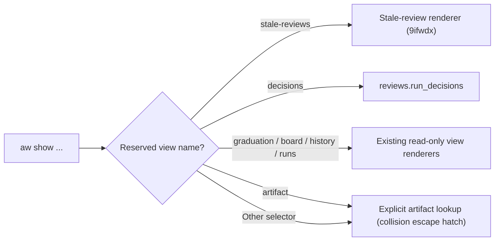

# IPD: Unify read-only views under aw show and remove aw reviews for 2.0.0

- Date: 2026-11-22
- Kind: child
- Concern: Consolidate read-only inspection views under `aw show` (`stale-reviews`, `decisions`, `graduation`, `board`, `history`, `runs`, plus `aw show artifact <selector>` escape hatch) and remove `aw reviews` outright for 2.0.0 across all 13 references (spec `ogd2nv` R-09 through R-11).
- Scope: Update `aw show` in `agent_workflows/cli.py` to dispatch reserved view names (`stale-reviews`, `decisions`, `graduation`, `board`, `history`, `runs`) and `artifact <selector>` while preserving bare `aw show <id6|setid|status>` fallback and normalized selector flags (`e36q6r`); remove top-level `aw reviews` from `agent_workflows/cli.py`; update all 13 `aw reviews` references across `agent_workflows/reviews.py`, `agent_workflows/check_engine.py`, `agent_workflows/cli.py`, `tests/test_review_decisions.py`, `docs/cli-output-contract.md`, and `docs/artifact-lifecycles.md`; add behavioral tests in `tests/test_review_decisions.py` and `tests/test_show_views.py`. EXCLUDES verb-first action commands (`xocj8i`).
- Scope-Paths: agent_workflows/cli.py, agent_workflows/reviews.py, agent_workflows/check_engine.py, docs/cli-output-contract.md, docs/artifact-lifecycles.md, tests/test_review_decisions.py, tests/test_show_views.py, .aw/records/plans/pending/20261122-cliverbs-02-p06t7i-unify-read-only-views-under-aw-show-and-remove-aw-reviews-fo.ipd.md
- Item-Dependencies: executed:e36q6r, executed:9ifwdx
- Status: to-review
- Short-Description: Add reserved aw show views (stale-reviews, decisions, graduation, board, history, runs, artifact escape) and remove aw reviews
- Work-Kind: feature
- Priority: medium
- From-Backlog: i8dc07
- From-Spec: ogd2nv
- Set: cliverbs
- Order: 2
- Highest E allocated: 04
- Author: antigravity
- Id: p06t7i

> Write and proofread this plan per the technical writing standard, `.aw/system/workflows/technical-writing/technical-writing.md` (`.agents/workflows/technical-writing/technical-writing.md` in a legacy-layout install), including requirement 12 (diagrams).

## Workflow history

- 2026-11-23 to-review (aw set): status set to to-review
- 2026-11-23 draft (antigravity): created and authored as Order 02 of Set `cliverbs` graduating `i8dc07` under spec `ogd2nv`.

## Goal

Make `aw show` the single home for read-only inspection views (`stale-reviews`, `decisions`, `graduation`, `board`, `history`, `runs`, plus `artifact <selector>` and direct `<id6|setid|status>` lookups) and cleanly remove `aw reviews` for 2.0.0.

## Detailed Implementation Checklist (TODO)

Execution-state rule: mark an `E-*` item complete only after performing the action. That mark is not validation. Right-sizing rule: write for a modest executor that cannot hold much in its head. Each E-item is one step (one concern, about one file, executable in one focused pass) and its V-item names each unit it covers with its own check; a plan stays at about 5 E-items and 8 work Scope-Paths, else split it into more child plans (guidance, `IPD-Z603`). Accepted execution states: blocked, failed, pending, performed; terminal gate demands 'performed'.

### Task group 1: Reserved `aw show` view router and escape hatch

- [ ] E-01 Update `aw show` in `agent_workflows/cli.py` so reserved view tokens (`stale-reviews`, `decisions`, `graduation`, `board`, `history`, `runs`) dispatch to their dedicated read-only handlers with per-view flags (such as `--diff` on `stale-reviews`, `--irreversible` on `decisions`) and normalized selector flags (`e36q6r`), while `aw show artifact <selector>` explicitly resolves `<selector>` as an artifact (bypassing reserved names) and bare `aw show <id6|setid|status>` continues working for all non-reserved tokens.
  - Depends on: none
  - Expected outcome: Every reserved view (`aw show stale-reviews`, `aw show decisions`, `aw show graduation <id6>`, `aw show board`, `aw show history <id6>`, `aw show runs`) plus `aw show artifact <selector>` and `aw show <id6>` work with consistent `--json` and `--agent` output.
  - Execution state: pending

### Task group 2: Remove `aw reviews` for 2.0.0 and update all 13 references

- [ ] E-02 Remove the `aw reviews` top-level parser and dispatch branch from `agent_workflows/cli.py`, and update all code references (`agent_workflows/reviews.py` and `agent_workflows/check_engine.py`) so every help example, diagnostic recovery hint, and message points to `aw show decisions` instead of `aw reviews decisions`.
  - Depends on: E-01
  - Expected outcome: `aw reviews` is no longer a registered top-level command in `aw --help` or `agent_workflows/cli.py`, and zero `aw reviews` strings remain in `agent_workflows/`.
  - Execution state: pending

- [ ] E-03 Update documentation references from `aw reviews decisions` to `aw show decisions` and document the reserved `aw show` views (`stale-reviews`, `decisions`, `graduation`, `board`, `history`, `runs`, `artifact`) in `docs/cli-output-contract.md` and `docs/artifact-lifecycles.md` (with zero em or en dashes in user-facing prose).
  - Depends on: E-01, E-02
  - Expected outcome: Zero stale `aw reviews` references remain in `docs/`, and the consolidated `aw show` surface is documented accurately.
  - Execution state: pending

### Task group 3: Behavioral tests

- [ ] E-04 Update `tests/test_review_decisions.py` to invoke `aw show decisions` (and verify `aw reviews` exits 2 as unrecognized) and create `tests/test_show_views.py` exercising `aw show stale-reviews`, `aw show decisions`, `aw show graduation`, `aw show board`, `aw show history`, `aw show runs`, `aw show artifact <reserved-name-collision>`, and bare `aw show <id6>` with normalized selector flags.
  - Depends on: E-01, E-02, E-03
  - Expected outcome: All targeted pytest suites, `mypy`, `aw attention --check`, and `aw sanitize` pass with zero errors and zero remaining `aw reviews` references across code, tests, and docs.
  - Execution state: pending

## Project conventions discovered (Step 0)

- Measured `aw reviews` footprint across the repository: 13 occurrences across 6 files (`agent_workflows/reviews.py`: 4, `agent_workflows/cli.py`: 4, `agent_workflows/check_engine.py`: 2, `tests/test_review_decisions.py`: 1, `docs/cli-output-contract.md`: 1, `docs/artifact-lifecycles.md`: 1).
- `agent_workflows/reviews.py` exposes `collect_decisions`, `classify_reversible`, and `run_decisions` (read-only).
- `9ifwdx` implements the core `aw show stale-reviews` renderer; this plan integrates it cleanly alongside the remaining five reserved views.
- Run `python3 -m pytest` bare; write behavioral tests only (no source inspection).

## Findings

- `aw reviews` holds only one subcommand (`decisions`), while read-only inspection views are scattered across `aw reviews`, `aw graduation`, `aw record-history`, `aw ipd board`, `aw runs`, and `aw show`.

## Proposed changes (ordered, validatable)

1. Implement reserved `aw show` view dispatch and `aw show artifact <selector>` escape hatch in `agent_workflows/cli.py` (`E-01`).
2. Remove `aw reviews` from `agent_workflows/cli.py` and update `agent_workflows/reviews.py` and `agent_workflows/check_engine.py` (`E-02`).
3. Sync `docs/cli-output-contract.md` and `docs/artifact-lifecycles.md` (`E-03`).
4. Update `tests/test_review_decisions.py` and add `tests/test_show_views.py` (`E-04`).

## Deferred / out of scope (with reason)

- Top-level verb-first operational commands (`aw rev`, `aw exec`, `aw grad`, `aw validate`, `aw approve`) and completion script updates: owned by Order 03 (`xocj8i`).
  - Carrier: xocj8i

## Scope check

- Over-scope: none; touches only `aw show`, `aw reviews` removal across its 6 measured files, and behavioral tests.
- Under-scope: none; satisfies spec `ogd2nv` R-09 through R-11 (`AC-05`).

## Required tests / validation

- `python3 -m pytest tests/test_review_decisions.py tests/test_show_views.py tests/test_review_staleness_advisory.py`
- `python3 -m mypy agent_workflows/cli.py agent_workflows/reviews.py agent_workflows/check_engine.py`
- `aw attention --check && aw sanitize`

## Spec / documentation sync

- Updates `docs/cli-output-contract.md` and `docs/artifact-lifecycles.md` (`E-03`) per spec `ogd2nv` R-09 through R-11.

## Open questions

None; all design questions were resolved in `i8dc07` OQ-02 and OQ-05 and codified in spec `ogd2nv`.

## Validation and cross-check (verify before reporting done)

Validation-state rule: inspect evidence in a separate pass. Do not mark a `V-*` item complete from memory or from the matching execution checkmark. Accepted validation results: blocked, failed, pass, pending; terminal gate demands 'pass'. Runtime-demonstration reachability rule: for each `V-*` item demanding the software be observed acting (such as a run, a dispatch, or a transition), as distinct from items demanding a diff, a file's content, or a test result, name the code path that produces the observation or the sibling `E-*` that creates it, else the demand is UNDER-SCOPE.

- [ ] V-01 validates E-01
  - Required evidence: Pasted pytest output from `tests/test_show_views.py` proving `aw show stale-reviews`, `aw show decisions`, `aw show graduation`, `aw show board`, `aw show history`, `aw show runs`, `aw show artifact <selector>`, and bare `aw show <id6>` all exit 0 with expected output.
  - Observed evidence:
  - Result: pending

- [ ] V-02 validates E-02
  - Required evidence: Pasted pytest output proving `aw reviews decisions` exits 2 (removed) and `grep -rn "aw reviews" agent_workflows/ tests/ docs/` returns zero matches.
  - Observed evidence:
  - Result: pending

- [ ] V-03 validates E-03
  - Required evidence: Pasted git diff excerpt for `docs/cli-output-contract.md` and `docs/artifact-lifecycles.md` showing `aw show` documentation and zero em/en dashes.
  - Observed evidence:
  - Result: pending

- [ ] V-04 validates E-04
  - Required evidence: Pasted runner output from `python3 -m pytest tests/test_review_decisions.py tests/test_show_views.py tests/test_review_staleness_advisory.py`, `mypy`, `aw attention --check`, and `aw sanitize` all passing with exit 0.
  - Observed evidence:
  - Result: pending

## Approval and execution gate

- Size assessment: standard
- Cohesion rationale: not required

Ready for `/plan-review` and human approval (`aw set approved p06t7i --by-human`). Execution must follow the repository agent execution contract (isolated worktree, path-scoped `aw commit p06t7i -- <paths>`, pasted validation output, and post-gate lifecycle transition).
