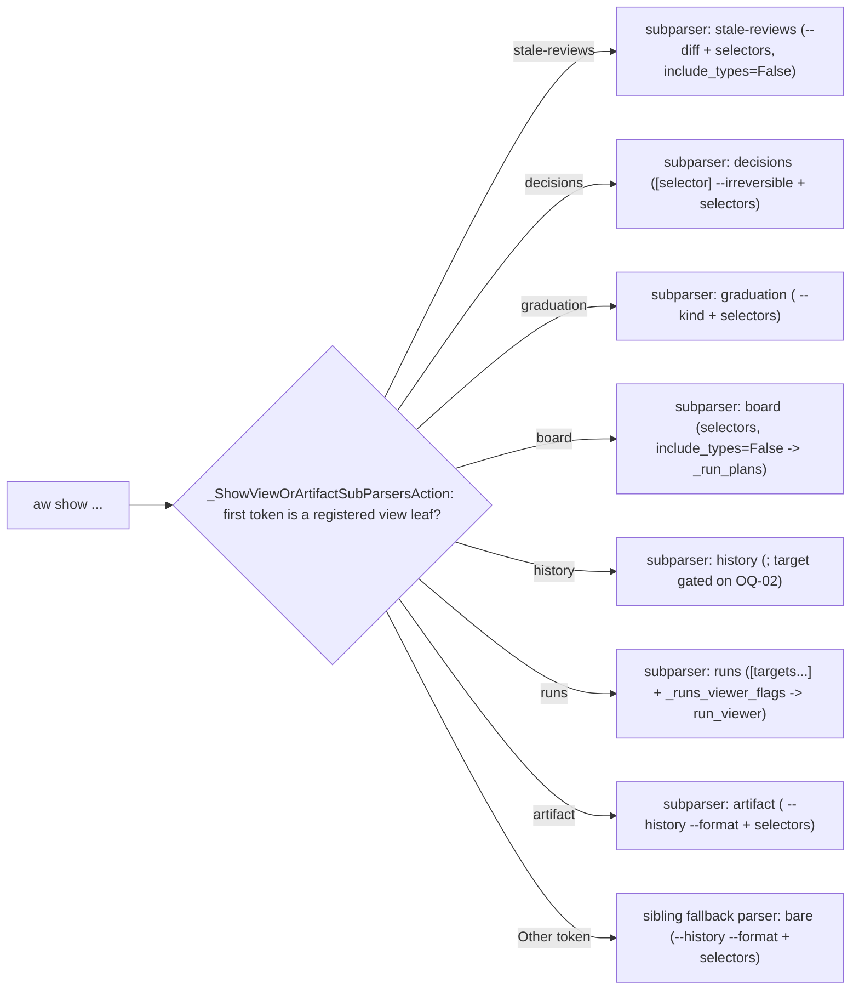

# IPD: Unify read-only views under aw show and remove aw reviews for 2.0.0

- Date: 2026-11-22
- Kind: child
- Concern: Consolidate read-only inspection views under `aw show` (`stale-reviews`, `decisions`, `graduation`, `board`, `history`, `runs`, plus `aw show artifact <selector>` escape hatch) and retire `aw reviews decisions` (with the fate of top-level `aw reviews` gated on `OQ-01` because metastore plan `724acb` shipped `aw reviews record` on 2026-11-23 under approved spec `4sd62s`) per spec `ogd2nv` R-09 through R-11.
- Scope: Replace the single-positional `p_show` parser in `agent_workflows/cli.py` with a hybrid subparser router (`_ShowViewOrArtifactSubParsersAction` + `_ShowArgumentParser`, modeled on `_ViewerOrLeafSubParsersAction` and `_RunsArgumentParser`) dispatching the seven reserved leaves (`stale-reviews`, `decisions`, `graduation`, `board`, `history`, `runs`, `artifact`) while preserving bare `aw show <id6|setid|status>` fallback and normalized selector flags (`mnlaoa`, transitive via `e36q6r`); wire normalized selector filtering into `show stale-reviews` (building on `9ifwdx`), `show decisions` (`agent_workflows/reviews.py`), and `show graduation`; keep `_runs_viewer_flags` isolated on `show runs` to avoid flag collisions; retire `aw reviews decisions` (and resolve `aw reviews` namespace scope per `OQ-01` once answered); update `agent_workflows/check_engine.py`, `agent_workflows/command_surface.py`, `tests/conformance_matrix.py`, `tests/test_usage_refusal_agent_record.py`, `tests/test_read_verb_zero_match_refusal.py`, `tests/test_review_decisions.py`, `tests/test_cli_show.py`, `docs/cli-output-contract.md`, `docs/artifact-lifecycles.md`, `.aw/records/reviews/README.md`, `.aw/system/workflows/plan-review/steps/s5-questions.md`, `.aw/system/workflows/plan-review-long/03-resolve-and-finalize.md`, `CHANGELOG.md`, and (if `OQ-01`/`OQ-02` narrows it) spec `ogd2nv`; add behavioral tests in `tests/test_show_views.py`. EXCLUDES verb-first operational commands and shell completion updates (`xocj8i`).
- Scope-Paths: agent_workflows/cli.py, agent_workflows/reviews.py, agent_workflows/check_engine.py, agent_workflows/command_surface.py, docs/cli-output-contract.md, docs/artifact-lifecycles.md, .aw/records/reviews/README.md, .aw/system/workflows/plan-review/steps/s5-questions.md, .aw/system/workflows/plan-review-long/03-resolve-and-finalize.md, CHANGELOG.md, .aw/records/specs/to-review/20261122-ogd2nv-01-ogd2nv-normalized-selectors-show-and-verb-first-cli.spec.md, tests/conformance_matrix.py, tests/test_usage_refusal_agent_record.py, tests/test_read_verb_zero_match_refusal.py, tests/test_review_decisions.py, tests/test_cli_show.py, tests/test_show_views.py, .aw/records/plans/pending/20261122-cliverbs-02-p06t7i-unify-read-only-views-under-aw-show-and-remove-aw-reviews-fo.ipd.md
- Item-Dependencies: executed:e36q6r, executed:9ifwdx
- Status: reviewed
- Readiness: no-go
- Review-Depth: complex
- Short-Description: Add reserved aw show views (stale-reviews, decisions, graduation, board, history, runs, artifact escape) and retire aw reviews decisions
- Work-Kind: feature
- Priority: medium
- From-Backlog: i8dc07
- From-Spec: ogd2nv
- Set: cliverbs
- Order: 2
- Highest E allocated: 05
- Author: antigravity
- Id: p06t7i

> Write and proofread this plan per the technical writing standard, `.aw/system/workflows/technical-writing/technical-writing.md` (`.agents/workflows/technical-writing/technical-writing.md` in a legacy-layout install), including requirement 12 (diagrams).

## Workflow history

- 2026-11-27 reviewed (aw set): plan-review: REVIEWED - OPEN QUESTIONS; PR-001, PR-002 (OPEN/blocking), PR-003..PR-008 (FIXED)
- 2026-11-27 /plan-review (antigravity/gemini): REVIEWED - OPEN QUESTIONS; PR-001 (BLOCKER, OPEN -> OQ-01), PR-002 (HIGH, OPEN -> OQ-02), PR-003..PR-008 (FIXED); review record .aw/records/reviews/20261122-cliverbs-02-p06t7i-unify-read-only-views-under-aw-show-and-remove-aw-reviews-fo.review.md
- 2026-11-23 to-review (aw set): status set to to-review
- 2026-11-23 draft (antigravity): created and authored as Order 02 of Set `cliverbs` graduating `i8dc07` under spec `ogd2nv`.

## Goal

Make `aw show` the single home for read-only inspection views (`stale-reviews`, `decisions`, `graduation`, `board`, `history`, `runs`, plus `artifact <selector>` as the reserved-name collision escape hatch and bare `<id6|setid|status>` lookups) and retire `aw reviews decisions` cleanly for 2.0.0 without breaking `aw reviews record` (`724acb` / approved spec `4sd62s`) or existing `aw show` callers.

## Detailed Implementation Checklist (TODO)

Execution-state rule: mark an `E-*` item complete only after performing the action. That mark is not validation. Right-sizing rule: write for a modest executor that cannot hold much in its head. Each E-item is one step (one concern, about one file, executable in one focused pass) and its V-item names each unit it covers with its own check; a plan stays at about 5 E-items and 8 work Scope-Paths, else split it into more child plans (guidance, `IPD-Z603`). Accepted execution states: blocked, failed, pending, performed; terminal gate demands 'performed'.

Common rules for every E-item in this plan:
- Register artifact selector flags only through `agent_workflows/selectors.py::add_selector_args` and parse them only through `agent_workflows/selectors.py::parse_selector_namespace` (`bzsoai` / `mnlaoa`). Map any `ValueError` from selector parsing to exit code 2 naming the offending token (`ogd2nv` R-03).
- Do not register `_runs_viewer_flags` (`-s`/`--short`, `-S`/`--summary-only`, `--status`, `--set`) on the same parser as `selectors.add_selector_args` (which owns `-s`/`--status`, `-S`/`--not-status`, `--set`); keep `_runs_viewer_flags` isolated on the `show runs` subparser.
- Write behavioral tests only (drive `cli.main(...)` or real handler entry points against temporary repositories; never inspect production source via `inspect`, `ast`, regex, or substring checks per `GUIDING_PRINCIPLES.md` P16). Mark all new test classes `@pytest.mark.core`.
- Do not write em or en dashes in user-facing prose (`docs/`, `CHANGELOG.md`).

### Task group 1: Hybrid `aw show` subparser router and reserved views

- [ ] E-01 Replace the single-positional `p_show` parser in `agent_workflows/cli.py::p_show` and `agent_workflows/cli.py::_run_show` with a hybrid subparser router modeled on `agent_workflows/cli.py::_ViewerOrLeafSubParsersAction` and `agent_workflows/cli.py::_RunsArgumentParser` (introducing `_ShowViewOrArtifactSubParsersAction` and `_ShowArgumentParser`) to satisfy `ogd2nv` R-09 and `ogd2nv` R-10:
  1. Register seven real subparsers on `p_show`: `stale-reviews` (`--diff`, `--dir`, `add_selector_args(..., include_types=False)`), `decisions` (optional `selector`, `--irreversible`, `--dir`, `add_selector_args`), `graduation` (required `source`, `--kind backlog|spec`, `--dir`, `add_selector_args`), `board` (`--dir`, `add_selector_args(..., include_types=False)`), `history` (required `id6`, `--dir`), `runs` (parents `[common, _runs_viewer_flags]`, optional `targets` `nargs="*"`, no `add_selector_args`), and `artifact` (required `action_ref`, `--dir`, `--history`, `--format text|json`, `add_selector_args`).
  2. Attach a sibling fallback artifact-lookup parser to `_ShowViewOrArtifactSubParsersAction` carrying required `action_ref`, `--dir`, `--history`, `--format text|json`, and `add_selector_args` (from `mnlaoa` E-03), so bare `aw show <id6|setid|status>` keeps its exact existing behavior (`tests/test_cli_show.py`) and bare `aw show` without arguments continues exiting 2 with `aw.agent/v1` cannot-run output under `--agent`/`--json`.
  3. Dispatch `show artifact <selector>` to the same artifact lookup path as bare `aw show <selector>`, bypassing reserved view names (`ogd2nv` R-10).
  4. Dispatch `show board` to `agent_workflows/cli.py::_run_plans`, `show graduation` to `agent_workflows/cli.py::_run_graduation` (filtering returned cluster artifacts via `selectors.filter_records` when any selector flag is present), `show runs` to `agent_workflows/run_viewer.py::run_viewer_cli`, and `show history <id6>` to the backend selected when `OQ-02` is resolved (`_run_show_meta(..., want_history=True)` durable metadata history vs `_run_record_history` machine-local sidecar).
  5. Keep `--diff` strictly on `show stale-reviews` so passing `--diff` to bare `aw show <id6>` or any other `show` view exits 2 (preserving `9ifwdx` E-03).
  - Depends on: none
  - Expected outcome: Every reserved view (`aw show stale-reviews`, `aw show decisions`, `aw show graduation <id6>`, `aw show board`, `aw show history <id6>`, `aw show runs`) plus `aw show artifact <selector>` and bare `aw show <id6>` parse cleanly with native per-view `--help`, isolated flags (no `-s`/`-S` collision on `runs`), consistent `--json`/`--agent` output, and exit 2 on invalid selector expressions or missing required view arguments.
  - Execution state: pending

- [ ] E-02 Wire normalized selector filtering into `show stale-reviews` and `show decisions` (`ogd2nv` R-09), and migrate `agent_workflows/reviews.py` and `agent_workflows/check_engine.py` from `aw reviews decisions` to `aw show decisions` (`ogd2nv` R-11):
  1. In `agent_workflows/cli.py` (the `stale-reviews` handler added by `9ifwdx` E-03), parse selector flags with `selectors.parse_selector_namespace(args)` and, when non-empty, narrow the merged self-stale and basis-stale plan rows with `selectors.filter_records(selectors.selector_records(repo_root, plan_paths), spec, repo_root=repo_root)` while keeping `review_basis.stale_bases(repo_root, prune=False)` strictly read-only.
  2. In `agent_workflows/reviews.py::run_decisions`, parse normalized selector flags with `selectors.parse_selector_namespace(args)` and, when non-empty, narrow review records by resolving each review's subject artifact (`r.subject_id`) and filtering via `selectors.filter_records`; update `CommandResult.command` / `cmd` from `"reviews decisions"` to `"show decisions"`, update `next_cmd` and `NextAction.command` (`"aw show decisions"`, `"aw show decisions --irreversible"`), and update the human empty-state prefix (`"aw show decisions: ..."`).
  3. In `agent_workflows/check_engine.py` (`check.review-decision-unescalated` registry comment and docstring), update `aw reviews decisions` references to `aw show decisions`.
  - Depends on: E-01
  - Expected outcome: `aw show stale-reviews` and `aw show decisions` honor normalized selector flags (`-p`, `-P`, `--sid`, `--nsid`, `-d`, `--mtime`, `--ctime`, etc.) and exit 2 on bad expressions; `reviews.run_decisions` emits `cmd="show decisions"` and `aw show decisions` recovery hints; zero `aw reviews decisions` references remain in `agent_workflows/reviews.py` and `agent_workflows/check_engine.py`.
  - Execution state: pending

### Task group 2: Retire `aw reviews decisions` (per `OQ-01`) and maintain command-surface parity

- [ ] E-03 Execute the `aw reviews` retirement decision resolved in `OQ-01` (`ogd2nv` R-11) and synchronize `agent_workflows/command_surface.py`, `tests/conformance_matrix.py`, and `tests/test_usage_refusal_agent_record.py` so the core merge gate stays green in Order 02:
  1. In `agent_workflows/cli.py`, remove `p_reviews_decisions`, its dispatch branch (`reviews_cmd == "decisions"`), and the `"reviews decisions"` `_COMMAND_HELP` entry. For top-level `p_reviews` and `p_reviews_record` (`724acb` / approved spec `4sd62s`), apply the exact resolution recorded in `OQ-01`: if `OQ-01` keeps `aw reviews` solely for `aw reviews record`, update `p_reviews` help, epilog, `_COMMAND_HELP["reviews"]`, and fallback `_show_family_help` hint (`"aw reviews record --help"`) so zero `aw reviews decisions` strings remain; if `OQ-01` relocates `aw reviews record` and removes `aw reviews`, apply the approved relocation and cross-plan spec/cutover updates specified by that resolution.
  2. In `agent_workflows/command_surface.py`, add `CommandDeclaration` entries for every new `show` subcommand leaf (`show stale-reviews`, `show decisions`, `show graduation`, `show board`, `show history`, `show runs`, `show artifact`) matching their exact `command_class`, `exit_contract`, and `legacy_flags`; update `show` as appropriate; and remove the retired `reviews decisions` declaration (and `reviews record` only if `OQ-01` relocates it).
  3. In `tests/conformance_matrix.py::RUNNABLE_ARGV`, replace `"reviews decisions": ["f36de0"]` with `"show decisions": ["f36de0"]` and add safe read-only entries for required-positional `show` subcommands (`"show graduation": ["25kzda"]`, `"show history": ["f36de0"]`, `"show artifact": ["f36de0"]`).
  4. In `tests/test_usage_refusal_agent_record.py::test_exclusion_set_size_and_members`, update the documented `REQUIRED_LEAVES` count assertion to reflect the exact required-argument `show` leaves added (and any `reviews` leaf removed per `OQ-01`).
  - Depends on: E-01, E-02
  - Expected outcome: `aw reviews decisions` exits 2 as unrecognized; `tests/test_command_surface_declarations.py` reports zero undeclared leaves and zero unreachable declarations; `tests/test_usage_refusal_agent_record.py` and `tests/test_group_verb_policy.py` pass with zero errors.
  - Execution state: pending

### Task group 3: Documentation sync, behavioral tests, and validation

- [ ] E-04 Synchronize documentation, workflow instructions, `CHANGELOG.md`, and (if modified by `OQ-01`/`OQ-02`) spec `ogd2nv` (`ogd2nv` R-09 through R-11):
  1. Update `docs/cli-output-contract.md` (Section 11.1 and Section 16), `docs/artifact-lifecycles.md` (Section 7), `.aw/records/reviews/README.md`, `.aw/system/workflows/plan-review/steps/s5-questions.md`, and `.aw/system/workflows/plan-review-long/03-resolve-and-finalize.md` to replace `aw reviews decisions` with `aw show decisions` and document all seven reserved `aw show` views (`stale-reviews`, `decisions`, `graduation`, `board`, `history`, `runs`, `artifact`) plus bare `aw show <selector>`.
  2. Add user-facing `- Added:` and `- Changed:` entries under `## 2.0.0 (pending)` in `CHANGELOG.md` describing the unified `aw show` views and the migration/removal of `aw reviews decisions`, using zero em or en dashes across `docs/` and `CHANGELOG.md`.
  3. If `OQ-01` or `OQ-02` narrows `ogd2nv` R-09 or R-11 (for example retaining `aw reviews record` under `aw reviews`), amend `.aw/records/specs/to-review/20261122-ogd2nv-01-ogd2nv-normalized-selectors-show-and-verb-first-cli.spec.md` to match and record the amendment with `aw specs note`.
  - Depends on: E-03
  - Expected outcome: Zero stale `aw reviews decisions` references remain across `docs/`, `.aw/records/reviews/README.md`, and `.aw/system/workflows/`; `CHANGELOG.md` and `ogd2nv` match the shipped CLI surface; zero em or en dashes appear in user-facing prose; `aw specs check` passes.
  - Execution state: pending

- [ ] E-05 Update existing review-decision tests, add comprehensive behavioral tests in `tests/test_show_views.py` (`ogd2nv` AC-05), and run full validation:
  1. Update `tests/test_review_decisions.py` (`payload["cmd"] == "show decisions"`, human empty-state prefix, plus a behavioral test confirming `aw reviews decisions` exits 2) and `tests/test_read_verb_zero_match_refusal.py` (migrate all `["reviews", "decisions", ...]` invocations to `["show", "decisions", ...]`). Confirm `tests/test_cli_show.py` remains green (updating any declaration-level assertion only if needed for the hybrid parser).
  2. Create `tests/test_show_views.py` with `@pytest.mark.core` behavioral tests driving `cli.main(...)` on temporary repositories covering: (a) `aw show stale-reviews` with `--diff` and normalized selector flags (`-p`, `--sid`) plus `--diff` refusal on non-`stale-reviews` selectors; (b) `aw show decisions` with `--irreversible`, optional selector, normalized selector flags, and `--json`/`--agent`; (c) `aw show graduation <id6>` with `--kind`, normalized selector flags, and missing-source exit 2; (d) `aw show board` with normalized selector flags matching `aw ipd board`; (e) `aw show history <id6>` per `OQ-02` resolution plus missing-id6 exit 2; (f) `aw show runs` with `_runs_viewer_flags` (`-s`, `-S`, `--failed`, `--last`) verifying zero conflict with `aw show` artifact selector flags; (g) `aw show artifact <reserved-name>` resolving a record whose Set ID or filename fragment equals a reserved view name (`board`, `decisions`, `runs`); and (h) invalid selector expressions exiting 2 naming the offending token.
  3. Run every command in `## Required tests / validation` after the final edit and paste the actual runner output into `V-01..V-05`.
  - Depends on: E-01, E-02, E-03, E-04
  - Expected outcome: All targeted suites, bare `python3 -m pytest`, `mypy`, `aw specs check`, `aw attention --check`, and `aw sanitize --agent` pass with exit 0 and zero regressions.
  - Execution state: pending

## Project conventions discovered (Step 0)

- **Critical post-authoring change (`724acb` / spec `4sd62s`)**: When `p06t7i` was committed (`f5a2c87e6`, 2026-11-22 23:48), `aw reviews` held only `decisions` across 13 occurrences in 6 files. Three hours later (`feb476c6e`, 2026-11-23 02:47), approved metastore plan `724acb` executed and shipped `aw reviews record` (`agent_workflows/cli.py::p_reviews_record`, `agent_workflows/reviews.py::run_record`, `agent_workflows/command_surface.py` `command="reviews record"`, `tests/test_reviews_record_walkthrough_new.py`, `tests/test_usage_refusal_agent_record.py` `REQUIRED_LEAVES == 72`, and 25+ citations in `.aw/system/cutover/metastore-docs.cutover.patch` for pending cutover `cxxmyv`). Removing top-level `aw reviews` outright now conflicts with approved spec `4sd62s`; `OQ-01` blocks execution until the maintainer resolves it.
- **Ambiguity between two history views**: `agent_workflows/cli.py::_run_show_meta` (`aw show <id6> --history`, shipped by `1ajqaa` E-03 / spec `4sd62s` 4.8) renders durable tracked workflow/metadata history, whereas `agent_workflows/cli.py::_run_record_history` (`aw record-history <id6>`) renders the machine-local gitignored activity sidecar. `OQ-02` blocks execution until the maintainer confirms which backend `aw show history <id6>` delegates to.
- **Canonical hybrid subparser pattern**: `agent_workflows/cli.py::_ViewerOrLeafSubParsersAction` and `agent_workflows/cli.py::_RunsArgumentParser` implement the repository's standard mechanism for a command carrying both real named subcommand leaves (discoverable by `agent_workflows/command_surface.py::discover_parser_leaves` and shell completion, with isolated per-leaf flags) and a bare fallback positional parser.
- **Flag collision constraint**: `agent_workflows/cli.py::_runs_viewer_flags` owns `-s`/`--short`, `-S`/`--summary-only`, `--status`, and `--set`, which collide with `selectors.add_selector_args` (`-s`/`--status`, `-S`/`--not-status`, `--set`). Spec `ogd2nv` R-05 explicitly exempts `aw runs` from selector short-flag normalization. Isolating `_runs_viewer_flags` on the `show runs` subparser prevents an `argparse.ArgumentError` crash.
- **Prerequisite wiring**: `mnlaoa` E-03 (transitive prerequisite via `e36q6r`) wires `selectors.add_selector_args` into `p_show` and `p_ipd_board` (`include_types=False`). `9ifwdx` E-03 (direct prerequisite) adds `--diff` and the core `stale-reviews` renderer (without selector filtering, deferred to `1iojci`/`cliverbs`).
- **Command-surface and refusal tests**: `tests/test_command_surface_declarations.py` asserts zero undeclared parser leaves and zero unreachable `COMMAND_INVENTORY` declarations; `tests/conformance_matrix.py::RUNNABLE_ARGV` supplies read-only args for required-arg leaves (`"reviews decisions"`, `"show"`); `tests/test_usage_refusal_agent_record.py` pins `REQUIRED_LEAVES` count (currently 72); `tests/test_read_verb_zero_match_refusal.py` invokes `["reviews", "decisions", ...]` in 7 places.
- **Additional `aw reviews decisions` references discovered**: `.aw/records/reviews/README.md`, `.aw/system/workflows/plan-review/steps/s5-questions.md`, `.aw/system/workflows/plan-review-long/03-resolve-and-finalize.md`, and `agent_workflows/cli.py::_COMMAND_HELP`.
- **Testing convention**: Run `python3 -m pytest` bare (never `-n0`, extra `-q`, or `-p no:randomly`); write behavioral tests only (no source inspection per `GUIDING_PRINCIPLES.md` P16).

## Findings

- `aw reviews` no longer holds only `decisions`: metastore `724acb` shipped `aw reviews record` under approved spec `4sd62s` (`PR-001` -> `OQ-01`).
- Two distinct history engines exist (`aw show <id6> --history` durable metadata log vs `aw record-history <id6>` local sidecar), leaving `aw show history <id6>` ambiguous (`PR-002` -> `OQ-02`).
- Single-positional `p_show` cannot parse multi-token views or isolate `_runs_viewer_flags` from `selectors.add_selector_args`; the repository's `_ViewerOrLeafSubParsersAction` pattern solves both while giving native `--help` and `command_surface` discovery (`PR-003`).
- `stale-reviews`, `decisions`, and `graduation` require explicit `selectors.filter_records` wiring to satisfy `ogd2nv` R-09 (`PR-004`).
- Leaving `command_surface.py` cleanup to Order 03 (`xocj8i`) would break Order 02's merge gate (`test_command_surface_declarations.py`, `test_usage_refusal_agent_record.py`, `test_read_verb_zero_match_refusal.py`) (`PR-005`).

## Proposed changes (ordered, validatable)

1. Build the hybrid `aw show` subparser router (`_ShowViewOrArtifactSubParsersAction` + `_ShowArgumentParser`) with all seven reserved view leaves and the sibling fallback artifact parser in `agent_workflows/cli.py` (`E-01`).
2. Wire normalized selector filtering into `show stale-reviews` and `show decisions`, and migrate `agent_workflows/reviews.py` and `agent_workflows/check_engine.py` hints/commands to `aw show decisions` (`E-02`).
3. Retire `aw reviews decisions` (and apply `OQ-01` resolution for `aw reviews`), and synchronize `agent_workflows/command_surface.py`, `tests/conformance_matrix.py`, and `tests/test_usage_refusal_agent_record.py` (`E-03`).
4. Update `docs/cli-output-contract.md`, `docs/artifact-lifecycles.md`, `.aw/records/reviews/README.md`, both plan-review workflow docs, `CHANGELOG.md`, and (if narrowed by `OQ-01`/`OQ-02`) spec `ogd2nv` (`E-04`).
5. Update `tests/test_review_decisions.py` and `tests/test_read_verb_zero_match_refusal.py`, add `tests/test_show_views.py`, and run full validation (`E-05`).

## Deferred / out of scope (with reason)

- Top-level verb-first operational commands (`aw rev`/`review`, `aw exec`, `aw plan`/`grad`/`graduate`, `aw validate`, `aw approve`) and shell completion updates: owned by Order 03 (`xocj8i`). Note: `p06t7i` E-03 now owns `command_surface.py` parity for `show` and `reviews` so Order 02 passes the merge gate independently; `xocj8i` E-03 keeps only completion updates and verb-first command declarations.
  - Carrier: xocj8i
- Replacing or deprecating `aw graduation`, `aw ipd board`, `aw record-history`, or `aw runs` top-level commands: explicitly out of scope per spec `ogd2nv` (retained as stable lower-level interfaces while `aw show` provides unified read-only access).
  - Carrier-Declined: explicitly out of scope per spec ogd2nv (existing top-level read commands remain supported aliases)

## Scope check

- Over-scope: none; touches only the `aw show` hybrid view router, `aw reviews decisions` retirement (gated on `OQ-01` for `aw reviews record`), command-surface/conformance parity, docs/workflows/changelog sync, and behavioral tests.
- Under-scope: corrected at review (`PR-003..PR-006`) by adding `command_surface.py`, `conformance_matrix.py`, `test_usage_refusal_agent_record.py`, `test_read_verb_zero_match_refusal.py`, `test_cli_show.py`, `.aw/records/reviews/README.md`, both plan-review workflow files, `CHANGELOG.md`, and `ogd2nv` to `- Scope-Paths:`. The plan carries 16 work Scope-Paths (past the 8-path `IPD-Z603` guidance) across 5 focused E-items; every extra path is a mandatory test, command-surface mirror, or doc reference required to keep Order 02's merge gate green.

## Required tests / validation

- Targeted behavioral and parity suites: `python3 -m pytest tests/test_review_decisions.py tests/test_show_views.py tests/test_cli_show.py tests/test_read_verb_zero_match_refusal.py tests/test_review_staleness_advisory.py tests/test_command_surface_declarations.py tests/test_usage_refusal_agent_record.py tests/test_group_verb_policy.py tests/test_reviews_record_walkthrough_new.py`
- Core tier merge gate (bare): `python3 -m pytest`
- Type check: `python3 -m mypy agent_workflows/cli.py agent_workflows/reviews.py agent_workflows/check_engine.py agent_workflows/command_surface.py`
- Records and hygiene: `aw specs check && aw attention --check && aw sanitize --agent`

## Spec / documentation sync

- Updates `docs/cli-output-contract.md`, `docs/artifact-lifecycles.md`, `.aw/records/reviews/README.md`, `.aw/system/workflows/plan-review/steps/s5-questions.md`, `.aw/system/workflows/plan-review-long/03-resolve-and-finalize.md`, and `CHANGELOG.md` (`E-04`).
- Amends `.aw/records/specs/to-review/20261122-ogd2nv-01-ogd2nv-normalized-selectors-show-and-verb-first-cli.spec.md` (`R-09`/`R-11`) if `OQ-01` or `OQ-02` narrows the spec contract (`E-04`).

## Open questions

### OQ-01: Should top-level `aw reviews` stay solely for `aw reviews record` (removing only `aw reviews decisions`), or should `aw reviews record` be relocated so `aw reviews` can be removed completely?

- Blocking: yes
- Status: open
- Owner: maintainer
- Finding: PR-001
- Carrier-Declined: blocking question on this plan (p06t7i); gated by IPD-Q501 and lane outcome questions[] so p06t7i cannot be approved or executed until resolved by the maintainer
- Context: On 2026-11-22 (`i8dc07` OQ-05), the maintainer approved removing top-level `aw reviews` outright on the factual premise that `aw reviews` held only one subcommand (`decisions`) with 13 references across 6 files. Three hours after `p06t7i` was committed (`f5a2c87e6`), metastore plan `724acb` executed (`feb476c6e`, 2026-11-23) and shipped `aw reviews record` under approved spec `4sd62s` Sections 4.1a and 4.2 as the canonical metadata-log writer for review rounds, wired into `cli.py`, `reviews.py`, `command_surface.py`, `tests/test_reviews_record_walkthrough_new.py`, `tests/test_usage_refusal_agent_record.py`, and 25+ lines of `.aw/system/cutover/metastore-docs.cutover.patch` for the pending metadata cutover `cxxmyv`. Removing `aw reviews` outright now conflicts with approved spec `4sd62s` and breaks the metastore cutover.
- Options:
  1. Keep top-level `aw reviews` solely for `aw reviews record`, remove only `aw reviews decisions` (moving decisions to `aw show decisions`), and amend `ogd2nv` R-11 to reflect that `aw reviews record` stays.
  2. Move `aw reviews record` to a new command (for example `aw review record` or `aw meta record-review`), remove top-level `aw reviews` completely, and coordinate an amendment to approved spec `4sd62s` plus `.aw/system/cutover/metastore-docs.cutover.patch` before cutover `cxxmyv`.
  3. Keep both `aw reviews decisions` and `aw reviews record` intact until after the `metastore` cutover (`cxxmyv`), adding `aw show decisions` now and deferring removal.
- Recommendation: Option 1 (keep `aw reviews` solely for `aw reviews record`, remove only `aw reviews decisions`, and amend `ogd2nv` R-11). Preserves approved spec `4sd62s`, executed plan `724acb`, and the ready-to-apply metastore cutover patch with zero cross-initiative churn while moving all read-only inspection to `aw show`. Recommendation strength: strong.
- Resolution or deferral rationale: Unresolved; requires maintainer decision before `p06t7i` can be approved or executed.

### OQ-02: Which history source should `aw show history <id6>` display: durable artifact workflow/metadata history (`aw show <id6> --history`) or the machine-local gitignored activity sidecar (`aw record-history <id6>`)?

- Blocking: yes
- Status: open
- Owner: maintainer
- Finding: PR-002
- Carrier-Declined: blocking question on this plan (p06t7i); gated by IPD-Q501 and lane outcome questions[] so p06t7i cannot be approved or executed until resolved by the maintainer
- Context: Two distinct history commands exist today: (a) `aw show <id6> --history` (`agent_workflows/cli.py::_run_show_meta`, shipped by `1ajqaa` E-03 / approved spec `4sd62s` Section 4.8), which prints durable tracked workflow history (inline `## Workflow history` pre-cutover, `.aw/records/meta/<id6>.jsonl` post-cutover); and (b) `aw record-history <id6>` (`agent_workflows/cli.py::_run_record_history`), which prints the machine-local gitignored sidecar activity log (does not survive a clone). Neither `i8dc07` OQ-02 nor `ogd2nv` R-09 states which one `aw show history <id6>` delegates to. Routing `aw show history <id6>` to the local sidecar would make `aw show history <id6>` and `aw show <id6> --history` return completely different data.
- Options:
  1. Delegate `aw show history <id6>` to durable metadata history (`_run_show_meta(..., want_history=True)`, identical to `aw show <id6> --history`), leaving `aw record-history <id6>` for the machine-local sidecar.
  2. Delegate `aw show history <id6>` to the machine-local sidecar (`_run_record_history`, identical to `aw record-history <id6>`), keeping durable history on `aw show <id6> --history`.
  3. Delegate `aw show history <id6>` to durable metadata history by default and add a `--sidecar` flag to view the machine-local sidecar.
- Recommendation: Option 1 (delegate `aw show history <id6>` to durable metadata history so `aw show history <id6>` and `aw show <id6> --history` always agree, leaving `aw record-history <id6>` for the local sidecar). Recommendation strength: strong.
- Resolution or deferral rationale: Unresolved; requires maintainer decision before `p06t7i` can be approved or executed.

## Validation and cross-check (verify before reporting done)

Validation-state rule: inspect evidence in a separate pass. Do not mark a `V-*` item complete from memory or from the matching execution checkmark. Accepted validation results: blocked, failed, pass, pending; terminal gate demands 'pass'. Runtime-demonstration reachability rule: for each `V-*` item demanding the software be observed acting (such as a run, a dispatch, or a transition), as distinct from items demanding a diff, a file's content, or a test result, name the code path that produces the observation or the sibling `E-*` that creates it, else the demand is UNDER-SCOPE.

- [ ] V-01 validates E-01
  - Required evidence: Pasted pytest output from `tests/test_show_views.py` and `tests/test_cli_show.py` exercising `agent_workflows/cli.py::_ShowViewOrArtifactSubParsersAction` and `_run_show` proving `aw show stale-reviews`, `aw show decisions`, `aw show graduation <id6>`, `aw show board`, `aw show history <id6>`, `aw show runs` (with `-s`/`-S`/`--failed`/`--last`), `aw show artifact <reserved-name>`, and bare `aw show <id6>` all exit 0 with expected output (`ogd2nv` AC-05), while `aw show <id6> --diff`, missing required view arguments, and bad selector expressions exit 2.
  - Observed evidence:
  - Result: pending

- [ ] V-02 validates E-02
  - Required evidence: Pasted pytest output from `tests/test_show_views.py` and `tests/test_review_decisions.py` exercising `agent_workflows/reviews.py::run_decisions` and the `stale-reviews` handler proving normalized selector flags (`-p`, `--sid`, `-d`, etc.) filter both views, `reviews.run_decisions` emits `cmd="show decisions"` and `aw show decisions` hints, and a fresh repo grep (`grep -rn "aw reviews decisions" agent_workflows/`) returns zero matches (`ogd2nv` R-09, `ogd2nv` R-11).
  - Observed evidence:
  - Result: pending

- [ ] V-03 validates E-03
  - Required evidence: Pasted pytest output proving `aw reviews decisions` exits 2 (and matching `OQ-01` resolution for `aw reviews record`), plus passing runner output from `tests/test_command_surface_declarations.py`, `tests/test_usage_refusal_agent_record.py`, `tests/test_group_verb_policy.py`, and `tests/test_reviews_record_walkthrough_new.py` (`ogd2nv` AC-05).
  - Observed evidence:
  - Result: pending

- [ ] V-04 validates E-04
  - Required evidence: Pasted git diff excerpt for `docs/cli-output-contract.md`, `docs/artifact-lifecycles.md`, `.aw/records/reviews/README.md`, `.aw/system/workflows/plan-review/steps/s5-questions.md`, `.aw/system/workflows/plan-review-long/03-resolve-and-finalize.md`, `CHANGELOG.md` (confirming zero em or en dashes in user-facing prose), and (if amended per `OQ-01`/`OQ-02`) spec `ogd2nv` plus `aw specs check` exit 0, and a fresh repo grep (`grep -rn "aw reviews decisions" docs/ .aw/records/reviews/README.md .aw/system/workflows/`) returning zero matches.
  - Observed evidence:
  - Result: pending

- [ ] V-05 validates E-05
  - Required evidence: Pasted runner output after the final edit from the targeted pytest command in `## Required tests / validation`, bare `python3 -m pytest`, `python3 -m mypy agent_workflows/cli.py agent_workflows/reviews.py agent_workflows/check_engine.py agent_workflows/command_surface.py`, `aw specs check`, `aw attention --check`, and `aw sanitize --agent`, all passing with exit 0 (`ogd2nv` AC-05).
  - Observed evidence:
  - Result: pending

## Approval and execution gate

- Size assessment: standard
- Cohesion rationale: not required. The plan holds 5 focused E-items across 3 task groups and 16 work Scope-Paths (above the 8-path `IPD-Z603` advisory guidance, well below the 18-item/5-group hard limit). Every extra Scope-Path is a direct command-surface declaration, conformance matrix entry, behavioral test mirror, or doc reference required to keep Order 02's merge gate green as a single atomic CLI transition.

Execute only after `OQ-01` and `OQ-02` are resolved by the maintainer, the review record's blocking findings (`PR-001`, `PR-002`) are cleared via re-review or readiness re-check, and human approval (`- Status: approved`) is recorded. Prerequisites `executed:e36q6r` (bringing transitive `mnlaoa`) and `executed:9ifwdx` must have landed on disk; if `selectors.add_selector_args`, `selectors.selector_records`, or `9ifwdx`'s `stale-reviews` handler are absent at execution time, STOP and report.

Resolved questions: `OQ-01` and `OQ-02` are currently OPEN and BLOCKING; execution is gated until both are resolved.

Scope fence: this plan declares `- Scope-Paths:` above as its expected change set. If an out-of-scope edit proves necessary, make it and justify it at finalize with `--scope-reason <path>`; acknowledge any declared path left unmodified with `--scope-ack <path>`.

Honesty rule: paste the ACTUAL runner output of every required validation command after your final edit; never claim test, typecheck, or check results you did not run.

Commits and lifecycle: commit only the paths you changed for this plan using `aw commit p06t7i -- <paths>`; never `git add -A`, bare `git add`, or `git commit -a`, and never push. Never hand-roll a `git mv` of this plan into `.aw/records/plans/executed/`. Lifecycle transition is mandatory on completion with conditional ownership: when running inside a managed runner lane (`AW_EXECUTION_ROLE=worker`), leave `aw ipd finalize` to the runner after verification and integration; when executing standalone outside a managed lane, finalize with `aw ipd finalize p06t7i --actor <agent/model> --message "
" --apply` so the tool moves the plan to `executed/` and refreshes the plans index cleanly.
