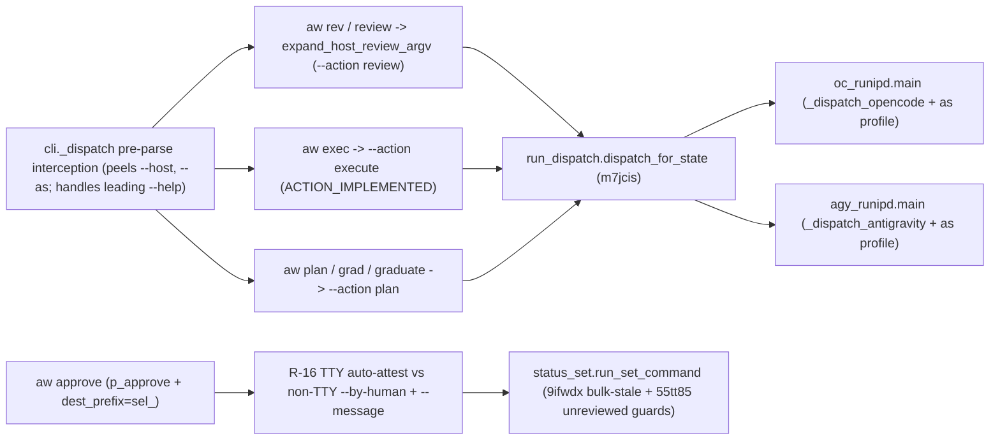

# IPD: Add verb-first top-level CLI commands (review, exec, plan, approve) and Antigravity dispatch adapter

- Date: 2026-11-22
- Kind: child
- Concern: Add the Antigravity (`agy`) dispatch adapter and `as <profile>` support so both `agy` and `oc` launch through `run_dispatch`, expose natural verb-first top-level CLI commands (`aw rev`/`review`, `aw exec`, `aw plan`/`grad`/`graduate`, `aw approve`) wired to normalized selectors (`e36q6r`) and per-state runner routing (`m7jcis`), enable `--action execute` in `agent_workflows/runner_shared.py`, update shell completions, command declarations, conformance exemptions, docs, and `CHANGELOG.md`, and perform whole-Set verification (spec `ogd2nv` R-12 through R-14, R-16, and AC-06; R-15 `aw validate` deferred to backlog `2hssxe`).
- Scope: Add `_dispatch_antigravity` in `agent_workflows/run_dispatch.py` and positional `as <profile>` + `runner_profiles.resolve` support in `agent_workflows/agy_runipd.py` (via shared `runner_shared.extract_profile_clause`), updating `tests/test_runner_profiles_verbs.py` and `tests/test_agy_runipd_cli.py`; register top-level `review` (alias `rev`), `exec`, `plan` (aliases `grad`, `graduate`), and `approve` (TTY auto-attest vs non-TTY `--by-human --message`) in `agent_workflows/cli.py`, `agent_workflows/run_dispatch.py`, `agent_workflows/runner_shared.py`, and `agent_workflows/status_set.py`; enable `"execute"` in `runner_shared.ACTION_IMPLEMENTED` (and update `tests/test_oc_runipd.py`) so `aw exec` does not fail with `"--action execute is not implemented yet"`; preserve existing `aw run`, `aw oc`, `aw agy`, and `aw set` commands unbroken; update `agent_workflows/completion.py`, `agent_workflows/command_surface.py`, `tests/conformance_matrix.py`, `docs/cli-output-contract.md`, and `CHANGELOG.md`; add behavioral tests in `tests/test_cli_verbs.py`, update `tests/test_completion.py`, and run whole-Set verification. EXCLUDES standalone `--action validate` (`/verify-execution` on executed plans) and top-level `aw validate` (deferred to backlog `2hssxe` per 2026-11-27 maintainer ruling on `OQ-01`), removing `aw oc`/`aw agy`/`aw run`/`aw set`, relocating `aw reviews record` (`pqqqzf`), and `aw show`/`reviews` command-surface parity (`p06t7i`).
- Scope-Paths: agent_workflows/agy_runipd.py, agent_workflows/cli.py, agent_workflows/run_dispatch.py, agent_workflows/runner_shared.py, agent_workflows/status_set.py, agent_workflows/completion.py, agent_workflows/command_surface.py, docs/cli-output-contract.md, CHANGELOG.md, tests/conformance_matrix.py, tests/test_cli_verbs.py, tests/test_completion.py, tests/test_oc_runipd.py, tests/test_agy_runipd_cli.py, tests/test_runner_profiles_verbs.py, .aw/records/plans/pending/20261122-cliverbs-03-xocj8i-add-verb-first-top-level-cli-commands-review-exec-grad-appro.ipd.md
- Item-Dependencies: executed:m7jcis, executed:p06t7i, executed:e36q6r
- Status: approved
- Readiness: go-pending-approval
- Review-Depth: complex
- Short-Description: Wire aw rev/review, aw exec, aw plan/grad/graduate, aw approve, and agy dispatch adapter with selectors, completions, and tests
- Work-Kind: feature
- Priority: medium
- From-Backlog: i8dc07
- From-Spec: ogd2nv
- Set: cliverbs
- Order: 3
- Highest E allocated: 06
- Author: antigravity
- Id: xocj8i
- Approval: 2026-11-27, recorded via aw ipd set: status set to approved

> Write and proofread this plan per the technical writing standard, `.aw/system/workflows/technical-writing/technical-writing.md` (`.agents/workflows/technical-writing/technical-writing.md` in a legacy-layout install), including requirement 12 (diagrams).

## Workflow history

- 2026-11-27 approved (aw set): status set to approved
- 2026-11-27 /plan-review (antigravity/gemini): APPROVE WITH REVISIONS APPLIED; PR-001, PR-002 (FIXED in Round 2 per maintainer rulings), PR-009 (FIXED); review record .aw/records/reviews/20261122-cliverbs-03-xocj8i-add-verb-first-top-level-cli-commands-review-exec-grad-appro.review.md
- 2026-11-27 reviewed (aw set): plan-review: REVIEWED - OPEN QUESTIONS; PR-001, PR-002 (OPEN/blocking), PR-003..PR-008 (FIXED)
- 2026-11-27 /plan-review (antigravity/gemini): REVIEWED - OPEN QUESTIONS; PR-001 (BLOCKER, OPEN -> OQ-01), PR-002 (BLOCKER, OPEN -> OQ-02), PR-003..PR-008 (FIXED); review record .aw/records/reviews/20261122-cliverbs-03-xocj8i-add-verb-first-top-level-cli-commands-review-exec-grad-appro.review.md
- 2026-11-27 note (antigravity/gemini): Aligned E-03, V-03, and deferred scope with amended spec ogd2nv (R-09, R-11, AC-05) and follow-up backlog pqqqzf: keep aw reviews record intact until after metastore cutover cxxmyv (removing only aw reviews decisions), and document aw show review-decisions and durable aw show history.
- 2026-11-23 to-review (aw set): status set to to-review
- 2026-11-23 draft (antigravity): created and authored as Order 03 of Set `cliverbs` graduating `i8dc07` under spec `ogd2nv`.

## Goal

Give maintainers natural verb-first daily commands (`aw rev`/`review`, `aw exec`, `aw plan`/`grad`/`graduate`, `aw approve`) that launch on both Antigravity (`agy`) and OpenCode (`oc`) via normalized selectors (`e36q6r`) and per-state runner profiles (`m7jcis`), update shell completions, command declarations, docs, and `CHANGELOG.md`, and verify the entire `cliverbs` Set end to end (with standalone `aw validate` / `--action validate` tracked separately in backlog `2hssxe`).

## Detailed Implementation Checklist (TODO)

Execution-state rule: mark an `E-*` item complete only after performing the action. That mark is not validation. Right-sizing rule: write for a modest executor that cannot hold much in its head. Each E-item is one step (one concern, about one file, executable in one focused pass) and its V-item names each unit it covers with its own check; a plan stays at about 5 E-items and 8 work Scope-Paths, else split it into more child plans (guidance, `IPD-Z603`). Accepted execution states: blocked, failed, pending, performed; terminal gate demands 'performed'.

Common rules for every E-item in this plan:
- Follow `agent_workflows/cli.py::_dispatch` (`aw run as`/`ipd` and `aw oc review` precedent): forwarded runner verbs register thin `add_help=False` + `argparse.REMAINDER` parsers on `sub` and intercept before `parse_args` in `_dispatch`, so they never declare `--agent` (which collides with OpenCode's `--agent <name>`) and never duplicate driver flags (`--model`, `--variant`, `--effort`, selector flags from `e36q6r`).
- Never re-resolve `--model`, `--variant`, or `--effort` in `cli.py` or `run_dispatch.py`; leave them in the forwarded `tail` so the host driver applies them once (`agent_workflows/run_dispatch.py` rule `"RESOLUTION IS NOT DUPLICATED HERE"`, `m7jcis` E-05).
- Write behavioral tests only (drive `cli.main(...)`, `run_dispatch.dispatch_for_state(...)`, `agy_runipd.main(...)`, `completion.complete_query(...)`, or `status_set.run_set_command(...)` against temporary repositories; never inspect production source via `inspect`, `ast`, regex, or substring checks per `GUIDING_PRINCIPLES.md` P16). Mark every new test class `@pytest.mark.core`.
- Write zero em or en dashes in user-facing prose (`docs/`, `CHANGELOG.md`).

### Task group 1: Antigravity dispatch adapter, `--action execute`, and top-level runner verbs (`review`/`rev`, `exec`, `plan`/`grad`/`graduate`)

- [ ] E-06 Add the Antigravity (`agy`) dispatch adapter in `agent_workflows/run_dispatch.py` and positional `as <profile>` + launch-profile resolution in `agent_workflows/agy_runipd.py`, and update `tests/test_runner_profiles_verbs.py` and `tests/test_agy_runipd_cli.py` (2026-11-27 maintainer ruling on `OQ-02`, `ogd2nv` R-07 and R-12..R-14):
  1. In `agent_workflows/runner_shared.py`, add `ProfileClauseError(DriverError)` and `extract_profile_clause(argv: Sequence[str], *, host_cmd: str) -> tuple[list[str], str | None]` implementing the exact positional `as <profile>` grammar established by `agent_workflows/oc_runipd.py::extract_profile_clause` (accepting leading `as <profile>` or `start as <profile>`, supporting `--` literal escape, and raising `ProfileClauseError` with `host_cmd` in the usage text on missing, duplicate, or misplaced `as`).
  2. In `agent_workflows/agy_runipd.py`:
     - In `main()`, before the implicit-`start` shim, call `runner_shared.extract_profile_clause(argv, host_cmd="aw agy run")` whenever `argv` is non-empty and `argv[0] not in subcommands or argv[0] == "start"`; print any `ProfileClauseError` to stderr and return exit 2; prepend `"start"` when `not argv and profile_request is not None`; set `args.profile` on the parsed namespace; and refuse `as <profile>` on non-`start` subcommands (`resume`, `status`, `report`, `stop`, `integrate`, `audit`) with exit 2 (mirroring `oc_runipd.main`).
     - In `resolve_verification_decision(args)`, pass `profile=getattr(args, "profile", None)` instead of `profile=None` into `runner_shared.resolve_verification_decision(...)` and update its docstring accordingly.
     - In `initialize_run(args)`, resolve the Antigravity launch profile once before creating any run directory by calling `runner_profiles.load()` and `runner_profiles.resolve(cfg, runner="agy", profile=getattr(args, "profile", None), model=getattr(args, "model", None), validate=verification_flag_tristate(args))` (wrapping `RunnerProfileError` into `DriverError(f"runner profile: {exc}")`). Use `resolved.model` when present (falling back to `agy_models.resolve_agy_default_model()` when `None`), set `effective_source` to `"cli-argument"` when CLI `--model` is given, `"runner-profile"` when resolved from a profile or per-runner default profile, or `model_source` otherwise, and set `"no_verify": not bool(resolved.validate)`. Do NOT add a `"launch_profile"` key to `agy_runipd`'s `host_options` dict so `tests/test_runner_shared.py::test_verification_tristate_and_provenance_recording` (`assertNotIn("launch_profile", ...)`) stays passing unchanged.
  3. In `agent_workflows/run_dispatch.py`, add `_dispatch_antigravity(argv: Sequence[str]) -> int` (lazily importing `agent_workflows.agy_runipd` and returning `agy_runipd.main(list(argv))`), register `"agy": _dispatch_antigravity` in `RUNNER_ADAPTERS` (`{"agy": _dispatch_antigravity, "oc": _dispatch_opencode}`), and update the comment above `RUNNER_ADAPTERS` to reflect that both `agy` and `oc` have adapters.
  4. In `tests/test_runner_profiles_verbs.py` (created by prerequisite Order 01 `m7jcis`), update the `E-04(d)` test case that asserted exit 2 `"no dispatch adapter"` for `"agy"` so a resolved `"agy"` dispatches through `_dispatch_antigravity` (while retaining `"no dispatch adapter"` coverage by monkeypatching `RUNNER_ADAPTERS` without `"agy"`). In `tests/test_agy_runipd_cli.py`, add a `@pytest.mark.core` test class verifying `agy_runipd.main(["as", <profile>, ..., "--prepare-only"])` freezes the profile's `model` and `no_verify`, CLI `--model` overrides the profile's model, unknown/wrong-runner/misplaced `as` exits 2 before creating a run directory, and `as <profile>` on `resume` exits 2.
  - Depends on: none
  - Expected outcome: Both `agy` and `oc` are registered in `run_dispatch.RUNNER_ADAPTERS`, `aw agy run as <profile>` and `aw run as <agy-profile>` / `dispatch_for_state` resolve and launch on Antigravity, and `tests/test_agy_runipd_cli.py`, `tests/test_runner_profiles_verbs.py`, and `tests/test_runner_shared.py` pass cleanly.
  - Execution state: pending

- [ ] E-01 Enable `--action execute` in `agent_workflows/runner_shared.py` and register top-level forwarded runner verbs `review` (alias `rev`), `exec`, and `plan` (aliases `grad`, `graduate`) in `agent_workflows/cli.py` and `agent_workflows/run_dispatch.py` (`ogd2nv` R-12 through R-14; `aw validate` omitted and deferred to backlog `2hssxe`):
  1. In `agent_workflows/runner_shared.py`, add `"execute"` to `ACTION_IMPLEMENTED` (`frozenset(("review", "plan", "execute"))`) and update `enforce_requested_action` so `action == "execute"` accepts derived actions `("execute", "orchestrate")` (allowing `aw exec <set-id>` when an Order-00 orchestrator is in the Set) while refusing `draft`, `to-review`, and non-IPD items with exit 2 before any run directory is created. Update `tests/test_oc_runipd.py::test_action_choices_and_enforcement` to assert the updated `ACTION_IMPLEMENTED` set and legality behavior.
  2. In `agent_workflows/cli.py::_build_parser_impl`, register thin `add_help=False` + `argparse.REMAINDER` top-level parsers for `review` (alias `rev`), `exec`, and `plan` (aliases `grad`, `graduate`) (matching `aw run as`/`ipd` and `aw oc review`, with concise `help=` strings visible in `aw --help`). Do NOT register `validate` (deferred to backlog `2hssxe`). Keep all existing `aw run` subcommands (`as`, `ipd`, `init`, `start`, `record`, `verify`, `cancel`, `finalize`) and `aw oc`/`aw agy` commands unchanged.
  3. In `agent_workflows/cli.py::_dispatch` (in the pre-`parse_args` fast-path block beside `aw run` and `aw <host> review`) and a small router helper in `agent_workflows/run_dispatch.py`, intercept `review`/`rev`, `exec`, and `plan`/`grad`/`graduate`:
     - If the tail starts with `-h` or `--help`, print the verb's route help (showing usage, state name, `--host`, `--as`, and pointing to `aw oc run --help` / `aw agy run --help` for full driver and selector flags) and exit 0 without requiring `default_runner` to be configured (matching `run_dispatch._wants_route_help`).
     - Peel ONLY router-owned `--host <val>`/`--host=<val>` and `--as <profile>`/`--as=<profile>` tokens from the tail (refusing missing option values with exit 2); keep all remaining tokens verbatim (selectors, `--model`, `--variant`, `--effort`, `--full-auto`, `--yes`, `--prepare-only`, etc.) so `e36q6r`'s driver `start` parsers receive them untouched.
     - Expand each verb's canonical driver argv before calling `run_dispatch.dispatch_for_state(state, forwarded, host=host, profile=profile)` (`m7jcis` E-05): `review`/`rev` calls `expand_host_review_argv(tail)` (state `"review"`, defaulting to `"reviews"` when no positional selector precedes flags and preserving `decide_rereview_admission`); `exec` forwards `[*tail, "--action", "execute"]` verbatim (state `"execute"`, requiring an explicit selector rather than synthesizing `"all"`, which would collide with `to-review` plans in `"all"` or risk unintended whole-repo execution); `plan`/`grad`/`graduate` forwards `[*tail, "--action", "plan"]` verbatim (state `"graduate"`, requiring an explicit backlog/spec selector).
  - Depends on: E-06
  - Expected outcome: `aw review`/`rev`, `aw exec`, and `aw plan`/`grad`/`graduate` resolve host/profile via `run_dispatch.dispatch_for_state` across both `agy` and `oc`, forward normalized selector flags and `--model`/`--variant`/`--effort` verbatim without colliding with driver flags, honor `--action execute` without `"not implemented"` errors, print route help on leading `--help`, and leave `aw run`, `aw oc`, and `aw agy` unaffected.
  - Execution state: pending

### Task group 2: Top-level `aw approve` with TTY-vs-agent attestation

- [ ] E-02 Register top-level `aw approve` in `agent_workflows/cli.py` and wire it through `agent_workflows/status_set.py` (`ogd2nv` R-16):
  1. In `agent_workflows/cli.py::_build_parser_impl`, register `p_approve` (`parents=[common]`) accepting optional positional `targets` (`nargs="*"`), `selectors.add_selector_args(p_approve, dest_prefix="sel_", allow_set_alias=False)` (per `mnlaoa` E-09 so selector dests never collide with write dests), `--by-human`, `--message`/`-m`, `--dry-run`, `--yes`/`-y`, `--accept-stale` (`9ifwdx` E-06), `--allow-open-questions`, `--allow-unreviewed` (`55tt85` E-02), `--skip-refused`, `--commit`/`--no-commit` (`_add_commit_flags`), and `--dir`.
  2. Enforce `ogd2nv` R-16 attestation BEFORE any write:
     - Determine interactivity via `term.stdin_is_interactive() and not ctx.is_agent and not ctx.is_json`.
     - On an interactive TTY: automatically set `args.by_human = True` (never bypassing `plan_readiness.approval_refusals`, `9ifwdx` bulk-stale confirmation guard, or `55tt85` unreviewed-plan gate).
     - On a non-interactive caller or `--agent`/`--json`: require BOTH `args.by_human` AND a non-empty `args.message` (`(args.message or "").strip()`); if either is missing, refuse with exit 2 (emitting a structured `CommandResult(command="approve", status="cannot-run", exit_code=2, ...)` in `--json`/`--agent` mode or a clear stderr message naming `--by-human --message "..."` in human mode) and write zero files.
  3. Target resolution:
     - If neither positional `targets` nor any active selector flag (`selectors.parse_selector_namespace(args, dest_prefix="sel_")`) is given, refuse with exit 2 naming `aw approve <id6|setid> ...` or selector flags (and map invalid selector date/time expressions from `ValueError` to exit 2 naming the offending token per `ogd2nv` R-03).
     - If positional `targets` is empty and a non-empty `SelectorSpec` is given (such as `aw approve -s reviewed --sid <set>`), resolve candidate records across `plans` and `specs` via `selectors`, filter with `selectors.filter_records`, and pass the resolved paths/ids into `status_set.run_set_command(["approved", *resolved_targets], args=args, term=term)` (emitting a clean empty result at exit 0 if zero records match the filter).
     - When positional `targets` are supplied, delegate directly to `status_set.run_set_command(["approved", *args.targets], args=args, term=term)` (which already narrows by `sel_*` per `mnlaoa` E-09, supports plans and specs, re-affirms stale plans per `9ifwdx`, and refuses non-plan/non-spec records such as backlog items with exit 2).
  - Depends on: E-01
  - Expected outcome: Humans can run `aw approve <id6>` or `aw approve -s reviewed --sid <set>` on a TTY to approve or re-affirm plans and specs without typing `--by-human`, while non-interactive/`--agent`/`--json` callers are refused with exit 2 unless both `--by-human` and `--message` are provided; all `status_set` approval, stale, and unreviewed guards stay intact.
  - Execution state: pending

### Task group 3: Completions, declarations, docs, tests, and whole-Set verification

- [ ] E-03 Update `agent_workflows/completion.py`, `agent_workflows/command_surface.py`, `tests/conformance_matrix.py`, `docs/cli-output-contract.md`, and `CHANGELOG.md` (`ogd2nv` R-12 through R-14, R-16, and AC-06):
  1. In `agent_workflows/command_surface.py`, add `CommandDeclaration` entries for the four new top-level canonical commands (`review`, `exec`, `plan`, `approve`): the three forwarded runner verbs declare `command_class="mutation"`, `legacy_flags=()`, `exit_contract=(0, 1, 2)` (matching `run as` and `run ipd`); `approve` declares `command_class="mutation"`, `mutation_gate="auth_floor"`, `exit_contract=(0, 1, 2)` (matching `set` / `9ifwdx` bulk-stale exit 1) with its `legacy_flags`. Do NOT register `validate` (deferred to `2hssxe`) and do NOT duplicate `show` view or `reviews decisions` `command_surface.py` edits already owned by `p06t7i` E-03.
  2. In `tests/conformance_matrix.py`, add `arg_fixture_needed` exemptions for `review`, `exec`, `plan`, and `approve` matching `run as`, `run ipd`, and `set` so `tests/test_agent_surface_conformance.py` and `tests/test_command_surface_declarations.py` pass cleanly.
  3. In `agent_workflows/completion.py`, wire the static runner selector flag list (`selectors.SELECTOR_FLAG_SPELLINGS` filtered with `include_types=False`, from `e36q6r` E-04) plus `--host`, `--as`, `--model`, `--variant`, `--effort`, and status completion (`_is_status_position`) for the new `REMAINDER` runner verbs (`review`, `rev`, `exec`, `plan`, `grad`, `graduate`) across `complete_query` and generated bash/zsh/fish scripts, keeping `CompleteQueryLatencyTests` (< 250ms) and `CompletionSurfaceParityTests` passing. Verify `aw profile` and all seven `aw show` views (`stale-reviews`, `review-decisions`, `graduation`, `board`, `history`, `runs`, `artifact`) appear in completions (with `reviews decisions` absent and `reviews record` intact).
  4. Update `docs/cli-output-contract.md` and `CHANGELOG.md` (`## 2.0.0 (pending)`) to document `aw review`/`rev`, `aw exec`, `aw plan`/`grad`/`graduate`, `aw approve`, `aw profile`, `agy` dispatch parity (`aw agy run as <profile>`, `aw run as`/`ipd`), and the `aw show` views, noting `aw validate` is deferred to backlog `2hssxe`, `aw reviews record` remains intact until `pqqqzf`, and writing zero em or en dashes in user-facing prose.
  - Depends on: E-01, E-02
  - Expected outcome: Shell completions, command declarations, conformance matrix, CLI docs, and `CHANGELOG.md` reflect the verb-first CLI surface (`review`/`rev`, `exec`, `plan`/`grad`/`graduate`, `approve`), `agy` dispatch parity, `aw profile`, and `aw show` views with zero undeclared leaves, zero unreachable declarations, and zero em or en dashes.
  - Execution state: pending

- [ ] E-04 Create `tests/test_cli_verbs.py` (`pytestmark = pytest.mark.core`) and extend `tests/test_completion.py` (`@pytest.mark.core` class) with behavioral tests (`ogd2nv` AC-06):
  1. In `tests/test_cli_verbs.py`, test: (a) `aw rev`/`review`, `aw exec`, and `aw plan`/`grad`/`graduate` routing through `run_dispatch.dispatch_for_state` to BOTH `oc` and `agy` adapters verifying per-state profiles, `--host`/`--as`/`--model`/`--variant`/`--effort` forwarding, leading `--help` exit 0 without `default_runner`, single-host `PATH` fallback for both `opencode`-only and `agy`-only, normalized selector forwarding, `--action execute` accepting approved IPDs + orchestrators while refusing `to-review`/`draft` plans, and bare `aw exec`/`aw plan` refusing without a selector rather than executing `"all"`; (b) `aw approve` interactive TTY auto-attestation for plans, specs, and selector-only `aw approve -s reviewed --sid <set>`, non-interactive/`--agent`/`--json` refusal with exit 2 when `--by-human` or `--message` is missing, approval succeeding with `--by-human --message`, bulk-stale guard (`9ifwdx`), unreviewed-plan gate (`55tt85`), and exit-2 refusal on bare `aw approve` or non-plan/non-spec targets; and (c) existing `aw run`, `aw oc`, `aw agy`, and `aw set` backward compatibility (including `aw run as <agy-profile>` reaching `agy_runipd.main`).
  2. In `tests/test_completion.py`, test `complete_query` and static script generation for `review`/`rev`, `exec`, `plan`/`grad`/`graduate`, `approve`, `profile`, and `show` views (including `--host`, `--as`, `--priority`, `--not-status`), while keeping `CompleteQueryLatencyTests` and `CompletionSurfaceParityTests` passing.
  - Depends on: E-01, E-02, E-03
  - Expected outcome: Every new verb-first routing (`oc` and `agy`), attestation, selector, completion, and compatibility path is covered by passing `@pytest.mark.core` behavioral tests.
  - Execution state: pending

- [ ] E-05 Execute the whole-Set verification sweep for Set `cliverbs` (`ogd2nv` AC-06, excluding deferred R-15 `aw validate`): run every command in `## Required tests / validation` after the final edit (targeted verb-first, show, profile, selector, completion, declaration, conformance, runner-shared, and `reviews record` suites; bare core-tier `python3 -m pytest`; `mypy`; `aw attention --check`; and `aw sanitize --agent`) and paste the actual runner output into `V-01..V-06`.
  - Depends on: E-04
  - Expected outcome: Every targeted suite, bare `python3 -m pytest`, `mypy`, `aw attention --check`, and `aw sanitize --agent` pass with exit 0 and zero regressions across Set `cliverbs` and Set `selectors`.
  - Execution state: pending

## Project conventions discovered (Step 0)

- **`--action execute` status (`agent_workflows/runner_shared.py::ACTION_CHOICES`, `ACTION_IMPLEMENTED`, `enforce_requested_action`)**: `ACTION_CHOICES = ("review", "plan", "execute")` and `ACTION_IMPLEMENTED = frozenset(("review", "plan"))`; `tests/test_oc_runipd.py::test_action_choices_and_enforcement` pins that `"execute"` currently raises `"not implemented"`. `E-01` enables `"execute"` in `ACTION_IMPLEMENTED` (allowing `derived in ("execute", "orchestrate")` in `enforce_requested_action`) and updates that test.
- **No standalone `--action validate` backend exists (deferred to `2hssxe`)**: Neither `runner_shared.py`, `oc_runipd.py`, nor `agy_runipd.py` implements standalone AI `/verify-execution` dispatch on already-`executed` plans (existing `--validate`/`--verify-with` runs an audit step inside an execute run). Per the 2026-11-27 maintainer ruling on `OQ-01`, `aw validate` is omitted from `xocj8i` and deferred with `ogd2nv` R-15 to backlog `2hssxe`.
- **Antigravity dispatch adapter (`agent_workflows/run_dispatch.py::RUNNER_ADAPTERS`, `agent_workflows/agy_runipd.py::main`, `initialize_run`, `resolve_verification_decision`, `main_prompt`)**: `agy_runipd.py` already imports `runner_profiles` and resolves `agy` profiles in `main_prompt`, but `RUNNER_ADAPTERS` currently registers `"oc"` only and `agy_runipd.main` has no `as <profile>` clause. Per the 2026-11-27 maintainer ruling on `OQ-02`, `E-06` adds `_dispatch_antigravity` and `agy_runipd` `as <profile>` + `runner_profiles.resolve` support while preserving `tests/test_runner_shared.py::test_verification_tristate_and_provenance_recording`'s assertion that `agy_runipd` `host_options` omits `"launch_profile"`.
- **Pre-`parse_args` forwarding convention (`agent_workflows/cli.py::_dispatch`, `expand_host_review_argv`)**: `aw run as`/`ipd` and `aw oc`/`agy review` register thin `add_help=False` + `argparse.REMAINDER` parsers and intercept in `_dispatch` before `parse_args`, avoiding `--agent` collisions and `REMAINDER` leading-option drops. `e36q6r` registers normalized selectors on the driver `start` parsers, and `m7jcis` `run_dispatch.dispatch_for_state` resolves only runner + profile name without touching `--model`/`--variant`/`--effort`.
- **`expand_selectors` `"all"` behavior (`agent_workflows/runner_shared.py::expand_selectors`)**: `"all"` expands `manifest_entry_is_sweepable` (which includes `to-review` plans alongside `approved` plans) for `ipd` only, so `aw exec` and `aw plan`/`grad`/`graduate` must NOT synthesize `"all"` when no positional selector is given (only `aw review`/`rev` defaults to `"reviews"` via `expand_host_review_argv`).
- **`status_set.py` approval gates**: `agent_workflows/status_set.py` auto-attests on interactive TTY for specs only (not plans); `run_set_command` enforces `plan_readiness.approval_refusals`, `9ifwdx` bulk-stale confirmation (`--accept-stale`, transitive via `p06t7i`), and `55tt85` unreviewed-plan refusal (`--allow-unreviewed`), and requires at least one positional target unless `aw approve` expands selector-only flags into targets first.
- **Command surface & conformance tests**: `tests/test_command_surface_declarations.py` asserts zero undeclared leaves and zero unreachable declarations; `tests/test_agent_surface_conformance.py` requires `arg_fixture_needed` exemptions in `tests/conformance_matrix.py` for forwarded/positional leaves; `tests/test_completion.py::CompleteQueryLatencyTests` bounds `complete_query` at 250ms; `p06t7i` E-03 already owns `show` and `reviews` `command_surface.py` parity.
- **Testing convention**: Run `python3 -m pytest` bare (never `-n0`, extra `-q`, or `-p no:randomly`); write behavioral tests only (no source inspection per `GUIDING_PRINCIPLES.md` P16).

## Findings

- `aw validate` (`/verify-execution` on executed plans) has no driver action or dispatch backend in `runner_shared.py`, `oc_runipd.py`, or `agy_runipd.py`; per the 2026-11-27 maintainer ruling (`OQ-01`), `aw validate` is omitted from `xocj8i` and deferred to backlog `2hssxe` (`PR-001`, fixed in Round 2).
- `run_dispatch.RUNNER_ADAPTERS` is OpenCode-only and `agy_runipd.py` has no `as <profile>` clause; per the 2026-11-27 maintainer ruling (`OQ-02`), `E-06` adds `_dispatch_antigravity` and `agy_runipd.py` `as <profile>` + `runner_profiles.resolve` support so both `agy` and `oc` work (`PR-002`, fixed in Round 2).
- `--action execute` is currently excluded from `runner_shared.ACTION_IMPLEMENTED` and raises `"not implemented"` on every call, so `aw exec` would fail unconditionally unless `E-01` enables `"execute"` in `runner_shared.py` and updates `tests/test_oc_runipd.py` (`PR-003`).
- Verb-first runner commands must use pre-`parse_args` interception + `REMAINDER` forwarding (peeling only `--host` and `--as`) rather than registering selectors or `--agent` in `cli.py` (`PR-004`), and `aw exec`/`aw plan` must not synthesize `"all"` when no positional selector is supplied (`PR-009`).
- `aw approve` needs explicit R-16 TTY-vs-non-TTY `--by-human --message` enforcement and selector-only target expansion before delegating to `status_set.run_set_command` (`PR-005`).
- New top-level commands require `tests/conformance_matrix.py` exemptions, static completion flags in `completion.py`, and a 2.0.0 `CHANGELOG.md` entry (`PR-006`).

## Proposed changes (ordered, validatable)

1. Add `_dispatch_antigravity` in `run_dispatch.py`, shared `extract_profile_clause` in `runner_shared.py`, and `as <profile>` + `runner_profiles.resolve` support in `agy_runipd.py`, updating `tests/test_runner_profiles_verbs.py` and `tests/test_agy_runipd_cli.py` (`E-06`).
2. Enable `"execute"` in `runner_shared.ACTION_IMPLEMENTED` (updating `tests/test_oc_runipd.py`) and register pre-`parse_args` forwarded `review`/`rev`, `exec`, and `plan`/`grad`/`graduate` in `cli.py` and `run_dispatch.py` (`E-01`).
3. Register `aw approve` with explicit R-16 TTY-vs-non-TTY `--by-human --message` attestation and selector-only target expansion over `status_set.run_set_command` (`E-02`).
4. Sync `command_surface.py`, `tests/conformance_matrix.py`, `completion.py`, `docs/cli-output-contract.md`, and `CHANGELOG.md` (`E-03`).
5. Add behavioral tests in `tests/test_cli_verbs.py` and `tests/test_completion.py` (`E-04`).
6. Run whole-Set validation across Set `cliverbs` and Set `selectors` (`E-05`).

## Deferred / out of scope (with reason)

- Standalone `--action validate` (`/verify-execution` on already-executed plans) across `runner_shared.py`, `run_selection_policy.py`, `oc_runipd.py`, and `agy_runipd.py` and top-level `aw validate` (spec `ogd2nv` R-15 and the `aw validate` portion of AC-06): omitted from `xocj8i` rather than shipping a fail-closed stub, per the 2026-11-27 maintainer ruling on `OQ-01`.
  - Carrier: 2hssxe
- Removing legacy `aw oc ...`, `aw agy ...`, `aw run ...`, or `aw set ...` commands: explicitly out of scope per spec `ogd2nv` (retained as lower-level stable interfaces).
  - Carrier-Declined: explicitly out of scope per spec ogd2nv (legacy commands retained as lower-level stable interfaces)
- Relocating/renaming `aw reviews record` and removing top-level `aw reviews` completely before 2.0.0: deferred until after the `metastore` cutover (`cxxmyv`) lands so approved spec `4sd62s` and `.aw/system/cutover/metastore-docs.cutover.patch` remain unbroken.
  - Carrier: pqqqzf

## Scope check

- Over-scope: none; covers only the four shipped verb-first commands (`review`/`rev`, `exec`, `plan`/`grad`/`graduate`, `approve`), the Antigravity dispatch adapter requested by the maintainer on `OQ-02`, enabling `--action execute` in `runner_shared.py`, completions/declarations/conformance/docs/changelog sync, and whole-Set verification. `aw validate` (`ogd2nv` R-15) was cleanly deferred to backlog `2hssxe`.
- Under-scope: none; all Round 1 and Round 2 findings (`PR-001..PR-009`) are fixed in place, `OQ-01` and `OQ-02` are resolved by the maintainer, and every modified module and mirror test/doc/declaration is listed in `- Scope-Paths:` (15 work Scope-Paths across 6 focused E-items).

## Required tests / validation

- Targeted verb-first, agy-dispatch, show, profile, selector, completion, and parity suites: `python3 -m pytest tests/test_cli_verbs.py tests/test_show_views.py tests/test_runner_profiles_verbs.py tests/test_review_decisions.py tests/test_completion.py tests/test_normalized_selectors.py tests/test_oc_runipd.py tests/test_agy_runipd_cli.py tests/test_runner_shared.py tests/test_status_set.py tests/test_command_surface_declarations.py tests/test_agent_surface_conformance.py tests/test_usage_refusal_agent_record.py tests/test_group_verb_policy.py tests/test_reviews_record_walkthrough_new.py`
- Core tier merge gate (bare): `python3 -m pytest`
- Type check: `python3 -m mypy agent_workflows/agy_runipd.py agent_workflows/cli.py agent_workflows/run_dispatch.py agent_workflows/runner_shared.py agent_workflows/status_set.py agent_workflows/completion.py agent_workflows/command_surface.py`
- Records and hygiene: `aw attention --check && aw sanitize --agent`

## Spec / documentation sync

- Updates `docs/cli-output-contract.md` and `CHANGELOG.md` (`E-03`) and completes spec `ogd2nv` Sections 2-4 (`R-12`..`R-14`, `R-16`, `AC-06`) across both `agy` and `oc`. Spec `ogd2nv` `R-15` (`aw validate`) and the `aw validate` portion of `AC-06` are deferred to follow-up backlog `2hssxe` per the 2026-11-27 maintainer ruling on `OQ-01`; `docs/cli-output-contract.md` and `CHANGELOG.md` document only the shipped four verb-first commands (`review`/`rev`, `exec`, `plan`/`grad`/`graduate`, `approve`) and note that `aw validate` is tracked in `2hssxe`. Spec `ogd2nv` (`to-review`) should note this deferral during its own `/spec-review`.

## Open questions

### OQ-01: How should `aw validate` dispatch AI post-execution verification (`/verify-execution`) given that neither `oc_runipd` nor `agy_runipd` currently has a standalone `--action validate` backend?

- Blocking: yes
- Status: resolved
- Owner: maintainer
- Finding: PR-001
- Context: Spec `ogd2nv` R-15 and Round 1 `xocj8i` E-01 required `aw validate <ids|set>` to dispatch AI post-execution verification (`/verify-execution`) on already-`executed` plans via `run_dispatch.dispatch_for_state`. In the codebase, `agent_workflows/runner_shared.py::ACTION_CHOICES` is `("review", "plan", "execute")` with zero `"validate"` or `"verify"` action; both drivers skip/refuse terminal `executed` plans in normal queue selection and have no standalone `/verify-execution` prompt-builder, session launcher, or evidence capture path.
- Options:
  1. Keep `xocj8i` as the thin CLI wrapper (`review`/`rev`, `exec`, `plan`/`grad`/`graduate`, `approve`), split standalone `--action validate` (`/verify-execution` on executed plans) into a dedicated follow-up plan/backlog item, and omit `aw validate` from `xocj8i` rather than shipping a fail-closed stub.
  2. Expand `xocj8i` to build full standalone `--action validate` inside `runner_shared.py`, `run_selection_policy.py`, `oc_runipd.py`, and `agy_runipd.py`.
  3. Wire `aw validate <id6>` to one-shot `aw oc prompt` / `aw agy prompt` invoking `/verify-execution <plan-path>`.
- Recommendation: Option 1. Recommendation strength: strong.
- Resolution or deferral rationale: Resolved by maintainer on 2026-11-27 (terminal channel, question `03-xocj8i-a1-q-validate-runner-backend`): chose Option 1, splitting standalone `--action validate` (`/verify-execution` on executed plans) and top-level `aw validate` into follow-up backlog `2hssxe`, omitting `aw validate` from `xocj8i` rather than shipping a fail-closed stub, and noting the deferral of `ogd2nv` R-15 to `2hssxe`.

### OQ-02: Should Set `cliverbs` add an Antigravity (`agy`) dispatch adapter before or inside `xocj8i`, or should `xocj8i` ship with OpenCode-only dispatch (refusing resolved `agy` with exit 2) and file a follow-up backlog carrier?

- Blocking: yes
- Status: resolved
- Owner: maintainer
- Finding: PR-002
- Context: `agent_workflows/run_dispatch.py::RUNNER_ADAPTERS` registered OpenCode (`"oc"`) only, and `agent_workflows/agy_runipd.py` had no `as <profile>` clause. Approved Order 01 `m7jcis` explicitly kept `RUNNER_ADAPTERS` OpenCode-only and handed the scope decision to `xocj8i` (`m7jcis` Deferred + `OQ-01`). Without an `agy` adapter, any user whose host resolves to `agy` would hit exit 2 on every verb-first runner command.
- Options:
  1. Add the Antigravity dispatch adapter (`_dispatch_antigravity` in `agent_workflows/run_dispatch.py` plus `as <profile>` / profile resolution in `agent_workflows/agy_runipd.py`) as a prerequisite child plan or expanded into `xocj8i`, so verb-first commands launch on both `agy` and `oc`.
  2. Keep `RUNNER_ADAPTERS` OpenCode-only in `xocj8i` and track the `agy` dispatch adapter in a follow-up backlog item.
- Recommendation: Option 1. Recommendation strength: strong.
- Resolution or deferral rationale: Resolved by maintainer on 2026-11-27 (terminal channel, question `03-xocj8i-a1-q-agy-dispatch-adapter-scope`): chose Option 1 ("Add a prerequisite child plan (or expand xocj8i) for the `agy` dispatch adapter so both `agy` and `oc` work"). Expanded `xocj8i` with `E-06`/`V-06` (reusing `agy_runipd.py`'s existing `runner_profiles` import and shared `runner_shared.extract_profile_clause`) so `agy` and `oc` ship together without disturbing sibling plans in Set `cliverbs`.

## Validation and cross-check (verify before reporting done)

Validation-state rule: inspect evidence in a separate pass. Do not mark a `V-*` item complete from memory or from the matching execution checkmark. Accepted validation results: blocked, failed, pass, pending; terminal gate demands 'pass'. Runtime-demonstration reachability rule: for each `V-*` item demanding the software be observed acting (such as a run, a dispatch, or a transition), as distinct from items demanding a diff, a file's content, or a test result, name the code path that produces the observation or the sibling `E-*` that creates it, else the demand is UNDER-SCOPE.

- [ ] V-01 validates E-01
  - Required evidence: Pasted pytest output from `tests/test_cli_verbs.py` and `tests/test_oc_runipd.py` proving `runner_shared.ACTION_IMPLEMENTED` includes `"execute"` (allowing approved IPDs and orchestrators while refusing `to-review`/`draft` plans), `aw rev`/`review`, `aw exec`, and `aw plan`/`grad`/`graduate` route through `run_dispatch.dispatch_for_state` to both `oc` and `agy` with per-state profiles, `--host`/`--as`/`--model`/`--variant`/`--effort`, leading `--help` (exit 0 without `default_runner`), and normalized selectors, bare `aw exec`/`aw plan` refuse without a selector rather than running `"all"`, `aw validate` is not registered, and existing `aw run`, `aw oc`, and `aw agy` commands stay unbroken (`ogd2nv` R-12..R-14, `ogd2nv` AC-06).
  - Observed evidence:
  - Result: pending

- [ ] V-02 validates E-02
  - Required evidence: Pasted pytest output from `tests/test_cli_verbs.py` and `tests/test_status_set.py` proving `aw approve` auto-attests on an interactive TTY for plans, specs, and selector-only `aw approve -s reviewed --sid <set>`, refuses with exit 2 and zero writes on non-interactive/`--agent`/`--json` calls unless both `--by-human` and non-empty `--message` are provided, refuses bare `aw approve` and non-plan/non-spec targets with exit 2, and preserves `9ifwdx` bulk-stale and `55tt85` unreviewed-plan guards (`ogd2nv` R-16, `ogd2nv` AC-06).
  - Observed evidence:
  - Result: pending

- [ ] V-03 validates E-03
  - Required evidence: Pasted pytest output from `tests/test_completion.py`, `tests/test_command_surface_declarations.py`, `tests/test_agent_surface_conformance.py`, and `tests/test_group_verb_policy.py`, plus git diff excerpts for `docs/cli-output-contract.md` and `CHANGELOG.md` showing the four new top-level canonical verbs (`review`, `exec`, `plan`, `approve`), `agy` dispatch parity, `aw profile`, `aw show` views (`stale-reviews`, `review-decisions`, `graduation`, `board`, `history`, `runs`, `artifact`), deferral of `aw validate` to `2hssxe`, preservation of `aw reviews record` until `pqqqzf`, and zero em or en dashes (`ogd2nv` AC-06).
  - Observed evidence:
  - Result: pending

- [ ] V-04 validates E-04
  - Required evidence: Pasted pytest output (with test names and `N passed` summary) from `tests/test_cli_verbs.py` and `tests/test_completion.py` showing all new `@pytest.mark.core` behavioral tests (covering both `oc` and `agy` dispatch) and `CompleteQueryLatencyTests` passing (`ogd2nv` AC-06).
  - Observed evidence:
  - Result: pending

- [ ] V-05 validates E-05
  - Required evidence: Pasted runner output after the final edit from every command in `## Required tests / validation` (targeted pytest command, bare `python3 -m pytest`, `mypy`, `aw attention --check`, and `aw sanitize --agent`), all exiting 0 with zero regressions (`ogd2nv` AC-06).
  - Observed evidence:
  - Result: pending

- [ ] V-06 validates E-06
  - Required evidence: Pasted pytest output from `tests/test_agy_runipd_cli.py`, `tests/test_runner_profiles_verbs.py`, and `tests/test_runner_shared.py` proving `run_dispatch.RUNNER_ADAPTERS` dispatches `"agy"` through `_dispatch_antigravity`, `agy_runipd.main(["as", <profile>, ..., "--prepare-only"])` freezes the profile's `model` and `no_verify`, CLI `--model` overrides the profile's model, unknown/wrong-runner/misplaced `as` and `as <profile>` on `resume` exit 2 without creating a run directory, and `tests/test_runner_shared.py::test_verification_tristate_and_provenance_recording` stays green (`ogd2nv` R-07, R-12..R-14).
  - Observed evidence:
  - Result: pending

## Approval and execution gate

- Size assessment: standard
- Cohesion rationale: 6 focused E-items across 3 task groups and 15 work Scope-Paths (above the 8-path `IPD-Z603` advisory guidance, well below the 18-item/5-group hard limit). Expanding `xocj8i` with `E-06` (`agy` dispatch adapter and `agy_runipd.py` `as <profile>` support, per the 2026-11-27 maintainer ruling on `OQ-02`) alongside the four thin CLI verbs and their mandatory command-surface, conformance, completion, test, and changelog mirrors delivers working `agy` + `oc` verb-first dispatch in one mergeable unit without disturbing sibling plans in Set `cliverbs`.

Execute only after human approval (`- Status: approved`, recorded with `aw set approved xocj8i --by-human`) is recorded. Prerequisites `executed:m7jcis`, `executed:p06t7i` (bringing transitive `9ifwdx`), and `executed:e36q6r` (bringing transitive `mnlaoa`) must have landed on disk; if `run_dispatch.dispatch_for_state` or `selectors.SELECTOR_FLAG_SPELLINGS` are absent at execution time, STOP and report.

Resolved questions: `OQ-01` and `OQ-02` were resolved by the maintainer on 2026-11-27 (`OQ-01`: standalone `--action validate` and `aw validate` omitted and deferred to backlog `2hssxe`; `OQ-02`: Antigravity dispatch adapter and `agy_runipd.py` `as <profile>` support expanded into `xocj8i` as `E-06`/`V-06`); none open.

Scope fence: this plan declares `- Scope-Paths:` above as its expected change set. If an out-of-scope edit proves necessary, make it and justify it at finalize with `--scope-reason <path>`; acknowledge any declared path left unmodified with `--scope-ack <path>`.

Honesty rule: paste the ACTUAL runner output of every required validation command after your final edit; never claim test, typecheck, or check results you did not run.

Commits and lifecycle: commit only the paths you changed for this plan using `aw commit xocj8i -- <paths>`; never `git add -A`, bare `git add`, or `git commit -a`, and never push. Never hand-roll a `git mv` of this plan into `.aw/records/plans/executed/`. Lifecycle transition is mandatory on completion with conditional ownership: when running inside a managed runner lane (`AW_EXECUTION_ROLE=worker`), leave `aw ipd finalize` to the runner after verification and integration; when executing standalone outside a managed lane, finalize with `aw ipd finalize xocj8i --actor <agent/model> --message "
" --apply` so the tool moves the plan to `executed/` and refreshes the plans index cleanly.
