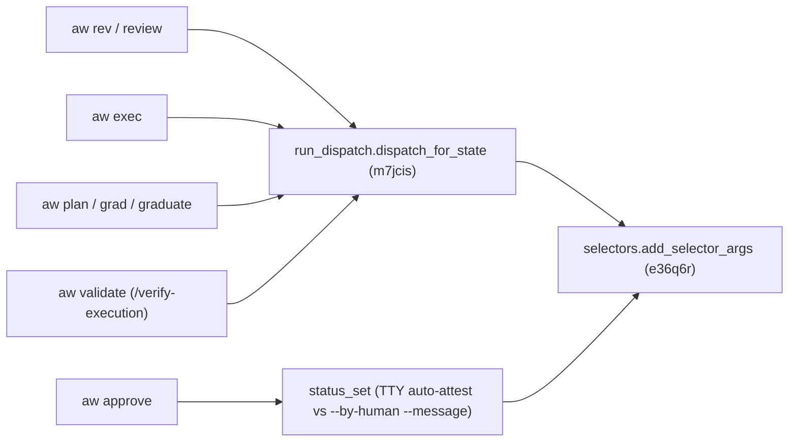

# IPD: Add verb-first top-level CLI commands (review, exec, grad, approve, validate)

- Date: 2026-11-22
- Kind: child
- Concern: Expose natural verb-first top-level CLI commands (`aw rev`/`review`, `aw exec`, `aw plan`/`grad`/`graduate`, `aw validate`, `aw approve`) wired to normalized selectors (`e36q6r`) and per-state runner routing (`m7jcis`), update shell completions and docs, and perform whole-Set verification (spec `ogd2nv` R-12 through R-16).
- Scope: Register top-level `review` (alias `rev`), `exec`, `plan` (aliases `grad`, `graduate`), `validate` (AI `/verify-execution`), and `approve` (TTY auto-attest vs non-TTY `--by-human --message`) in `agent_workflows/cli.py`, `agent_workflows/run_dispatch.py`, and `agent_workflows/status_set.py`; preserve existing `aw run`, `aw oc`, `aw agy`, and `aw set` commands unbroken; update `agent_workflows/completion.py`, `agent_workflows/command_surface.py`, and `docs/cli-output-contract.md`; add behavioral tests in `tests/test_cli_verbs.py` and update `tests/test_completion.py`. EXCLUDES removing `aw oc`/`aw agy`/`aw set`.
- Scope-Paths: agent_workflows/cli.py, agent_workflows/run_dispatch.py, agent_workflows/status_set.py, agent_workflows/completion.py, agent_workflows/command_surface.py, docs/cli-output-contract.md, tests/test_cli_verbs.py, tests/test_completion.py, .aw/records/plans/pending/20261122-cliverbs-03-xocj8i-add-verb-first-top-level-cli-commands-review-exec-grad-appro.ipd.md
- Item-Dependencies: executed:m7jcis, executed:p06t7i, executed:e36q6r
- Status: to-review
- Short-Description: Wire aw rev/review, aw exec, aw plan/grad/graduate, aw approve, and aw validate with normalized selectors, completions, and tests
- Work-Kind: feature
- Priority: medium
- From-Backlog: i8dc07
- From-Spec: ogd2nv
- Set: cliverbs
- Order: 3
- Highest E allocated: 04
- Author: antigravity
- Id: xocj8i

> Write and proofread this plan per the technical writing standard, `.aw/system/workflows/technical-writing/technical-writing.md` (`.agents/workflows/technical-writing/technical-writing.md` in a legacy-layout install), including requirement 12 (diagrams).

## Workflow history

- 2026-11-23 to-review (aw set): status set to to-review
- 2026-11-23 draft (antigravity): created and authored as Order 03 of Set `cliverbs` graduating `i8dc07` under spec `ogd2nv`.

## Goal

Give maintainers natural verb-first daily commands (`aw rev`/`review`, `aw exec`, `aw plan`/`grad`/`graduate`, `aw validate`, `aw approve`) backed by normalized selectors and per-state runner profiles, update shell completions and docs, and verify the entire `cliverbs` Set end to end.

## Detailed Implementation Checklist (TODO)

Execution-state rule: mark an `E-*` item complete only after performing the action. That mark is not validation. Right-sizing rule: write for a modest executor that cannot hold much in its head. Each E-item is one step (one concern, about one file, executable in one focused pass) and its V-item names each unit it covers with its own check; a plan stays at about 5 E-items and 8 work Scope-Paths, else split it into more child plans (guidance, `IPD-Z603`). Accepted execution states: blocked, failed, pending, performed; terminal gate demands 'performed'.

### Task group 1: Top-level runner verbs (`review`/`rev`, `exec`, `plan`/`grad`/`graduate`, `validate`)

- [ ] E-01 Register top-level verbs `review` (alias `rev`), `exec`, `plan` (aliases `grad`, `graduate`), and `validate` in `agent_workflows/cli.py` and `agent_workflows/run_dispatch.py`, attaching `selectors.add_selector_args` (`e36q6r`) and routing each verb through `run_dispatch.dispatch_for_state` (`m7jcis`) using its state (`review`, `execute`, `graduate`, `validate`) and `--host`/`--as`/`--model`/`--variant` overrides: `review` dispatches `--action review`, `exec` dispatches `--action execute`, `plan`/`grad`/`graduate` dispatches `--action plan`, and `validate` dispatches AI post-execution verification (`/verify-execution`) on executed plans. Keep all existing `aw run` subcommands (`as`, `ipd`, `init`, `start`, `record`, `verify`, `cancel`, `finalize`) and `aw oc`/`aw agy` commands unchanged.
  - Depends on: none
  - Expected outcome: All four runner verbs resolve host/profile/model via per-state precedence, pass normalized selector filters cleanly, and leave existing `aw run`, `aw oc`, and `aw agy` commands unaffected.
  - Execution state: pending

### Task group 2: Top-level `aw approve` with TTY-vs-agent attestation

- [ ] E-02 Register top-level `aw approve` in `agent_workflows/cli.py` and wire it to `agent_workflows/status_set.py` with normalized selectors (`e36q6r`) so it approves (or re-affirms stale, per `9ifwdx`) both plans and specs in one command: when `term.stdin_is_interactive()` is true (and not `--agent`/`--json`), attest automatically as human without requiring `--by-human` (honoring the bulk/stale confirmation guard); when non-interactive or `--agent`/`--json`, require explicit `--by-human` AND `--message "<human instruction>"` and fail closed with exit 2 otherwise.
  - Depends on: E-01
  - Expected outcome: Humans can run `aw approve <id6>` (or `aw approve -s reviewed --sid <set>`) cleanly in a terminal, while unattended/agent invocations cannot approve without explicit `--by-human --message`.
  - Execution state: pending

### Task group 3: Completions, docs, and whole-Set verification

- [ ] E-03 Update `agent_workflows/completion.py`, `agent_workflows/command_surface.py`, and `docs/cli-output-contract.md` to register and document `review`/`rev`, `exec`, `plan`/`grad`/`graduate`, `validate`, `approve`, `profile`, and `show` views (removing `reviews` from completions/surface and writing zero em or en dashes in user-facing prose).
  - Depends on: E-01, E-02
  - Expected outcome: Shell completions and CLI reference documentation reflect the complete verb-first CLI surface and consolidated `aw show` views.
  - Execution state: pending

- [ ] E-04 Create `tests/test_cli_verbs.py` and update `tests/test_completion.py` with behavioral tests exercising: (a) `aw rev`/`review`, `aw exec`, `aw plan`/`grad`/`graduate`, and `aw validate` routing with per-state profiles, `--host`/`--as`, single-host `PATH` fallback, and normalized selectors, (b) `aw approve` interactive TTY auto-attestation vs non-interactive refusal without `--by-human --message` on both plans and specs, (c) existing `aw run`, `aw oc`, `aw agy`, and `aw set` backward compatibility, and (d) whole-Set validation (`pytest`, `mypy`, `aw attention --check`, `aw sanitize`).
  - Depends on: E-01, E-02, E-03
  - Expected outcome: All verb-first, show, profile, selector, and completion tests plus `mypy`, `aw attention --check`, and `aw sanitize` pass with zero errors.
  - Execution state: pending

## Project conventions discovered (Step 0)

- `aw run` already owns `as`, `ipd`, `init`, `start`, `record`, `verify`, `cancel`, and `finalize`; introducing `aw exec` avoids colliding with those existing `aw run` subcommands while giving a concise top-level execution verb.
- `agent_workflows/status_set.py` already uses `term.stdin_is_interactive()` to distinguish human terminals from `--agent`/`--json`/non-TTY callers on spec approvals; `aw approve` extends that exact pattern consistently across plans and specs with required `--message` on non-interactive calls.
- Run `python3 -m pytest` bare; write behavioral tests only (no source inspection).

## Findings

- Daily operations currently require host-qualified prefixes (`aw agy run --action review`) and separate approval commands for plans vs specs (`aw ipd set approved` vs `aw specs set --status approved`).

## Proposed changes (ordered, validatable)

1. Register `review`/`rev`, `exec`, `plan`/`grad`/`graduate`, and `validate` in `cli.py` and `run_dispatch.py` (`E-01`).
2. Register `aw approve` with TTY-vs-non-TTY `--by-human --message` enforcement in `cli.py` and `status_set.py` (`E-02`).
3. Sync `completion.py`, `command_surface.py`, and `docs/cli-output-contract.md` (`E-03`).
4. Add behavioral tests in `tests/test_cli_verbs.py`, update `tests/test_completion.py`, and run whole-Set verification (`E-04`).

## Deferred / out of scope (with reason)

- Removing legacy `aw oc ...`, `aw agy ...`, `aw run ...`, or `aw set ...` commands: explicitly out of scope per spec `ogd2nv` (retained as lower-level stable interfaces).
  - Carrier-Declined: explicitly out of scope per spec ogd2nv (legacy commands retained as lower-level stable interfaces)

## Scope check

- Over-scope: none; covers only the five verb-first commands, completions, docs, and whole-Set tests.
- Under-scope: none; completes every remaining requirement of spec `ogd2nv` (`R-12`..`R-16`, `AC-06`).

## Required tests / validation

- `python3 -m pytest tests/test_cli_verbs.py tests/test_show_views.py tests/test_runner_profiles_verbs.py tests/test_review_decisions.py tests/test_completion.py tests/test_normalized_selectors.py`
- `python3 -m mypy agent_workflows/cli.py agent_workflows/run_dispatch.py agent_workflows/status_set.py agent_workflows/completion.py agent_workflows/command_surface.py`
- `aw attention --check && aw sanitize`

## Spec / documentation sync

- Updates `docs/cli-output-contract.md` (`E-03`) and completes spec `ogd2nv` Sections 2-4.

## Open questions

None; all design questions were resolved in `i8dc07` and codified in spec `ogd2nv`.

## Validation and cross-check (verify before reporting done)

Validation-state rule: inspect evidence in a separate pass. Do not mark a `V-*` item complete from memory or from the matching execution checkmark. Accepted validation results: blocked, failed, pass, pending; terminal gate demands 'pass'. Runtime-demonstration reachability rule: for each `V-*` item demanding the software be observed acting (such as a run, a dispatch, or a transition), as distinct from items demanding a diff, a file's content, or a test result, name the code path that produces the observation or the sibling `E-*` that creates it, else the demand is UNDER-SCOPE.

- [ ] V-01 validates E-01
  - Required evidence: Pasted pytest output from `tests/test_cli_verbs.py` proving `aw rev`/`review`, `aw exec`, `aw plan`/`grad`/`graduate`, and `aw validate` route through per-state profiles with normalized selectors while existing `aw run`, `aw oc`, and `aw agy` commands still work.
  - Observed evidence:
  - Result: pending

- [ ] V-02 validates E-02
  - Required evidence: Pasted pytest output from `tests/test_cli_verbs.py` proving `aw approve` auto-attests on an interactive TTY for plans and specs, and refuses with exit 2 on non-interactive/`--agent` calls unless both `--by-human` and `--message` are provided.
  - Observed evidence:
  - Result: pending

- [ ] V-03 validates E-03
  - Required evidence: Pasted pytest output from `tests/test_completion.py` and git diff excerpt for `docs/cli-output-contract.md` showing the new top-level verbs, `aw profile`, `aw show` views, removal of `reviews`, and zero em/en dashes.
  - Observed evidence:
  - Result: pending

- [ ] V-04 validates E-04
  - Required evidence: Pasted runner output from `python3 -m pytest tests/test_cli_verbs.py tests/test_show_views.py tests/test_runner_profiles_verbs.py tests/test_review_decisions.py tests/test_completion.py tests/test_normalized_selectors.py`, `mypy`, `aw attention --check`, and `aw sanitize` all passing with exit 0.
  - Observed evidence:
  - Result: pending

## Approval and execution gate

- Size assessment: standard
- Cohesion rationale: not required

Ready for `/plan-review` and human approval (`aw set approved xocj8i --by-human`). Execution must follow the repository agent execution contract (isolated worktree, path-scoped `aw commit xocj8i -- <paths>`, pasted validation output, and post-gate lifecycle transition).
