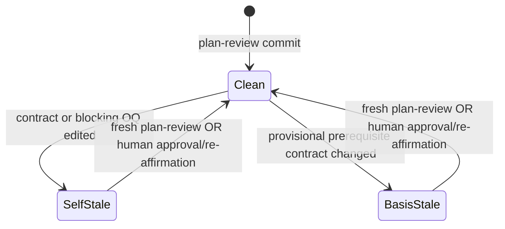

# IPD: Clear review staleness on human approval and add aw show stale-reviews

- Date: 2026-11-22
- Kind: child
- Concern: ui-ux (review staleness lifecycle, human-approval clearing, unified read-only stale-review inspection under `aw show`, and `aw att` filtering/legend completeness).
- Scope: Update review-staleness detection (`agent_workflows/plan_readiness.py`), human approval transitions (`agent_workflows/status_set.py`), local review-basis clearing (`agent_workflows/review_basis.py`), host-aware staleness recovery hints (`agent_workflows/check_engine.py`), read-only `aw show stale-reviews [--diff]` (`agent_workflows/cli.py`), `aw att --stale-review` filter and legend (`agent_workflows/attention.py`), and behavioral tests (`tests/test_review_staleness_advisory.py`). EXCLUDES `aw partition --action review` explicit re-review support (shipped separately in this session), verb-first top-level CLI routing (`i8dc07`), and normalized selector flag unification (`1iojci`).
- Scope-Paths: agent_workflows/plan_readiness.py, agent_workflows/status_set.py, agent_workflows/review_basis.py, agent_workflows/check_engine.py, agent_workflows/cli.py, agent_workflows/attention.py, tests/test_review_staleness_advisory.py, .aw/records/plans/pending/20261122-rereviewux-01-9ifwdx-clear-review-staleness-on-human-approval-and-add-aw-show-sta.ipd.md
- Item-Dependencies: none
- Status: to-review
- Short-Description: Clear self-stale and basis-stale warnings on human approval, add aw show stale-reviews --diff, and add aw att --stale-review
- Work-Kind: feature
- Priority: medium
- Set: rereviewux
- Order: 1
- Highest E allocated: 05
- Author: antigravity
- Id: 9ifwdx

> Write and proofread this plan per the technical writing standard, `.aw/system/workflows/technical-writing/technical-writing.md` (`.agents/workflows/technical-writing/technical-writing.md` in a legacy-layout install), including requirement 12 (diagrams).

## Workflow history

- 2026-11-22 to-review (aw set): status set to to-review
- 2026-11-22 draft (antigravity): created from `/assess-ui-ux` review-staleness assessment after maintainer selected Option A on Question 1 (human approval clears staleness with bulk-approval guard) and directed `aw show` as the read-only inspection surface.

## Goal

Make review-staleness warnings actionable and dismissible through normal maintainer approval: clear both self-stale (`[stale-review]`) and local prerequisite-stale (`.aw/state/review-basis/`) signals when a human approves or re-affirms a plan (with a bulk-approval confirmation guard), expose a unified read-only `aw show stale-reviews [--diff]` view, add `--stale-review` filtering and legend documentation to `aw att`, and make `check_engine.check_ipd_review_stale` host-aware.

## Detailed Implementation Checklist (TODO)

Execution-state rule: mark an `E-*` item complete only after performing the action. That mark is not validation. Right-sizing rule: write for a modest executor that cannot hold much in its head. Each E-item is one step (one concern, about one file, executable in one focused pass) and its V-item names each unit it covers with its own check; a plan stays at about 5 E-items and 8 work Scope-Paths, else split it into more child plans (guidance, `IPD-Z603`). Accepted execution states: blocked, failed, pending, performed; terminal gate demands 'performed'.

### Task group 1: Staleness baseline and human-approval clearing (Q1 = Option A)

- [ ] E-01 Update `review_staleness_index` in `agent_workflows/plan_readiness.py` so the staleness baseline recognizes the latest human-attested approval commit for a plan alongside `plan-review:` commits, and add a helper returning a concise diff summary (changed `Scope-Paths`, changed `E-*`/`V-*` items, and newly resolved blocking OQs) between the baseline blob and current text.
  - Depends on: none
  - Expected outcome: A plan whose latest baseline commit is a human-attested approval/re-affirmation (recorded by `aw set approved --by-human`) reports no `[stale-review]` until a later substantive edit or blocking OQ resolution occurs, and the diff helper extracts exact changed lines without invoking external diff binaries.
  - Execution state: pending

- [ ] E-02 Update `agent_workflows/status_set.py` and `agent_workflows/review_basis.py` so `aw set approved <targets> --by-human` clears both self-stale and local prerequisite-stale warnings: (a) add `clear_basis(repo, consumer_id6)` in `agent_workflows/review_basis.py` to remove `.aw/state/review-basis/<id6>.json` if present; (b) allow `aw set approved --by-human` on an already-`approved` plan that is currently self-stale or basis-stale to write a re-affirmation `## Workflow history` entry citing the cleared baseline SHA instead of treating the call as a no-op; (c) delete `.aw/state/review-basis/<id6>.json` whenever `aw set approved --by-human` succeeds on a plan; and (d) add a bulk-approval guard that, when approving more than one plan (or a Set selector) containing stale plans, lists the stale plans and asks for confirmation on a TTY (or requires `--yes` / explicit confirmation when non-interactive) before clearing them.
  - Depends on: E-01
  - Expected outcome: Approving or re-affirming a single stale plan with `aw set approved <id6> --by-human` records a baseline-advancing history entry and removes any local basis-stale record; bulk approval warns and gates before clearing staleness on unnoticed edits.
  - Execution state: pending

### Task group 2: Unified read-only inspection (`aw show stale-reviews`), `aw att` integration, and host-aware check hints

- [ ] E-03 Add a read-only `aw show stale-reviews [selectors] [--diff]` view in `agent_workflows/cli.py` (backed by a shared listing helper in `agent_workflows/review_basis.py` and `agent_workflows/plan_readiness.py`) that merges self-stale (`[stale-review]`) and local prerequisite-stale (`[REVIEW-BASIS-STALE]`) pending plans into one table/JSON/agent output showing `id6`, `status`, `set`, `stale-kind` (`self-edited`, `dep-changed`, or `both`), baseline commit/target, and (with `--diff`) the changed `Scope-Paths`, `E-*`/`V-*` items, or resolved blocking OQs.
  - Depends on: E-01, E-02
  - Expected outcome: Running `aw show stale-reviews` prints one unified read-only report of all stale plans (and exits 0 when none are stale), `--diff` prints the concrete contract/OQ deltas, and existing `aw show <id6|setid|status>` lookups remain unchanged.
  - Execution state: pending

- [ ] E-04 Add `--stale-review` filter support and a `[stale-review]` legend note to `aw att` (`agent_workflows/attention.py` and `agent_workflows/cli.py`), and update `check_ipd_review_stale` in `agent_workflows/check_engine.py` to derive the recovery command host from repo/user configuration (falling back to `oc` when unconfigured so existing tests and defaults remain unchanged).
  - Depends on: E-01, E-03
  - Expected outcome: `aw att -t plan --stale-review` filters cleanly to stale plans, the `aw att` legend documents `[stale-review]`, and `check_ipd_review_stale` uses the configured host (`agy` or `oc`) when set while preserving `aw oc review <id6> --yes` as the default fallback.
  - Execution state: pending

### Task group 3: Behavioral test coverage

- [ ] E-05 Add behavioral tests in `tests/test_review_staleness_advisory.py` exercising: (1) human approval and re-affirmation clearing `[stale-review]` and `.aw/state/review-basis/<id6>.json`, (2) bulk-approval guard prompting/refusing without confirmation when stale plans are included, (3) `aw show stale-reviews` and `aw show stale-reviews --diff` (text and `--json`), (4) `aw att -t plan --stale-review` filtering and legend output, and (5) `check_ipd_review_stale` honoring configured host with `oc` default fallback.
  - Depends on: E-01, E-02, E-03, E-04
  - Expected outcome: Every new behavior is tested through real CLI/function calls against real git repos and plan files (zero code-pinning tests), and `python3 -m pytest tests/test_review_staleness_advisory.py tests/test_readers_check_engine.py tests/test_review_unreviewed_deps.py` plus `mypy` pass cleanly.
  - Execution state: pending

## Project conventions discovered (Step 0)

- `agent_workflows/plan_readiness.py` (`review_staleness_index`, `review_staleness_from_texts`) is the single authority for self-stale `[stale-review]` computation, reading current status via `artifact_meta.read_text` and baseline blobs via batched `git cat-file --batch`.
- `agent_workflows/review_basis.py` (`stale_bases`, `record_basis`, `basis_dir`) owns `.aw/state/review-basis/<id6>.json` prerequisite-stale state.
- `agent_workflows/status_set.py` (`apply_status_change`, `_prepare_status_change`, `run_set_command`) owns `aw set` status transitions and `_offer_self_commit`. Today a same-status write without a new `-m` message is a pure no-op.
- `agent_workflows/check_engine.py` (`check_ipd_review_stale`) emits advisory info drift; `tests/test_review_staleness_advisory.py` and `tests/test_readers_check_engine.py` pin `"aw oc review <id6> --yes"` when no host override is configured.
- `agent_workflows/cli.py` owns `aw show <action_ref>` and `aw att` CLI parsing.
- Testing convention: run `python3 -m pytest` bare (never `-n0`, extra `-q`, or `-p no:randomly`), test observable behavior only (never inspect source with `ast`/`inspect`/regex).

## Findings

From the `/assess-ui-ux` assessment of `aw` re-review and review-staleness workflows (2026-11-22):

| ID | Severity | Finding | Resolution in this plan |
| --- | --- | --- | --- |
| F-03 | High | Two disconnected staleness models (`[stale-review]` in `aw att` vs `[REVIEW-BASIS-STALE]` in runner stderr) show conflicting counts (6 vs 62) with no unified view. | Unified read-only `aw show stale-reviews` (E-03) and `aw att --stale-review` (E-04). |
| F-04 | High | No way to inspect what changed since review and no way for a human to clear staleness after an intentional edit without running a full AI re-review and re-approval cycle. | Human approval clears staleness with bulk guard (E-01, E-02) and `aw show stale-reviews --diff` (E-03). |
| F-06 | Medium | `check_engine.check_ipd_review_stale` hardcodes `aw oc review <id6> --yes` even in repositories configured for `agy`. | Host-aware recovery hint with `oc` fallback (E-04). |
| F-07 | Low | `aw att` displays `[stale-review]` inline but offers no `--stale-review` filter and omits `[stale-review]` from its legend. | `--stale-review` filter and legend note (E-04). |

(Findings F-01 `aw partition --action review` exit-2 conflict, F-02 orchestrator filtering in `review_basis.py`, and F-05 stderr line-cap truncation are fixed immediately outside this plan.)

## Proposed changes (ordered, validatable)

1. Extend `plan_readiness.review_staleness_index` to recognize human-attested approval commits as baseline commits alongside `plan-review:` commits, and add a pure contract/OQ diff summary helper (`E-01`).
2. Add `review_basis.clear_basis` and update `status_set` so `aw set approved --by-human` re-affirms already-approved stale plans, clears local basis records, and prompts/gates before clearing stale plans in bulk approvals (`E-02`).
3. Add `aw show stale-reviews [selectors] [--diff]` combining self-stale and basis-stale pending plans in one read-only view (`E-03`).
4. Add `aw att --stale-review`, update the `aw att` legend, and make `check_engine.check_ipd_review_stale` honor configured host with `oc` fallback (`E-04`).
5. Add end-to-end behavioral tests in `tests/test_review_staleness_advisory.py` (`E-05`).

## Deferred / out of scope (with reason)

- Verb-first top-level CLI verbs (`aw rev|review`, `aw run|exec`, `aw plan|grad|graduate`, `aw validate`, `aw approve`) and deprecating `aw reviews`: broader CLI surface redesign tracked in backlog item `i8dc07`.
- Aggregating and normalizing all artifact selector flags (`-t/-T`, `-s/-S`, `-p/-P`, `-r/-R`, `--set-id`/`--not-set-id`, date/mtime/ctime): tracked in backlog item `1iojci`.
- Immediate `aw partition --action review` re-review fix (Q2 = Option A) and `review_basis.py` orchestrator pruning/cap: implemented directly in this session.

## Scope check

- Over-scope: none; every file in `Scope-Paths` directly implements the settled Q1=A decision, `aw show stale-reviews`, `aw att --stale-review`, or host-aware recovery hints.
- Under-scope: none; all callers, CLI wiring, and behavioral tests are covered in `E-01`..`E-05`.

## Required tests / validation

- Targeted behavioral suite: `python3 -m pytest tests/test_review_staleness_advisory.py tests/test_readers_check_engine.py tests/test_review_unreviewed_deps.py`
- Type check: `python3 -m mypy agent_workflows/plan_readiness.py agent_workflows/status_set.py agent_workflows/review_basis.py agent_workflows/check_engine.py agent_workflows/cli.py agent_workflows/attention.py`
- Full repo sanity: `aw attention --check && aw sanitize`

## Spec / documentation sync

- Update CLI help text for `aw show` and `aw att` inside `agent_workflows/cli.py` (`E-03`, `E-04`). No separate specification requires revision prior to `i8dc07`.

## Open questions

### OQ-01: Should human-attested approval commits be matched by a dedicated commit trailer/prefix or by inspecting `## Workflow history` in the commit diff?

- Blocking: no
- Status: open
- Owner: executor
- Resolution or deferral rationale: Implementation detail delegated to executor of E-01/E-02. Both approaches are valid as long as only genuine human-attested approval/re-affirmation commits (written via `aw set approved --by-human` or `aw commit` with matching `approved (aw set)` / `same-status` re-affirmation history entry) advance the staleness baseline, and an arbitrary human edit commit without re-approval still triggers `[stale-review]`.

## Validation and cross-check (verify before reporting done)

Validation-state rule: inspect evidence in a separate pass. Do not mark a `V-*` item complete from memory or from the matching execution checkmark. Accepted validation results: blocked, failed, pass, pending; terminal gate demands 'pass'. Runtime-demonstration reachability rule: for each `V-*` item demanding the software be observed acting (such as a run, a dispatch, or a transition)—as distinct from items demanding a diff, a file's content, or a test result, which are reachable by construction—name the code path that produces the observation or the sibling `E-*` that creates it, else the demand is UNDER-SCOPE.

- [ ] V-01 validates E-01
  - Required evidence: Pasted pytest output from `tests/test_review_staleness_advisory.py` showing that (a) editing a plan after `plan-review:` triggers `[stale-review]`, (b) a subsequent human-attested approval commit clears `[stale-review]` in `plan_readiness.review_staleness_index`, (c) a later substantive edit after that approval triggers `[stale-review]` again, and (d) the diff helper returns the exact changed contract/OQ lines.
  - Observed evidence:
  - Result: pending

- [ ] V-02 validates E-02
  - Required evidence: Pasted pytest output from `tests/test_review_staleness_advisory.py` showing that `aw set approved <id6> --by-human` on an already-`approved` stale plan writes a re-affirmation `## Workflow history` entry and deletes `.aw/state/review-basis/<id6>.json`, and that bulk-approving a Set containing a stale plan refuses/prompts unless confirmed.
  - Observed evidence:
  - Result: pending

- [ ] V-03 validates E-03
  - Required evidence: Pasted pytest output and CLI output demonstrating `aw show stale-reviews`, `aw show stale-reviews --diff`, and `aw show stale-reviews --json` reporting both `self-edited` and `dep-changed` stale plans, plus an unchanged `aw show <id6>` lookup exiting 0.
  - Observed evidence:
  - Result: pending

- [ ] V-04 validates E-04
  - Required evidence: Pasted pytest output showing `aw att -t plan --stale-review` returning only stale plans, `aw att` output documenting `[stale-review]` in its legend, and `check_engine.check_ipd_review_stale` emitting the configured host (`agy`) when configured while preserving `aw oc review <id6> --yes` as the default fallback in `tests/test_readers_check_engine.py`.
  - Observed evidence:
  - Result: pending

- [ ] V-05 validates E-05
  - Required evidence: Pasted runner output from `python3 -m pytest tests/test_review_staleness_advisory.py tests/test_readers_check_engine.py tests/test_review_unreviewed_deps.py`, `mypy`, `aw attention --check`, and `aw sanitize` all passing with zero errors.
  - Observed evidence:
  - Result: pending

## Approval and execution gate

- Size assessment: standard
- Cohesion rationale: not required

This plan is ready for `/plan-review` and human approval (`aw set approved 9ifwdx --by-human`). Execution must follow the repository agent execution contract (isolated worktree, path-scoped `aw commit 9ifwdx -- <paths>`, pasted validation output, and post-gate lifecycle transition to `.aw/records/plans/executed/`).
