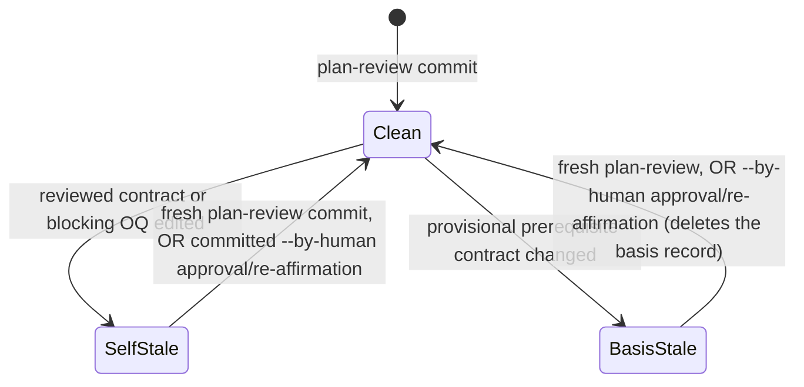

# IPD: Clear review staleness on human approval and add aw show stale-reviews

- Date: 2026-11-22
- Kind: child
- Concern: ui-ux (review staleness lifecycle, human-approval clearing, unified read-only stale-review inspection under `aw show`, and `aw att` filtering/legend completeness).
- Scope: Update the review-staleness baseline (`agent_workflows/plan_readiness.py`), human approval and re-affirmation (`agent_workflows/status_set.py`), local review-basis clearing (`agent_workflows/review_basis.py`), host-aware re-review hints at all three hint sites (`agent_workflows/check_engine.py`, `agent_workflows/ipd_lint.py`, `agent_workflows/status_set.py`), the read-only `aw show stale-reviews [--diff]` view (`agent_workflows/cli.py`, `agent_workflows/command_surface.py`), the `aw att --stale-review` filter and legend (`agent_workflows/attention.py`, `agent_workflows/cli.py`), behavioral tests (`tests/test_review_staleness_advisory.py`), the CHANGELOG, and the two specs that define the staleness baseline and the basis-record deletion rule. EXCLUDES `aw partition --action review` explicit re-review support (shipped separately in this session), verb-first top-level CLI routing and the `aw show artifact <selector>` escape hatch (`i8dc07`), and normalized selector flag unification (`1iojci`).
- Scope-Paths: agent_workflows/plan_readiness.py, agent_workflows/status_set.py, agent_workflows/review_basis.py, agent_workflows/check_engine.py, agent_workflows/ipd_lint.py, agent_workflows/cli.py, agent_workflows/command_surface.py, agent_workflows/attention.py, tests/test_review_staleness_advisory.py, CHANGELOG.md, .aw/records/specs/implemented/20260726-1340-01-ipd-spec.spec.md, .aw/records/specs/approved/20260826-25kzda-01-25kzda-aw-run-deterministic-run-and-verify.spec.md, .aw/records/plans/pending/20261122-rereviewux-01-9ifwdx-clear-review-staleness-on-human-approval-and-add-aw-show-sta.ipd.md
- Item-Dependencies: none
- Status: reviewed
- Short-Description: Clear self-stale and basis-stale warnings on human approval, add aw show stale-reviews --diff, and add aw att --stale-review
- Work-Kind: feature
- Priority: medium
- Readiness: go-pending-approval
- Review-Depth: complex
- Set: rereviewux
- Order: 1
- Highest E allocated: 08
- Author: antigravity
- Id: 9ifwdx

> Write and proofread this plan per the technical writing standard, `.aw/system/workflows/technical-writing/technical-writing.md` (`.agents/workflows/technical-writing/technical-writing.md` in a legacy-layout install), including requirement 12 (diagrams).

## Workflow history

- 2026-11-23 reviewed (/plan-review model=claude-opus-5.5): APPROVE WITH REVISIONS APPLIED; F1..F11 FIXED; review record .aw/records/reviews/20261122-rereviewux-01-9ifwdx-clear-review-staleness-on-human-approval-and-add-aw-show-sta.review.md
- 2026-11-22 to-review (aw set): status set to to-review
- 2026-11-22 draft (antigravity): created from `/assess-ui-ux` review-staleness assessment after maintainer selected Option A on Question 1 (human approval clears staleness with bulk-approval guard) and directed `aw show` as the read-only inspection surface.

## Goal

Make review-staleness warnings actionable and dismissible through normal maintainer approval. Two signals exist today. Self-stale (`[stale-review]`, computed from git history by `plan_readiness.review_staleness_index`) means the plan's own reviewed contract or a blocking open question changed since its last `plan-review:` commit. Basis-stale (`[REVIEW-BASIS-STALE]`, a local JSON record under `.aw/state/review-basis/<id6>.json` written by `review_basis.record_basis`) means a prerequisite the plan was reviewed against under `--review-unreviewed-deps` has since changed its contract. This plan lets a COMMITTED human-attested approval or re-affirmation (`aw set approved <id6> --by-human`) clear both signals, adds a confirmation guard so a bulk approval cannot clear staleness on edits nobody looked at, exposes one read-only `aw show stale-reviews [--diff]` view of both signals, adds `--stale-review` filtering and a legend entry to `aw att`, and makes every re-review hint name the user's configured runner host instead of always `oc`.

## Detailed Implementation Checklist (TODO)

Execution-state rule: mark an `E-*` item complete only after performing the action. That mark is not validation. Right-sizing rule: write for a modest executor that cannot hold much in its head. Each E-item is one step (one concern, about one file, executable in one focused pass) and its V-item names each unit it covers with its own check; a plan stays at about 5 E-items and 8 work Scope-Paths, else split it into more child plans (guidance, `IPD-Z603`). Accepted execution states: blocked, failed, pending, performed; terminal gate demands 'performed'.

### Task group 1: Staleness baseline and human-approval clearing (Q1 = Option A)

- [ ] E-01 In `agent_workflows/plan_readiness.py`, change `review_staleness_index` so the staleness baseline is the NEWEST of: (a) the latest commit whose subject starts with `plan-review:` (today's only baseline, found by the subject filter in the `git log --format=%x01%H%x00%s --name-only` loop), or (b) a later commit on the same path whose committed blob is a human-attested approval. A blob is a human-attested approval when its `- Status:` (read through `artifact_meta.read_text`) is `approved` AND its newest `## Workflow history` record (via `attention_contract.history_block` and `attention_contract.newest_history_record`) matches `^- \d{4}-\d{2}-\d{2} (approved|same-status) \([^)]*--by-human[^)]*\):`. The match is SUBJECT-AGNOSTIC on purpose: `status_set._offer_self_commit` commits as `chore(plans): set status approved`, a hand commit uses any subject, and `aw commit` uses the caller's message, so a subject filter would miss most real approvals. Implementation shape, keeping today's single-`git log` and single-`git cat-file --batch` cost model: keep the one `git log` over all candidate paths; for each path collect the commits NEWER than its latest `plan-review:` commit (stop at that commit, so nothing older than the last review is examined); read every collected `<sha>:<path>` blob plus the `plan-review:` blob in ONE `git cat-file --batch` call; pick the newest qualifying blob as the baseline and pass it with its SHA to the unchanged `review_staleness_from_texts`. A path with no `plan-review:` commit stays silent, as today (an approval never creates a baseline on its own). An UNCOMMITTED approval does not count, because the baseline is read from git history; it clears staleness once committed. Update the function docstring to state the new baseline rule.
  - Depends on: none
  - Expected outcome: a reviewed plan edited after its `plan-review:` commit reports `[stale-review]`; once a `--by-human` approval or re-affirmation of it is committed (under any commit subject) the plan reports no staleness; a later substantive edit or blocking-OQ resolution makes it stale again with `reviewed_commit` naming the approval commit; an edit commit whose newest history record is not a `--by-human` approval never advances the baseline.
  - Execution state: pending

- [ ] E-02 In `agent_workflows/review_basis.py` add `clear_basis(repo: Path, consumer_id6: str) -> bool`, which deletes `basis_dir(repo) / f"{consumer_id6}.json"` when present and returns whether it deleted a file. In `agent_workflows/status_set.py`, for a plan record whose target status is `approved` with `--by-human`: (a) in `_prepare_status_change`, when the plan is ALREADY `approved` (the `is_same_status` path, which today writes nothing because `content_changed` is false and `_write_history_anyway` is false without `-m`) AND it is self-stale (the existing `review_staleness_index` call in the same function) or basis-stale (`basis_dir(repo)/<id6>.json` exists), force `_write_history_anyway` and use the default message `re-affirmed by human; clears review staleness since <sha8>` (`<sha8>` is the stale baseline's `reviewed_commit[:8]`, or `basis` when only basis-stale), so the `same-status (aw set, --by-human)` record E-01 recognizes is written and the duplicate suppression of `same_status_message_is_duplicate` cannot swallow a second re-affirmation after a later edit (its SHA differs); an explicit `-m` message is kept and the SHA clause is appended; (b) after `apply_status_change` succeeds for such a plan (a genuine transition to `approved` OR a re-affirmation), and not under `--dry-run`, call `review_basis.clear_basis(repo, id6)`. A same-status `approved` call WITHOUT `--by-human`, or on a plan that is neither self-stale nor basis-stale, keeps today's no-op behavior.
  - Depends on: E-01
  - Expected outcome: `aw set approved <id6> --by-human` on an already-approved stale plan prepends one `same-status (aw set, --by-human)` history record naming the cleared SHA and removes `.aw/state/review-basis/<id6>.json`; the same command on a non-stale approved plan writes nothing; no `.aw/state` file is touched under `--dry-run`.
  - Execution state: pending

- [ ] E-06 In `agent_workflows/status_set.py` `run_set_command`, add the bulk-approval staleness guard, and add its `--accept-stale` flag (store_true, help "Confirm approving a batch that contains plans whose review may be stale") to the two plan-capable setter parsers in `agent_workflows/cli.py` (`p_set`, `p_ipd_set`) and to the `legacy_flags` of the `set` and `ipd set` declarations in `agent_workflows/command_surface.py`. The guard fires only when the target is `approved` with `--by-human`, more than one record is matched, and at least one matched plan is self-stale or basis-stale (computed once for the batch through one `review_staleness_index` call plus a `basis_dir` existence check). When it fires and `--accept-stale` is absent: on an interactive TTY (`_is_interactive(term)`, not agent or json) list each stale plan with its reasons and prompt `Approve and clear staleness for these N plans? [y/N]`, refusing on anything but `y`/`yes`; on a non-TTY, agent, or json caller refuse without prompting. A refusal exits 1 with rule `status.bulk_stale_approval_unconfirmed`, writes nothing, names every stale plan, and gives the retry command with `--accept-stale` appended (via the existing `_retry_command`). With `--accept-stale` the batch proceeds and `, --accept-stale` is appended to each written history record's actor, the same way `--allow-open-questions` is recorded. A single-plan approval is never guarded, because the human named that plan. `--yes` deliberately does NOT satisfy the guard: agent and json callers already need `--yes` for any mutation (`status_set.py` ~3888), so it would confirm nothing.
  - Depends on: E-02
  - Expected outcome: approving a Set containing a stale plan refuses with exit 1 and no writes unless confirmed, prompts on a TTY, and with `--accept-stale` approves every plan and records the override; a single stale plan approved by id6 proceeds without the guard.
  - Execution state: pending

### Task group 2: Unified read-only inspection (`aw show stale-reviews`), `aw att` integration, and host-aware hints

- [ ] E-03 Add the read-only `aw show stale-reviews [--diff]` view. In `agent_workflows/cli.py` `_run_show`, dispatch the reserved view name `stale-reviews` BEFORE selector resolution, following backlog `i8dc07` OQ-02 Option A (reserved view names dispatch first). In `agent_workflows/plan_readiness.py` add a pure `review_contract_diff(reviewed_text, current_text) -> dict` returning added and removed `Scope-Paths` entries, the ids of `E-*`/`V-*` items whose action block (via `ipd_lint.leaf_action_blocks`) was added, removed, or changed, with old and new text, and the ids of blocking OQs that went `open` to `resolved`; it uses no external diff binary. The view collects self-stale plans with one `review_staleness_index` call over the `reviewed`/`approved`/`auto-approved` plans and basis-stale plans with `review_basis.stale_bases(repo, prune=False)` (`prune=False` is mandatory: the default prunes, which deletes files, and a read-only view must write nothing). It merges them per plan into rows of `id6`, `status`, `set`, `stale-kind` (`self-edited`, `dep-changed`, or `both`), `baseline` (the baseline SHA for self-stale, the prerequisite id6 for dep-changed), and `reasons`. `--diff` adds, for self-stale rows, the `review_contract_diff` of the baseline blob against the current text; for dep-changed rows it states that only a digest was recorded, so no prerequisite text diff is available. Output honors the existing `--format json`, `--json`, and `--agent` paths of `aw show` (a JSON list of row objects; `diff` included only with `--diff`); an empty result prints `no stale reviews` and exits 0. Add `--diff` to `p_show` (help: "With `aw show stale-reviews`: also print what changed since the review baseline") and to the `show` declaration's `legacy_flags` in `agent_workflows/command_surface.py`; `--diff` with any other selector exits 2 with a message naming `aw show stale-reviews --diff`. Measured at review: no tracked record's Set id or filename contains `stale-reviews`, so reserving the name breaks no lookup today; the `aw show artifact <selector>` escape hatch belongs to `i8dc07`.
  - Depends on: E-01, E-02
  - Expected outcome: `aw show stale-reviews` prints one read-only report covering both staleness kinds and exits 0 (also when empty), `--diff` prints concrete contract and OQ deltas for self-stale plans, the view never deletes a basis record, and existing `aw show <id6|setid|status>` lookups are unchanged.
  - Execution state: pending

- [ ] E-04 In `agent_workflows/cli.py` add `--stale-review` (store_true, help "Show only plans whose review may be stale") to the shared `next` parser (spelled `aw next`, `aw attention`, `aw att`, `aw todo`), add `--stale-review` to the `next` declaration's `legacy_flags` in `agent_workflows/command_surface.py`, and in `agent_workflows/attention.py` filter the scanned items to those with a non-empty `review_stale` after the existing type and selector filters, so `aw att -t plan --stale-review` composes with `-t` and positional selectors. Extend the board legend line (`attention.py`, the `legend: ! stale(>30d) ...` string printed only when output is colored) with `[stale-review] review may be stale (aw show stale-reviews)`. This filter covers self-stale only; basis-stale plans are listed by `aw show stale-reviews` (E-03).
  - Depends on: E-01
  - Expected outcome: `aw att -t plan --stale-review` lists only self-stale plans, the colored board legend documents `[stale-review]`, and `aw att` without the flag is unchanged.
  - Execution state: pending

- [ ] E-07 Make every re-review hint host-aware. Add `review_basis.rereview_host() -> str`, which returns `runner_profiles.load().default_runner` when it is `oc` or `agy` and otherwise `oc`, and returns `oc` when the store is absent or raises `runner_profiles.RunnerProfileError` (a broken user store must never break `aw check` or `aw ipd lint`). Use it at the three hardcoded `aw oc review <id6> --yes` hint sites: `check_engine.check_ipd_review_stale` (the `recovery = f"aw oc review {id6} --yes"` line in `agent_workflows/check_engine.py`), `ipd_lint._review_stale_advisory` (the `to re-review: aw oc review {id6} --yes` message in `agent_workflows/ipd_lint.py`), and the stale warning in `status_set._prepare_status_change` (`agent_workflows/status_set.py`). Both host drivers' `start` parsers accept `--yes`, so the hint shape stays `aw <host> review <id6> --yes`. The host source is the user-local `default_runner`, because the project config has only `enabled_hosts` (three hosts, no default).
  - Depends on: none
  - Expected outcome: with no runner profile store, or one without `default_runner`, all three hints still read `aw oc review <id6> --yes` (existing assertions in `tests/test_review_staleness_advisory.py` and `tests/test_readers_check_engine.py` stay green); with `default_runner: agy` all three read `aw agy review <id6> --yes`.
  - Execution state: pending

### Task group 3: Behavioral test coverage and documentation

- [ ] E-05 Add behavioral tests to `tests/test_review_staleness_advisory.py`, each driving real functions or the CLI against a temporary git repository with real plan files (no source inspection, no code pinning): (1) E-01 baseline: stale after an edit past `plan-review:`; cleared after a committed `--by-human` approval whose commit subject is `chore(plans): set status approved` (not `plan-review:`); stale again after a later substantive edit; NOT cleared by a commit whose newest history record lacks `--by-human`; NOT cleared while the approval is uncommitted; (2) E-02 re-affirmation history record and `.aw/state/review-basis/<id6>.json` deletion, plus the non-stale no-op and the `--dry-run` no-write; (3) E-06 bulk guard: refusal exit 1 with no writes for a non-TTY or agent caller, approval with `--accept-stale` and the recorded override, and no guard for a single plan; (4) E-03 `aw show stale-reviews` text, `--json`, and `--diff`, covering `self-edited`, `dep-changed`, and `both`, the empty exit 0, the basis record surviving the view, and `--diff` with another selector exiting 2; (5) E-04 `aw att -t plan --stale-review` filtering and the legend under `--color` (the legend prints only when colored); (6) E-07: all three hint sites with no store (`oc`) and with a store setting `default_runner: agy`, by pointing `AW_CONFIG_DIR` at a temporary directory inside the test (the root `conftest.py` pops `AW_CONFIG_DIR` around every test, so the test must set it itself).
  - Depends on: E-01, E-02, E-03, E-04, E-06, E-07
  - Expected outcome: every behavior in E-01 through E-04, E-06, and E-07 has at least one passing test that would fail without the change.
  - Execution state: pending

- [ ] E-08 Sync the contracts and user docs. In `.aw/records/specs/implemented/20260726-1340-01-ipd-spec.spec.md`, amend the "Review staleness advisory" paragraph's honest-limits sentence so the baseline is "the newest of the latest `plan-review:` commit and any later committed blob whose newest history record is a `--by-human` approval or re-affirmation", and state that an uncommitted approval does not clear staleness; the "no new front-matter attestation field" property still holds. In `.aw/records/specs/approved/20260826-25kzda-01-25kzda-aw-run-deterministic-run-and-verify.spec.md` section 2.9, extend "A record is deleted when ..." with "or when a human approves or re-affirms the dependent with `--by-human`". Record each amendment with `aw specs note <path> --message "
 (plan 9ifwdx)"`. Add `Added:` lines to the pending release section of `CHANGELOG.md`, beside the existing "review may be stale" entry, for human-approval clearing with `--accept-stale`, `aw show stale-reviews [--diff]`, `aw att --stale-review`, and host-aware re-review hints, written without em or en dashes (user-facing prose).
  - Depends on: E-01, E-02, E-03, E-04, E-06, E-07
  - Expected outcome: both specs describe the shipped behavior, each carries a workflow-history note citing `9ifwdx`, `aw specs check` passes, and CHANGELOG names the four user-visible changes.
  - Execution state: pending

## Project conventions discovered (Step 0)

- `agent_workflows/plan_readiness.py` (`review_staleness_index`, `review_staleness_from_texts`) is the single authority for self-stale `[stale-review]` computation. It reads current status via `artifact_meta.read_text`, finds the baseline with one `git log` filtered by the `plan-review:` subject, and reads baseline blobs with one batched `git cat-file --batch`. Results are memoized in `_STALENESS_CACHE`, keyed on path and mtime.
- `agent_workflows/review_basis.py` (`stale_bases`, `record_basis`, `basis_dir`, `report_stale_bases`) owns `.aw/state/review-basis/<id6>.json` prerequisite-stale state. `stale_bases(prune=True)`, the default, DELETES settled or terminal records. `record_basis` with empty targets deletes a record. There is no `clear_basis` today.
- `agent_workflows/status_set.py` (`apply_status_change`, `_prepare_status_change`, `run_set_command`, `_offer_self_commit`) owns `aw set` transitions. A same-status write is tagged `same-status` with default message `status unchanged (<status>)`. A pure no-op writes nothing. `--by-human` appends `, --by-human` to the history actor. Agent and json callers need `--yes` for any mutation. `_offer_self_commit` commits as `chore(<label>): set status <status>`.
- The `aw oc review <id6> --yes` hint is hardcoded in three places: `check_engine.check_ipd_review_stale`, `ipd_lint._review_stale_advisory`, and `status_set._prepare_status_change`. Tests pin the `oc` form in `tests/test_review_staleness_advisory.py` and `tests/test_readers_check_engine.py`.
- The runner host default is the user-local `default_runner` (`runner_profiles.load()`, store `runner-profiles.json` beside `config.json`); `runner_profiles.canonical_runner` maps aliases to `oc`/`agy`.
- `agent_workflows/cli.py` owns `aw show <action_ref>` (one positional selector) and the shared `next`/`attention`/`att`/`todo` parser. `agent_workflows/command_surface.py` declares each leaf's `legacy_flags`, and tests (for example `tests/test_group_verb_policy.py`) assert that every declared flag is accepted by the parser.
- Testing convention: run `python3 -m pytest` bare (never `-n0`, extra `-q`, or `-p no:randomly`), and test observable behavior only (never inspect source with `ast`/`inspect`/regex).

## Findings

From the `/assess-ui-ux` assessment of `aw` re-review and review-staleness workflows (2026-11-22):

| ID | Severity | Finding | Resolution in this plan |
| --- | --- | --- | --- |
| F-03 | High | Two disconnected staleness models (`[stale-review]` in `aw att` vs `[REVIEW-BASIS-STALE]` in runner stderr) show conflicting counts (6 vs 62) with no unified view. | Unified read-only `aw show stale-reviews` (E-03) and `aw att --stale-review` (E-04). |
| F-04 | High | No way to inspect what changed since review and no way for a human to clear staleness after an intentional edit without running a full AI re-review and re-approval cycle. | Human approval clears staleness (E-01, E-02) behind a bulk guard (E-06), and `aw show stale-reviews --diff` (E-03). |
| F-06 | Medium | Re-review hints hardcode `aw oc review <id6> --yes` even for users whose default runner is `agy`. | Host-aware hint at all three sites with `oc` fallback (E-07). |
| F-07 | Low | `aw att` displays `[stale-review]` inline but offers no `--stale-review` filter and omits `[stale-review]` from its legend. | `--stale-review` filter and legend note (E-04). |

(Findings F-01 `aw partition --action review` exit-2 conflict, F-02 orchestrator filtering in `review_basis.py`, and F-05 stderr line-cap truncation are fixed immediately outside this plan.)

## Proposed changes (ordered, validatable)

1. Make the `review_staleness_index` baseline the newest of the latest `plan-review:` commit and any later committed `--by-human` approval blob, matched by content rather than commit subject (`E-01`).
2. Add `review_basis.clear_basis`, and make `aw set approved --by-human` write a re-affirmation record for an already-approved stale plan and delete its basis record (`E-02`).
3. Guard bulk `--by-human` approvals that contain stale plans behind a TTY prompt or `--accept-stale` (`E-06`).
4. Add the reserved `aw show stale-reviews [--diff]` view combining both staleness kinds read-only, with a pure contract diff helper (`E-03`).
5. Add `aw att --stale-review` and the `[stale-review]` legend entry (`E-04`).
6. Derive the re-review hint host from the user's `default_runner` at all three hint sites (`E-07`).
7. Add behavioral tests (`E-05`), then amend the two specs and the CHANGELOG (`E-08`).

### Review decisions (plan-review 2026-11-22)

- D1, the baseline is matched by blob content, not commit subject: real approval commits carry `chore(plans): set status approved` or arbitrary subjects, and the newest-history-record test is the same evidence the setter writes. This satisfies OQ-01's condition that only genuine `--by-human` approvals advance the baseline.
- D2, an uncommitted approval does not clear self-staleness. The advisory is defined from git history (ipd-spec), and keeping it that way avoids a second, working-tree-dependent truth.
- D3, the bulk guard uses a new `--accept-stale` flag, not `--yes`, because `--yes` is already mandatory for every agent/json mutation and would confirm nothing.
- D4, `aw show stale-reviews` takes no extra selectors in this plan; Set or type narrowing is available through `aw att -t plan --stale-review <selector>`. The reserved-name escape hatch `aw show artifact <selector>` stays with `i8dc07`.
- D5, the hint host comes from the user-local `default_runner`, because no repository-level default host exists (`project.json` lists three `enabled_hosts`).

## Deferred / out of scope (with reason)

- Verb-first top-level CLI verbs (`aw rev|review`, `aw run|exec`, `aw plan|grad|graduate`, `aw validate`, `aw approve`), deprecating `aw reviews`, and the `aw show artifact <selector>` escape hatch for reserved view names: broader CLI surface redesign tracked in backlog item `i8dc07`.
  - Carrier: i8dc07
- Aggregating and normalizing all artifact selector flags (`-t/-T`, `-s/-S`, `-p/-P`, `-r/-R`, `--set-id`/`--not-set-id`, date/mtime/ctime), including selectors on `aw show stale-reviews`: tracked in backlog item `1iojci`.
  - Carrier: 1iojci
- Immediate `aw partition --action review` re-review fix (Q2 = Option A) and `review_basis.py` orchestrator pruning/cap: implemented directly in this session.
  - Carrier-Declined: not an outstanding obligation; the author records these fixes as already made outside this plan (Findings note F-01, F-02, F-05), so nothing remains to carry.
- A prerequisite text diff for basis-stale plans: basis records store only a digest (`review_basis.contract_digest`), so there is no reviewed text to diff against; changing the record format is out of scope.
  - Carrier-Declined: deliberate design limit, not deferred work; `aw show stale-reviews --diff` states for dep-changed rows that only a digest was recorded, so the limit is visible to users.

## Scope check

- Over-scope: none; every Scope-Paths entry implements the settled Q1=A decision, `aw show stale-reviews`, `aw att --stale-review`, host-aware hints, or the contract and CHANGELOG sync that describes them.
- Under-scope: corrected at review. The original scope missed two of the three hardcoded hint sites (`agent_workflows/ipd_lint.py`, `agent_workflows/status_set.py`), the flag declarations in `agent_workflows/command_surface.py`, the two specs whose text defines the staleness baseline and the basis-record deletion rule, and `CHANGELOG.md`. All are now in Scope-Paths. Cross-plan note: approved plan `t4gl15` (Set `metastore`) will later port `review_staleness_index`'s blob reads onto `artifact_meta.read_at`; that port must carry E-01's approval-baseline rule, and this plan does not touch `artifact_meta`.

## Required tests / validation

- Targeted behavioral suite: `python3 -m pytest tests/test_review_staleness_advisory.py tests/test_readers_check_engine.py tests/test_review_unreviewed_deps.py tests/test_cli_show.py tests/test_attention_priority_blocker.py tests/test_group_verb_policy.py`
- Core tier (covers the `command_surface` declaration and conformance tests): `python3 -m pytest`
- Type check: `python3 -m mypy agent_workflows/plan_readiness.py agent_workflows/status_set.py agent_workflows/review_basis.py agent_workflows/check_engine.py agent_workflows/ipd_lint.py agent_workflows/cli.py agent_workflows/command_surface.py agent_workflows/attention.py`
- Records and hygiene: `aw specs check`, `aw attention --check`, `aw sanitize --agent`

## Spec / documentation sync

- `.aw/records/specs/implemented/20260726-1340-01-ipd-spec.spec.md` (E-08): its "Review staleness advisory" paragraph says detection locates "the newest git commit on the plan's path whose commit subject begins with `plan-review:`". E-01 changes that baseline, so the paragraph must be amended in the same change, or every later review and `aw check` would be judged against a contract the code no longer follows.
- `.aw/records/specs/approved/20260826-25kzda-01-25kzda-aw-run-deterministic-run-and-verify.spec.md` section 2.9 (E-08): it lists the only two conditions under which a basis record is deleted. E-02 adds a third (human approval), so the list must grow to match.
- `CHANGELOG.md` (E-08): four user-visible CLI changes.
- CLI help for `aw show --diff`, `aw att --stale-review`, and `aw set --accept-stale` lives in `agent_workflows/cli.py` (E-03, E-04, E-06).

## Open questions

### OQ-01: Should human-attested approval commits be matched by a dedicated commit trailer/prefix or by inspecting `## Workflow history` in the commit diff?

- Blocking: no
- Status: resolved
- Owner: executor
- Resolution or deferral rationale: Implementation detail delegated to executor of E-01/E-02. Both approaches are valid as long as only genuine human-attested approval/re-affirmation commits (written via `aw set approved --by-human` or `aw commit` with matching `approved (aw set)` / `same-status` re-affirmation history entry) advance the staleness baseline, and an arbitrary human edit commit without re-approval still triggers `[stale-review]`. RESOLVED 2026-11-22 by maintainer via aw oc run pre-flight: no. Narrowed at plan-review 2026-11-22: the trailer/prefix option is not viable because `_offer_self_commit` and hand commits do not use a fixed subject, so E-01 inspects the committed blob's newest `## Workflow history` record (decision D1).

## Validation and cross-check (verify before reporting done)

Validation-state rule: inspect evidence in a separate pass. Do not mark a `V-*` item complete from memory or from the matching execution checkmark. Accepted validation results: blocked, failed, pass, pending; terminal gate demands 'pass'. Runtime-demonstration reachability rule: for each `V-*` item demanding the software be observed acting (such as a run, a dispatch, or a transition)—as distinct from items demanding a diff, a file's content, or a test result, which are reachable by construction—name the code path that produces the observation or the sibling `E-*` that creates it, else the demand is UNDER-SCOPE.

- [ ] V-01 validates E-01
  - Required evidence: Pasted pytest output (test names and the `N passed` line) from `tests/test_review_staleness_advisory.py` for `plan_readiness.review_staleness_index` showing each of: (a) a plan edited after its `plan-review:` commit is stale; (b) after a committed `--by-human` approval whose commit subject is `chore(plans): set status approved` the plan is NOT stale; (c) a later substantive edit makes it stale with `reviewed_commit` equal to the approval commit's SHA; (d) a commit whose newest history record lacks `--by-human` does not advance the baseline; (e) an uncommitted approval does not clear staleness. Also paste the diff of `review_staleness_index` showing the subject filter replaced by the blob-content test.
  - Observed evidence:
  - Result: pending

- [ ] V-02 validates E-02
  - Required evidence: Pasted pytest output from `tests/test_review_staleness_advisory.py` covering `review_basis.clear_basis` and `status_set._prepare_status_change`: (a) `aw set approved <id6> --by-human` on an already-approved self-stale plan prepends one `same-status (aw set, --by-human)` record whose message names the stale SHA, and pasted `head` of the plan's `## Workflow history` showing it; (b) the same call deletes a seeded `.aw/state/review-basis/<id6>.json` (pasted `ls` before and after); (c) on a non-stale approved plan the call leaves the file byte-identical; (d) under `--dry-run` neither the plan nor the basis file changes.
  - Observed evidence:
  - Result: pending

- [ ] V-03 validates E-03
  - Required evidence: Pasted pytest output covering `_run_show`'s `stale-reviews` dispatch and `plan_readiness.review_contract_diff`, plus pasted CLI output from a fixture repo for `aw show stale-reviews` (rows with stale-kind `self-edited`, `dep-changed`, and `both`), `aw show stale-reviews --diff` (a changed `E-*` item and a resolved blocking OQ listed), and `aw show stale-reviews --json` (a parsed list of row objects). Also: the empty case printing `no stale reviews` with exit 0, the seeded basis record still present after the view (pasted `ls`), `aw show <id6> --diff` exiting 2, and an unchanged `aw show <id6>` lookup exiting 0 (pasted exit codes).
  - Observed evidence:
  - Result: pending

- [ ] V-04 validates E-04
  - Required evidence: Pasted pytest output covering the `--stale-review` filter in `agent_workflows/attention.py` and the legend: `aw att -t plan --stale-review` on a fixture with one stale and one clean reviewed plan lists only the stale id6; `aw att --color` output contains `[stale-review]` in its `legend:` line; `aw att` without the flag still lists both plans.
  - Observed evidence:
  - Result: pending

- [ ] V-05 validates E-05
  - Required evidence: Pasted runner output, after the final edit, of `python3 -m pytest tests/test_review_staleness_advisory.py tests/test_readers_check_engine.py tests/test_review_unreviewed_deps.py tests/test_cli_show.py tests/test_attention_priority_blocker.py tests/test_group_verb_policy.py` and of the bare core tier `python3 -m pytest`, each with its `N passed` line and no failures; the mypy command from "Required tests / validation" with `Success`; and `aw attention --check` and `aw sanitize --agent` exit codes of 0. Name which new test function covers each numbered group (1) to (6) of E-05.
  - Observed evidence:
  - Result: pending

- [ ] V-06 validates E-06
  - Required evidence: Pasted pytest output covering the guard in `status_set.run_set_command` and the `--accept-stale` flag: (a) `aw set approved <setid> --by-human --yes --agent` on a Set holding one stale plan exits 1 with rule `status.bulk_stale_approval_unconfirmed`, names the stale id6, gives a retry command containing `--accept-stale`, and changes no file (pasted `git status --porcelain` empty); (b) the same command with `--accept-stale` exits 0, approves every plan, and the written history actor contains `--accept-stale`; (c) a single stale plan approved by id6 proceeds without the guard. Also pasted `aw set --help` and `aw ipd set --help` lines showing `--accept-stale`, and the declaration-matches-parser test in `tests/test_group_verb_policy.py` (or the core tier) passing.
  - Observed evidence:
  - Result: pending

- [ ] V-07 validates E-07
  - Required evidence: Pasted pytest output covering `review_basis.rereview_host` and the three hint sites `check_engine.check_ipd_review_stale`, `ipd_lint._review_stale_advisory`, and `status_set._prepare_status_change`: with no profile store each hint contains `aw oc review <id6> --yes`; with `AW_CONFIG_DIR` pointing at a store setting `default_runner: agy` each contains `aw agy review <id6> --yes`; with a malformed store each falls back to `oc` and nothing raises. Also pasted output showing the existing `oc` assertions in `tests/test_review_staleness_advisory.py` and `tests/test_readers_check_engine.py` still pass.
  - Observed evidence:
  - Result: pending

- [ ] V-08 validates E-08
  - Required evidence: Pasted `git diff` of the ipd-spec "Review staleness advisory" paragraph, the `25kzda` section 2.9 deletion sentence, and the new `CHANGELOG.md` lines; pasted `aw specs check` exit 0; and pasted `## Workflow history` heads of both specs showing the `aw specs note` records citing `9ifwdx`.
  - Observed evidence:
  - Result: pending

## Approval and execution gate

- Size assessment: standard
- Cohesion rationale: not required. The plan holds 8 E-items and 10 work Scope-Paths, which is past the `IPD-Z603` followability guidance (5 and 8) but under the size thresholds (5 task groups, 18 E-items). It is kept as one plan because all eight items serve one user-visible feature (dismissible, inspectable review staleness), and E-02, E-03, E-05, E-06, and E-08 each depend on E-01's baseline rule.

Execute only after plan review and maintainer approval (`- Status: approved`). Requires no prior plan; if `plan_readiness.review_staleness_index`, `review_basis.basis_dir`, or `runner_profiles.load` are absent at execution time, STOP and report, because the plan's design assumes them.

Resolved questions: OQ-01 is resolved (blob-content matching, decision D1); no open question remains.

Scope fence: this plan declares the Scope-Paths above as its expected change set. If an out-of-scope edit proves necessary, make it and justify it at finalize with `--scope-reason <path>`; acknowledge any declared path left unmodified with `--scope-ack <path>`.

Honesty rule: paste the ACTUAL output of each command; never claim test or check results you did not run after your final edit.

Commits and lifecycle: commit only the paths you changed for this plan using `aw commit 9ifwdx -- <paths>`; never `git add -A`, bare `git add`, or `git commit -a`, and never push. Never hand-roll a `git mv` of this plan into `.aw/records/plans/executed/`. Lifecycle transition is mandatory on completion with conditional ownership: when running inside a managed runner lane (`AW_EXECUTION_ROLE=worker`), leave `aw ipd finalize` to the runner after verification and integration; when executing standalone outside a managed lane, finalize with `aw ipd finalize 9ifwdx --actor <agent/model> --message "
" --apply` so the tool moves the plan to `executed/` and refreshes the plans index cleanly.
