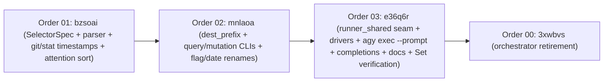

# IPD: Orchestrate normalized artifact selector flags across all aw commands

- Date: 2026-11-22
- Kind: orchestrator
- Concern: Normalize and aggregate all artifact selector flags across every artifact-selecting `aw` command per spec `ogd2nv` Section 1 (`1iojci`).
- Scope: Coordinate Orders 01 through 03 of Set `selectors`: Order 01 (`bzsoai`, approved) builds the shared selector spec, flag builder, range/date/time parser, durable git/history timestamp engine, and aligned `agent_workflows/attention.py` mtime/ctime sorting; Order 02 (`mnlaoa`, approved) extends the builder with `dest_prefix` and `selectors.selector_records`, wires the normalized flags into query and mutation CLI commands (`att`/`next`, `find`, `search`, `partition`, `show`, `set`, `group`, `rename`, `archive`, `index`, `ipd board`), resolves short-flag and mutation-date collisions (`--details`/`--desc`, `--paths`, `--short`, `--new-date`, `--history-date`, hiding `--arcive-state`), and amends spec `ogd2nv` R-05/R-06/AC-03; Order 03 (`e36q6r`, approved) adds the queue-filter seam in `agent_workflows/runner_shared.py`, wires normalized selectors (`include_types=False`, keeping the runner `--type` of spec `25kzda` Section 2.1) into `oc_runipd`/`agy_runipd`, moves `aw agy exec -p` to `--prompt`, updates shell completions, `command_surface.py` `legacy_flags`, spec `ogd2nv` R-06/AC-03, `docs/cli-output-contract.md` Section 16, and `CHANGELOG.md`, and executes whole-Set parity verification. This orchestrator performs no code edits itself.
- Scope-Paths: .aw/records/plans/pending/20261122-selectors-00-3xwbvs-orchestrate-normalized-artifact-selector-flags-across-all-aw.ipd.md
- Item-Dependencies: executed:bzsoai, executed:mnlaoa, executed:e36q6r
- Status: approved
- Readiness: go-pending-approval
- Review-Depth: orchestrator
- Coverage: pass
- Coverage-Fingerprint: 4b12392b5adba22fcc26463855b5fca90b0e7132027ab2f7e492c4676962206a
- Coverage-Checked: 2026-11-27 by uri/its_direct/pt3-claude-opus-5.5-1m-us
- Short-Description: Coordinate Orders 01-03 normalizing artifact selector flags, durable date/time filters, and CLI/runner/completion wiring
- Work-Kind: feature
- Priority: medium
- From-Backlog: 1iojci
- From-Spec: ogd2nv
- Set: selectors
- Order: 0
- Highest E allocated: 03
- Author: antigravity
- Id: 3xwbvs
- Approval: 2026-11-27, recorded via aw ipd set: status set to approved

> Write and proofread this plan per the technical writing standard, `.aw/system/workflows/technical-writing/technical-writing.md` (`.agents/workflows/technical-writing/technical-writing.md` in a legacy-layout install), including requirement 12 (diagrams).

## Workflow history

- 2026-11-27 approved (aw set): status set to approved
- 2026-11-27 reviewed (aw set): plan-review: APPROVE WITH REVISIONS APPLIED; PR-001..PR-004 FIXED
- 2026-11-27 coverage pass (aw oc run): fingerprint 4b12392b5adb, model uri/its_direct/pt3-claude-opus-5.5-1m-us
- 2026-11-27 /plan-review (antigravity/gemini): APPROVE WITH REVISIONS APPLIED; PR-001, PR-002, PR-003, PR-004 FIXED; review record .aw/records/reviews/20261122-selectors-00-3xwbvs-orchestrate-normalized-artifact-selector-flags-across-all-aw.review.md
- 2026-11-23 to-review (aw set): status set to to-review
- 2026-11-23 coverage pass (aw oc run): fingerprint 0cc5a96fdc28, model uri/its_direct/pt3-claude-opus-5.5-1m-us
- 2026-11-23 draft (antigravity): created and authored as Order 00 orchestrator for Set `selectors` graduating `1iojci` under spec `ogd2nv`.

## Goal

Deliver one uniform artifact-selector CLI grammar and predicate engine across every artifact-selecting `aw` command by sequencing approved Orders 01 (`bzsoai`), 02 (`mnlaoa`), and 03 (`e36q6r`) and retiring this orchestrator once all three children reach `executed`.

## Detailed Implementation Checklist (TODO)

Execution-state rule: mark an `E-*` item complete only after performing the action. That mark is not validation. Right-sizing rule: write for a modest executor that cannot hold much in its head. Each E-item is one step (one concern, about one file, executable in one focused pass) and its V-item names each unit it covers with its own check; a plan stays at about 5 E-items and 8 work Scope-Paths, else split it into more child plans (guidance, `IPD-Z603`). Accepted execution states: blocked, failed, pending, performed; terminal gate demands 'performed'.

### Task group 1: Child completion tracking

- [ ] E-01 CONFIRM bzsoai REACHED executed
  - Depends on: none
  - Expected outcome: Child plan `bzsoai` (Order 01) has landed in `.aw/records/plans/executed/` with `Status: executed`, implementing `agent_workflows/selectors.py::SelectorSpec`, `agent_workflows/selectors.py::add_selector_args`, `agent_workflows/selectors.py::parse_selector_namespace`, `agent_workflows/selectors.py::parse_date_expr`, `agent_workflows/selectors.py::parse_time_expr`, `agent_workflows/selectors.py::batched_artifact_timestamps`, and `agent_workflows/selectors.py::filter_records`, aligning `agent_workflows/attention.py::sort_items_with_notices` mtime/ctime sorting, and updating `agent_workflows/attention_contract.py::ORDER_KEYS` comments (`ogd2nv` R-01 through R-04, `ogd2nv` AC-01, `ogd2nv` AC-02).
  - Execution state: pending

- [ ] E-02 CONFIRM mnlaoa REACHED executed
  - Depends on: E-01
  - Expected outcome: Child plan `mnlaoa` (Order 02) has landed in `.aw/records/plans/executed/` with `Status: executed`, adding `dest_prefix` and `agent_workflows/selectors.py::selector_records`, wiring normalized selectors across `att`/`next`, `find`, `search`, `partition` (no `-T`), `show`, `set`, `group`, `rename`, `archive`, `index` (accepted and ignored with notice), and `ipd board` (no `-t/-T`), moving conflicting flags (`--details`/`--desc`, `--paths` on `find` and `search`, `--short` on `search`, `--new-date` on `group`/`rename`, `--history-date` on `specs set` and `set`, hiding `--arcive-state`), and amending `ogd2nv` R-05, R-06, and AC-03 (`ogd2nv` R-02, R-05, R-06, `ogd2nv` AC-03).
  - Execution state: pending

- [ ] E-03 CONFIRM e36q6r REACHED executed
  - Depends on: E-02
  - Expected outcome: Child plan `e36q6r` (Order 03) has landed in `.aw/records/plans/executed/` with `Status: executed`, adding the queue-filter seam in `agent_workflows/runner_shared.py::_initialize_run_core_once`, wiring normalized selectors (`include_types=False`, keeping the runner `--type` of spec `25kzda` Section 2.1) into `agent_workflows/oc_runipd.py` and `agent_workflows/agy_runipd.py`, moving `aw agy exec -p` to `--prompt` in `agent_workflows/agy_run.py`, updating `agent_workflows/completion.py`, `agent_workflows/command_surface.py` `legacy_flags`, spec `ogd2nv` R-06/AC-03, `docs/cli-output-contract.md` Section 16, and `CHANGELOG.md`, and completing whole-Set verification (`ogd2nv` R-05, R-06, `ogd2nv` AC-03).
  - Execution state: pending

## Child IPDs, sequence, and dependencies

| Order | Id | File | What it does | Depends on |
|---|---|---|---|---|
| 01 | `bzsoai` | `20261122-selectors-01-bzsoai-build-shared-normalized-selector-spec-parser-builder-and-dur.ipd.md` | Builds shared `SelectorSpec`, `add_selector_args`, `parse_selector_namespace`, `parse_date_expr`, `parse_time_expr`, rename-aware `batched_artifact_timestamps`, and `filter_records` in `agent_workflows/selectors.py`; moves `aw att` parsers/matchers behind delegates in `agent_workflows/attention.py`; aligns `attention.py` mtime/ctime sorting and `attention_contract.py::ORDER_KEYS` comments. | none |
| 02 | `mnlaoa` | `20261122-selectors-02-mnlaoa-wire-normalized-artifact-selectors-into-query-and-mutation-c.ipd.md` | Adds `dest_prefix` and `selectors.selector_records`; wires normalized selectors into `att`/`next`, `find`, `search`, `partition` (no `-T`), `show`, `set`, `group`, `rename`, `archive`, `index` (ignored with notice), and `ipd board` (no `-t/-T`); moves `-d` (`--details`) to `--details`/`--desc`/`-desc`, `find`/`search` `-p` to `--paths`, `search -S` to `--short`, `group`/`rename` `--date` to `--new-date`, and `specs set --date` to `--history-date` (also added to `set`); hides `--arcive-state`; fixes `_reconstruct_apply_command`; amends spec `ogd2nv` R-05/R-06/AC-03. | `executed:bzsoai` |
| 03 | `e36q6r` | `20261122-selectors-03-e36q6r-wire-normalized-artifact-selectors-into-runner-clis-shell-co.ipd.md` | Adds the queue-filter seam in `agent_workflows/runner_shared.py::_initialize_run_core_once`; registers selector flags (`include_types=False`) on `oc_runipd`/`agy_runipd` `start` parsers; moves `aw agy exec -p` to `--prompt` in `agent_workflows/agy_run.py` and `tools/README.md`; adds static runner completion flags and `--not-status` in `agent_workflows/completion.py` and updates `agent_workflows/command_surface.py` `legacy_flags`; amends spec `ogd2nv` R-06/AC-03; documents the grammar in `docs/cli-output-contract.md` Section 16 and `CHANGELOG.md`; runs whole-Set parity verification. | `executed:mnlaoa` |

## Completion criteria (the whole Set is done only when)

- Shared selector builder, date/time expression parser, rename-aware batched git/history timestamp engine, and aligned `attention.py` mtime/ctime sorting satisfy `ogd2nv` R-01 through R-04, `ogd2nv` AC-01, and `ogd2nv` AC-02. Owner: `bzsoai`.
- All query and mutation CLI commands adopt the normalized selector flags, resolve `-d`/`-p`/`-S`/`--date` collisions (including `--new-date` on `group`/`rename` and `--history-date` on `specs set`/`set`), and amend `ogd2nv` R-05, R-06, and AC-03. Owner: `mnlaoa`.
- Runner CLIs (`runner_shared.py`, `oc_runipd.py`, `agy_runipd.py` keeping `--type` per spec `25kzda` Section 2.1), `aw agy exec --prompt`, shell completions, `command_surface.py` `legacy_flags`, `ogd2nv` R-06/AC-03, `docs/cli-output-contract.md` Section 16, and `CHANGELOG.md` reflect the normalized selector contract while keeping `aw runs`/`aw runners`/`pwatch` exempt per `ogd2nv` R-05, R-06, and AC-03. Owner: `e36q6r`.

## Cross-IPD validation

- Whole-Set cross-command flag parity across `aw att`, `aw find plans`, `aw search`, `aw partition`, `aw show`, `aw ipd board`, and `oc_runipd` (comparing identical id6 sets for `-p`, `-P`, `--sid`, `--nsid`, and `-d`, plus verifying `aw runs -s/-S` and `aw runners -t` remain unchanged) is performed by `e36q6r` (`E-05` / `V-05`) after `bzsoai` and `mnlaoa` execute.

## Deferred / out of scope (with reason)

- Verb-first top-level CLI commands (`aw rev`, `aw exec`, `aw grad`, `aw validate`, `aw approve`) and unified `aw show` views: governed by spec `ogd2nv` Sections 2-4 and implemented by sibling Set `cliverbs` (`lmlji2`, depending on `executed:e36q6r`).
  - Carrier: lmlji2

## Scope check

- Over-scope: none; this orchestrator owns only child completion tracking (`IPD-S407`) and delegates all code, spec amendments, tests, completions, and docs to `bzsoai`, `mnlaoa`, and `e36q6r`.
- Under-scope: none; every requirement in spec `ogd2nv` Section 1 (`R-01`..`R-06`, `AC-01`..`AC-03`) is assigned to an approved child plan. Note: spec `ogd2nv` is currently `to-review` and is amended by `mnlaoa` (`E-10`) and `e36q6r` (`E-05`) to reflect measured parser constraints; children `mnlaoa` (10 E-items, 20 work Scope-Paths) and `e36q6r` (5 E-items, 17 work Scope-Paths) each record advisory `IPD-Z603` cohesion rationales and are already `approved`.

## Required tests / validation

This orchestrator runs no tests directly. Whole-Set validation (targeted `pytest` suites, bare core-tier `python3 -m pytest`, `mypy`, `aw specs check`, `aw attention --check`, and `aw sanitize --agent`) is performed by `e36q6r` (`E-05` / `V-05`) after Orders 01 and 02 have executed.

## Open questions

None open; all five open questions in backlog item `1iojci` were resolved by the maintainer on 2026-11-22 and codified in spec `ogd2nv`, and `mnlaoa` `OQ-01` (renaming `aw group`/`aw rename` mutation `--date` to `--new-date`) was resolved by the maintainer on 2026-11-25.

## Validation and cross-check (verify before reporting the Set complete)

Validation-state rule: inspect evidence in a separate pass. Do not mark a `V-*` item complete from memory or from the matching execution checkmark. Accepted validation results: blocked, failed, pass, pending; terminal gate demands 'pass'. Runtime-demonstration reachability rule: for each `V-*` item demanding the software be observed acting (such as a run, a dispatch, or a transition), as distinct from items demanding a diff, a file's content, or a test result, name the code path that produces the observation or the sibling `E-*` that creates it, else the demand is UNDER-SCOPE.

- [ ] V-01 validates E-01
  - Required evidence: Confirmed path `.aw/records/plans/executed/20261122-selectors-01-bzsoai-build-shared-normalized-selector-spec-parser-builder-and-dur.ipd.md` with `- Status: executed` and all V-items (`V-01..V-04`) `pass`, proving `ogd2nv` AC-01 and `ogd2nv` AC-02 at the library level.
  - Observed evidence:
  - Result: pending

- [ ] V-02 validates E-02
  - Required evidence: Confirmed path `.aw/records/plans/executed/20261122-selectors-02-mnlaoa-wire-normalized-artifact-selectors-into-query-and-mutation-c.ipd.md` with `- Status: executed` and all V-items (`V-01..V-10`) `pass`, proving query and mutation CLI selector wiring and the `ogd2nv` R-05/R-06/AC-03 amendment.
  - Observed evidence:
  - Result: pending

- [ ] V-03 validates E-03
  - Required evidence: Confirmed path `.aw/records/plans/executed/20261122-selectors-03-e36q6r-wire-normalized-artifact-selectors-into-runner-clis-shell-co.ipd.md` with `- Status: executed` and all V-items (`V-01..V-05`) `pass`, including pasted whole-Set cross-command parity output and validation results (`ogd2nv` AC-03).
  - Observed evidence:
  - Result: pending

## Approval and execution gate

- Size assessment: standard
- Cohesion rationale: not required

Execute/retire only after human approval (`- Status: approved`, recorded via `aw set approved 3xwbvs --by-human`) and after all three child plans (`bzsoai`, `mnlaoa`, `e36q6r`) reach `executed` on disk. Open questions: none open.

Scope fence: this orchestrator declares only its own plan file in `- Scope-Paths:` and performs no code edits. If an out-of-scope edit ever proved necessary during manual retirement, justify it at finalize with `--scope-reason <path>`; acknowledge any declared path left unmodified with `--scope-ack <path>`.

Honesty rule: confirm each child plan's `executed/` path, `- Status: executed`, and passing `V-*` evidence directly from disk before marking `V-01..V-03` `pass`; never claim verification from memory.

Commits and lifecycle: commit only the paths changed for this orchestrator through `aw commit 3xwbvs -- <paths>`; never `git add -A`, bare `git add`, `git commit -a`, or push without explicit human instruction. Never hand-roll a `git mv` of this plan into `.aw/records/plans/executed/`. Lifecycle transition is mandatory on completion with conditional ownership: when `aw oc run` or `aw agy run` drives Set `selectors`, the runner retires this orchestrator to `.aw/records/plans/executed/` automatically without spending an agent turn once `bzsoai`, `mnlaoa`, and `e36q6r` are all `executed` on disk; when retiring standalone outside a managed runner, finalize with `aw ipd finalize 3xwbvs --actor <agent/model> --message "
" --apply`.
