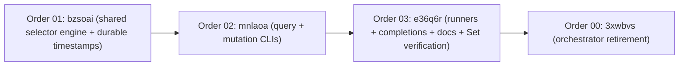

# IPD: Orchestrate normalized artifact selector flags across all aw commands

- Date: 2026-11-22
- Kind: orchestrator
- Concern: Normalize and aggregate all artifact selector flags across every artifact-selecting `aw` command per spec `ogd2nv` Section 1 (`1iojci`).
- Scope: Coordinate Orders 01 through 03 of Set `selectors`: Order 01 (`bzsoai`) builds the shared selector spec, flag builder, range/date parser, and durable git/history timestamp engine; Order 02 (`mnlaoa`) wires the normalized flags into query and mutation CLI commands; Order 03 (`e36q6r`) wires them into runner CLIs, shell completions, and docs, and executes the whole-Set verification pass. This orchestrator performs no code edits itself.
- Scope-Paths: .aw/records/plans/pending/20261122-selectors-00-3xwbvs-orchestrate-normalized-artifact-selector-flags-across-all-aw.ipd.md
- Item-Dependencies: executed:bzsoai, executed:mnlaoa, executed:e36q6r
- Status: to-review
- Coverage: pass
- Coverage-Fingerprint: 0cc5a96fdc285e22fdd9b549b3a2cb2df435ba37d0f65ed86d9c3eee47b2866d
- Coverage-Checked: 2026-11-23 by uri/its_direct/pt3-claude-opus-5.5-1m-us
- Short-Description: Coordinate Orders 01-03 normalizing artifact selector flags, durable date/time filters, and CLI/runner/completion wiring
- Work-Kind: feature
- Priority: medium
- From-Backlog: 1iojci
- From-Spec: ogd2nv
- Set: selectors
- Order: 0
- Highest E allocated: 03
- Author: antigravity
- Id: 3xwbvs

> Write and proofread this plan per the technical writing standard, `.aw/system/workflows/technical-writing/technical-writing.md` (`.agents/workflows/technical-writing/technical-writing.md` in a legacy-layout install), including requirement 12 (diagrams).

## Workflow history

- 2026-11-23 to-review (aw set): status set to to-review
- 2026-11-23 coverage pass (aw oc run): fingerprint 0cc5a96fdc28, model uri/its_direct/pt3-claude-opus-5.5-1m-us
- 2026-11-23 draft (antigravity): created and authored as Order 00 orchestrator for Set `selectors` graduating `1iojci` under spec `ogd2nv`.

## Goal

Deliver one uniform artifact-selector CLI grammar and predicate engine across every artifact-selecting `aw` command by sequencing Orders 01 (`bzsoai`), 02 (`mnlaoa`), and 03 (`e36q6r`) and retiring this orchestrator once all three children reach `executed`.

## Detailed Implementation Checklist (TODO)

Execution-state rule: mark an `E-*` item complete only after performing the action. That mark is not validation. Right-sizing rule: write for a modest executor that cannot hold much in its head. Each E-item is one step (one concern, about one file, executable in one focused pass) and its V-item names each unit it covers with its own check; a plan stays at about 5 E-items and 8 work Scope-Paths, else split it into more child plans (guidance, `IPD-Z603`). Accepted execution states: blocked, failed, pending, performed; terminal gate demands 'performed'.

### Task group 1: Child completion tracking

- [ ] E-01 CONFIRM bzsoai REACHED executed
  - Depends on: none
  - Expected outcome: Child plan `bzsoai` (Order 01) has landed in `.aw/records/plans/executed/` with `Status: executed`, providing `selectors.SelectorSpec`, `selectors.add_selector_args`, `selectors.filter_records`, durable git/history timestamp helpers, and aligned `attention.py` mtime/ctime sorting.
  - Execution state: pending

- [ ] E-02 CONFIRM mnlaoa REACHED executed
  - Depends on: E-01
  - Expected outcome: Child plan `mnlaoa` (Order 02) has landed in `.aw/records/plans/executed/` with `Status: executed`, wiring normalized selectors across `att`, `find`, `search`, `partition`, `show`, `set`, `group`, `rename`, `archive`, `index`, and `ipd board`.
  - Execution state: pending

- [ ] E-03 CONFIRM e36q6r REACHED executed
  - Depends on: E-02
  - Expected outcome: Child plan `e36q6r` (Order 03) has landed in `.aw/records/plans/executed/` with `Status: executed`, wiring normalized selectors into `agy`/`oc` runners, updating shell completions and docs, and completing the whole-Set verification sweep.
  - Execution state: pending

## Child IPDs, sequence, and dependencies

| Order | Id | File | What it does | Depends on |
|---|---|---|---|---|
| 01 | `bzsoai` | `20261122-selectors-01-bzsoai-build-shared-normalized-selector-spec-parser-builder-and-dur.ipd.md` | Builds shared `SelectorSpec`, `add_selector_args`, range/date parser, batched git/history timestamp helper, and aligns `attention.py` mtime/ctime sorting. | none |
| 02 | `mnlaoa` | `20261122-selectors-02-mnlaoa-wire-normalized-artifact-selectors-into-query-and-mutation-c.ipd.md` | Wires normalized selector flags into `att`/`next`, `find`/`search`, `partition`, `show`, `set` (`--history-date`), `group`, `rename`, `archive`, `index`, and `ipd board`; moves `-d` (`--details`) to `--desc`/`-desc`, `find -p` to `--paths`, `search -S` to `--short`, and fixes `--arcive-state`. | `executed:bzsoai` |
| 03 | `e36q6r` | `20261122-selectors-03-e36q6r-wire-normalized-artifact-selectors-into-runner-clis-shell-co.ipd.md` | Wires normalized selectors into `agy`/`oc` runners (moving inline `-p` to `--prompt`), updates shell completions and CLI docs, and executes whole-Set cross-command parity verification. | `executed:mnlaoa` |

## Completion criteria (the whole Set is done only when)

- Shared selector builder, date/time expression parser, and batched git/history timestamp engine satisfy spec `ogd2nv` R-01 through R-04 and AC-01/AC-02. Owner: `bzsoai`.
- All query and mutation CLI commands adopt the normalized selector flags and resolve `-d`/`-p`/`-S`/`--date` collisions per spec `ogd2nv` R-05 and AC-03. Owner: `mnlaoa`.
- Runner CLIs (`agy`, `oc`), shell completions, and docs reflect the normalized selector contract while keeping `aw runs`/`aw runners`/`pwatch` exempt per spec `ogd2nv` R-05/R-06 and AC-03. Owner: `e36q6r`.

## Cross-IPD validation

- Cross-command flag parity across `att`, `find`, `search`, `partition`, `show`, `set`, `oc`, `agy`, and shell completions (verifying identical include/exclude behavior and zero regressions on `aw runs -s/-S` and `aw runners -t`) is performed by `e36q6r` (`E-04` / `V-04`).

## Deferred / out of scope (with reason)

- Verb-first top-level CLI commands (`aw rev`, `aw exec`, `aw grad`, `aw validate`, `aw approve`) and unified `aw show` views: governed by spec `ogd2nv` Sections 2-4 and implemented by sibling Set `cliverbs` (`lmlji2`, depending on `executed:e36q6r`).

## Scope check

- Over-scope: none; this orchestrator owns only child completion tracking and delegates all code, tests, completions, and docs to `bzsoai`, `mnlaoa`, and `e36q6r`.
- Under-scope: none; every requirement in spec `ogd2nv` Section 1 (`R-01`..`R-06`) is assigned to a child plan.

## Required tests / validation

This orchestrator runs no tests directly. Whole-Set validation (`pytest`, `mypy`, `aw attention --check`, `aw sanitize`) is performed by `e36q6r` (`E-04` / `V-04`) after Orders 01 and 02 have executed.

## Open questions

None; all five open questions in backlog item `1iojci` were resolved by the maintainer on 2026-11-22 and codified in spec `ogd2nv`.

## Validation and cross-check (verify before reporting the Set complete)

Validation-state rule: inspect evidence in a separate pass. Do not mark a `V-*` item complete from memory or from the matching execution checkmark. Accepted validation results: blocked, failed, pass, pending; terminal gate demands 'pass'. Runtime-demonstration reachability rule: for each `V-*` item demanding the software be observed acting (such as a run, a dispatch, or a transition), as distinct from items demanding a diff, a file's content, or a test result, name the code path that produces the observation or the sibling `E-*` that creates it, else the demand is UNDER-SCOPE.

- [ ] V-01 validates E-01
  - Required evidence: Confirmed path `.aw/records/plans/executed/20261122-selectors-01-bzsoai-build-shared-normalized-selector-spec-parser-builder-and-dur.ipd.md` with `- Status: executed` and all V-items `pass`.
  - Observed evidence:
  - Result: pending

- [ ] V-02 validates E-02
  - Required evidence: Confirmed path `.aw/records/plans/executed/20261122-selectors-02-mnlaoa-wire-normalized-artifact-selectors-into-query-and-mutation-c.ipd.md` with `- Status: executed` and all V-items `pass`.
  - Observed evidence:
  - Result: pending

- [ ] V-03 validates E-03
  - Required evidence: Confirmed path `.aw/records/plans/executed/20261122-selectors-03-e36q6r-wire-normalized-artifact-selectors-into-runner-clis-shell-co.ipd.md` with `- Status: executed` and all V-items `pass` (including whole-Set cross-command parity output).
  - Observed evidence:
  - Result: pending

## Approval and execution gate

- Size assessment: standard
- Cohesion rationale: not required

Ready for `/plan-review`, human approval, and automatic orchestrator retirement once children `bzsoai`, `mnlaoa`, and `e36q6r` reach `executed`.
