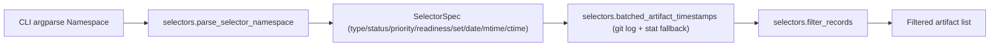
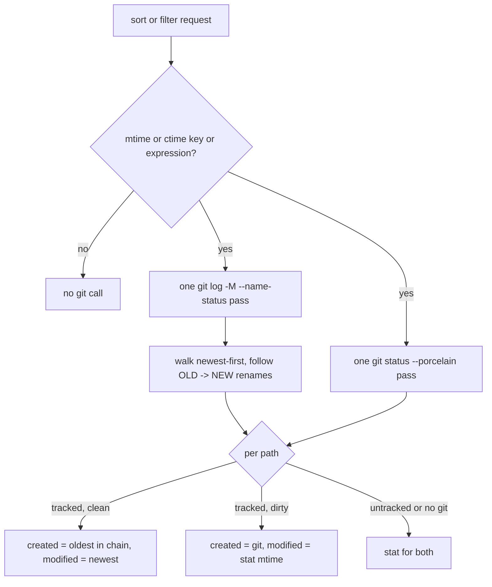

# IPD: Build shared normalized selector spec, parser builder, and durable date/time filter engine

- Date: 2026-11-22
- Kind: child
- Concern: Implement the single shared artifact-selector flag specification, expression parser, batched git/history timestamp helper, and predicate engine (spec `ogd2nv` R-01 through R-04).
- Scope: Add `SelectorSpec`, `add_selector_args`, `parse_selector_namespace`, `parse_date_expr`, `parse_time_expr`, `batched_artifact_timestamps`, and `filter_records` in `agent_workflows/selectors.py`; move the existing `aw att` filter-token parsing and `matches_status`/`matches_priority`/`matches_readiness` semantics into `selectors.py` as the single authority, leaving `agent_workflows/attention.py` names as thin delegates; align `aw att --order-by mtime|ctime` in `agent_workflows/attention.py` to compute `selectors.batched_artifact_timestamps` once per sort; correct the stale "filesystem time" comments on `ctime`/`mtime` in `agent_workflows/attention_contract.py::ORDER_KEYS`; add behavioral tests in `tests/test_normalized_selectors.py` and `tests/test_attention.py`. EXCLUDES wiring CLI subcommands in `agent_workflows/cli.py` and the `--details`/`--desc` move (`mnlaoa`), and runner CLIs/completions (`e36q6r`).
- Scope-Paths: agent_workflows/selectors.py, agent_workflows/attention.py, agent_workflows/attention_contract.py, tests/test_normalized_selectors.py, tests/test_attention.py, .aw/records/plans/pending/20261122-selectors-01-bzsoai-build-shared-normalized-selector-spec-parser-builder-and-dur.ipd.md
- Item-Dependencies: none
- Status: reviewed
- Readiness: go-pending-approval
- Review-Depth: standard
- Short-Description: Implement shared selector flag builder, SelectorSpec, range/prefix/relative time parser, and batched git/history mtime/ctime engine
- Work-Kind: feature
- Priority: medium
- From-Backlog: 1iojci
- From-Spec: ogd2nv
- Set: selectors
- Order: 1
- Highest E allocated: 04
- Author: antigravity
- Id: bzsoai

> Write and proofread this plan per the technical writing standard, `.aw/system/workflows/technical-writing/technical-writing.md` (`.agents/workflows/technical-writing/technical-writing.md` in a legacy-layout install), including requirement 12 (diagrams).

## Workflow history

- 2026-11-24 reviewed (aw set): APPROVE WITH REVISIONS APPLIED; PR-001..PR-013 FIXED
- 2026-11-24 /plan-review (uri/its_direct/pt3-claude-opus-5.5-1m-us): APPROVE WITH REVISIONS APPLIED; PR-001..PR-013 FIXED; review record .aw/records/reviews/20261122-selectors-01-bzsoai-build-shared-normalized-selector-spec-parser-builder-and-dur.review.md
- 2026-11-23 to-review (aw set): status set to to-review
- 2026-11-23 draft (antigravity): created and authored as Order 01 of Set `selectors` graduating `1iojci` under spec `ogd2nv`.

## Goal

Create one authoritative selector flag builder, date/time expression parser, durable git/history timestamp lookup, and record filter engine in `agent_workflows/selectors.py`, and align `agent_workflows/attention.py` mtime/ctime sorting to use that exact timestamp authority.

## Detailed Implementation Checklist (TODO)

Execution-state rule: mark an `E-*` item complete only after performing the action. That mark is not validation. Right-sizing rule: write for a modest executor that cannot hold much in its head. Each E-item is one step (one concern, about one file, executable in one focused pass) and its V-item names each unit it covers with its own check; a plan stays at about 5 E-items and 8 work Scope-Paths, else split it into more child plans (guidance, `IPD-Z603`). Accepted execution states: blocked, failed, pending, performed; terminal gate demands 'performed'.

### Task group 1: Shared selector spec, argparse builder, and date/time parser

- [ ] E-01 Add `SelectorSpec` (a frozen dataclass of normalized include/exclude token sets per dimension plus parsed date/mtime/ctime expressions), `add_selector_args(parser, *, include_types=True, allow_set_alias=True)`, and `parse_selector_namespace(args)` in `agent_workflows/selectors.py` implementing spec `ogd2nv` R-01, R-02, and the `1iojci` OQ-01/OQ-05 rules recorded in the spec. Register EVERY row of the `ogd2nv` R-02 matrix, with the first-listed long form as the canonical `--help` spelling and every other spelling an alias:
  - Type/tree: `-t`/`--type`/`--tree` and `-T`/`--not-type` (alias `--type-not`).
  - Status: `-s`/`--status` and `-S`/`--not-status` (alias `--status-not`).
  - Priority: `-p`/`--priority` and `-P`/`--not-priority` (alias `--priority-not`).
  - Readiness: `-r`/`--readiness` and `-R`/`--not-readiness` (alias `--readiness-not`).
  - Set id: `--set-id`/`--sid` (hidden `-sid`; compatibility alias `--set` only when `allow_set_alias=True`, because authoring commands such as `aw ipd scaffold --set` own `--set`) and `--not-set-id`/`--nsid` (hidden `-nsid`, alias `--set-id-not`).
  - Filename date: `-d`/`--date` and `-D`/`--not-date` (alias `--date-not`).
  - Modified time: `--modified-time`/`--mtime` (hidden `-mtime`) and `--not-modified-time`/`--not-mtime` (aliases `--mtime-not`, `-nmtime`).
  - Created time: `--created-time`/`--ctime` (hidden `-ctime`) and `--not-created-time`/`--not-ctime` (aliases `--ctime-not`, `-nctime`).
  - Every flag is `action="append"`. MOVE the token parsers `parse_filter_tokens`, `parse_type_filters` (with `TYPE_ALIASES`), `parse_status_filters`, `parse_priority_filters` (with `_PRIORITY_FILTER_ALIASES`), and `parse_readiness_filters` from `agent_workflows/attention.py` (around lines 2497-2610) into `selectors.py` unchanged, leaving same-named delegates and a re-exported `TYPE_ALIASES` name in `attention.py` (`cli.py` around lines 17589-17666 and `partition.py` around line 1359 call them). `parse_selector_namespace` normalizes through these moved parsers, so comma splitting, `med` meaning `medium`, and `_`/`-` equivalence behave exactly as `aw att` does today.
  - Hidden spellings: the single-dash multi-letter forms (`-sid`, `-nsid`, `-mtime`, `-ctime`, `-nmtime`, `-nctime`, per OQ-01) and the `--<field>-not` forms (per OQ-05) stay out of `--help`; every other spelling is shown. Hide one by registering it in a separate `add_argument` call with the same `dest`, `action="append"`, `default=argparse.SUPPRESS`, and `help=argparse.SUPPRESS`. Measured at review: this both parses (`-S a --status-not b` yields `['a', 'b']`) and keeps the alias out of the usage line.
  - Pass `parse_date_expr`/`parse_time_expr` errors through unchanged as `ValueError`; do not call `parser.error` here. Mapping a `ValueError` to exit code 2 is the CLI caller's job, owned by `mnlaoa` and `e36q6r`.
  - Depends on: none
  - Expected outcome: Any `argparse.ArgumentParser(allow_abbrev=False)` (the setting `agent_workflows/cli.py::_AwArgumentParser` forces) wired with `selectors.add_selector_args` accepts every R-02 spelling, including `-sid x -s done -nsid y`, `-sdraft`, `-nmtime 24h`, `-mtime 7d`, and `-ctime ..20261101`, and produces the same `SelectorSpec` for equivalent spellings; `--help` omits exactly the hidden spellings named above; and the existing `attention.parse_*_filters` callers return the same values as before the move.
  - Execution state: pending

- [ ] E-02 Add pure date/time expression parsers (`parse_date_expr`, `parse_time_expr`) and the batched timestamp resolver (`batched_artifact_timestamps(repo_root, rel_paths) -> dict[str, ArtifactTimes]`) in `agent_workflows/selectors.py` implementing spec `ogd2nv` R-03 and R-04.
  - Expression grammar (both parsers): exact dates (`YYYYMMDD`, `YYYY-MM-DD`), prefixes (`2026`, `202611`), closed and open ranges (`A..B`, `A..`, `..B`, both bounds inclusive at day granularity), comparators (`>=`, `<=`, `>`, `<`), and, for `parse_time_expr` only, relative windows `Nd`, `Nh`, `Nm` meaning "within the last N days/hours/minutes" (`m` is MINUTES, as spec R-03 writes `Nm`; this deliberately differs from `agent_workflows/run_viewer.py::parse_since_timestamp`, where `m` means months, and the help text must say so).
  - Time semantics: calendar dates and prefixes are interpreted in the LOCAL time zone (a user typing `20261122` means their own day); relative windows are measured back from an injectable `now` (an aware datetime, default `datetime.now(timezone.utc)`); all comparisons use aware datetimes. Filename dates (`--date`) compare the 8-digit filename prefix as a calendar date, with no time zone involved.
  - Errors: raise `ValueError` whose message quotes the offending token verbatim, for example `invalid date expression '2026-13-40'`; an empty range `..`, an inverted range `B..A`, and an unknown unit all raise.
  - Timestamp source: run ONE `git log -M --diff-filter=AMR --format=%x1e%at --name-status -z` pass in `project_context.record_git_root(repo_root)` (NUL/record-separated as in `agent_workflows/ipd_lifecycle.py` around line 3424 and `agent_workflows/artifact_audit.py::FinalizeEvidenceIndex`) over the WHOLE history with no pathspec, and walk it newest-first in Python. No pathspec, because `-M` cannot pair a rename whose source lies outside the pathspec, so a scoped pass would report the `aw migrate-layout` move from `.agents/` to `.aw/records/` as a creation; measured at review, the unscoped pass costs no more than a scoped one (about 2.4 seconds unscoped versus 2.3 to 3.1 seconds scoped). Modified time is the newest commit touching the current path. Created time is the oldest commit in the path's RENAME CHAIN: when a commit renamed `OLD -> CURRENT`, keep following `OLD` in older commits. Rename-following is required, not optional, because every plan reaches `executed/` through a `git mv`, so a per-path "first commit" would report the finalize move as the creation time. `git log --follow` is not used: it accepts only one path and was measured missing the `aw migrate-layout` renames (see the comment at `ipd_lifecycle.py` line 3424).
  - Fallback and precedence per path: an untracked path, or any path when git is unavailable or the root is not a repository, uses `stat()` for both (`st_mtime` for modified; `st_birthtime` where the platform provides it, else `st_mtime`, for created, never Linux `st_ctime`, which is inode change time). A tracked path with uncommitted working-tree changes, detected by one `git status --porcelain -z` call, uses `stat().st_mtime` for modified time and keeps its git creation time. Record the source (`git` or `stat`) on `ArtifactTimes` so tests and callers can tell them apart. When the git root differs from `repo_root` (a companion records root), map git's root-relative paths back to the caller's repo-relative keys.
  - Cost: exactly two git subprocesses per call regardless of path count, no subprocess per file. Measured at review on this repository (14564 commits): the unscoped `-M --name-status` pass takes about 2.4 seconds and `git status` about 0.02 seconds, so callers must invoke the resolver only when a time filter or time sort is actually requested.
  - Depends on: E-01
  - Expected outcome: Filename-date matching and git/stat created/modified timestamp matching evaluate deterministically with two git subprocesses per call, and a plan moved from `pending/` to `executed/` by `git mv` keeps its original creation time.
  - Execution state: pending

### Task group 2: Predicate engine and `attention.py` timestamp alignment

- [ ] E-03 Add `filter_records(records, spec, *, repo_root=None, now=None, times=None)` in `agent_workflows/selectors.py` and align `agent_workflows/attention.py` with it.
  - Semantics: AND across dimensions, OR within the repeated values of one dimension, and any exclusion match removes the record.
  - Single authority, no duplicate matchers: MOVE the bodies of `matches_status`, `matches_priority`, and `matches_readiness` from `agent_workflows/attention.py` (around lines 2671-2785) into `selectors.py` as attribute-reading functions, and leave same-named delegates in `attention.py` so `cli.py` and `tests/test_attention.py` keep working unchanged; `filter_records` uses these and the parsers E-01 moved. Preserve their current behavior exactly: status matches `native_status` OR `attention_class` with `_`/`-` interchangeable; `-` or `none` selects a record whose priority or readiness is absent.
  - No import cycle: `attention.py` already imports `selectors` (`attention.py` line 47), so `selectors.py` must not import `attention`. `filter_records` reads records by attribute (`id`, `path`, `tree`, `native_status`, `attention_class`, `priority`, `readiness`), which `attention.Item` already satisfies; set id and filename date come from `artifact_naming.parse_clustered`/`parse_clustered_prefix` on the basename.
  - Timestamps: `filter_records` calls `batched_artifact_timestamps` once, only when the spec carries an mtime or ctime expression, unless the caller passes a precomputed `times` map.
  - `attention.py`: in `sort_items_with_notices`, when `mtime` or `ctime` is among the requested keys, compute `selectors.batched_artifact_timestamps(repo_root, [it.path for it in items])` ONCE (the same place `depths` and `run_map` are computed today) and pass the map into `_order_key`, whose `ctime`/`mtime` branch reads the map instead of calling `stat()` per item. An item missing from the map sorts LAST, as today. Do not run the git pass for any other key, so `aw att` without `-o mtime|ctime` pays nothing.
  - Stale text: update the `attention.py` module docstring ("no timestamps/mtime/locale") and the `sort_items` docstring ("no timestamps, mtime or locale involved") to say the default order uses no timestamps while `-o mtime|ctime` reads `selectors.batched_artifact_timestamps`; change the `ctime`/`mtime` comments in `agent_workflows/attention_contract.py::ORDER_KEYS` from "filesystem" time to "git history time, stat fallback". This is a comment and docstring change only, and the `-o` help text in `cli.py` stays with `mnlaoa`.
  - Depends on: E-02
  - Expected outcome: `selectors.filter_records` filters `attention.Item` records with the same answers the existing `aw att --status/--priority/--readiness` filters give, and `attention.py` mtime/ctime sort keys equal the `--mtime`/`--ctime` filter timestamps across git commits, renames, and uncommitted working-tree changes, with one batched lookup per sort.
  - Execution state: pending

### Task group 3: Behavioral tests

- [ ] E-04 Create `tests/test_normalized_selectors.py` (with `pytestmark = pytest.mark.core`, as `tests/test_selector_resolver_matrix.py` does) and extend `tests/test_attention.py` with behavioral tests that call the functions and assert on returned values, never on source text. Cover:
  - (a) Every R-02 spelling listed in E-01, each parsed by a real `argparse.ArgumentParser(allow_abbrev=False)` built with `add_selector_args`, asserting equal `SelectorSpec` values for equivalent spellings, comma and repeat splitting, `--set` present only with `allow_set_alias=True`, and hidden aliases absent from `format_help()` output.
  - (b) Expression forms: exact, prefix, closed and open `..` ranges, each comparator, `7d`/`24h`/`30m` against a fixed injected `now`, and a `ValueError` whose message contains the offending token for each malformed case named in E-02.
  - (c) Timestamps in a temporary `git init` repository with commits made under fixed `GIT_AUTHOR_DATE`/`GIT_COMMITTER_DATE`: created and modified times equal the commit dates after `os.utime` resets the file times; a file renamed by `git mv` in a later commit keeps its ORIGINAL creation time; an untracked file and a non-git directory use `stat()`; a tracked file with an uncommitted edit uses `stat()` for modified and git for created; and the resolver gives the same answer for a path whether it is asked about alone or among 50 paths.
  - (d) `filter_records` parity: for a fixed list of `attention.Item` values, `filter_records` with status/priority/readiness specs returns exactly the items the existing `attention.matches_status`/`matches_priority`/`matches_readiness` select, including the `-`/`none` absent-value case and `med`.
  - (e) `attention.sort_items(..., order_by="mtime")` and `"ctime"` order items by the same timestamps `batched_artifact_timestamps` returns, with a git-less item sorting last.
  - Depends on: E-01, E-02, E-03
  - Expected outcome: All new and existing selector and attention tests pass under `python3 -m pytest`, and `python3 -m mypy agent_workflows/selectors.py agent_workflows/attention.py agent_workflows/attention_contract.py` passes cleanly.
  - Execution state: pending

## Project conventions discovered (Step 0)

- `agent_workflows/selectors.py` already owns selector resolution (`resolve`, `resolve_selectors`, `scan_once`, `filename_slot_id6`, `read_front_matter_status`).
- `agent_workflows/attention.py::_order_key` (around line 1243) sorts `mtime` and `ctime` by calling `f.stat()` once per item, and `sort_items_with_notices` (around line 1301) calls `_order_key` once per item; `depths` and `run_map` are already computed once per sort in `sort_items_with_notices`, which is where a timestamp map belongs.
- `agent_workflows/attention.py` already owns the `aw att` filter vocabulary: `TYPE_ALIASES` and `parse_type_filters` (around line 2497), `parse_filter_tokens`, `parse_status_filters`, `parse_priority_filters` (with the `med` alias), `parse_readiness_filters`, and `matches_status`/`matches_priority`/`matches_readiness` (around lines 2671-2785). `cli.py` (around lines 17589-17666) and `partition.py` (around line 1359) call some of them.
- `attention.py` line 47 imports `selectors as _sel`, so `selectors.py` cannot import `attention`.
- Batched `git log` precedents to reuse: `agent_workflows/ipd_lifecycle.py` around line 3424 (rename chain walked by hand, with the note that `--follow` missed `aw migrate-layout` renames) and `agent_workflows/artifact_audit.py::FinalizeEvidenceIndex` (one pass answers every row).
- `agent_workflows/project_context.py::record_git_root` finds the git repository that holds a record, which can differ from the project root for a companion records root.
- Empirically verified at review with Python 3.14 and `allow_abbrev=False` (the setting `agent_workflows/cli.py::_AwArgumentParser` forces): `-sid x -s done -nsid y`, `-sdraft`, `-sidle` (as `-s idle`), `-mtime -7d`, `-nmtime 24h`, and `-desc` all parse as intended because an exact option string wins over a short option with an attached value. A hidden alias registered in its own `add_argument` call with `default=argparse.SUPPRESS, help=argparse.SUPPRESS` parses and stays out of `--help`.
- `python3 -m mypy agent_workflows/selectors.py agent_workflows/attention.py` passes today (`Success: no issues found in 2 source files`, about 6 seconds).
- Run `python3 -m pytest` bare (no `-n0`, extra `-q`, or `-p no:randomly`); write behavioral tests only (no source inspection).

## Findings

- Current selector logic is duplicated across `cli.py`, `attention.py`, `partition.py`, and `find`, with no shared `SelectorSpec` or date/time filter engine.
- Raw `st_ctime` on Linux is inode change time and git checkouts/worktrees reset `st_mtime`/`st_ctime`, making raw `stat()` unsuitable as the primary timestamp source.
- Plans move from `pending/` to `executed/` through `git mv`, and `aw migrate-layout` moved every record from `.agents/` to `.aw/records/`, so a creation time that ignores renames would report a move as a creation for most records.
- No existing test covers `aw att --order-by mtime` or `ctime`, so the E-03 sort change has no regression net until E-04 adds one.
- Measured at review: `aw att` and `aw att -o mtime` each take about 16 seconds end to end on this repository, and the batched history pass adds about 2.4 seconds when it runs, which is why E-03 runs it only for a time key.

## Proposed changes (ordered, validatable)

1. Move the `aw att` token parsers into `agent_workflows/selectors.py` and add `SelectorSpec`, `add_selector_args`, and `parse_selector_namespace` there (`E-01`).
2. Add `parse_date_expr`, `parse_time_expr`, and the rename-aware `batched_artifact_timestamps` to `agent_workflows/selectors.py` (`E-02`).
3. Move the `aw att` matchers into `selectors.py` behind `attention.py` delegates (the parsers move in `E-01`), add `filter_records`, and compute one timestamp map per `mtime`/`ctime` sort in `attention.sort_items_with_notices` (`E-03`).
4. Add behavioral tests in `tests/test_normalized_selectors.py` and `tests/test_attention.py` (`E-04`).

## Deferred / out of scope (with reason)

- Wiring `add_selector_args` into `cli.py` query/mutation commands: owned by Order 02 (`mnlaoa`).
  - Carrier: mnlaoa
- Wiring `add_selector_args` into `agy`/`oc` runners and shell completions: owned by Order 03 (`e36q6r`).
  - Carrier: e36q6r

## Scope check

- Over-scope: none; touches only `selectors.py`, `attention.py`, comments in `attention_contract.py`, and their tests. The `--details`/`--desc` alias is not built here; `mnlaoa` owns it.
- Under-scope: none after review; E-01 now registers the full `ogd2nv` R-02 matrix, and E-02 states the rename, dirty-file, time-zone, and `now` semantics.
- Exit code 2 for an invalid expression (spec R-03) is delivered by the CLI callers in `mnlaoa` and `e36q6r`, which catch the `ValueError` this plan raises; this plan only guarantees the message names the token.

## Required tests / validation

- `python3 -m pytest tests/test_normalized_selectors.py tests/test_attention.py tests/test_selector_resolver_matrix.py tests/test_selector_scan_once.py tests/test_selector_precedence_outcomes.py`
- `python3 -m pytest` (bare core tier, the runner merge gate)
- `python3 -m mypy agent_workflows/selectors.py agent_workflows/attention.py agent_workflows/attention_contract.py`
- `aw sanitize --agent`

## Spec / documentation sync

- Implements spec `ogd2nv` R-01 through R-04 and satisfies `ogd2nv` AC-01 and `ogd2nv` AC-02 at the library level. No spec text changes. CLI help and docs updates live in Orders 02 and 03.
- Spec `ogd2nv` is at `to-review`, not `approved`, at the time of this review; this plan follows its current text, and the human approving this plan should know the spec may still change.

## Open questions

None; all design questions were resolved in `1iojci` and codified in spec `ogd2nv`. The rename-following creation time, the dirty-file precedence, local-time calendar dates, and `m` meaning minutes were settled at review from spec `ogd2nv` R-03/R-04 and repository evidence (review record `D-1` to `D-3`).

## Validation and cross-check (verify before reporting done)

Validation-state rule: inspect evidence in a separate pass. Do not mark a `V-*` item complete from memory or from the matching execution checkmark. Accepted validation results: blocked, failed, pass, pending; terminal gate demands 'pass'. Runtime-demonstration reachability rule: for each `V-*` item demanding the software be observed acting (such as a run, a dispatch, or a transition), as distinct from items demanding a diff, a file's content, or a test result, name the code path that produces the observation or the sibling `E-*` that creates it, else the demand is UNDER-SCOPE.

- [ ] V-01 validates E-01
  - Required evidence: Pasted pytest output from `tests/test_normalized_selectors.py` (test names visible, for example via `python3 -m pytest -o addopts="" -v tests/test_normalized_selectors.py`) proving `add_selector_args` and `parse_selector_namespace` parse EVERY `ogd2nv` R-02 spelling listed in E-01, including `--modified-time`/`--created-time`, `--not-modified-time`/`--not-created-time`, `--not-mtime`/`--mtime-not`/`-nmtime`, `--not-ctime`/`--ctime-not`/`-nctime`, `--set-id`/`--sid`/`-sid`, `--not-set-id`/`--nsid`/`-nsid`/`--set-id-not`, `--tree`, and `--set` gated by `allow_set_alias`; comma-separated and repeated inputs; and hidden aliases absent from `format_help()`. This is the library half of `ogd2nv` AC-01.
  - Observed evidence:
  - Result: pending

- [ ] V-02 validates E-02
  - Required evidence: Pasted pytest output from `tests/test_normalized_selectors.py` proving `parse_date_expr`, `parse_time_expr`, and `batched_artifact_timestamps` handle exact dates, prefixes, closed/open `..` ranges, comparators, relative `7d`/`24h`/`30m` windows against an injected `now`, an invalid-expression `ValueError` whose message contains the offending token, real git commit timestamps surviving `os.utime` resets, a `git mv` rename keeping the original creation time, the dirty tracked file (stat modified, git created), and the untracked and non-git `stat()` fallback. This is the library half of `ogd2nv` AC-02.
  - Observed evidence:
  - Result: pending

- [ ] V-03 validates E-03
  - Required evidence: Pasted pytest output from `tests/test_normalized_selectors.py` and `tests/test_attention.py` proving `filter_records` evaluates combined include/exclude filters, returns the same items as the existing `attention.matches_status`/`matches_priority`/`matches_readiness` (including `-`/`none` and `med`), and that `attention.sort_items(..., order_by="mtime"|"ctime")` orders by the timestamps `selectors.batched_artifact_timestamps` returns; plus the pasted `git diff` of `agent_workflows/attention.py` showing the timestamp map computed once in `sort_items_with_notices` and the updated docstrings.
  - Observed evidence:
  - Result: pending

- [ ] V-04 validates E-04
  - Required evidence: Pasted runner output, with the `N passed` summary lines and exit codes, from every command in `## Required tests / validation`: the targeted `python3 -m pytest tests/test_normalized_selectors.py tests/test_attention.py tests/test_selector_resolver_matrix.py tests/test_selector_scan_once.py tests/test_selector_precedence_outcomes.py`, the bare `python3 -m pytest`, `python3 -m mypy agent_workflows/selectors.py agent_workflows/attention.py agent_workflows/attention_contract.py`, and `aw sanitize --agent`, all exiting 0.
  - Observed evidence:
  - Result: pending

## Approval and execution gate

- Size assessment: standard
- Cohesion rationale: not required

Execute only after human approval (`- Status: approved`, recorded with `aw set approved bzsoai --by-human`). Open questions: none open.

Scope fence: the paths in `- Scope-Paths:` are a declaration. If execution must edit a file outside the fence, make the needed edit and justify it at finalize (`--scope-reason`), and acknowledge any declared path left unmodified (`--scope-ack`).

Safety rule: uncommitted changes and untracked files you did not create are not yours; never revert, stage, commit, discard, reformat, or clean up another party's work. Stop and report if a file you must edit has an unresolvable concurrent-edit conflict.

Honesty rule: run all required tests and checks and paste the ACTUAL runner output and summary lines; never claim a result you did not run.

Commits: commit only files modified for this plan through `aw commit bzsoai -- <paths>`; never `git add -A`, a bare `git add`, `git commit -a`, or `--no-verify`; never push without explicit human instruction.

Lifecycle transition: this plan moves to `.aw/records/plans/executed/` only through `aw ipd finalize`, never a hand `git mv`, and only after `aw ipd lint --phase pre-transition` conforms and every `V-*` reads `pass` with pasted evidence. When `aw oc run` or `aw agy run` executes this plan, the runner owns retirement to `executed/` and runs finalize automatically upon task completion; when executed standalone by hand or by a direct agent turn, the executor runs `aw ipd finalize bzsoai`.
