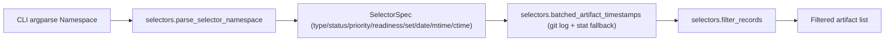

# IPD: Build shared normalized selector spec, parser builder, and durable date/time filter engine

- Date: 2026-11-22
- Kind: child
- Concern: Implement the single shared artifact-selector flag specification, expression parser, batched git/history timestamp helper, and predicate engine (spec `ogd2nv` R-01 through R-04).
- Scope: Add `SelectorSpec`, `add_selector_args`, `parse_selector_namespace`, `parse_date_expr`, `parse_time_expr`, `batched_artifact_timestamps`, and `filter_records` in `agent_workflows/selectors.py`; align `aw att --order-by mtime|ctime` in `agent_workflows/attention.py` to use `selectors.batched_artifact_timestamps`; add behavioral tests in `tests/test_normalized_selectors.py` and `tests/test_attention.py`. EXCLUDES wiring CLI subcommands in `agent_workflows/cli.py` (`mnlaoa`) and runner CLIs/completions (`e36q6r`).
- Scope-Paths: agent_workflows/selectors.py, agent_workflows/attention.py, tests/test_normalized_selectors.py, tests/test_attention.py, .aw/records/plans/pending/20261122-selectors-01-bzsoai-build-shared-normalized-selector-spec-parser-builder-and-dur.ipd.md
- Item-Dependencies: none
- Status: to-review
- Short-Description: Implement shared selector flag builder, SelectorSpec, range/prefix/relative time parser, and batched git/history mtime/ctime engine
- Work-Kind: feature
- Priority: medium
- From-Backlog: 1iojci
- From-Spec: ogd2nv
- Set: selectors
- Order: 1
- Highest E allocated: 04
- Author: antigravity
- Id: bzsoai

> Write and proofread this plan per the technical writing standard, `.aw/system/workflows/technical-writing/technical-writing.md` (`.agents/workflows/technical-writing/technical-writing.md` in a legacy-layout install), including requirement 12 (diagrams).

## Workflow history

- 2026-11-23 to-review (aw set): status set to to-review
- 2026-11-23 draft (antigravity): created and authored as Order 01 of Set `selectors` graduating `1iojci` under spec `ogd2nv`.

## Goal

Create one authoritative selector flag builder, date/time expression parser, durable git/history timestamp lookup, and record filter engine in `agent_workflows/selectors.py`, and align `agent_workflows/attention.py` mtime/ctime sorting to use that exact timestamp authority.

## Detailed Implementation Checklist (TODO)

Execution-state rule: mark an `E-*` item complete only after performing the action. That mark is not validation. Right-sizing rule: write for a modest executor that cannot hold much in its head. Each E-item is one step (one concern, about one file, executable in one focused pass) and its V-item names each unit it covers with its own check; a plan stays at about 5 E-items and 8 work Scope-Paths, else split it into more child plans (guidance, `IPD-Z603`). Accepted execution states: blocked, failed, pending, performed; terminal gate demands 'performed'.

### Task group 1: Shared selector spec, argparse builder, and date/time parser

- [ ] E-01 Add `SelectorSpec`, `add_selector_args(parser, *, include_types=True, include_details_alias=False, allow_set_alias=True)`, and `parse_selector_namespace(args)` in `agent_workflows/selectors.py` implementing spec `ogd2nv` R-01, R-02, and OQ-01/OQ-05 rules: canonical `--not-<field>` in `--help` with `--<field>-not` aliases, canonical `--sid`/`--nsid`/`--mtime`/`--ctime` with hidden single-dash `-sid`/`-nsid`/`-mtime`/`-ctime` aliases, repeatable and comma-separated value splitting, and `-t/-T`, `-s/-S`, `-p/-P`, `-r/-R`, `-d/-D`.
  - Depends on: none
  - Expected outcome: Any `argparse.ArgumentParser` wired with `selectors.add_selector_args` accepts all positive, negated, long, double-dash short, and single-dash hidden alias forms without collision and produces a normalized `SelectorSpec`.
  - Execution state: pending

- [ ] E-02 Add pure date/time expression parsers (`parse_date_expr`, `parse_time_expr`) and batched timestamp resolver (`batched_artifact_timestamps`) in `agent_workflows/selectors.py` implementing spec `ogd2nv` R-03 and R-04: support exact dates (`YYYYMMDD`, `YYYY-MM-DD`), prefixes (`2026`, `202611`), closed/open ranges (`A..B`, `A..`, `..B`), comparators (`>=`, `<=`, `>`, `<`), and relative windows (`7d`, `24h`, `30m`); resolve created/modified timestamps from a single batched `git log` pass over candidate paths with filesystem `stat()` fallback for uncommitted, untracked, or non-git files; raise `ValueError` with a clear message naming the invalid expression on malformed input.
  - Depends on: E-01
  - Expected outcome: Filename-date matching and git/stat created/modified timestamp matching evaluate deterministically without per-file git subprocesses.
  - Execution state: pending

### Task group 2: Predicate engine and `attention.py` timestamp alignment

- [ ] E-03 Add `filter_records(records, spec, *, repo_root=None, now=None)` in `agent_workflows/selectors.py` to evaluate all fields of `SelectorSpec` (AND across dimensions, OR within repeated values of one dimension, exclusions removing any match), and update `agent_workflows/attention.py` (`--order-by mtime` / `ctime` sorting) to read timestamps from `selectors.batched_artifact_timestamps` instead of raw `st.st_ctime`/`st.st_mtime` alone.
  - Depends on: E-02
  - Expected outcome: `selectors.filter_records` filters any `attention.Item` or metadata-bearing record uniformly, and `attention.py` mtime/ctime sort keys match `--mtime`/`--ctime` filter timestamps across git commits and uncommitted working-tree changes.
  - Execution state: pending

### Task group 3: Behavioral tests

- [ ] E-04 Create `tests/test_normalized_selectors.py` and extend `tests/test_attention.py` with behavioral tests exercising: (a) every include/exclude flag and alias (`--sid`, `-sid`, `--nsid`, `-nsid`, `--not-status`, `--status-not`, `-t/-T`, `-s/-S`, `-p/-P`, `-r/-R`, `-d/-D`, `--mtime`/`-mtime`, `--ctime`/`-ctime`), (b) date/time expression forms (exact, prefix, closed/open `..` ranges, comparators, `7d`/`24h`, invalid syntax error), (c) batched git commit creation/modification timestamps surviving a `touch`/mtime reset plus working-tree fallback for untracked/modified files, and (d) `attention.py` `--order-by mtime|ctime` parity.
  - Depends on: E-01, E-02, E-03
  - Expected outcome: All new and existing selector/attention tests pass under `python3 -m pytest` and `mypy` passes cleanly.
  - Execution state: pending

## Project conventions discovered (Step 0)

- `agent_workflows/selectors.py` already owns selector resolution (`resolve`, `resolve_selectors`, `scan_once`, `filename_slot_id6`, `read_front_matter_status`).
- `agent_workflows/attention.py` currently sorts `mtime` and `ctime` via `f.stat().st_mtime` / `f.stat().st_ctime` (inside its sort-key helper for `order_by in ("ctime", "mtime")`).
- Empirically verified: Python `argparse` parses single-dash multi-letter options (`-sid`, `-nsid`, `-mtime`, `-ctime`) cleanly alongside `-s`/`-d`/`-n` because exact option strings win over attached short values; use `argparse.SUPPRESS` on hidden aliases or register cleanly so `--help` shows canonical `--not-<field>` and `--sid`/`--nsid`/`--mtime`/`--ctime`.
- Run `python3 -m pytest` bare (no `-n0`, extra `-q`, or `-p no:randomly`); write behavioral tests only (no source inspection).

## Findings

- Current selector logic is duplicated across `cli.py`, `attention.py`, `partition.py`, and `find`, with no shared `SelectorSpec` or date/time filter engine.
- Raw `st_ctime` on Linux is inode change time and git checkouts/worktrees reset `st_mtime`/`st_ctime`, making raw `stat()` unsuitable as the primary timestamp source.

## Proposed changes (ordered, validatable)

1. Add `SelectorSpec`, `add_selector_args`, and `parse_selector_namespace` to `agent_workflows/selectors.py` (`E-01`).
2. Add `parse_date_expr`, `parse_time_expr`, and `batched_artifact_timestamps` to `agent_workflows/selectors.py` (`E-02`).
3. Add `filter_records` to `agent_workflows/selectors.py` and wire `agent_workflows/attention.py` `mtime`/`ctime` sorting to `batched_artifact_timestamps` (`E-03`).
4. Add comprehensive behavioral tests in `tests/test_normalized_selectors.py` and `tests/test_attention.py` (`E-04`).

## Deferred / out of scope (with reason)

- Wiring `add_selector_args` into `cli.py` query/mutation commands: owned by Order 02 (`mnlaoa`).
- Wiring `add_selector_args` into `agy`/`oc` runners and shell completions: owned by Order 03 (`e36q6r`).

## Scope check

- Over-scope: none; touches only `selectors.py`, `attention.py`, and their tests.
- Under-scope: none; delivers the complete reusable foundation required by Orders 02 and 03.

## Required tests / validation

- `python3 -m pytest tests/test_normalized_selectors.py tests/test_attention.py tests/test_selectors.py`
- `python3 -m mypy agent_workflows/selectors.py agent_workflows/attention.py`
- `aw sanitize`

## Spec / documentation sync

- Implements spec `ogd2nv` R-01 through R-04 (`AC-01`, `AC-02`). CLI help and docs updates live in Orders 02 and 03.

## Open questions

None; all design questions were resolved in `1iojci` and codified in spec `ogd2nv`.

## Validation and cross-check (verify before reporting done)

Validation-state rule: inspect evidence in a separate pass. Do not mark a `V-*` item complete from memory or from the matching execution checkmark. Accepted validation results: blocked, failed, pass, pending; terminal gate demands 'pass'. Runtime-demonstration reachability rule: for each `V-*` item demanding the software be observed acting (such as a run, a dispatch, or a transition), as distinct from items demanding a diff, a file's content, or a test result, name the code path that produces the observation or the sibling `E-*` that creates it, else the demand is UNDER-SCOPE.

- [ ] V-01 validates E-01
  - Required evidence: Pasted pytest output from `tests/test_normalized_selectors.py` proving `add_selector_args` and `parse_selector_namespace` parse all positive/negative pairs, `--not-<field>` and `--<field>-not` aliases, `--sid`/`-sid`, `--nsid`/`-nsid`, `--mtime`/`-mtime`, `--ctime`/`-ctime`, and comma-separated/repeated inputs.
  - Observed evidence:
  - Result: pending

- [ ] V-02 validates E-02
  - Required evidence: Pasted pytest output from `tests/test_normalized_selectors.py` proving `parse_date_expr`, `parse_time_expr`, and `batched_artifact_timestamps` handle exact dates, prefixes, closed/open `..` ranges, comparators, relative `7d`/`24h` windows, invalid-expression `ValueError`, and real git commit history timestamps surviving `os.utime` resets plus untracked/dirty fallback.
  - Observed evidence:
  - Result: pending

- [ ] V-03 validates E-03
  - Required evidence: Pasted pytest output from `tests/test_normalized_selectors.py` and `tests/test_attention.py` proving `filter_records` evaluates combined include/exclude filters accurately and `aw att --order-by mtime|ctime` agrees with `selectors.batched_artifact_timestamps`.
  - Observed evidence:
  - Result: pending

- [ ] V-04 validates E-04
  - Required evidence: Pasted runner output from `python3 -m pytest tests/test_normalized_selectors.py tests/test_attention.py tests/test_selectors.py`, `python3 -m mypy agent_workflows/selectors.py agent_workflows/attention.py`, and `aw sanitize` all exiting 0.
  - Observed evidence:
  - Result: pending

## Approval and execution gate

- Size assessment: standard
- Cohesion rationale: not required

Ready for `/plan-review` and human approval (`aw set approved bzsoai --by-human`). Execution must follow the repository agent execution contract (isolated worktree, path-scoped `aw commit bzsoai -- <paths>`, pasted validation output, and post-gate lifecycle transition).
