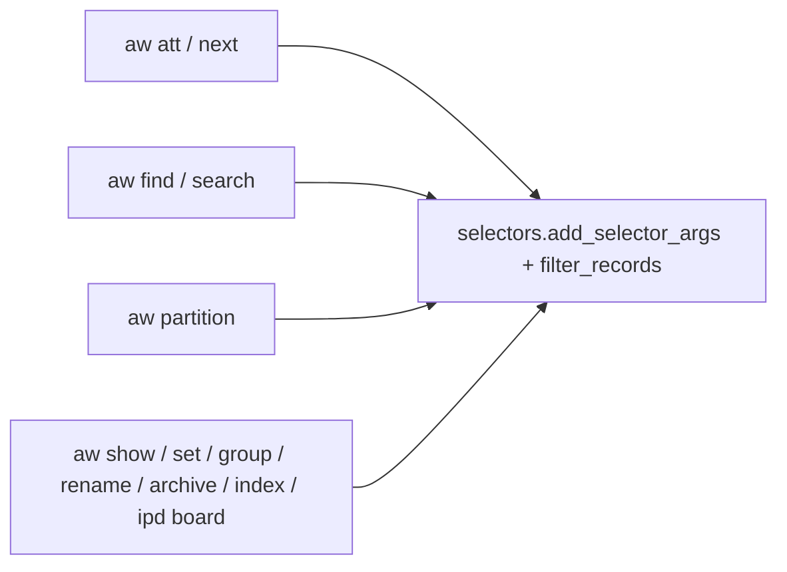

# IPD: Wire normalized artifact selectors into query and mutation CLI commands

- Date: 2026-11-22
- Kind: child
- Concern: Wire the shared normalized artifact selector flags (`bzsoai`) into all query and mutation CLI commands and resolve existing short-flag collisions (spec `ogd2nv` R-02, R-05, R-06).
- Scope: Attach `selectors.add_selector_args` and `selectors.filter_records` in `agent_workflows/cli.py`, `agent_workflows/partition.py`, `agent_workflows/status_set.py`, and `agent_workflows/attention.py` for `aw att`/`next`, `aw find`/`search`, `aw partition`, `aw show`, `aw set`, `aw group`, `aw rename`, `aw archive`, `aw index`, and `aw ipd board`; move `aw att`'s `-d` (`--details`) to `--details`/`--desc`/`-desc`; fix `--arcive-state` typo; rename `aw set`'s write-override `--date` to `--history-date`; move `aw find -p` to `--paths` and `aw search -S` to `--short`; update `tests/test_cli_find.py`, `tests/test_attention.py`, and `tests/test_partition.py`. EXCLUDES runner CLIs (`agy`, `oc`), shell completions, and docs (`e36q6r`).
- Scope-Paths: agent_workflows/cli.py, agent_workflows/partition.py, agent_workflows/status_set.py, agent_workflows/attention.py, tests/test_cli_find.py, tests/test_attention.py, tests/test_partition.py, .aw/records/plans/pending/20261122-selectors-02-mnlaoa-wire-normalized-artifact-selectors-into-query-and-mutation-c.ipd.md
- Item-Dependencies: executed:bzsoai
- Status: to-review
- Short-Description: Adopt shared selector flags across att, find, search, partition, show, set, group, rename, archive, index, and ipd board
- Work-Kind: feature
- Priority: medium
- From-Backlog: 1iojci
- From-Spec: ogd2nv
- Set: selectors
- Order: 2
- Highest E allocated: 04
- Author: antigravity
- Id: mnlaoa

> Write and proofread this plan per the technical writing standard, `.aw/system/workflows/technical-writing/technical-writing.md` (`.agents/workflows/technical-writing/technical-writing.md` in a legacy-layout install), including requirement 12 (diagrams).

## Workflow history

- 2026-11-23 to-review (aw set): status set to to-review
- 2026-11-23 draft (antigravity): created and authored as Order 02 of Set `selectors` graduating `1iojci` under spec `ogd2nv`.

## Goal

Ensure every query and mutation CLI command (`att`/`next`, `find`/`search`, `partition`, `show`, `set`, `group`, `rename`, `archive`, `index`, and `ipd board`) uses the shared normalized selector flags from `bzsoai` with zero short-flag collisions.

## Detailed Implementation Checklist (TODO)

Execution-state rule: mark an `E-*` item complete only after performing the action. That mark is not validation. Right-sizing rule: write for a modest executor that cannot hold much in its head. Each E-item is one step (one concern, about one file, executable in one focused pass) and its V-item names each unit it covers with its own check; a plan stays at about 5 E-items and 8 work Scope-Paths, else split it into more child plans (guidance, `IPD-Z603`). Accepted execution states: blocked, failed, pending, performed; terminal gate demands 'performed'.

### Task group 1: Query surfaces (`att`/`next`, `find`/`search`, `partition`)

- [ ] E-01 Wire `selectors.add_selector_args` and `selectors.filter_records` into `aw att` / `aw next` (`agent_workflows/cli.py` and `agent_workflows/attention.py`), move `-d` (`--details`) to `--details` / `--desc` (hidden alias `-desc`), fix the misspelled `--arcive-state` option to `--active-state` (or `--archive-state` matching its `RUN_STATUS` dest while preserving compatibility if referenced), and wire `aw find` and `aw search` (`agent_workflows/cli.py`) to `selectors.add_selector_args` while moving `find -p` to `--paths` and `search -S` to `--short`.
  - Depends on: none
  - Expected outcome: `aw att`, `aw find`, and `aw search` accept `-t/-T`, `-s/-S`, `-p/-P`, `-r/-R`, `--sid`/`-sid`, `--nsid`/`-nsid`, `-d/-D`, `--mtime`/`-mtime`, and `--ctime`/`-ctime` identically, and `aw att --desc`/`-desc`, `aw find --paths`, and `aw search --short` work cleanly.
  - Execution state: pending

- [ ] E-02 Wire `selectors.add_selector_args` and `selectors.filter_records` into `aw partition` (`agent_workflows/cli.py` and `agent_workflows/partition.py`), extending `partition.collect` and `_run_partition_impl` to honor `-T`, `-S`, `-P`, `-r/-R`, `--sid`/`--nsid`, `-d/-D`, `--mtime`, and `--ctime` while preserving existing Set cohesion, `--split-sets`, and explicit re-review admission.
  - Depends on: E-01
  - Expected outcome: `aw partition` filters candidate items using the same `SelectorSpec` as `aw att` and `aw find`, exiting 2 on invalid date/time expressions.
  - Execution state: pending

### Task group 2: Mutation and inspection surfaces (`show`, `set`, `group`, `rename`, `archive`, `index`, `ipd board`)

- [ ] E-03 Wire `selectors.add_selector_args` and `selectors.filter_records` into `aw show`, `aw set`, `aw group`, `aw rename`, `aw archive`, `aw index`, and `aw ipd board` in `agent_workflows/cli.py` and `agent_workflows/status_set.py`; rename `aw set`'s write-override `--date` flag to `--history-date` so `-d` / `--date` unambiguously selects artifacts by filename date (while leaving `--date` untouched on authoring verbs `new`/`scaffold` where no selection occurs).
  - Depends on: E-01
  - Expected outcome: Users can filter targets with `-t/-T`, `-s/-S`, `-p/-P`, `-r/-R`, `--sid`/`--nsid`, `-d/-D`, `--mtime`, and `--ctime` on `show`, `set`, `group`, `rename`, `archive`, `index`, and `ipd board`, and `aw set --history-date YYYY-MM-DD` overrides the workflow history line date cleanly.
  - Execution state: pending

### Task group 3: Behavioral tests

- [ ] E-04 Update existing tests affected by the resolved collisions (`aw find --paths` in `tests/test_cli_find.py`, `aw att --desc`/`-desc` in `tests/test_attention.py`) and add behavioral CLI tests in `tests/test_cli_find.py`, `tests/test_attention.py`, and `tests/test_partition.py` exercising `-t/-T`, `-s/-S`, `-p/-P`, `-r/-R`, `--sid`/`-sid`, `--nsid`/`-nsid`, `-d/-D`, `--mtime`/`-mtime`, `--ctime`/`-ctime`, and `aw set --history-date`.
  - Depends on: E-01, E-02, E-03
  - Expected outcome: All targeted CLI tests and `mypy` pass with zero regressions on `aw runs -s/-S` and `aw runners -t`.
  - Execution state: pending

## Project conventions discovered (Step 0)

- Measured collision footprints: `aw att -d` (`--details`) appears in 4 files (`cli.py`, `attention.py`, `command_surface.py`, `tests/test_attention.py`); `aw find -p` (`--paths`) appears in 2 test files (`tests/test_cli_find.py`, `tests/test_record_builder_slow.py`); `aw search -S` (`--short`) appears in `tests/test_completion.py` (completion test updated in Order 03 `e36q6r` if needed, or preserve `--short` check).
- `aw runs` (`-s`/`-S`), `aw runners` (`-t`), and `pwatch` (`-r`/`-R`/`-d`) are explicitly exempt from selector short-flag normalization per spec `ogd2nv` R-05.
- `status_set.run_set_command` reads `getattr(args, "date", None)` for history date override; update to read `history_date` cleanly.

## Findings

- Today `aw att`, `aw find`, `aw partition`, and `aw set` each hand-register incompatible subsets of selector flags in `agent_workflows/cli.py`.

## Proposed changes (ordered, validatable)

1. Wire `selectors.add_selector_args` into `att`/`next`, `find`, and `search`, moving `-d`/`-p`/`-S` collisions and fixing `--arcive-state` (`E-01`).
2. Wire `selectors.add_selector_args` and `filter_records` into `partition.py` and `cli.py` (`E-02`).
3. Wire `selectors.add_selector_args` into `show`, `set` (with `--history-date`), `group`, `rename`, `archive`, `index`, and `ipd board` (`E-03`).
4. Update and expand behavioral tests across `tests/test_cli_find.py`, `tests/test_attention.py`, and `tests/test_partition.py` (`E-04`).

## Deferred / out of scope (with reason)

- Runner CLIs (`agy`, `oc`), shell completions (`agent_workflows/completion.py`, `tests/test_completion.py`), `tests/test_record_builder_slow.py` update, and user docs: owned by Order 03 (`e36q6r`).
  - Carrier: e36q6r

## Scope check

- Over-scope: none; touches only query/mutation CLI surfaces and their unit/CLI tests.
- Under-scope: none; every non-runner artifact-selecting command is covered.

## Required tests / validation

- `python3 -m pytest tests/test_cli_find.py tests/test_attention.py tests/test_partition.py tests/test_partition_set_cohesion.py tests/test_normalized_selectors.py`
- `python3 -m mypy agent_workflows/cli.py agent_workflows/partition.py agent_workflows/status_set.py agent_workflows/attention.py`
- `aw attention --check && aw sanitize`

## Spec / documentation sync

- Implements spec `ogd2nv` R-02, R-05, and query/mutation portion of R-06 (`AC-03`). Reference docs and shell completions sync in Order 03 (`e36q6r`).

## Open questions

None; all design questions were resolved in `1iojci` and codified in spec `ogd2nv`.

## Validation and cross-check (verify before reporting done)

Validation-state rule: inspect evidence in a separate pass. Do not mark a `V-*` item complete from memory or from the matching execution checkmark. Accepted validation results: blocked, failed, pass, pending; terminal gate demands 'pass'. Runtime-demonstration reachability rule: for each `V-*` item demanding the software be observed acting (such as a run, a dispatch, or a transition), as distinct from items demanding a diff, a file's content, or a test result, name the code path that produces the observation or the sibling `E-*` that creates it, else the demand is UNDER-SCOPE.

- [ ] V-01 validates E-01
  - Required evidence: Pasted pytest output from `tests/test_attention.py` and `tests/test_cli_find.py` proving `aw att`, `aw find`, and `aw search` accept all normalized selector flags, `aw att --desc`/`-desc` displays details, `aw find --paths` outputs paths, `aw search --short` outputs short format, and `--arcive-state` typo is resolved.
  - Observed evidence:
  - Result: pending

- [ ] V-02 validates E-02
  - Required evidence: Pasted pytest output from `tests/test_partition.py` and `tests/test_partition_set_cohesion.py` proving `aw partition` filters with `-T`, `-S`, `-P`, `-r/-R`, `--sid`/`--nsid`, `-d/-D`, `--mtime`, and `--ctime` without breaking Set cohesion or re-review partitioning.
  - Observed evidence:
  - Result: pending

- [ ] V-03 validates E-03
  - Required evidence: Pasted pytest output from `tests/test_cli_find.py` and `tests/test_attention.py` proving each command (`aw show`, `aw set`, `aw group`, `aw rename`, `aw archive`, `aw index`, and `aw ipd board`) accepts normalized selector flags (`-t/-T`, `-s/-S`, `-p/-P`, `-r/-R`, `--sid`/`--nsid`, `-d/-D`, `--mtime`, `--ctime`) with its own test assertion, and that `aw set --history-date YYYY-MM-DD` records the requested date in `## Workflow history`.
  - Observed evidence:
  - Result: pending

- [ ] V-04 validates E-04
  - Required evidence: Pasted runner output from `python3 -m pytest tests/test_cli_find.py tests/test_attention.py tests/test_partition.py tests/test_partition_set_cohesion.py tests/test_normalized_selectors.py`, `mypy`, `aw attention --check`, and `aw sanitize` all passing with exit 0.
  - Observed evidence:
  - Result: pending

## Approval and execution gate

- Size assessment: standard
- Cohesion rationale: not required

Ready for `/plan-review` and human approval (`aw set approved mnlaoa --by-human`). Execution must follow the repository agent execution contract (isolated worktree, path-scoped `aw commit mnlaoa -- <paths>`, pasted validation output, and post-gate lifecycle transition).
