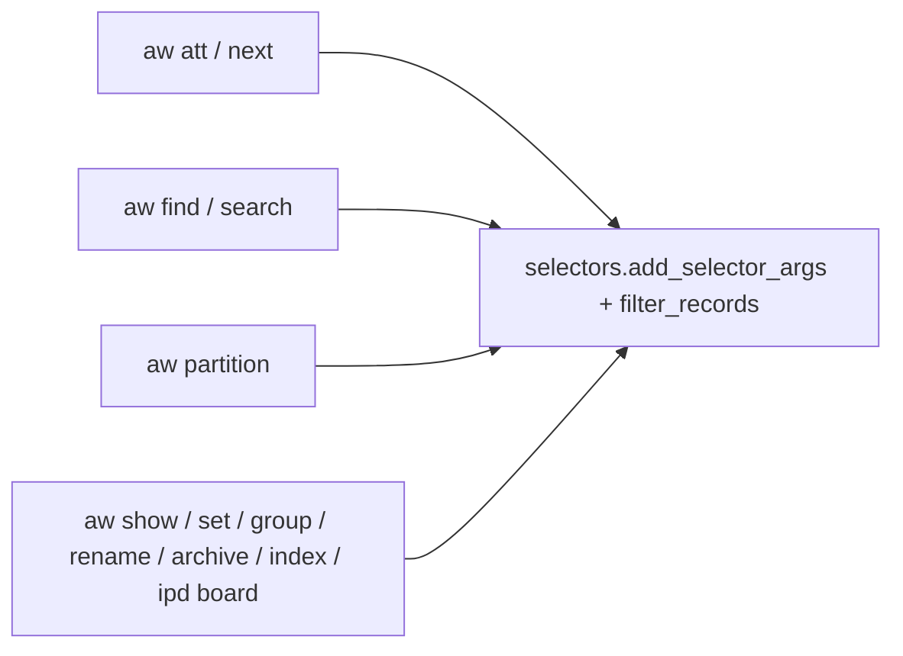
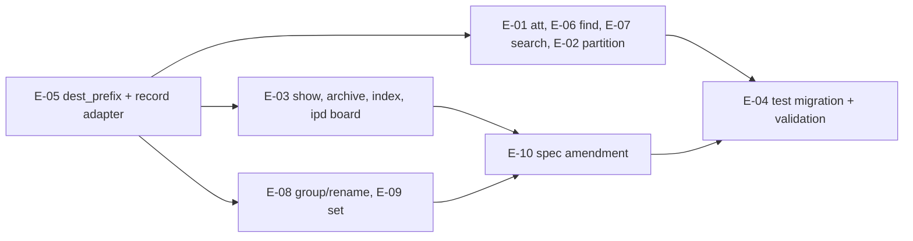

# IPD: Wire normalized artifact selectors into query and mutation CLI commands

- Date: 2026-11-22
- Kind: child
- Concern: Wire the shared normalized artifact selector flags (`bzsoai`) into all query and mutation CLI commands and resolve existing short-flag collisions (spec `ogd2nv` R-02, R-05, R-06).
- Scope: Attach `selectors.add_selector_args`, `selectors.parse_selector_namespace`, and `selectors.filter_records` (all from `bzsoai`) for `aw att`/`next`, `aw find`/`search`, `aw partition`, `aw show`, `aw set`, `aw group`, `aw rename`, `aw archive`, `aw index`, and `aw ipd board`, REPLACING each command's existing overlapping registrations; add a `dest_prefix` keyword to `add_selector_args`/`parse_selector_namespace` so `aw set` selector values never reach the write paths that read `args.priority`/`args.status`/`args.date`; move `aw att -d` (`--details`) to `--details`/`--desc`/`-desc`; hide the misspelled `--arcive-state` spelling; rename `aw specs set --date` (the only history-date write override; top-level `aw set` has no `--date`) to `--history-date` and add `--history-date` to top-level `aw set`; drop the `-p` short form of `--paths` on `aw find` and `aw search` and the `-S` short form of `--short` on `aw search`; stop `_reconstruct_apply_command` from dropping a selector `-d` value; amend spec `ogd2nv` R-05/R-06 to match; update every test that uses a moved short flag. EXCLUDES runner CLIs (`agy`, `oc`), shell completions, and docs (`e36q6r`), and leaves `aw check`, `aw specs note --date`, and `aw specs migrate --date` unchanged.
- Scope-Paths: agent_workflows/cli.py, agent_workflows/attention.py, agent_workflows/partition.py, agent_workflows/status_set.py, agent_workflows/selectors.py, .aw/records/specs/to-review/20261122-ogd2nv-01-ogd2nv-normalized-selectors-show-and-verb-first-cli.spec.md, tests/test_attention.py, tests/test_cli_find.py, tests/test_find_filters.py, tests/test_index_aliases.py, tests/test_record_builder_slow.py, tests/test_cli_search.py, tests/test_partition.py, tests/test_status_set.py, tests/test_event_overrides.py, tests/test_cli_show.py, tests/test_plans_archive_selectors.py, tests/test_artifact_group.py, tests/test_artifact_rename.py, tests/test_plans_rename_selectors.py, tests/test_plans_board.py, .aw/records/plans/pending/20261122-selectors-02-mnlaoa-wire-normalized-artifact-selectors-into-query-and-mutation-c.ipd.md
- Item-Dependencies: executed:bzsoai
- Status: reviewed
- Short-Description: Adopt shared selector flags across att, find, search, partition, show, set, group, rename, archive, index, and ipd board
- Work-Kind: feature
- Priority: medium
- From-Backlog: 1iojci
- From-Spec: ogd2nv
- Set: selectors
- Order: 2
- Readiness: no-go
- Review-Depth: standard
- Highest E allocated: 10
- Author: antigravity
- Id: mnlaoa

> Write and proofread this plan per the technical writing standard, `.aw/system/workflows/technical-writing/technical-writing.md` (`.agents/workflows/technical-writing/technical-writing.md` in a legacy-layout install), including requirement 12 (diagrams).

## Workflow history

- 2026-11-25 reviewed (aw set): status set to reviewed
- 2026-11-24 /plan-review (uri/its_direct/pt3-claude-opus-5.5-1m-us): REVIEWED - OPEN QUESTIONS; PR-001..PR-003, PR-005..PR-016 FIXED; PR-004 ESCALATED as blocking OQ-01; PR-017 DEFERRED (advisory); review record .aw/records/reviews/20261122-selectors-02-mnlaoa-wire-normalized-artifact-selectors-into-query-and-mutation-c.review.md
- 2026-11-23 to-review (aw set): status set to to-review
- 2026-11-23 draft (antigravity): created and authored as Order 02 of Set `selectors` graduating `1iojci` under spec `ogd2nv`.

## Goal

Ensure every query and mutation CLI command (`att`/`next`, `find`/`search`, `partition`, `show`, `set`, `group`, `rename`, `archive`, `index`, and `ipd board`) uses the shared normalized selector flags from `bzsoai` with zero short-flag collisions.

## Detailed Implementation Checklist (TODO)

Execution-state rule: mark an `E-*` item complete only after performing the action. That mark is not validation. Right-sizing rule: write for a modest executor that cannot hold much in its head. Each E-item is one step (one concern, about one file, executable in one focused pass) and its V-item names each unit it covers with its own check; a plan stays at about 5 E-items and 8 work Scope-Paths, else split it into more child plans (guidance, `IPD-Z603`). Accepted execution states: blocked, failed, pending, performed; terminal gate demands 'performed'.

### Task group 1: Shared builder extension and query surfaces (`att`/`next`, `find`, `search`, `partition`)

Common rules for every E-item in this plan (each item cites them as "the common rules"):

- Register selector flags only through `selectors.add_selector_args` and read them only through `selectors.parse_selector_namespace`; never re-type a selector spelling in `cli.py`. Before adding the builder to a parser, DELETE every existing registration on that parser whose option string the builder also registers, or argparse raises `ArgumentError: argument -t/--type: conflicting option strings` at parser build time (measured at review by re-adding `-t/--type` to the `aw att` parser).
- A `ValueError` from `parse_selector_namespace`, `parse_date_expr`, or `parse_time_expr` (`bzsoai` E-01/E-02 raise it and leave the exit code to this plan) exits 2: a human caller gets `term.status("fail", "<command>: <message>")`, and an `--agent`/`--json` caller gets a `CommandResult(status="cannot-run", exit_code=2, summary=<message>)`, the shape `_run_plans` already uses for an unrecognized `--status` (`cli.py` around line 12996). The message keeps the offending token verbatim (`ogd2nv` R-03).
- Call `selectors.filter_records` only when the parsed `SelectorSpec` carries at least one value, so a command run without selector flags does no extra file reads and no git pass, and its output stays byte-identical.
- Every new behavioral test drives the real CLI (`cli.main([...])` or `support.run_cli`) against a temporary repository and asserts on exit codes and output (GUIDING_PRINCIPLES P16). Mark each NEW test class `@pytest.mark.core` so the bare `python3 -m pytest` merge gate runs it; do not add a module-level `core` marker to `tests/test_attention.py`, `tests/test_cli_find.py`, or `tests/test_partition.py`, which do not carry one today.

- [ ] E-05 Add a `dest_prefix: str = ""` keyword to `selectors.add_selector_args` and `selectors.parse_selector_namespace`, and add a per-path record adapter, both in `agent_workflows/selectors.py`.
  - `dest_prefix`: when non-empty, every selector `dest` the builder registers is prefixed (for example `sel_status`), and `parse_selector_namespace(args, dest_prefix=...)` reads the prefixed names. The default `""` keeps `bzsoai` behavior unchanged. Only `aw set` (E-03) passes a prefix; it exists because `status_set.py` reads `args.priority` as a value to WRITE (`status_set.py` lines 1269, 1915, 3263, 3554), reads `args.status` through the retry allow-list (`_RETRY_FLAG_ALLOWLIST`, around line 2314), and reads `args.date` (lines 1618, 2212, 3125), so an unprefixed selector `-p high` on `aw set` would be written into the artifact as its priority.
  - Record adapter: `selector_records(repo_root, paths) -> list[SelectorRecord]`, where `SelectorRecord` is a frozen dataclass carrying the attributes `filter_records` reads (`id`, `path`, `tree`, `native_status`, `attention_class`, `priority`, `readiness`). Read each path once through `artifact_meta.read_text(text, record_type=...)` (its `State.fields` carries `priority`, `readiness`, `status`, and `set`; `status_set.ArtifactRecord` at `status_set.py` line 129 carries none of priority, readiness, or attention class). Derive `attention_class` with `attention_contract.class_of(tree, native_status)` imported lazily, and use `None` when it raises `attention_contract.UnknownNativeStatus`. Do NOT call `attention.scan` (measured at review: about 6.27 seconds over all trees, against 0.8 to 1.2 seconds for a whole `aw find`). `selectors.py` must still not import `attention` (`bzsoai` E-03).
  - Tests: in `tests/test_normalized_selectors.py` (created by `bzsoai`), a parser built with `dest_prefix="sel_"` parses `-p high -s draft` into `sel_priority`/`sel_status` and leaves `priority`/`status` unset; `selector_records` on a temporary plan, spec, and backlog item returns their priority, readiness, native status, and attention class.
  - Depends on: none
  - Expected outcome: A caller can attach selector flags without touching any existing `dest`, and can filter an arbitrary list of artifact paths with `filter_records` without a whole-tree scan.
  - Execution state: pending

- [ ] E-01 Wire the selectors into `aw att` / `aw next` (`agent_workflows/cli.py` parser around lines 6098-6262, and `agent_workflows/attention.py`), following the common rules.
  - Parser: delete the `aw att` registrations of `--type`/`-t` (dest `types`), `--status`/`-s`, `--status-not`/`-S`, `--priority`/`-p`, and `--readiness`/`-r`, and call `add_selector_args(p_attention)`; keep every other `aw att` flag (`-o`, `-id`, `-b`, `-a`, `-ac`, `-na`, and the rest) unchanged. `att`, `attention`, and `next` share this one parser.
  - `-d`: re-register `--details` (dest `details`, `store_true`) with the visible alias `--desc`, and register `-desc` in a separate `add_argument` call with the same `dest`, `action="store_true"`, `default=argparse.SUPPRESS`, and `help=argparse.SUPPRESS`, so `-d` is free for the selector filename-date flag. Update the `attention.py` line 1550 docstring ("identically to `aw att -d`") to say `aw att --details`.
  - `--arcive-state`: it already sits in one `_RunStatusAction` call with `--active-state`, `--archive-state`, `--run-status`, `--runs-status`, `-as`, and `-ars` (`cli.py` around line 6248), so the "typo fix" is to HIDE the misspelling, not to add a spelling. Remove `--arcive-state` from that call and register it in a separate call inside the same mutually exclusive group with `dest="run_status"`, `action=_RunStatusAction`, and `help=argparse.SUPPRESS`. Keep the `run_status`, `arcive_state`, and `active_state` namespace attributes, because `_RunStatusAction` (`cli.py` line 1372) sets all three, `attention.py` line 5025 reads them, and `tests/test_attention.py` (lines 1876-1892, 3277-3279, 3364), `tests/test_attention_excluded_tree_selector.py` line 87, and `tests/test_empty_result_convention_doc.py` line 117 build namespaces with them. Update the `attention.py` docstring at line 4232 to name `--active-state`.
  - Filtering: in `attention.py` (the readers at lines 4816-4990), build the filters from `parse_selector_namespace(args)` and apply `filter_records` to the scanned items, so the new dimensions (`-T`, `-P`, `-R`, set id, `-d/-D`, `--mtime`, `--ctime`) work and the existing ones keep their answers.
  - `-o` help text: say that `mtime` and `ctime` are git history times with a stat fallback (the help-text half `bzsoai` E-03 leaves to this plan), and that in `--mtime`/`--ctime` relative windows `m` means MINUTES.
  - Tests (`tests/test_attention.py`): `-T`, `-P`, `-R`, `--sid`/`-sid`, `--nsid`/`-nsid`, `-d 2026`, `-D`, and `--mtime 7d` narrow the output; `--desc` and `-desc` show details; `-d` no longer means details; `--arcive-state running` still parses to `run_status == ["running"]` and is absent from `format_help()`; `-d 2026-13-40` exits 2 naming the token.
  - Depends on: E-05
  - Expected outcome: `aw att` accepts the full `ogd2nv` R-02 matrix, `--desc`/`-desc` show details, and `--arcive-state` still works but is hidden from `--help`.
  - Execution state: pending

- [ ] E-06 Wire the selectors into `aw find` (`agent_workflows/cli.py`: the noun-verb loop around lines 5518-5745 and `_run_find_impl` around line 16799), following the common rules.
  - Parser: on the `find` parser only, stop registering the loop's `--status` (a single `Store`), `--status-not`/`-S`, `--set`, and `--date` (help "Date (YYYYMMDD; default preserves existing date or today)", a mutation value that no find code path reads), drop the `-p` short form from `--paths` (keep `--paths`), and call `add_selector_args(_p, allow_set_alias=True)`. `find` has a positional TYPE and no `-t` today: the positional TYPE resolves the base type set as it does now, and `-t`/`-T` then narrow and exclude within it, so a disjoint pair returns an empty result under the repository's empty-result convention.
  - Readers: find consumes `--status` as one string today (`plans_index.query` lines 316-327, `cli.py` lines 15963-15966, 16020-16024, 16856, and the `explicit_flags` namespace around line 16980). Remove the `status`, `status_not`, and `set` values from those backend calls and from `explicit_flags`, and instead apply `filter_records(selector_records(repo_root, matched_paths), spec)` to the matched paths. Keep the `wja06w` status validation (around line 16856) by validating each selector status value with the same rule. `_build_find_continuation_parts` (around line 16733) echoes each selector value with its canonical long spelling.
  - Tests (`tests/test_cli_find.py`): `aw find plans -p high`, `-P low`, `-r go`, `--sid <set>`, `--set <set>` (the compatibility alias), `-s a -s b`, `-S done`, and `-d 2026` each select the expected records; `--paths` prints paths; `-p` without a value is a usage error, not paths mode.
  - Depends on: E-05
  - Expected outcome: `aw find` accepts the R-02 matrix, `-p` means priority, `--paths` prints paths, and existing `--status`/`--set` invocations give the same answers as before.
  - Execution state: pending

- [ ] E-07 Wire the selectors into `aw search` (`agent_workflows/cli.py`: the `search` branch of the noun-verb loop around lines 5600-5660 and the handler around line 17535), following the common rules.
  - Parser: delete search's own `--type`/`-t`/`--tree` (dest `types`), `--status`/`-s`, and `--status-not` registrations and the loop's `--set` and `--date` on `search`, drop the `-p` short form from `--paths` and the `-S` short form from `--short` (keep both long forms), and call `add_selector_args(_p, allow_set_alias=True)`. `-n` (line numbers), `-l` (files only), and `-F` (full) are not selector spellings and stay. Spec `ogd2nv` R-05 names only `search -S`; search ALSO has `-p/--paths` (used 16 times in `tests/test_cli_search.py`), which collides with selector `-p`, so E-10 adds it to R-05.
  - Readers: the handler reads `types`, `status`, and `status_not` as lists today (around lines 17581-17600); route them through `parse_selector_namespace` and apply `filter_records` to the candidate files before the regex pass, so `-p`, `-r`, set id, and the date/time dimensions also narrow the search.
  - Tests (`tests/test_cli_search.py`): `-p high`, `-S done`, `-T backlog`, and `--sid <set>` narrow results; `--short` and `--paths` keep their output formats.
  - Depends on: E-05
  - Expected outcome: `aw search` accepts the R-02 matrix, and `--paths` and `--short` work in their long forms only.
  - Execution state: pending

- [ ] E-02 Wire the selectors into `aw partition` (`agent_workflows/cli.py` parser around line 5309 and `agent_workflows/partition.py`), following the common rules.
  - Parser: keep partition's own `-t`/`--type`/`--tree` (dest `artifact_type`, a single `Store` with choices `plans`/`backlog`/`specs` and type inference from selectors), because one partition run schedules exactly one tree and Set cohesion depends on that; call `add_selector_args(p_partition, include_types=False)` after deleting partition's `-s`/`--status`, `--status-not`, and `-p`/`--priority` registrations. `-T` is therefore not offered on partition; E-10 records this in `ogd2nv` R-06. `-n/--shards` and `-o/--order-by` are not selector spellings and stay.
  - Readers: `_run_partition_impl` reads `status`, `status_not`, and `priority` as lists (`partition.py` lines 1891-1893) and passes them to `collect` (line 1308); read them from `parse_selector_namespace` instead, and apply `filter_records` to `collect`'s result for readiness, set id, and the date/time dimensions. Map the `ValueError` through the existing `except ValueError` blocks (`partition.py` around lines 1947 and 2179), which already return 2. Preserve Set cohesion, `--split-sets`, `--allow-partial-sets`, and explicit re-review admission.
  - Tests (`tests/test_partition.py`): `-P low`, `-r go-pending-approval`, `--sid <set>`, and `-d 2026` narrow the candidates; an invalid `--mtime 7x` exits 2; existing `-s`/`-p` invocations give the same shards.
  - Depends on: E-05
  - Expected outcome: `aw partition` filters candidates with the same `SelectorSpec` as `aw att` and `aw find`, and exits 2 on an invalid date or time expression.
  - Execution state: pending

### Task group 2: Inspection and mutation surfaces (`show`, `archive`, `index`, `ipd board`, `group`, `rename`, `set`)

Safety rule for the mutation verbs (`set`, `group`, `rename`, `archive`): selector flags only NARROW the targets the command already resolves; they never widen them. `aw set` keeps its rule that at least one positional target selector is required (`status_set.py` line 3133, "aw set: at least one target selector (id6, setid, or filename) is required."), `aw group` and `aw rename` keep requiring a positional selector or `--id`, and `aw archive` filters only the candidates its own target or age sweep produced. Flags alone never select a mutation target set, so the bulk-write confirmation refusal (`status_set.py` around line 3942) still sees every write it saw before. These four verbs pass `dest_prefix="sel_"` and `allow_set_alias=False`, because `--set` on `group`/`rename` is the NEW Set id (`plans_refs.py` lines 851 and 883, `research_refs.py` line 771, `artifact_rename.py` line 878).

- [ ] E-03 Wire the selectors into the read-only inspection verbs `aw show`, `aw archive` (preview), `aw index`, and `aw ipd board` in `agent_workflows/cli.py`, following the common rules.
  - `aw show` (`_run_show`, around line 14359; today only `action_ref`, `--history`, and `--format`): call `add_selector_args(p_show)`, and apply `filter_records(selector_records(repo_root, unique), spec)` to the hits `selectors.resolve_selectors` returns (around line 14403). When the token matched records but the filter removed all of them, emit an empty result that names the active filter, NOT the `selector_tokens_naming_no_artifact` refusal, which would falsely say the token names no artifact.
  - `aw archive` (`type_or_target`, `target`, `-a/--age`, `--keep`, `--keep-last`, `--apply`, `--force`): call `add_selector_args(p_archive, dest_prefix="sel_", allow_set_alias=False)`; `-a/--age` is not a selector spelling and stays. Apply `filter_records` to the candidate list after `plans_archive.sweep_candidates` (`plans_archive.py` line 272, called at line 449) and `research_archive.sweep_candidates` (`research_archive.py` line 265, called at line 669), and to the explicit-target list from `plans_archive._find_targets` (line 206), before the preview is printed and before any `--apply` move.
  - `aw index`: `meta_cli.index_alias` (lines 722-764) only rebuilds the cache or runs `--check`; it lists nothing, so a selector cannot narrow anything. On the `index` parser, replace the noun-verb loop's `--status`, `--status-not`/`-S`, `--set`, and `--date` with `add_selector_args(_p)` so the flags parse uniformly, and when any selector value is given, add one `info` diagnostic (or stderr line for a human) saying selector flags are accepted and ignored by `aw index` and naming `aw find` as the listing command, exactly as `index_alias` already treats `--limit`. Record this meaning in spec `ogd2nv` R-06 (E-10).
  - `aw ipd board` (`_run_plans`, around lines 12933-13140): replace `--status` (dest `status_filter`, a single value) and `--status-not` (dest `status_not_filter`, a comma string) with `add_selector_args(p_ipd_board, include_types=False)`; map the parsed status values onto the existing validation (each value must satisfy `plans_mod.normalize_status(v) in plans_mod.RECOGNIZED`, else exit 2 with the existing "Unrecognized --status" message) and filtering, and apply `filter_records` to the board rows for the remaining dimensions.
  - Tests: `tests/test_cli_show.py` (`-s`, `--sid`, and a filter that empties the hits), `tests/test_plans_archive_selectors.py` (`-s`/`-d` narrow an archive preview; nothing outside the narrowed set moves under `--apply`), `tests/test_index_aliases.py` (`aw index plans -s draft` exits as before and prints the ignored-flags notice), and `tests/test_plans_board.py` (`aw ipd board -s approved`, `-S executed`, and `--status bogus` exiting 2).
  - Depends on: E-05
  - Expected outcome: `aw show`, `aw archive`, `aw index`, and `aw ipd board` accept the R-02 matrix (board without `-t/-T`), narrow their output where they list records, and leave unfiltered output unchanged.
  - Execution state: pending

- [ ] E-08 Wire the selectors into `aw group` and `aw rename` (the noun-verb loop in `agent_workflows/cli.py`, around lines 5518-5745, and `_reconstruct_apply_command`, around lines 15289-15320), following the common rules and the mutation safety rule.
  - BLOCKED ON OQ-01 (Finding PR-004): the loop registers `--date` on `group` and `rename` as a MUTATION value (the new filename date; read at `research_refs.py` lines 765 and 866), which collides with the selector `-d/--date`. Implement the option OQ-01 resolves to. The recommended option renames the mutation option string to `--new-date` while keeping `dest="date"`, so no reader changes; the alternative skips the selector `-d/--date`/`-D` pair on these two verbs and records that in spec `ogd2nv` R-05.
  - Parser: on `group` and `rename`, delete the loop's `--status` (no `group`/`rename` code path reads it; verified at review by grep of `artifact_rename.py`, `plans_refs.py`, and `research_refs.py`) and `--status-not`/`-S`, and call `add_selector_args(_p, dest_prefix="sel_", allow_set_alias=False)`. `--set`, `--slug`, `--order`, `--id`, `--rename`, `--no-refs`, `--to-id6`, `--force`, and `--allow-invalid-order` stay as mutation options.
  - Filtering: apply `filter_records` to the records the positional selectors resolve before planning the moves; a selector flag never adds a record.
  - `_reconstruct_apply_command`: it rebuilds the `--apply` retry from `sys.argv` and today skips `-d` plus the next token as if `-d` were `--dir`, but the `group`/`rename` parsers register `--dir` with no `-d`. Skip only `--dir` and `--dir=`, so a selector `-d 2026` survives into the printed `--apply` command and the retry cannot widen the move.
  - Tests: `tests/test_artifact_group.py`, `tests/test_artifact_rename.py`, and `tests/test_plans_rename_selectors.py`: `-s`/`-d`/`--sid` narrow the preview, nothing outside the narrowed set is renamed under `--apply`, the printed `--apply` command keeps `-d <value>`, and the mutation date option chosen by OQ-01 still sets the new filename date.
  - Depends on: E-05
  - Expected outcome: `aw group` and `aw rename` accept the selector flags as narrowing filters, keep their mutation options, and print an `--apply` command that reproduces the narrowed selection.
  - Execution state: pending

- [ ] E-09 Wire the selectors into top-level `aw set` and rename the history-date override, in `agent_workflows/cli.py` and `agent_workflows/status_set.py`, following the common rules and the mutation safety rule.
  - Correct target: spec `ogd2nv` R-05 and the earlier text of this plan say to rename `aw set`'s `--date`, but top-level `aw set` has NO `--date` (its own options are `-m`, `-y`, and the positional `args`). The only history-date write override is `aw specs set --date` (and its `aw spec set` spelling; `cli.py` around line 7890), which `run_set_command` reads only for specs (`status_set.py` lines 1618-1620, 2212, and 3125). Rename that option to `--history-date` with `dest="history_date"`, update those three readers and the `_spec_date_refusal` message (`status_set.py` around line 726) to say `--history-date`, change the retry allow-list entry `("date", "--date", True)` (`status_set.py` around line 2314) to `("history_date", "--history-date", True)`, and add the same `--history-date` option to top-level `aw set`, where it applies only to spec targets exactly as on `aw specs set`. Do NOT keep a hidden `--date` alias unless the non-gating outcome question on aliases is answered otherwise; the flag is unreleased (absent from tag `v1.3.0-rc.1`). `aw specs note --date` (line 7921) and `aw specs migrate --date` (line 7966) select nothing and stay unchanged.
  - Selectors: attach `add_selector_args(p_set, dest_prefix="sel_", allow_set_alias=False)` to top-level `aw set` ONLY. Never attach them to `aw specs set`, `aw backlog set`, or `aw ipd set`, where `--status` is the target status and `--priority` is a value to write. In `run_set_command`, apply `filter_records` to `matched_records` after positional resolution (around line 3333) and before the orchestrator sort and the confirmation refusal (around line 3942).
  - Retry command: `_retry_command` emits only scalar allow-list values today (around lines 2378-2390). Extend it so each element of every non-empty `sel_*` list is emitted with its canonical long spelling, so the printed retry of a refused bulk write keeps its narrowing.
  - Tests: `tests/test_status_set.py` (`aw set reviewed <setid> -s to-review` writes only the matching plans; `-p high` on `aw set` writes no priority; flags without a positional selector still fail with the existing message; the refused bulk write's retry command carries `--status to-review`) and `tests/test_event_overrides.py` (lines 227-252: `--history-date` replaces `--date` in the refusal tests, and `aw specs set --date` is now a usage error with exit 2).
  - Depends on: E-05
  - Expected outcome: `aw set` narrows its targets with selector flags without changing any written value, `aw specs set --history-date` and `aw set --history-date` override the spec history date, and `-d`/`--date` on `aw set` select by filename date.
  - Execution state: pending

### Task group 3: Spec amendment and existing-test migration

- [ ] E-10 Amend spec `ogd2nv` (`.aw/records/specs/to-review/20261122-ogd2nv-01-ogd2nv-normalized-selectors-show-and-verb-first-cli.spec.md`, still `to-review`) so its contract matches what this plan builds: in R-05, retarget the history-date rename from `aw set` to `aw specs set`/`aw spec set` (with `aw set` gaining `--history-date`), add `aw search -p` (`--paths`) to the moved short flags, and state the group/rename mutation-date outcome of OQ-01; in R-06, state that `aw partition` offers no `-T` because one run schedules one tree, that `aw ipd board` offers no `-t/-T`, and that `aw index` accepts and ignores selector flags with a notice; in AC-03, replace "`aw set` (`--history-date`)" with "`aw set` and `aw specs set` (`--history-date`)". Append a dated `## Workflow history` line through `aw specs note` naming plan `mnlaoa`.
  - Depends on: E-03, E-08, E-09
  - Expected outcome: Spec `ogd2nv` R-05, R-06, and AC-03 describe the flags this plan ships, so `e36q6r` (completions and docs) is reviewed against the shipped contract.
  - Execution state: pending

- [ ] E-04 Migrate every existing test that uses a moved short flag, and run the whole validation.
  - Moved-flag users measured at review: `aw find -p` meaning paths in `tests/test_find_filters.py` (19 uses), `tests/test_cli_find.py` (10), `tests/test_index_aliases.py` line 279 (`_find_paths`), and `tests/test_record_builder_slow.py` line 56 (`support.run_cli("find", "-p", ...)`; marked `slow`); `aw search -p` meaning paths in `tests/test_cli_search.py` (16) and `aw search -S` meaning short at line 198. Change each to `--paths` or `--short`. `aw att -d` meaning details has no CLI test user (the details tests call the renderer with `details=True`). `tests/test_completion.py` line 1191 (`aw find backlog -S g`) keeps its meaning, because `-S` stays "not status" on `find`; its candidate lists belong to `e36q6r`.
  - Depends on: E-01, E-02, E-03, E-05, E-06, E-07, E-08, E-09, E-10
  - Expected outcome: No test uses `-p` or `-S` in a meaning this plan removed, and every command in `## Required tests / validation` exits 0.
  - Execution state: pending

## Project conventions discovered (Step 0)

- Parser facts (argparse dump of `cli._build_parser()` at review, `AW_NO_REEXEC=1`): `att`, `attention`, and `next` share one parser; `spec` and `specs` share one. `aw att` already has append flags `-t` (dest `types`), `-s`, `-S` (dest `status_not`), `-p`, and `-r`, plus `-d` meaning `--details`. `aw find` has `-p/--paths`, a single-`Store` `--status`, `--status-not/-S`, `--set`, `--date`, and a positional TYPE, but no `-t`. `aw search` has `-p/--paths`, `-S/--short`, `-n`, `-l`, `-F`, an append `-t/--type/--tree` (dest `types`), an append `-s/--status`, and `--status-not` with no short form. `aw partition` has `-t/--type/--tree` (dest `artifact_type`, single `Store`), append `-s`, `--status-not`, and `-p`, plus `-n/--shards` and `-o/--order-by`. Top-level `aw set` has `-m`, `-y`, and positional `args` and NO `--date`, `--status`, or `--priority`; `aw specs set` has `--status`, `--priority`, and `--date`. `aw ipd board` has `--status` (dest `status_filter`) and `--status-not` (dest `status_not_filter`). `aw show` has `action_ref`, `--history`, and `--format`. `aw archive` has `type_or_target`, `target`, `-a/--age`, `--keep`, `--keep-last`, `--apply`, and `--force`.
- The noun-verb loop (`cli.py` around lines 5518-5745) registers the same `--status`, `--status-not/-S`, `--id`, `--set`, `--topic`, `--limit`, `--slug`, `--order`, `--date`, `--rename`, `--apply`, `--no-refs`, `--to-id6`, and `--force` on `check`, `find`, `search`, `index`, `rename`, and `group`, so each verb's selector wiring must delete the overlapping registrations for that verb only. `aw check` is not in spec `ogd2nv` R-06 and keeps its flags.
- Re-registering an option string that a parser already has raises `argparse.ArgumentError` ("conflicting option strings") when the parser is built (measured at review). With `allow_abbrev=False` (`_AwArgumentParser`), `-nsid x -n 3`, `-desc`, `-sdraft`, and `-sid abc` parse without conflict.
- Release state: `aw specs set --date`, `aw att --details`, `--arcive-state`, and the noun-verb `--date` are all absent from tag `v1.3.0-rc.1` (the latest tag), and release `2.0.0` is `planned`, so every flag this plan renames is unreleased.
- `aw specs set --date` is refused once `metadata_schema` is 2 (`_spec_date_refusal`, `status_set.py` around line 726; spec `4sd62s`); this repository's `metadata_schema` is unset, so the flag still works here and `tests/test_event_overrides.py` covers both cases.
- Core marker: `tests/test_index_aliases.py`, `tests/test_event_overrides.py`, `tests/test_status_set.py`, and `tests/test_cli_search.py` carry a module-level `pytest.mark.core`; `tests/test_cli_find.py`, `tests/test_attention.py`, `tests/test_partition.py`, `tests/test_find_filters.py`, and `tests/test_completion.py` do not; `tests/test_record_builder_slow.py` is marked `slow`.
- `aw runs` (`-s`/`-S`), `aw runners` (`-t`), and `pwatch` (`-r`/`-R`/`-d`) are exempt from selector short-flag normalization per spec `ogd2nv` R-05.

## Findings

- Each selecting command hand-registers its own subset of selector flags with different types (single `Store` on `find --status` and `ipd board --status`, `append` on `att`/`search`/`partition`), different short forms, and different dests, so the same spelling means different things across commands (`-p` is priority on `att`/`partition` and paths on `find`/`search`; `-S` is not-status on `att`/`find` and short output on `search`; `-d` is details on `att`).
- The status-set write path reads `args.priority`, `args.status`, and `args.date` as values to write or echo, so selector flags on `aw set` need dests that no write path reads (E-05 `dest_prefix`).
- The `--apply` retry rebuilt by `_reconstruct_apply_command` drops any `-d <value>` pair, which would silently widen a narrowed `group`/`rename` (E-08).
- The record type `status_set.ArtifactRecord` carries no priority, readiness, or attention class, and the only scan that does (`attention.scan`) takes about 6 seconds, so a per-path adapter is needed (E-05).
- Spec `ogd2nv` R-05 names the wrong command for the history-date rename and omits `search -p`; E-10 amends it.

## Proposed changes (ordered, validatable)

1. Extend the shared builder with `dest_prefix` and a per-path record adapter (`E-05`).
2. Wire `aw att`/`next`, hide `--arcive-state`, and move `-d` to `--details`/`--desc` (`E-01`).
3. Wire `aw find` and `aw search`, dropping `-p` for paths and search's `-S` for short (`E-06`, `E-07`).
4. Wire `aw partition` (`E-02`).
5. Wire the read-only inspection verbs `aw show`, `aw archive`, `aw index`, and `aw ipd board` (`E-03`).
6. Wire `aw group`/`aw rename` and fix the `--apply` retry (`E-08`; the mutation `--date` outcome is OQ-01).
7. Wire `aw set` and rename `aw specs set --date` to `--history-date` (`E-09`).
8. Amend spec `ogd2nv` (`E-10`).
9. Migrate existing moved-flag tests and run the full validation (`E-04`).

## Deferred / out of scope (with reason)

- Runner CLIs (`agy`, `oc`), shell completions (`agent_workflows/completion.py`, `tests/test_completion.py`), and user docs: owned by Order 03 (`e36q6r`).
  - Carrier: e36q6r
- `aw check`, `aw specs note --date`, and `aw specs migrate --date`: not artifact-selecting surfaces in spec `ogd2nv` R-06, so they keep their flags.
  - Carrier-Declined: not in the R-06 command list; no selection happens on these verbs.

## Scope check

- Over-scope: none; this plan touches only query and mutation CLI surfaces, the shared builder extension they need, the spec text describing them, and their tests.
- Under-scope: none known after review; every non-runner command in spec `ogd2nv` R-06 has an E-item.
- Size: 10 E-items and 20 work Scope-Paths exceed the `IPD-Z603` guidance (about 5 E-items and 8 work Scope-Paths). This is advisory. Each E-item is one command surface with its own V-item, so the plan can be executed one item at a time; splitting it into a query child (E-05, E-01, E-06, E-07, E-02) and a mutation child (E-03, E-08, E-09, E-10, E-04) is a reasonable alternative a human may choose at approval.

## Required tests / validation

- `python3 -m pytest -o addopts="" -q -n auto tests/test_normalized_selectors.py tests/test_attention.py tests/test_cli_find.py tests/test_find_filters.py tests/test_cli_search.py tests/test_partition.py tests/test_partition_set_cohesion.py tests/test_cli_show.py tests/test_plans_archive_selectors.py tests/test_index_aliases.py tests/test_plans_board.py tests/test_artifact_group.py tests/test_artifact_rename.py tests/test_plans_rename_selectors.py tests/test_status_set.py tests/test_event_overrides.py tests/test_attention_excluded_tree_selector.py tests/test_empty_result_convention_doc.py tests/test_record_builder_slow.py` (the `-o addopts=""` reset also runs the `slow` file).
- The bare core gate: `python3 -m pytest`.
- `python3 -m mypy agent_workflows/cli.py agent_workflows/partition.py agent_workflows/status_set.py agent_workflows/attention.py agent_workflows/selectors.py`
- `aw specs check` (after E-10), `aw attention --check`, and `aw sanitize --agent`.

## Spec / documentation sync

- Implements spec `ogd2nv` R-02, R-05, and the query and mutation portion of R-06 (AC-03). Spec `ogd2nv` is still `to-review`.
- Amends spec `ogd2nv` R-05, R-06, and AC-03 (E-10, declared in `- Scope-Paths:`), because R-05 names `aw set` for a `--date` flag that only `aw specs set` has, and omits the `aw search -p` collision; leaving the spec unchanged would make `e36q6r` document and complete flags that do not exist.
- Reference docs and shell completions sync in Order 03 (`e36q6r`). Cross-plan note: `e36q6r` lists `tests/test_record_builder_slow.py` as its own but its `- Scope-Paths:` omits it; this plan now owns the `find -p` change there (E-04). `p06t7i` (Set `cliverbs`, Order 02, depends on `e36q6r`) restructures `aw show` later and must keep the selector flags E-03 adds.

## Open questions

### OQ-01: What should the group/rename mutation `--date` become?
- Blocking: yes
- Status: open
- Owner: maintainer
- Finding: PR-004
- Carrier: 1iojci
- Resolution or deferral rationale: pending maintainer decision. `aw group` and `aw rename` use `--date` today to SET the new filename date (`research_refs.py` lines 765 and 866), and spec `ogd2nv` R-02 gives `-d/--date` to every selecting command as a filename-date FILTER. Option A (recommended, medium strength): rename the mutation option string to `--new-date`, keeping `dest="date"`, so `-d/--date` filters uniformly. Option B: keep the mutation `--date` and offer no `-d/--date`/`-D` filter on these two verbs, recorded in R-05. The flag is unreleased (absent from tag `v1.3.0-rc.1`), so either choice is reversible before 2.0.0.

## Validation and cross-check (verify before reporting done)

Validation-state rule: inspect evidence in a separate pass. Do not mark a `V-*` item complete from memory or from the matching execution checkmark. Accepted validation results: blocked, failed, pass, pending; terminal gate demands 'pass'. Runtime-demonstration reachability rule: for each `V-*` item demanding the software be observed acting (such as a run, a dispatch, or a transition), as distinct from items demanding a diff, a file's content, or a test result, name the code path that produces the observation or the sibling `E-*` that creates it, else the demand is UNDER-SCOPE.

Every pytest evidence block below must show test names (for example `python3 -m pytest -o addopts="" -v <file> -k <expr>`) and the `N passed` summary line.

- [ ] V-01 validates E-01
  - Required evidence: Pasted pytest output from `tests/test_attention.py` proving that `aw att` narrows output with `-T`, `-P`, `-R`, `--sid`/`-sid`, `--nsid`/`-nsid`, `-d 2026`, `-D`, and `--mtime 7d`; that `--desc` and `-desc` show details and `-d` no longer does; that `--arcive-state running` parses to `run_status == ["running"]` and is absent from `format_help()`; and that `-d 2026-13-40` exits 2 with the token in the message.
  - Observed evidence:
  - Result: pending

- [ ] V-02 validates E-02
  - Required evidence: Pasted pytest output from `tests/test_partition.py` and `tests/test_partition_set_cohesion.py` proving `aw partition` narrows candidates with `-P`, `-r`/`-R`, `--sid`/`--nsid`, `-d`/`-D`, `--mtime`, and `--ctime`; that `--mtime 7x` exits 2; and that existing `-s`/`-p` runs and Set-cohesion tests give unchanged shards.
  - Observed evidence:
  - Result: pending

- [ ] V-03 validates E-03
  - Required evidence: Pasted pytest output with one named test per command: `tests/test_cli_show.py` (`aw show` with `-s` and `--sid`, and the filtered-to-empty result that is not the no-artifact refusal), `tests/test_plans_archive_selectors.py` (an archive preview narrowed by `-s`/`-d`, and no file outside the narrowed set moved under `--apply`), `tests/test_index_aliases.py` (`aw index plans -s draft` exit code unchanged plus the ignored-flags notice), and `tests/test_plans_board.py` (`aw ipd board -s approved`, `-S executed`, and `--status bogus` exiting 2).
  - Observed evidence:
  - Result: pending

- [ ] V-04 validates E-04
  - Required evidence: Pasted output of `git grep -n -E '"(find|search)"[^]]*"-p"|"search"[^]]*"-S"' tests/` returning no line in which `-p` means paths or search's `-S` means short; and pasted runner output, with summary lines and exit codes, of every command in `## Required tests / validation` (the targeted pytest run, the bare `python3 -m pytest`, `mypy`, `aw specs check`, `aw attention --check`, and `aw sanitize --agent`), all exiting 0.
  - Observed evidence:
  - Result: pending

- [ ] V-05 validates E-05
  - Required evidence: Pasted pytest output from `tests/test_normalized_selectors.py` proving a parser built with `dest_prefix="sel_"` stores `-p high -s draft` in `sel_priority`/`sel_status` and leaves `priority`/`status` unset, that the default prefix still produces `bzsoai`'s dests, and that `selector_records` returns priority, readiness, native status, and attention class for a temporary plan, spec, and backlog item.
  - Observed evidence:
  - Result: pending

- [ ] V-06 validates E-06
  - Required evidence: Pasted pytest output from `tests/test_cli_find.py` proving `aw find plans -p high`, `-P low`, `-r go`, `--sid <set>`, `--set <set>`, `-s a -s b`, `-S done`, and `-d 2026` select the expected records; that `--paths` prints paths; and that a bare `-p` is a usage error.
  - Observed evidence:
  - Result: pending

- [ ] V-07 validates E-07
  - Required evidence: Pasted pytest output from `tests/test_cli_search.py` proving `aw search` narrows results with `-p high`, `-S done`, `-T backlog`, and `--sid <set>`, and that `--short` and `--paths` keep their output formats.
  - Observed evidence:
  - Result: pending

- [ ] V-08 validates E-08
  - Required evidence: Pasted pytest output from `tests/test_artifact_group.py`, `tests/test_artifact_rename.py`, and `tests/test_plans_rename_selectors.py` proving `-s`/`--sid` (and `-d`, if OQ-01 chose option A) narrow the preview; that no file outside the narrowed set is renamed under `--apply`; that the printed `--apply` command keeps `-d <value>`; and that the mutation date option chosen by OQ-01 still sets the new filename date.
  - Observed evidence:
  - Result: pending

- [ ] V-09 validates E-09
  - Required evidence: Pasted pytest output from `tests/test_status_set.py` proving `aw set reviewed <setid> -s to-review` writes only matching plans, `aw set ... -p high` writes no priority, selector flags without a positional selector fail with the existing message, and the refused bulk write's retry command carries `--status to-review`; and from `tests/test_event_overrides.py` proving `aw specs set --history-date` and `aw set --history-date` write the requested history date (and are refused at `metadata_schema` 2) and `aw specs set --date` exits 2 as a usage error.
  - Observed evidence:
  - Result: pending

- [ ] V-10 validates E-10
  - Required evidence: Pasted `git diff` of the `ogd2nv` spec showing the amended R-05, R-06, and AC-03 text and the new `## Workflow history` line naming `mnlaoa`, and pasted `aw specs check` output exiting 0.
  - Observed evidence:
  - Result: pending

## Approval and execution gate

- Size assessment: standard
- Cohesion rationale: one CLI grammar applied across every non-runner selecting command; each E-item is one command surface with its own V-item, and all of them depend on the one builder extension in E-05.

Execute only after human approval (`- Status: approved`, recorded with `aw set approved mnlaoa --by-human`) and after OQ-01 is resolved. Open questions: OQ-01 is open and blocking.

Scope fence: the paths in `- Scope-Paths:` are a declaration. If execution must edit a file outside the fence, make the needed edit and justify it at finalize (`--scope-reason`), and acknowledge any declared path left unmodified (`--scope-ack`).

Safety rule: uncommitted changes and untracked files you did not create are not yours; never revert, stage, commit, discard, reformat, or clean up another party's work. Stop and report if a file you must edit has an unresolvable concurrent-edit conflict.

Honesty rule: run all required tests and checks and paste the ACTUAL runner output and summary lines; never claim a result you did not run.

Commits: commit only files modified for this plan through `aw commit mnlaoa -- <paths>`; never `git add -A`, a bare `git add`, `git commit -a`, or `--no-verify`; never push without explicit human instruction.

Lifecycle transition: this plan moves to `.aw/records/plans/executed/` only through `aw ipd finalize`, never a hand `git mv`, and only after `aw ipd lint --phase pre-transition` conforms and every `V-*` reads `pass` with pasted evidence. When `aw oc run` or `aw agy run` executes this plan, the runner owns retirement to `executed/` and runs finalize automatically upon task completion; when executed standalone by hand or by a direct agent turn, the executor runs `aw ipd finalize mnlaoa`.
