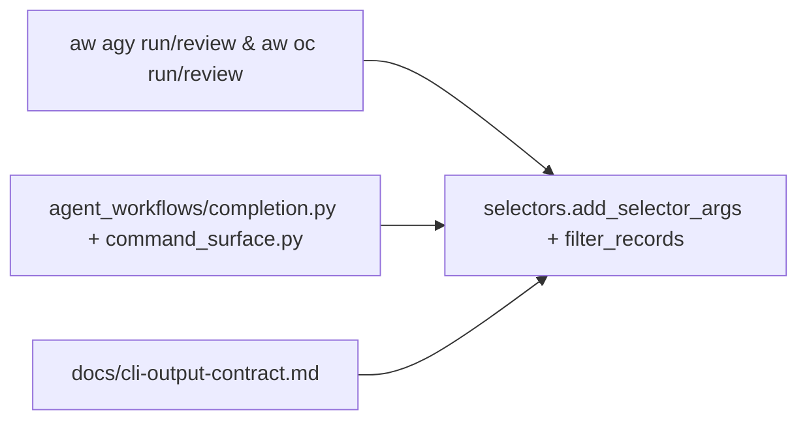

# IPD: Wire normalized artifact selectors into runner CLIs, shell completions, and docs

- Date: 2026-11-22
- Kind: child
- Concern: Complete Set `selectors` by wiring normalized artifact selector flags into `agy`/`oc` runners, updating shell completions and CLI docs, and running whole-Set cross-command parity verification (spec `ogd2nv` R-05, R-06).
- Scope: Attach `selectors.add_selector_args` and `selectors.filter_records` to runner queue selection in `agent_workflows/agy_runipd.py`, `agent_workflows/oc_runipd.py`, and `agent_workflows/agy_run.py` (moving inline `-p` to `--prompt`); update shell completion metadata in `agent_workflows/completion.py` and `agent_workflows/command_surface.py`; update `docs/cli-output-contract.md`; update `tests/test_completion.py` and `tests/test_record_builder_slow.py` and add cross-command selector parity tests in `tests/test_normalized_selectors.py`. EXCLUDES verb-first top-level commands (`cliverbs` Set).
- Scope-Paths: agent_workflows/agy_runipd.py, agent_workflows/oc_runipd.py, agent_workflows/agy_run.py, agent_workflows/completion.py, agent_workflows/command_surface.py, docs/cli-output-contract.md, tests/test_completion.py, tests/test_normalized_selectors.py, .aw/records/plans/pending/20261122-selectors-03-e36q6r-wire-normalized-artifact-selectors-into-runner-clis-shell-co.ipd.md
- Item-Dependencies: executed:mnlaoa
- Status: to-review
- Short-Description: Adopt shared selector flags in agy/oc runners, move inline -p to --prompt, and update shell completions and CLI docs
- Work-Kind: feature
- Priority: medium
- From-Backlog: 1iojci
- From-Spec: ogd2nv
- Set: selectors
- Order: 3
- Highest E allocated: 04
- Author: antigravity
- Id: e36q6r

> Write and proofread this plan per the technical writing standard, `.aw/system/workflows/technical-writing/technical-writing.md` (`.agents/workflows/technical-writing/technical-writing.md` in a legacy-layout install), including requirement 12 (diagrams).

## Workflow history

- 2026-11-23 to-review (aw set): status set to to-review
- 2026-11-23 draft (antigravity): created and authored as Order 03 of Set `selectors` graduating `1iojci` under spec `ogd2nv`.

## Goal

Finish normalizing artifact selectors across `aw agy run`/`review`, `aw oc run`/`review`, shell completions, and CLI documentation, and verify cross-command parity across the entire `selectors` Set.

## Detailed Implementation Checklist (TODO)

Execution-state rule: mark an `E-*` item complete only after performing the action. That mark is not validation. Right-sizing rule: write for a modest executor that cannot hold much in its head. Each E-item is one step (one concern, about one file, executable in one focused pass) and its V-item names each unit it covers with its own check; a plan stays at about 5 E-items and 8 work Scope-Paths, else split it into more child plans (guidance, `IPD-Z603`). Accepted execution states: blocked, failed, pending, performed; terminal gate demands 'performed'.

### Task group 1: Runner CLI wiring

- [ ] E-01 Wire `selectors.add_selector_args` and `selectors.filter_records` into `agent_workflows/oc_runipd.py`, `agent_workflows/agy_runipd.py`, and `agent_workflows/agy_run.py` so `aw oc run`/`review` and `aw agy run`/`review` support `-t/-T`, `-s/-S`, `-p/-P`, `-r/-R`, `--sid`/`-sid`, `--nsid`/`-nsid`, `-d/-D`, `--mtime`/`-mtime`, and `--ctime`/`-ctime` when building candidate queues, and move `agy_run.py`'s inline `-p` (`--prompt`) to `--prompt` only.
  - Depends on: none
  - Expected outcome: Both `aw oc run` and `aw agy run` filter candidate queues with the same normalized selector grammar as `aw att` and `aw partition`, and `agy_run --prompt "..."` works without colliding with `-p` (`--priority`).
  - Execution state: pending

### Task group 2: Shell completions, command surface, and docs

- [ ] E-02 Update `agent_workflows/completion.py` and `agent_workflows/command_surface.py` so tab-completion advertises the normalized selector flags (`-t/-T`, `-s/-S`, `-p/-P`, `-r/-R`, `--set-id`/`--sid`, `--not-set-id`/`--nsid`, `-d/-D`, `--modified-time`/`--mtime`, `--created-time`/`--ctime`, `--not-<field>`, `--desc`) on every artifact-selecting command and removes retired short-flag entries (`att -d` -> `--desc`, `find -p` -> `--paths`, `search -S` -> `--short`).
  - Depends on: E-01
  - Expected outcome: `aw __complete` and generated bash/zsh/fish completion scripts expose the normalized selector flags consistently.
  - Execution state: pending

- [ ] E-03 Document the normalized artifact selector flag table, date/time range expressions, and monitoring-command exemptions (`aw runs`, `aw runners`, `pwatch`) in `docs/cli-output-contract.md` (with zero em or en dashes in user-facing prose).
  - Depends on: E-01, E-02
  - Expected outcome: `docs/cli-output-contract.md` accurately documents every normalized selector flag, alias, expression syntax, and exemption.
  - Execution state: pending

### Task group 3: Whole-Set cross-command parity tests and validation

- [ ] E-04 Update `tests/test_completion.py` and add whole-Set cross-command parity behavioral tests in `tests/test_normalized_selectors.py` verifying identical filter outcomes across `att`, `find`, `search`, `partition`, `show`, `set`, `oc`, and `agy`, verifying `aw runs -s/-S` and `aw runners -t` remain untouched, and running the full Set validation (`pytest`, `mypy`, `aw attention --check`, `aw sanitize`).
  - Depends on: E-01, E-02, E-03
  - Expected outcome: All cross-command parity tests, completion tests, `mypy`, `aw attention --check`, and `aw sanitize` pass with zero errors.
  - Execution state: pending

## Project conventions discovered (Step 0)

- `agent_workflows/agy_run.py` registers `"-p", "--prompt"`; removing `"-p"` resolves the collision with `-p` / `--priority` per spec `ogd2nv` R-05.
- `agent_workflows/completion.py` and `agent_workflows/command_surface.py` drive shell completion and command-surface tests (`tests/test_completion.py`).
- User-facing documentation (`docs/cli-output-contract.md`) must contain no em or en dashes.

## Findings

- Without wiring `oc_runipd.py`, `agy_runipd.py`, and `completion.py`, runner queue selection and shell tab completion would drift behind `att`/`find`/`partition`.

## Proposed changes (ordered, validatable)

1. Wire normalized selectors into `oc_runipd.py`, `agy_runipd.py`, and `agy_run.py` (`--prompt` long form) (`E-01`).
2. Sync `completion.py` and `command_surface.py` with the normalized flags (`E-02`).
3. Document the selector contract in `docs/cli-output-contract.md` (`E-03`).
4. Add whole-Set cross-command parity tests and run full verification (`E-04`).

## Deferred / out of scope (with reason)

- Verb-first top-level commands (`aw rev`, `aw exec`, `aw grad`, `aw validate`, `aw approve`) and unified `aw show` views: implemented in Set `cliverbs` (`lmlji2`) after `e36q6r` executes.
  - Carrier: lmlji2

## Scope check

- Over-scope: none; completes the remaining runner, completion, doc, and whole-Set verification pieces of Set `selectors`.
- Under-scope: none; closes every remaining requirement of spec `ogd2nv` Section 1 (`R-05`, `R-06`, `AC-03`).

## Required tests / validation

- `python3 -m pytest tests/test_normalized_selectors.py tests/test_completion.py tests/test_cli_find.py tests/test_attention.py tests/test_partition.py`
- `python3 -m mypy agent_workflows/agy_runipd.py agent_workflows/oc_runipd.py agent_workflows/agy_run.py agent_workflows/completion.py agent_workflows/command_surface.py`
- `aw attention --check && aw sanitize`

## Spec / documentation sync

- Updates `docs/cli-output-contract.md` (`E-03`) and completes spec `ogd2nv` Section 1.

## Open questions

None; all design questions were resolved in `1iojci` and codified in spec `ogd2nv`.

## Validation and cross-check (verify before reporting done)

Validation-state rule: inspect evidence in a separate pass. Do not mark a `V-*` item complete from memory or from the matching execution checkmark. Accepted validation results: blocked, failed, pass, pending; terminal gate demands 'pass'. Runtime-demonstration reachability rule: for each `V-*` item demanding the software be observed acting (such as a run, a dispatch, or a transition), as distinct from items demanding a diff, a file's content, or a test result, name the code path that produces the observation or the sibling `E-*` that creates it, else the demand is UNDER-SCOPE.

- [ ] V-01 validates E-01
  - Required evidence: Pasted pytest output from `tests/test_normalized_selectors.py` proving `oc_runipd` and `agy_runipd` parsers/selection accept normalized selector flags and `agy_run.py` accepts `--prompt` without colliding with `-p` (`--priority`).
  - Observed evidence:
  - Result: pending

- [ ] V-02 validates E-02
  - Required evidence: Pasted pytest output from `tests/test_completion.py` proving normalized selector flags appear in completion output and retired short flags (`att -d`, `find -p`, `search -S`) no longer collide.
  - Observed evidence:
  - Result: pending

- [ ] V-03 validates E-03
  - Required evidence: Pasted git diff excerpt for `docs/cli-output-contract.md` documenting the normalized selector table, date/time expressions, and exemptions, plus confirmation of zero em/en dashes.
  - Observed evidence:
  - Result: pending

- [ ] V-04 validates E-04
  - Required evidence: Pasted runner output from `python3 -m pytest tests/test_normalized_selectors.py tests/test_completion.py tests/test_cli_find.py tests/test_attention.py tests/test_partition.py`, `mypy`, `aw attention --check`, and `aw sanitize` all passing with exit 0, confirming cross-command parity and intact `aw runs -s/-S` and `aw runners -t`.
  - Observed evidence:
  - Result: pending

## Approval and execution gate

- Size assessment: standard
- Cohesion rationale: not required

Ready for `/plan-review` and human approval (`aw set approved e36q6r --by-human`). Execution must follow the repository agent execution contract (isolated worktree, path-scoped `aw commit e36q6r -- <paths>`, pasted validation output, and post-gate lifecycle transition).
