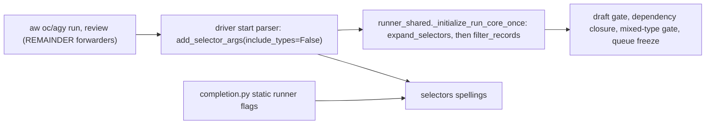
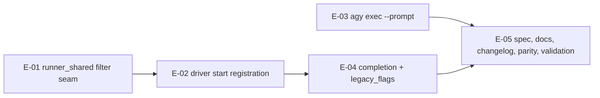

# IPD: Wire normalized artifact selectors into runner CLIs, shell completions, and docs

- Date: 2026-11-22
- Kind: child
- Concern: Complete Set `selectors` by wiring the normalized artifact selector flags into the `aw oc run`/`review` and `aw agy run`/`review` queue builders, moving `aw agy exec -p` to `--prompt`, updating shell completions, command declarations, and docs, and running whole-Set cross-command parity verification (spec `ogd2nv` R-05, R-06, AC-03).
- Scope: Add one queue-filter seam in `agent_workflows/runner_shared.py` (`_initialize_run_core_once`) that narrows the expanded selection with `selectors.filter_records`; register `selectors.add_selector_args(start, include_types=False)` on the `start` subparser of both drivers (`agent_workflows/oc_runipd.py`, `agent_workflows/agy_runipd.py`), keeping the runner's own run-type `--type` (spec `25kzda` Section 2.1); drop `-p` from `aw agy exec` (`agent_workflows/agy_run.py`, its tests, and `tools/README.md`); teach `agent_workflows/completion.py` the runner selector flags and `--not-status`, and update stale `legacy_flags` in `agent_workflows/command_surface.py`; amend spec `ogd2nv` R-06/AC-03 for the runner type exception; document the selector flags in `docs/cli-output-contract.md` Section 16 and `CHANGELOG.md`; add whole-Set parity tests. EXCLUDES verb-first top-level commands (`cliverbs` Set), every non-runner command surface (owned by `mnlaoa`), and `tests/test_record_builder_slow.py` (owned by `mnlaoa` E-04).
- Scope-Paths: agent_workflows/runner_shared.py, agent_workflows/oc_runipd.py, agent_workflows/agy_runipd.py, agent_workflows/agy_run.py, agent_workflows/completion.py, agent_workflows/command_surface.py, agent_workflows/selectors.py, docs/cli-output-contract.md, CHANGELOG.md, tools/README.md, .aw/records/specs/to-review/20261122-ogd2nv-01-ogd2nv-normalized-selectors-show-and-verb-first-cli.spec.md, tests/test_runner_shared.py, tests/test_oc_runipd.py, tests/test_agy_run.py, tests/test_agy_tools_graduation.py, tests/test_completion.py, tests/test_command_surface_declarations.py, tests/test_normalized_selectors.py, .aw/records/plans/pending/20261122-selectors-03-e36q6r-wire-normalized-artifact-selectors-into-runner-clis-shell-co.ipd.md
- Item-Dependencies: executed:mnlaoa
- Status: reviewed
- Short-Description: Filter agy/oc run queues with the shared selector flags, move agy exec -p to --prompt, and update completions and docs
- Work-Kind: feature
- Priority: medium
- From-Backlog: 1iojci
- From-Spec: ogd2nv
- Set: selectors
- Order: 3
- Readiness: go-pending-approval
- Review-Depth: standard
- Highest E allocated: 05
- Author: antigravity
- Id: e36q6r

> Write and proofread this plan per the technical writing standard, `.aw/system/workflows/technical-writing/technical-writing.md` (`.agents/workflows/technical-writing/technical-writing.md` in a legacy-layout install), including requirement 12 (diagrams).

## Workflow history

- 2026-11-25 reviewed (aw set): status set to reviewed
- 2026-11-25 /plan-review (uri/its_direct/pt3-claude-opus-5.5-1m-us): APPROVE WITH REVISIONS APPLIED; PR-001..PR-011 FIXED; PR-012 DEFERRED (advisory IPD-Z603); D-1 keeps the runner --type (include_types=False) with an ogd2nv R-06/AC-03 amendment; review record .aw/records/reviews/20261122-selectors-03-e36q6r-wire-normalized-artifact-selectors-into-runner-clis-shell-co.review.md
- 2026-11-23 to-review (aw set): status set to to-review
- 2026-11-23 draft (antigravity): created and authored as Order 03 of Set `selectors` graduating `1iojci` under spec `ogd2nv`.

## Goal

Finish normalizing artifact selectors for the runner commands: `aw oc run`/`review` and `aw agy run`/`review` narrow the queue they build with the same selector flags `aw att` and `aw find` use, `aw agy exec` stops claiming `-p`, shell completion offers the new flags, and the docs describe the selector grammar once. Then verify cross-command parity across the whole `selectors` Set.

## Detailed Implementation Checklist (TODO)

Execution-state rule: mark an `E-*` item complete only after performing the action. That mark is not validation. Right-sizing rule: write for a modest executor that cannot hold much in its head. Each E-item is one step (one concern, about one file, executable in one focused pass) and its V-item names each unit it covers with its own check; a plan stays at about 5 E-items and 8 work Scope-Paths, else split it into more child plans (guidance, `IPD-Z603`). Accepted execution states: blocked, failed, pending, performed; terminal gate demands 'performed'.

Common rules for every E-item in this plan (each item cites them as "the common rules"):

- Register selector flags only through `selectors.add_selector_args` (from `bzsoai`, extended with `dest_prefix` and `selector_records` by `mnlaoa` E-05) and read them only through `selectors.parse_selector_namespace`; never re-type a selector spelling in a driver. Re-registering an option string a parser already has raises `argparse.ArgumentError: conflicting option string` when the parser is built (measured at review on both drivers with `include_types=True`: `argument -t/--type/--tree: conflicting option string: --type`).
- A `ValueError` from `parse_selector_namespace`, `parse_date_expr`, or `parse_time_expr` becomes `runner_shared.RunFlagRefusal(<message>)` (a `DriverError` subclass, `runner_shared.py` line 19723), which both drivers' `main` already print as `runipd: <message>` and exit 2 before any run directory exists. The message keeps the offending token verbatim (`ogd2nv` R-03).
- Call `selectors.filter_records` only when the parsed `SelectorSpec` carries at least one value, so a run started without selector flags does no extra file reads and no git pass, and its queue stays identical.
- Every new behavioral test drives the real entry point (`oc_runipd.main([...])`, `agy_runipd.main([...])`, `cli.main([...])`, `completion.complete_query([...])`, or `agy_run.parse_args([...])`) against a temporary repository and asserts on exit codes, frozen run state, and output, never on source text (GUIDING_PRINCIPLES P16). Mark each NEW test class `@pytest.mark.core` so the bare `python3 -m pytest` merge gate runs it; `tests/test_oc_runipd.py`, `tests/test_agy_run.py`, and `tests/test_completion.py` carry no module-level marker today and must not gain one, while `tests/test_runner_shared.py` and `tests/test_normalized_selectors.py` already carry `pytestmark = pytest.mark.core`.

### Task group 1: Runner queue filtering

- [ ] E-01 Add the selector filter seam to `agent_workflows/runner_shared.py::_initialize_run_core_once` (around line 40571), following the common rules.
  - Placement: immediately after `queue_ids = expand_selectors_fn(manifest, args.selectors, repo=repo, types=run_types)` (around line 40667, inside the `selectors.scan_once()` block) and BEFORE the `is_status_selector` draft gate, so every later gate (draft admission, `expand_dependency_closure`, `resolve_selected_artifact_paths`, the mixed-type gate, and the queue freeze) sees only the narrowed selection.
  - Parse: call `selectors.parse_selector_namespace(args)` once near the existing `resolve_run_types` call (around line 40647), ahead of the run directory, mapping a `ValueError` to `RunFlagRefusal` per the common rules. Use `getattr` defaults so a namespace built without the selector flags (`resume`, older test fixtures) parses to an empty spec.
  - Records: resolve each id in `queue_ids` to its manifest entry with `lookup_manifest_artifact(manifest, repo, id6)` (around line 17346; every entry carries a repo-relative `"file"`: plans `rec.rel_path`, specs `rec.file`, backlog `rel`), build records with `selectors.selector_records(repo, paths)`, run `selectors.filter_records(records, spec, repo_root=repo)`, and keep the ids whose records survive, in the original `queue_ids` order. A queue id whose path cannot be resolved stays in the queue unfiltered, so the existing unresolved-path handling downstream still reports it.
  - Expanded selection: the filter narrows the expanded selection only. The dependency closure that follows may still add prerequisites that do not match the filter, because `--with-dependencies` asks for them explicitly; state this in the help epilog text E-02 adds.
  - Empty result: when the filter removes every id, raise `EmptyStatusSelection("No items in 'to-review' state match the selector filters (
)")` (exit 0, `runner_shared.py` line 309) when `is_review_selector(args.selectors)` is true, and otherwise `DriverError("No queued artifacts match the selector filters (
)")` (exit 2), where `
` names each active filter dimension and its values, so an operator can tell a filter-emptied queue from a misspelled selector.
  - Freeze: record the parsed filter in run state by adding `options["selector_filter"]` (a dict of the non-empty dimensions as lists of strings, or absent when no filter was given) next to the existing frozen options, so `aw runs` and a later `resume` show which filter built the queue. Do not re-apply it on resume: the queue is already frozen.
  - Tests (in `tests/test_runner_shared.py`, new `@pytest.mark.core` class `SelectorQueueFilterTests`, using a temporary repository built with the `_repo_with_statuses` helper pattern from `tests/test_oc_runipd.py` line 4906 or `support.RecordBuilder` plans that carry `- Priority:`): `oc_runipd.main(["all", "-p", "high", "--repo", R, "--prepare-only"])` freezes a queue holding only the high-priority approved plan; `-P high` excludes it; `--sid demo` and `--nsid demo` narrow by Set; `-d 2026` keeps plans whose filename date is in 2026; a filter matching nothing exits 2 with the filter summary on stderr and creates no run directory; `reviews -p high` matching nothing exits 0; `--mtime 7x` exits 2 naming `7x`; and a run with no selector flags freezes the same queue as before and no `selector_filter` option.
  - Depends on: none
  - Expected outcome: Both hosts' queue builds narrow the expanded selection by every R-02 dimension except type, refuse a bad expression with exit 2, report a filter-emptied queue distinctly, and leave unfiltered runs unchanged.
  - Execution state: pending

- [ ] E-02 Register the selector flags on both drivers' `start` subparsers and refuse them on `resume`, following the common rules.
  - Registration: in `agent_workflows/oc_runipd.py` (`start` subparser around line 5022, after `register_run_policy_flags(start)` at line 5153) and `agent_workflows/agy_runipd.py` (`start` around line 4184, after line 4337), call `selectors.add_selector_args(start, include_types=False)`. `include_types=False` keeps the runner's own repeatable `--type` (dest `types`, `RUN_TYPE_CHOICES` of `ipd`/`spec`/`backlog`/`prompt`/`research`/`release`/`walkthrough`, spec `25kzda` Section 2.1, `runner_shared.py` around line 19266) as the one type selector, so the drivers offer no `-t`, `--tree`, `-T`, or `--not-type` (Decision D-1). No `dest_prefix` is needed: no driver or `runner_shared` reader uses the dests `status`, `priority`, `readiness`, `date`, `set_id`, or any `not_*` dest (grep at review returned nothing).
  - Abbreviations: the driver parsers use the default `allow_abbrev=True`, so adding `--status`, `--set-id`, `--date`, `--created-time`, and `--modified-time` makes the prefixes `--st`, `--sta`, `--se`, `--da`, `--c`, `--mo`, and `--mod` ambiguous (measured at review: `ambiguous option: --sta could match --stall-timeout, --status`). Accept this: no test, doc, or workflow body passes one of these prefixes (grep at review), and the full spellings keep working. Do NOT set `allow_abbrev=False` on the driver parsers in this plan, because that would also break every other abbreviation an operator may type today, which is out of scope.
  - Help: add one sentence to the `start` description in both drivers stating that the selector flags narrow the expanded selection, that `--type` selects the artifact type, and that `--with-dependencies` may add prerequisites outside the filter.
  - Resume: the `resume` subparsers (oc line 5203, agy line 4358) do NOT register the selector flags, so `resume <run-id> -p high` keeps failing at parse time with `unrecognized arguments` and exit 2 (measured at review), which is the correct refusal for a frozen queue. Do not add them to `refuse_frozen_flags_on_resume`.
  - Forwarding: `aw oc run`, `aw oc review`, `aw agy run`, and `aw agy review` forward their argv verbatim (`cli.py` around lines 21359-21372 and `expand_host_review_argv` at line 21045), so registering on the driver `start` parser is the whole wiring; `cli.py` needs no change.
  - Tests (in `tests/test_oc_runipd.py`, new `@pytest.mark.core` class `SelectorFlagRegistrationTests`): for both `oc_runipd.build_parser()` and `agy_runipd.build_parser()`, `start` parses `all -sid x -s done -nsid y -sdraft -mtime 7d -nmtime 24h -p high --type spec` into the selector dests plus `types == ["spec"]`; `start` rejects `-t plans` and `-T plans` with exit 2; `resume RUN -p high` exits 2; `cli.main(["oc", "run", "all", "-p", "high", "--repo", R, "--prepare-only"])` and the `agy` equivalent reach the driver and freeze the filtered queue; and `aw oc review -p high --repo R --prepare-only` keeps its `reviews` default selector.
  - Depends on: E-01
  - Expected outcome: `aw oc run`/`review` and `aw agy run`/`review` accept every R-02 selector spelling except the type pair, keep `--type` as the run-type flag, and refuse selector flags on `resume`.
  - Execution state: pending

- [ ] E-03 Move `aw agy exec`'s inline prompt flag from `-p`/`--prompt` to `--prompt` only, in `agent_workflows/agy_run.py`, its tests, and `tools/README.md`.
  - `agent_workflows/agy_run.py` is the `aw agy exec` core (a one-shot Antigravity prompt runner), not a queue runner, so it gets NO selector flags; spec `ogd2nv` R-05 only asks that it release `-p`. Remove `"-p"` from the `("--prompt", "-p")` registration (dest `prompt_target`, lines 197-199) and from the module docstring and help text (lines 23, 132, 135; change the example to `--prompt`).
  - Keep the two `"-p"` tokens that build the EXTERNAL `agy` binary's own argv (`agy_run.py` line 656 and `agy_runipd.py` line 2521): they are the Antigravity CLI's flag, not ours.
  - No alias: `agy_run.py` was added on 2026-08-28 (`4579ba873`), after the latest tag `v1.3.0-rc.1`, so no released user depends on `-p`.
  - Migrate callers: `tests/test_agy_run.py` (15 uses of `"-p"` meaning prompt, lines 82-151 and around 393), `tests/test_agy_tools_graduation.py` lines 135 and 154 (the forwarded argv assertions become `["--prompt", ...]`), and `tools/README.md` lines 35 and 42.
  - Tests: in `tests/test_agy_run.py`, new `@pytest.mark.core` class `PromptFlagTests`: `agy_run.parse_args(["--prompt", "x"]).prompt_target == "x"`, and `agy_run.parse_args(["-p", "x"])` exits 2.
  - Depends on: none
  - Expected outcome: `aw agy exec --prompt "..."` works, `aw agy exec -p "..."` exits 2 with a usage error, and the external `agy -p` invocation is unchanged.
  - Execution state: pending

### Task group 2: Completion, command declarations, and docs

- [ ] E-04 Teach `agent_workflows/completion.py` the runner selector flags and `--not-status`, and update the stale `legacy_flags` in `agent_workflows/command_surface.py`.
  - Automatic part: flags registered on `cli.py` parsers (everything `mnlaoa` wires) are already introspected (`_flags_of` line 141, `introspect_cli_tree` line 190), so they need no change here.
  - Runner flags: `complete_query(["aw", "oc", "run", "--"], 3)` and the `review`/`agy` equivalents return `[]` today because these leaves are `argparse.REMAINDER` forwarders with no flags of their own. Add a static candidate list for `oc run`/`runipd`/`review` and `agy run`/`runipd`/`runagy`/`review` (and the `opencode`/`antigravity` aliases), built from a public spellings constant that `selectors.py` exposes (for example `selectors.SELECTOR_FLAG_SPELLINGS`, filtered by `include_types=False` and hidden spellings removed). Do NOT build the driver parser at completion time: importing `runner_shared` costs about 1.3 seconds cold and `oc_runipd` import plus `build_parser` about 210 to 320 milliseconds (measured at review), against the 250 millisecond bound in `tests/test_completion.py::CompleteQueryLatencyTests`. If `selectors.py` has no such constant after `bzsoai`, add it there in this item (a module-level tuple that `add_selector_args` also reads, so the two cannot drift; no new imports), with a test asserting that every spelling in the tuple is accepted by a parser built with `add_selector_args`. Wire the same list into the generated bash, zsh, and fish scripts through the tree that `introspect_cli_tree` returns, so `CompletionSurfaceParityTests` still holds.
  - Status positions: `_is_status_position` (line 1084) recognizes only `--status`, `--status-not`, `-s`, and `-S`; add `--not-status` (the R-02 canonical spelling). For the runner leaves, map a status position to `"all"`, as `att` does.
  - `command_surface.py` `legacy_flags`: after `mnlaoa`, `specs set` (around line 1847) lists `--date`, which `mnlaoa` E-09 renames to `--history-date`; `group` (line 616) and `rename` (line 597) list `--date`, whose mutation meaning `mnlaoa` E-08 moves to `--new-date`; top-level `set` (around line 740) gains `--history-date`; `search` (line 565) still lists `--short`, which stays valid. Update each tuple to the post-`mnlaoa` option strings. `tests/test_specs_evidence_gate_parity.py` lines 724-743 and `tests/test_group_verb_policy.py` lines 1036-1043 assert `set(decl.legacy_flags) - accepted == set()`; run them. A measured review sweep over all 155 declarations with flags found no mismatch today, so any mismatch after this item is introduced by the Set.
  - Tests (in `tests/test_completion.py`, new `@pytest.mark.core` class `SelectorCompletionTests`): `complete_query(["aw", "oc", "run", "--p"], 3)` includes `--priority` and excludes `--tree`; `complete_query(["aw", "agy", "review", "--n"], 3)` includes `--not-status` and `--nsid`; `complete_query(["aw", "find", "specs", "--not-status", "i"], 4)` returns spec statuses; `complete_query(["aw", "find", "--pa"], 2)` includes `--paths`; `complete_query(["aw", "att", "--de"], 2)` includes `--desc` and `--details`; `complete_query(["aw", "group", "--new"], 2)` includes `--new-date`; and `generate_bash_completion()` contains `--priority` under the `oc` `run` case. The existing latency test must still pass unchanged.
  - Depends on: E-02
  - Expected outcome: `aw __complete` and the generated bash, zsh, and fish scripts offer the selector flags on every artifact-selecting command, including the runners, and every `legacy_flags` tuple names only option strings the parser accepts.
  - Execution state: pending

- [ ] E-05 Amend spec `ogd2nv`, document the selector grammar, record the change in `CHANGELOG.md`, add the whole-Set parity tests, and run the full validation.
  - Spec: in `.aw/records/specs/to-review/20261122-ogd2nv-01-ogd2nv-normalized-selectors-show-and-verb-first-cli.spec.md`, amend R-06 and AC-03 to state that `aw oc run`/`review` and `aw agy run`/`review` take every R-02 dimension except type, whose selector is the runner's own repeatable `--type` (spec `25kzda` Section 2.1), and that `agy_run --prompt` belongs to `aw agy exec`. Use `aw specs note` if the spec tooling requires a history line for the edit.
  - Docs: add `## 16. Artifact Selector Flags` to `docs/cli-output-contract.md` after Section 15 (line 564), containing the R-02 flag table (canonical spelling, aliases, hidden spellings), the R-03 expression grammar with one example per form (`2026`, `20261101..20261130`, `..20261101`, `>=20261101`, `7d`, `24h`, `30m` meaning minutes), the semantics (AND across dimensions, OR within one, exclusions remove), the per-command exceptions (`aw partition` and `aw ipd board` have no `-T`, the runners use `--type`, `aw index` ignores selector flags with a notice), the renamed flags (`aw att --details`/`--desc`, `aw find --paths`, `aw search --paths`/`--short`, `aw specs set --history-date`, `aw group`/`aw rename --new-date`, `aw agy exec --prompt`), and the exempt operational commands (`aw runs -s/-S`, `aw runners -t`, `pwatch`). Write no em or en dashes. Do not cite a `tests/test_*.py` path that does not exist (`tests/test_docs_test_citations.py` fails on a dangling citation).
  - `CHANGELOG.md`: add one `- Changed:` bullet under `## 2.0.0 (pending)` (line 7) naming the uniform selector flags and every renamed flag above, in user-facing prose with no em or en dashes.
  - Parity tests (in `tests/test_normalized_selectors.py`, created by `bzsoai`, module marker already `core`): one fixture repository with plans differing in priority, Set, and filename date; assert that `aw att`, `aw find plans`, `aw search`, `aw partition`, `aw show`, `aw ipd board`, and `oc_runipd.main([... "--prepare-only"])` select the same id6 set for each of `-p high`, `-P high`, `--sid demo`, `--nsid demo`, and `-d 2026` (comparing id6 sets parsed from `--agent`/`--json` output or frozen run state); and that `aw runs -s` and `aw runners -t` parse exactly as before (`cli._build_parser()` option strings for `runs` include `-s`, `-S`, and `runners` include `-t`, each with its current dest).
  - Validation: run every command in `## Required tests / validation` and paste the output.
  - Depends on: E-01, E-02, E-03, E-04
  - Expected outcome: The spec states the runner type exception, the docs and changelog describe the shipped flags, the parity tests show one grammar across commands, and every validation command exits 0.
  - Execution state: pending

## Project conventions discovered (Step 0)

- Forwarders: `aw oc run`/`runipd`, `aw agy run`/`runipd`/`runagy`, `aw oc review`, and `aw agy review` pass their argv verbatim to `oc_runipd.main`/`agy_runipd.main` (`cli.py` around lines 21359-21372; `expand_host_review_argv` line 21045 only prepends `reviews` and appends `--action review`). The driver's `build_parser()` owns every flag; `docs/cli-output-contract.md` Section 1.3 documents this.
- Queue build: both drivers call `runner_shared._initialize_run_core_once` (line 40571), which resolves `--type` with `resolve_run_types` (line 40647) and expands selectors with `expand_selectors` (line 18194) inside one `selectors.scan_once()` block, then runs the draft gate, dependency closure, and mixed-type gate.
- Type vocabularies differ: the runner `--type` takes `RUN_TYPE_CHOICES` (`ipd`, `spec`, `backlog`, `prompt`, `research`, `release`, `walkthrough`), while selector `-t` takes tree names normalized by `attention.TYPE_ALIASES` (`ipd` maps to `plans`).
- Driver parsers use `allow_abbrev=True` (unlike `cli.py`'s `_AwArgumentParser`, which forces `False`).
- `agent_workflows/agy_run.py` is the `aw agy exec` core; its `-p` (dest `prompt_target`) is unreleased (added 2026-08-28, after tag `v1.3.0-rc.1`).
- Completion: `_subcommand_candidates` and the static generators read one `introspect_cli_tree` result; REMAINDER leaves have no flags in that tree. `tests/test_completion.py` has no module marker, and its latency test bounds a query at 250 milliseconds.
- Sibling facts from `mnlaoa` (reviewed, `go-pending-approval`): `aw group`/`aw rename` mutation date becomes `--new-date` (dest `date`); `aw specs set --date` becomes `--history-date` and top-level `aw set` gains `--history-date`, with no hidden alias; `aw att -d` becomes `--details`/`--desc`/`-desc`; `aw find -p` and `aw search -p` become `--paths`; `aw search -S` becomes `--short`; `aw index` ignores selector flags with a notice; `aw partition` has no `-T` and `aw ipd board` no `-t/-T`; `mnlaoa` E-04 owns the `find -p` change in `tests/test_record_builder_slow.py`; `mnlaoa` E-05 adds `dest_prefix` and `selectors.selector_records`.
- `aw runs` (`-s`/`-S`), `aw runners` (`-t`), and `pwatch` (`-r`/`-R`/`-d`) are exempt from selector short-flag normalization per spec `ogd2nv` R-05.
- User-facing documentation (`docs/`, `CHANGELOG.md`, `tools/README.md`) must contain no em or en dashes.

## Findings

- The runner queue is built in `runner_shared.py`, which the original plan did not name, so wiring the drivers alone would parse the flags and ignore them (E-01).
- Registering the full selector builder on the drivers fails at parser build time because the runner already owns `--type` with a different vocabulary; the runner keeps its `--type` and takes every other dimension (E-02, D-1).
- `aw agy exec` is a one-shot prompt runner with no queue, so it needs only the `-p` release, plus migration of 17 test uses and one README (E-03).
- Runner flags cannot be completed by introspection, and building the driver parser at completion time breaks the latency bound, so completion needs a static spellings list (E-04).
- Several `command_surface.py` `legacy_flags` tuples name flags `mnlaoa` renames, and parity tests assert those tuples against the real parser (E-04).

## Proposed changes (ordered, validatable)

1. Filter the expanded runner selection in `runner_shared.py` and freeze the filter (`E-01`).
2. Register the selector flags on both drivers' `start` parsers with `include_types=False` (`E-02`).
3. Release `-p` on `aw agy exec` and migrate its callers (`E-03`).
4. Complete the runner selector flags and `--not-status`, and update `legacy_flags` (`E-04`).
5. Amend the spec, document the grammar, record the changelog entry, add parity tests, and validate (`E-05`).

## Deferred / out of scope (with reason)

- Verb-first top-level commands (`aw rev`, `aw exec`, `aw grad`, `aw validate`, `aw approve`) and unified `aw show` views: implemented in Set `cliverbs` (`lmlji2`) after `e36q6r` executes.
  - Carrier: lmlji2
- Selector type filtering (`-t`/`-T`) on the runners: replaced by the runner's own `--type` (D-1); a separate `--not-type` for runs has no requester.
  - Carrier-Declined: the runner `--type` already selects types; no exclusion use case is recorded.
- Setting `allow_abbrev=False` on the driver parsers: changes every abbreviation an operator may type today, unrelated to selectors.
  - Carrier-Declined: no reported need; full spellings keep working.

## Scope check

- Over-scope: none; every item serves a runner, completion, documentation, or verification requirement of spec `ogd2nv` R-05, R-06, or AC-03.
- Under-scope: none known after review; the queue seam, both drivers, `aw agy exec`, completion, declarations, docs, and parity tests each have an E-item.
- Size: 5 E-items and 17 work Scope-Paths (`aw ipd lint` advisory `IPD-Z603`). The path count exceeds the `IPD-Z603` guidance of about 8, because each production change carries its own test file and the doc homes are separate files; this is advisory, and each E-item names its own files.

## Required tests / validation

- `python3 -m pytest -o addopts="" -q -n auto tests/test_runner_shared.py tests/test_oc_runipd.py tests/test_agy_runipd_cli.py tests/test_agy_run.py tests/test_agy_tools_graduation.py tests/test_completion.py tests/test_command_surface_declarations.py tests/test_specs_evidence_gate_parity.py tests/test_group_verb_policy.py tests/test_normalized_selectors.py tests/test_flag_surface_uniformity.py tests/test_spec_review_dispatch.py tests/test_typed_queue_entries.py tests/test_docs_test_citations.py tests/test_cli_agent_protocol_doc.py tests/test_empty_result_convention_doc.py`
- The bare core gate: `python3 -m pytest`.
- `python3 -m mypy agent_workflows/runner_shared.py agent_workflows/oc_runipd.py agent_workflows/agy_runipd.py agent_workflows/agy_run.py agent_workflows/completion.py agent_workflows/command_surface.py agent_workflows/selectors.py`
- `aw specs check`, `aw attention --check`, and `aw sanitize --agent`.

## Spec / documentation sync

- Implements spec `ogd2nv` R-05 (the `agy_run --prompt` move), the runner and completion portion of R-06, and AC-03. Spec `ogd2nv` is still `to-review`.
- Amends spec `ogd2nv` R-06 and AC-03 (E-05, declared in `- Scope-Paths:`), because the runners cannot take selector `-t`/`--type` without breaking the shipped run-type `--type` of spec `25kzda` Section 2.1; leaving the spec unchanged would make AC-03 demand a flag the runners cannot register.
- Adds `docs/cli-output-contract.md` Section 16 and a `CHANGELOG.md` entry (E-05), and updates `tools/README.md` (E-03).

## Open questions

None open. The runner `--type` collision was settled from repository evidence (D-1): the runner flag is shipped spec behavior, and the `mnlaoa` partition precedent (`include_types=False`) already handles a command that owns its own type flag.

## Validation and cross-check (verify before reporting done)

Validation-state rule: inspect evidence in a separate pass. Do not mark a `V-*` item complete from memory or from the matching execution checkmark. Accepted validation results: blocked, failed, pass, pending; terminal gate demands 'pass'. Runtime-demonstration reachability rule: for each `V-*` item demanding the software be observed acting (such as a run, a dispatch, or a transition), as distinct from items demanding a diff, a file's content, or a test result, name the code path that produces the observation or the sibling `E-*` that creates it, else the demand is UNDER-SCOPE.

Every pytest evidence block below must show test names (for example `python3 -m pytest -o addopts="" -v <file> -k <expr>`) and the `N passed` summary line.

- [ ] V-01 validates E-01
  - Required evidence: Pasted pytest output from `tests/test_runner_shared.py -k SelectorQueueFilterTests` showing, through `oc_runipd.main([... "--prepare-only"])` (the queue build in `runner_shared._initialize_run_core_once` that E-01 changes), that `-p high`, `-P high`, `--sid`, `--nsid`, and `-d 2026` each freeze the expected queue and `options.selector_filter`; that a filter matching nothing exits 2 with the filter summary and no run directory; that `reviews` filtered to nothing exits 0; that `--mtime 7x` exits 2 naming `7x`; and that an unfiltered run freezes the unchanged queue with no `selector_filter`.
  - Observed evidence:
  - Result: pending

- [ ] V-02 validates E-02
  - Required evidence: Pasted pytest output from `tests/test_oc_runipd.py -k SelectorFlagRegistrationTests` showing, for both `oc_runipd` and `agy_runipd`, the combined `start` parse with `--type spec`, `-t`/`-T` rejected with exit 2, `resume RUN -p high` exiting 2, and `cli.main(["oc", "run", ...])`, `cli.main(["agy", "run", ...])`, and `aw oc review -p high` reaching the driver (the forwarding in `cli.py` around line 21359 that E-02 relies on) and freezing the filtered queue.
  - Observed evidence:
  - Result: pending

- [ ] V-03 validates E-03
  - Required evidence: Pasted pytest output from `tests/test_agy_run.py` (including `PromptFlagTests`) and `tests/test_agy_tools_graduation.py` showing `--prompt` accepted, `-p` exiting 2, and the migrated forwarding assertions passing; plus pasted `git grep -n -- '-p' tools/README.md` returning no `aw agy exec -p` line.
  - Observed evidence:
  - Result: pending

- [ ] V-04 validates E-04
  - Required evidence: Pasted pytest output from `tests/test_completion.py -k "SelectorCompletionTests or CompleteQueryLatencyTests or CompletionSurfaceParityTests"`, `tests/test_specs_evidence_gate_parity.py -k set_declaration_agreement`, `tests/test_group_verb_policy.py`, and `tests/test_command_surface_declarations.py`, showing runner selector candidates, `--not-status` status completion, the `--paths`/`--desc`/`--new-date` candidates, the unchanged latency bound, and every `legacy_flags` tuple accepted by its parser.
  - Observed evidence:
  - Result: pending

- [ ] V-05 validates E-05
  - Required evidence: Pasted diff excerpts of the spec R-06/AC-03 amendment, `docs/cli-output-contract.md` Section 16, and the `CHANGELOG.md` bullet; pasted `grep -nP '[\x{2013}\x{2014}]' docs/cli-output-contract.md CHANGELOG.md tools/README.md` count unchanged from before execution (0 new lines); pasted pytest output of the parity tests in `tests/test_normalized_selectors.py` with names; and pasted runner output, with summary lines and exit codes, of every command in `## Required tests / validation` (the targeted pytest run, the bare `python3 -m pytest`, `mypy`, `aw specs check`, `aw attention --check`, and `aw sanitize --agent`), all exiting 0.
  - Observed evidence:
  - Result: pending

## Approval and execution gate

- Size assessment: standard
- Cohesion rationale: one selector grammar carried to the runner queue build and the surfaces that advertise it (completion, declarations, docs); E-01 and E-02 are the runner wiring, E-03 is the one remaining R-05 collision, and E-04/E-05 make the shipped flags discoverable and verified.

Execute only after human approval (`- Status: approved`, recorded with `aw set approved e36q6r --by-human`) and after `mnlaoa` is executed (`- Item-Dependencies: executed:mnlaoa`). Open questions: none open.

Scope fence: the paths in `- Scope-Paths:` are a declaration. If execution must edit a file outside the fence, make the needed edit and justify it at finalize (`--scope-reason`), and acknowledge any declared path left unmodified (`--scope-ack`).

Safety rule: uncommitted changes and untracked files you did not create are not yours; never revert, stage, commit, discard, reformat, or clean up another party's work. Stop and report if a file you must edit has an unresolvable concurrent-edit conflict.

Honesty rule: run all required tests and checks and paste the ACTUAL runner output and summary lines; never claim a result you did not run.

Commits: commit only files modified for this plan through `aw commit e36q6r -- <paths>`; never `git add -A`, a bare `git add`, `git commit -a`, or `--no-verify`; never push without explicit human instruction.

Lifecycle transition: this plan moves to `.aw/records/plans/executed/` only through `aw ipd finalize`, never a hand `git mv`, and only after `aw ipd lint --phase pre-transition` conforms and every `V-*` reads `pass` with pasted evidence. When `aw oc run` or `aw agy run` executes this plan, the runner owns retirement to `executed/` and runs finalize automatically upon task completion; when executed standalone by hand or by a direct agent turn, the executor runs `aw ipd finalize e36q6r`.
