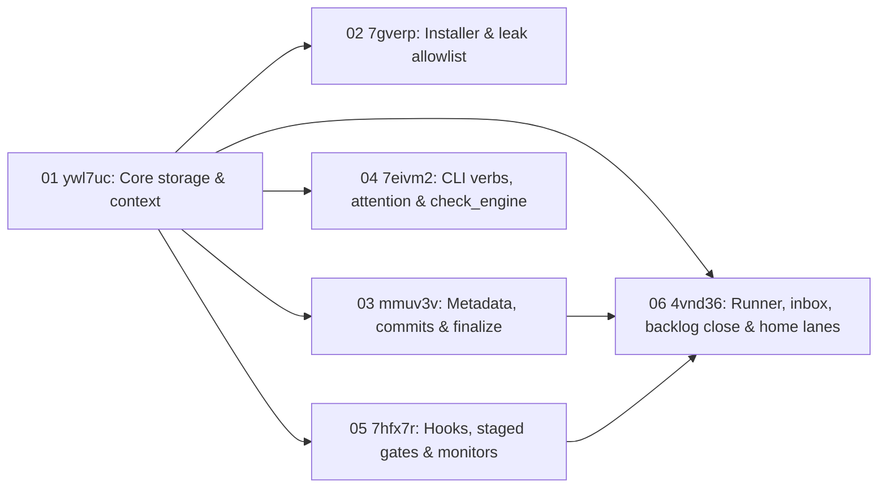

# IPD: Coordinate companion repo and AW_HOME bug fixes

- Date: 2026-11-24
- Kind: orchestrator
- Concern: A targeted `/assess-bugs` audit across `agent_workflows/` scoped strictly to companion `aw` repositories (`records_backend == "companion"`) and `~/.aw/` (`AW_HOME` / `records_backend == "home"` / `clean-delta`) identified 55 verified, open bugs (excluding issues already fixed in commits `b77c6ef43`, `70f911304`, and `c8a130148`, and excluding `emit_index_write_result` deleted in `snin8q`). These span six architectural layers: core storage/context/placement switching, installer and policy persistence, metadata/selectors/self-commit locking, CLI record verbs and attention/check engine, pre-commit hooks and run monitoring, and runner execution/question inbox/`~/.aw/` lanes.
- Scope: Coordinate six right-sized child IPDs (`ywl7uc`, `7gverp`, `mmuv3v`, `7eivm2`, `7hfx7r`, `4vnd36`) that remediate every confirmed companion and `~/.aw/` bug with behavioral regression coverage. This orchestrator performs no code edits of its own and retires once all six children reach `executed/`.
- Scope-Paths: .aw/records/plans/pending/20261124-comphome-00-92ujfc-coordinate-companion-repo-and-aw-home-bug-fixes.ipd.md
- Item-Dependencies: executed:4vnd36, executed:7eivm2, executed:7gverp, executed:7hfx7r, executed:mmuv3v, executed:ywl7uc
- Status: to-review
- Coverage: pass
- Coverage-Fingerprint: 78bb57faef4d8c1e8d6c60277233bbde672b663615997fb00d04e80e74bdcca6
- Coverage-Checked: 2026-11-25 by uri/its_direct/pt3-claude-opus-5.5-1m-us
- Priority: high
- Work-Kind: bug
- Blocks-Release: next
- Set: comphome
- Order: 0
- Highest E allocated: 6
- Id: 92ujfc
- Author: antigravity

> Write and proofread this plan per the technical writing standard, `.aw/system/workflows/technical-writing/technical-writing.md` (`.agents/workflows/technical-writing/technical-writing.md` in a legacy-layout install), including requirement 12 (diagrams).

## Workflow history

- 2026-11-25 coverage pass (aw oc run): fingerprint 78bb57faef4d, model uri/its_direct/pt3-claude-opus-5.5-1m-us
- 2026-11-24 to-review (antigravity): authored orchestrator for `/assess-bugs` (companion repos and `~/.aw/` scope), coordinating six child IPDs (`ywl7uc`, `7gverp`, `mmuv3v`, `7eivm2`, `7hfx7r`, `4vnd36`).

## Goal

Remediate all 55 confirmed companion-repository and `~/.aw/` (`AW_HOME`) bugs found by `/assess-bugs` through six focused, parallelizable child IPDs with full behavioral test coverage.

## Detailed Implementation Checklist (TODO)

Execution-state rule: mark an `E-*` item complete only after performing the action. That mark is not validation. Accepted execution states: blocked, failed, pending, performed; terminal gate demands 'performed'.

### Task group 1: Confirm all child IPDs reach executed

- [ ] E-01 CONFIRM ywl7uc REACHED executed
  - Depends on: none
  - Expected outcome: `aw find plans ywl7uc` reports `ywl7uc` under `.aw/records/plans/executed/`.
  - Execution state: pending

- [ ] E-02 CONFIRM 7gverp REACHED executed
  - Depends on: E-01
  - Expected outcome: `aw find plans 7gverp` reports `7gverp` under `.aw/records/plans/executed/`.
  - Execution state: pending

- [ ] E-03 CONFIRM mmuv3v REACHED executed
  - Depends on: E-01
  - Expected outcome: `aw find plans mmuv3v` reports `mmuv3v` under `.aw/records/plans/executed/`.
  - Execution state: pending

- [ ] E-04 CONFIRM 7eivm2 REACHED executed
  - Depends on: E-01
  - Expected outcome: `aw find plans 7eivm2` reports `7eivm2` under `.aw/records/plans/executed/`.
  - Execution state: pending

- [ ] E-05 CONFIRM 7hfx7r REACHED executed
  - Depends on: E-01
  - Expected outcome: `aw find plans 7hfx7r` reports `7hfx7r` under `.aw/records/plans/executed/`.
  - Execution state: pending

- [ ] E-06 CONFIRM 4vnd36 REACHED executed
  - Depends on: E-03, E-05
  - Expected outcome: `aw find plans 4vnd36` reports `4vnd36` under `.aw/records/plans/executed/`.
  - Execution state: pending

## Child IPDs, sequence, and dependencies

| Order | ID | Filename | Summary | Depends on |
|---:|---|---|---|---|
| 01 | `ywl7uc` | `20261124-comphome-01-ywl7uc-fix-companion-and-aw-home-core-storage-context-placement-swi.ipd.md` | Fix core storage, `AW_HOME` unification, companion security/local.json sync, placement-switch rollback, `record_placement`, `artifact_core.git_mv`, and `project_layout`. | `none` |
| 02 | `7gverp` | `20261124-comphome-02-7gverp-fix-installer-clean-delta-hijack-companion-project-policy-di.ipd.md` | Fix `engine._clean_delta_home_trees` hijack, `public-target-private-companion` policy/attachment gaps, `aw install --diff`, local-lane migration crash, and `leak_sanitizer` allowlist path. | `executed:ywl7uc` |
| 03 | `mmuv3v` | `20261124-comphome-03-mmuv3v-fix-metadata-selectors-self-commit-routing-companion-locking.ipd.md` | Fix `status_set` self-commit routing, `commit_lock` vs `ipd_lifecycle` companion locking, finalize staged-lane/worktree/runs fixes, `selectors` records-relative paths, and `artifact_meta` companion lookup bugs. | `executed:ywl7uc` |
| 04 | `7eivm2` | `20261124-comphome-04-7eivm2-fix-rename-archive-partition-attention-board-search-and-chec.ipd.md` | Fix `aw rename`, `aw group`, `aw archive`, `aw partition`, `aw ipd board`, `aw search`, `attention.scan` `.data/` and path-join bugs, `plan_readiness`, `artifact_refs`, and `check_engine` logical-path rules. | `executed:ywl7uc` |
| 05 | `7hfx7r` | `20261124-comphome-05-7hfx7r-fix-pre-commit-hooks-staged-gates-runners-monitor-run-viewer.ipd.md` | Fix companion pre-commit hooks (`executed_transition_gate`, `meta_log_append_gate`, `ipd_dependency_statement_gate`, staged `check_engine` gates), `runners_monitor`, `run_viewer`, `checkup`, and clean-delta `aw adopt` inbox. | `executed:ywl7uc` |
| 06 | `4vnd36` | `20261124-comphome-06-4vnd36-fix-runner-question-inbox-untooled-finalize-gate-backlog-clo.ipd.md` | Fix `consume_answers` companion/home commit rollback, untooled `executed/` move gate bypass, `process_backlog_close`, `read_zero_work_evidence`, companion review/carrier helpers, and `~/.aw/` (`home`) lane staging/routing/merge guard. | `executed:ywl7uc`, `executed:mmuv3v`, `executed:7hfx7r` |

## Completion criteria (the whole Set is done only when)

- Every child IPD in `## Child IPDs, sequence, and dependencies` (`ywl7uc`, `7gverp`, `mmuv3v`, `7eivm2`, `7hfx7r`, `4vnd36`) is in `.aw/records/plans/executed/` with `Status: executed` and all `V-*` checks passing.
- Each child IPD landed with behavioral regression coverage (zero code-pinning source-inspection tests), clean `mypy` on its modified modules, and clean `aw sanitize`.
- This orchestrator performs no code edits of its own and retires automatically once all six children are `executed`.

## Cross-IPD validation

- Order 01 (`ywl7uc`) establishes the unified `AW_HOME` resolver, companion `.gitignore`/`local.json` sync, and `git_mv` primitives required by Orders 02-06.
- Orders 02 (`7gverp`), 03 (`mmuv3v`), 04 (`7eivm2`), and 05 (`7hfx7r`) validate independently after `ywl7uc` lands.
- Order 06 (`4vnd36`) validates end-to-end companion and `~/.aw/` (`home`) runner execution, question inbox, backlog close, and lane containment after `ywl7uc`, `mmuv3v`, and `7hfx7r` land.

## Project conventions discovered (Step 0)

- Run record lives locally (gitignored) under `.aw/workflow-artifacts/assess-bugs/20261124-213000/`.
- Every child IPD is right-sized per `IPD-Z603` and tests observable behavior only (no code-pinning source inspection tests).
- Runner retirement retires this orchestrator automatically once all six children in `## Child IPDs, sequence, and dependencies` are `executed` on disk.

## Findings

Summary of the 55 confirmed companion and `~/.aw/` bugs by child owner (full catalog in `.aw/workflow-artifacts/assess-bugs/20261124-213000/findings.csv`):
- `ywl7uc` (Order 01): 14 bugs in core storage, `AW_HOME` resolution, companion `.gitignore`/`local.json`, placement switch, `record_placement`, `artifact_core`, `config`, and `project_layout`.
- `7gverp` (Order 02): 6 bugs in `engine`, `install_wizard`, `cli` install flow, and `leak_sanitizer`.
- `mmuv3v` (Order 03): 9 bugs in `status_set`, `git_commit_helper`, `commit_lock`, `ipd_lifecycle`, `selectors`, and `artifact_meta`.
- `7eivm2` (Order 04): 9 bugs in `artifact_rename`, `research_refs`, `plans_archive`, `research_archive`, `partition`, `attention`, `plan_readiness`, `artifact_refs`, `check_engine`, and `cli`.
- `7hfx7r` (Order 05): 8 bugs in companion pre-commit hooks, staged `check_engine` rules, `runners_monitor`, `run_viewer`, `checkup`, `artifact_adopt`, and `set_records`.
- `4vnd36` (Order 06): 9 bugs in `runner_shared`, `question_inbox`, `review_findings`, `lane_containment`, and `ipd_lifecycle`.

*(Note: 5 overlapping bugs reported across subagents were deduplicated; 5 companion lane production/staging bugs were already fixed in commit `c8a130148`; 1 deleted function `emit_index_write_result` was removed by `snin8q`.)*

## Proposed changes (ordered, validatable)

1. Execute Order 01 (`ywl7uc`) first to establish unified `AW_HOME`, companion `.gitignore`/`local.json`, and `git_mv` primitives.
2. Execute Orders 02 (`7gverp`), 03 (`mmuv3v`), 04 (`7eivm2`), and 05 (`7hfx7r`) in parallel once `ywl7uc` lands.
3. Execute Order 06 (`4vnd36`) once `ywl7uc`, `mmuv3v`, and `7hfx7r` land.
4. Retire `92ujfc` once all six children are `executed`.

## Deferred / out of scope (with reason)

- Backlog `vo0y6q` (`aw backlog new --apply` state lock in `tracked`+`home` fixture) is already carried by existing plan `rntx9a`.
  - Carrier: rntx9a
- Backend-agnostic `artifact_meta.check_freshness` `ReleaseResolution` attribute mismatch (`status`/`candidates` vs `outcome`/`paths`) is outside the companion/`~/.aw/` scope of this assessment.
  - Carrier: ywl7uc

## Scope check

- Over-scope: none; orchestrator touches only its own plan file and delegates all code edits to Orders 01-06.
- Under-scope: none; all 55 confirmed companion and `~/.aw/` bugs are assigned to concrete child IPDs.

## Required tests / validation

Each child IPD (`ywl7uc`, `7gverp`, `mmuv3v`, `7eivm2`, `7hfx7r`, `4vnd36`) runs its own targeted `python3 -m pytest` suite, `mypy`, and `aw sanitize`. This orchestrator runs no tests of its own.

## Spec / documentation sync

N/A for this orchestrator; each child updates only the docs/help strings directly affected by its fix (for example, `7gverp` aligns `public-target-private-companion` config policy docs if needed).

## Open questions

### OQ-01: Canonical default for `AW_HOME` when `XDG_CONFIG_HOME` is set (`ywl7uc`)

- Blocking: no
- Status: resolved
- Owner: maintainer
- Resolution or deferral rationale: `project_context.get_default_aw_home` currently uses `$XDG_CONFIG_HOME/agent-workflows` when `XDG_CONFIG_HOME` is set, whereas `config.get_aw_home` and `project_registry.find_project` always default to `~/.aw`. Order 01 (`ywl7uc`) should confirm during `/plan-review` whether to standardize on `~/.aw` (with legacy XDG fallback/warning if existing data is detected) or honor `XDG_CONFIG_HOME` across all three modules. RESOLVED 2026-11-24 by the user via /askme: Always default AW_HOME to ~/.aw, ignoring XDG_CONFIG_HOME (detect and warn if legacy project data already exists under $XDG_CONFIG_HOME/agent-workflows). No reason was given.

### OQ-02: Target-repo tracking policy for `.aw/config/project.json` in `public-target-private-companion` (`7gverp`)

- Blocking: no
- Status: resolved
- Owner: maintainer
- Resolution or deferral rationale: `install_wizard.get_preset_defaults` sets `config_project="companion-git"`, `project_context` derives `IGNORED`, and `.aw/.gitignore` leaves `/config/project.json` unignored so fresh installs leave `.aw/config/project.json` untracked in the target repo. Order 02 (`7gverp`) should confirm during `/plan-review` whether `.aw/config/project.json` should be `target-git` (committed in target repo) or ignored/stored in the companion repo. RESOLVED 2026-11-24 by the user via /askme: Keep project.json at <target>/.aw/config/project.json and track it in the target repo (target-git). No reason was given.

## Validation and cross-check (verify before reporting the Set complete)

Validation-state rule: inspect evidence in a separate pass. Do not mark a `V-*` item complete from memory or from the matching execution checkmark. Accepted validation results: blocked, failed, pass, pending; terminal gate demands 'pass'.

- [ ] V-01 validates E-01
  - Required evidence: paste `aw find plans ywl7uc` showing `ywl7uc` under `.aw/records/plans/executed/`.
  - Observed evidence:
  - Result: pending

- [ ] V-02 validates E-02
  - Required evidence: paste `aw find plans 7gverp` showing `7gverp` under `.aw/records/plans/executed/`.
  - Observed evidence:
  - Result: pending

- [ ] V-03 validates E-03
  - Required evidence: paste `aw find plans mmuv3v` showing `mmuv3v` under `.aw/records/plans/executed/`.
  - Observed evidence:
  - Result: pending

- [ ] V-04 validates E-04
  - Required evidence: paste `aw find plans 7eivm2` showing `7eivm2` under `.aw/records/plans/executed/`.
  - Observed evidence:
  - Result: pending

- [ ] V-05 validates E-05
  - Required evidence: paste `aw find plans 7hfx7r` showing `7hfx7r` under `.aw/records/plans/executed/`.
  - Observed evidence:
  - Result: pending

- [ ] V-06 validates E-06
  - Required evidence: paste `aw find plans 4vnd36` showing `4vnd36` under `.aw/records/plans/executed/`.
  - Observed evidence:
  - Result: pending

## Approval and execution gate

- Size assessment: standard
- Cohesion rationale: not required

This orchestrator retires only after human approval and after all six children (`ywl7uc`, `7gverp`, `mmuv3v`, `7eivm2`, `7hfx7r`, `4vnd36`) reach `executed/`.
