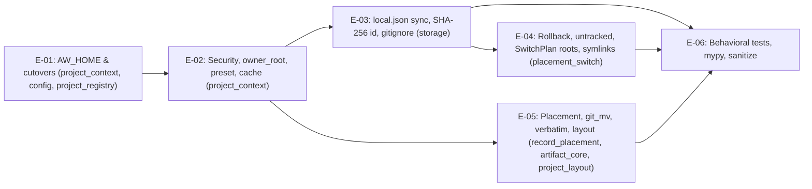
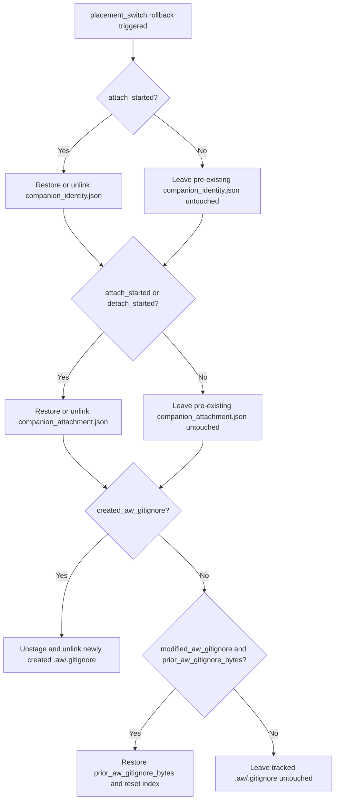

# IPD: Fix companion and AW_HOME core storage context placement switch and git_mv bugs

- Date: 2026-11-24
- Kind: child
- Concern: Core context, storage, and placement-switch modules have 14 verified defects affecting companion repositories (`records_backend == "companion"`) and `~/.aw/` (`AW_HOME` / `records_backend == "home"` / `clean-delta`): split-brain `AW_HOME` resolution between `agent_workflows/project_context.py`, `agent_workflows/config.py`, and `agent_workflows/project_registry.py`; stale `local.json:companion_dir` overriding `storage.py::move_companion`/`detach_companion`/`reattach_companion`; missing security and non-nesting validation on explicit or `local.json` `companion_dir`; companion `.gitignore` omitting runtime runs, history sidecar, untracked lanes, and generated indexes; unhashed machine-local path written to `.aw/companion_identity.json:git_common_dir_hash`; `placement_switch.py` rollback deleting pre-existing companion identity, attachment files, or tracked `.aw/.gitignore`, staging `repository-untracked` records, checking the wrong leftover root on `in-place` attach, dropping custom `project_id`, and dereferencing tracked symlinks; `record_placement.py::resolve_type_dir` falling back to `.agents/` before checking stored external placement; `artifact_core.py::git_mv` degrading to unstaged `shutil.move` on `home` local-git and custom companion repos while swallowing escape errors; `artifact_core.py::_is_verbatim_preserved` missing external research paths; `project_context.py` cache invalidation and `local-only` preset derivation bugs; `config.py::plan_cutovers_update` discarding `aw_home`; and `project_layout.py` dropping `companion_dir`/`preset`/`role` or hardcoding `.aw/system`.
- Scope: Fix all 14 core storage, context, and placement bugs in `agent_workflows/project_context.py`, `agent_workflows/config.py`, `agent_workflows/project_registry.py`, `agent_workflows/storage.py`, `agent_workflows/placement_switch.py`, `agent_workflows/record_placement.py`, `agent_workflows/artifact_core.py`, and `agent_workflows/project_layout.py`, with behavioral tests covering both companion and `~/.aw/` modes. Excludes installer (`7gverp`), `status_set`/finalize (`mmuv3v`), CLI record verbs (`7eivm2`), hooks (`7hfx7r`), and runner lanes (`4vnd36`).
- Scope-Paths: agent_workflows/project_context.py, agent_workflows/config.py, agent_workflows/project_registry.py, agent_workflows/storage.py, agent_workflows/placement_switch.py, agent_workflows/record_placement.py, agent_workflows/artifact_core.py, agent_workflows/project_layout.py, tests/test_companion_containment_and_storage.py, tests/test_home_isolation.py, tests/test_placement_switch_companion_execute.py, .aw/records/plans/pending/20261124-comphome-01-ywl7uc-fix-companion-and-aw-home-core-storage-context-placement-swi.ipd.md
- Item-Dependencies: none
- Status: approved
- Readiness: go-pending-approval
- Review-Depth: complex
- Priority: high
- Work-Kind: bug
- Blocks-Release: next
- Set: comphome
- Order: 1
- Highest E allocated: 6
- Id: ywl7uc
- Approval: 2026-11-27, recorded via aw ipd set: status set to approved
- Author: antigravity

> Write and proofread this plan per the technical writing standard, `.aw/system/workflows/technical-writing/technical-writing.md` (`.agents/workflows/technical-writing/technical-writing.md` in a legacy-layout install), including requirement 12 (diagrams).

## Workflow history

- 2026-11-27 approved (aw set): status set to approved
- 2026-11-25 reviewed (aw set): APPROVE WITH REVISIONS APPLIED; PR-001..PR-010
- 2026-11-25 /plan-review (antigravity/Gemini 4 Neon (High)): APPROVE WITH REVISIONS APPLIED; PR-001..PR-010
- 2026-11-24 to-review (antigravity): authored Order 01 child IPD for `/assess-bugs` (Set `comphome`).

## Goal

Make `AW_HOME` resolution, companion attachment/move/detach persistence, security containment, placement-switch rollback, external record placement, and `git_mv` reliable and leak-free across both companion and `~/.aw/` modes.

## Detailed Implementation Checklist (TODO)

Execution-state rule: mark an `E-*` item complete only after performing the action. That mark is not validation. Accepted execution states: blocked, failed, pending, performed; terminal gate demands 'performed'.

### Task group 1: Context, `AW_HOME` unification, and cache invalidation

- [ ] E-01 Unify `AW_HOME` resolution across `agent_workflows/project_context.py`, `agent_workflows/config.py`, and `agent_workflows/project_registry.py`, and plumb `aw_home` and linked-worktree primary-checkout fallback into cutover resolution:
  1. Share one canonical `AW_HOME` resolver with precedence `--aw-home` flag > `AW_HOME` environment variable > `aw_home` in user `config.json` (preserving `user_config_dir` override and `XDG_CONFIG_HOME` / `AW_CONFIG_DIR` lookup for `config.json`) > built-in default `~/.aw` (per resolved `OQ-01`, ignoring `XDG_CONFIG_HOME` as a default `AW_HOME` root).
  2. Expand environment variables (`os.path.expandvars`) and `~` (`os.path.expanduser`) before canonicalizing, and enforce `_check_path_security` traversal (`..`) checks on both the raw and expanded path strings.
  3. When falling through to built-in default `~/.aw`, if `XDG_CONFIG_HOME` is set and `$XDG_CONFIG_HOME/agent-workflows/projects` is an existing non-empty directory whose canonical path differs from `~/.aw/projects`, emit a one-time-per-process-and-path warning to `sys.stderr` (never `stdout`, never mutating disk) explaining that `AW_HOME` defaults to `~/.aw` and how to set `AW_HOME` or migrate legacy data.
  4. Route `agent_workflows/config.py::get_aw_home`, `agent_workflows/project_context.py::get_default_aw_home`, `agent_workflows/project_context.py::_resolve_effective_aw_home`, and `agent_workflows/project_registry.py::find_project` through the canonical resolver, and include expanded `AW_HOME` in `project_context.py::resolve_project_context`'s cache key.
  5. Plumb optional `aw_home` into `agent_workflows/config.py::_find_install_history_cutover` and `agent_workflows/config.py::resolve_cutover_date`, stop discarding `aw_home` in `agent_workflows/config.py::plan_cutovers_update`, forward `aw_home` to `resolve_project_context`, and check the linked-worktree primary checkout's `.aw/state/durable/history/installs.jsonl` and `.aw/state/history/installs.jsonl` (via `checkout_main_root`) when `repo_root` is a linked worktree.
  - Depends on: none
  - Expected outcome: `config.py::get_aw_home()`, `project_context.py::_resolve_effective_aw_home()`, and `project_registry.py::find_project()` resolve the exact same `AW_HOME` under `XDG_CONFIG_HOME` and `$VAR` inputs, default to `~/.aw` with a bounded stderr warning when legacy XDG project data exists, and `plan_cutovers_update` honors explicit `aw_home` and linked worktrees.
  - Execution state: pending

- [ ] E-02 Harden companion path security, `record_owner_root`, preset derivation, and cache invalidation in `agent_workflows/project_context.py`:
  1. Extract one shared companion-path validator enforcing `_check_path_security` and bidirectional `_is_safe_subpath` non-nesting against both `repo_abs` and `primary_abs` (when distinct for a linked worktree), and call it for explicit `companion_dir`, `merged_local_binding.get("companion_dir")`, and `_read_validated_companion_attachment`.
  2. Switch both fast-path checks in `agent_workflows/project_context.py::record_owner_root` from `Path(path).parts` to `canon_path.parts` so relative paths inside external `records/` trees resolve cleanly.
  3. Derive `DeliveryMode.CLEAN_DELTA` for `Preset.LOCAL_ONLY` alongside `Preset.COMPLETELY_CLEAN_TARGET` in `agent_workflows/project_context.py::_resolve_project_context_uncached` (with provenance naming the resolved preset).
  4. Extract a shared gitfile-aware index-path helper so `agent_workflows/project_context.py::_git_index_stamp` resolves linked-worktree `.git` gitfiles (`gitdir: <path>` -> `<gitdir>/index`) rather than returning `()`.
  5. Update `agent_workflows/project_context.py::_watched_context_paths` to watch `<system_root>/VERSION`, `<system_root>/workflows/VERSION`, `<state_root>/actions/open`, the active profile file (`<user_cfg_dir>/profiles/<selected_profile>.json` when active), and `<aw_home>/config/registry.json` (replacing the wrong `<aw_home>/registry.json` path).
  - Depends on: E-01
  - Expected outcome: nested or traversal `companion_dir` (explicit, `local.json`, or user binding) raises `PathSecurityError`; relative paths under external `records/` resolve in `record_owner_root`; `Preset.LOCAL_ONLY` derives `clean-delta`; linked-worktree staged policy violations and external `~/.aw/` file edits invalidate the context cache.
  - Execution state: pending

### Task group 2: Companion storage attachment, `.gitignore`, and portable identity

- [ ] E-03 Fix companion storage persistence, portable identity hashing, and companion `.gitignore` in `agent_workflows/storage.py`:
  1. Resolve the target project's local binding file via `project_context.py::project_config_dir(target_repo, aw_home=aw_home) / "local.json"` (never creating `<target>/.aw/config/local.json` in `clean-delta` mode, and performing no writes when `dry_run=True`). Atomically set `"companion_dir"` (canonical path, preserving all other keys) in `attach_companion`, `move_companion`, and `reattach_companion` (which delegates to `attach_companion`) before returning `get_storage_status`, and atomically remove `"companion_dir"` in `detach_companion` only when `local.json` already exists.
  2. SHA-256 hash `comp_git_common` (`hashlib.sha256(comp_git_common.encode("utf-8")).hexdigest()` when non-empty, else `""`) before passing `git_common_dir_hash` to `create_companion_identity` in both `attach_companion` and `move_companion` so no raw machine-local path is ever written to `.aw/companion_identity.json`.
  3. Define one canonical list of explicit gitignore patterns in `agent_workflows/storage.py` (`COMPANION_RECORD_IGNORE_PATTERNS` for `records/runs/`, `records/history.jsonl`, `records/*/untracked/`, `records/plans/INDEX.json`, `records/plans/INDEX.md`, `records/research/INDEX.json`, `records/research/INDEX.md`, `records/prompts/INDEX.json`, `records/prompts/INDEX.md`; plus `COMPANION_GITIGNORE_PATTERNS` adding `.aw/config/local.json` and `.aw/state/runtime/`; using explicit lines, never shell brace expansion). Update `materialize_companion_storage` to append any missing pattern line-by-line (comparing stripped lines rather than gating on `".aw/state/runtime/" not in curr`) so both fresh and pre-existing companion repositories receive all rules idempotently.
  - Depends on: E-02
  - Expected outcome: after `move_companion` or `reattach_companion`, `resolve_project_context` immediately resolves the new companion target; after `detach_companion`, stale `local.json:companion_dir` no longer overrides resolution; `.aw/companion_identity.json` contains a SHA-256 hex digest with no raw local paths; companion `git status` ignores runtime runs, history sidecar, untracked lanes, and all six generated index files.
  - Execution state: pending

### Task group 3: Placement-switch rollback, leftovers, custom `project_id`, and symlinks

- [ ] E-04 Fix `agent_workflows/placement_switch.py` transaction, rollback, custom `project_id`, and symlink defects:
  1. Reuse `storage.py::COMPANION_RECORD_IGNORE_PATTERNS` in `placement_switch.py::_ensure_companion_gitignore` (matching stripped lines rather than substrings) so companion ignore patterns have one source of truth.
  2. Record `journal["detach_started"] = True` before calling `storage.detach_companion` in `_run_transaction`, and guard `_perform_rollback` so `.aw/companion_identity.json` is restored or unlinked only when `journal.get("attach_started")` is truthy, and `.aw/state/durable/companion_attachment.json` is restored or unlinked only when `journal.get("attach_started") or journal.get("detach_started")` is truthy.
  3. In `_run_records_transaction`, check `gi_existed_before = aw_gi.is_file()` and snapshot `prior_aw_gitignore_bytes` before modifying `.aw/.gitignore`; call `engine.py::ensure_untracked_records_ignore(repo)` when `new_policy.records_backend == "repository-untracked"` (or `engine.py::_ensure_aw_gitignore(repo, include_companion_records_ignore=False)` for `"repository"`), set `created_aw_gitignore` only when `not gi_existed_before and gi_changed` and `modified_aw_gitignore` when `gi_changed`, stage `.aw/.gitignore`, and skip staging `.aw/records/**` when `new_policy.records_backend == "repository-untracked"`.
  4. Add optional `old_records_root: Optional[Path] = None` and `new_records_root: Optional[Path] = None` fields to `SwitchPlan` (backwards-compatible in `to_dict`/`from_dict` when absent in older journals); populate them from the resolved context/hit in `plan_placement_switch` and `plan_records_root_switch`; and consume them in `_run_transaction` (fixing `in-place` attach leftovers for both `repository` and `home` sources), `execute_records_root_switch`, and `_run_records_transaction` (fixing custom `project_id` switches).
  5. Add a helper `_resolve_link_path(p: Path) -> Path` returning `p.parent.resolve() / p.name` and use it instead of `p.resolve()` in `git_owner`, `is_tracked`, destination staging, source removal, and leftover checks across `plan_placement_switch`, `plan_records_root_switch`, `_run_transaction`, and `_run_records_transaction` so tracked symlinks targeting outside the repo migrate intact.
  - Depends on: E-03
  - Expected outcome: detach and records-switch rollbacks preserve pre-existing companion identity, attachment metadata, and tracked `.aw/.gitignore`; `home -> repository-untracked` leaves records ignored and unstaged; `in-place` attach leftover checks and custom `project_id` switches pass verification; tracked symlinks targeting outside the repo migrate intact.
  - Execution state: pending

### Task group 4: Record placement, `artifact_core.git_mv`, verbatim research, and `project_layout`

- [ ] E-05 Fix external-records path, move, verbatim-preservation, and layout helpers in `agent_workflows/record_placement.py`, `agent_workflows/artifact_core.py`, and `agent_workflows/project_layout.py`:
  1. In `agent_workflows/record_placement.py::resolve_type_dir`, check `has_stored_records_placement(repo_root)` before the `<target>/.agents/` fallback so first-record creation in a companion or `~/.aw/` repo never falls back to target `.agents/`.
  2. In `agent_workflows/artifact_core.py::git_mv`, when both `resolved_src` and `resolved_dst` are outside `resolved_root`: resolve `owner = project_context.record_owner_root(resolved_src) or resolved_root` and `ctx = project_context.resolve_project_context(target_repo=str(owner))`; for `ctx.records_backend in ("companion", "home")`, redirect `actual_git_root` via `project_context.record_git_root(resolved_src)` when present (requiring `resolved_dst` strictly inside `actual_git_root`, else raising `MoveOutsideRepositoryError`), and when `record_git_root` is `None` (unversioned `home` or companion) skip `git -C resolved_root mv` and require `resolved_dst` to remain strictly inside `Path(ctx.logical_roots["records"]).resolve()` whenever `resolved_src` is inside it (else raising `MoveOutsideRepositoryError`, while preserving `test_case_c2_both_outside_repo_allowed` for arbitrary non-project external dirs). Explicitly re-raise `MoveOutsideRepositoryError` outside any `except Exception:` guard.
  3. Add `("records", "research")` and `("records", "docs", "research")` to `agent_workflows/artifact_core.py::_VERBATIM_PRESERVED_SEGMENTS`.
  4. Pass `companion_dir=policy.companion_dir`, `preset=policy.preset`, `role=policy.role`, and `aw_home=aw_home or policy.aw_home` in `agent_workflows/project_layout.py::materialize_project_layout`, pass `preset=policy.preset`, `role=role or policy.role`, and `companion_dir=policy.companion_dir` in `agent_workflows/project_layout.py::install_system_tree`, and update `agent_workflows/project_layout.py::uninstall_system_tree` to accept optional `aw_home: Optional[str | Path] = None` and resolve `system_root` via `project_context.py::project_system_dir(repo, aw_home=aw_home)`.
  - Depends on: E-02
  - Expected outcome: first-record creation in companion/`~/.aw/` repos never falls back to target `.agents/`; `git_mv` stages renames cleanly in both `home` local-git and custom companion repos while raising `MoveOutsideRepositoryError` on escapes and preserving `test_case_c2_both_outside_repo_allowed`; external research files preserve verbatim formatting; `project_layout` honors custom companion dirs and clean-delta system roots.
  - Execution state: pending

### Task group 5: Behavioral verification

- [ ] E-06 Add behavioral tests covering all 14 fixes in `tests/test_companion_containment_and_storage.py`, `tests/test_home_isolation.py`, and `tests/test_placement_switch_companion_execute.py` (placing `E-01` and `E-02`/`E-05` `~/.aw/` tests in `tests/test_home_isolation.py` with isolated temporary `HOME` so default `~/.aw` tests never touch the developer home directory; placing `E-02`/`E-03`/`E-05` companion and `record_placement`/`git_mv`/`project_layout` tests in `tests/test_companion_containment_and_storage.py`; placing `E-04` rollback/records-switch/custom-`project_id`/symlink tests in `tests/test_placement_switch_companion_execute.py`), then run bare `python3 -m pytest` on the new and existing regression suites listed in `## Required tests / validation`, `python3 -m mypy` on all 8 modified modules, and `aw sanitize`.
  - Depends on: E-03, E-04, E-05
  - Expected outcome: all new and existing behavioral tests pass with zero code-pinning source inspections, `mypy` reports zero errors on all 8 modified modules, and `aw sanitize` reports clean.
  - Execution state: pending

## Project conventions discovered (Step 0)

- Never write code-pinning source inspection tests (`inspect`, `ast`, regex over production source; `GUIDING_PRINCIPLES.md` P16).
- Run pytest bare (`python3 -m pytest <targets>` without `-n0`, `-q`, or `-p no:randomly`).
- `conftest.py` installs an `AW_HOME`/`XDG_CONFIG_HOME` test sandbox; tests exercising default `~/.aw` with `AW_HOME` unset must patch `HOME` to a temporary directory.
- Commit via `aw commit ywl7uc -- <paths>` inside an isolated worktree.

## Findings

All 14 bugs traced from `/assess-bugs` run `20261124-213000`:
- `BUG-01` (`agent_workflows/storage.py`): `move_companion`/`detach_companion`/`attach_companion`/`reattach_companion` leave stale `local.json:companion_dir`.
- `BUG-02` (`agent_workflows/project_context.py`, `agent_workflows/config.py`, `agent_workflows/project_registry.py`): split-brain `AW_HOME` under `XDG_CONFIG_HOME` and `$VAR`.
- `BUG-03` (`agent_workflows/placement_switch.py`): `_perform_rollback` deletes pre-existing `.aw/companion_identity.json` and `.aw/state/durable/companion_attachment.json`.
- `BUG-04` (`agent_workflows/placement_switch.py`): `_run_records_transaction` deletes tracked `.aw/.gitignore` on rollback and stages `repository-untracked` records.
- `BUG-05` (`agent_workflows/record_placement.py`): `resolve_type_dir` falls back to `<target>/.agents/` before `has_stored_records_placement`.
- `BUG-06` (`agent_workflows/artifact_core.py`): `git_mv` degrades to unstaged `shutil.move` on `home` local-git and custom `--dir` companions and swallows escape errors.
- `BUG-07` (`agent_workflows/project_context.py`): explicit/`local.json` `companion_dir` skips `_check_path_security` and bidirectional non-nesting checks.
- `BUG-08` (`agent_workflows/storage.py`): companion `.gitignore` omits `records/runs/`, `records/history.jsonl`, `records/*/untracked/`, and generated `INDEX.{json,md}` files and gates appending on `.aw/state/runtime/`.
- `BUG-09` (`agent_workflows/project_context.py`): `record_owner_root` checks raw `Path(path).parts` instead of `canon_path.parts`.
- `BUG-10` (`agent_workflows/placement_switch.py`): `in-place` companion attach checks wrong `old_records_root`; `execute_records_root_switch` ignores custom `project_id`; symlink dereference in `git_owner`/`is_tracked`/staging/removal/leftovers.
- `BUG-11` (`agent_workflows/artifact_core.py`): `_is_verbatim_preserved` misses external `records/research` and `records/docs/research`.
- `BUG-12` (`agent_workflows/project_context.py`): `_git_index_stamp` misses linked worktree gitfiles and `_watched_context_paths` misses `<system_root>/VERSION`, `<state_root>/actions/open`, active profile file, and `<aw_home>/config/registry.json`.
- `BUG-13` (`agent_workflows/project_context.py`): `Preset.LOCAL_ONLY` misses `DeliveryMode.CLEAN_DELTA`.
- `BUG-14` (`agent_workflows/project_layout.py`, `agent_workflows/config.py`): `materialize_project_layout` and `install_system_tree` drop `companion_dir`/`preset`/`role`, `uninstall_system_tree` hardcodes `.aw/system`, and `plan_cutovers_update` discards `aw_home`.

## Proposed changes (ordered, validatable)

1. Unify `AW_HOME` resolution and `config.py::plan_cutovers_update` (`E-01`).
2. Harden `project_context.py` companion security, `record_owner_root`, preset derivation, and cache invalidation (`E-02`).
3. Fix `storage.py` `local.json` sync, SHA-256 identity hash, and shared companion `.gitignore` patterns (`E-03`).
4. Fix `placement_switch.py` rollbacks, `repository-untracked`, `SwitchPlan` record roots for `in-place`/custom `project_id`, and tracked symlinks (`E-04`).
5. Fix `record_placement.py`, `artifact_core.py`, and `project_layout.py` (`E-05`).
6. Add behavioral tests and validate (`E-06`).

## Deferred / out of scope (with reason)

- Installer policy alignment and clean-delta hijack live in Order 02 (`7gverp`).
  - Carrier: 7gverp
- Metadata commit locking, selectors, and finalize live in Order 03 (`mmuv3v`).
  - Carrier: mmuv3v
- CLI record verbs, `aw attention`, `aw partition`, and non-staged `check_engine` rules live in Order 04 (`7eivm2`).
  - Carrier: 7eivm2
- Companion pre-commit hooks, staged `check_engine` gates, monitors, and clean-delta inbox live in Order 05 (`7hfx7r`).
  - Carrier: 7hfx7r
- Runner execution, question inbox, backlog close, and `~/.aw/` lane containment live in Order 06 (`4vnd36`).
  - Carrier: 4vnd36
- Backend-agnostic `artifact_meta.check_freshness` `ReleaseResolution` attribute mismatch (cited in orchestrator `92ujfc` `## Deferred / out of scope`) is outside the companion/`~/.aw/` scope and is not carried by `ywl7uc` (`ywl7uc` does not touch `agent_workflows/artifact_meta.py`; re-home its carrier in `92ujfc` during `92ujfc`'s review).
  - Carrier-Declined: outside companion/AW_HOME scope and outside ywl7uc Scope-Paths; orchestrator 92ujfc owns re-homing the carrier pointer

## Scope check

- Over-scope: none; strictly limited to core storage, context, and placement modules and their tests.
- Under-scope: none; covers every core storage, context, and placement finding from `/assess-bugs` run `20261124-213000`.

## Required tests / validation

- `python3 -m pytest tests/test_companion_containment_and_storage.py tests/test_home_isolation.py tests/test_placement_switch_companion_execute.py tests/test_placement_switch_companion_plan.py tests/test_project_context.py tests/test_config.py tests/test_storage.py tests/test_project_layout.py tests/test_record_placement.py tests/test_artifact_core_git_mv_containment.py tests/test_records_root_switch_cli.py`
- `python3 -m mypy agent_workflows/project_context.py agent_workflows/config.py agent_workflows/project_registry.py agent_workflows/storage.py agent_workflows/placement_switch.py agent_workflows/record_placement.py agent_workflows/artifact_core.py agent_workflows/project_layout.py`
- `aw sanitize`

## Spec / documentation sync

No spec or user-doc edit is required. Checked `.aw/records/specs/` (`20260706-0000-01-pip-distribution-and-multi-repo-setup.spec.md`, `11037v`, `yfz5u9`): those specs govern the user config file (`$XDG_CONFIG_HOME/agent-workflows/config.json`), which remains unchanged under `E-01`. Defaulting `AW_HOME` to `~/.aw` aligns `agent_workflows/project_context.py` with the already-documented behavior of `agent_workflows/config.py::get_aw_home` and `agent_workflows/project_registry.py::find_project` per resolved `OQ-01`.

## Open questions

### OQ-01: Default `AW_HOME` when `XDG_CONFIG_HOME` is set

- Blocking: no
- Status: resolved
- Owner: maintainer
- Resolution or deferral rationale: Confirm during `/plan-review` whether to standardize on `~/.aw` (with legacy XDG detection fallback) or honor `XDG_CONFIG_HOME` consistently across `project_context`, `config`, and `project_registry`. RESOLVED 2026-11-24 by the user via /askme: Always default AW_HOME to ~/.aw, ignoring XDG_CONFIG_HOME (detect and warn if legacy project data already exists under $XDG_CONFIG_HOME/agent-workflows). No reason was given.

## Validation and cross-check (verify before reporting done)

Validation-state rule: inspect evidence in a separate pass. Do not mark a `V-*` item complete from memory or from the matching execution checkmark. Accepted validation results: blocked, failed, pass, pending; terminal gate demands 'pass'.

- [ ] V-01 validates E-01
  - Required evidence: paste `python3 -m pytest tests/test_home_isolation.py` output (with isolated temporary `HOME`) proving `config.py::get_aw_home`, `project_context.py::_resolve_effective_aw_home`, `project_context.py::get_default_aw_home`, and `project_registry.py::find_project` all default to `<HOME>/.aw` when `XDG_CONFIG_HOME` is set and `AW_HOME` is unset, emit a bounded stderr (not stdout) warning when legacy `$XDG_CONFIG_HOME/agent-workflows/projects` data exists, expand `$VAR` before `_check_path_security`, and prove `config.py::plan_cutovers_update` / `resolve_cutover_date` honor explicit `aw_home` and linked worktrees.
  - Observed evidence:
  - Result: pending

- [ ] V-02 validates E-02
  - Required evidence: paste `python3 -m pytest tests/test_companion_containment_and_storage.py tests/test_home_isolation.py` output proving `PathSecurityError` on nested or traversal explicit/`local.json` `companion_dir` (against both worktree and primary roots), relative-path `record_owner_root`, `Preset.LOCAL_ONLY` clean-delta derivation, linked-worktree `_git_index_stamp` invalidation on staged forbidden files, and `_watched_context_paths` invalidation on `<system_root>/VERSION`, `<state_root>/actions/open`, active profile file, and `<aw_home>/config/registry.json`.
  - Observed evidence:
  - Result: pending

- [ ] V-03 validates E-03
  - Required evidence: paste `python3 -m pytest tests/test_companion_containment_and_storage.py` output proving `attach_companion`/`move_companion`/`reattach_companion`/`detach_companion` sync `project_config_dir/local.json` atomically (respecting `dry_run=True`, preserving other keys, not creating `local.json` on detach when absent, and keeping `clean-delta` target repos clean), `attach_companion` and `move_companion` write a SHA-256 hex digest in `.aw/companion_identity.json:git_common_dir_hash` with no raw local path, and `materialize_companion_storage` ignores `records/runs/`, `records/history.jsonl`, `records/*/untracked/`, and all six `records/{plans,research,prompts}/INDEX.{json,md}` files (explicit lines, verified with `git status` on both fresh and pre-existing companions).
  - Observed evidence:
  - Result: pending

- [ ] V-04 validates E-04
  - Required evidence: paste `python3 -m pytest tests/test_placement_switch_companion_execute.py` output proving `_perform_rollback` preserves pre-existing `companion_identity.json` and `companion_attachment.json` before `attach_started`/`detach_started`, `_perform_records_rollback` preserves tracked `.aw/.gitignore`, `home -> repository-untracked` adds `/records/` ignore and leaves `.aw/records/**` unstaged, `in-place` attach leftover checks (from both `repository` and `home` sources) and custom `project_id` records switches pass verification, and tracked symlinks targeting outside the repo migrate intact.
  - Observed evidence:
  - Result: pending

- [ ] V-05 validates E-05
  - Required evidence: paste `python3 -m pytest tests/test_companion_containment_and_storage.py tests/test_home_isolation.py tests/test_artifact_core_git_mv_containment.py tests/test_record_placement.py tests/test_project_layout.py` output proving `record_placement.py::resolve_type_dir` skips `.agents/` when external placement is stored, `artifact_core.py::git_mv` stages moves in `home` local-git and custom companion repos while raising `MoveOutsideRepositoryError` on escapes and preserving `test_case_c2_both_outside_repo_allowed`, external `records/research` and `records/docs/research` stay verbatim, and `project_layout.py` (`materialize_project_layout`, `install_system_tree`, `uninstall_system_tree`) honors custom companion and clean-delta roots.
  - Observed evidence:
  - Result: pending

- [ ] V-06 validates E-06
  - Required evidence: paste full bare `python3 -m pytest` summary across all 11 suites listed in `## Required tests / validation`, `python3 -m mypy` zero-error output on all 8 modified modules, and `aw sanitize` clean output.
  - Observed evidence:
  - Result: pending

## Approval and execution gate

- Size assessment: exception
- Cohesion rationale: These eight core context/storage/placement modules form the single foundational storage layer (`AW_HOME`, `resolve_project_context`, `storage`, `placement_switch`, `record_placement`, `artifact_core.git_mv`, `project_layout`) that Orders 02-06 depend on (`executed:ywl7uc`). `placement_switch.py` directly invokes `storage.attach_companion`/`detach_companion` and shares `COMPANION_RECORD_IGNORE_PATTERNS` with `storage.py`, and each of the 14 fixes is a bounded bug fix rather than new architecture; landing them in one Order-01 child guarantees a consistent foundation for all parallel downstream plans.

Execution contract:
- **Approval and open questions:** Execute only after human approval (`Status: approved`). All open questions (`OQ-01`) are resolved; no blocking open question remains.
- **Scope fence:** `- Scope-Paths:` declares the expected edit surface. If execution genuinely requires editing a file outside `- Scope-Paths:` or leaving a declared path unmodified, complete the work and supply `--scope-reason` / `--scope-ack` at finalize (do not abandon the turn over a scope declaration; stop only for an unsafe condition such as an unresolvable concurrent-edit conflict or absent prerequisite symbols).
- **Honesty rule (MUST):** Paste actual command output in `Observed evidence:` for every `V-*` item; never claim a test, `mypy`, or `aw sanitize` run passed without executing it on the final code.
- **Commit and push:** Commit only path-scoped files you modified via `aw commit ywl7uc -- <paths>` inside an isolated worktree (never `git add -A`, `-a`, or bare `git add`); never push, tag, or release.
- **Lifecycle transition:** Finalize is mandatory once all `E-*` items are `performed` and all `V-*` items are `pass`. When executed by an automated runner (`aw oc run` / `aw agy run`), leave status transition and finalize to the runner; when executed standalone by an agent or human, run `aw ipd finalize ywl7uc`. Never hand-roll `git mv` into `.aw/records/plans/executed/`.
