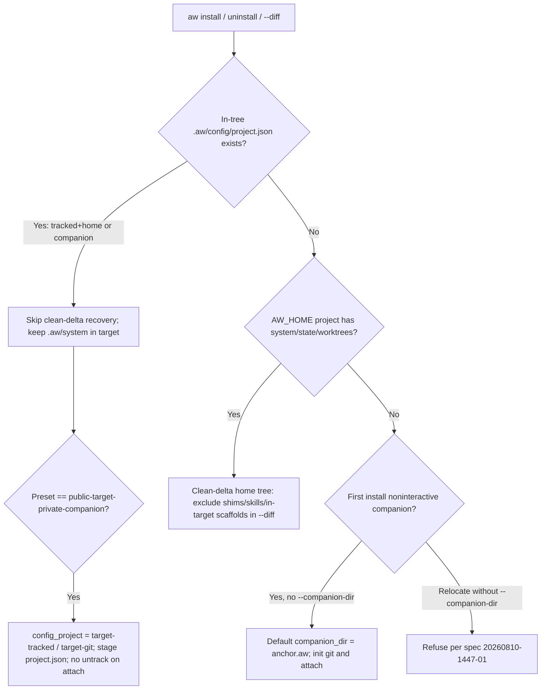

# IPD: Fix installer clean-delta hijack companion project policy diff and leak allowlist bugs

- Date: 2026-11-24
- Kind: child
- Concern: Six verified installer and configuration bugs break `tracked`+`home`, `public-target-private-companion`, and `clean-delta` (`~/.aw/`) repositories: (1) `agent_workflows/engine.py::_clean_delta_home_trees` unconditionally enters partial-uninstall recovery whenever `<AW_HOME>/projects/<pid>/records` exists, hijacking `tracked`+`home` updates into `~/.aw/.../system` and stranding `<repo>/.aw/` on uninstall; (2) `public-target-private-companion` install leaves `.aw/config/project.json` permanently untracked and uncommitted due to policy drift across `install_wizard.py`, `project_schema.py`, `project_context.py`, and `placement_switch.py` (which also untracks `project.json` on `in-place` attach); (3) noninteractive `aw install --preset public-target-private-companion --yes` without `--companion-dir` skips companion git init and attachment on first install; (4) `agent_workflows/engine.py::migrate_local_lanes_to_untracked` crashes with `ValueError` on external `records/` trees and writes stray nested `.gitignore` files outside `.agents/`; (5) `aw install --diff` (`engine.py::run` and `show_install_diffs`) ignores external `system`/`records` destinations and `clean-delta` exclusions; and (6) `agent_workflows/leak_sanitizer.py::resolve_allowlist_path` hardcodes `<repo>/.aw/config/local-leaks-allowlist.toml` instead of `project_config_dir`, dirtying `clean-delta` target repos.
- Scope: Fix all six installer, wizard, policy-alignment, and leak-allowlist bugs across `agent_workflows/engine.py`, `agent_workflows/install_wizard.py`, `agent_workflows/cli.py`, `agent_workflows/project_context.py`, `agent_workflows/project_schema.py`, `agent_workflows/placement_switch.py`, and `agent_workflows/leak_sanitizer.py`, update existing tests that pinned the overruled `public-target-private-companion` unstaged/`untrack` behavior, and add end-to-end behavioral tests across `tracked`+`home`, `public-target-private-companion`, and `clean-delta`.
- Scope-Paths: agent_workflows/engine.py, agent_workflows/install_wizard.py, agent_workflows/cli.py, agent_workflows/project_context.py, agent_workflows/project_schema.py, agent_workflows/placement_switch.py, agent_workflows/leak_sanitizer.py, tests/test_home_isolation.py, tests/test_companion_containment_and_storage.py, tests/test_leak_sanitizer.py, tests/test_installer.py, tests/test_placement_switch_companion_plan.py, tests/test_placement_switch_companion_execute.py, tests/test_placement_switch_companion_cli.py, .aw/records/plans/pending/20261124-comphome-02-7gverp-fix-installer-clean-delta-hijack-companion-project-policy-di.ipd.md
- Item-Dependencies: executed:ywl7uc
- Status: approved
- Readiness: go-pending-approval
- Review-Depth: complex
- Priority: high
- Work-Kind: bug
- Blocks-Release: next
- Set: comphome
- Order: 2
- Highest E allocated: 5
- Id: 7gverp
- Approval: 2026-11-27, recorded via aw ipd set: status set to approved
- Author: antigravity

> Write and proofread this plan per the technical writing standard, `.aw/system/workflows/technical-writing/technical-writing.md` (`.agents/workflows/technical-writing/technical-writing.md` in a legacy-layout install), including requirement 12 (diagrams).

## Workflow history

- 2026-11-27 approved (aw set): status set to approved
- 2026-11-25 reviewed (aw set): APPROVE WITH REVISIONS APPLIED; PR-001..PR-007
- 2026-11-25 /plan-review (antigravity/Gemini 4 Neon (High)): APPROVE WITH REVISIONS APPLIED; PR-001..PR-007
- 2026-11-24 to-review (antigravity): authored Order 02 child IPD for `/assess-bugs` (Set `comphome`).

## Goal

Ensure `aw install`, `aw install --diff`, `aw uninstall`, and `aw sanitize --configure` preserve exact target-repo and `~/.aw/` footprints across `tracked`+`home`, `public-target-private-companion`, and `clean-delta` modes.

## Detailed Implementation Checklist (TODO)

Execution-state rule: mark an `E-*` item complete only after performing the action. That mark is not validation. Accepted execution states: blocked, failed, pending, performed; terminal gate demands 'performed'.

### Task group 1: Installer home-tree recovery, local-lane migration, and `--diff`

- [ ] E-01 Fix `agent_workflows/engine.py::_clean_delta_home_trees`, `agent_workflows/engine.py::migrate_local_lanes_to_untracked`, and `aw install --diff` (`agent_workflows/engine.py::run`, `agent_workflows/engine.py::show_install_diffs`):
  1. In `_clean_delta_home_trees` branch (b) (partial-uninstall recovery), return `None` whenever an in-tree tracked policy file exists (`<repo>/.aw/config/{project,config,policy}.json` or the linked-worktree primary checkout equivalent), and check only `("system", "state", "worktrees")` under `<AW_HOME>/projects/<pid>` (never treating a `records/`-only home directory as a clean-delta system tree, while keeping partial-uninstall recovery working when `config/` was removed from a `clean-delta` project per `test_case_u_uninstall_recovers_partial`).
  2. In `migrate_local_lanes_to_untracked`, guard `new.relative_to(repo_root)` with `try/except ValueError` (falling back to POSIX string form for external lanes), and call `_ensure_untracked_gitignore(base)` only for legacy `.agents/` lanes (not external companion or `~/.aw/` records directories, which do not need nested per-lane `.gitignore` files).
  3. In `run()` (`if plan.diff:`), mirror `install_into_repo`'s `clean = _is_clean_delta_install(plan.repo_root)` exclusions: pass `{}` for generated shim/skill members when `clean` is `True`, filter out clean-delta-excluded scaffold members (`workflow_artifacts`, `inbox`, and in-target setup files skipped by `create_setup_artifacts`), and test scaffold existence against the resolved physical destination (`_records_member_destination` for `.aw/records/...`, `_system_member_destination` for `.aw/system/...`, `plan.repo_root / rel` otherwise).
  4. In `show_install_diffs()`, resolve each member's current on-disk path through `_system_member_destination(plan.repo_root, rel)[0]` for `.aw/system/...` and `_records_member_destination(plan.repo_root, rel)` for `.aw/records/...` instead of `plan.repo_root / rel`.
  - Depends on: none
  - Expected outcome: `tracked`+`home` update and uninstall keep `.aw/system/` in the target repo while clean-delta partial-uninstall recovery still works; legacy `prompts/local/` migration succeeds on companion and `home` records without writing stray nested `.gitignore` files; `aw install --diff` on an up-to-date companion, `tracked`+`home`, or `clean-delta` install reports zero spurious changes.
  - Execution state: pending

### Task group 2: Companion preset policy consistency and noninteractive attachment

- [ ] E-02 Apply resolved `OQ-01` (keep `.aw/config/project.json` at `<target>/.aw/config/project.json` and track it in `target-git` for `public-target-private-companion`) consistently across all policy, context, and placement-switch modules:
  1. In `agent_workflows/install_wizard.py::get_preset_defaults` and `agent_workflows/project_schema.py::PRESET_PLACEMENTS`, set `RootClass.CONFIG_PROJECT` to `Placement.TARGET_TRACKED` and `GitPolicy.TARGET_GIT` for `Preset.PUBLIC_TARGET_PRIVATE_COMPANION`.
  2. In `agent_workflows/project_context.py::_resolve_project_context_uncached`, include `Preset.PUBLIC_TARGET_PRIVATE_COMPANION.value` alongside `Preset.PRIVATE_TARGET.value` and `ProjectRole.SOURCE_CHECKOUT.value` when computing `GitPolicy.TARGET_GIT` for both `RootClass.SYSTEM` and `RootClass.CONFIG_PROJECT` under `DeliveryMode.TRACKED`.
  3. Verify `agent_workflows/engine.py::stage_tracked_policy_files` stages `.aw/config/project.json` on fresh `public-target-private-companion` installs (and leaves explicit `"config_project": "ignored"` unstaged).
  4. In `agent_workflows/placement_switch.py::plan_placement_switch`, stop setting `config_retrack = "untrack"` and stop emitting `warnings["config-becomes-untracked"]` on `in-place` companion attach (and leave `config_retrack = None` on `in-place` detach when `.aw/config/project.json` is already tracked in target git), since both `private-target` and `public-target-private-companion` track `project.json` in `target-git`.
  5. Update existing tests that pinned the overruled unstaged/`untrack` behavior (`tests/test_installer.py::test_ignored_and_companion_preset_project_json_not_staged`, `tests/test_placement_switch_companion_plan.py`, `tests/test_placement_switch_companion_execute.py`, and `tests/test_placement_switch_companion_cli.py`).
  - Depends on: E-01
  - Expected outcome: fresh `aw install --preset public-target-private-companion --companion-dir ../repo.aw --yes` writes `config_project: target-tracked` / `target-git`, stages `.aw/config/project.json` in target git, and leaves no untracked/unignored `project.json`; switching between `private-target` and `public-target-private-companion` keeps `.aw/config/project.json` tracked in target git.
  - Execution state: pending

- [ ] E-03 Fix noninteractive first-install companion initialization in `agent_workflows/install_wizard.py::resolve_policy_noninteractive` and `agent_workflows/cli.py::_run_install`:
  1. In `install_wizard.py::resolve_policy_noninteractive` on first install (`existing_policy is None`), when `preset_name == Preset.PUBLIC_TARGET_PRIVATE_COMPANION.value` or `backend_final == RecordsBackend.COMPANION.value` and `explicit_companion` is omitted, default `companion_dir` to `<anchor>.aw` (using `checkout_main_root` + `_canonical_path` matching `project_context.py`'s sibling convention). Do NOT apply this default on `--relocate` switches (`existing_policy is not None` with a preset switch), preserving `cli.py`'s refusal requiring explicit `--companion-dir <path>` during relocation per spec `20260810-1447-01`.
  2. In `cli.py::_run_install`, ensure non-relocating companion setup runs `git -C <comp_p> init` (checking exit status rather than silently ignoring failure) and passes `aw_home=policy.aw_home` to `storage.attach_companion` so `.aw/companion_identity.json`, target attachment metadata, `local.json:companion_dir`, and companion `.gitignore` always materialize cleanly.
  - Depends on: E-02
  - Expected outcome: first-install `aw install --preset public-target-private-companion --yes` (without `--companion-dir`) initializes and attaches `<repo>.aw` as a versioned companion repository, while `--relocate` into `public-target-private-companion` without `--companion-dir` still refuses as specified.
  - Execution state: pending

### Task group 3: Leak allowlist path under `clean-delta` / `~/.aw/`

- [ ] E-04 Route `agent_workflows/leak_sanitizer.py::resolve_allowlist_path` (which `write_repo_allowlist`, `load_repo_allowlist`, and `load_repo_config_bools` all call) through `project_context.py::project_config_dir(repo_root) / "local-leaks-allowlist.toml"`:
  1. Resolve `cfg_dir = project_context.project_config_dir(repo_root)` (falling back to `repo_root / ".aw" / "config"` on exception) and set `new_path = cfg_dir / "local-leaks-allowlist.toml"`.
  2. When `cfg_dir` resolves outside `repo_root` (`clean-delta` mode), return `new_path` directly without falling back to `<repo>/.agents/local-leaks-allowlist.toml` so `aw sanitize --configure` never writes inside a `clean-delta` target repo.
  3. When `cfg_dir` resolves inside `repo_root`, preserve the existing precedence (`new_path` if present, else `repo_root / LEGACY_REPO_ALLOWLIST_REL` if present, else `new_path`).
  - Depends on: none
  - Expected outcome: `aw sanitize --configure` writes to `<AW_HOME>/projects/<pid>/config/local-leaks-allowlist.toml` in `clean-delta` mode with zero target-repo dirtiness, `aw sanitize` reads allowlists stored there, and tracked/legacy repos preserve `.aw/config/` and `.agents/` behavior unchanged.
  - Execution state: pending

### Task group 4: Behavioral verification

- [ ] E-05 Add behavioral tests covering all six fixes across `tests/test_home_isolation.py` (`tracked`+`home` `_clean_delta_home_trees` non-hijack + `clean-delta` partial-uninstall recovery + `clean-delta` `aw install --diff`), `tests/test_companion_containment_and_storage.py` (fresh `public-target-private-companion` target-git staging, noninteractive first install without `--companion-dir`, `--relocate` refusal without `--companion-dir`, external `migrate_local_lanes_to_untracked`, and companion `aw install --diff`), and `tests/test_leak_sanitizer.py` (`clean-delta` allowlist read/write with zero target footprint even when `.agents/` exists), then run bare `python3 -m pytest` on the suites listed in `## Required tests / validation`, `python3 -m mypy` on all 7 modified modules, and `aw sanitize`.
  - Depends on: E-01, E-02, E-03, E-04
  - Expected outcome: all new and updated behavioral tests plus existing regression suites pass with zero code-pinning source inspections, `mypy` reports zero errors on all 7 modified modules, and `aw sanitize` reports clean.
  - Execution state: pending

## Project conventions discovered (Step 0)

- Run bare `python3 -m pytest <targets>` (no `-n0`, `-q`, or `-p no:randomly`); write observable behavioral tests only (`GUIDING_PRINCIPLES.md` P16).
- Commit path-scoped via `aw commit 7gverp -- <paths>` in an isolated worktree.

## Findings

Six verified bugs from `/assess-bugs` run `20261124-213000`:
- Blocker: `agent_workflows/engine.py::_clean_delta_home_trees` hijacks `tracked`+`home` installs and uninstalls.
- High: `public-target-private-companion` install leaves `.aw/config/project.json` untracked/unignored/uncommitted (`install_wizard.py`, `project_schema.py`, `project_context.py`, `placement_switch.py`).
- Medium: `agent_workflows/engine.py::migrate_local_lanes_to_untracked` crashes with `ValueError` on external records and writes stray nested `.gitignore` files outside `.agents/`.
- Medium: noninteractive first-install `--preset public-target-private-companion --yes` without `--companion-dir` skips companion init/attachment (`install_wizard.py`, `cli.py`).
- Medium: `aw install --diff` (`engine.py::run`, `show_install_diffs`) ignores external `system`/`records` roots and `clean-delta` exclusions.
- Medium: `agent_workflows/leak_sanitizer.py::resolve_allowlist_path` ignores `project_config_dir` and dirties `clean-delta` target repos.

## Proposed changes (ordered, validatable)

1. Guard `_clean_delta_home_trees`, fix `migrate_local_lanes_to_untracked`, and align `aw install --diff` (`E-01`).
2. Align `public-target-private-companion` `config_project` (`target-git`) and `system` (`target-git`) policy across `install_wizard.py`, `project_schema.py`, `project_context.py`, `placement_switch.py`, and existing pinning tests (`E-02`), and default sibling `companion_dir` on noninteractive first install (`E-03`).
3. Route `leak_sanitizer.py::resolve_allowlist_path` through `project_config_dir` (`E-04`).
4. Add behavioral tests and run pytest, mypy, and sanitize (`E-05`).

## Deferred / out of scope (with reason)

- Core storage, `AW_HOME` unification, and companion `.gitignore` expansion live in Order 01 (`ywl7uc`).
  - Carrier: ywl7uc
- Metadata commit locking, selectors, and finalize live in Order 03 (`mmuv3v`).
  - Carrier: mmuv3v
- CLI record verbs, `aw attention`, `aw partition`, and non-staged `check_engine` rules live in Order 04 (`7eivm2`).
  - Carrier: 7eivm2
- Companion pre-commit hooks, staged `check_engine` gates, monitors, and clean-delta inbox live in Order 05 (`7hfx7r`).
  - Carrier: 7hfx7r
- Runner execution, question inbox, backlog close, and `~/.aw/` lane containment live in Order 06 (`4vnd36`).
  - Carrier: 4vnd36

## Scope check

- Over-scope: none.
- Under-scope: none; covers all six installer, preset-policy, and allowlist bugs from `/assess-bugs` plus all code and test sites affected by resolved `OQ-01`.

## Required tests / validation

- `python3 -m pytest tests/test_home_isolation.py tests/test_companion_containment_and_storage.py tests/test_leak_sanitizer.py tests/test_installer.py tests/test_placement_switch_companion_plan.py tests/test_placement_switch_companion_execute.py tests/test_placement_switch_companion_cli.py tests/test_project_layout.py tests/test_reinstall_preserves_config.py`
- `python3 -m pytest tests/test_clean_target_config_home.py -k "test_case_j_public_target_private_companion or test_case_u_uninstall_recovers_partial"`
- `python3 -m mypy agent_workflows/engine.py agent_workflows/install_wizard.py agent_workflows/cli.py agent_workflows/project_context.py agent_workflows/project_schema.py agent_workflows/placement_switch.py agent_workflows/leak_sanitizer.py`
- `aw sanitize`

## Spec / documentation sync

No spec or user-doc edit is required. Checked `ARCHITECTURE.md:91` (already documents that `public-target-private-companion` keeps system, config, and state tracked in the target repository), `README.md:138` (consistent), and `.aw/records/specs/implemented/20260810-1447-01-physical-aw-hierarchy-placement-and-migration.spec.md:143` (requires explicit `--companion-dir <path>` on `--relocate`, which `E-03` explicitly preserves).

## Open questions

### OQ-01: `config_project` policy for `public-target-private-companion`

- Blocking: no
- Status: resolved
- Owner: maintainer
- Resolution or deferral rationale: Confirm during `/plan-review` whether `.aw/config/project.json` in `public-target-private-companion` should be `target-git` (staged/committed on install) or ignored/stored in the companion repo. RESOLVED 2026-11-24 by the user via /askme: Keep project.json at <target>/.aw/config/project.json and track it in the target repo (target-git). No reason was given.

## Validation and cross-check (verify before reporting done)

Validation-state rule: inspect evidence in a separate pass. Do not mark a `V-*` item complete from memory or from the matching execution checkmark. Accepted validation results: blocked, failed, pass, pending; terminal gate demands 'pass'.

- [ ] V-01 validates E-01
  - Required evidence: paste `python3 -m pytest tests/test_home_isolation.py tests/test_companion_containment_and_storage.py` and `python3 -m pytest tests/test_clean_target_config_home.py -k "test_case_u_uninstall_recovers_partial"` output proving `tracked`+`home` update/uninstall keeps `.aw/system/` in repo while clean-delta partial-uninstall recovery still works, `migrate_local_lanes_to_untracked` succeeds on external records without writing stray nested `.gitignore` files, and `aw install --diff` reports no spurious changes on up-to-date companion, `tracked`+`home`, and `clean-delta` installs.
  - Observed evidence:
  - Result: pending

- [ ] V-02 validates E-02
  - Required evidence: paste `python3 -m pytest tests/test_companion_containment_and_storage.py tests/test_installer.py tests/test_placement_switch_companion_plan.py tests/test_placement_switch_companion_execute.py tests/test_placement_switch_companion_cli.py tests/test_project_layout.py` output proving a fresh `public-target-private-companion` install writes `config_project: target-tracked` / `target-git`, stages `.aw/config/project.json` cleanly, leaves explicit `config_project: ignored` unstaged, and keeps `.aw/config/project.json` tracked across `private-target <-> public-target-private-companion` switches.
  - Observed evidence:
  - Result: pending

- [ ] V-03 validates E-03
  - Required evidence: paste `python3 -m pytest tests/test_companion_containment_and_storage.py` output proving first-install `aw install --preset public-target-private-companion --yes` (omitting `--companion-dir`) creates `<repo>.aw/.git`, `.aw/companion_identity.json`, attachment metadata, and `local.json:companion_dir`, while `--relocate` without `--companion-dir` still refuses with exit code 1.
  - Observed evidence:
  - Result: pending

- [ ] V-04 validates E-04
  - Required evidence: paste `python3 -m pytest tests/test_leak_sanitizer.py` output proving `aw sanitize --configure` writes to `<AW_HOME>/projects/<pid>/config/local-leaks-allowlist.toml` without creating `.aw/` or writing `.agents/` in a `clean-delta` target repo, `aw sanitize` reads allowlists stored there, and tracked/legacy repos retain existing resolution behavior.
  - Observed evidence:
  - Result: pending

- [ ] V-05 validates E-05
  - Required evidence: paste full bare `python3 -m pytest` summary across all suites listed in `## Required tests / validation`, `python3 -m mypy` zero-error output on all 7 modified modules (`engine.py`, `install_wizard.py`, `cli.py`, `project_context.py`, `project_schema.py`, `placement_switch.py`, `leak_sanitizer.py`), and `aw sanitize` clean output.
  - Observed evidence:
  - Result: pending

## Approval and execution gate

- Size assessment: exception
- Cohesion rationale: The plan stays within the 5-item `IPD-Z603` E-item guidance (`5` E-items, `4` task groups); its `14` work `Scope-Paths` reflect the single atomic `OQ-01` policy alignment (`config_project = target-tracked / target-git` for `public-target-private-companion`) across `install_wizard.py`, `project_schema.py`, `project_context.py`, `placement_switch.py`, and the 4 existing test files that pinned the overruled `untrack`/unstaged behavior, which cannot merge separately without leaving `pytest` red.

Execution contract:
- **Approval and open questions:** Execute only after human approval (`Status: approved`) and after `executed:ywl7uc`. All open questions (`OQ-01`) are resolved; no blocking open question remains.
- **Scope fence:** `- Scope-Paths:` declares the expected edit surface. If execution genuinely requires editing a file outside `- Scope-Paths:` or leaving a declared path unmodified, complete the work and supply `--scope-reason` / `--scope-ack` at finalize (do not abandon the turn over a scope declaration; stop only for an unsafe condition such as an unresolvable concurrent-edit conflict or absent prerequisite symbols).
- **Honesty rule (MUST):** Paste actual command output in `Observed evidence:` for every `V-*` item; never claim a test, `mypy`, or `aw sanitize` run passed without executing it on the final code.
- **Commit and push:** Commit only path-scoped files you modified via `aw commit 7gverp -- <paths>` inside an isolated worktree (never `git add -A`, `-a`, or bare `git add`); never push, tag, or release.
- **Lifecycle transition:** Finalize is mandatory once all `E-*` items are `performed` and all `V-*` items are `pass`. When executed by an automated runner (`aw oc run` / `aw agy run`), leave status transition and finalize to the runner; when executed standalone by an agent or human, run `aw ipd finalize 7gverp`. Never hand-roll `git mv` into `.aw/records/plans/executed/`.
