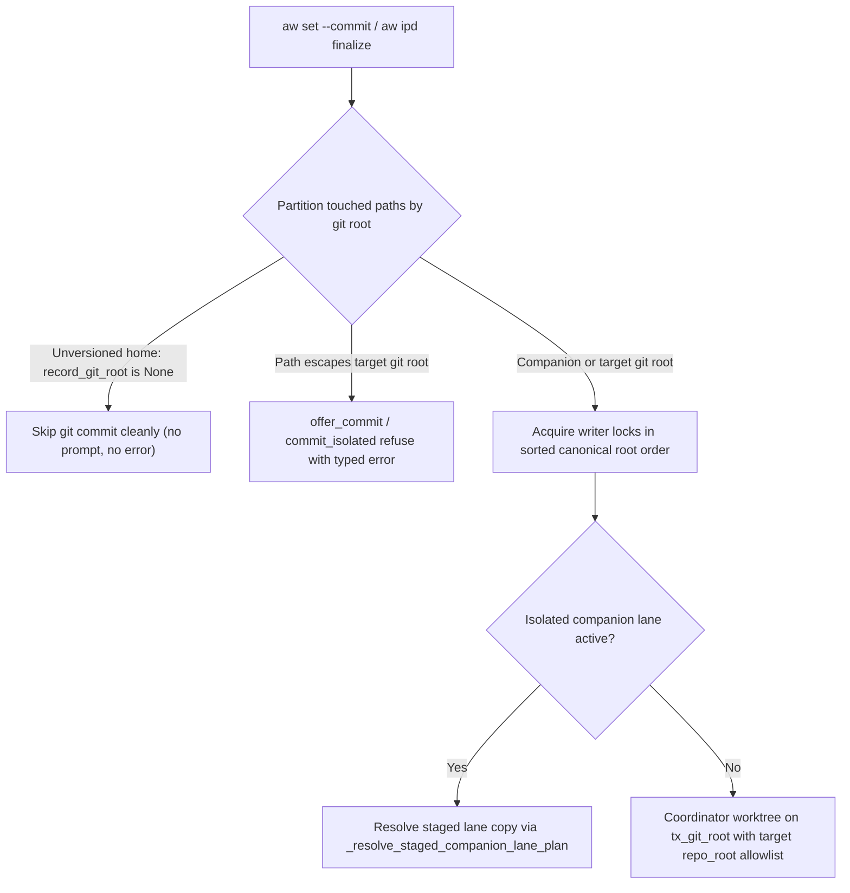

# IPD: Fix metadata selectors self-commit routing companion locking and ipd finalize bugs

- Date: 2026-11-24
- Kind: child
- Concern: Nine verified bugs affect metadata setters, selectors, commit locking, and `ipd_lifecycle` in companion and `~/.aw/` modes: (1) `agent_workflows/status_set.py::_offer_self_commit` tries to `git add` unversioned `~/.aw/` records in `target_repo`, fails on unregistered custom companion dirs via `--dir`, and fails atomically on mixed-repo batches (while `git_commit_helper.py::offer_commit` and `commit_lock.py::commit_isolated` fail unsafely on out-of-repo absolute paths); (2) `commit_lock.py::writer_lock` and `ipd_lifecycle.py::acquire_finalize_lock` acquire different lock files in companion mode, breaking mutual exclusion; (3) `status_set.py::_delegate_plan_executed_to_finalize` / `ipd_lifecycle.py::finalize` skips `_resolve_staged_companion_lane_plan`, bypassing lane isolation; (4) `ipd_lifecycle.py::_finalize_transaction` passes companion worktree `coord.path` as `repo_root` (missing target leak allowlist and log-format detection) and reads commit identity from `target_repo` instead of `tx_git_root`; (5) `ipd_lifecycle.py::_run_record_committed_paths` looks under `checkout_control_root / "records" / "runs"` instead of `project_records_dir / "runs"`; (6) `status_set.py::run_set_command` runs the orchestrator dirty-tree check against `target_repo`, failing open; (7) `status_set.py::_prepare_status_change` and `apply_status_change` break `--rewrite-citations`, custom-companion staleness, and `read_at`/`read_path_at` `rel` paths; (8) `selectors.py::resolve` (`MATCH_PATH`) and `status_set.py::match_selector` reject records-relative paths (`plans/pending/...`, `records/plans/pending/...`); and (9) `artifact_meta.py::write_legacy`, `_git_target_root`, and `load_legacy_artifact` misresolve owner, git, and id6 collision roots for companion and `~/.aw/` records.
- Scope: Fix all nine bugs across `agent_workflows/status_set.py`, `agent_workflows/git_commit_helper.py`, `agent_workflows/commit_lock.py`, `agent_workflows/ipd_lifecycle.py`, `agent_workflows/selectors.py`, and `agent_workflows/artifact_meta.py`, with behavioral tests covering companion (sibling and custom `--dir`) and `~/.aw/` (`home`) modes.
- Scope-Paths: agent_workflows/status_set.py, agent_workflows/git_commit_helper.py, agent_workflows/commit_lock.py, agent_workflows/ipd_lifecycle.py, agent_workflows/selectors.py, agent_workflows/artifact_meta.py, tests/test_companion_ipd_lifecycle.py, tests/test_home_isolation.py, .aw/records/plans/pending/20261124-comphome-03-mmuv3v-fix-metadata-selectors-self-commit-routing-companion-locking.ipd.md
- Item-Dependencies: executed:ywl7uc
- Status: approved
- Readiness: go-pending-approval
- Review-Depth: complex
- Priority: high
- Work-Kind: bug
- Blocks-Release: next
- Set: comphome
- Order: 3
- Highest E allocated: 5
- Id: mmuv3v
- Approval: 2026-11-27, recorded via aw ipd set: status set to approved
- Author: antigravity

> Write and proofread this plan per the technical writing standard, `.aw/system/workflows/technical-writing/technical-writing.md` (`.agents/workflows/technical-writing/technical-writing.md` in a legacy-layout install), including requirement 12 (diagrams).

## Workflow history

- 2026-11-27 approved (aw set): status set to approved
- 2026-11-25 reviewed (aw set): APPROVE WITH REVISIONS APPLIED; PR-001..PR-007
- 2026-11-25 /plan-review (antigravity/Gemini 4 Neon (High)): APPROVE WITH REVISIONS APPLIED; PR-001..PR-007
- 2026-11-24 to-review (antigravity): authored Order 03 child IPD for `/assess-bugs` (Set `comphome`).

## Goal

Make `aw set`, `aw ipd finalize`, `selectors.py::resolve`, `commit_lock.py`, and `artifact_meta.py` writers behave safely, atomically, and consistently on companion (sibling and custom) and `~/.aw/` repositories.

## Detailed Implementation Checklist (TODO)

Execution-state rule: mark an `E-*` item complete only after performing the action. That mark is not validation. Accepted execution states: blocked, failed, pending, performed; terminal gate demands 'performed'.

### Task group 1: Self-commit routing and commit containment

- [ ] E-01 Fix self-commit routing and out-of-repo path containment in `agent_workflows/status_set.py::_offer_self_commit`, `agent_workflows/git_commit_helper.py::offer_commit`, and `agent_workflows/commit_lock.py::commit_isolated`:
  1. In `git_commit_helper.py::offer_commit` (and `commit_lock.py::commit_isolated` as defense-in-depth for direct callers), validate before staging or allocating an isolated worktree that every requested path resolves inside `repo_root.resolve()`; refuse any out-of-repo absolute path or `..` traversal with typed `CommitOutcome(STATUS_ERROR, ...)` / `IsolatedCommitResult(ISO_ERROR, ...)` and zero index or worktree mutation.
  2. In `status_set.py::_offer_self_commit`, partition `touched_paths` by enclosing git repository root: resolve each path against `repo_root` when relative; consult `project_context.py::resolve_project_context(target_repo=str(repo_root))` and `project_context.py::record_git_root(p)` so unregistered custom companions under `--dir` map to their companion git root, target-repo paths map to `repo_root`, and unversioned `~/.aw/` paths (`record_git_root(p) is None`) are skipped cleanly without prompting or running git against `target_repo`.
  3. Commit each versioned git-root bucket independently using paths relative to that bucket's root; if all touched paths are unversioned, return cleanly with no prompt and no error.
  - Depends on: none
  - Expected outcome: `aw set --commit` / `--yes` succeeds cleanly on unversioned `~/.aw/`, custom companions via `--dir`, and mixed batches without `is outside repository` or `shutil.SameFileError`, and direct out-of-repo calls to `offer_commit` / `commit_isolated` fail closed with typed error outcomes.
  - Execution state: pending

### Task group 2: Companion finalize locking, staged-lane delegation, worktree context, and runs attribution

- [ ] E-02 Fix companion finalize locking, staged-lane delegation, coordinator-worktree context, and run-record attribution in `agent_workflows/commit_lock.py`, `agent_workflows/ipd_lifecycle.py`, and `agent_workflows/status_set.py`:
  1. In `ipd_lifecycle.py::finalize` and `ipd_lifecycle.py::retire_orchestrator`, whenever `tx_git_root` resolves to a distinct git root from `repo_root`, acquire the shared writer locks on the canonical sorted set of resolved lock roots (`sorted({repo_root.resolve(), tx_git_root.resolve()}, key=lambda p: p.as_posix())`) so concurrent `commit_lock.py::writer_lock` and `ipd_lifecycle` callers serialize deadlock-free, and release in reverse order inside `try/finally` (releasing any already-acquired lock if a subsequent acquisition raises `TransactionLockError`).
  2. Call `ipd_lifecycle.py::_resolve_staged_companion_lane_plan(repo_root, plan_path)` at the top of `ipd_lifecycle.py::finalize` (after the worker-role check and before holder/receipt/precheck checks) so both `aw ipd finalize` and `status_set.py::_delegate_plan_executed_to_finalize` (`aw set executed` / `aw ipd set executed`) operate on the lane's staged copy instead of the live companion repo.
  3. In `ipd_lifecycle.py::_finalize_transaction`, pass `tx_git_root` (not `repo_root`) to `git_commit_helper.py::agent_commit_identity`; add an optional keyword `project_context: Any = None` parameter to `status_set.py::apply_status_change` and pass `repo_root=repo_root` together with a context whose `records` root points to `coord.path / "records"` (when `tx_git_root != repo_root`, or `coord.path / ".aw" / "records"` when in-tree) so leak-allowlist and log-format checks read the target repo while `git mv` stages inside `coord.path`.
  4. In `ipd_lifecycle.py::_run_record_committed_paths`, probe `project_context.py::project_records_dir(repo_root) / "runs"` first and fall back to `checkout_control_root(repo_root) / "records" / "runs"` when absent or distinct so companion and `tracked`+`home` repos get `run-record-exact` attribution.
  - Depends on: E-01
  - Expected outcome: concurrent `aw set --commit` and `aw ipd finalize` serialize deadlock-free on the same companion lock; `aw ipd set executed` inside an isolated companion lane edits the staged lane copy instead of the live companion; companion finalize honors target leak allowlist, companion git identity, and exact `run-record-exact` attribution.
  - Execution state: pending

### Task group 3: `status_set` guards and citation rewrites

- [ ] E-03 Fix companion and `~/.aw/` path handling in `agent_workflows/status_set.py`:
  1. In `status_set.py::run_set_command` (orchestrator dirty-tree check), resolve `orch_git_root = project_context.py::record_git_root(orch.path)`; skip the git check cleanly when `orch_git_root is None` (unversioned `~/.aw/`), and otherwise run `git status --porcelain` with `cwd=orch_git_root` and the `orch_git_root`-relative path.
  2. In `status_set.py::apply_status_change` (`--rewrite-citations`), when `rec.path` or `dest_path` lies outside `repo_root`, compute logical `.aw/records/<rel>` strings relative to `project_context.py::project_records_dir(repo_root).resolve()` before calling `artifact_refs.py::post_relocation_citation_rewrite`.
  3. In `status_set.py::_prepare_status_change`, (a) for the same-status `HEAD` probe, resolve `git_root = project_context.py::record_git_root(rec.path)`, skip the git `HEAD` probe when `git_root is None`, and compute `rel` relative to `git_root.resolve()` for `read_at`/`read_path_at`; and (b) for the `approved` stale-review check, fall back from `record_owner_root(rec.path)` to `repo_root` (`owner = project_context.record_owner_root(rec.path) or repo_root`) when consulting `resolve_project_context` so custom non-sibling companions under `--dir` evaluate staleness against the companion git root.
  - Depends on: E-01
  - Expected outcome: dirty companion orchestrators are refused rather than silently overwritten; `--rewrite-citations` rewrites logical `.aw/records/...` `Scope-Paths` in companion and `~/.aw/` plans; stale-review and untooled-transition checks work on custom companions and skip cleanly on unversioned `~/.aw/`.
  - Execution state: pending

### Task group 4: `selectors` records-relative paths and `artifact_meta` owner/collision roots

- [ ] E-04 Fix records-relative path matching and owner/git/collision root resolution in `agent_workflows/selectors.py`, `agent_workflows/status_set.py`, and `agent_workflows/artifact_meta.py`:
  1. Add a shared helper in `agent_workflows/selectors.py` (used by both `selectors.py::resolve` `MATCH_PATH` and `status_set.py::match_selector`'s `cand_is_path` check) that resolves relative path tokens (`plans/pending/...`, `records/plans/pending/...`, `.aw/records/...`) by stripping an optional leading `.aw/records/` or `records/` prefix, joining onto `records_dir = project_context.py::project_records_dir(repo_root).resolve()`, and verifying the resolved candidate stays strictly inside `records_dir` (refusing `..` traversal or symlink escapes).
  2. In `agent_workflows/artifact_meta.py::write_legacy`, resolve `rroot` via `_core.repo_root_of(ltarget.path)` (which checks `record_owner_root` first) before falling back to `_proj_ctx.record_git_root(ltarget.path)` so companion records bind to the owning target repo rather than the companion directory.
  3. In `agent_workflows/artifact_meta.py::_git_target_root`, consult `resolve_project_context(target_repo=str(repo_root))` (falling back to `record_owner_root(path)`) so unregistered custom companions under `--dir` and coordinator worktrees (`record_git_root(path)`) stage moves in the actual enclosing git root for both `companion` and `home` local-git backends.
  4. In `agent_workflows/artifact_meta.py::load_legacy_artifact`, pass `scan_repo` (with fallback `_proj_ctx.record_owner_root(records_root) or records_root`) instead of `_proj_ctx.record_git_root(records_root) or records_root` to `_core.global_id6s` so companion and `~/.aw/` repos scan a non-empty id6 collision pool.
  - Depends on: none
  - Expected outcome: `aw find plans plans/pending/<file>.ipd.md` and `aw ipd set reviewed records/plans/pending/<file>.ipd.md` resolve cleanly in companion and `~/.aw/` repos while refusing traversal escapes; `write_legacy`, `_git_target_root`, and `load_legacy_artifact` target the correct owning repo, git root, and id6 collision pool.
  - Execution state: pending

### Task group 5: Behavioral verification

- [ ] E-05 Add behavioral tests covering all nine fixes in `tests/test_companion_ipd_lifecycle.py` (custom-companion `--dir` self-commits, mixed-repo self-commit partition, out-of-repo refusal in `offer_commit`/`commit_isolated`, `commit_lock.writer_lock` vs `ipd_lifecycle.finalize` lock contention, `_delegate_plan_executed_to_finalize` staged-lane routing, `_finalize_transaction` target allowlist + companion commit identity + `run-record-exact`, dirty companion orchestrator refusal, `--rewrite-citations`, custom-companion staleness, records-relative `selectors.resolve`/`match_selector` + traversal refusal, and `artifact_meta` owner/git/collision roots) and `tests/test_home_isolation.py` (unversioned `~/.aw/` `aw set --commit`/`--yes` clean skip, records-relative selectors, and `load_legacy_artifact` collision pool), then run bare `python3 -m pytest` on the suites listed in `## Required tests / validation`, `python3 -m mypy` on all 6 modified modules, and `aw sanitize`.
  - Depends on: E-02, E-03, E-04
  - Expected outcome: all new and existing behavioral tests pass with zero code-pinning source inspections, `mypy` reports zero errors on all 6 modified modules, and `aw sanitize` reports clean.
  - Execution state: pending

## Project conventions discovered (Step 0)

- Never write code-pinning tests (`GUIDING_PRINCIPLES.md` P16); assert on real CLI/function outcomes, git index state, lock contention, and file bytes.
- Run pytest bare (`python3 -m pytest <targets>` without `-n0`, `-q`, or `-p no:randomly`).
- Commit path-scoped via `aw commit mmuv3v -- <paths>` inside an isolated worktree.

## Findings

Nine verified bugs from `/assess-bugs` run `20261124-213000`:
- High: `status_set.py::_offer_self_commit`, `git_commit_helper.py::offer_commit`, and `commit_lock.py::commit_isolated` fail on unversioned `~/.aw/`, custom companions, mixed batches, and out-of-repo absolute paths.
- High: `commit_lock.py::writer_lock` vs `ipd_lifecycle.py::acquire_finalize_lock` acquire distinct locks in companion mode.
- High: `status_set.py::_delegate_plan_executed_to_finalize` / `ipd_lifecycle.py::finalize` skips `_resolve_staged_companion_lane_plan`.
- Medium: `status_set.py::run_set_command` orchestrator dirty-tree check fails open in companion mode.
- Medium: `status_set.py::apply_status_change` passes absolute external paths to `post_relocation_citation_rewrite`.
- Medium: `ipd_lifecycle.py::_run_record_committed_paths` misses companion/`tracked`+`home` `records/runs/`.
- Medium: `artifact_meta.py::write_legacy` short-circuits on `record_git_root` before `repo_root_of`; `_git_target_root` and `_prepare_status_change` ignore `repo_root`; `load_legacy_artifact` passes the wrong root to `global_id6s`.
- Medium: `ipd_lifecycle.py::_finalize_transaction` passes `coord.path` as `repo_root` and reads target commit identity.
- Medium: `selectors.py::resolve` / `status_set.py::match_selector` fail on records-relative paths; `_prepare_status_change` passes an absolute path as `rel` to `read_at`/`read_path_at`.

## Proposed changes (ordered, validatable)

1. Partition self-commits by enclosing git root and guard out-of-repo paths in `offer_commit`/`commit_isolated` (`E-01`).
2. Align canonical companion finalize locking, staged-lane delegation in `finalize`, coordinator-worktree target context, and `runs/` attribution (`E-02`).
3. Fix `status_set.py` dirty-tree guard, logical `--rewrite-citations`, and custom-companion staleness/HEAD `rel` paths (`E-03`).
4. Fix `selectors.py` records-relative matching with containment validation and `artifact_meta.py` owner/git/collision roots (`E-04`).
5. Add behavioral tests and validate (`E-05`).

## Deferred / out of scope (with reason)

- Core storage, `AW_HOME` unification, and `artifact_core.git_mv` live in Order 01 (`ywl7uc`).
  - Carrier: ywl7uc
- Installer policy alignment and `leak_sanitizer` allowlist placement live in Order 02 (`7gverp`).
  - Carrier: 7gverp
- CLI archive/rename `_offer_*_commit` helpers are fixed alongside `aw rename`/`aw archive` in Order 04 (`7eivm2`).
  - Carrier: 7eivm2
- Companion pre-commit hooks, staged `check_engine` gates, monitors, and clean-delta inbox live in Order 05 (`7hfx7r`).
  - Carrier: 7hfx7r
- Runner execution, question inbox, backlog close, and `~/.aw/` lane containment live in Order 06 (`4vnd36`).
  - Carrier: 4vnd36

## Scope check

- Over-scope: none.
- Under-scope: none; covers all metadata, selector, locking, and finalize bugs from `/assess-bugs`.

## Required tests / validation

- `python3 -m pytest tests/test_companion_ipd_lifecycle.py tests/test_home_isolation.py tests/test_companion_record_owner_root.py tests/test_commit_lock.py tests/test_git_commit_helper.py tests/test_selector_resolver_matrix.py tests/test_selector_type_containment.py tests/test_status_set.py`
- `python3 -m mypy agent_workflows/status_set.py agent_workflows/git_commit_helper.py agent_workflows/commit_lock.py agent_workflows/ipd_lifecycle.py agent_workflows/selectors.py agent_workflows/artifact_meta.py`
- `aw sanitize`

## Spec / documentation sync

No spec or user-doc edit is required. Checked `.aw/records/specs/` (`4sd62s` metadata store, `7ckptx` lane containment): all nine fixes restore documented selector, setter, locking, and finalize guarantees across companion and `~/.aw/` backends without altering public CLI flags or schemas.

## Open questions

None.

## Validation and cross-check (verify before reporting done)

Validation-state rule: inspect evidence in a separate pass. Do not mark a `V-*` item complete from memory or from the matching execution checkmark. Accepted validation results: blocked, failed, pass, pending; terminal gate demands 'pass'.

- [ ] V-01 validates E-01
  - Required evidence: paste `python3 -m pytest tests/test_companion_ipd_lifecycle.py tests/test_home_isolation.py tests/test_git_commit_helper.py tests/test_commit_lock.py` output proving `aw set --commit`/`--yes` skips git cleanly on unversioned `~/.aw/`, commits custom non-sibling companions via `--dir`, handles mixed batches, and refuses out-of-repo paths cleanly in `offer_commit`/`commit_isolated` with zero index or worktree mutation.
  - Observed evidence:
  - Result: pending

- [ ] V-02 validates E-02
  - Required evidence: paste `python3 -m pytest tests/test_companion_ipd_lifecycle.py` output proving deadlock-free `commit_lock.writer_lock` vs `ipd_lifecycle.finalize` / `retire_orchestrator` mutual exclusion in canonical root order, `_delegate_plan_executed_to_finalize` resolving staged companion lane plans via `finalize`, `_finalize_transaction` honoring target leak allowlist and companion `agent_commit_identity` while staging inside `coord.path`, and `_run_record_committed_paths` yielding `run-record-exact` attribution.
  - Observed evidence:
  - Result: pending

- [ ] V-03 validates E-03
  - Required evidence: paste `python3 -m pytest tests/test_companion_ipd_lifecycle.py tests/test_home_isolation.py` output proving `status_set.py::run_set_command` refuses dirty companion orchestrators (and skips unversioned `~/.aw/`), `apply_status_change` rewrites logical `.aw/records/...` `Scope-Paths` via `--rewrite-citations`, and `_prepare_status_change` resolves custom-companion staleness and git-relative `rel` paths.
  - Observed evidence:
  - Result: pending

- [ ] V-04 validates E-04
  - Required evidence: paste `python3 -m pytest tests/test_companion_ipd_lifecycle.py tests/test_home_isolation.py tests/test_selector_resolver_matrix.py tests/test_selector_type_containment.py` output proving `selectors.py::resolve` and `status_set.py::match_selector` resolve `plans/pending/...`, `records/plans/pending/...`, and `.aw/records/...` in companion/`~/.aw/` repos while rejecting traversal escapes, and `artifact_meta.py::write_legacy`, `_git_target_root`, and `load_legacy_artifact` resolve the owning repo, git root, and non-empty id6 collision pool.
  - Observed evidence:
  - Result: pending

- [ ] V-05 validates E-05
  - Required evidence: paste full bare `python3 -m pytest` summary across all 8 suites listed in `## Required tests / validation`, `python3 -m mypy` zero-error output on all 6 modified modules, and `aw sanitize` clean output.
  - Observed evidence:
  - Result: pending

## Approval and execution gate

- Size assessment: standard
- Cohesion rationale: not required

Execution contract:
- **Approval and open questions:** Execute only after human approval (`Status: approved`) and after `executed:ywl7uc`. No open questions remain.
- **Scope fence:** `- Scope-Paths:` declares the expected edit surface. If execution genuinely requires editing a file outside `- Scope-Paths:` or leaving a declared path unmodified, complete the work and supply `--scope-reason` / `--scope-ack` at finalize (do not abandon the turn over a scope declaration; stop only for an unsafe condition such as an unresolvable concurrent-edit conflict or absent prerequisite symbols).
- **Honesty rule (MUST):** Paste actual command output in `Observed evidence:` for every `V-*` item; never claim a test, `mypy`, or `aw sanitize` run passed without executing it on the final code.
- **Commit and push:** Commit only path-scoped files you modified via `aw commit mmuv3v -- <paths>` inside an isolated worktree (never `git add -A`, `-a`, or bare `git add`); never push, tag, or release.
- **Lifecycle transition:** Finalize is mandatory once all `E-*` items are `performed` and all `V-*` items are `pass`. When executed by an automated runner (`aw oc run` / `aw agy run`), leave status transition and finalize to the runner; when executed standalone by an agent or human, run `aw ipd finalize mmuv3v`. Never hand-roll `git mv` into `.aw/records/plans/executed/`.
