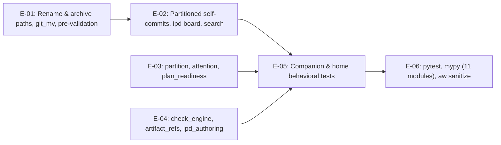
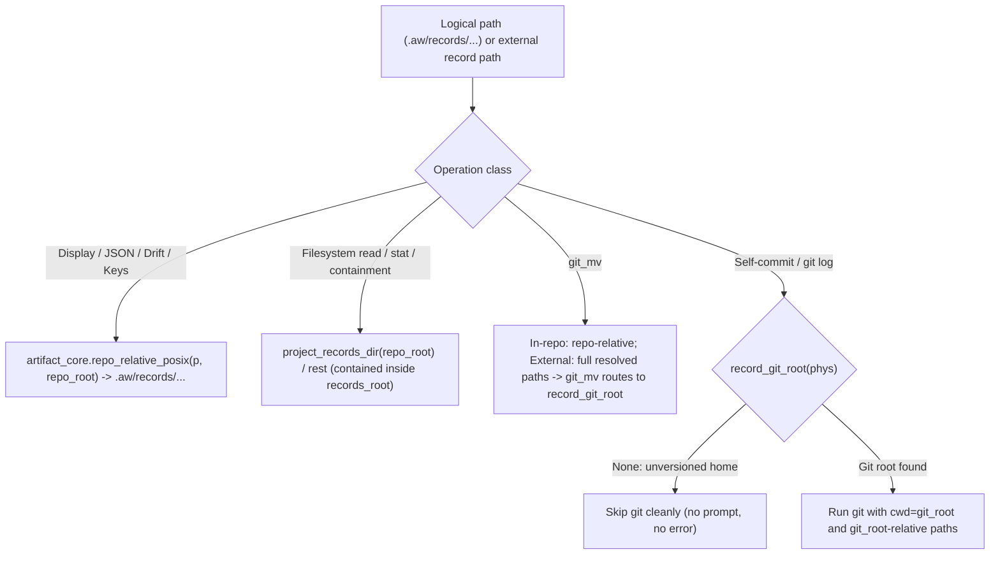

# IPD: Fix rename archive partition attention board search and check_engine external-record bugs

- Date: 2026-11-24
- Kind: child
- Concern: Nine verified CLI, attention-board, and `check_engine` bugs crash or emit false errors whenever records live in a companion repository (`records_backend == "companion"`) or `~/.aw/` (`AW_HOME` / `records_backend == "home"`): (1) `agent_workflows/artifact_rename.py` and `agent_workflows/research_refs.py` (`aw rename`, `aw group`, `aw research mv`, `aw research set-assign`) crash with `ValueError` on unguarded `relative_to(repo_root)` calls, and `artifact_rename.py::find_unrewritable_path_citations` / `_meta_target_for_file` miscompute external directory/owner roots; (2) `agent_workflows/plans_archive.py::apply_shard_moves` and `agent_workflows/research_archive.py::apply_moves` (`aw archive plans`, `aw archive research`) crash with `ValueError` (and `apply_moves` mutates record status on disk before validating move paths); (3) `agent_workflows/cli.py::_offer_records_commit`, `plans_archive.py::_offer_archive_commit`, and `research_archive.py::_offer_archive_commit` run git against `target_repo` instead of the enclosing `record_git_root` and fail on unversioned `~/.aw/` records; (4) `agent_workflows/partition.py` (`collect`, `classify_sets`, `expand_candidates_with_dependencies`, `_is_orchestrator_plan`, `_is_active_member`) joins `repo_root / it.path`, failing on every explicit selector and silently breaking Set classification, dependency expansion, and the orchestrator guard; (5) `agent_workflows/cli.py::_run_plans` (`aw ipd board`) crashes in human mode and leaks absolute paths in JSON/agent mode, while `cli.py::_run_search` (`aw search --short` and `-s`/`--status`) misses `item_map` on external paths; (6) `agent_workflows/attention.py::scan` passes `repo_root` instead of the research root to `research_contract.py::companion_owner_stem` (invalidating the board with `valid: false` on `.data/` files), and `attention.py` joins `repo_root / it.path` in staleness lookup, `_order_primary` (`-o mtime|ctime`), `filter_items_by_selectors`, `_filter_drift_by_selection`, and `run_attention` warning filters; (7) `agent_workflows/plan_readiness.py::review_staleness_index`, `check_engine.py::check_review_stale`, and `plan_readiness.py::_resolve_recheck_review_binding` fail on external companion/`~/.aw/` paths; (8) `agent_workflows/check_engine.py::stale_record_scope_paths`, `resolve_gate_ref`, and `graduated_closable_warnings` fail on logical `.aw/records/...` paths or emit rejected absolute `--evidence` paths; and (9) `agent_workflows/artifact_refs.py::filter_in_flight_plan_edits`, `_is_pending_plan_file`, and `rewrite_scope_path_citations` bypass in-flight receipt protection, disable `Scope-Paths` citation rewriting, or emit absolute paths, while `agent_workflows/ipd_authoring.py::_run_bulk_id_backfill` checks stale local `.aw/records/plans` before stored external placement.
- Scope: Fix all nine bugs across `agent_workflows/artifact_rename.py`, `agent_workflows/research_refs.py`, `agent_workflows/plans_archive.py`, `agent_workflows/research_archive.py`, `agent_workflows/partition.py`, `agent_workflows/attention.py`, `agent_workflows/plan_readiness.py`, `agent_workflows/check_engine.py`, `agent_workflows/artifact_refs.py`, `agent_workflows/ipd_authoring.py`, and `agent_workflows/cli.py`, with behavioral tests covering companion and `~/.aw/` modes.
- Scope-Paths: agent_workflows/artifact_rename.py, agent_workflows/research_refs.py, agent_workflows/plans_archive.py, agent_workflows/research_archive.py, agent_workflows/partition.py, agent_workflows/attention.py, agent_workflows/plan_readiness.py, agent_workflows/check_engine.py, agent_workflows/artifact_refs.py, agent_workflows/ipd_authoring.py, agent_workflows/cli.py, tests/test_companion_doctor_and_carriers.py, tests/test_research_companion.py, .aw/records/plans/pending/20261124-comphome-04-7eivm2-fix-rename-archive-partition-attention-board-search-and-chec.ipd.md
- Item-Dependencies: executed:ywl7uc
- Status: reviewed
- Readiness: go-pending-approval
- Review-Depth: complex
- Priority: high
- Work-Kind: bug
- Blocks-Release: next
- Set: comphome
- Order: 4
- Highest E allocated: 6
- Id: 7eivm2
- Author: antigravity

> Write and proofread this plan per the technical writing standard, `.aw/system/workflows/technical-writing/technical-writing.md` (`.agents/workflows/technical-writing/technical-writing.md` in a legacy-layout install), including requirement 12 (diagrams).

## Workflow history

- 2026-11-25 reviewed (aw set): APPROVE WITH REVISIONS APPLIED; PR-001..PR-007
- 2026-11-25 /plan-review (antigravity/Gemini 4 Neon (High)): APPROVE WITH REVISIONS APPLIED; PR-001..PR-007
- 2026-11-24 to-review (antigravity): authored Order 04 child IPD for `/assess-bugs` (Set `comphome`).

## Goal

Eliminate every `relative_to(repo_root)` crash, logical-vs-physical path mismatch, false-positive check error, absolute-path leak, and broken self-commit across CLI record verbs, `aw attention`, `aw partition`, `plan_readiness`, `artifact_refs`, `ipd_authoring`, and `check_engine` in companion and `~/.aw/` repositories.

## Detailed Implementation Checklist (TODO)

Execution-state rule: mark an `E-*` item complete only after performing the action. That mark is not validation. Accepted execution states: blocked, failed, pending, performed; terminal gate demands 'performed'.

### Task group 1: `aw rename`, `aw group`, `aw archive`, `aw ipd board`, and `aw search`

- [ ] E-01 Fix external-record path rendering, moves, and pre-validation in `agent_workflows/artifact_rename.py`, `agent_workflows/research_refs.py`, `agent_workflows/plans_archive.py`, and `agent_workflows/research_archive.py`:
  1. Replace every unguarded `relative_to(repo_root)` call used for human output, `MutationTarget`, `MutationRefEdit`, and `touched` lists with `artifact_core.py::repo_relative_posix(path, repo_root)` (which emits leak-free logical `.aw/records/...` paths for external records, matching `artifact_rename.py::append_log_rename`).
  2. For every `_core.git_mv(repo_root, src_arg, dst_arg)` (and `research_refs.py::_git_mv`) call, pass repo-relative paths when both endpoints lie inside `repo_root.resolve()`, and pass full resolved paths (`str(src.resolve())`, `str(dst.resolve())`) when outside `repo_root.resolve()` so `artifact_core.py::git_mv` (updated by `ywl7uc` `E-05`) routes companion and `home` moves to the enclosing `record_git_root` (or filesystem move when unversioned). Never pass a `record_git_root`-relative path with `repo_root` as argument 1, and in `artifact_rename.py::move_with_log_event` reverse a failed append using those same physical move arguments rather than logical `touched` entries.
  3. In `agent_workflows/artifact_rename.py`, update `_meta_target_for_file` (when `repo_root is None`) to prefer `_core.repo_root_of(file_path)` before `project_context.py::record_git_root(file_path)`, and update `find_unrewritable_path_citations` to compute `src_dir_rel` via `_core.repo_relative_posix(src_dir, repo_root)`.
  4. In `agent_workflows/research_archive.py::apply_moves`, pre-validate every planned move BEFORE the first `artifact_meta.append` status write: confirm `m.old_path.is_file()`, destination non-collision, and strict containment of `m.old_path`, `m.new_path`, and any companion `.data/` directory inside `research_root.resolve()`, so a validation failure never leaves mutated status on disk.
  - Depends on: none
  - Expected outcome: `aw rename`, `aw group`, `aw research mv`/`set-assign`, and `aw archive plans`/`research` succeed cleanly on companion and `~/.aw/` repos with zero `ValueError` crashes, leak-free logical output paths, and zero partial status mutation on failure.
  - Execution state: pending

- [ ] E-02 Fix CLI self-commit routing, `aw ipd board`, and `aw search` in `agent_workflows/cli.py`, `agent_workflows/plans_archive.py`, and `agent_workflows/research_archive.py`:
  1. Update `agent_workflows/cli.py::_offer_records_commit` to resolve each incoming path before partitioning by enclosing git root: map logical `.aw/records/<rest>` entries to `project_context.py::project_records_dir(repo_root) / <rest>` (while keeping repo-relative target paths under `repo_root` and handling absolute paths), resolve the enclosing git root via `resolve_project_context(target_repo=str(repo_root))` and `project_context.py::record_git_root(abs_path)` (handling custom `--dir` companions consistently with `mmuv3v` `E-01`), skip unversioned `~/.aw/` entries where `record_git_root` is `None` without prompting or running git, and for each versioned git-root bucket compute `git_root`-relative paths and run `_gch._git(git_root, ["reset", "--quiet", "HEAD", "--", *bucket_rels])` followed by `_gch.offer_commit(git_root, bucket_rels, ...)`.
  2. Delegate `agent_workflows/plans_archive.py::_offer_archive_commit` and `agent_workflows/research_archive.py::_offer_archive_commit` to `cli.py::_offer_records_commit` with their respective commit messages so archive and rename/group self-commits share one partitioned implementation.
  3. In `agent_workflows/cli.py::_run_plans` (`aw ipd board`), replace `r.path.relative_to(root)` / `rec.path.relative_to(root)` in BOTH JSON/agent mode and human mode with `artifact_core.py::repo_relative_posix(..., root)` so external plans neither crash in human mode nor leak absolute paths in JSON/agent mode.
  4. In `agent_workflows/cli.py::_run_search`, build `item_map` by resolving each scanned `it.path` through `project_context.py::project_records_dir(repo_root)` when it starts with `.aw/records/` (so both `--short` and `-s`/`--status`/`--status-not` match external records), and compute `rel_p` via `artifact_core.py::repo_relative_posix(p, repo_root)`.
  - Depends on: E-01
  - Expected outcome: self-commits commit against each enclosing `record_git_root` in companion and mixed repos and skip cleanly on unversioned `~/.aw/`; `aw ipd board` (human and JSON/agent) and `aw search --short`/`-s` render and filter external records cleanly with no absolute-path leaks.
  - Execution state: pending

### Task group 2: `aw partition`, `aw attention`, and `plan_readiness`

- [ ] E-03 Fix logical-to-physical external record mapping in `agent_workflows/partition.py`, `agent_workflows/attention.py`, `agent_workflows/plan_readiness.py`, and `agent_workflows/check_engine.py`:
  1. Add a shared logical-to-physical resolver helper (mapping `.aw/records/<rest>` to `project_context.py::project_records_dir(repo_root) / <rest>`, preserving absolute paths, and joining other relative paths onto `repo_root`, with containment checks against `records_root.resolve()` for `.aw/records/` inputs) and apply it across `agent_workflows/partition.py` (`collect` `by_path`, `classify_sets` `distinct_setids`/`orch_p`/`mp`, `expand_candidates_with_dependencies` `tgt_p`, `_is_orchestrator_plan`, and `_is_active_member` using `artifact_core.py::repo_relative_posix(m.path, repo_root)`).
  2. In `agent_workflows/attention.py::scan`, pass the enclosing research root (`records_root / "research"` when `f` lies under `records_root`, or legacy `repo_root / ".agents" / "docs" / "research"` when under `.agents/`) to `research_contract.py::companion_owner_stem` so `.data/` companion files never invalidate the board (`valid: false`), and pass resolved physical paths to `plan_readiness.py::review_staleness_index`.
  3. Apply the logical-to-physical resolver in `agent_workflows/attention.py::_order_primary` (`-o mtime|ctime`), `filter_items_by_selectors`, `_filter_drift_by_selection` (resolving both `it.path` and `d.location`), and `run_attention` warning filters (resolving both `it.path` and `w.location` from `release_gate_warnings` and `graduated_closable_warnings`).
  4. In `agent_workflows/plan_readiness.py::review_staleness_index`, partition candidates by resolved `git_root = project_context.py::record_git_root(abs_path)` (skipping candidates where `git_root is None`, such as unversioned `~/.aw/`), run `git log` and `git cat-file --batch` per `git_root` using `git_rel = abs_path.relative_to(git_root).as_posix()`, key `_STALENESS_CACHE` by `(git_root, git_rel, st.st_mtime_ns)`, and return dict keys via `artifact_core.py::repo_relative_posix(abs_path, repo_root_path)` (preserving `"records/plans/..."` when `ipd_lint.py` or `status_set.py` pass the companion root, and emitting logical `".aw/records/plans/..."` when `attention.py` or `check_engine.py` pass `target_repo`). Update `agent_workflows/check_engine.py::check_review_stale` to key `path_map`/`id_map` via `_core.repo_relative_posix(p, repo_root)`.
  5. In `agent_workflows/plan_readiness.py::_resolve_recheck_review_binding`, allow conforming review files strictly contained inside either `repo_root.resolve()` OR `(project_context.py::project_records_dir(repo_root) / "reviews").resolve()`, and return `review_ref` as leak-free logical POSIX via `artifact_core.py::repo_relative_posix(resolved_rev, resolved_root)`.
  - Depends on: none
  - Expected outcome: `aw partition <selector>`, `aw attention --check` (with research `.data/` files), `aw attention -o mtime|ctime`, `aw attention <selector>` (including warning filters), `check_engine.py::check_review_stale`, and `aw ipd recheck-readiness` all work identically in companion and `~/.aw/` repos as in repository mode.
  - Execution state: pending

### Task group 3: `check_engine` logical-path rules, `artifact_refs`, and `ipd_authoring`

- [ ] E-04 Fix logical `.aw/records/...` resolution and containment in `agent_workflows/check_engine.py`, `agent_workflows/artifact_refs.py`, and `agent_workflows/ipd_authoring.py`:
  1. In `agent_workflows/check_engine.py::stale_record_scope_paths`, resolve `.aw/records/<rest>` entries against `records_dir = project_context.py::project_records_dir(repo_root).resolve()` with strict containment (`target.resolve().is_relative_to(records_dir)`), and normalize every hit path via `_core.repo_relative_posix(h, repo_root)` for both the declared move-pair check (`hit_rels & declared_rel`) and the emitted `StaleScopePath.resolved` tuples.
  2. In `agent_workflows/check_engine.py::resolve_gate_ref`, when `clean_ref` starts with `.aw/records/`, resolve against `records_root = project_context.py::project_records_dir(repo_root).resolve()` with strict containment (`candidate.is_relative_to(records_root) and candidate != records_root and candidate.exists()`) and return `GateRefResolution("resolved", route="path", path=".aw/records/" + candidate.relative_to(records_root).as_posix())` so `..` traversal still fails closed while valid external `.aw/records/...` gate refs resolve.
  3. In `agent_workflows/check_engine.py::graduated_closable_warnings`, format `rel_carrier` via `_core.repo_relative_posix(first_carrier, repo_root)` so the suggested `--evidence` path is always a valid logical `.aw/records/...` path rather than a rejected absolute path.
  4. In `agent_workflows/artifact_refs.py`, update `_is_pending_plan_file` and `filter_in_flight_plan_edits` to recognize external plans strictly inside `(project_context.py::project_records_dir(repo_root) / "plans" / "pending").resolve()` and `(project_context.py::project_records_dir(repo_root) / "plans").resolve()` respectively (formatting skip notes via `_core.repo_relative_posix(res, root)`), and update `rewrite_scope_path_citations` stdout/Change reporting to use `_core.repo_relative_posix(p, repo_root)` so `--agent` output never leaks `~/.aw/` paths (while preserving `post_relocation_citation_rewrite`'s returned path list for `status_set.py`).
  5. In `agent_workflows/ipd_authoring.py::_run_bulk_id_backfill`, resolve `repo_root` via `project_context.py::resolve_verb_repo_root(getattr(args, "dir", None))` and check `has_stored_records_placement(repo_root)` (using `project_records_dir(repo_root) / "plans"`) before probing `<repo_root>/.aw/records/plans`, matching `plans_archive.py::_dirs`.
  - Depends on: none
  - Expected outcome: `check.scope-path-target-stale` and `check.gate-ref-dangling` stop emitting false positives on valid external `.aw/records/...` references while rejecting traversal escapes; `graduated_closable_warnings` emits valid logical `--evidence` paths; in-flight begin-receipt protection and `Scope-Paths` citation rewriting work on external plans without leaking absolute paths; `aw ipd sync --all` honors stored companion/`~/.aw/` placement over stale local directories.
  - Execution state: pending

### Task group 4: Behavioral verification

- [ ] E-05 Add behavioral regression tests covering all nine fixes (companion and `~/.aw/` modes, plus containment/traversal and in-flight receipt negative cases) in `tests/test_companion_doctor_and_carriers.py` and `tests/test_research_companion.py`:
  1. In `tests/test_research_companion.py`: test `aw research mv`, `aw research set-assign`, `aw archive research` (including `.data/` companion move and pre-validation failure leaving status unmutated on disk), `_offer_archive_commit`/`_offer_records_commit` on companion and unversioned `~/.aw/`, and `attention.scan` returning `valid: true` with research `.data/` files in companion and `~/.aw/` layouts.
  2. In `tests/test_companion_doctor_and_carriers.py`: test `aw rename plans`, `aw group plans`, `aw archive plans`, mixed/companion/unversioned-home self-commits, human and JSON/agent `aw ipd board`, `aw search --short` and `aw search -s`, `aw partition <selector>` (including Set classification, dependency expansion, and orchestrator guard), `attention` `-o mtime|ctime`, selector filtering, warning filters, `plan_readiness.review_staleness_index` (companion + unversioned `~/.aw/`), `check_review_stale`, `_resolve_recheck_review_binding` (external reviews + out-of-root refusal), `stale_record_scope_paths` (valid, moved, declared move pair, traversal escape), `resolve_gate_ref` (valid logical `.aw/records/...` + traversal escape), `graduated_closable_warnings` logical `--evidence`, `artifact_refs.filter_in_flight_plan_edits` + `rewrite_scope_path_citations` on external plans, and `ipd_authoring._run_bulk_id_backfill` with stale local `.aw/records/plans`.
  - Depends on: E-02, E-03, E-04
  - Expected outcome: every new behavioral regression test fails without the corresponding fix and passes with it using real temporary git/companion/`~/.aw/` repos (zero code-pinning source inspections).
  - Execution state: pending

- [ ] E-06 Run bare `python3 -m pytest` on all new and existing regression suites listed in `## Required tests / validation`, `python3 -m mypy` on all 11 modified modules, and `aw sanitize`.
  - Depends on: E-05
  - Expected outcome: all pytest suites pass with zero failures, `mypy` reports zero errors on all 11 modified modules, and `aw sanitize` reports clean.
  - Execution state: pending

## Project conventions discovered (Step 0)

- Run pytest bare (`python3 -m pytest <targets>` without `-n0`, `-q`, or `-p no:randomly`).
- Never write code-pinning source-inspection tests (`inspect`, `ast`, regex over production source; `GUIDING_PRINCIPLES.md` P16).
- All human, JSON, and `--agent` output surfaces must emit repo-relative or logical `.aw/records/...` paths (`docs/cli-output-contract.md`, `artifact_core.py::repo_relative_posix`); never leak absolute machine-local paths.
- Commit path-scoped via `aw commit 7eivm2 -- <paths>` inside an isolated git worktree.

## Findings

Nine verified bug clusters from `/assess-bugs` run `20261124-213000` (with symbol and site verification from `/plan-review`):
- Blocker: `agent_workflows/artifact_rename.py` and `agent_workflows/research_refs.py` (`aw rename`, `aw group`, `aw research mv|set-assign`) crash with `ValueError` on unguarded `relative_to(repo_root)` calls; `artifact_rename.py::find_unrewritable_path_citations` and `_meta_target_for_file` misresolve external dirs/owners.
- Blocker: `agent_workflows/plans_archive.py::apply_shard_moves` and `agent_workflows/research_archive.py::apply_moves` crash with `ValueError` (and `apply_moves` mutates status on disk before validating move paths).
- Blocker: `agent_workflows/partition.py` (`collect`, `classify_sets`, `expand_candidates_with_dependencies`, `_is_orchestrator_plan`, `_is_active_member`) rejects explicit selectors and skips Set classification, dependency expansion, and the orchestrator guard.
- Blocker: `agent_workflows/check_engine.py::stale_record_scope_paths` emits false-positive `check.scope-path-target-stale` on every pending plan declaring `.aw/records/...` in `Scope-Paths`.
- High: `agent_workflows/cli.py::_run_plans` (`aw ipd board`) crashes in human mode and leaks absolute paths in JSON/agent mode; `cli.py::_run_search` misses `item_map` for `--short` and `-s`; `cli.py::_offer_records_commit` and `plans_archive.py`/`research_archive.py::_offer_archive_commit` target `repo_root` instead of enclosing `record_git_root`.
- High: `agent_workflows/check_engine.py::resolve_gate_ref` emits false-positive `check.gate-ref-dangling` on valid logical `.aw/records/...` `Gate-Ref` entries.
- High: `agent_workflows/artifact_refs.py::filter_in_flight_plan_edits`, `_is_pending_plan_file`, and `rewrite_scope_path_citations` bypass in-flight receipt protection, disable `Scope-Paths` citation rewriting, and leak absolute paths.
- High: `agent_workflows/attention.py::scan` marks research `.data/` files as invalid records (`valid: false`), and `repo_root / it.path` breaks staleness lookup, `-o mtime|ctime`, selectors, `_filter_drift_by_selection`, and warning filters (`graduated_closable_warnings` also emits rejected absolute `--evidence`).
- Medium: `agent_workflows/plan_readiness.py::review_staleness_index`, `check_engine.py::check_review_stale`, and `plan_readiness.py::_resolve_recheck_review_binding` fail on external companion/`~/.aw/` paths; `agent_workflows/ipd_authoring.py::_run_bulk_id_backfill` checks target `.aw/records/plans` before stored placement.

## Proposed changes (ordered, validatable)

1. Fix external-record path rendering, `_core.git_mv` invocation, and `apply_moves` pre-validation in `artifact_rename.py`, `research_refs.py`, `plans_archive.py`, and `research_archive.py` (`E-01`).
2. Partition CLI/archive self-commits by enclosing `record_git_root` and fix `aw ipd board` and `aw search` in `cli.py`, `plans_archive.py`, and `research_archive.py` (`E-02`).
3. Fix logical-to-physical external record resolution across `partition.py`, `attention.py`, `plan_readiness.py`, and `check_engine.py::check_review_stale` (`E-03`).
4. Fix logical `.aw/records/...` containment and resolution in `check_engine.py`, `artifact_refs.py`, and `ipd_authoring.py` (`E-04`).
5. Add behavioral regression tests (`E-05`) and run full targeted validation (`E-06`).

## Deferred / out of scope (with reason)

- Core storage, unified `AW_HOME`, and `artifact_core.py::git_mv` external-record routing are owned by Order 01 (`ywl7uc`).
  - Carrier: ywl7uc
- Installer policy alignment and `leak_sanitizer` allowlist placement are owned by Order 02 (`7gverp`).
  - Carrier: 7gverp
- `status_set.py` self-commits, companion finalize locking, `selectors.py`, and `artifact_meta.py` are owned by Order 03 (`mmuv3v`).
  - Carrier: mmuv3v
- Staged git-diff checks (`check_status_untooled`, `check_staged_illegal_backlog_transition`, `_staged_backlog_done_items`, `_lane_carrier_is_executed`) and `attention.py::inbox_waiting` are owned by Order 05 (`7hfx7r`) together with the pre-commit hooks that invoke them.
  - Carrier: 7hfx7r
- Runner execution, question inbox, backlog close, and `~/.aw/` lane containment are owned by Order 06 (`4vnd36`).
  - Carrier: 4vnd36

## Scope check

- Over-scope: none.
- Under-scope: none; all CLI record verbs, `attention`, `partition`, `plan_readiness`, `artifact_refs`, `ipd_authoring`, and non-staged `check_engine` findings from `/assess-bugs` are covered, with disjoint function boundaries from `7gverp` (`cli.py`) and `7hfx7r` (`check_engine.py`, `attention.py`).

## Required tests / validation

- `python3 -m pytest tests/test_companion_doctor_and_carriers.py tests/test_research_companion.py tests/test_artifact_rename.py tests/test_plans_archive.py tests/test_research_archive.py tests/test_partition.py tests/test_attention.py tests/test_plan_readiness_recheck.py tests/test_plans_board.py tests/test_cli_search.py tests/test_artifact_refs_rewrite.py tests/test_rename_receipt_guard.py tests/test_ipd_authoring.py tests/test_check_engine.py`
- `python3 -m mypy agent_workflows/artifact_rename.py agent_workflows/research_refs.py agent_workflows/plans_archive.py agent_workflows/research_archive.py agent_workflows/partition.py agent_workflows/attention.py agent_workflows/plan_readiness.py agent_workflows/check_engine.py agent_workflows/artifact_refs.py agent_workflows/ipd_authoring.py agent_workflows/cli.py`
- `aw sanitize`

## Spec / documentation sync

No spec or user-doc edit is required. Checked `docs/cli-output-contract.md` (path sanitization and leak posture) and `.aw/records/specs/` (`4sd62s` metadata store, `25kzda` plan readiness/lifecycle): all nine fixes restore existing documented CLI, attention, partition, and `check_engine` guarantees on companion and `~/.aw/` backends without changing public CLI flags or schemas.

## Open questions

None.

## Validation and cross-check (verify before reporting done)

Validation-state rule: inspect evidence in a separate pass. Do not mark a `V-*` item complete from memory or from the matching execution checkmark. Accepted validation results: blocked, failed, pass, pending; terminal gate demands 'pass'.

- [ ] V-01 validates E-01
  - Required evidence: paste pytest output proving `artifact_rename.py`, `research_refs.py`, `plans_archive.py`, and `research_archive.py::apply_moves` succeed on companion and `~/.aw/` repos with zero `ValueError` crashes, leak-free logical output paths, and zero partial status mutation when move pre-validation fails.
  - Observed evidence:
  - Result: pending

- [ ] V-02 validates E-02
  - Required evidence: paste pytest output proving `cli.py::_offer_records_commit`, `plans_archive.py::_offer_archive_commit`, `research_archive.py::_offer_archive_commit`, `cli.py::_run_plans` (`aw ipd board`, human and JSON/agent), and `cli.py::_run_search` (`aw search --short` and `-s`) work cleanly on companion and `~/.aw/` repos without leaking absolute paths.
  - Observed evidence:
  - Result: pending

- [ ] V-03 validates E-03
  - Required evidence: paste pytest output proving `partition.py` (`collect`, `classify_sets`, `expand_candidates_with_dependencies`, `_is_orchestrator_plan`, `_is_active_member`), `attention.py` (`scan` with `.data/` files, `_order_primary` `-o mtime|ctime`, `filter_items_by_selectors`, `_filter_drift_by_selection`, warning filters), `plan_readiness.py` (`review_staleness_index`, `_resolve_recheck_review_binding`), and `check_engine.py::check_review_stale` pass on companion and `~/.aw/` repos.
  - Observed evidence:
  - Result: pending

- [ ] V-04 validates E-04
  - Required evidence: paste pytest output proving `check_engine.py::stale_record_scope_paths`, `check_engine.py::resolve_gate_ref`, `check_engine.py::graduated_closable_warnings`, `artifact_refs.py` (`filter_in_flight_plan_edits`, `_is_pending_plan_file`, `rewrite_scope_path_citations`), and `ipd_authoring.py::_run_bulk_id_backfill` pass on companion and `~/.aw/` repos, including traversal-escape refusal and in-flight receipt skip cases.
  - Observed evidence:
  - Result: pending

- [ ] V-05 validates E-05
  - Required evidence: paste pytest output showing all newly added behavioral regression tests in `tests/test_companion_doctor_and_carriers.py` and `tests/test_research_companion.py` passing with zero code-pinning assertions.
  - Observed evidence:
  - Result: pending

- [ ] V-06 validates E-06
  - Required evidence: paste full bare `python3 -m pytest` summary across all 14 suites listed in `## Required tests / validation`, `mypy` zero-error output on all 11 modified modules, and `aw sanitize` clean output.
  - Observed evidence:
  - Result: pending

## Approval and execution gate

- Size assessment: exception
- Cohesion rationale: All 11 modules share one mechanical root defect (joining `repo_root / logical_path` or calling unguarded `path.relative_to(repo_root)` on external companion/`AW_HOME` records) and couple directly across `attention.py` <-> `plan_readiness.py` <-> `check_engine.py`, `partition.py` <-> `attention.py`, and `artifact_rename.py`/`plans_archive.py`/`research_archive.py` <-> `cli.py::_offer_records_commit`; keeping them in one child plan prevents partial cross-module key or path-format mismatches and keeps Set `comphome`'s six-child layout aligned with orchestrator `92ujfc`.

Execution contract:
- Execute ONLY after human approval (`- Status: approved`) and after `executed:ywl7uc` is satisfied on disk.
- Work inside an isolated git worktree; never edit on `main` directly.
- Commit ONLY the files listed in `- Scope-Paths:` via `aw commit 7eivm2 -- <paths>` (never `git add -A`, never raw `git commit`, never push, never tag or release).
- Run `python3 -m pytest` bare (no `-n0`, extra `-q`, or `-p no:randomly`), write only behavioral tests (zero code-pinning source inspection tests), paste real command outputs in `V-01..V-06`, and run `aw ipd finalize 7eivm2` as the terminal transaction after all `E-*` are `performed` and all `V-*` are `pass`.
